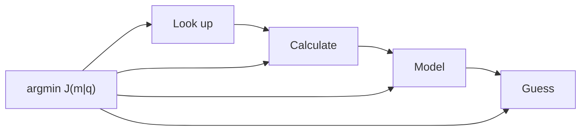

# Metabolic Intelligence: Budget-Native Compute from Tag to Campus

## Abstract

Metabolic Intelligence (MEI) is a class of computer intelligence designed to run inside a fixed energy budget. This paper defines the class, reports emulator and datasheet results on a sensor tag, and reports a protocol-level test of a grid-following data center, each labeled by evidence class.

**In plain words**

1. Give a computer a fixed energy budget, and design it to give the best answer it can inside that budget.
2. A tiny sensor tag that checks food freshness can then run for about eight years on a coin battery.
3. A data center can cut its power use when the electricity grid asks, by pausing or shrinking work, without giving wrong answers.

Two scales are studied:

- **Edge / tag scale.** Binding classifiers on cold-chain gas tags. Cortex-M4 instruction counts (emulator-measured): enzyme families with early exit take 1,723 instructions vs 2,451 for an int8 MLP at matched accuracy. On SmellNet sequential learning (50 foods, five groups, no revisit), enzymes keep 77.7% vs 18.4% for the MLP. A metabolic heating schedule draws about 10 µW total (datasheet + schedule model): heater about 3.0 µW, MCU sleep about 6.9 µW on STM32U3; about eight years on a CR2032. Classifier decisions are about 92 nJ; the sleep floor dominates on the metabolic schedule. At this envelope, dedicated cooling plants and campus-scale water loops are not in the design. Coin-cell physics is the plant. Chicken-spoilage Anwar results are internal only and are **not published** here (no licence).
- **Resource-optimized central (lean campus).** A metabolic grid service for a **budget-capped** 100 MW AI plant (grid-following, not uncapped hyperscale), tested end to end against a real OpenADR 3.1 VTN and a real MQTT DSX Flex broker. Plant is a model; protocols are real. With node sleep available: zero time over the grid cap across the closed scenario set. Headline lever order: pause deferral → slow per-user speed → route smaller model → lower effort → battery → shed. The service is how a lean central stays inside shared power and water ecosystems without requiring a private uncapped cooling/power campus.

Value of information is the expected gain in a decision's payoff from observing a quantity before deciding (Howard, 1966). The software reference implementation is the software path used to test a claim, without board-level metering. Every energy figure carries an evidence class (Section 2.7).

## 1. Introduction: budget-native intelligence

People should not have to fight over energy to eat or to use AI. That civic sentence is the design brief. Cold-chain tags that watch food should last years on a coin cell. Central plants that serve answers should follow the grid when the grid asks them to cut, without inventing false board joules or collapsing every research law into one paper.

Uncapped hyperscale campuses pull dedicated cooling, dedicated generation, and large ecosystem water and power. Metabolic Intelligence is **not** that deployment class. It is designed for the **edge** and for the **resource-optimized central datacenter**: a lean, budget-capped, grid-following plant. Because the class runs at lower energy budgets by construction, dedicated water plants, dedicated power plants, and hyperscale cooling loops are **not required** for the workloads this class serves within its envelope; workload equivalence with uncapped operation is not claimed. This is stated as a **design consequence** of the budget-native envelope, with pack evidence at both ends (µW tags under a metabolic schedule; OpenADR/DSX lean-campus levers). Do **not** invent liters of water saved or board `measured_j` from that consequence. Software reference path: no FPGA board result claimed.

The dominant construction for computer intelligence still treats the transformer corridor as the substrate: pretrain a large generative model, then spend tokens and watts at serve time. That corridor has produced real products. It is not the only class. **Logical Intelligence** casts reasoning as energy minimization over constraints (Business Wire, 20 Jan 2026). **World Labs** casts spatial intelligence as world models that predict views and dynamics (Atlas, 1 Sep 2026). **Metabolic Intelligence** casts intelligence as **budget-native obtain and actuate**: the envelope is the physical condition under which the best answer is obtained. It is not the cheapest answer. The class is designed for **Klere** ([klere.ai](https://klere.ai)): research owns the law; Klere owns the product embodiment. Do not read the thin public landing page as live product features.

Shannon (1948) prices bits under uncertainty as established results. Howard's Value of Information (1966) prices whether another observation is worth its cost for a decision. Landauer (1961) prices irreversible bit erasure in joules at temperature T: $E_{\min} = k_B T \ln 2$ per bit erased in the ideal model. On receipts that Landauer quantity is a **labeled estimate**, not a wattmeter reading. Together they imply floors: past a point, more bits stop buying outcomes that matter for a stated benefit. Metabolic Intelligence embodies those floors as **schedules and actuators** at the edge of a tag and at the meter of a lean central plant.

**Formal thesis.** Let B be the metabolic envelope in joules (tag episode) or watts / megawatts (lean-campus import). B is the physical condition under which the best answer is obtained. It is not a menu of cheaper substitutes. Metabolic Intelligence returns that answer by budget-native obtain, enzymes, physics-informed features, and test-time close. A stated utility U (accuracy, completeness of a chore, interactive close) is what the committed answer maximizes. Grid-following levers refuse or defer work that would violate B. They do not degrade the certified answer. The answer that commits is the best one. The substrate is binding classifiers and other algorithmic compute under that envelope, plus a grid-following service whose levers keep the envelope. Deployment scopes are **edge** and **resource-optimized central**, not an uncapped hyperscale campus whose first coordinate is unlimited import. Class properties follow: physics-informed features and heaters; test-time binding and routing; sequential / super learning without full pretrain replay; zero-shot close when grammar covers; pretrain as residual leaf, not default. Computers are hardware; software is applied engineering under constraints. AGI-grade reliability is that pair, not the algorithm alone ([The pair, not the algorithm](#the-pair-not-the-algorithm)).

Three measurement facts constrain every later number. First, curve and ledger watt-hours are **model / measured-kernel / looked-up** composites, labeled by evidence class. Second, tag microwatts mix **datasheet** and **schedule model**; instruction counts are **emulator-measured**. Third, no FPGA board result claimed; package `measured_j` appears only when a labeled meter returns a reading.

---

## 2. Formal problem, definitions, and propositions

### 2.1 Problem statement

**Problem (Budget-native obtain).** Given a need q that feeds a decision y, an explicit budget B, and a menu of obtain mechanisms $M = \{\mathrm{Lookup}, \mathrm{Formula}, \mathrm{Solver}, \mathrm{Model}, \mathrm{Guess}\}$ with costs and uncertainty, select mechanism $m^{*}$ and actuation schedule $s^{*}$ so the committed answer is the superior one under the envelope B. Work that would violate B is refused or deferred. Stop when further spend does not raise a stated completeness predicate (Satiation) or when policy refuse fires (Notational Intelligence). The envelope is not permission to return a worse answer.

The problem is dual-scale by construction: **edge** and **resource-optimized central**, not uncapped hyperscale:

| Scale | Budget unit | Actuators | Success metric in this study |
|---|---|---|---|
| Edge / tag | µW continuous; nJ to mJ per event | Heater duty, MCU sleep, enzyme binding / early exit | Lifetime on CR2032; decisions under schedule; sequential accuracy |
| Resource-optimized central (lean campus) | MW import cap (grid-following; not uncapped) | Pause, speed, route, effort, battery, shed | Time over cap; interactive served share |

### 2.2 Definitions

| Term | Definition in this paper |
|---|---|
| **Metabolic Intelligence (MEI)** | Budget-native class. The metabolic envelope is the physical condition under which the best answer is obtained, at the edge and the resource-optimized central (not uncapped hyperscale). Not a cheaper answer. |
| **Hardware-software pair** | AGI-grade reliability is the procedure together with the fabric that hosts it. Not the algorithm alone. Each Mixture of Limits gear requires a host that is available, accessible, and capable. |
| **Budget envelope** | Explicit joule or power condition B under which the best answer is obtained. First-class physical condition, not a post-hoc telemetry label and not a quality discount. |
| **Binding classifier** | Silicon recognition unit with binding site, product, allosteric context switch, Hill cooperativity, abundance as learned weight, and a cost for every binding check. Bit-enzyme variant uses no multiplies. |
| **Metabolic schedule** | Duty cycle for sensing and heating that meets a monitoring objective while minimizing average power (heater + sleep + radio). |
| **Obtain mechanism** | How an input is acquired: Lookup, Formula / Calculate, Solver, Model, Guess, ordered by Mixture of Limits and priced by $J(m \mid q)$. |
| **Obtain-router** | The rule $m^{*} = \arg\min_m J(m \mid q)$ that selects the mechanism under λ at stake. |
| **Grid-following service** | Control plane that accepts OpenADR / DSX Flex signals and applies ordered levers so campus import stays under cap. |
| **Evidence class** | Label on a number: real protocol, emulator-measured, datasheet, measured-kernel model, looked-up, calculation, plant model, estimate (M/C/V/R/D/S/P in the pack radar). |
| **Software reference path** | No FPGA board result claimed; estimates ≠ package `measured_j`. |

### 2.3 Established results: Shannon, Landauer, VoI

These are established results that this study uses.

| Law | Statement used here | Role in MEI |
|---|---|---|
| **Shannon (1948)** | Bits under uncertainty have a rate-distortion structure; more bits past a point buy little for a fixed fidelity. | Justifies Lookup / Formula before Model when the coordinate is already known. |
| **Landauer (1961)** | Irreversible bit erasure has an ideal floor $k_B T \ln 2$ per bit. | Labeled **estimate** on receipts; not a wattmeter. Motivates treating joules as scarce even when digital inference is free at the money margin. |
| **Howard VoI (1966)** | Value of Information is the expected improvement in decision utility from an observation, net of cost. | When VoI ≤ 0 under λ, Satiation / Mixture of Limits name stop; MEI makes stop executable as refuse of heater pulse or campus lever. |

Horowitz (2014) documents that practical CMOS energy is dominated by data movement and memory, far above the Landauer ideal. That gap is why Metabolic Intelligence schedules heaters and campus import meters rather than claiming thermodynamic optimality from whiteboard erasure.

### 2.4 Propositions (claims with evidence class)

Each proposition is a claim. Evidence class is stated. Peer overlap is acknowledged; uniqueness is scoped.

**Proposition 1 (Envelope primacy).** *An intelligence class whose first coordinate is an explicit budget envelope can bind obtain and actuation at microwatt (edge) and megawatt (resource-optimized central) scales under one thesis, without presupposing uncapped hyperscale cooling/power plants.* Evidence: this study's dual-scale pack (tag schedule + OpenADR lean-campus service). Class: **real protocol** (campus) + **datasheet / schedule model / emulator** (tag). Peer slices: Dynamo power caps (campus only); TinyML (edge only). Unique stack claim: dual scale + OpenADR/DSX + $J(m|q)$ + enzymes + Satiation stop. Ecosystem-resource avoidance (water / dedicated power / hyperscale cooling) is stated as a **design consequence** of that envelope, not as measured liters saved.

**Proposition 2 (Enzyme sequential learning).** *Under a fixed MCU budget, binding classifiers absorb sequential class groups with far less catastrophic forgetting than an int8 MLP of matched decision cost.* Evidence: SmellNet 50 foods, five groups, no revisit: enzymes 77.7% vs MLP 18.4% (**real dataset protocol**). Peer overlap: AdaTM continual Tsetlin; classical Hopfield / DenseAM pattern add. Do **not** claim universal end of catastrophic forgetting.

**Proposition 3 (Sleep floor on metabolic schedule).** *On a cold-chain gas tag with metabolic heating (~9.6 readings/day, Oct 2026 parts), MCU sleep current dominates heater average power.* Evidence: BME690 heater ~3.0 µW vs STM32U3 sleep ~6.9 µW (**datasheet + schedule model**). Correction: "heater is always the cost" is false on this schedule.

**Proposition 4 ($J(m|q)$ obtain law).** *Pricing obtain mechanisms by energy plus λ-weighted uncertainty selects Lookup/Formula when they measure the same quantity and reserves Model for residual leaves.* Evidence: synthesis ledger math + sourced inputs (**calculation + looked-up**); not board `measured_j`. Peer: PEARL / OmniRouter price *which LLM*; they do not price *which obtain zone*.

**Proposition 5 (Campus cap with node sleep).** *A 100 MW campus plant model under real OpenADR 3.1 and real DSX Flex MQTT, with node sleep available, records zero time over the grid cap across the closed scenario set.* Evidence: **real protocol** + **plant model**. Without node sleep, idle GPUs alone can exceed a deep cut (scenario E: 96 min over cap).

**Proposition 6 (Free-at-margin ≠ free joules).** *Published collapse in money price of digital inference does not identify free energy, free actuation, or unbounded value after a chore is complete.* Evidence: Epoch AI (2025) for the price series; Landauer (1961) and Horowitz (2014) for the energy floors.

**Proposition 7 (Class properties are path-scoped).** *No-pretrain, zero-shot, and test-time claims must be scoped by path (enzyme vs latent vs certify EBM). Mixing scopes invents a contradiction.* Evidence: V-JEPA 2-AC zero-shot planning requires large video pretrain (Assran et al., 2025); enzyme online path does not. Logical Intelligence constraint energy ≠ campus joules (Business Wire, 2026).

---

### 2.5 Formal lemmas (stated, not board-proved)

**Lemma A (Obtain dominance under matched measurement).** If two mechanisms $m_1$, $m_2$ measure the same quantity $q$ and $E_{m_1} < E_{m_2}$ with $\mathrm{var}_{m_1} \le \mathrm{var}_{m_2}$, then $J(m_1|q) < J(m_2|q)$ for all $\lambda$, $S_q \ge 0$. *Proof sketch:* both additive terms weakly favor $m_1$. Evidence class: **calculation** (definition of J). Implication: Lookup beats Calculate when the table holds the same coordinate; Calculate beats Model when a closed form exists.

**Lemma B (Precision sizing).** For fixed $\lambda$, $S_q$ and target excess cost $\varepsilon$, the uncertainty that equalizes the $\lambda$-term with $\varepsilon$ is $\sigma^{*} = \sqrt{2\varepsilon / (\lambda S_q^2)}$ (ignoring staleness). Spending below $\sigma^{*}$ wastes energy; spending above leaves decision risk on the table. Evidence: **calculation**. Implication: satiation of precision is a first-class stop, not a soft habit.

**Lemma C (Cache refresh).** Under linear staleness $\kappa_q \cdot t$, the refresh interval that balances obtain energy against $\lambda$-weighted variance growth is $t^{*} = 2E / (\lambda S_q^2 \kappa)$ when $p_m$ is small. Evidence: **calculation**. Implication: metabolic schedules on tags and cache TTLs on campuses are the same object at different λ.

**Lemma D (Cap feasibility without sleep).** If idle import $P_{\mathrm{idle}}$ exceeds the grid cap $P_{\mathrm{cap}}$, no combination of speed / route / effort levers that leaves nodes powered can meet the cap. Scenario E is the concrete instance (96 min over cap without node sleep). Evidence: **plant model + real protocol**. Implication: node sleep (or equivalent power-down) is not an optional luxury at deep cuts.

These lemmas are engineering consequences of the definitions. They are not theorems about AGI. Software reference path: no FPGA board result claimed.

### 2.6 Related work by method (academic corridor)

Method is the claim axis. Geography is not. What this class absorbs is stated as a rule. Everything else in this section is cited only. URLs and dates below were checked on 2 Oct 2026. A vendor joule, a vendor latency, or a vendor accuracy stays on the vendor's page. It is not this pack's `measured_j`.

**Absorbed (not citations).** Four objects are Metabolic Intelligence.

1. **Physics envelope.** B is joules on a tag episode or watts on a lean-campus import cap. Energy budget is physics: the condition under which the answer is obtained. It is not a discount on the answer, and it is not a Faustian cheaper-answer trade.
2. **Best answer.** Levers and routing refuse or defer work that would violate B. They do not degrade the certified answer. The answer that commits is the best one. Best has a measured form. Fix a task set, a completeness predicate $C(z)$ and a deadline per task. For each system, plot the fraction of tasks closed with $C(z) = 1$ inside the deadline against joules per task. Refusals and deferrals count as misses on that curve. They are not hidden. The campus scenario table gives the measured cost of the envelope in those terms: interactive share served falls from 100% to 52.6% at today's speeds under a 90/95% cut, to 13% under a 90% cut for 10 h, and to 1% without node sleep. A system is best at envelope B when no other system closes more tasks inside the deadline at the same joules. That frontier is the test. A claim of superiority that does not place a point on it is not yet a result. Budget-native obtain, binding classifiers, physics-informed features, and test-time close are how answers that were thought impossible become reachable. That reach is inside the envelope.
3. **Binding classifiers.** Binding site, product, allosteric context, abundance as learned weight, a cost on every binding check, early exit. The unit is this study (§5): emulator-measured Cortex-M4 counts and the SmellNet sequential protocol. Tsetlin machines and hyperdimensional computing, cited below, are edge cousins. They are not the enzyme.
4. **Dual hardware map.** The class runs today on GPUs and MCUs. It points at neuromorphic, analog in-memory, photonic, and adiabatic substrates where energy-based and latent settle can map (Appendix B). The map is operational. A substrate paper is not a second definition of the class. Deployment is the edge and the resource-optimized central. Hyperscale water, power, and cooling plants are not required by design. The interface tax of hosting the class on each existing fabric is §12. Klere is the designed home. The class is not confined to it.

**Cited only.**

**Energy-based models, Hopfield networks, and Dense Associative Memory.** Hopfield (1982) casts associative memory as descent on an energy. Krotov and Hopfield (arXiv:1606.01164, 2016) raise capacity with higher-order energies (Dense Associative Memory). Ramsauer et al. (arXiv:2008.02217, 2020) recover softmax attention as a modern Hopfield update. Hoover, Krotov, and coauthors (arXiv:2302.07253, NeurIPS 2023) define the Energy Transformer: attention layers built to minimize a token energy. Gladstone et al. (arXiv:2507.02092, 2025) train Energy-Based Transformers that assign an energy to an input-prediction pair and predict by gradient minimization of that energy. Bacvanski, Hopfield, Krotov, and coauthors (arXiv:2512.15002, 16 Dec 2025) propose analog RC and crossbar circuits for Dense Associative Memory and analyze constant-time inference from amplifier specifications; that bound is their analysis, not a meter here. Montanari, Bullo, Krotov, and Motter (arXiv:2604.05042, 2026) survey energy-based dynamical models from Hopfield networks through Dense Associative Memory to oscillator machines. Logical Intelligence is the product neighbor on this axis, not these theory papers. Bodnia and Hanin (21 Jan 2026) describe Kona as non-autoregressive at the trace, globally scored, and continuous-state: an energy over partial and complete traces, with Aleph coordinating calls to Kona and language models. Kona 1.0 pilots are the Business Wire account of 20 Jan 2026. Their scalar is constraint energy. It is not campus import joules and not a coin-cell schedule. This study does not adopt their benchmark figures.

**Latent prediction and spatial world models.** LeCun (version 0.9.2, 27 Jun 2022) names the joint-embedding predictive architecture as a path to autonomous machine intelligence. V-JEPA 2 and V-JEPA 2-AC (Assran et al., arXiv:2506.09985, 11 Jun 2025) predict in a latent video space and, after large video pretraining plus less than 62 hours of unlabeled robot video, plan a robot arm from image goals without a task reward. World Labs Marble (12 Nov 2025) is a generative multimodal world model. Atlas (1 Sep 2026) is their later omni model over text, images, video, and 3D. A latent model is an optional Model-last leaf under Mixture of Limits. Their pretrain stays on their path (Proposition 7). This study does not speak for their results.

**State-space efficiency corridor.** Mamba (Gu and Dao, arXiv:2312.00752, 2023) is a selective state-space sequence model: linear scaling in length, constant-size recurrent state, no attention block. Mamba-2 (Dao and Gu, arXiv:2405.21060, 2024) states a structured state-space duality with attention. The corridor prices sequence compute inside the transformer-replacement race. It does not price an obtain zone, a heater duty cycle, or a grid cap.

**Neuromorphic, analog, and photonic substrates.** Intel announced Hala Point on 17 Apr 2024: 1,152 Loihi 2 processors, 1.15 billion neurons, stated maximum 2,600 W. That watt figure is Intel's. Chen et al. (Nature Communications, 30 Sep 2025, doi:10.1038/s41467-025-63794-4) demonstrated an ALBERT transformer on a 14 nm analog in-memory inference chip. Ahmed et al. (Nature, 9 Apr 2025, doi:10.1038/s41586-025-08854-x) report a photonic processor executing ResNet, BERT, and an Atari reinforcement-learning workload. These demonstrations sit on the dual hardware map. They are not the class. Shipping neuromorphic gas or odour nanojoule figures were not found. Innatera Pulsar remains a vendor milliwatt-class audio and radar part, above the tag schedule near 10 µW (datasheet plus schedule model).

**Tsetlin machines and hyperdimensional computing.** Granmo (arXiv:1804.01508, 2018) learns propositional clauses with teams of Tsetlin automata. Kanerva (*Cognitive Computation*, 2009) defines hyperdimensional computing on high-dimensional random vectors. Tunheim et al. (arXiv:2501.19347, 31 Jan 2025) report an all-digital 65 nm Tsetlin accelerator at 8.6 nJ per MNIST frame. Hyperdimensional Tsetlin machines (arXiv:2406.02648, 2024) combine the two encodings. Cite them as sparse edge cousins: online learning and nJ-class decisions on the tasks they publish. They do not supply the OpenADR obtain-router or the dual-scale thesis.

**Open post-training recipes.** Trillium Labs ([trilliumlabs.org](https://trilliumlabs.org/)), Nathan Lambert and Tom Zick, was unveiled on 2 Oct 2026. Lambert's note the same day says the nonprofit is building open post-training recipes and intends to expand into open infrastructure for recursive self-improvement, reward hacking, and multi-agent systems. WIRED the same day (Will Knight) reports the initial focus as post-training: publishing experiment details so others can study and replicate them. Those sources describe a program. They do not contain a recipe, a dataset, a configuration, or a model release. None is inferred. Trillium Labs is the open corridor of the frontier transformer stack. It is not Metabolic Intelligence and not a Klere product.

**Envelope actuators, not a class.** PEARL, OmniRouter, and Energy-Aware LRM (2025 to Jan 2026) price which language model answers. NVIDIA Dynamo 1.5 (18 Sep 2026), InferenceX, MLPerf, Emerald DSX Flex, and the AI Energy Management Alliance are serving and grid actuators (§11.4). Metabolic Intelligence binds those actuator shapes to Mixture of Limits obtain zones. The actuators are not the intelligence class.

### 2.7 Evidence grammar (how to read every table)

| Tag in this paper | Meaning | When it can support a sell claim |
|---|---|---|
| **real protocol** | Talked to a real VTN / broker / schema | Protocol interoperability yes; plant watts no |
| **emulator-measured** | Cortex-M4 instruction counts from ELF under emulator | Relative enzyme vs MLP cost yes; board joules no |
| **datasheet** | Vendor electrical tables | Schedule model inputs |
| **measured-kernel model** | AI Configurator kernels + published power ratios | Wh/answer bands as estimates |
| **looked-up** | Artificial Analysis medians, public blogs | Baseline speeds |
| **calculation** | Central differences, J algebra, CoreMark→nJ | Algebraic consequences |
| **plant model** | Campus thermal/power simulator | Scenario comparisons under stated assumptions |
| **estimate** | Ledger fuse, capacity life | Always banded; never `measured_j` |

No FPGA board result claimed is sticky. Package `measured_j` appears only when a labeled meter returns a reading.

## 4. Standing obtain rule and the J(m|q) synthesis router

Standing rule (David Charlot): **Don't calculate what can be looked up. Don't guess what can be calculated. Don't spend hard-guessing effort on an easy guess.**

The cost model prices computing an answer:

$$
E(x) = \sum_{p \in P(c(x))} \theta(p)\cdot\mu(p,H)
$$

**Metabolic Intelligence** raises resolution on *how each input is obtained*. For need q feeding decision y, mechanism m has cost:

$$
J(m|q) = E_m + \lambda \cdot \tfrac{1}{2} \cdot S_q^2 \cdot \mathrm{var}_m(t)
$$

$$
\mathrm{var}_m(t) = (\sigma_m^2 + \kappa_q \cdot t)\cdot(1 + 3\cdot p_m),\quad m^{*} = \arg\min_m J(m|q)
$$

| Symbol | Meaning | Evidence |
|---|---|---|
| $E_m$ | Energy of the obtain mechanism | Stack formula on the mechanism's primitives |
| $S_q$ | Elasticity $d \ln y / d \ln q$ | **Calculated** by central differences; never assumed |
| λ | Joules at stake in the decision | Decision scale (one request; campus-year) |
| $\sigma_m$, $\kappa_q$, $t$, $p_m$ | Uncertainty, staleness rate, age, zone-misjudge chance | Looked-up spread, derivation, or labeled guess |

What falls out of the function, not as slogan:

- Lookups dominate when they measure the same quantity.
- Cheap crude options win when $\lambda S_q^2$ is small.
- Required precision: $\sigma^{*} = \sqrt{2\varepsilon / (\lambda S_q^2)}$.
- Refresh a cache at $t^{*} = 2E / (\lambda S_q^2 \kappa)$.
- The estimator of $J(m|q)$ is Lookup or Formula. Its cost is capped so meta-compute cannot eat B. If the estimate exceeds the cap, take the default gear. Do not run a heavy estimator.

Ledger outputs (synthesis pack; math + sourced ledger; **not** board `measured_j`):

| Output | Point | p10 to p90 | Measure next |
|---|---|---|---|
| Wh per V4 Pro answer at today's speed (GB300) | 0.20 Wh | 0.044 to 0.68 | Meter one GPU pool for a day |
| Work-per-MW gain, speed matching human chat | 1.92× | 1.19 to 2.93 | Pro speed; human share of tokens |
| Same gain on Vera Rubin | 2.0× | 1.2 to 3.4 | Metered Rubin chat curve |

Fused public proxies for output length (400 / 630 / 1,115 tokens) give 655 at log-σ 0.585, no tighter than a 500-token guess. The router keeps the guess for campus planning and takes the lookup per request. Only the gateway's own counters settle it. Evidence class: **model + looked-up + calculation**.

---

## 5. Binding classifiers

A **binding classifier** (earlier drafts said "digital enzyme"; tables keep the short label "enzymes") is a silicon recognition unit with a binding site, a product, an allosteric context switch, Hill cooperativity, an abundance that acts as the learned weight, and a cost for every binding check. A bit-enzyme variant uses no multiplies. The unit is algorithmic compute under a local energy cost, not a smaller transformer.

| Result | Number | Evidence class | Where |
|---|---|---|---|
| Instructions / decision, Cortex-M4, 12 features | Enzymes + early exit 1,723; int8 MLP 2,451; first enzyme pool 6,948 | Emulator-measured | `mcu/` |
| Accuracy, same test (3 seeds) | Enzymes 82.9 / 86.9 / 88.7%; MLP 82.2 / 78.0 / 87.4% | Real protocol on simulated features | `benchmarks/` |
| Late-life accuracy, physics-invariant features (days 90 to 180) | LDA 94.9%, MLP 93.4%, enzymes 90.0% (from 80.8%), Tsetlin 89.1% | Simulation + classifier | `benchmarks/` |
| SmellNet, 50 foods, 5 sequential groups, no revisit | Enzymes 77.7%; MLP without replay or regularization 18.4% (forgetting floor, not a continual-learning baseline) | Real dataset protocol | `benchmarks/` |
| SmellNet cross-day | MLP 85.5%; enzymes 79.8% (same on Cortex-M4) | Real dataset + MCU | `benchmarks/` |

**Class properties, grounded:**

- **Physics-informed.** Drift-invariant / physics-informed features added about 9 to 11 points of late-life accuracy for enzymes, bit enzymes, and Tsetlin machines. Sensor kinetics and humidity/heater physics are first-class inputs, not post-hoc regularizers.
- **Sequential / super learning.** Enzymes keep usable accuracy while learning foods one group at a time without revisiting. The MLP collapses under the same protocol (77.7% vs 18.4%). That is the super-learning property under a budget: absorb new context without a full pretrain replay. The MLP here has no replay and no regularization, so 18.4% is the catastrophic-forgetting floor. It is not a strong baseline. The fair comparison runs continual-learning methods under the same memory and energy budget: elastic weight consolidation [61], experience replay with a small buffer [62], and iCaRL with its nearest-mean-of-exemplars classifier [63]. Each is scored for retained accuracy and for energy per inference under MLPerf Tiny measurement rules [64]. That comparison is specified and not yet run.
- **Test-time inference.** Binding checks, early exit through the family index, and allosteric context switches are serve-time decisions under abundance and cost.
- **Not pre-training required** as default. Abundance updates and family indices learn locally. Large generative pretrain is not the substrate of the tag classifier.
- **Zero-shot under grammar.** When a Lookup or Formula leaf covers the context (known context state, known refuse), the cascade closes without opening a generative Model leaf. Mixture of Limits states that order; enzymes supply a budget-native leaf when Model is residual. Open entropy goes to the last cascade stage. That order is the architecture.
- **Capacity.** Family index, early exit, and abundance decay are the capacity control. The sequential learning bound is that control. Garbage collection is abundance decay.

Chicken-spoilage evaluation (Anwar & Anwar 2025) has **no licence**. Results from that dataset are **internal only, not published**. Software reference path: no FPGA board result claimed.

---

## 6. Cold-chain tag budget

On a gas tag the energy goes into **heating and sleep**, not into classifying. One gas reading costs about 0.5 to 27 mJ depending on the part (datasheet). A classifier decision costs about 92 nJ on an STM32U3 (CoreMark 15.5 µA/MHz at 3.3 V; **calculated** from datasheet, not board package `measured_j`).

Metabolic schedule (about 9.6 readings/day), October 2026 parts:

| Term | Power | Evidence |
|---|---|---|
| Heater (BME690 metabolic) | ~3.0 µW | Datasheet + schedule model |
| MCU sleep (STM32U3) | ~6.9 µW | Datasheet |
| Tag total | ~10 µW | Sum of schedule model |
| CR2032 life, no self-discharge | ~8.1 years | Capacity model: 235 mAh to 2.0 V at 21°C, 3.0 V nominal [65] |
| CR2032 life, ~1% per year self-discharge | ~7.5 years | Capacity model [65] |
| Same tag on nRF54L15 sleep | ~5.1 µW | Datasheet swap |

Derating. The cell holds about 235 mAh × 3.0 V, about 2.54 kJ, rated at 21°C [65]. At 9.9 µW the tag uses about 312 J a year, so 8.1 years spends the whole rated capacity. With about 1% per year self-discharge, the life is about 7.5 years. A cold-chain tag lives below 21°C, where lithium coin cells deliver less. That derating is not in the model and must be measured at the cold-chain temperature. The 3.0 µW heater average implies a very low duty cycle for a metal-oxide gas sensor that draws milliwatts when on. Whether sensing response holds at that duty is a measurement to make, not a datasheet fact.

Correction (honesty): earlier prose said "the heater is the cost." True for frequent readings. On the metabolic schedule the **MCU sleep floor** is the larger term. Choose the MCU for sleep current. Innatera Pulsar-class neuromorphic parts publish audio/radar milliwatts, not gas-tag microwatt schedules; they are peers on the post-von Neumann map, not drop-in tag winners today.

Drift upload is a scheduled act inside that same sleep and heater discipline, inside the CR2032 envelope. It is not an extra drain beside the envelope. Heater duty is thermal feedback inside the same metabolic control. The published ~10 µW class figure stays datasheet plus schedule model.

Regulatory dates: FDA proposed FSMA 204 compliance move to 20 Jul 2028; Congress barred earlier enforcement. EU PPWR applies since 12 Aug 2026. These dates bear on cold-chain observability buyers, not a product launch slogan.

---

## 7. Campus energy per answer

Method (curves pack): energy per answer ≈ output tokens × all-in kW per GPU ÷ output tokens/s per GPU.

- **Throughput:** NVIDIA AI Configurator 0.12.0 (measured GPU kernels; SGLang; NVFP4). Evidence: **measured-kernel model**.
- **Power per GPU from InferenceX** (tokens/s per chip ÷ tokens/s per MW): GB300 2.12 kW, B300 1.90, B200 1.71, Vera Rubin 3.30, MI355X 2.09. Evidence: **calculated from published measurements**.
- **Served speeds (Artificial Analysis medians):** V4 Pro 79 tok/s/user, V4 Flash 125, Qwen3-VL 48.5. Evidence: **looked up**.

| Workload (GB300 unless noted) | Energy | Evidence class |
|---|---|---|
| Chat, DeepSeek V4 Pro (2k in / 500 out) | 0.32 Wh at 50 tok/s/user; 0.92 at 79; 4.57 at 159 | Curves method |
| Synthesis ledger best estimate today | 0.20 Wh (p10 to p90: 0.04 to 0.68) | Ledger fuse |
| Chat, V4 Flash | 49 mWh at 50; 180 at 159 | Curves |
| Agentic turn, V4 Flash (32k in, 28k cached / 1k out) | 0.16 Wh at 96 | Curves |
| Video clip, 8 s 720p (Wan 2.2) | 390 Wh | Curves / model |

**Plateau levers (field + model, not board `measured_j`):**

- Vera Rubin NVL72 moves the knee of the speed-energy curve from about 100 to about 175 tok/s/user (InferenceX / MLPerf; **measured** field reports). Speed matching human chat is worth about 2.0× on Rubin vs about 2.9× on GB300 (ledger).
- Flash-first routing (V4.1 Flash answering most human chat) plus speed matching: about 2.3 to 4.4× more work per MW (efficiency pack; **model + looked-up**).
- Deeper speculative decoding (accept length 2.8 modeled): about 1.55× cut in today's base-mix energy per output token; speed matching then adds only about 1.4 to 1.8×.

These are **test-time** levers under a live budget: which model answers, how fast it streams, how much draft speculation to accept. They are Metabolic Intelligence at campus scale, not a new pretrain run.

Bands matter. Point estimates without p10 to p90 invite false precision. Software reference path: no FPGA board result claimed.

---

## 8. Metabolic grid service (resource-optimized central)

The service makes a **budget-capped** 100 MW AI plant (a **resource-optimized central datacenter**, not an uncapped hyperscale campus) follow grid caps. Lever order on deferrable work: **pause deferrable work → slow per-user speed → route to a smaller model → lower reasoning effort → battery → shed**. Those levers do not degrade the certified answer. Certified and interactive work runs to close or to refuse. Deferrable work is what pauses. A breakthrough task is not aborted by a linear spend line. A contract declares the invariants (`never_lower_precision`, `max_deferral`). Grid follow stays inside the contract. Shed is last and only outside the invariant. The answer that commits is the best one. Route and effort move deferrable work. They are not a license to commit a worse answer. The withdrawn claim that Flash routing costs no quality stays withdrawn. The power-model bias loop is live thermal control on this service (plant model: learned +5 MW on a hot day). Grid-following lean operation is how the class stays inside shared power and water ecosystems without requiring a private dedicated cooling/power campus. That framing is a design consequence of the envelope; it is not a measured water-liter claim. Software reference path: no FPGA board result claimed.

Architecture (`datacenter/service/`):

- **Grid in:** OpenADR 3.1 VEN (OAuth2, polling, DEMAND reports), tested against real openleadr-rs VTN. Evidence: **real protocol**.
- **Backstop:** DSX Flex ISV over MQTT, CloudEvents, JWS ES256. Evidence: **real broker + schemas**.
- **Actuators:** Dynamo planner GPU budgets; metabolic gateway (in-flight caps, routing, effort, `x-consumer` speed tiers); Kueue / SGLang pause; Redfish node sleep; battery PCS.
- **Learning:** per-pool speed curve by recursive least squares; power-model bias loop (learned +5 MW on a hot day in the plant model).
- **Plant:** campus model. Evidence: **model**. Protocols and schemas: **real**.

| Scenario (100 MW GB300 campus) | Time over cap | Interactive served | Note |
|---|---|---|---|
| A to C: 60/70% day; notice / feedforward / no notice | 0 | 100% | Notice mostly saves battery |
| D: 90/95%, fast campus (159 tok/s/user) | 0 | 100% | All knowledge chat routed; effort low |
| E: 90/95% **without** node sleep | 96 min | 1% | Idle GPUs alone exceed a 10 MW cap |
| L to M: today's looked-up speeds, 60/70 and 90/95 | 0 | 100% / 52.6% | Speed already spent cannot be spent again |
| N: no notice, no battery (PJM-style 10 min) | 7.5 min | 99.8% | Under cap within 225 s |
| O: 60% cut for 10 h | 0 | 100% | Deadlines kept |
| P: new cap every 5 min for 3 h | 0 | 98.8% | ERCOT-style |
| Q: recovery ramp 2 MW/min | 0 | 100% | Max rise 2.9 MW/min vs 29 to 47 unlimited |
| R: 90% cut for 10 h | 0 | 13% | Video deadline vs interactive (policy) |

In every run: no actuator call failed; VTN accepted all OpenADR reports; no DSX message rejected. Headline: **zero time over the grid cap whenever node sleep is available**. Correction honesty: "100% served through a 90/95% cut" assumed a fast campus and one curve; with per-pool curves it is about 94%, from today's speeds about 53%. The **cap held** in all of them.

**The measured cost of the envelope.** Committed answers keep their certificate in every scenario. The envelope's cost is availability and deferral, and the table measures it in the plant model under real protocols. Interactive share served is 100% in scenarios A to D, O and Q. It is 52.6% at today's looked-up speeds under a 90/95% cut (L to M), 13% under a 90% cut for 10 h (R), and 1% without node sleep (E), with 96 min over the cap. Deferred and refused work is counted, not hidden.

AEMA (Emerald AI, Google, NVIDIA; 16 Sep 2026) is a field alliance; **no published AEMA protocol spec** as of the 1 Oct 2026 radar. Dynamo 1.5 power-aware scaling (18 Sep 2026) is a deployment annotation, not obtain-routing. OpenIE wires those actuators *inside* Mixture of Limits intelligence.

---

## 9. Economic argument: joules as scarce resource

### 9.1 Free at the margin for digital chores

Epoch AI reports that the money price of a fixed inference performance has fallen sharply (Epoch AI, 2025). For digital chores whose output is information and whose completeness test is finite, synthesis can be **free at the margin** in money terms. That phrase does **not** mean joules are free, that a plant may move without a certificate, or that care labor has been automated away.

Metabolic Intelligence accepts that money-price collapse and asks the physical question: *who spends which joules after the chore is done, and who is refused?*

### 9.2 Two scarcities, and the ecosystem that uncapped campuses pull

| Scarcity | What binds | Who feels it |
|---|---|---|
| **Money price of tokens** | Collapsing for fixed benchmarks | Buyers of API seats; can look "free" |
| **Grid / actuation joules** | Import caps, interconnection queues, heater mJ, battery cycles | Ratepayers, farms, cold-chain operators, campus neighbors |
| **Ecosystem support (water, dedicated power, hyperscale cooling)** | Uncapped campus design that presupposes private cooling loops and generation | Shared basins, ratepayers, neighbors of hyperscale builds |

People should not have to fight over energy to eat or to use AI. The civic framing is not marketing copy. It is the reason tags that watch food must last years on a coin cell, and lean centrals that serve answers must shed watts when the grid asks, without lying about meters.

**Design consequence (not a liters-saved claim).** Metabolic Intelligence targets energy budgets so low that dedicated water plants, dedicated power plants, and hyperscale cooling loops are **not required** for the workloads this class serves within its envelope; workload equivalence with uncapped operation is not claimed. Evidence in this pack is the envelope itself: ~10 µW tag schedules (datasheet + schedule model) and a grid-following lean campus under OpenADR/DSX (real protocols; plant model). Do **not** invent gallons or liters of water saved, nor upgrade the claim to board `measured_j`. The statement is class design + pack evidence, not a field water meter. Software reference path: no FPGA board result claimed.

### 9.3 Work-per-MW and Wh/answer as estimates with bands

| Quantity | Point | Band | Evidence | Do not claim |
|---|---|---|---|---|
| Wh / V4 Pro answer (today, GB300) | 0.20 Wh | 0.04 to 0.68 | Ledger fuse | Board `measured_j` |
| Work-per-MW vs today (speed match) | 1.92× | 1.19 to 2.93 | Efficiency + looked-up speeds | Universal 4 to 12× |
| Same on Vera Rubin | 2.0× | 1.2 to 3.4 | Ledger transfer | "30×" without speed condition |
| Flash-first + speed match | 2.3 to 4.4× | model band | Efficiency P4 | "Routing costs no quality" |

These are **estimates with bands**. Software reference path: no FPGA board result claimed. Metering one GPU pool for a day is the highest-VoI next measurement in the synthesis ledger.

### 9.4 Satiation stop as economic actuator

When completeness C(z) = 1 and VoI is zero, further Model spend is a cost with no increment on the written objective. Metabolic Intelligence implements that stop as:

1. **Obtain refuse:** do not open Model when Lookup/Formula closes J.
2. **Speed refuse:** do not stream above human-read rate when the consumer is human (`x-consumer` tiers).
3. **Grid refuse:** pause / shed when import cap binds, ordered by least service lost per MW.
4. **Tag refuse:** skip heater when surprise is below threshold and lifetime budget binds.

Stop is success. That is Satiation's Economic Reality; this study shows the actuators.

### 9.5 Landauer as labeled estimate, not a cheat

Landauer's $k_B T \ln 2$ appears on analytical receipts as a **labeled estimate**. It is not a claim that the boards used here operate at the ideal floor. Horowitz (2014) places practical CMOS far above that floor. The economic argument needs only the weaker statement: joules remain scarce after tokens become cheap; schedules and meters are how that scarcity is governed.

---

### 9.6 Rebound, care, and the civic bound

Direct rebound (Gillingham, Rapson, and Wagner) is the extra use of a service when its effective price falls. Free-at-margin tokens invite rebound in engagement metrics. Metabolic Intelligence does not estimate a structural rebound parameter. It installs **hard stops**: completeness refuse, budget refuse, and grid cap. Those stops are design rules, not fitted elasticities.

Care and food are not software goods. Baumol-style cost disease (cited in Satiation) warns that sectors with weak productivity growth absorb expenditure even when token prices fall. Cold-chain tags exist so food loss and food energy are measured under a coin-cell envelope, not so a generative model can narrate spoilage without a sensor. Lean centrals that shed watts on OpenADR signals exist so ratepayers are not forced into a false choice between "AI" and "keep the lights on," and so shared water and power ecosystems are not presupposed as private hyperscale plants. The civic bound is: **eat and compute under shared joules, with meters and schedules, without invented board claims or invented liters saved.**

### 9.7 Cost surface from synthesis to metabolic spend

The cost model prices an answer as $E(x) = \sum \theta(p)\cdot\mu(p,H)$. Metabolic Intelligence adds:

| Layer | Object | Scarcity coordinate |
|---|---|---|
| Synthesis | Primitive mix on hardware H | Analytical / looked-up μ |
| Obtain router | $J(m \mid q)$ over Lookup→Guess | λ at stake + variance |
| Tag schedule | Heater + sleep + radio | µW continuous; CR2032 life |
| Lean campus service | Ordered levers under $P_{\mathrm{cap}}$ | MW import (capped); interactive served |

The same standing rule threads all four layers. Software reference path keeps every layer's joules labeled until Metered.

### 9.8 Resource-optimized deployment vs uncapped hyperscale

| Deployment | Energy budget posture | Ecosystem support presupposed | MEI stance |
|---|---|---|---|
| **Edge (tag)** | µW continuous; coin-cell life | None beyond the cell and board | **In scope**: evidence pack for schedule / enzyme evidence |
| **Resource-optimized central** | MW import **cap**; grid-following levers | Shared grid; no private uncapped cooling/power campus required by class design | **In scope**: evidence pack for OpenADR/DSX + scenarios |
| **Uncapped hyperscale campus** | Unlimited import until interconnection / cooling bind | Dedicated cooling, dedicated generation, large water uptake | **Out of class**: not the MEI design target |

---

## 11. SOTA at the metabolic frontier

### 11.1 Class definition

**Metabolic Intelligence** is the budget-native class: the metabolic envelope is the physical condition under which the best answer is obtained. It does not trade the certified answer down to save joules, and it does not take uncapped transformer FLOPs or uncapped hyperscale import as the coordinate. Architecturally it sits with Logical Intelligence-style moves *past* basic transformers (energy-based scoring and constraint commit, latent world models, non-autoregressive or non-attention primitives), but binds the envelope at **two scales at once**: **edge** (microwatt tags) ↔ **resource-optimized central** (budget-capped, grid-following lean campus), not the uncapped hyperscale campus that presupposes dedicated water, power, and cooling plants. The unit of computation is the **binding classifier** (recognition, allosteric context gating, abundance as weight, local learning and decay, costed binding check) and related algorithmic compute, not ever-larger nets. Ecosystem-resource avoidance is a **design consequence** of those budgets + pack evidence; it is not a measured liters-saved claim.

Class properties (stated as operating claims; peer overlap cited honestly below):

| Property | MEI grounding in this pack | Honest peer overlap |
|---|---|---|
| **Super / sequential learning** | SmellNet enzymes 77.7% vs MLP 18.4% across five groups without revisit (**real protocol**) | AdaTM continual Tsetlin; classical Hopfield / DenseAM pattern add. Do not claim universal end of catastrophic forgetting. |
| **Test-time inference** | Binding, early exit, $J(m \mid q)$ route, campus lever dial under live budget | DenseAM energy descent; Hopfield recall; JEPA MPC planning; Logical Intelligence constraint solve. Test-time ≠ free or pretrain-free. |
| **Zero-shot under grammar** | Lookup → Formula → Solver first (Mixture of Limits); refuse when covered | **V-JEPA 2-AC** zero-shot robot planning without task reward is a strong peer. OpenADR demos here are **protocol-tested**, not "zero-shot AGI." |
| **No large pretrain required** | Enzyme / bit-enzyme **online** path on MCU | Tsetlin / Hebbian AM cousins. **Do not** attribute this to JEPA, World Labs, or Logical Intelligence frontier stacks; they pretrain heavily. Scope the claim to the enzyme path. |
| **Physics-informed** | E-nose kinetics, drift-invariant features (+9 to 11 late-life points); heater / sleep schedule; Landauer as labeled estimate | PINN lineage; analog EBM as physics substrate. Physics features ≠ thermodynamic optimality without meters. |

**Class, not a peer list.** Section 2.6 absorbs four objects into Metabolic Intelligence: the physics envelope, the best answer, binding classifiers, and the dual hardware map. The table below cites the rest. Neighbors keep their axis. The combination here is edge and resource-optimized central, an OpenADR 3.1 and DSX Flex-shaped lean service, the $J(m|q)$ obtain-router, binding classifiers, and a completeness stop, with hyperscale water, power, and cooling plants not required by design. Software reference path: no FPGA board result claimed.

### 11.2 Method taxonomy (must-cite; method-first, not geography)

The prose, URLs, and dates are in §2.6. This table is the index. Binding classifiers, the physics envelope, the best answer, and the dual hardware map are not rows: they are the class. Checked 2 Oct 2026. Do not promote a cell into `measured_j`.

| Method (cited only) | Canonical cite | Cite for | Do not absorb |
|---|---|---|---|
| **Energy-based models / Hopfield / Dense Associative Memory** | Hopfield 1982; Krotov and Hopfield, arXiv:1606.01164 (2016); Ramsauer et al., arXiv:2008.02217 (2020); Energy Transformer, arXiv:2302.07253 (NeurIPS 2023); Energy-Based Transformers, arXiv:2507.02092 (2025); analog Dense Associative Memory, arXiv:2512.15002 (16 Dec 2025); energy-based dynamical models, arXiv:2604.05042 (2026) | Test-time energy descent. Attention recovered as an energy update. | Their energy is not campus joules and not the tag schedule. Amplifier time bounds are theirs. |
| **Logical Intelligence** | Business Wire, 20 Jan 2026; Bodnia and Hanin, 21 Jan 2026, [logicalintelligence.com/blog/energy-based-models-for-reasoning](https://logicalintelligence.com/blog/energy-based-models-for-reasoning) | Constraint energy. Non-autoregressive trace. Lean-checkable commit via Aleph. | Not obtain routing. Not dual deployment. Not "no pretrain." Do not copy their benchmark figures. |
| **V-JEPA / World Labs** | LeCun, v0.9.2, 27 Jun 2022; Assran et al., arXiv:2506.09985, 11 Jun 2025; Marble, 12 Nov 2025; Atlas, 1 Sep 2026 | Latent prediction and spatial world models | Large video pretrain stays on their path. Optional Model-last leaf only. |
| **State-space corridor (Mamba, Mamba-2)** | arXiv:2312.00752 (2023); arXiv:2405.21060 (2024) | Linear-time selective state. Sequence efficiency versus quadratic attention. | Not an obtain zone. Not a grid cap. Not the class. |
| **Neuromorphic / analog / photonic** | Hala Point, Intel, 17 Apr 2024; Chen et al., Nature Communications, 30 Sep 2025, doi:10.1038/s41467-025-63794-4; Ahmed et al., Nature, 9 Apr 2025, doi:10.1038/s41586-025-08854-x | Substrates on the dual hardware map (Appendix B) | Not the software class. Vendor watts are not `measured_j`. |
| **Tsetlin machines / hyperdimensional computing** | Granmo, arXiv:1804.01508 (2018); Kanerva, 2009; Tunheim et al., arXiv:2501.19347, 31 Jan 2025 (8.6 nJ per MNIST frame, 65 nm) | Sparse logic and associative edge cousins | Not the enzyme. Not OpenADR. |
| **Trillium Labs** | [trilliumlabs.org](https://trilliumlabs.org/); Lambert note and WIRED, both 2 Oct 2026 | Announced program: open post-training recipes on the frontier stack | No recipe, dataset, or release is in those sources. Not Klere. |

Power-aware serving and grid flexibility stay in §11.4. They are actuators.

### 11.4 Soft peers only: serving and grid actuators

Dynamo 1.5 power-aware scaling, NVIDIA DPS, InferenceX Vera Rubin tok/s/MW curves, Emerald DSX Flex, and the AI Energy Management Alliance are **envelope actuators and field measurements**. They do not define the intelligence class. Academic joule-aware routers (PEARL, OmniRouter, Energy-Aware LRM) price which LLM answers; they do not price which obtain zone (Lookup → Formula → Solver → Model) and do not bind tag↔campus.

### 11.5 What not to claim without meters

- Wh/answer, J/token, µW lifetime, or × work/MW untied to pack evidence **M/C** or a named external meter.
- Invented **liters / gallons of water saved** (state ecosystem-resource avoidance as design consequence of budget-native class + pack evidence only).
- "Routing costs no quality" (Flash leads AA composite; trails ~1.5 GPQA).
- "Heater is always the tag cost" (sleep floor dominates on metabolic schedule).
- Rubin "up to 30×" without speed condition (gain is speed-dependent).
- AEMA / DSX Flex latency or ramp numbers (unspecified).
- Shipping neuromorphic gas/odour nJ figures (not found).
- That Logical Intelligence "energy-based" equals grid joules (different energy).
- That MEI needs no pretrain **and** matches V-JEPA zero-shot robotics (incompatible scopes; split by path).
- Chicken-spoilage accuracy in public prose (**no licence**).

Software reference path: no FPGA board result claimed; estimates ≠ `measured_j`.

---

## 13. Review answered by construction

The envelope is the physical condition under which the best answer is obtained. The points below are mechanisms of that class, stated as a rule. Pack numbers stay in their evidence class: emulator counts, datasheet schedules, protocol tests, plant models, calculations. No FPGA board result claimed because meters are the measurement instrument of the solution. Package `measured_j` is written when a meter returns. No shunt joules are invented. Chicken-spoilage Anwar numbers are not published.

### 13.1 A priori difficulty

The obtain router prices cost before spend. $J(m|q)$ is that estimate. The estimator is a Lookup or Formula gear. Its compute is capped so meta-compute cannot eat B. If the estimate of the estimator exceeds the cap, the router takes the default gear and does not run a heavy estimator.

### 13.2 Enzyme capacity

Family index, early exit, and abundance decay are the capacity control. The sequential learning bound is part of the enzyme. Garbage collection is decay of abundance. Cortex-M4 counts in §5 are emulator-measured instructions for the family-index path. They are the compute term of that control.

### 13.3 Non-monotonic utility

Levers do not assume a smooth utility of energy. Certified and interactive work runs to close or to refuse. Deferrable work is what pauses. A breakthrough task is not aborted because a linear spend line was crossed. The answer that commits is the best one. The envelope is not a Faustian discount.

### 13.4 Two ledgers

Compile-time synthesis energy and the serve-time envelope are both counted. Tag microwatts (§6, datasheet plus schedule model) are the serve-time envelope. Offline synthesis sits on the compile ledger $E(x)$. Dual accounting is the law. Compile joules stay on the compile ledger. Serve joules stay on the serve ledger.

### 13.5 Contract-bounded levers

A contract declares invariants: `never_lower_precision`, `max_deferral`. Grid follow happens inside the contract. Shed is last, and only outside the invariant. The ordered levers in §8 are that law on the lean campus. They refuse or defer work that would violate the envelope. They do not degrade the certified answer.

### 13.6 Edge sync inside the envelope

Drift upload is a scheduled act inside the metabolic budget, under the same sleep and heater discipline as the rest of the tag. It is inside the CR2032 envelope. The published schedule (about 10 µW, datasheet plus schedule model) is the envelope those acts share. This study does not add a separate radio joule.

### 13.7 Energy is memory plus compute

The energy metric is $E_{\mathrm{mem}} + E_{\mathrm{compute}}$. Instruction counts are a compute term only. Memory movement is in the budget. Horowitz (2014) places practical CMOS energy in data movement: on the order of 10 pJ for an internal cache access or a functional operation, and 1 to 2 nJ for a DRAM access, in that plenary's technology frame. Those are literature orders for the physics of moving data. They are not this pack's `measured_j`.

### 13.8 Thermal and process loop

The control loop is live. On the campus service, power-model bias is learned (plant model: +5 MW on a hot day). On the edge, the metabolic schedule includes thermal feedback: heater duty follows the thermal state, inside the same envelope. That loop is metabolic control.

### 13.9 Open entropy is the last cascade stage

A bounded domain is the class. Work covered by Lookup, Formula, or Solver closes there. Open entropy goes to the last cascade stage. That order is the architecture.

### 13.10 Primitive distillation

Grammars and formulas are extracted from traces and installed as Lookup, Formula, or enzyme. Human craft of those leaves is not the long-term path. Sutton's Bitter Lesson (2019) says general methods that scale with compute overtake hand-built features. This class answers that lesson by distillation into Lookup, Formula, and enzyme. It does not answer it with uncapped pretrain.

### 13.11 Tier meters

Energy is reported by tier. When a meter returns, the package field `measured_j` is that reading. Until then the row stays an estimate, a datasheet, an emulator count, a protocol test, or a plant model. Estimates stay estimates.

---

## 15. Measurement classes

Evidence classes used in this study: **real protocol**, **emulator-measured**, **datasheet**, **measured-kernel model**, **looked-up**, **calculation**, **plant model**, **estimate**. Estimates ≠ `measured_j`. Software reference path: no FPGA board result claimed.

Tier meters are how the solution reports energy (§13.11). Package `measured_j` is written when a meter returns. Until then the row stays in the class below. Stake order on the synthesis ledger, for the next meter readings:

1. One GB300 pool for a day (energy-per-answer band; campus-scale value of the meter).
2. Vera Rubin chat curve from a metered pool or AISimulate once Rubin-supported.
3. Gateway counters: output tokens per answer; human share (`x-consumer`).
4. V4.1 Flash throughput curve (the curve behind routing, in place of the V4 Flash stand-in).
5. Speculative-decoding accept length per workload from engine telemetry.

Tag figures are datasheet plus schedule plus emulator. Campus figures are curves plus plant model plus real protocols. Stage C package joules are not claimed. No invented board package joules. No invented shunt joules. Chicken-spoilage Anwar numbers stay unpublished (no licence).

---

## 16. Conclusion

## References

### Established results

[1] Shannon, C. E. (1948). A Mathematical Theory of Communication. *Bell System Technical Journal*.
[2] Howard, R. A. (1966). Information Value Theory. *IEEE Transactions on Systems Science and Cybernetics*.
[3] Landauer, R. (1961). Irreversibility and Heat Generation in the Computing Process. *IBM Journal of Research and Development*.
[4] Horowitz, M. (2014). Computing's Energy Problem (and what we can do about it). ISSCC. **Historical** CMOS energy floor relative to Landauer.
### Post-transformer class peers (prefer May 2026+; older labeled)

[9] Logical Intelligence (20 Jan 2026). Kona 1.0 energy-based reasoning pilots; LeCun Technical Research Board. Business Wire: https://www.businesswire.com/news/home/20260120751310/en/Logical-Intelligence-Introduces-First-Energy-Based-Reasoning-AI-Model-Signals-Early-Steps-Toward-AGI-Adds-Yann-LeCun-and-Patrick-Hillmann-to-Leadership . Evidence: **V**.
[10] Logical Intelligence. Aleph PutnamBench Lean-certified materials. [logicalintelligence.com](https://logicalintelligence.com). Evidence: **V**.
[11] Assran, M., et al. (11 Jun 2025). *V-JEPA 2: Self-Supervised Video Models Enable Understanding, Prediction and Planning*. arXiv:2506.09985. Zero-shot MPC planning peer; **requires** large video pretrain. **Historical relative to May 2026+ radar cut** but must-cite for zero-shot. Evidence: **M**.
[12] World Labs (1 Sep 2026). Atlas world model. https://www.worldlabs.ai/blog/atlas . Evidence: **V**.
[13] World Labs (12 Nov 2025). Marble: A Multimodal World Model. https://www.worldlabs.ai/blog/marble-world-model . Generative spatial world model. Evidence: **V**.

### EBM / associative / logic ML (theory and silicon)

[14] DenseAM analog circuits (Dec 2025 preprint). arXiv:2512.15002. EBM → analog constant-time inference path. Evidence: **P**.
[15] Energy-based dynamical models tutorial (2026). Hopfield → DenseAM → oscillator EDMs. arXiv:2604.05042. Evidence: **P**.
[16] Tunheim, S. A., Zheng, Y., Jiao, L., Shafik, R., Yakovlev, A., & Granmo, O.-C. (31 Jan 2025). *An All-digital 65-nm Tsetlin Machine Image Classification Accelerator with 8.6 nJ per MNIST Frame*. arXiv:2501.19347. Edge cousin. **Historical** relative to May 2026+ cut; silicon result. Evidence: **M**.
[17] HV-TM / Sparse TM / AdaTM (2024 to 2025). HDC+TM; continual learning peer. arXiv:2406.02648 and AdaTM materials. **Historical**. Evidence: **P**.

### Campus envelope actuators and field measurements

[18] Emerald AI (1 Jun 2026). First DSX Flex commercial deployment path with NVIDIA and Silicon Valley Power. https://www.emeraldai.co/blog/nvidia-dsx-pilot-framework . Evidence: **C/V**.
[19] Parker, J. / NVIDIA Blog (16 Sep 2026). AI Energy Management Alliance (Emerald AI, Google, NVIDIA). https://blogs.nvidia.com/blog/ai-energy-management-alliance/ . **No published AEMA protocol spec** as of 1 Oct 2026 radar. Evidence: **V**.
[20] NVIDIA Dynamo 1.5 power-aware scaling (18 Sep 2026). docs.nvidia.com/dynamo (v1-5-0). Evidence: **V**.
[21] InferenceX (14 Sep 2026). Vera Rubin NVL72 agentic inference tok/s/MW. https://inferencex.semianalysis.com/blog/vera-rubin-nvl72-agentic-inference . Evidence: **M**.
[22] MLPerf Inference v6.1 (16 Sep 2026). Rubin preview throughput; power pages partly unchecked. Evidence: **M**.

### Edge / TinyML / regulatory dates

[23] MLPerf Tiny v1.4 (Jul 2026). MCU energy/inference. https://mlcommons.org/2026/07/mlperf-tiny-v1-4-results/ . Evidence: **M**.
[24] Bosch BME690; Renesas ZMOD4410; Sensirion SGP41; ST STM32U3; Nordic nRF54L15. Datasheets 2026. Tag heater vs sleep floor. Evidence: **V/D**.
[25] Innatera Pulsar (shipping). Neuromorphic MCU; pack: ~0.4 to 0.6 mW audio/radar ≫ duty-cycled MCU tag. Evidence: **V**.
[26] FDA FSMA 204 traceability; proposed compliance move / congressional bar before 20 Jul 2028. EU PPWR application since 12 Aug 2026. Evidence: **R**.

### Evidence pack and brief (unpublished, by the author)

[27] Author's Metabolic Intelligence handoff pack (2 Oct 2026): `HANDOFF.md`, `radar/README.md`, `synthesis/`, `datacenter/service/`, `benchmarks/`, `mcu/`.
[28] Author's Metabolic Intelligence SOTA brief (2 Oct 2026). `docs/MEI_SOTA_BRIEF_2026-10-02.md`.
[29] Dalgaty et al. Probabilistic in-memory computing for energy-based models (arXiv:2609.11281, 2609.11288, 2026). Model / TLM evidence for AIMC vs HBM-bound GPU mismatch. Evidence: **P**.
[30] Memristor Hopfield / adaptive associative memory (2026). Nature Communications s41467-026-69958-0; arXiv:2605.07223. CIM energy-min peer. Evidence: **M/P**.
[31] Photonic neuromorphic / analog memory (2026). Nature Communications s41467-026-69084-x; fully analog photonic online training arXiv:2506.18041 (853 fJ/op paper claim). Evidence: **M/S**. Cited as joule-floor substrate peers, not MEI software class.
[32] PEARL; OmniRouter (arXiv:2502.20576); Energy-Aware LRM (arXiv:2601.00823) (2025 to Jan 2026). Academic joule/cost-aware multi-LLM routers. Price which LLM answers, not Lookup→Formula→Solver→Model. Evidence: **P**.
[34] ML.ENERGY v3.0 (Jan 2026). Energy leaderboard. **Historical-ish** relative to Sep 2026 field curves. Evidence: **M**.
[35] Trillium Labs. https://trilliumlabs.org/ . Unveiled 2 Oct 2026. Nathan Lambert, executive director; Tom Zick, president. Launch sources say the lab is building open post-training recipes. They do not publish a recipe. Not Metabolic Intelligence. Not a Klere product. Evidence: **V**. See refs 51 and 52.
[36] Sutton, R. (2019). The Bitter Lesson. http://www.incompleteideas.net/IncIdeas/BitterLesson.html . Answered in this class by distillation into Lookup, Formula, and enzyme (§13.10), not by uncapped pretrain.

### Post-transformer corridor (checked 2 Oct 2026)

[37] Hopfield, J. J. (1982). Neural networks and physical systems with emergent collective computational abilities. *PNAS* 79(8):2554-2558.
[38] Krotov, D., & Hopfield, J. J. (2016). Dense Associative Memory for Pattern Recognition. arXiv:1606.01164. https://arxiv.org/abs/1606.01164
[39] Ramsauer, H., et al. (2020). Hopfield Networks is All You Need. arXiv:2008.02217. https://arxiv.org/abs/2008.02217
[40] Hoover, B., Liang, Y., Pham, B., Panda, R., Strobelt, H., Chau, D. H., Zaki, M., & Krotov, D. (2023). Energy Transformer. NeurIPS. arXiv:2302.07253. https://arxiv.org/abs/2302.07253
[41] Gladstone, A., et al. (2025). Energy-Based Transformers are Scalable Learners and Thinkers. arXiv:2507.02092. https://arxiv.org/abs/2507.02092
[42] LeCun, Y. (27 Jun 2022). A Path Towards Autonomous Machine Intelligence. Version 0.9.2. https://openreview.net/pdf?id=BZ5a1r-kVsf
[43] Gu, A., & Dao, T. (2023). Mamba: Linear-Time Sequence Modeling with Selective State Spaces. arXiv:2312.00752. https://arxiv.org/abs/2312.00752
[44] Dao, T., & Gu, A. (2024). Transformers are SSMs: Generalized Models and Efficient Algorithms Through Structured State Space Duality (Mamba-2). arXiv:2405.21060. https://arxiv.org/abs/2405.21060
[45] Intel (17 Apr 2024). Hala Point: 1,152 Loihi 2 processors, 1.15 billion neurons, stated maximum 2,600 W. https://newsroom.intel.com/artificial-intelligence/intel-builds-worlds-largest-neuromorphic-system-to-enable-more-sustainable-ai . Vendor description. Not `measured_j`.
[46] Chen, A., et al. (30 Sep 2025). Demonstration of transformer-based ALBERT model on a 14nm analog AI inference chip. *Nature Communications*. https://doi.org/10.1038/s41467-025-63794-4 . Substrate demonstration. Not `measured_j`.
[47] Ahmed, S. R., et al. (9 Apr 2025). Universal photonic artificial intelligence acceleration. *Nature*. https://doi.org/10.1038/s41586-025-08854-x . Reports ResNet, BERT, and an Atari workload on a photonic processor. Substrate only. Not `measured_j`.
[48] Granmo, O.-C. (2018). The Tsetlin Machine: A Game Theoretic Bandit Driven Approach to Optimal Pattern Recognition with Propositional Logic. arXiv:1804.01508. https://arxiv.org/abs/1804.01508
[49] Kanerva, P. (2009). Hyperdimensional Computing: An Introduction to Computing in Distributed Representation with High-Dimensional Random Vectors. *Cognitive Computation* 1:139-159.
[50] Bodnia, E., & Hanin, B. (21 Jan 2026). Energy-Based Models for Reasoning, LLMs for the Interface. https://logicalintelligence.com/blog/energy-based-models-for-reasoning . Mechanism account of Kona. Their benchmark figures are not adopted here.
[51] Knight, W. (2 Oct 2026). These AI Experts Want to Do High-Stakes Research Out in the Open. *WIRED*. https://www.wired.com/story/trillium-labs-wants-to-do-high-risk-ai-research-in-the-open/ . Launch-day account. No recipe is published there.
[52] Lambert, N. (2 Oct 2026). Trillium Labs unveiling note. https://substack.com/@natolambert/note/c-351283371 . States that the lab is building open post-training recipes. The note does not contain a recipe.
[53] Hooker, S. (2020). The Hardware Lottery. arXiv:2009.06489. https://arxiv.org/abs/2009.06489 . A research idea wins because it suits available software and hardware, not because it is the superior direction. Later: Hooker, S. (2021). The Hardware Lottery. *Communications of the ACM* 64(12). https://doi.org/10.1145/3467017 .
[54] Dao, T., Fu, D. Y., Ermon, S., Rudra, A., & Ré, C. (2022). FlashAttention: Fast and Memory-Efficient Exact Attention with IO-Awareness. NeurIPS. arXiv:2205.14135. https://arxiv.org/abs/2205.14135 . IO-aware exact attention as a fused CUDA kernel over GPU HBM and on-chip SRAM. **Historical** mechanism. Their wall-clock figures are not `measured_j`.
[55] Lai, L., Suda, N., & Chandra, V. (2018). CMSIS-NN: Efficient Neural Network Kernels for Arm Cortex-M CPUs. arXiv:1801.06601. https://arxiv.org/abs/1801.06601 . int8 and int16 kernels for Cortex-M. **Historical**. Not the binding classifier. Not this pack's `measured_j`.
[56] W3C. WebAssembly Core Specification, version 3.0. https://www.w3.org/TR/wasm-core/ . Consulted 2 Oct 2026. Linear memory and numeric instructions. No energy model. No Wasm joule is taken from this document.
[57] Umuroglu, Y., et al. (2017). FINN: A Framework for Fast, Scalable Binarized Neural Network Inference. FPGA. arXiv:1612.07119. https://arxiv.org/abs/1612.07119 . Binarized networks mapped to streaming FPGA datapaths. **Historical**. Their platform figures are not `measured_j`. No FPGA board result claimed.
[58] Kaplan, J., et al. (2020). Scaling Laws for Neural Language Models. arXiv:[2001.08361](https://arxiv.org/abs/2001.08361).
[59] Hoffmann, J., et al. (2022). Training Compute-Optimal Large Language Models. arXiv:[2203.15556](https://arxiv.org/abs/2203.15556).
[60] Snell, C., Lee, J., Xu, K., and Kumar, A. (2024). Scaling LLM Test-Time Compute Optimally can be More Effective than Scaling Model Parameters. arXiv:[2408.03314](https://arxiv.org/abs/2408.03314).
[61] Kirkpatrick, J., et al. (2017). Overcoming catastrophic forgetting in neural networks. *PNAS* 114(13), 3521-3526. https://doi.org/10.1073/pnas.1611835114
[62] Rolnick, D., et al. (2019). Experience Replay for Continual Learning. *NeurIPS*. arXiv:[1811.11682](https://arxiv.org/abs/1811.11682).
[63] Rebuffi, S.-A., Kolesnikov, A., Sperl, G., and Lampert, C. H. (2017). iCaRL: Incremental Classifier and Representation Learning. *CVPR*. https://doi.org/10.1109/CVPR.2017.587
[64] Banbury, C., et al. (2021). MLPerf Tiny Benchmark. arXiv:[2106.07597](https://arxiv.org/abs/2106.07597).
[65] Energizer. CR2032 product datasheet. https://data.energizer.com/pdfs/cr2032.pdf

*No chicken-spoilage Anwar publish numbers. No invented citations. Numbers not tied to pack evidence M/C or a named external meter remain estimates. Software reference path: no FPGA board result claimed.*

---

Greatorex, H., Richter, O., Mastella, M., et al. (2025). A neuromorphic processor with on-chip learning for beyond-CMOS device integration. *Nature Communications*. https://doi.org/10.1038/s41467-025-61576-6
Huang, W.-H., et al. (2025). A3D-MoE: Acceleration of Large Language Models with Mixture of Experts via 3D Heterogeneous Integration. arXiv:2507.19142. https://arxiv.org/abs/2507.19142
Chung, J.-W., Wu, R., Ma, J. J., and Chowdhury, M. (2026). Where Do the Joules Go? Diagnosing Inference Energy Consumption. arXiv:2601.22076. https://arxiv.org/abs/2601.22076

## Appendix A. Notation quick reference

| Symbol | Meaning |
|---|---|
| B | Budget envelope (J or W / MW) |
| $\mathcal{A}(B)$ | Obtainable answers under B |
| U(a) | Stated utility of answer a |
| q, y | Need and decision |
| m, M | Obtain mechanism and menu |
| $E_m$ | Energy of mechanism m |
| $S_q$ | Elasticity $d \ln y / d \ln q$ |
| λ | Joules at stake |
| $\sigma_m$, $\kappa_q$, $t$, $p_m$ | Uncertainty, staleness rate, age, misjudge chance |
| $J(m \mid q)$ | Obtain cost |
| C(z) | Completeness predicate (Satiation) |
| $E(x)$ | Synthesis cost surface |
| $\mu(p,H)$ | Primitive energy on hardware H |
| $P_{\mathrm{cap}}$, $P_{\mathrm{idle}}$ | Grid cap and idle import |

## Appendix B. Dual hardware map (operational)

| Class leaf | Runs today (von Neumann) | Post-von Neumann path | Status in this study |
|---|---|---|---|
| Binding classifier | MCU / Cortex-M4 C | Content-addressable / sparse associative | Emulator-measured instructions |
| $J(m \mid q)$ router | CPU / gateway service | N/A (software) | Math + ledger |
| Campus levers | GPU planners, Redfish, MQTT | Analog power fabrics (speculative) | Real protocols; plant model |
| Latent / EBM optional leaf | GPU ViT / Lean | Analog DenseAM / memristor Hopfield | Cited peers; not meters of this study |
| Photonic / adiabatic | Lab claims | Joule-floor substrates | Cited; not MEI software class |

## Appendix C. Civic one-pager (for non-specialists)

1. AI answers are getting cheaper in money. Electricity, water, and food cold-chains are not free.
2. **Metabolic Intelligence** means: the energy envelope is the physical condition of the best answer. It is not the cheapest answer. Levers refuse or defer work that would break the envelope. The answer that commits is the best one.
3. On a food tag (the **edge**), that means years on a coin cell and smart heating, not a giant model in the package.
4. On a **resource-optimized central** plant, that means following the grid when asked, keeping interactive work alive, and stopping when the chore is done, not building an uncapped hyperscale campus with its own cooling and power plants.
5. At those lower budgets, dedicated water, power, and hyperscale cooling are **not required by design** for the workloads this class serves within its envelope. Workload equivalence with uncapped operation is not claimed. We do not invent liters saved; we show the envelope and the pack evidence.
6. We label every number: measured, datasheet, model, or estimate. We do not invent board joules.
7. People should not have to fight over energy to eat or to use AI.

## Appendix D. Glossary of definitions

Spell-outs and working definitions used in this study. First use in the body also carries a short gloss; this appendix is the lookup table.

| Term | Definition |
|---|---|
| **Metabolic Intelligence (MEI)** | Budget-native class. The metabolic envelope is the physical condition under which the best answer is obtained, at the edge and the resource-optimized central. Not a cheaper answer. Not a Faustian trade. |
| **Budget envelope B** | Explicit joule or power condition under which the best answer is obtained. Not a quality discount. |
| **Binding classifier** | Silicon recognition unit with binding site, product, allosteric context switch, Hill cooperativity, abundance as learned weight, and a cost for every binding check. Bit-enzyme variant uses no multiplies. |
| **Metabolic schedule** | Duty cycle for sensing and heating that meets a monitoring objective while minimizing average power (heater + sleep + radio). |
| **Obtain mechanism** | How an input is acquired: Lookup, Formula / Calculate, Solver, Model, Guess, ordered by Mixture of Limits. |
| **Obtain-router / $J(m \mid q)$** | Rule $m^{*} = \arg\min_m J(m \mid q)$ with $J(m \mid q) = E_m + \lambda \cdot \tfrac{1}{2} \cdot S_q^2 \cdot \mathrm{var}_m(t)$. |
| **Grid-following service** | Control plane that accepts OpenADR / DSX Flex signals and applies ordered levers so campus import stays under cap. |
| **Resource-optimized central** | Budget-capped, grid-following lean campus. Not an uncapped hyperscale plant with dedicated water/power/cooling as design defaults. |
| **Edge / tag** | Microwatt-class cold-chain or similar sensing node under coin-cell physics. |
| **Evidence class** | Label on a number: real protocol, emulator-measured, datasheet, measured-kernel model, looked-up, calculation, plant model, estimate (pack radar M/C/V/R/D/S/P). |
| **Evidence pack** | Evidence artifact present in the author's metabolic handoff pack and cited with its class in this study. |
| **Estimate** | Number that is modeled, looked-up, or curve-derived and not a board package meter. |
| **Software reference path** | No FPGA board result claimed; estimates ≠ package `measured_j`. |
| **Value of Information (VoI)** | Howard (1966): expected improvement in decision utility from an observation, net of cost. |
| **Satiation** | Companion law: stop when VoI is zero or budget refuse fires (task completion). |
| **Mixture of Limits** | Companion navigation rule: Lookup → Formula → Solver → Model. Each gear is hosted by a fabric that is available, accessible, and capable. Not a software-only order. |
| **Hardware lottery** | Hooker (2020): a research idea wins because it fits available software and hardware, not because it is the superior direction. In this study the lottery is which ideas look like progress because they fit available chips. Documented observation (Hooker, 2020). |
| **Hardware-software pair** | AGI-grade reliability is the algorithm together with the device it runs on. Computers are hardware. Software is applied engineering written for that hardware. |
| **Notational Intelligence** | Companion commit gate: certify-before-commit. |
| **OpenADR** | Open Automated Demand Response protocol (3.1 VTN used in pack demos). |
| **DSX Flex** | Emerald / NVIDIA-shaped campus flexibility MQTT service used as peer actuator shape in pack demos. |
| **AEMA** | AI Energy Management Alliance (Emerald AI, Google, NVIDIA). No published protocol spec as of 1 Oct 2026 radar. |
| **Interface tax** | What a host charges to run Metabolic Intelligence: data movement, API or runtime shim, precision conversion, added latency, and meter honesty. The tax is not permission to commit a worse answer. |
| **board_metered** | Repository honesty flag. True only when a labeled meter returned an FPGA board energy reading for the study. False here. |
| **measured_j** | Package joule field populated only when a labeled meter returns a reading (Metered). |
| **Dual ledger** | Compile-time synthesis energy and serve-time envelope, both counted. Tag µW is serve-time. Offline synthesis is compile-time. |
| **Contract invariant** | Declared bound on levers (`never_lower_precision`, `max_deferral`). Grid follow stays inside it. Shed is outside it and last. |
| **Primitive distillation** | Extraction of grammars and formulas from traces into Lookup, Formula, or enzyme. |

## Appendix E. Claim ledger (evidence pack vs roadmap vs estimate)

Sell these as **separate evidence classes**. Do not upgrade a row without changing its class and citation.

### E.1 Evidence pack

| Claim | Evidence pointer | Class |
|---|---|---|
| Enzyme families + early exit: 1,723 instr/decision vs int8 MLP 2,451 (matched Cortex-M4 setting) | Pack `mcu/` emulator | Emulator-measured |
| SmellNet sequential: enzymes 77.7% vs MLP 18.4% (50 foods, 5 groups, no revisit) | Pack `benchmarks/` | Real dataset protocol |
| Metabolic tag schedule ~9.92 µW total (heater ~2.99, sleep ~6.93) on BME690+STM32U3 model | Pack `tag_budget_2026_results.json` | Datasheet + schedule model |
| OpenADR 3.1 VTN + DSX Flex MQTT service tested end-to-end | Pack `datacenter/service/` | Real protocol |
| Ordered levers: pause → speed → route → effort → battery → shed | Pack service + study §8 | Real protocol + plant model |
| Closed scenario set with node sleep: zero time over cap (pack headline) | Pack scenario table / charts | Plant model + real protocol |
| Standing obtain rule / $J(m \mid q)$ math + ledger bands | Pack `synthesis/` + study §4 | Calculation + looked-up |
### E.3 Estimate / labeled model (not board measured_j)

| Quantity | Status |
|---|---|
| Wh/answer curve bands | Curves / measured-kernel model → **Estimated** until Metered |
| CR2032 lifetime years | Capacity model from datasheet ÷ average µW → **Estimate** |
| Campus plant watts / time-over-cap charts | Plant model (protocols real) → **Model** |
| Landauer $k_B T \ln 2$ on receipts | Labeled thermodynamic lower-bound **estimate** |
| Water / power / cooling “not required by design” | Design consequence of envelope + pack evidence for the workloads served within it, **not** measured liters saved; workload equivalence with uncapped operation not claimed |
| AEMA latency / ramp | **Forbidden**: no published protocol spec |
| Anwar chicken-spoilage accuracy | **Internal only**: no licence; not published |

### E.4 Software reference lock

No FPGA board result claimed. Package `measured_j` only when Metered. No FPGA board result claimed names the meter instrument. It does not weaken the class.

### E.5 Mechanisms of the class (design law)

These rows are the construction in §13. They are not open work. Evidence class on any number stays with the pack row that measured it.

| Mechanism | Law |
|---|---|
| A priori obtain | $J(m \mid q)$ before spend. Estimator is Lookup or Formula, capped. Over cap: default gear. |
| Enzyme capacity | Family index + early exit + abundance decay. Decay is garbage collection. |
| Non-monotonic utility | Certified and interactive work closes or refuses. Deferrable work pauses. No abort of a breakthrough by linear spend. |
| Dual ledger | Compile-time synthesis and serve-time envelope are both counted. Tag µW is serve-time. |
| Contract levers | Invariants `never_lower_precision`, `max_deferral`. Shed last, only outside the invariant. |
| Edge sync | Drift upload is inside the metabolic budget and the CR2032 envelope. No separate radio joule published. |
| $E_{\mathrm{mem}}+E_{\mathrm{compute}}$ | Instruction counts are the compute term. Memory movement is in the budget. Horowitz orders are literature physics, not `measured_j`. |
| Thermal loop | Campus bias learning (plant model) and edge heater feedback are the control. |
| Model stage, last in the cascade | Open entropy goes to the last cascade stage. That is the architecture. |
| Primitive distillation | Traces yield Lookup, Formula, and enzyme. Not uncapped pretrain. |
| Tier meters | `measured_j` when a meter returns. Estimates stay estimates. |
