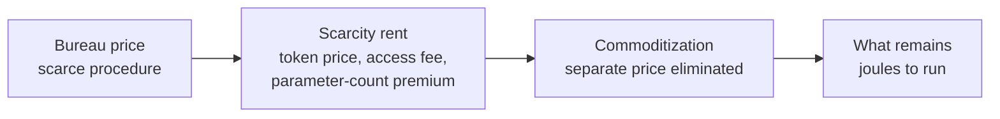

المراجعة db13599، 5 نوفمبر 2026. البيانات والشفرة: [research.openie.dev/data/](/data/#economics). LaTeX PDF: [/pdfs/latex/spellcheck.pdf](/pdfs/latex/spellcheck.pdf) ([source](/pdfs/latex/spellcheck.tex)).

## الملخص

تم بيع تدقيق الإملاء بمئات الدولارات في الفترة من 1981 إلى 1989 وهو الآن مجاني ومدمج في الأدوات التي يستخدمها الناس بالفعل. توثق هذه الورقة ذلك التغيير من مصادر قديمة وتشرح ذلك من خلال اقتصاديات التكلفة الحدية والتجميع [62, 63].

**بكلمات بسيطة**

1. كان الناس يدفعون الكثير مقابل تدقيق الإملاء. الآن هو مجاني داخل الهواتف والمتصفحات ومعالجات النصوص.
2. أصبح مجانيًا لأن فحص كلمة يكلف تقريبًا لا شيء لتشغيله، وهو أكثر فائدة داخل أداة يمتلكها المستخدم بالفعل.
3. يمكن أن يحدث نفس الأمر لمهارات حاسوبية أخرى بمجرد أن تعمل بتكلفة منخفضة على الأجهزة التي يمتلكها الناس، بحيث يمكن لمليارات الأشخاص استخدامها.

## الترميز والمصطلحات

| المصطلح | المعنى في هذه الورقة |
|---|---|
| مسار الأتمتة | إجراءٌ حاسوبي يغادر مكتبًا متخصصًا ويصبح روتينًا محليًا على عتاد يمتلكه الشخص بالفعل. |
| دليل الوجود | نموذجٌ مكتمل لذلك المسار. التدقيق الإملائي مثالٌ على ذلك. لا يُستخدم المصطلح بوصفه مجازًا. |
| محلي | يعمل الفحص على الجهاز الذي يحتوي على المستند. لا يستلزم الروتين المُشحون استئجار مركز بيانات حدودي. |
| العتاد المقترن | المحرر أو لوحة المفاتيح أو الهاتف الذي يستخدمه الشخص بالفعل في الكتابة. لا تمثل هذه القدرة جهازًا ثانيًا. |
| متاح | العتاد اعتيادي وليس إيجارًا نادرًا. |
| في المتناول | يستطيع الشخص استدعاء القدرة على تلك البنية دون إرسال المهمة إلى مكتب متخصص. |
| قادر | تستطيع البنية تشغيل الأدوات التي تُنجز المهمة. |
| الكثيرون (7B+) | أكثر من 7 مليارات شخص. هم المعنيون بالوصول العالمي. |
| القلة | الأشخاص الذين لا يزال بإمكان سعر الندرة الوصول إليهم. هذا تصنيفٌ سعري لا عدد رؤوس: إذ تجاوزت المحادثة الحدودية وحدها 800 مليون مستخدم أسبوعي في أكتوبر 2025 [61]. |
| اقتراح | اقتراح تهجئة. لم يتغير المستند بعد. |
| تثبيت | يُكتب الاستبدال في المستند. |
| الاكتمال | الرمز محفوظ: كان معروفًا أو قُبل أحد المرشحين. لا قيمة إضافية للبحث الإضافي على ذلك المحمول. |
| السعر النقدي | رسمٌ يمكن لأحدهم إصداره بفاتورة: سعر الرمز المميز، أو ترخيص المقعد، أو إيجار الندرة، أو رسوم الوصول. يدفع التسليع الرسم المنفصل نحو الصفر. |
| عدد المعاملات | حجم النموذج. ليس مقياسًا يصمد بمجرد أن تصبح القدرة سلعة. |
| الجول (J) | وحدة الطاقة في النظام الدولي للوحدات. يُقصد به هنا الطاقة المستهلكة لتشغيل الروتين. |
| بحث، صيغة، نموذج | ثلاثة أنواع من الآليات. استعلام القاموس بحثٌ. مولّد مسافة التحرير صيغةٌ. نموذج اللغة نموذجٌ. |

## 1. مقدمة

التحقق الإملائي هو قدرة كان الناس يشتريونها في السابق كمنتج منفصل والآن يحصلون عليها داخل الأدوات التي يمتلكونها بالفعل. تتبع هذه الورقة ذلك التغيير من خلال الأسعار المؤرخة، الأوراق التي بنت الإجراء، المكتبات التي تشحنه والآلات التي تشغله، وتسأل ما يعنيه ذلك للذكاء الحاسوبي بشكل عام.

دفع الناس علاوة. ثم لم يعد من الممكن بيع الشيء. هو مجاني، ومضمّن في شيء آخر. الأسعار في القسم 2.11 هي تلك الحقيقة. الأسماء في القسم 2.9 تأتي بعد ذلك.

الفاتورة المنفصلة للآلة الحاسبة هي سلسلة مؤرخة، من إعلانات أنيتا عبر HP-35 و TI-2500 إلى VisiCalc. الفاتورة المنفصلة للتحقق الإملائي تنتهي داخل معالج النصوص ثم نظام التشغيل. الدولارات التي لا تطبعها المصادر تبقى غير مطبوعة.

بالنسبة للتحقق الإملائي اتجاه السعر مكتمل. الروتين مضمّن في المحرر بسعر صفر. لا تزال الجوليات تُستهلك.

الاختيار هو السعر. تسعير الندرة يحجز قدرة ويبيع الحجز. يصل إلى الأشخاص الذين يستطيعون الدفع، القليل. الوصول العالمي هو الخيار الآخر. تُبنى القدرة لتعمل على الآلة التي يمتلكها الشخص بالفعل، وينتهي الرسوم المنفصلة. ذلك يصل إلى أكثر من 7 مليارات شخص.

التحقق الإملائي هو ذلك الخيار الثاني، مكتمل. المهمة هي تحديد ما إذا كان الرمز المكتوب كلمة، وإذا لم يكن كذلك، اقتراح الكلمة التي كان يقصدها الكاتب. يقسم كوكيتش (1992) المهمة إلى اكتشاف غير الكلمات، تصحيح الكلمات المعزولة، وتصحيح يعتمد على السياق. الأولان أصبحا عاديين. يعملان داخل البرامج التي يستخدمها الناس بالفعل للكتابة. إنهما ذكاء حاسوبي، ليس قصة تُروى للحديث عن نظام مختلف.

الخيار الثاني يكتمل فقط عندما يصبح الروتين رخيصًا بما يكفي ليعمل بجانب المستند، محليًا على الآلة التي تحتفظ بالملف، ومقترنًا بالأجهزة التي يمتلكها الناس بالفعل. يذكر ماكلروي (1982) القيد في الجمل الأولى من ورقة قائمة تهجئة UNIX. قد يُستخدم المدقق على الحواسيب الصغيرة، لذا يجب أن تكون القائمة مدمجة. هذا هو الوصول العالمي كهندسة. نموذج حدودي يجيب فقط داخل مركز بيانات مستأجر هو تسعير ندرة لا يزال ساريًا. يمكن أن يكون قادرًا ولا يزال يبقى مع القليل الذين يستطيعون استئجاره.

القسم 2.11 هو العلاوة، مؤرخ. القسم 2.10 هو من يمتلك آلة يمكن للقدرة المكتملة أن تعمل عليها، ومن يمتلك فقط استئجارًا. البرمجيات المكتوبة للآلة التي يستخدمها الناس بالفعل هي كيفية وصول الوصول إلى الكثيرين. السعر الذي يتطلب الاستئجار هو كيفية بقاء الندرة مع القليل.

### رمز واحد، يُعلَّم بالترتيب

نورفيغ (2007) يوثق مصححًا محليًا والاستدعاء `correction('speling')`، الذي يُعيد `spelling`. استعرض ذلك الاستدعاء كمثال تعليمي للمسار. إثبات وجود الإنتاج هو Hunspell في المحررات العادية، المذكور في القسم 2.5.

1. السلسلة موجودة بالفعل على الجهاز. لا شيء يُرسل إلى مكتب.
2. الاستعلام يطلب ما إذا كان `speling` موجودًا في عدد الكلمات المحلي. فهو غير موجود.
3. صيغة تُنشئ سلاسل على مسافة تحرير واحدة: حذف، تبديل، استبدال، أو إدراج. الكلمة المعروفة `spelling` موجودة في تلك المجموعة.
4. الاقتراح هو عرض. يتغير المستند فقط عندما يقبله شخص، أو عندما تقبل سياسة محددة ذلك. هذا هو الالتزام.
5. بمجرد الاحتفاظ بـ `spelling`، لا تُغيّر المرشحات الإضافية القاعدة "هذه العلامة هي الكلمة التي نحتفظ بها". هذا هو الإيقاف.
6. فتح نموذج حدودي لهذه العلامة لا يحصل على إغلاق أفضل. آلية البحث مع التحرير أغلقت الأمر بالفعل. رفض الإنفاق الأكبر ليس خصمًا. إنه أفضل إجابة لهذا العمل.

المقال نفسه يُظهر الحالة التي لا يستطيع فيها الرمز المحلي الإغلاق. `correction('where')` يبقى `where` عندما يتوقع زوج اختبار `were`. الكلمة المفردة لا تحمل القرار. سمى كوكيتش (1992) ذلك بالمشكلة الثالثة، التصحيح المعتمد على السياق. نموذج أكبر يمكن أن يكون الآلية الصحيحة هناك. المسار لا يكتمل لتلك الآلية حتى تعمل الآلية على عتاد يمتلكه الكاتب بالفعل، أو على نسيج مركزي مُحسّن للموارد يمكن للشخص فعليًا استخدامه. تصريح حدودي مستأجر لا يستطيع الكاتب استدعاؤه يظل مكتبًا.

## 2. الأعمال ذات الصلة

### 2.1 الكشف عن الأخطاء وتصحيح الكلمات المنعزلة

دامراؤ (1964) يقدم طريقة لكلمة مفقودة من القاموس وتحتوي على خطأ واحد على الأكثر: حرف خاطئ، حرف مفقود، حرف زائد، أو تبديل واحد. تُقارن الكلمة غير المحددة بالقاموس مرة أخرى تحت كل من هذه الفرضيات. يُبلغ الملخص عن تحديدات صحيحة لأكثر من 95 بالمئة من هذه الأنواع من الأخطاء في الاختبار الذي أجره. هذه الورقة تستشهد بهذه النتيجة كنتيجتها. لا تُعيد تكرار الاختبار.

بيترسون (1980) يستعرض برامج الحاسوب التي تكتشف وتصحح أخطاء الإملاء. بحلول ذلك التاريخ، أصبحت القدرة على ذلك أدبيّة من البرامج العاملة، وليس اقتراحًا بأن برنامجًا قد يتحقق من كلمة يومًا ما.

كوكيتش (1992) ينظم المجال إلى المشكلات الثلاث المذكورة أعلاه. اكتشاف الكلمات غير الموجودة يستخدم قائمة كلمات، أو مطابقة نمطية، أو تحليل n-gram. تصحيح الكلمات المعزولة يقترح كلمة من القاموس لكلمة غير موجودة تم اكتشافها. التصحيح المعتمد على السياق يتعامل مع رمز هو كلمة حقيقية لكنه لا يزال الكلمة الخاطئة. الاستعراض هو الخريطة. إثبات الوجود في هذه الورقة يستند إلى Hunspell في الإنتاج: LibreOffice، Firefox، Chrome، توزيعات Linux، و macOS يستدعون روتين القاموس المحلي (Hunspell README). المشكلتان الأوليتان لكوكيتش تُركتا في الاستعراض ودخلتا تلك المحرّرات العادية. نورفيغ (2007) يظل الشرح التعليمي للبحث ثم تعديل قصير، وليس حقيقة الإنتاج.

### 2.2 القائمة بُنيت لتناسب الآلة

يصف ماكيلروي (1982) قائمة الكلمات التي يستخدمها مدقق الإملاء في نظام UNIX. الملخص يوضح القيد الهندسي والنتيجة. يمكن استخدام المدقق على الحواسيب الصغيرة، لذا يجب أن تكون القائمة مضغوطة. إزالة البادئات واللواحق، والتجزئة، والضغط يقللان قائمة مكوّنة من 30 000 كلمة إنجليزية إلى 26 000 كلمة ذات 16‑بت. كان مدقق جونسون السابق يبحث عن كلمات مستند موجود مسبقاً على الجهاز. إسهام ماكيلروي في هذه الورقة هو الاقتران: تم ضغط القاموس لأن الهدف كان الحاسوب الصغير الذي سيستخدمه الناس فعلياً، وليس آلة أكبر مخصصة للمهمة.

تلك أعداد الكلمات هي أعدادهم المنشورة.

### 2.3 القناة المشوشة لا تزال برنامجاً محلياً

Kernighan، Church، وGale (1990) يرتّبون تصحيحات المرشّح باستخدام نموذج القناة الصاخبة: احتمال المرشّح مضروبًا في احتمال الخطأ المطبعي معطىً للمرشّح. البرنامج هو مصحّح إملائي بالمعنى التقليدي، حساب محلي على القاموس ونموذج الخطأ. درجة أفضل ليست نشرًا مختلفًا. يمكن للعتاد أن يصبح أكثر حدة ويبقى على الآلة التي تحتفظ بالنص.

### 2.4 مصحح يتسع لصفحة واحدة ولا يحتاج إلى شبكة

كتب نورفيغ (2007) الشرح على طائرة، دون بيانات أخطاء إملائية ولا اتصال بالإنترنت. نموذج اللغة هو ملف محلي يضم حوالي مليون كلمة، تم إحصاؤها إلى 32 192 كلمة مميزة ظهرت 1 115 504 مرة. نموذج الخطأ متعمد البساطة: كلمة معروفة على مسافة تحرير 0 تتفوق على أي كلمة على مسافة 1، والتي تتفوق على أي كلمة على مسافة 2. بعد الرحلة قيم الأداء مقابل مجموعات مأخوذة من مجموعة بيركبيك الخاصة بميتّون. أبلغ عن صحة 75 بالمئة من 270 زوجًا تطويريًا، بمعدل 41 كلمة في الثانية، وصحة 68 بالمئة من 400 زوج اختبار نهائي، بمعدل 35 كلمة في الثانية. صرّح أنه حقق أهدافه في الإيجاز والسرعة لكنه لم يحقق أمله في دقة تتراوح بين 80 إلى 90 بالمئة.

تلك الأرقام هي تقييمه المبلغ عنه. اللعبة ليست مدققًا صناعيًا. جزء مفيد من القدرة يعمل من ملف على الجهاز أمام المبرمج، بمعدل عشرات الكلمات في الثانية، دون وجود شبكة. هذا هو شكل مسار الأتمتة المكتمل. الأخطاء التي يذكرها، خاصة الكلمات غير المعروفة في القاموس والقرارات التي تحتاج إلى الرموز المجاورة، هي المتبقي. هي حجج من أجل تحسين الأدوات المحلية، لا حجج بأن المهمة يجب أن تعود إلى مكتب.

### 2.5 المكتبة داخل المحررات الاعتيادية

يُشير مشروع Hunspell إلى أن Hunspell هو مدقق الإملاء والمحلل الصرفي الذي تستخدمه LibreOffice، والمتصفحات الحرة بما فيها Firefox و Chrome، وأدوات وأنظمة تشغيل أخرى بما فيها توزيعات Linux و macOS (Hunspell README). تقرأ المكتبة ملف القاموس المحلي وملف اللواحق المحلي. أداة سطر الأوامر تتحقق من ملف نصي محلي. الشيفرة تنحدر من MySpell، تنفيذ Kevin Hendricks في OpenOffice.org، وهو نفسه إعادة تنفيذ لتدقيق الإملاء باللواحق من International Ispell لـ Geoff Kuenning. يضيف László Németh في Hunspell دعم Unicode والصرف اللازم للغات التي تكون فيها قائمة كلمات إنجليزية عارية غير مناسبة.

يذكر ذلك README الأماكن التي تُستَخدم فيها المكتبة. حقيقة مساهمتها هي فئة النشر. المدقق داخل تلك البرامج هو مكتبة محلية وقائمة كلمات محلية.

### 2.6 الهاتف الموجود بالفعل في اليد

UITextChecker هي فئة من UIKit. يمرّر المتصل سلسلة نصية ولغة. تُعيد الطريقة نطاق كلمة مكتوبة خطأً في تلك السلسلة، أو تُبلغ أنه لم يُعثر على أي منها (Apple, UITextChecker). الفحص يتم على الجهاز، ضد لغة يسردها النظام كمتاحة. لا يدّعي هذا البحث رقم جول لهذه الاستدعاءة. شكل API هو الاقتران: النص موجود بالفعل في عرض النص، والفاحص هو طريقة بجانبه.

إطار عمل مدقق الإملاء في Android موجود أيضًا على الجهاز. يمدّ تطبيق `SpellCheckerService`، يُنفّذ جلسة، ويُعيد اقتراحات للنص الذي تُعطى له الجلسة (Android Developers, spell-checker framework; `SpellCheckerService`). مدقق طريقة الإدخال اللاتيني هو خدمة محلية مع قواميس محلية. مرة أخرى، لا يُؤخذ رقم طاقة من تلك الوثائق. الوثائق تضع الروتين على الهاتف.

Hard وزملاؤه (2018) يدربون نموذج كلمة تالية لوحة مفاتيح Gboard على الهاتف عبر التعلم المتعدد. يحسب العملاء تحديثات على نص يبقى على الجهاز. يجمع الخادم تلك التحديثات ولا يتلقى النص الأصلي. نفس الورقة تُشير إلى أن Gboard يوفر تصحيحًا تلقائيًا بالإضافة إلى توقع الكلمة التالية، وأن لوحة المفاتيح كان لديها أكثر من مليار تثبيت بحلول 2019. جملة التثبيت تلك هي ادعاء النشر الخاص بالورقة. إنها ليست عددًا لأكثر من 7 مليارات شخص يتناولهم هذا الرأي.

النموذج الذي يوزعونُه صغير عن قصد. بعد الكمية يصبح حجمه 1.4 ميغابايت، مع مفردات من 10,000 كلمة، تحت قيود المنتج التي يذكرونها كاستجابة مرئية خلال حوالي 20 مللي ثانية وحجم نموذج بعشرات الميغابايت. مشاركة التدريب في دراستهم أضيق من قاعدة التثبيت: أجهزة شمال أمريكا، على الأقل 2 جيجابايت من الذاكرة، شحن، خمول، وعلى شبكة غير محدودة. هذه الدراسة تُشير إلى فئة النشر. لوحة مفاتيح يستخدمها الناس بالفعل تحمل نموذج لغة صغير على الجهاز، والتدريب الموصوف هناك لا يصدر النص المكتوب. لا تُشير إلى جداول الاستدعاء الخاصة بهم كنتيجة لدقة الإملاء.

### 2.7 اليانصيب المعتمد على العتاد

Hooker (2020; 2021) يطلق على ذلك «اليانصيب الصلب»: فكرة البحث تفوز لأنها تتناسب مع الأجهزة والبرمجيات المتاحة، لا لأنها أفضل فكرة في المجمل. تدقيق الإملاء فاز بيانصيب كان يستحق الفوز. الجهاز المتاح كان الآلة التي تحتفظ بالمستند. الخوارزمية التي تناسب كانت قائمة كلمات بالإضافة إلى نموذج تعديل صغير. القدرة التي تتناسب فقط مع مسرّع حدودي، وتُباع فقط كوقت على ذلك المسرّع، هي في يانصيب مختلف. تحذير Hooker هو أن الأفكار التي لا تتطابق مع الأجهزة المثبتة تتوقف حتى وإن كانت جيدة. النتيجة التصميمية في هذه الورقة هي القراءة العكسية لنفس الحقيقة. إذا كان الهدف هو الذكاء الحاسوبي للجميع، يجب أن تتناسب الفكرة مع الأجهزة التي يمتلكها الكثيرون بالفعل، أو مع جهاز يمكن للنسيج المركزي المُحسّن للموارد أن يمده إليهم. التوافق مع استئجار نادر هو الطريقة التي تبقى بها القدرة مع القليل.

### 2.8 ما لا تُطلب هذه الأدبيات إثباته

ليس أي من مصادر الإملاء المذكورة أعلاه جدولًا سكانيًا. عندما يظهر رقم إملائي في القسم 4، فهو عدد المصدر نفسه: كلمات القاموس، حجم مجموعة الاختبار، كلمات في الثانية، أو معدل التعرف المنشور. يضيف القسم 2.10 فئة مختلفة. كل رقم عتادي هو شحنة الناشر، أو المشترك، أو الإيراد، أو رقم المسح، مع السنة المرفقة. أكثر من 7 مليارات شخص، والقليل الذين يستطيعون دفع سعر الندرة، هما الفئتان في الرأي. هما ليسا مجموعًا لتلك الصفوف.

### 2.9 كيف يُسعَّر التشغيل الآلي الحاسوبي

يبقى معدل الاستشهاد داخل الورقة التي نشرتها. لا يتم ملاءمة أي منحنى هنا. لا يُذكر أي انحدار أو نصف عمر أو سنة السعر الصفرية.

بكلمات بسيطة، قبل الأسماء. كان الناس يدفعون علاوة لتصحيح الإملاء وللحساب العادي. لا يمكن بيع تصحيح الإملاء كمنتج طبقة أساسية بعد الآن. فهو مجاني، ومضمّن في المحرّر، والمتصفح، والهاتف. الحساب العادي مضمّن في الهاتف والكمبيوتر. الأسماء أدناه هي مجرد تسميات لتلك السلسلة.

ثلاثة أنظمة تسمّي كيف يُسعّر أداة الأتمتة الحاسوبية. القسم 2.11 هو الشريط الزمني للآلة الحاسبة ولتصحيح الإملاء. كل سعر هو سعر مصدر. لا يُملأ أي منحنى من خلالها.

**سعر المكتب.** بينما الإجراء نادر، يدفع المشتري لشخص أو لآلة محجوزة. يقيس نوردهوس (2007) السعر المالي الطويل للحوسبة نفسها، وليس لتصحيح الإملاء. في تلك المقالة يبدأ سعر الحوسبة حوالي 500 دولار لكل مليون عملية حسابية في الثانية للعمل اليدوي وينخفض إلى حوالي $6 \times 10^{-11}$ لكل مليون عملية حسابية في الثانية بحلول عام 2006، بأسعار 2006، بانخفاض على مستوى 8.3 تريليون. هذا الرقم هو ناتج هذا المقال من نقطتي النهاية التي ذكرها للتو، 500 دولار / $6 \times 10^{-11}$. نقطتا النهاية هما أرقامهما المبلغ عنها. لم يتم إعادة ملاءمتهما هنا، والناتج ليس توقعًا. إنهما يوثقان أن السعر المالي للركيزة الأساسية للأتمتة انخفض بأوامر حجم. انخفاض ذلك المؤشر ليس بعد إلغاء الفاتورة المنفصلة للمنتج، ولا هو مقياس جول.

**سعر الندرة، والسباق الذي يخلقه.** بمجرد أن تتمكن شركة من شحن الإجراء، يمكنها أن تفرض رسومًا أعلى من تكلفة تشغيله. تلك الفجوة هي إيجار الندرة. رسوم الوصول وسعر الرمز هما نفس الفجوة بأزياء مختلفة. يصبح عدد المعاملات جزءًا من الزي عندما يُعلَّم المشترون دفعًا مقابل الحجم. الإيجار هو ما يخلق السباق. المنافسون يزيلون الإيجار بدمج القدرة في منتج يمتلكه المشتري بالفعل، أو يستبدلون المنتج تمامًا. أسعار الاستدلال المنشورة تقول إن السباق جارٍ لنماذج اللغة ولم ينته بعد. تقارير Epoch AI (2025) تشير إلى انخفاض الأسعار عند أداء ثابت على مستوى 9 إلى 900 مرة سنويًا عبر المعايير في تلك الملاحظة. يذكر إمبرسون وروودمان (2026) انخفاضًا بنحو 47 بالمئة لكل ربع سنة في تكلفة أداء معين منذ حوالي 2023، وهو ما يلخصونه بنحو 13 مرة سنويًا. هذه ملخصاتهم لسلسلتهم. لم يُعاد تقدير المؤشر. لا يُرسم خط عبر النقاط. لا يُعد أي معدل قانونًا خارج نافذته. يستخدم ورق Task Satiation نفس الانخفاض المستشهد به كدليل على استمرار إزاحة الخندق؛ يظل ذلك الادعاء في ذلك الورق.

**إزالة التسعير.** التسلّية هي نهاية الرسوم المنفصلة. القدرة تبقى. سطر الفاتورة لا يبقى. تدقيق الإملاء هو المثال المكتمل. Hunspell هي مكتبة تدقيق إملائي مجانية تحت ترخيص ثلاثي (LGPL، GPL، وMPL). المشروع يذكر أن LibreOffice وFirefox وChrome وتوزيعات Linux وmacOS تستدعيها، وأن الفحص يقرأ قاموسًا محليًا (Hunspell README). مشتري تلك المحرّرات لا يدفع سعرًا رمزيًا لكلمة غير موجودة، ولا يدفع رسوم وصول إلى مكتب التدقيق الإملائي، ولا يشتري عددًا من المعلمات. السعر المالي للطريقة كسلعة منفصلة هو صفر. هذا هو إزالة التسعير. ليس ادعاءً بأن المحرّر نفسه مجاني، ولا ادعاءً بأن الهاتف كان مجانيًا. إنه ادعاء بأن تصحيح الإملاء لم يعد يُسعر كسلعة مستقلة.

**يمكن أن ينتقل تسعير الندرة إلى الجهاز.** إنهاء سعر البرنامج المنفصل لا ينهي كل سعر ندر. يمكن لمنصة أن تضع قدرة أحدث على جهاز أحدث وتفرض رسومًا على الجهاز. يوسف مهدي، 20 مايو 2024، عرّف جهاز Copilot+ PC بوحدة معالجة عصبية بقدرة 40 TOPS أو أكثر. الموجة الأولى تستخدم Snapdragon، النموذج الصغير يعمل على تلك الوحدة، والنماذج الكبيرة تبقى على Azure. حساب Apple بتاريخ 9 يونيو 2025 يضع نموذجًا على الجهاز بحجم حوالي 3 مليارات معلمة على silicon من Apple ويترك النموذج الأكبر على Private Cloud Compute. هذه أسعار لعتاد لاحق وللجهاز الذي يحمله. هي ليست فاتورة متجددة لتدقيق الإملاء. الفاحص يعمل بالفعل على المحرّر، المتصفح، والهاتف الذي يمتلكه الناس، بما في ذلك الجيل السابق المتاح. تحديث يطلب من شخص شراء فئة جديدة من الحواسيب لتلقي فحص يقوم به الجهاز القديم بالفعل هو تسعير ندرة للأجهزة. يصل إلى الأشخاص الذين يشترون تلك الفئة. القليل فقط يمكن أن يكونوا من تلك الفئة. لا يلغي ذلك الوصول الذي تم إنجازه بالفعل لأكثر من 7 مليارات شخص.

التصحيح المعتمد على السياق ليس الحالة المنتهية تلك. كوكيش (1992) سمّها المشكلة الثالثة: رمز هو كلمة حقيقية وما زالت الكلمة الخاطئة. نموذج أكبر يمكن أن يكون الأداة الصحيحة هناك. في تصحيح الأخطاء النحوية، النماذج الأكبر والمدربة بشكل أفضل تصحّح بشكل أفضل: GECToR [71] ونموذج متعدد اللغات بـ 11 مليار معلمة [72] وضعا حالة الفن في زمانهما. المقايضة هي الطاقة: لوكّيوني، جيرنيت وسترابيل يقيسون المهام التوليدية بأنها أكثر استهلاكًا للطاقة بكثير من مهام التصنيف لكل استدلال [73]. حالة الكلمة المعزولة في القسم 4.10 هي الحالة التي لا يشتري الإنفاق الإضافي رمزًا مختلفًا. الأداة أخذت خيار الوصول فقط عندما تعمل على عتاد يمتلكه الشخص بالفعل، أو على نسيج مركزي مُحسّن للموارد يمكن للشخص استخدامه. الإيجار النادر هو خيار الندرة، حتى عندما يكون النموذج أكثر دقة على معيار. وظيفة الكلمة غير الموجودة لا تعود إلى ذلك الإيجار لأن وظيفة السياق لم تُستكمل. لا جدول جول مقارنةً بين استعلام القاموس، نموذج محلي، ومكالمة مركز بيانات يُطبع هنا. لا أحد من تلك الجولات تم قياسها لهذه الورقة.

ما يبقى هو الطاقة لتشغيل المقارنة. استعلام القاموس المحلي يستهلك جولًا على الجهاز الذي يحمل المستند. لا جولات تم قياسها هنا. لا مجموع تحليلي تم حسابه. `measured_j` غير مُحدد: لم تُؤخذ قراءة للعداد.

التنبؤ يأتي من الأنظمة، لا من الانحدار. مهام الذكاء الحاسوبي العادية تتبع تدقيق الإملاء. أسعار الرموز، علاوات عدد المعلمات، إيجارات الندرة، ورسوم الوصول يتم التنافس عليها من خلال التجميع على الأجهزة التي يمتلكها الناس بالفعل وبواسطة طرق سعر ترخيصها صفر. الحالة النهائية هي لأكثر من 7 مليارات شخص، لا للقليل الذين يمكنهم دفع سعر الندرة. يفشل التنبؤ إذا استمرت مهمة عادية، من النوع الذي يغلقه تدقيق الإملاء بالفعل، في الحفاظ على سعر مالي منفصل دائم بعد أن يصبح الروتين المحلي للنتيجة المتساوية في يد الأشخاص الذين يحملون المستند. معيار حدودي لا يزال يحمل علاوة ليس هو الفشل. إنه مرحلة الخندق، التي تُظهر ملاحظات Epoch أنها تصبح أرخص، والتي يوضحها تدقيق الإملاء كيفية التخلي.

نفس الأنظمة مرسومة في الشكل التفاعلي [sc-anim-01](/living/spellcheck/#sc-anim-01). نقطتان تمثلان نقاط النهاية التي أبلغ عنها نوردهوس. الموصل المتقطع يربط هاتين النقطتين. لا يتم تقدير أي معدل. نطاق 9 إلى 900 الخاص بـ Epoch والملخص حوالي 13 مرة يظهران في ملاحظة. يظلان ملخصاتهما. لوحة تدقيق الإملاء هي النظام المكتمل: السعر المالي المنفصل اختفى، والجول يبقى غير مقاس.

Landauer (1961) يحدد حدًا ماديًا على مسح بت. Horowitz (2014) هو بيان CMOS العملي: حركة البيانات تهيمن، أعلى بكثير من الحد المثالي. مسح القاموس ينقل البتات. يمكن للتسليع أن يجعل الفاتورة صفرًا ولا يزال يترك تلك الحركة. لا يتم حساب إجمالي الجول لتدقيق الإملاء من أي من الاقتباسين.

**التجميع كاستراتيجية.** الأدبيات المتعلقة بالتجميع تقرأ نفس التاريخ كاستراتيجية وكذلك كوسيلة وصول. Adams و Yellen يبرزان أن التجميع أداة للتمييز السعري [68]. Nalebuff يوضح أن التجميع يمكن أن يمنع دخول منافس يبيع سلعة واحدة [69]. Spolsky سَمّى التكتيك للبرمجيات: سلّق مكملك، بحيث يصبح المنتج الذي تبيعه أكثر قيمة [70]. كل قراءة تتفق على الملاحظة التي يستخدمها هذا المقال: السعر المنفصل للطبقة المجمعة يذهب إلى الصفر. يختلفون في من يحتفظ بالإيجار. هذا الاختلاف هو السبب في تتبع هذا المقال لمن يملك المنصة وكذلك السعر.

### 2.10 الوصول إلى العتاد، فئةً فئةً

يُسمِّي هوكر اليانصيب. هذا القسم يُسمِّي الآلات. الحجة هي سبعة سجلات. شحنة هاتف ليست شحنة مركز بيانات. مسح Steam ليس تعدادًا للكمبيوترات الشخصية. خط الإيرادات ليس عدد وحدات. عندما لا تكشف شركة عن الوحدات، يذكر الورق ذلك ويستشهد بالرقم الذي كشفته الشركة. لا أحد من هذه الأرقام هو عدد للعديد أو للقليل. إنها ليست مجموع الصفوف. الأرقام الحية [sc-hw-01](/living/spellcheck/#sc-hw-01) و [sc-gen-01](/living/spellcheck/#sc-gen-01) هي نفس السجلات.

لكل فئة الأسئلة هي نفسها. من يمتلك الآلة، بحسب عدد المصدر نفسه. ما هو مجموعة البرمجيات التي تشغل تلك الآلة. كيف تلتقي تلك المجموعة بأفضل مجموعة حدودية. ادعاء التصميم هو جملة واحدة: البرمجيات المكتوبة للجيل المتاح عالميًا لها أكبر تأثير. الجيل المتاح هو الموجود في اليد. التدقيق الإملائي هو مثال الأتمتة المكتملة لتلك الجملة. قام McIlroy بحجم القائمة للكمبيوتر الصغير في الخدمة. الطاقة لتشغيلها هي المقياس المتبقي. هذه الصفوف هي من يمتلك الآلة. إنها ليست جول.

**الهواتف وأجيال SoC المتنقلة.** تُحصي GSMA، The Mobile Economy 2025، 5.8 مليار مشترك متنقل فريد بنهاية 2024، بمعدل اختراق 71 بالمئة، و4.7 مليار مستخدم إنترنت متنقل. يُحصي المتعقب العالمي للهواتف المحمولة الربع سنوي الأولي لـ IDC الصادر في 13 يناير 2026، 1,260.3 مليون هاتف ذكي شُحن في 2025، من بينها شحن Apple 247.8 مليون. الإصدار الصادر في 13 يناير 2025 من IDC سجل 1,238.8 مليون هاتف ذكي في 2024. جدول 2026 يعيد صياغة 2024 كـ 1,236.3 مليون. كل إصدار يحتفظ بإجماله الخاص. تقرير Arm السنوي للسنة المنتهية في 31 مارس 2025 يذكر أن وحدات CPU القائمة على Arm كانت في أكثر من 99 بالمئة من هواتف العالم الذكية المباعة في ذلك العام المالي، وأن العملاء شحنوا cumulatively أكثر من 310 مليار شريحة قائمة على Arm، من أصغر المستشعرات إلى الحواسيب الفائقة. الرقم التراكمي هو كل سوق Arm. إنه ليس عدد هواتف، ولا يفصل التقرير ذلك إلى أجيال SoC.

الهاتف 2025 هو جيل SoC متنقل حالي: Apple silicon، Qualcomm Snapdragon، MediaTek، Samsung، Google Tensor. تُحصي IDC الهواتف ذات العلامات التجارية. عدد المشتركين هو الأشخاص الذين لديهم اشتراك متنقل، وليس عدد SoC.

مجموعة البرمجيات على ذلك الهاتف تشمل بالفعل مدققًا محليًا. UITextChecker و Android `SpellCheckerService` هما حالة الإملاء. نموذج على نفس الهاتف يستخدم Apple Core ML وإطار نماذج الأساس، Android LiteRT و NNAPI، مُصرّف QNN من Qualcomm، ExecuTorch، أو llama.cpp. حساب Apple الصادر في 9 يونيو 2025، المتوافق مع التقرير الفني الصادر في 17 يوليو 2025، يصف نموذج أساس على الجهاز بحوالي 3 مليارات معامل، مضغوط إلى 2 بت لكل وزن، ونموذج خلط خبراء على الخادم يعمل على Private Cloud Compute. تقرير LFM2 من Liquid AI يصمم نماذج كثيفة من 350 مليون إلى 2.6 مليار معامل، ونموذج خلط خبراء بـ 8.3 مليار مع 1.5 مليار نشط، لـ ExecuTorch، llama.cpp، و vLLM، ويقيس أوقات التنفيذ على Samsung Galaxy S25 مع Snapdragon 8 Elite. يذكر PrismML أن Ternary Bonsai 2 27B، الذي يقول إنه مبني على Qwen3.8 27B، يحتفظ بـ 98.2 بالمئة من النظير بدقة كاملة ب footprint أصغر 9 مرات، 5.9 جيجابايت. تلك النسب هي نسب PrismML. لا يعيد هذا الورق قياسها.

واجهة مجموعة الحدود هي نموذج أصغر، نموذج منخفض البت، أو استدعاء إلى خادم تديره الشركة المصنعة. تشير Apple إلى ذلك الانقسام في تقرير واحد. لا يتم تشغيل تدريب الحدود على الهاتف. الادعاء التصميمي لهذا الصف: البرنامج المكتوب لجيل SoC الذي يتم شحنه بالفعل، وللهواتف التي لا تزال مستخدمة من سنوات سابقة، له التأثير الأكبر. التدقيق الإملائي هو ذلك البرنامج.

**أجهزة الكمبيوتر المكتبية والمحمولة.** تصدر IDC في 9 يناير 2025 عدد 262.7 مليون جهاز كمبيوتر تقليدي تم شحنه في 2024. تصدر IDC الأولية في 12 يناير 2026 عدد 284.7 مليون في 2025. يعيد جدول 2026 ذكر 2024 كـ 263.3 مليون. في مكالمة الأرباح في 28 يناير 2026، قال ساتيا نادالا إن Windows وصل إلى مليار مستخدم Windows 11، بزيادة تزيد عن 45 بالمئة سنةً على سنة. سنة شحن واحدة ليست قاعدة تثبيت تلك الأجهزة.

المجموعة تتكون من نظام التشغيل، المتصفح، ومكتبة محلية. Hunspell هو حالة التدقيق الإملائي داخل المحررات العادية. نموذج على نفس الجهاز يستخدم ONNX Runtime، DirectML، Windows ML، llama.cpp، أو ExecuTorch على وحدة المعالجة المركزية وGPU المدمج. GPU منفصل هو الفئة التالية. Liquid AI يوقت نفس عائلة LFM2 على AMD Ryzen AI 9 HX 370 مع llama.cpp في Q4_0. هذا قياس CPU للكمبيوتر المحمول في تقريرهم، وليس قياس لمركز البيانات.

واجهة مجموعة الحدود هي استدعاء API، أو نموذج يتناسب مع ذاكرة الجهاز. البرنامجان مختلفان. الأول هو استئجار. الثاني هو المسار. الادعاء التصميمي لهذا الصف: البرنامج لجيل أجهزة الكمبيوتر التي يستخدمها الناس بالفعل له التأثير الأكبر. التدقيق الإملائي سلك ذلك المسار. وزن يفترض وجود مسرّع مستأجر لم يفعل ذلك.

**بطاقات الرسوميات للمستهلكين.** تقرير NVIDIA المالي لعام 2026، الذي انتهى في 25 يناير 2026، يذكر إيرادات الألعاب بقيمة 16.0 مليار دولار. هذه إيرادات، ليست عدد الوحدات. تقرير Jon Peddie Research في 5 مارس 2026 يذكر شحن 11.48 مليون لوحة رسومية مضافة للكمبيوتر في الربع الرابع من 2025، بزيادة 36.0 بالمئة عن العام السابق، مع معدل إرفاق سطح المكتب بنسبة 55 بالمئة في ذلك الربع. نفس الملاحظة تقول إن لوحات GPU لمراكز البيانات ارتفعت 17.0 بالمئة عن الربع السابق ولا تنشر عدد الوحدات. "قاعدة مثبتة" بـ 172 مليون في تلك الملاحظة هي نقطة توقع نهائية. لا يستخدم هذا البحث ذلك كعدد حالي.

مسح Valve لعتاد وبرمجيات Steam لشهر سبتمبر 2026 يذكر، بين العملاء الذين أجابوا، NVIDIA GeForce RTX 5070 بنسبة 6.15 بالمئة، RTX 5090 بنسبة 0.40 بالمئة، RTX 4060 بنسبة 3.89 بالمئة، RTX 3060 بنسبة 3.66 بالمئة، وGTX 1650 بنسبة 2.19 بالمئة. المسح يخص مشاركي Steam. ليس عالميًا. لا يضيف هذا البحث تلك الحصص إلى إجمالي جيل. القائمة جزئية، والمسح يحتوي على فئة أخرى.

المجموعة هي CUDA على NVIDIA، وROCm أو Vulkan على AMD. llama.cpp يشغّل نموذجًا مُكمًًًًًًًًًًًًًًًًًًًًًًًًًًًًًًًًًًًًًًًًًًًًًًًًًًًًًًًًًًًًًًًًًًًًًًًًًًًًًًًًًًًًًًًًًًًًًًًًًًًًًًًًًًًًًًًًًًًًًًًًًًًًًًًًًًًًًًًًًًًًًًًًًًًًًًًًًًًًًًًًًًًًًًًًًًًًًًًًًًًًًًًًًًًًًًًًًًًًًًًًًًًًًًًًًًًًًًًًًًًًًًًًًًًًًًًًًًًًًًًًًًًًًًًًًًًًًًًًًًًًًًًًًًًًًًًًًًًًًًًًًًًًًًًًًًًًًًًًًًًًًًًًًًًًًًًًًًًًًًًًًًًًًًًًًًًًًًًًًًًًًًًًًًًًًًًًًًًًًًًًًًًًًًًًًًًًًًًًًًًًًًًًًًًًًًًًًًًًًًًًًًًًًًًًًًًًًًًًًًًًًًًًًًًًًًًًًًًًًًًًًًًًًًًًًًًًًًًًًًًًًًًًًًًًًًًًًًًًًًًًًًًًًًًًًًًًًًًًًًًًًًًًًًًًًًًًًًًًًًًًًًًًًًًًًًًًًًًًًًًًًًًًًًًًًًًًًًًًًًًًًًًًًًًًًًًًًًًًًًًًًًًًًًًًًًًًًًًًًًًًًًًًًًًًًًًًًًًًًًًًًًًًًًًًًًًًًًًًًًًًًًًًًًًًًًًًًًًًًًًًًًًًًًًًًًًًًًًًًًًًًًًًًًًًًًًًًًًًًًًًًًًًًًًًًًًًًًًًًًًًًًًًًًًًًًًًًًًًًًًًًًًًًًًًًًًًًًًًًًًًًًًًًًًًًًًًًًًًًًًًًًًًًًًًًًًًًًًًًًًًًًًًًًًًًًًًًًًًًًًًًًًًًًًًًًًًًًًًًًًًًًًًًًًًًًًًًًًًًًًًًًًًًًًًًًًًًًًًًًًًًًًًًًًًًًًًًًًًًًًًًًًًًًًًًًًًًًًًًًًًًًًًًًًًًًًًًًًًًًًًًًًًًًًًًًًًًًًًًًًًًًًًًًًًًًًًًًًًًًًًًًًًًًًًًًًًًًًًًًًًًًًًًًًًًًًًًًًًًًًًًًًًًًًًًًًًًًًًًًًًًًًًًًًًًًًًًًًًًًًًًًًًًًًًًًًًًًًًًًًًًًًًًًًًًًًًًًًًًًًًًًًًًًًًًًًًًًًًًًًًًًًًًًًًًًًًًًًًًًًًًًًًًًًًًًًًًًًًًًًًًًًًًًًًًًًًًًًًًًًًًًًًًًًًًًًًًًًًًًًًًًًًًًًًًًًًًًًًًًًًًًًًًًًًًًًًًًًًًًًًًًًًًًًًًًًًًًًًًًًًًًًًًًًًًًًًًًًًًًًًًًًًًًًًًًًًًًًًًًًًًًًًًًًًًًًًًًًًًًًًًًًًًًًًًًًًًًًًًًًًًًًًًًًًًًًًًًًًًًًًًًًًًًًًًًًًًًًًًًًًًًًًًًًًًًًًًًًًًًًًًًًًًًًًًًًًًًًًًًًًًًًًًًًًًًًًًًًًًًًًًًًًًًًًًًًًًًًًًًًًًًًًًًًًًًًًًًًًًًًًًًًًًًًًًًًًًًًًًًًًًًًًًًًًًًًًًًًًًًًًًًًًًًًًًًًًًًًًًًًًًًًًًًًًًًًًًًًًًًًًًًًًًًًًًًًًًًًًًًًًًًًًًًًًًًًًًًًًًًًًًًًًًًًًًًًًًًًًًًًًًًًًًًًًًًًًًًًًًًًًًًًًًًًًًًًًًًًًًًًًًًًًًًًًًًًًًًًًًًًًًًًًًًًًًًًًًًًًًًًًًًًًًًًًًًًًًًًًًًًًًًًًًًًًًًًًًًًًًًًًًًًًًًًًًًًًًًًًًًًًًًًًًًًًًًًًًًًًًًًًًًًًًًًًًًًًًًًًًًًًًًًًًًًًًًًًًًًًًًًًًًًًًًًًًًًًًًًًًًًًًًًًًًًًًًًًًًًًًًًًًًًًًًًًًًًًًًًًًًًًًًًًًًًًًًًًًًًًًًًًًًًًًًًًًًًًًًًًًًًًًًًًًًًًًًًًًًًًًًًًًًًًًًًًًًًًًًًًًًًًًًًًًًًًًًًًًًًًًًًًًًًًًًًًًًًًًًًًًًًًًًًًًًًًًًًًًًًًًًًًًًًًًًًًًًًًًًًًًًًًًًًًًًًًًًًًًًًًًًًًًًًًًًًًًًًًًًًًًًًًًًًًًًًًًًًًًًًًًًًًًًًًًًًًًًًًًًًًًًًًًًًًًًًًًًًًًًًًًًًًًًًًًًًًًًًًًًًًًًًًًًًًًًًًًًًًًًًًًًًًًًًًًًًًًًًًًًًًًًًًًًًًًًًًًًًًًًًًًًًًًًًًًًًًًًًًًًًًًًًًًًًًًًًًًًًًًًًًًًًًًًًًًًًًًًًًًًًًًًًًًًًًًًًًًًًًًًًًًًًًًًًًًًًًًًًًًًًًًًًًًًًًًًًًًًًًًًًًًًًًًًًًًًًًًًًًًًًًًًًًًًًًًًًًًًًًًًًًًًًًًًًًًًًًًًًًًًًًًًًًًًًًًًًًًًًًًًًًًًًًًًًًًًًًًًًًًًًًًًًًًًًًًًًًًًًًًًًًًًًًًًًًًًًًًًًًًًًًًًًًًًًًًًًًًًًًًًًًًًًًًًًًًًًًًًًًًًًًًًًًًًًًًًًًًًًًًًًًًًًًًًًًًًًًًًًًًًًًًًًًًًًًًًًًًًًًًًًًًًًًًًًًًًًًًًًًًًًًًًًًًًًًًًًًًًًًًًًًًًًًًًًًًًًًًًًًًًًًًًًًًًًًًًًًًًًًًًًًًًًًًًًًًًًًًًًًًًًًًًًًًًًًًًًًًًًًًًًًًًًًًًًًًًًًًًًًًًًًًًًًًًًًًًًًًًًًًًًًًًًًًًًًًًًًًًًًًًًًًًًًًًًًًًًًًًًًًًًًًًًًًًًًًًًًًًًًًًًًًًًًًًًًًًًًًًًًًًًًًًًًًًًًًًًًًًًًًًًًًًًًًًًًًًًًًًًًًًًًًًًًًًًًًًًًًًًًًًًًًًًًًًًًًًًًًًًًًًًًًًًًًًًًًًًًًًًًًًًًًًًًًًًًًًًًًًًًًًًًًًًًًًًًًًًًًًًًًًًًًًًًًًًًًًًًًًًًًًًًًًًًًًًًًًًًًًًًًًًًًًًًًًًًًًًًًًًًًًًًًًًًًًًًًًًًًًًًًًًًًًًًًًًًًًًًًًًًًًًًًًًًًًًًًًًًًًًًًًًًًًًًًًًًًًًًًًًًًًًًًًًًًًًًًًًًًًًًًًًًًًًًًًًًًًًًًًًًًًًًًًًًًًًًًًًًًًًًًًًًًًًًًًًًًًًًًًًًًًًًًًًًًًًًًًًًًًًًًًًًًًًًًًًًًًًًًًًًًًًًًًًًًًًًًًًًًًًًًًًًًًًًًًًًًًًًًًًًًًًًًًًًًًًًًًًًًًًًًًًًًًًًًًًًًًًًًًًًًًًًًًًًًًًًًًًًًًًًًًًًًًًًًًًًًًًًًًًًًًًًًًًًًًًًًًًًًًًًًًًًًًًًًًًًًًًًًًًًًًًًًًًًًًًًًًًًًًًًًًًًًًًًًًًًًًًًًًًًًًًًًًًًًًًًًًًًًًًًًًًًًًًًًًًًًًًًًًًًًًًًًًًًًًًًًًًًًًًًًًًًًًًًًًًًًًًًًًًًًًًًًًًًًًًًًًًًًًًًًًًًًًًًًًًًًًًًًًًًًًًًًًًًًًًًًًًًًًًًًًًًًًًًًًًًًًًًًًًًًًًًًًًًًًًًًًًًًًًًًًًًًًًًًًًًًًًًًًًًًًًًًًًًًًًًًًًًًًًًًًًًًًًًًًًًًًًًًًًًًًًًًًًًًًًًًًًًًًًًًًًًًًًًًًًًًًًًًًًًًًًًًًًًًًًًًًًًًًًًًًًًًًًًًًًًًًًًًًًًًًًًًًًًًًًًًًًًًًًًًًًًًًًًًًًًًًًًًًًًًًًًًًًًًًًًًًًًًًًًًًًًًًًًًًًًًًًًًًًًًًًًًًًًًًًًًًًًًًًًًًًًًًًًًًًًًًًًًًًًًًًًًًًًًًًًًًًًًًًًًًًًًًًًًًًًًًًًًًًًًًًًًًًًًًًًًًًًًًًًًًًًًًًًًًًًًًًًًًًًًًًًًًًًًًًًًًًًًًًًًًًًًًًًًًًًًًًًًًًًًًًًًًًًًًًًًًًًًًًًًًًًًًًًًًًًًًًًًًًًًًًًًًًًًًًًًًًًًًًًًًًًًًًًًًًًًًًًًًًًًًًًًًًًًًًًًًًًًًًًًًًًًًًًًًًًًًًًًًًًًًًًًًًًًًًًًًًًًًًًًًًًًًًًًًًًًًًًًًًًًًًًًًًًًًًًًًًًًًًًًًًًًًًًًًًًًًًًًًًًًًًًًًًًًًًًًًًًًًًًًًًًًًًًًًًًًًًًًًًًًًًًًًًًًًًًًًًًًًًًًًًًًًًًًًًًًًًًًًًًًًًًًًًًًًًًًًًًًًًًًًًًًًًًًًًًًًًًًًًًًًًًًًًًًًًًًًًًًًًًًًًًًًًًًًًًًًًًًًًًًًًًًًًًًًًًًًًًًًًًًًًًًًًًًًًًًًًًًًًًًًًًًًًًًًًًًًًًًًًًًًًًًًًًًًًًًًًًًًًًًًًًًًًًًًًًًًًًًًًًًًًًًًًًًًًًًًًًًًًًًًًًًًًًًًًًًًًًًًًًًًًًًًًًًًًًًًًًًًًًًًًًًًًًًًًًًًًًًًًًًًًًًًًًًًًًًًًًًًًًًًًًًًًًًًًًًًًًًًًًًًًًًًًًًًًًًًًًًًًًًًًًًًًًًًًًًًًًًًًًًًًًًًًًًًًًًًًًًًًًًًًًًًًًًًًًًًًًًًًًًًًًًًًًًًًًًًًًًًًًًًًًًًًًًًًًًًًًًًًًًًًًًًًًًًًًًًًًًًًًًًًًًًًًًًًًًًًًًًًًًًًًًًًًًًًًًًًًًًًًًًًًًًًًًًًًًًًًًًًًًًًًًًًًًًًًًًًًًًًًًًًًًًًًًًًًًًًًًًًًًًًًًًًًًًًًًًًًًًًًًًًًًًًًًًًًًًًًًًًًًًًًًًًًًًًًًًًًًًًًًًًًًًًًًًًًًًًًًًًًًًًًًًًًًًًًًًًًًًًًًًًًًًًًًًًًًًًًًًًًًًًًًًًًًًًًًًًًًًًًًًًًًًًًًًًًًًًًًًًًًًًًًًًًًًًًًًًًًًًًًًًًًًًًًًًًًًًًًًًًًًًًًًًًًًًًًًًًًًًًًًًًًًًًًًًًًًًًًًًًًًًًًًًًًًًًًًًًًًًًًًًًًًًًًًًًًًًًًًًًًًًًًًًًًًًًًًًًًًًًًًًًًًًًًًًًًًًًًًًًًًًًًًًًًًًًًًًًًًًًًًًًًًًًًًًًًًًًًًًًًًًًًًًًًًًًًًًًًًًًًًًًًًًًًًًًًًًًًًًًًًًًًًًًًًًًًًًًًًًًًًًًًًًًًًًًًًًًًًًًًًًًًًًًًًًًًًًًًًًًًًًًًًًًًًًًًًًًًًًًًًًًًًًًًًًًًًًًًًًًًًًًًًًًًًًًًًًًًًًًًًًًًًًًًًًًًًًًًًًًًًًًًًًًًًًًًًًًًًًًًًًًًًًًًًًًًًًًًًًًًًًًًًًًًًًًًًًًًًًًًًًًًًًًًًًًًًًًًًًًًًًًًًًًًًًًًًًًًًًًًًًًًًًًًًًًًًًًًًًًًًًًًًًًًًًًًًًًًًًًًًًًًًًًًًًًًًًًًًًًًًًًًًًًًًًًًًًًًًًًًًًًًًًًًًًًًًًًًًًًًًًًًًًًًًًًًًًًًًًًًًًًًًًًًًًًًًًًًًًًًًًًًًًًًًًًًًًًًًًًًًًًًًًًًًًًًًًًًًًًًًًًًًًًًًًًًًًًًًًًًًًًًًًًًًًًًًًًًًًًًًًًًًًًًًًًًًًًًًًًًًًًًًًًًًًًًًًًًًًًًًًًًًًًًًًًًًًًًًًًًًًًًًًًًًًًًًًًًًًًًًًًًًًًًًًًًًًًًًًًًًًًًًًًًًًًًًًًًًًًًًًًًًًًًًًًًًًًًًًًًًًًًًًًًًًًًًًًًًًًًًًًًًًًًًًًًًًًًًًًًًًًًًًًًًًًًًًًًًًًًًًًًًًًًًًًًًًًًًًًًًًًًًًًًًًًًًًًًًًًًًًًًًًًًًًًًًًًًًًًًًًًًًًًًًًًًًًًًًًًًًًًًًًًًًًًًًًًًًًًًًًًًًًًًًًًًًًًًًًًًًًًًًًًًًًًًًًًًًًًًًًًًًًًًًًًًًًًًًًًًًًًًًًًًًًًًًًًًًًًًًًًًًًًًًًًًًًًًًًًًًًًًًًًًًًًًًًًًًًًًًًًًًًًًًًًًًًًًًًًًًًًًًًًًًًًًًًًًًًًًًًًًًًًًًًًًًًًًًًًًًًًًًًًًًًًًًًًًًًًًًًًًًًًًًًًًًًًًًًًًًًًًًًًًًًًًًًًًًًًًًًًًًًًًًًًًًًًًًًًًًًًًًًًًًًًًًًًًًًًًًًًًًًًًًًًًًًًًًًًًًًًًًًًًًًًًًًًًًًًًًًًًًًًًًًًًًًًًًًًًًًًًًًًًًًًًًًًًًًًًًًًًًًًًًًًًًًًًًًًًًًًًًًًًًًًًًًًًًًًًًًًًًًًًًًًًًًًًًًًًًًًًًًًًًًًًًًًًًًًًًًًًًًًًًًًًًًًًًًًًًًًًًًًًًًًًًًًًًًًًًًًًًًًًًًًًًًًًًًًًًًًًًًًًًًًًًًًًًًًًًًًًًًًًًًًًًًًًًًًًًًًًًًًًًًًًًًًًًًًًًًًًًًًًًًًًًًًًًًًًًًًًًًًًًًًًًًًًًًًًًًًًًًًًًًًًًًًًًًًًًًًًًًًًًًًًًًًًًًًًًًًًًًًًًًًًًًًًًًًًًًًًًًًًًًًًًًًًًًًًًًًًًًًًًًًًًًًًًًًًًًًًًًًًًًًًًًًًًًًًًًًًًًًًًًًًًًًًًًًًًًًًًًًًًًًًًًًًًًًًًًًًًًًًًًًًًًًًًًًًًًًًًًًًًًًًًًًًًًًًًًًًًًًًًًًًًًًًًًًًًًًًًًًًًًًًًًًًًًًًًًًًًًًًًًًًًًًًًًًًًًًًًًًًًًًًًًًًًًًًًًًًًًًًًًًًًًًًًًًًًًًًًًًًًًًًًًًًًًًًًًًًًًًًًًًًًًًًًًًًًًًًًًًًًًًًًًًًّ​

**مسرعات مراكز البيانات.** تقارير إصدار NVIDIA لنفس السنة المالية 2026 إيرادات مركز البيانات بمقدار 193.7 مليار دولار للعام، بزيادة 68 في المئة، و62.3 مليار دولار في الربع الرابع. لا يكشف الإصدار عن شحنات الوحدات من Hopper أو Blackwell أو Rubin. يصف شراكة متعددة السنوات مع Meta تشمل ملايين وحدات Blackwell و Rubin GPU. تلك الجملة هي حساب NVIDIA لخطة النشر. إنها ليست عددًا مدققًا للبطاقات في الرفوف. في 28 أكتوبر 2025، خلال GTC في واشنطن، قال جينسن هوانغ إن 6 ملايين وحدة Blackwell GPU تم شحنها في الأرباع الأربعة الأخيرة. تقارير CNBC تلك الجملة في نفس اليوم. لا يزال إصدار السنة المالية 2026 لا يكشف عن شحنات الوحدات. رقم الـ 6 ملايين هو بيان هوانغ. إنه ليس خطًا مدققًا للوحدات. نفس التقرير يقتبس توقعًا بمبيعات GPU بقيمة 500 مليار دولار عبر Blackwell و Rubin. هذا توقع مبيعات. لا يحول هذا البحث ذلك إلى عدد وحدات.

تقارير إصدار AMD في 3 فبراير 2026 إيرادات قطاع مركز البيانات بمقدار 16.6 مليار دولار للسنة التقويمية 2025، بزيادة 32 في المئة، وتذكر أن النمو يعكس كلًا من معالجات EPYC CPUs و Instinct GPUs. Instinct ليست خط إيرادات منفصل، باستثناء شريحة مكشوفة واحدة: إيرادات Instinct MI308 للربع الرابع إلى الصين بحوالي 390 مليون دولار. لا يوجد عدد وحدات Instinct في الإصدار.

في مكالمة 28 يناير 2026، قال ناديللا إن أسطول مايكروسوفت يشمل NVIDIA و AMD ومسرع Maya 200 الخاص بمايكروسوفت، الذي قامت الشركة بتشغيله. قالت آمي هود إن الإنفاق الرأسمالي في ذلك الربع كان 37.5 مليار دولار، مع حوالي ثلثين على أصول قصيرة الأجل، أساسًا GPUs و CPUs، وأن الطلب فاق العرض. لا يوجد عدد وحدات Maya في النص. شحنات وحدات Google TPU و Amazon Trainium غير موجودة في المصادر المقروءة لهذا القسم. تم تسميتها بحيث لا يُختزل الفئة إلى بائع واحد. العدد المفقود هو السجل.

من يملكه: المشترون الذين يتعاقدون على تلك الإيرادات. قالت هود إن معظم رأس مال GPU قد تم التعاقد عليه بالفعل لعمر الجهاز المفيد. هذا سوق تأجير. المكدس على المسرع هو CUDA و ROCm ومكدسات الخدمة التي تفترض البطاقة، بما في ذلك TensorRT-LLM و vLLM. هذه الفئة هي مكدس الحدود. واجهة الجميع الأخرى لها هي API أو نموذج مُستخلص أو نموذج مُكمَّن. الادعاء التصميمي لهذا الصف: البرمجيات التي تتطلب المسرع تصل إلى المستأجرين. البرمجيات المكتوبة للأجيال في الصفوف الأخرى تصل إلى الأشخاص الذين يمتلكون تلك الآلات. تدقيق الإملاء فعل الثاني. الأول هو مرحلة المكتب.

**وحدات التحكم الدقيقة، الأجزاء الصغيرة، والأجزاء المدمجة.** الرقم التراكمي لشركة Arm الذي يزيد عن 310 مليارات شريحة يشمل المستشعرات والأجهزة المدمجة. لا تقسم التقرير السنوي ذلك الرقم التراكمي إلى وحدات تحكم دقيقة. تقول IC Insights، 29 مارس 2022، إن شحنات 2021 وصلت إلى 30.9 مليار وحدة تحكم دقيقة، بعد نمو وحدات بنسبة 12 في المئة ذلك العام. هذا شحن 2021. نفس الملاحظة تتوقع 35.8 مليار وحدة في 2026. التوقع ليس عددًا حاليًا.

MLCommons، 17 سبتمبر 2025، نشر MLPerf Tiny الإصدار 1.3. تقيس المجموعة الشبكات العصبية التي عادةً ما تكون أقل من 100 كيلوبايت. يحتوي الإصدار على 70 نتيجة عبر خمس اختبارات، بما في ذلك 27 نتيجة للطاقة، من كاي جيانغ، كوالكوم، STMicroelectronics، وSyntiant. تم اختبار خمس منصات عتادية للمرة الأولى. تغطي الاختبارات تصنيف الصور، الكلمات المستيقظة البصرية، اكتشاف الكلمات المفتاحية، كشف الشذوذ، ومهمة كلمة استيقاظ متدفقة.

المكدس هو TensorFlow Lite for Microcontrollers، CMSIS-NN، وبيئات التشغيل الخاصة بالمورد التي تستخدمها تلك المشاركات. النموذج هو kilobytes. لا يتم تحميل نموذج لغة حدودية. الواجهة إلى مكدس الحدود هي نموذج مهمة مُجمع للجزء: كلمة استيقاظ، نتيجة مستشعر، نواة. ادعاء التصميم لهذا الصف: البرمجيات لهذا الجيل هي البرمجيات التي تناسب الجزء. شحنات Arm التراكمية هي أكبر رقم سيليكوني في هذا القسم، وهي ليست مركز بيانات. الأثر يتبع الجزء الذي يُشحن.

**المسرعات الطرفية ووحدات المعالجة العصبية في الأجهزة المرسلة.** يوسف مهدي، 20 مايو 2024، عرّف جهاز Copilot+ PC بوحدة معالجة عصبية بقدرة 40+ TOPS. الموجة الأولى تستخدم Snapdragon X Elite وSnapdragon X Plus، والتي يذكر هذا المنشور أنها توفر 45 NPU TOPS. تُحدد التجارب على الجهاز لتعمل على تلك الوحدة مع نماذج لغة صغيرة، بينما تظل النماذج الكبيرة متاحة عبر Azure. جارتنر، كما أوردتها Computerworld في 28 أغسطس 2025 من إصدار جارتنر في نفس اليوم، توقعت 77.8 مليون جهاز كمبيوتر AI في 2025، أي 31 بالمئة من سوق الحواسيب العالمي. هذا توقع نُشر قبل إغلاق العام. ليس إجمالي حواسيب IDC المكتمل، ولا هو عدد أجهزة Copilot+ وحدها. كاناليس، الآن جزء من Omdia، في بيانات مؤرخة 25 فبراير 2025 ومُبلغ عنها في 7 مارس 2025، تُحصي 15.4 مليون جهاز كمبيوتر AI شُحن في الربع الرابع من 2024، أي 23 بالمئة من شحنات الحواسيب ذلك الربع. للسنة الكاملة 2024 تقول الملاحظة نفسها إن 17 بالمئة من الحواسيب المشحونة كانت AI‑capable ولا تُظهر إجمالي الوحدات للعام. تعريفها هو حاسوب مكتبي أو محمول يحتوي على شريحة أو وحدة مخصصة لأعباء عمل AI على الجهاز. الأمثلة التي تذكرها هي AMD XDNA، Neural Engine من Apple، Intel AI Boost، وQualcomm Hexagon. الـ 15.4 مليون هي ربع مغلق. توقع جارتنر البالغ 77.8 مليون يظل توقعًا.

نموذج Apple على الجهاز الذي يضم حوالي 3 مليارات معامل مُجمع لسيليكون Apple، والذي يتضمن Neural Engine. لا تنشر Apple شحنات Neural Engine منفصلة. قاعدة الأجهزة النشطة هي الرقم السابق لـ Apple، وليس تعداد NPU.

المكدس هو Qualcomm QNN، Windows Copilot Runtime، Apple Core ML وإطار نماذج الأساس، برنامج AMD Ryzen AI، مكدس NPU من Intel، وONNX. كل واحد يُجمع رسمًا بيانيًا لوحدته. وزن CUDA ليس برنامج NPU حتى يقبله مُجمع. الواجهة إلى مكدس الحدود هي ما تصرح به مايكروسوفت وما تصرح به Apple: النموذج الصغير على الجهاز، والنموذج الكبير على خادم يديره المورد. ادعاء التصميم لهذا الصف: الـ NPU داخل هاتف أو حاسوب عادي هو الجيل المتاح. البرمجيات المكتوبة لتلك الـ NPU، في مُجمع المورد، لها الوصول. نواة تفترض وجود GPU في مركز بيانات لا تعمل هناك.

**الأجيال السابقة لا تزال في المتناول.** الجيل الأخير هو شحنة. الجيل المثبت هو ما لا يزال الناس يستخدمونه. الرقمان مختلفان، ولا تنشر عدة شركات الرقم الثاني.

الهواتف: تم شحن 1,260.3 مليون هاتف ذكي في عام 2025، مقابل 5.8 مليار مشترك فريد في الهواتف المحمولة بنهاية عام 2024. المشتركون ليسوا الأجهزة. حقيقة الحجم تبقى دون ذلك التحويل. سنة واحدة من شحن الأجهزة لا تمثل قاعدة المشتركين. الأجهزة السابقة لا تزال قيد الاستخدام. لا يحول هذا البحث الفجوة إلى حصة جيلية.

أبل، في مكالمة الأرباح في 30 يناير 2025، صرّح بقاعدة مثبتة تتجاوز 2.35 مليار جهاز نشط عبر فئات المنتجات. في إصدار 30 أكتوبر 2025، ذكر أن القاعدة المثبتة وصلت إلى أعلى مستوى تاريخي آخر ولم ينشر عدد الاستبدالات. شحنات iPhone في التقويم لعام 2025 التي بلغت 247.8 مليون هي منتج واحد في سنة واحدة. هي ليست القاعدة النشطة.

أجهزة الكمبيوتر الشخصية: 1 مليار مستخدم لنظام Windows 11 في 28 يناير 2026، مقابل 284.7 مليون جهاز شُحن في التقويم لعام 2025. ملاحظة IDC في 12 يناير 2026 وتعليقات هود في مكالمة يناير كلاهما يذكران انتهاء دعم Windows 10 كسبب لتحرك طلب أجهزة الكمبيوتر في 2025. الجيل السابق من نظام التشغيل كان كبيرًا بما يكفي لدفع تجديد. عدد الأجهزة المتبقية غير موجود في النص. لا يوفر هذا البحث أحدًا.

وحدات معالجة الرسوم للمستهلكين: مسح Steam في سبتمبر 2026، المذكور أعلاه. RTX 5090 بنسبة 0.40 بالمائة. RTX 3060 بنسبة 3.66 بالمائة. RTX 4060 بنسبة 3.89 بالمائة. GTX 1650 بنسبة 2.19 بالمائة. أحدث طراز رائد ليس البطاقة التي يذكرها المسح في أغلب الأحيان.

معجلات مراكز البيانات: إصدار NVIDIA للعام المالي 2026 يقارن Blackwell بـ Hopper ولا يعطي عدد بطاقات Hopper المثبتة التي لا تزال في الخدمة. قال ناديلّا إن البرمجيات تستمر في تشغيل النماذج الحالية على الأسطول المتق aging. هذه هي صيغة مراكز البيانات لنفس الحقيقة، ولا يزال الأسطول إيجارًا. لا يُختلق هنا أي عدد للوحدات المثبتة.

ادعاء التصميم، لهذا الصف وللستة السابقة: البرمجيات المكتوبة للجيل المتاح عالميًا لها أكبر تأثير. الجيل المتاح هو الذي في اليد، وتظهر المصادر أعلاه أنه ليس نفس الكائن كأحدث شريحة. تم كتابة تدقيق الإملاء للكمبيوتر الصغير في الخدمة، ثم للمحرر، ثم للهاتف. بمجرد اختفاء السعر المالي المنفصل، يبقى الطاقة اللازمة للتشغيل. شريحة أحدث لا تستبدل ذلك المقياس بترخيص.

الأطروحات على الجهاز تتماشى مع ذلك الادعاء، ولا تحل محل سجل الشحن. يقول هوكر (2020; 2021) إن الفكرة تنتصر عندما تتناسب مع الأجهزة الموجودة. تقرير أبل يطابق نموذجًا بحجم تقريبًا 3 مليارات معالج مع شريحة Apple ويترك النموذج الأكبر على الحوسبة السحابية الخاصة. تقرير Liquid AI LFM2 يبحث عن بنى تحت قياس الكمون والذاكرة على وحدة معالجة هاتف وكمبيوتر محمول، ويشحن الأوزان لتلك البيئات. الادعاء العام لـ PrismML هو أن نموذجًا ثلاثيًا هو الأداة التي تناسب الجهاز المحلي، وفق النسب التي تصرح بها الشركة. يبقى تدقيق الإملاء المثال المكتمل. لم يتطلب استبيان القاموس أيًا من هذه النماذج. كان يحتاج فقط إلى الجهاز الذي يحمل النص مسبقًا.

### 2.11 الأسعار المؤرخة، والمدة المعروفة لاستمرار كل منها

الأحكام في القسم 2.9 هي أسماء. هذا القسم هو شريط الأسعار. كل صف هو سعر يطبعه مصدر، التاريخ الذي يرفقه ذلك المصدر، وما يقوله المصدر عن مدة استمرار السعر. عندما يكون المصدر إعلانًا واحدًا، تكون المدة هي الفجوة حتى الإعلان التالي الذي تطبعه التجميع. تلك الفجوة ليست تدقيقًا مستمرًا للسعر. عندما يختلف مصدران، يُطبع كلاهما. عندما لا يكون السعر موجودًا على الصفحة، لا يُملأ. الجدول الحي هو [sc-price-01](/living/spellcheck/#sc-price-01).

**آلات الحاسبة المكتبية، Sumlock Comptometer و Anita.** فهرس الإعلانات على anita-calculators.info هو تجميع للإعلانات المؤرخة. إنه ليس قائمة أسعار تحتفظ بها الشركة.

خريف 1949. إعلان آلة الجمع Plus على ذلك الفهرس يقول "الآن Plus بسعر 100 \$ فقط". الفهرس لا يذكر مدة استمرار ذلك السعر.

أكتوبر 1961. تم إطلاق Anita Mk 8 في معرض كفاءة الأعمال في لندن. مجلة Office، ديسمبر 1961، الصفحات 1244-1245، أعيد طباعتها على نفس الموقع، تذكر السعر بـ 335 £ وتذكر أن الطلبات ستُقبل اعتبارًا من 1 يناير 1962. المراجعة تقول إن الآلة لم تكن متاحة بعد للجمهور العام.

مايو 1963. إعلان على الفهرس يحدد سعر Anita Mk 8 بـ 355 £ وسعر Comptometer 993s بـ 265 £. الفهرس لا يسجل سعرًا لـ Mk 8 بين مراجعة ديسمبر 1961 وهذا الإعلان. الفاصل هو الصمت بين هذين التاريخين، وليس شهادة على أن 335 £ استمر.

يناير 1964. الفهرس يحدد سعر Mk 8 بـ 365 £. فبراير 1964. سلسلة Comptometer 993 تُسعر كنطاق، من 160 £ إلى 330 £.

يناير 1965. الفهرس يحدد سعر Mk 8 بـ 335 £ وسعر Mk 9 بـ 425 £. السعر المعلن لـ Mk 8 هو 335 £ في مراجعة ديسمبر 1961، 355 £ في مايو 1963، 365 £ في يناير 1964، و335 £ في يناير 1965. كل رقم هو إعلان واحد أو مراجعة واحدة. لا أحد منها يقول إن السعر كان ثابتًا بين التواريخ.

نوفمبر 1965. الفهرس يحدد سعر Mk 9 بـ 425 £ ويذكر أن أكثر من 16 000 جهاز Anita كانت قيد الاستخدام، وأن Anita تم تقديمها في يناير 1962. من إعلان يناير 1965 إلى هذا الإعلان، يظل سعر Mk 9 على الفهرس ثابتًا عند 425 £. هذا يمثل ملاحظتين. ليس تدقيقًا شهريًا.

يوليو 1966. الفهرس يحدد سعر Mk 10 بـ 460 £.

يونيو 1968. "Focus on ANITA"، إعلان في Office Methods and Machines، يونيو 1968، الصفحة 41، يُستشهد به من قبل صفحات النماذج على anita-calculators.info. تلك الصفحات تنقل ثلاثة مبالغ منه. Mk 10: 480 £. صفحة Mk 10 تقتبس الإعلان: "السعر 480 £". Mk 11: 298 £. Mk 12: 480 £. الفهرس لا يطبع هذه المبالغ. مبلغ Mk 9 غير موجود على صفحة Mk 9. تلك الصفحة تسعر تقديم 1964 بـ 425 £، مستشهدة بـ "BEE '64"، Industrial Electronics، نوفمبر 1964، الصفحة 521. هذا الـ 425 £ هو سعر التقديم. ليس نسخة من سطر يونيو 1968. مبلغ يونيو 1968 لـ Mk 9 غير موجود في المصادر المقروءة لهذه الورقة. يوليو 1966 كان قد سُعر Mk 10 بـ 460 £. يونيو 1968 يسعره بـ 480 £. هذان إعلانان. الأشهر بينهما ليست تدقيقًا.

أبريل 1969 ومايو 1969. الفهرس يحدد سعر Anita 1000 بـ 285 £ في كلا الشهرين. يوليو 1969. سعر Anita 1010 هو 320 £. فبراير 1971. سعر Anita 1000LSI هو 192 £ وسعر 1010LSI هو 250 £. هذه نماذج لاحقة. انخفاض السعر في نموذج لاحق ليس خفضًا في سعر Mk 8.

**HP-35.** ثلاثة مصادر تتفق على سعر التقديم وتختلف في تقويم التخفيضات.

متحف تاريخ الحاسوب، "هذا اليوم في التاريخ"، 4 يناير 1972: قدمت شركة هوليت-باكارد جهاز HP-35 وباع بسعر 395 دولارًا.

متحف حاسبة داتاماث، صفحة HP-35: أعلن في 4 يناير 1972، وتوفر في فبراير 1972، سعر التجزئة المقترح 395 دولارًا في يناير 1972، وسعر التجزئة المقترح 295 دولارًا في يناير 1974. تقول نفس الصفحة إن السعر انخفض إلى 195 دولارًا في أوائل عام 1975 وتم إيقاف إنتاج الحاسبة بعد HP-21. كما تسعر HP-65، الذي تم تقديمه في 19 يناير 1974، بـ 795 دولارًا. لا تُدرج قطعًا تخفيضًا في مايو 1973 ولا تُدرج سعرًا قدره 225 دولارًا.

كريغ فينست، ملف hpdata لـ HP-35A: سعر الإطلاق 395 دولارًا. تاريخ الإطلاق في ذلك الملف هو 1 يوليو 1972، مأخوذ من "جدار الشهرة"، مع احتمال 1 فبراير 1972. الإيقاف في 1 فبراير 1975 بسعر 195 دولارًا. خطوط تغيير السعر في الملف هي 1 مايو 1973 بسعر 295 دولارًا، 1 مايو 1974 بسعر 225 دولارًا، و1 فبراير 1975 بسعر 195 دولارًا. ملاحظة في نفس الملف تقول إن السعر ارتفع إلى 295 دولارًا عندما تم تقديم HP-45A. يحدد داتاماث تاريخ HP-45 إلى مايو 1973، وهو الشهر الذي يستخدمه فينست لسعر 295 دولارًا، بينما لا يزال خط MSRP الخاص بداتاماث يُظهر 295 دولارًا كرقم يناير 1974.

مُطبعًا كفترات زمنية، وفقط داخل كل مصدر. قائمة فينست، إذا أخذنا جدول ذلك الملف: 395 دولارًا من تاريخ الإطلاق في ذلك الملف حتى 1 مايو 1973؛ 295 دولارًا من 1 مايو 1973 حتى 1 مايو 1974؛ 225 دولارًا من 1 مايو 1974 حتى 1 فبراير 1975؛ 195 دولارًا في تاريخ الإيقاف. تاريخ الإطلاق في ذلك الملف نفسه مُعلم بأنه غير مؤكد. قائمة داتاماث: 395 دولارًا كـ MSRP يناير 1972، و295 دولارًا كـ MSRP يناير 1974. لا تقول الصفحة إن السعر ظل عند 395 دولارًا لكل شهر بينهما. 195 دولارًا هي "في أوائل عام 1975"، ليست يومًا محددًا. الأشهر بين رقم يناير 1974 وتلك القيمة لعام 1975 غير مُفصلة.

**TI-2500 Datamath.** متحف حاسبة داتاماث، صفحة TI-2500 الإصدار 1: أعلن في أبريل 1972 بسعر تجزئة مقترح 149.95 دولارًا. استلم أول العملاء الحاسبات في يونيو 1972 في نيمان-ماركوس وسنجر-هاريس في دالاس. تم تقديمه رسميًا في 21 سبتمبر 1972. خُفض السعر المقترح إلى 119.95 دولارًا بحلول تاريخ ذلك التقديم. لا تعطي الصفحة يوم التخفيض. النافذة الموثقة لسعر 149.95 دولارًا في هذا المصدر تمتد من إعلان أبريل حتى 21 سبتمبر 1972. التخفيضات اللاحقة بعد 119.95 دولارًا غير موجودة في هذه الصفحة. نفس الصفحة تسمي Bowmar 901B، الذي تم تقديمه في سبتمبر 1971، ولا تعطيه سعرًا. صفحة HP-35 في داتاماث تسمي HP 9100A لعام 1968 ولا تعطيه سعرًا. الأسعار موجودة في صفحات أخرى، يُقرأ أدناه.

**HP 9100A.** مسح متحف تاريخ الحاسوب لكتيب 1968، المجموعة 102646164، يطبع "سعره 4900 دولار" و"حاسبة hp 9100A، السعر: 4900 دولار". مشروع ذاكرة HP يذكر نفس السعر 4900 دولار على الصفحة 130 من كتالوج 1969، ويذكر أن النموذج تم تقديمه في مجلة هوليت-باكارد سبتمبر 1968. لا يذكر الكتيب مدة استمرار سعر 4900 دولار. سعر لاحق غير مأخوذ من صفحة لم يقرأها هذا البحث.

**Bowmar 901B.** متحف حاسبة داتاماث، صفحة Bowmar 901B: تاريخ التقديم سبتمبر 1971، سعر جديد 240 دولارًا. الصفحة تشير إلى سعر تجزئة مقترح 240.00 دولارًا للـ 901B الذي تم إطلاقه على TMS0103. مدة سعر 240 دولارًا غير مذكورة في الصفحة.

**الحاسبة كبرمجية.** Wikipedia، VisiCalc، وفقًا للصفحة المقروءة لهذه الورقة. بدأت Personal Software في بيع VisiCalc في منتصف 1979 بأقل من US\$100. نفس المقال يذكر مقدمة رسمية مقررة للمؤتمر الوطني للحاسوب، من 4 إلى 7 يونيو 1979. كما يذكر بيتر جينينغز: النسخة الأولى من Apple II، الإصدار 1.37، صدرت في 17 أكتوبر 1979. كلا التاريخين موجودان في المقال. لا تقوم هذه الورقة بدمجهما.

يذكر المقال أنه بحلول 1982 ارتفع السعر من \$100 إلى \$250، مستشهدًا بـ Softline، مارس 1982. لا يذكر شهر الزيادة. رقم \$100 ورقم \$250 هما تقريران مؤرخان. مدة كل سعر بين تلك التقارير غير موجودة في المقال. جملة منفصلة في المقال تصفها بأنها VisiCalc بسعر \$100 مقابل Apple II بسعر \$2,000. هذا الـ \$2,000 هو سعر الجهاز، وفقًا لسرد لاحق في المقال، وليس سعر برنامج آخر.

نفس المقال يقول إن لغات النمذجة المالية على أنظمة المشاركة الزمنية تكلف \$20,000، مستشهدًا بحالة تدريسية من UCLA. هذا سعر مكتب لمنتج فئة مختلفة، وليس فاتورة VisiCalc.

أرقام المبيعات في المقال، كما يذكرها المقال: أكثر من 39,000 نسخة في يناير 1983، لا تزال أفضل برنامج مبيعًا؛ 5,700 نسخة في ديسمبر 1983. استحوذت Lotus Development على Software Arts وأنهت المبيعات. تواريخ النهاية تمتد إلى 1985. عنصر InfoWorld المستشهد به مؤرخ 2 يونيو 1986 وعنوانه VisiCalc discontinued. كلا التاريخين يبقيان.

أيام DOS، صفحة Lotus 1-2-3: تم إصدار البرنامج في يناير 1983. الصفحة لا تذكر سعر يناير 1983. غريغ ويليامز، Byte، ديسمبر 1982، الصفحات 182-198، راجع نسخة ما قبل الإصدار. المراجعة، كما أعيد طباعتها، تقول إن Lotus حدد سعر 1-2-3 بـ \$495، وأن البرنامج سيكون متاحًا لجهاز IBM Personal Computer في الشهر التالي. هذا الـ \$495 هو السعر المحدد قبل البيع التجاري، مطبوع في ديسمبر 1982. ليس إيصالًا مؤرخًا 26 يناير 1983. أيام DOS لا تطبع سعر يناير خاصًا بها. تشير إلى أن الإصدار 2.2 والإصدار 3 يكلفان نفس السعر، \$495، وهو نفس سعر Microsoft Excel 2.1 وBorland Quattro Pro في وقت المقارنة. مدة استمرار الـ \$495، وما إذا كان سعر 1983 هو \$495، غير موجودة في تلك الصفحة. الإصدار 4 لنظام DOS، مايو 1994، أضاف مدقق إملائي. هذا تاريخ ميزة، ليس سعرًا.

**مدقق إملائي كمنتج، ثم كخط اختفى.**

Wikipedia، "Spell checker"، كما قرئ لهذه الورقة. في 1961 استخدم مشروع Les Earnest قائمة من 10,000 كلمة مقبولة. فبراير 1971: رالف جورين كتب SPELL لجهاز DEC PDP-10 في مختبر الذكاء الاصطناعي بستانفورد، بلغة التجميع، وجعله متاحًا للجمهور. المقال لا يذكر سعرًا. برنامج مختبري ليس جدولًا تجاريًا.

ظهرت أولى برامج التدقيق الإملائي لأجهزة الكمبيوتر الشخصية في 1980. تم إصدار WordCheck لأنظمة Commodore في أواخر 1980 لتوقيت إعلان في Compute!، يناير 1981، العدد 8، الصفحة 119. تم قراءة تلك الصفحة. الإعلان من Micro Computer Industries, Ltd. نسخة WordCheck تقول إن البرنامج متاح لأجهزة CBM وPET بسعة 32K مع محركات أقراص مزدوجة، ثم: "List price is only \$200.00." نفس الصفحة تسعر أيضًا Create-A-Base وبرنامج جرد بمبلغ \$200.00. رقم WordCheck هو الجملة المرفقة بسطر الأقراص المزدوجة. مقال Wikipedia لا يقتبس ذلك. هذه الورقة تقتبس ذلك.

المقال يقول إن السوق للحزم المستقلة كان قصير الأمد، وأنه بحلول منتصف الثمانينات دمج كل من WordStar وWordPerfect مدققات إملائية. "قصير الأمد" و"بحلول منتصف الثمانينات" هما حدود المقال نفسها. هما ليسا زوجًا من تواريخ الفاتورة. لا يوجد سعر دولاري مستقل في المقال.

Spellbound من Sector Software، 1987، وMicrosoft Word منذ Word 95، هما أمثلة المقال على الفحص التفاعلي. لا يقدم المقال أي سعر. الاقتباس لفقرة Word 95 هو Raymond Chen، The Old New Thing، 22 يونيو 2026. Word 95 هو المنتج الصادر عام 1995. السعر المنفصل لمدقق الإملاء غير مذكور لأن المدقق كان داخل معالج النصوص.

Edward Mendelson، "A Chronology of Versions"، WPDOS. مارس 1980: SSI*WP لأجهزة Data General المصغرة، US\$5,500 لكل نسخة. لا تقول السيرة الذاتية إن النسخة شملت مدقق إملائي. هذا الـ5,500 دولار هو معالج النصوص. مدته غير مذكورة.

26 نوفمبر 1982: WordPerfect 2.20 لـ IBM PC. لا سعر في السيرة الذاتية. تقول DOS Days إن هذه النسخة احتوت على قاموس من 30,000 كلمة. الصفحة لا تسمي أمر تدقيق إملائي لـ 2.20. أكتوبر 1983: WordPerfect 3.0 لـ DOS. قائمة أوامر Mendelson لتلك النسخة تعين Alt‑F5، عندما لا يكون هناك نص محدد، إلى Spellcheck. كان أمر تدقيق الإملاء موجودًا في منتج DOS الشاحن بحلول أكتوبر 1983. تقول DOS Days إن النسخة 3.0 أُطلقت في Comdex في أكتوبر 1983 بسعر US\$495. السيرة الذاتية لا تطبع ذلك السعر. لا تسمي DOS Days في الفقرة الخاصة بـ 3.0 مدقق الإملاء. القائمة الأمرية تفعل ذلك. الـ495 دولار هو معالج النصوص. أمر التدقيق الإملائي لم يُعطَ سعرًا منفصلًا.

30 نوفمبر 1992: WordPerfect 5.2 لنظام Windows يتضمن Grammatik 5. 6 يناير 1993: تستحوذ WordPerfect على Reference Software International، مؤلف Grammatik. الإدراج هو نهاية الفاتورة النحوية المنفصلة داخل ذلك المنتج. لا تذكر السيرة الذاتية السعر التجزئة السابق لـ Grammatik. سعران تجزئة سابقان موجودان في صفحات أخرى. صحيفة Chicago Tribune، 10 أبريل 1988، تقول إن Grammatik II يكلف US\$89. START، المجلد 4 العدد 4، نوفمبر 1989، تقول إن Grammatik III بسعر US\$99، من Reference Software. لا صفحة من هذه الصفحات تمثل سعرًا لـ Grammatik 5 عند الاستحواذ. ذلك السعر المستقل غير موجود في المصادر المقروءة لهذه الورقة.

Wikipedia، History of Microsoft Word. Word 1.0، صدر أكتوبر 1983، بسعر US\$395، استنادًا إلى John Markoff، InfoWorld، 30 مايو 1983. هذا هو معالج النصوص. لا تقول المقالة ما إذا كان الإصدار 1.0 يحتوي على مدقق إملائي. Richard Brodie، الذي كتب معظم الإصدار 1، قال في مقابلة بريد إلكتروني أكتوبر 2008 نُشرت بواسطة Benj Edwards في 7 نوفمبر 2015: "بالإضافة إلى 1.0، أضاف 1.1 دمج البريد، وأضاف 2.0 ببساطة مدقق إملائي مدمج اشتريناه." بناءً على هذا البيان، لم يتضمن الإصدار 1.0 مدقق الإملاء. أضاف الإصدار 1.1 دمج البريد. أضاف الإصدار 2.0 مدقق إملائي اشترته الشركة. Michal Necasek، OS/2 Museum، 26 مايو 2018، يحدد مدقق الإملاء في DOS Word 2.x و3.x، الذي بيع تقريبًا من 1985 إلى 1987، كمرخص من Software Heaven, Inc. الـ395 دولار ليس سعرًا لمدقق الإملاء. Word for Windows، نوفمبر 1989، US\$498. لا تقول المقالة إلى متى استمر الـ498. Microsoft Write لأجهزة Atari ST بيعت بسعر US\$129.95. سعر تجزئة واحد مذكور. لا مدة.

الإزالة المذكورة بالفعل في القسم 2.9 هي السعر الأخير على هذا الشريط. سعر ترخيص Hunspell كمكتبة هو صفر وفقًا للترخيص الثلاثي كما يذكر ملف README. لا ينشر ملف README جدول تجزئة تجزئة سابقة. الفاحص الشامل على مستوى نظام Apple، الموصوف في مقالة تدقيق الإملاء على أنه نظام التشغيل يتولى إصلاحات الإملاء، لا يمتلك سعرًا منفصلًا في تلك المقالة. يبدأ مدة "لا سعر منفصل" وفقًا لصياغة تلك المقالة، بحلول منتصف الثمانينات للمدققين المدمجين في معالجات النصوص. الفاحص على مستوى نظام التشغيل غير مؤرخ بيوم معين في المقالة.

الشكل 1 يضع الأسعار المؤرخة لهذا القسم على محور واحد.

*الشكل 1. تدقيق الإملاء من سعر منفصل إلى صفر مدمج. شكل بيانات، مقياس لوغاريتمي: الأسعار والتواريخ كما طُبع من مصادر هذا القسم (Compute!, يناير 1981؛ Mendelson, WPDOS؛ InfoWorld عبر Wikipedia؛ Chicago Tribune، 10 أبريل 1988؛ START، نوفمبر 1989؛ Brodie، 2015؛ README الخاص بـ Hunspell). نسخة [PNG](/figures/spellcheck/price-to-zero.png) متوفرة.*

## 3. التعريفات والمنهجية

### 3.1 المسار بوصفه اختباراً

القدرة تُعد على مسار الأتمتة عندما تتحقق جميع النقاط الخمس التالية.

1. العمل موجود بالفعل على جهاز يمتلكه الشخص، أو على بنية يمكن للشخص استخدامها دون الحاجة إلى حجز متخصص.
2. القدرة تُنفّذ كروتين على ذلك الجهاز، لا كوظيفة تُرسل إلى مكتب.
3. الروتين يتناسب مع الذاكرة العادية وحجم الطاقة لهذا الجهاز.
4. استدعاؤه لا يتطلب استئجار مركز بيانات حدودي.
5. الإجابة التي يُعيدها الروتين هي الأداة المناسبة للمهمة. لا يتم تحقيق الوصول بإرجاع إجابة أسوأ.

التدقيق الإملائي، بالشكل الذي يُدمج داخل المحرّرات ولوحات المفاتيح، يحقق الخمس. نموذج محادثة يجيب فقط داخل مركز بيانات حدودي مستأجر يفشل في النقاط 2 و 3 و 4 بالنسبة للشخص الذي لا يمتلك الإيجار. الفرضية هي أن الذكاء الحاسوبي سيُبنى حتى يحقق الخمس، لأن ذلك هو مسار أتمتة الحواسيب، والتدقيق الإملائي هو المثال المكتمل للذكاء الحاسوبي على ذلك المسار.

### 3.2 إثبات الوجود

تشبه تشبيه "X يشبه Y" ثم يتحدث عن X. إثبات الوجود يعرض Y. هنا Y هو تدقيق الإملاء. الإجراءات في القسم 2 هي Y. المنتجات التي تستدعي مكتبة محلية هي Y. تدقيق الإملاء هو إثبات وجود أن بعض الذكاء الحاسوبي يسلّمه كسلعة بسعر صفر مدمج. لا يُظهر أن كل قدرة تسلك هذا المسار. ما هي القدرات التي تسلكه يحدده هيكل التكلفة: تكلفة هامشية تقريباً صفر، وتكاملية مع سطح يمتلكه الناس بالفعل [62, 63]. الادعاء بشأن مستقبل الذكاء الحاسوبي هو أن البنائين يجب أن يُهندسون هذين الشرطين، لأن هذه الحالة قد انتهت بالفعل. حيث تكون الحالة ضيقة، يذكر الورقة ذلك. اكتشاف الكلمات غير الموجودة وتصحيح الكلمات المعزولة أنهى المسار. التصحيح المعتمد على السياق هو الترس المتبقي، ولا يكتمل إلا عندما يكون محلياً بنفس المعنى.

### 3.3 الأشخاص

العديدون هم أكثر من 7 مليارات شخص. النطاق المتصل لمفحص الحزمة اليوم أصغر: تقدر ITU أن 5.5 مليار شخص متصلين بالإنترنت في 2024 [64]، وتعد GSMA أن هناك 4.7 مليار مستخدم للإنترنت عبر الهواتف المحمولة [21]. الوصول العالمي هو الاتجاه؛ الـ 5 مليارات المتصلة هي ما يمثل الوضع الحالي. القلة هم أولئك الذين يستطيعون دفع سعر الندرة. هذا الرأي يتناول ما يحدث عندما تُبنى التقنية للمجموعة الأولى بدلاً من أن تُسعر، وفق الندرة، للمجموعة الثانية. التدقيق الإملائي هو الحالة المكتملة. سعر الندرة أبقى الحساب والإملاء كمنتجات. الوصول العالمي أنهى البيع المنفصل ودمج القدرة في الأدوات التي يمتلكها الناس بالفعل. القسم 2.10 يسجل من يمتلك أي آلات. تلك الصفوف لا تُجمع لتكوين إما عدد الأشخاص. قدرة لا يمكن إلا للمجموعة الأصغر استئجارها لم تُكمل المسار، مهما كان تقييمها المعياري.

### 3.4 ما تم إنجازه

المنهج هو قراءة في المصادر الأولية الواردة في القسم 2.

فئات الأدلة المستخدمة أدناه:

| الفئة | المعنى |
|---|---|
| **الأدبيات** | ورقة بحثية أو مقالة منشورة. الأرقام هي الأرقام التي أفصح عنها المؤلف. |
| **بيان المشروع** | ملف README لمشروع يصف المواضع التي تُستخدم فيها مكتبته. وليس إحصاءً شاملاً. |
| **API** | توثيق مزود الخدمة لاستدعاء يُنفَّذ على نص تحتفظ به الجهاز بالفعل. وليس قياساً بالجول. |
| **التصميم** | فرضية مُصاغة مستخلصة من ذلك السجل، مع الإشارة إلى الملاحظة التي من شأنها دحضها. مُصنَّف باعتباره تصميماً. |
| **الأشخاص** | أكثر من 7 مليارات شخص، والقلة القادرة على دفع سعر الندرة. |
| **الشحنات أو القاعدة المنصَّبة** | إحصاء صادر عن الناشر نفسه: الوحدات، أو المشتركون، أو الإيرادات، أو مسح بحثي مُسمَّى. وليس إحصاءً للأشخاص. |

## 4. الأدلة

### 4.1 الادعاء SC-1. تصحيح الكلمات المنعزلة إجراء منشور

ديمراؤ (1964)، بيترسون (1980)، وكوكيتش (1992) يوثقون الكشف عن الأخطاء وتصحيحها كإجراءات حاسوبية. المشكلتين الأوليين لكوكيتش لهما أسماء، طرق، ومسح. القدرة التي يشير إليها هذا البحث هي الأدب، وليس لقبًا لنموذج لاحق. الفئة: الأدب.

### 4.2 الادعاء SC-2. صُمِّم القاموس بحجم يناسب الآلة التي سيشغّلها الناس

ماكيلروي (1982) ضغط قائمة تهجئة يونكس لأن الفاحص قد يعمل على الحواسيب الصغيرة. قائمة مختصرة مكوّنة من 30 000 كلمة إنجليزية تشغل 26 000 كلمة ذات 16 بت في حسابه. هدف النشر هو الآلة التي هي بالفعل قيد الخدمة، وليس آلة تُشتَرَى للتّهجئة. الفئة: الأدب.

### 4.3 الادعاء SC-3. المصحح المفيد لا يحتاج إلى شبكة ولا إلى نموذج حدّي

نورفيغ (2007) بنى المصحح دون اتصال بالإنترنت، من ملف عدّ محلي، وأبلغ عن صحة 68 في المئة من 400 زوج اختبار نهائي بسرعة 35 كلمة في الثانية. كيرنغن، تشurch، وجيل (1990) يصنّفون المرشحين بحساب قناة ضوضائية محلية. لا يُعَدّ أي من النتائج حجةً على أن اللعبة الصغيرة لعام 2007 تطابق أعلى دقة منشورة. كلاهما حجةً على أن الآلية التي تقوم بالعمل العادي هي القاموس ونموذج التحرير على الآلة التي تحتفظ بالكلمة. الفئة: الأدب.

### 4.4 الادعاء SC-4. المحررات الاعتيادية تستدعي مكتبة محلية

يذكر ملف README الخاص بـ Hunspell أن LibreOffice و Firefox و Chrome وتوزيعات Linux و macOS تستخدم المكتبة، وأن الفحص يقرأ ملفات الصيغ والقواميس المحلية. الفئة: بيان المشروع. هذا الادعاء لا يحدد نسبة ما تغطيه تلك البرامج من كتابة العالم. إنه يوضح أن الفاحص داخل تلك البرامج محلي.

### 4.5 الادعاء SC-5. تعرض الهواتف التدقيقَ الإملائي بوصفه استدعاءً محلياً

يتحقق UITextChecker من السلسلة التي يمررها المستدعي (Apple). تُعيد `SpellCheckerService` الخاصة بـ Android اقتراحات في جلسة على الجهاز (Android Developers). الفئة: API. لا توجد أي صورة للواط مرفقة.

### 4.6 الادعاء SC-6. نماذج لوحة المفاتيح على الجهاز حافظت على الاقتران

قام Hard وآخرون (2018) بتدريب نموذج للكلمة التالية (next-word model) على الهاتف وتجميع التحديثات دون رفع بيانات الكتابة الخام. يبلغ حجم نموذج الاستدلال الذي وصفوه 1.4 ميجابايت. إن عبارة "أكثر من مليار عملية تثبيت اعتبارًا من عام 2019" هي ادعاؤهم لعدد عمليات تثبيت Gboard. كانت أهلية التدريب في الدراسة مقتصرة على مجموعة فرعية مقيدة من الأجهزة. التصنيف: أدبيات، مقتصرة على الاقتران. ليست نتيجة لدقة الإملاء.

### 4.7 الادعاء SC-7. العتاد المُشحَن هو البحث في الجداول أولاً، ثم صيغة حسابية

لكلمة غير موجودة، تقوم الروتينية المدمجة بالتحقق من قائمة الكلمات وتقترح تعديلًا صغيرًا. هذا عبارة عن بحث، ثم صيغة. النموذج هو الآلية المتبقية للمشكلة الثالثة لكوكيتش، وتحليل الأخطاء الخاص بنورفيغ نفسه يقول إن السياق هو ما تحتاجه الدقة الأعلى. استخدام أصغر آلية تُنهي المهمة هو ترتيب، وليس حظرًا للسياق. الفئة: تصميم، مستند إلى SC-1 عبر SC-5.

### 4.8 الادعاء SC-8. الاقتراح ليس إلزاماً بعد

الخط الأحمر المقترح. يتغير المستند عندما يقبل الكاتب مرشحًا، أو عندما تستبدل سياسة تلقائية الرمز. الاستبدال التلقائي دون سياسة مذكورة هو تعديل غير معتمد. لا يدعي هذا البحث أن كل سياسة تصحيح تلقائي مُصدَّرة هي بوابة تعديل جيدة. يدعي أن الشكل الصحيح ظاهر في الواجهة العادية: إظهار الاقتراح، وتسجيل القبول. الفئة: تصميم.

### 4.9 الادعاء SC-9. تتوقف المرشحات الإضافية عند الإبقاء على الرمز

بمجرد أن يحافظ الكاتب على `spelling`، لا تغير السلاسل الأخرى ذات مسافة التحرير اثنين من شرط الاكتمال لذلك الرمز. توليد بقية قائمة المرشحين بعد أن يصبح الشرط صحيحًا يُنفق دون زيادة على الهدف المكتوب. يجب كتابة الشرط. "قد يظل المستخدم غير متأكد" هو شرط مختلف، ولا يتم استبداله صامتًا هنا. الفئة: design.

### 4.12 الادعاء SC-12. الكثيرون والقلة هم أشخاص

أكثر من 7 مليارات شخص، والقليل الذين يستطيعون دفع سعر الندرة. الرأي هو ما يحدث عندما تُبنى التكنولوجيا من أجل الوصول العالمي بدلاً من أن تُسعر بناءً على الندرة. الفئة: رأي.

الرقمان يشكلان خيارًا. إنهما ليسا تعدادًا سكانيًا. القليل هم فئة سعرية، وليس عددًا من الأشخاص. استخدام الدردشة المتقدمة قد تجاوز ذلك بالفعل. في 6 أكتوبر 2025 قال سام ألتمان: "أكثر من 800 مليون شخص يستخدمون ChatGPT كل أسبوع" [61]. وصل ذلك من خلال طبقة مجانية. الطبقة المجانية هي حزمة بالمعنى المستخدم في هذه الورقة: القدرة تُشحن دون سعر منفصل، تُدفع بواسطة منتجات أخرى ومشتريين آخرين [62, 63]. لذا فإن رقم الـ 800 مليون هو آلية عمل هذه الورقة، وليس استثناءً لها. ما يظل نادرًا هو القدرة التي تُحجز لأولئك الذين يدفعون: طبقة المتقدمين، حد المعدل، تأجير مركز البيانات. القليل هم الأشخاص الذين لا يزال سعر الندرة يصل إليهم.

### 4.13 ما يُعدّ نتيجة وما لا يُعدّ كذلك

لا يُذكر أي جزء من الكلمات المكتوبة، ولا مسح شامل للغات، ولا طاقة لكل اقتراح، ولا عدد مستأجري مراكز البيانات المتقدمة. الأرقام الواردة في القسم 2.10 هي أرقام الناشرين. هي ليست ذلك العدد، ولا هي استنتاج من 7B+ أو من القليل. تلك القياسات الخاصة بالمستأجرين تنتمي إلى دراسة مختلفة.

### 4.14 الادعاء SC-13. أسعار المال في سباق، وهي ليست المقياس

تقارير Epoch AI (2025) و Emberson and Roodman (2026) عن انخفاض سريع في السعر النقدي لأداء ثابت مقاس، بالمعدلات المذكورة في القسم 2.9. يذكر Nordhaus (2007) انخفاضًا أطول بكثير في السعر النقدي للحوسبة، بالأحجام المذكورة هناك. الفئة: الأدبيات. لا يعيد هذا البحث تعديل أي من السلسلتين. السعر الرمزي، عدد المعلمات، إيجار الندرة، ورسوم الوصول هي عوامل من جانب المال. تقول النظرية إن السلعية تدفعها إلى الصفر كرسوم منفصلة. السلاسل المستشهد بها تُظهر الاتجاه للحوسبة في السجل الطويل وللاستدلال في السجل الأخير. هي ليست منحنى قدر هذا البحث.

### 4.15 الادعاء SC-14. أزال التدقيق الإملائي بالفعل السعر المنفصل

دفع الناس مبلغًا إضافيًا للحصول على مدقق إملائي. لا يمكن بيع هذا المنتج الأساسي الآن. انتقل المستوى المميز إلى طبقة أعلى، إلى القواعد والنمط وطريقة الإدخال، ولا يزال يُباع: Grammarly تبيع خطة مدفوعة [65]، Druide تبيع Antidote عن طريق الاشتراك [66]، وJustSystems تبيع طريقة الإدخال ATOK منذ عام 1983 [67]. الطبقة الأساسية عالمية؛ وانتقل المستوى المميز إلى طبقة أعلى. هو مجاني، ومضمّن في المحرّر، والمتصفح، والهاتف. سعر ترخيص Hunspell هو صفر، وتعمل الفحص كمكتبة محلية داخل المحرّرات العادية (Hunspell README؛ القسم 2.5 والقسم 4.4). لا توجد تكلفة رمزية متبقية لحالة الكلمات غير الموجودة التي يغلقها الجهاز المحلي. الفئة: بيان المشروع بالإضافة إلى التصميم. هذا هو مثال الأتمتة المكتمل. ليس توضيحًا لمنتج مختلف.

### 4.16 الادعاء SC-15. ما تبقى هو الطاقة

بعد أن يزول سعر المال المنفصل، يبقى الطاقة اللازمة لتشغيل الروتين. حد لانداور يعطي حدًا أدنى قدره $k_B T \ln 2 \approx 2.9 \times 10^{-21}$ جول لكل بت محو عند $T = 300$ كلفن [Landauer 1961]، ويذكر هوروويتز أن تكاليف CMOS العملية أعلى بكثير من ذلك الحد الأدنى، وتسيطر عليها حركة البيانات [Horowitz 2014]. لا يتم قياس أي قيمة جول لتصحيح الإملاء هنا. الفئة: فيزياء، دون قياس.

### 4.17 الادعاء SC-16. الهواتف شحنات سنوية مضافاً إليها قاعدة مشتركين

عدد المشتركين لدى GSMA في نهاية عام 2024 وشحنات الأجهزة المحمولة من IDC لعام 2025 هما كائنان مختلفان، مذكوران في القسم 2.10. تشير Arm إلى أن معالج تطبيقات الهاتف الذكي المبيع في عامها المالي 2025 كان وحدة معالجة مركزية من Arm في أكثر من 99 بالمئة من الوحدات. الفئة: شحنات أو قاعدة مثبتة. لا تُعطى عدادات الشرائح المنفصلة لمورّدي SoC داخل تلك الأجهزة المحمولة هنا.

### 4.18 الادعاء SC-17. الحواسيب الشخصية شحنات سنوية مضافاً إليها جيل Windows قيد الاستخدام

شحنات الحواسيب الشخصية لـ IDC في عامي 2024 و2025 وقاعدة مستخدمي ويندوز 11 التي يبلغ عددهم مليار مستخدم وفقًا لناديلّا، 28 يناير 2026، هي كائنات مختلفة. الفئة: شحنات أو قاعدة مثبتة. رقم ويندوز 11 ليس عدداً لوحدات المعالجة العصبية.

### 4.19 الادعاء SC-18. وحدات معالجة الرسومات الاستهلاكية لها عدد وحدات ربع سنوي ومسح، لا إحصاء بالطرازات الرائدة

عدد 11.48 مليون لوحة إضافية لشركة JPR في الربع الرابع من عام 2025 هو شحنة. إيرادات الألعاب لشركة NVIDIA بقيمة \$16.0 مليار للدولار للعام المالي 2026 هي إيرادات. استبيان Valve في سبتمبر 2026 هو استبيان للمشاركين. الفئة: شحنة أو قاعدة مثبتة. حصة RTX 5090 في ذلك الاستبيان هي 0.40 بالمئة. تلك الحصة ليست مخزون وحدات معالجة الرسوميات العالمي.

### 4.20 الادعاء SC-19. مسرّعات مراكز البيانات مُفصَح عنها كإيرادات، لا كإحصاء وحدات

إيرادات مراكز البيانات لشركة NVIDIA التي تبلغ 193.7 مليار دولار وإيرادات قطاع مراكز البيانات لشركة AMD التي تبلغ 16.6 مليار دولار هي الأرقام المكشوفة. لا يتم فصل Instinct باستثناء شريحة MI308 الصينية التي تبلغ حوالي 390 مليون دولار. تم ذكر Maya 200. وحدات TPU و Trainium غير موجودة في المصادر المستخدمة. الفئة: الشحن أو القاعدة المثبتة، مقصورة على ما تم الكشف عنه. عبارة NVIDIA عن "ملايين" وحدات GPU Blackwell و Rubin في شراكة Meta هي خطة مذكورة. 6 ملايين وحدة GPU Blackwell التي ذكرها هوانغ في الأربعة أرباع قبل 28 أكتوبر 2025 هي شحنة مذكورة، وفقًا لتقرير CNBC. ليست سطر وحدة في إصدار السنة المالية 2026.

### 4.21 الادعاء SC-20. المكونات الصغيرة والمدمجة لها معيار قياسي ورقم تراكمي للرقائق، لا إحصاء MCU لعام 2025

أكثر من 310 مليار رقاقة تراكمية لشركة Arm تشمل هذه الفئة ولا يتم تقسيمها. تشير IC Insights إلى 30.9 مليار وحدة تحكم دقيقة تم تسليمها في عام 2021. يقيس MLPerf Tiny v1.3 الشبكات عادةً تحت 100 كيلوبايت، مع 70 نتيجة و27 نتيجة للطاقة. الفئة: الشحن أو القاعدة المثبتة، بالإضافة إلى معيار قياسي. لا يتم ذكر إجمالي وحدات التحكم الدقيقة لعام 2025.

### 4.22 الادعاء SC-21. وحدات NPU المُشحَنة هي مواصفة وتوقع ونموذج مُجمَّع على الجهاز

Copilot+ هو معالج NPU من فئة 40+ TOPS، مع الموجة الأولى عند 45 TOPS على Snapdragon X. Canalys تحسب 15.4 مليون جهاز كمبيوتر شخصي قادر على تشغيل الذكاء الاصطناعي في الربع الرابع من عام 2024. توقع Gartner يقدر 77.8 مليون جهاز كمبيوتر شخصي ذكاء اصطناعي وحصة 31 بالمائة في أغسطس 2025. نموذج Apple على الجهاز الذي يحتوي على حوالي 3 مليارات معامل هو عبء العمل الموثق على شريحة Apple silicon. الفئة: الشحن أو القاعدة المثبتة حيث يوجد عدد، ومواصفات المنتج حيث لا يوجد. التوقع مصنّف كتوقع.

### 4.23 الادعاء SC-22. الأجيال السابقة تظل المخزون المتاح

حيثما يوجد كل من سنة الشحن ورقم القاعدة المثبتة، لا يتطابقان، ولا تقسمهما الفقرة 2.10 إلى حصة. حيثما يكون عدد المثبتين غائبًا، تقول الورقة إنه غائب. قائمة بطاقات Steam لشهر سبتمبر 2026 هي المكان الوحيد الذي توجد فيه أحدث البطاقات الرائدة والبطاقات القديمة في نفس الجدول. الفئة: شحن أو قاعدة مثبتة.

### 4.24 الادعاء SC-23. البرمجيات الخاصة بالجيل المتاح هي الأكبر أثراً

الادعاء التصميمي هو أن البرمجيات المكتوبة للجيل المتاح عالمياً لها أكبر تأثير. الجيل المتاح هو ذلك الذي تُظهره المصادر في اليد. التدقيق الإملائي هو الحالة النهائية: تم تحجيم القائمة للكمبيوتر الصغير، ثم للمحرر، ثم للهاتف. تُذكر Apple وLiquid AI وPrismML كأطروحات على الجهاز موجهة إلى ذلك الجيل. أرقام جودتها تبقى خاصة بهم. الفئة: تصميم، مستندة إلى SC-16 حتى SC-22. لا يتم حساب أي جول من جدول الشحن.

### 4.25 الادعاء SC-24. أسعار الآلات الحاسبة ملاحظات مؤرخة، لا منحنى واحد

أسعار أنيتا، HP 9100A، HP-35، Bowmar 901B، TI-2500، VisiCalc، وLotus في القسم 2.11 هي الأسعار التي تطبعها الصفحات المستشهد بها. الفترات هي الفواصل الزمنية التي تدعمها تلك الصفحات. يختلف Finseth وDatamath بشأن تاريخ خفض سعر HP-35 من 395 دولارًا إلى 295 دولارًا. كلا التاريخين مطبوعان. الفئة: تاريخ الأسعار.

### 4.26 الادعاء SC-25. فقد التدقيق الإملائي سعره المنفصل داخل منتجات أسعارها الخاصة معروفة جزئياً فحسب

قائمة إعلان WordCheck لشهر يناير 1981 تسجل 200.00 دولارًا لآلات CBM و PET 32K ذات محركات أقراص مزدوجة. WordPerfect 3.0، أكتوبر 1983، يحتوي على أمر تدقيق إملائي في قائمة Mendelson. أيام DOS تشير إلى سعر Comdex لتلك النسخة بـ 495 دولارًا. هذا هو معالج النصوص. يذكر Brodie أن Word 2.0 أضاف مدقق إملائي تم شراؤه وأن 1.1 أضاف دمج البريد، لذا فإن النسخة 1.0 لم تتضمن المدقق. سعر أكتوبر 1983 البالغ 395 دولارًا هو معالج النصوص. Grammatik II يكلف 89 دولارًا في Chicago Tribune بتاريخ 10 أبريل 1988. Grammatik III هو 99 دولارًا في START، نوفمبر 1989. سعر الترخيص المنفصل لـ Hunspell هو صفر. مبلغ Anita Mk 9 من يونيو 1968 غير موجود في المصادر المقروءة لهذه الورقة. سعر Grammatik 5 المستقل عند الاستحواذ عام 1993 غير موجود في المصادر المقروءة لهذه الورقة. الفئة: تاريخ الأسعار.

## 5. النقاش

### 5.1 منتجات قواعد النحو السحابية تقع على مسار مكتمل

بعض منتجات القواعد ترسل النص إلى خدمة عن بُعد وتعيد النصيحة. تلك الطبقة المؤجرة موجودة. لا تحل محل الفاحص الذي يعمل بالفعل داخل المحرّر. يمكن أن تكون الخدمة عن بُعد الأداة المناسبة لقرار سياق لا يمكن للقائمة المحلية إغلاقه. يصبح ذلك إرجاعًا إلى المكتب عندما تكون الطريقة الوحيدة لإجراء فحص ما هي الأداة المحلية التي تقوم بالفعل بأدائه. دليل الوجود هو الروتين المحلي. الطبقة المؤجرة هي منتج لاحق يجلس فوق مسار قد انتهى بالفعل.

### 5.2 الدردشة الحدّية هي مرحلة المكتب البيروقراطي

نموذج كبير خلف واجهة برمجة التطبيقات هو مكتب متخصص ذو طابور قصير. مسار الأتمتة هو المرحلة اللاحقة: التروس التي يحتاجها الناس تعمل على الأجهزة التي يمتلكونها بالفعل، أو على بنية مركزية مُحسّنة للموارد ومفتوحة للجميع. التدقيق الإملائي هو تلك المرحلة المنتهية.

### 5.6 ما قد يُعدّ دليلاً ضد الأطروحة

يفشل الأطروحة إذا كانت القدرة على التدقيق الإملائي التي وصلت إلى الكتابة العادية تتطلب مركز بيانات حدودي مستأجر. القسم 2 يوضح العكس للكشف عن الكلمات غير الموجودة وتصحيح الكلمات المعزولة. لوحة المتصدرين التي يتفوق فيها نموذج كبير على Hunspell في القواعد الحساسة للسياق تسمى تروسًا متبقية. تلك التروس تعاكس المسار فقط إذا لم تستطع التشغيل على العتاد الذي يمتلكه الناس بالفعل أو على نسيج مركزي مُحسّن للموارد يمكنهم استخدامه. ذلك القياس غير موجود في هذه الدراسة. الشرط هو الاختبار.

**التجميع يوضح السعر. لا يصنف الآلة.** أظهر Bakos و Brynjolfsson أن تجميع العديد من السلع المعلوماتية يسمح للبائع بتحديد سعر قريب من التقييم المتوسط ويستحوذ على جزء أكبر من القيمة الإجمالية مقارنة ببيع كل سلعة منفردة، لأن تقييمات التجميع أكثر قابلية للتنبؤ [62]. وضع Shapiro و Varian نفس الاقتصاد للسلع ذات التكلفة الثابتة العالية والتكلفة الحدية القريبة من الصفر [63]. السعر المفقود لتدقيق الإملائي هو ذلك الاقتصاد. الجول التي تبقى هي ما تصنفه هذه الدراسة. ليس كل قدرة سارت في مسار تدقيق الإملائي. ظلت مجموعات التصميم بمساعدة الحاسوب، وأدوات أتمتة التصميم الإلكتروني، ومحطة Bloomberg فاخرة. كل منها يحمل مكملاً نادراً: مكتبات معتمدة، بيانات عملية المصنع، تغذيات بيانات مملوكة، مسؤولية، شبكة من المستخدمين. القدرة التي تكمن قيمتها في مثل هذا المكمل يمكنها الحفاظ على سعرها. القدرة التي هي إجراء على عتاد يمتلكه الناس بالفعل لا يمكنها ذلك. الذكاء الحاسوبي العادي هو النوع الثاني عندما يقترب من تروس محلية. هذا هو التنبؤ، والناجون المميزون هم حيث سيفشل.

## 6. القيود والتهديدات للصلاحية

الأوراق الكلاسيكية للكشف تستخدم قوائم كلمات إنجليزية. قائمة ميزات Hunspell تشير إلى أن الصرف الغني يحتاج إلى لواحق. تغطية اللغة لم تُستقصَ هنا. لا يُدَّعى وجود مدقق محلي مكتمل لكل نظام كتابة.

نسبة 68 بالمئة التي ذكرها نورفيغ هي رقم الاختبار النهائي لنموذج تجريبي به نموذج خطأ معيب. هي دليل على أن نموذجًا تجريبيًا محليًا يعمل. ليست دقة تدقيق إملائي صناعي، ولا تمثل الحد الأقصى.

`UITextChecker` و `SpellCheckerService` يوثّقان استدعاءً محليًا. لا ينشران أي جول ولا ضمانًا غير متصل لكل تكوين بائع. Hard وآخرون (2018) هو توقع الكلمة التالية. لا يُستخلص أي رقم دقة إملائية من تلك الورقة.

ملف README الخاص بـ Hunspell هو بيان مشروع حول المتبنين. ليس تدقيقًا لمحرك هذا العام داخل كل نظام تشغيل مسمى.

سياسات التصحيح التلقائي تختلف. بعضُها يلتزم دون سؤال. SC-8 يحدد القانون: اقترح، ثم التزم. لا تُجرى مراجعات للبائعين هنا.

أكثر من 7 مليارات شخص، والقليل منهم قادر على دفع سعر الندرة. القسم 2.10 لا يضيف صفوفه إلى أي من الرقمين.

إجماليات IDC أولية والإصدار التالي يعيد صياغة العام السابق. مسح Steam يشمل المشاركين الذين أبلغوا عن الأجهزة. توقع Gartner بـ 77.8 مليون حاسوب AI مؤرخ 28 أغسطس 2025. NVIDIA و AMD لا تكشفان عن شحنات وحدات المعجلات في الإصدارات المذكورة. أكثر من 310 مليارات شريحة من Arm هي تراكمية عبر الأسواق. عوامل الذاكرة والسرعة والطاقة من PrismML هي أرقام البائع. أجهزة Apple النشطة بـ 2.35 مليار هي جميع فئات المنتجات حتى 30 يناير 2025، ليست فقط iPhones ولا Neural Engines. لا صفّ هو قياس جول.

لم يُصنَع أي لوحة ولا تُقاس. لم تُحسب أي طاقة تحليلية. `measured_j` غير مُعيّن.

مقدار Anita Mk 9 من يونيو 1968 لا يزال مفقودًا. صفحات النموذج تنقل Mk 10 و Mk 11 و Mk 12 من ذلك الإعلان ولا تنقل سطر Mk 9. جدول Finseth لـ HP-35 وخطوط MSRP لـ Datamath لـ HP-35 مطبوعان. لا يُروّج أحدهما إلى تقويم الآخر. سعر Byte لـ 1-2-3 هو السعر المحدد قبل التوفر التجاري، ليس إيصالًا بتاريخ 26 يناير 1983. عدد Huang لـ Blackwell هو شحنة مُعلنة، ليس سطرًا في إصدار السنة المالية 2026. 30.9 مليار متحكم دقيق من IC Insights هي توصيلات 2021، ليست تعدادًا لسنة 2025. Canalys يطبع عدد وحدات الربع الرابع 2024 لأجهزة PC القادرة على AI وحصة السنة الكاملة دون عدد وحدات للسنة الكاملة.

## 7. الخاتمة

يظهر تدقيق الإملاء ما يحدث عندما تُبنى تقنية للوصول العالمي بدلاً من أن تُسعر بناءً على الندرة. سبب ذلك هو التكلفة الحدية والتكامل: انخفضت التكلفة الحدية للروتين إلى ما يقرب من الصفر، وكان يكمل محرّراً يمتلكه الجميع بالفعل، لذا فالتجميع فاز على البيع [62, 63].

دفع الناس علاوةً مقابل ذلك، كما يسجل الشكل 1. لم يعد بإمكان المدقق أن يُباع. إنه مجاني، ومُدمج في المحرّر، والمتصفح، والهاتف.

انتهى الأمر لأن الروتين كان رخيصاً، محلياً، ومقترناً بأجهزة كان الناس يمتلكونها بالفعل. قام McIlroy بتكييف القائمة لتناسب الحاسوب الصغير. يندمج Hunspell داخل المحرّرات العادية كمكتبة محلية. يُظهر الهاتف الفحص كنداء على النص الذي يحوزه بالفعل. القدرة التي تجيب فقط داخل مركز بيانات مستأجر لم تتخذ ذلك الاختيار. لا يزال يُسعر بناءً على الندرة.

الآلات في القسم 2.10 هي مدى كل خيار. الهواتف، وأجهزة الحاسوب الشخصية، ووحدات معالجة الرسومات للمستهلكين، ومسرّعات مراكز البيانات، والميكروتحكمات، ووحدات المعالجة العصبية (NPUs) المشحونة، والجيل السابق المتاح لا يزال لكل منها مصدره الخاص. البرمجيات المكتوبة للآلة التي يستخدمها الناس بالفعل هي وصول عالمي. السعر الذي يتطلب الإيجار هو ندرة.

## المراجع

[1] Damerau, F. J. A technique for computer detection and correction of spelling errors. Communications of the ACM, 7(3), 171-176, 1964. https://doi.org/10.1145/363958.363994

[2] Peterson, J. L. Computer programs for detecting and correcting spelling errors. Communications of the ACM, 23(12), 676-687, 1980. https://doi.org/10.1145/359038.359041

[3] McIlroy, M. D. Development of a spelling list. IEEE Transactions on Communications, 30(1), 91-99, 1982. https://doi.org/10.1109/TCOM.1982.1095395

[4] Kernighan, M. D., Church, K. W., and Gale, W. A. A spelling correction program based on a noisy channel model. In COLING 1990, 205-210. https://aclanthology.org/C90-2036/ and https://doi.org/10.3115/997939.997975

[5] Kukich, K. Techniques for automatically correcting words in text. ACM Computing Surveys, 24(4), 377-439, 1992. https://doi.org/10.1145/146370.146380

[6] Norvig, P. How to write a spelling corrector. 2007 (page updated through 2016). https://norvig.com/spell-correct.html

[7] Hunspell project. README. Library developed by László Németh, descending from Kevin Hendricks's MySpell and Geoff Kuenning's International Ispell. States use by LibreOffice, Firefox, Chrome, Linux distributions, and macOS. https://github.com/hunspell/hunspell/blob/master/README.md

[8] Apple. UITextChecker. UIKit documentation. https://developer.apple.com/documentation/uikit/uitextchecker

[9] Android Developers. Spell checker framework, and `SpellCheckerService`. https://developer.android.com/develop/ui/views/touch-and-input/spell-checker-framework and https://developer.android.com/reference/android/service/textservice/SpellCheckerService

[10] Hard, A., Rao, K., Mathews, R., Ramaswamy, S., Beaufays, F., Augenstein, S., Eichner, H., Kiddon, C., and Ramage, D. Federated learning for mobile keyboard prediction. arXiv:1811.03604, 2018. https://arxiv.org/abs/1811.03604

[11] Hooker, S. The hardware lottery. arXiv:2009.06489, 2020. Communications of the ACM, 64(12), 58-65, 2021. https://doi.org/10.1145/3467017

[16] Nordhaus, W. D. Two centuries of productivity growth in computing. The Journal of Economic History, 2007. Reported computation prices are his, from around \$500 per million computations per second for manual work to around $6 \times 10^{-11}$ by 2006, in 2006 prices. https://www.cambridge.org/core/journals/journal-of-economic-history/article/two-centuries-of-productivity-growth-in-computing/856EC5947A5857296D3328FA154BA3A3

[17] Epoch AI. LLM inference price trends. 12 March 2025. Declines at fixed performance on the order of 9 to 900 times per year across the benchmarks in that note. Not refit here. https://epoch.ai/data-insights/llm-inference-price-trends

[18] Emberson, L., and Roodman, D. / Epoch AI. The plunging price of thought. 22 September 2026. About a 47 percent decline per quarter, summarized as about 13 times per year, since about 2023. Not refit here. https://epoch.ai/publications/the-plunging-price-of-thought

[19] Landauer, R. Irreversibility and heat generation in the computing process. IBM Journal of Research and Development, 5(3), 183-191, 1961. https://doi.org/10.1147/rd.53.0183

[20] Horowitz, M. Computing's energy problem (and what we can do about it). IEEE International Solid-State Circuits Conference, 2014. https://doi.org/10.1109/ISSCC.2014.6757323

[21] GSMA. The Mobile Economy 2025. End of 2024: 5.8 billion unique mobile subscribers, 71 percent penetration; 4.7 billion mobile internet users. https://www.gsma.com/solutions-and-impact/connectivity-for-good/mobile-economy/wp-content/uploads/2025/02/030325-The-Mobile-Economy-2025.pdf

[22] IDC. Worldwide Quarterly Mobile Phone Tracker, preliminary. 13 January 2025: 1,238.8 million smartphones in 2024. 13 January 2026: 1,260.3 million smartphones in 2025, of which Apple 247.8 million. The 2026 table restates 2024 as 1,236.3 million. 2024 release: https://www.businesswire.com/news/home/20250113500219/en/Worldwide-Smartphone-Shipments-Grew-6.4-in-2024-Despite-Macro-Challenges-according-to-IDC . 2025 preliminary table, IDC tracker dated 13 January 2026: https://it-online.co.za/2026/01/14/samsung-apple-push-global-smartphone-sales-up/

[23] IDC. Worldwide Quarterly Personal Computing Device Tracker. 9 January 2025: 262.7 million traditional PCs in 2024. 12 January 2026, preliminary: 284.7 million in 2025. The 2026 table restates 2024 as 263.3 million. 2024 release: https://www.businesswire.com/news/home/20250108905115/en/The-PC-Market-Closed-out-2024-with-Slight-Growth-and-Mixed-Views-on-What-2025-Will-Bring-according-to-IDC . 2025 preliminary table, IDC tracker dated 12 January 2026: https://www.pressreleasepoint.com/2025-holiday-pc-shipments-exceed-expectations-vendors-accelerate-inventory-purchases-amid-supply

[24] Arm Holdings plc. Annual report and accounts for the year ended 31 March 2025. Arm-based CPUs in greater than 99 percent of smartphones sold that fiscal year. Cumulative customer shipments of Arm-based chips greater than 310 billion. https://www.sec.gov/Archives/edgar/data/1973239/000197323925000035/armholdingsplcukannualre.htm

[25] AppleInsider, report of Apple's fiscal first-quarter 2025 earnings call, 30 January 2025: installed base of more than 2.35 billion active devices, all product categories. The call figure is taken from that report, not from an Apple page: https://appleinsider.com/articles/25/01/30/apple-has-more-than-235-billion-active-devices-up-550-million-since-2022 . Apple's fiscal fourth-quarter 2025 release, 30 October 2025, filed with the SEC: installed base at a new all-time high, with no replacement count published. https://www.sec.gov/Archives/edgar/data/320193/000032019325000077/a8-kex991q4202509272025.htm

[26] The Motley Fool, transcript of Microsoft's fiscal second-quarter 2026 earnings call, 28 January 2026. Nadella: 1 billion Windows 11 users, up over 45 percent year over year. Hood: capital expenditure of \$37.5 billion, roughly two-thirds on short-lived assets, primarily GPUs and CPUs. Maya 200 named. No accelerator unit count. The transcript is a third-party page, not a Microsoft page: https://www.fool.com/earnings/call-transcripts/2026/01/28/microsoft-msft-q2-2026-earnings-call-transcript/

[27] NVIDIA. Financial results for the fourth quarter and fiscal 2026, 25 February 2026. Year ended 25 January 2026. Data Center revenue \$193.7 billion. Gaming revenue \$16.0 billion. No accelerator unit shipments. The Meta sentence on millions of Blackwell and Rubin GPUs is a stated deployment plan. https://nvidianews.nvidia.com/news/nvidia-announces-financial-results-for-fourth-quarter-and-fiscal-2026

[28] AMD. Fourth quarter and full year 2025 financial results, 3 February 2026. Data Center segment revenue \$16.6 billion, EPYC and Instinct together. Fourth-quarter Instinct MI308 revenue to China about \$390 million. No Instinct unit count. https://ir.amd.com/news-events/press-releases/detail/1276/amd-reports-fourth-quarter-and-full-year-2025-financial-results

[29] Jon Peddie Research. PC graphics add-in board Market Watch, 5 March 2026. 11.48 million AIB units in the fourth quarter of 2025. Desktop attach rate 55 percent. Data-center GPU boards up 17.0 percent from the prior quarter, units not stated. The 172 million installed-base line in that note is a forecast endpoint and is not used as a current census. https://www.jonpeddie.com/news/q425-pc-graphics-aib-shipments-decreased-4-4-from-last-quarter-to-11-million-units-with-a-cagr-to-2029-of-5-9/

[30] Valve. Steam Hardware and Software Survey, September 2026. Among reporting clients: RTX 5070 6.15 percent, RTX 5090 0.40 percent, RTX 4060 3.89 percent, RTX 3060 3.66 percent, GTX 1650 2.19 percent. Not a world census. Shares are not summed here. https://store.steampowered.com/hwsurvey/videocard/

[31] MLCommons. MLPerf Tiny v1.3 results, 17 September 2025. Networks typically under 100 kilobytes. 70 results, 27 power results. Submitters: Kai Jiang, Qualcomm, STMicroelectronics, Syntiant. https://mlcommons.org/2025/09/mlperf-tiny-v1-3-results/

[32] Mehdi, Y. Introducing Copilot+ PCs. Microsoft, 20 May 2024. NPU class of 40+ TOPS. First-wave Snapdragon X Elite and X Plus stated at 45 NPU TOPS. On-device small language models, with large models available through Azure. https://blogs.microsoft.com/blog/2024/05/20/introducing-copilot-pcs/

[33] Gartner, as reported by Computerworld, 28 August 2025. Forecast: 77.8 million AI PCs in 2025, 31 percent of the global PC market. A forecast, not a closed shipment census, and not a Copilot+ count. https://www.computerworld.com/article/4047019/ai-pcs-to-surge-claiming-over-half-the-market-by-2026.html and https://www.gartner.com/en/newsroom/press-releases/2025-08-28-gartner-says-artificial-intelligence-pcs-will-represent-31-percent-of-worldwide-pc-market-by-the-end-of-2025

[34] Apple Machine Learning Research. Updates to Apple's On-Device and Server Foundation Language Models, 9 June 2025. Figures aligned to the technical report of 17 July 2025. On-device model of about 3 billion parameters, 2 bits per weight. Server model on Private Cloud Compute. https://machinelearning.apple.com/research/apple-foundation-models-2025-updates

[35] Liquid AI. LFM2 Technical Report. arXiv:2511.23404. Dense models from 350 million to 2.6 billion parameters. Mixture-of-experts model of 8.3 billion total and 1.5 billion active. Deployment through ExecuTorch, llama.cpp, and vLLM. CPU timings on a Galaxy S25 (Snapdragon 8 Elite) and a Ryzen AI 9 HX 370. https://arxiv.org/abs/2511.23404

[36] PrismML. Product statement for Ternary Bonsai 2 27B, described by the firm as built on Qwen3.8 27B: 98.2 percent retention of the full-precision counterpart, 9 times smaller footprint, 5.9 GB. The firm also states 9 times less memory, 8 times faster, and 5 times less energy. Vendor figures. Not remeasured here. https://prismml.com/

[37] Sumlock and Anita advertisement index, compiled at anita-calculators.info. Dated advertisements used here: Autumn 1949 Plus at \$100; May 1963 Anita Mk 8 £355 and Comptometer 993s £265; January 1964 Mk 8 £365; February 1964 Comptometer 993 series £160 to £330; January 1965 Mk 8 £335 and Mk 9 £425; November 1965 Mk 9 £425 and more than 16,000 Anitas in use; July 1966 Mk 10 £460; June 1968 index names the ad and does not transcribe amounts; model pages transcribe Mk 10 £480, Mk 11 £298, Mk 12 £480, and do not transcribe Mk 9; April and May 1969 Anita 1000 £285; July 1969 Anita 1010 £320; February 1971 1000LSI £192 and 1010LSI £250. http://www.anita-calculators.info/html/advertisements_-_brochures.html

[38] Office Magazine. "Simple and Silent," review of the Anita Mk 8, December 1961, pp. 1244-1245. Price £335. Orders from 1 January 1962. Reprint: http://www.anita-calculators.info/html/review_of_anita_mk_8.html

[39] Computer History Museum. This Day in History, 4 January 1972. Hewlett-Packard introduces the HP-35, sold for \$395. https://www.computerhistory.org/tdih/january/4/

[40] Datamath Calculator Museum. Hewlett-Packard HP-35. Announced 4 January 1972, available February 1972. MSRP \$395 in January 1972. MSRP \$295 in January 1974. Price tag \$195 early in 1975, then discontinued. HP-65 introduced 19 January 1974 at \$795. HP 9100A of 1968 named, no price on this page. The price is on the 1968 brochure, reference 48. http://www.datamath.org/Related/HewlettPackard/HP35.htm

[41] Finseth, C. hpdata file for the HP-35A. Introduction price \$395. Introduction date 1 July 1972 from a wall of fame, possibly 1 February 1972. Price changes: 1 May 1973 \$295, 1 May 1974 \$225, 1 February 1975 \$195. Discontinued 1 February 1975 at \$195. https://www.finseth.com/hpdata/hp35a.php

[42] Datamath Calculator Museum. Texas Instruments TI-2500 Datamath Version 1. Announced April 1972 at a suggested retail price of \$149.95. First customers June 1972, Neiman-Marcus and Sanger-Harris, Dallas. Formal introduction 21 September 1972, suggested price reduced to \$119.95 by that date. Bowmar 901B named, September 1971, no price on this page. The price is on the 901B page, reference 49. http://www.datamath.org/BASIC/DATAMATH/ti-2500-1.htm

[43] Wikipedia. VisiCalc. Mid-1979 sale for under US\$100. National Computer Conference introduction scheduled 4 to 7 June 1979. First Apple II copy 17 October 1979, citing Peter Jennings. By 1982 the price had risen from \$100 to \$250, citing Softline, March 1982. More than 39,000 copies in January 1983. 5,700 copies in December 1983. Lotus ended sales, lead date 1985, with an InfoWorld item dated 2 June 1986. Timesharing modeling languages at \$20,000, citing a UCLA case. https://en.wikipedia.org/wiki/VisiCalc

[44] DOS Days. Lotus 1-2-3. Released January 1983. The page does not state the 1983 price. Release 2.2 and Release 3 both \$495, the same price as Microsoft Excel 2.1 and Borland Quattro Pro at the time of that comparison. Release 4 for DOS, May 1994, added a spell checker. https://dosdays.co.uk/topics/Software/lotus_123.php

44a. Williams, G. Lotus Development Corporation's 1-2-3. Byte, December 1982, pp. 182-198. Prerelease review. Lotus had fixed the price at \$495, with availability for the IBM PC sometime next month. Read from the reprint at https://aresluna.org/attached/computerhistory/articles/spreadsheets/lotus123review/

[45] Wikipedia. Spell checker. Earnest, 1961, list of 10,000 words. Gorin, SPELL, February 1971, PDP-10 at Stanford, no price. WordCheck for Commodore, late 1980, Compute! January 1981, issue 8, page 119. The article does not quote the price. The advertisement, read for this paper, lists \$200.00. Standalone market short-lived; by the mid-1980s WordStar and WordPerfect had incorporated checkers. Spellbound, 1987. Interactive checking in Microsoft Word since Word 95, citing Raymond Chen, The Old New Thing, 22 June 2026. System-wide Mac OS X checker, no separate price and no day. https://en.wikipedia.org/wiki/Spell_checking

[46] Mendelson, E. WPDOS: A Chronology of Versions. March 1980: SSI*WP for Data General, US\$5,500 per copy, spelling not stated. 26 November 1982: WordPerfect 2.20 for the IBM PC, no price. October 1983: WordPerfect 3.0 for DOS, Alt-F5 assigned to Spellcheck when no text is selected, no price in the chronology. 30 November 1992: WordPerfect 5.2 for Windows includes Grammatik 5. 6 January 1993: acquisition of Reference Software International. The chronology does not state Grammatik's earlier retail price. https://mendelson.org/wpdos/chronology.html

[47] Wikipedia. History of Microsoft Word. Word 1.0, October 1983, \$395, citing Markoff, InfoWorld, 30 May 1983. The article does not say that version included a spelling checker. Word for Windows, November 1989, USD \$498. Microsoft Write for the Atari ST, \$129.95. Durations of those prices are not in the article. https://en.wikipedia.org/wiki/History_of_Microsoft_Word

[48] Hewlett-Packard. hp 9100A Calculator brochure, 1968. Computer History Museum collection 102646164. "Priced at \$4900." "Price: \$4900." http://archive.computerhistory.org/resources/text/HP/HP.9100A.1968.102646164.pdf

[49] HP Memory Project. The 9100A was introduced in the September 1968 Hewlett-Packard Journal and is priced at \$4900 on page 130 of the 1969 catalog. https://www.hpmemoryproject.org/wb_pages/wall_b_page_11a.htm

[50] Datamath Calculator Museum. Bowmar 901B. Introduced September 1971. New price \$240. Suggested retail price \$240.00. http://datamath.org/Related/Bowmar/901B.htm

[51] Compute! January 1981, issue 8, page 119. Micro Computer Industries, Ltd. WordCheck advertisement. CBM and PET 32K machines with dual disk drives. "List price is only \$200.00."

[52] DOS Days. WordPerfect. Version 2.20 featured a 30,000-word dictionary. Version 3.0, October 1983, Comdex, \$495. The 3.0 paragraph does not name the spell checker. https://dosdays.co.uk/topics/Software/wordperfect.php

[53] Edwards, B. Interview with Charles Simonyi and Richard Brodie, October 2008, published 7 November 2015. Brodie: "Besides 1.0, 1.1 added mail merge, 2.0 simply added a bundled spell checker that we purchased." http://www.vintagecomputing.com/index.php/archives/1165/vcg-anthology-interview-charles-simonyi-and-richard-brodie-creators-of-microsoft-word-2008

[54] Necasek, M. A Word on the CALL 5 Spell. OS/2 Museum, 26 May 2018. Spell checker in DOS Word 2.x and 3.x, sold roughly 1985 to 1987, licensed from Software Heaven, Inc. http://www.os2museum.com/wp/a-word-on-the-call-5-spell/

[55] Chicago Tribune. Software isn't sexist friendly. 10 April 1988. Grammatik II costs \$89. Read at https://bancodeprofissionais.com/1988/04/10/software-isnt-sexist-friendly/ which prints the Tribune article of that date.

[56] Edwards, D. Mac & PC on the ST: Readability and Grammatik III Under pc-ditto. START, vol. 4, no. 4, November 1989. Grammatik III, \$99. https://www.atarimagazines.com/startv4n4/macandpc.php

[57] ANITA model pages. Mk 10, Mk 11, and Mk 12 transcribe "Focus on ANITA," Office Methods and Machines, June 1968, p. 41: Mk 10 £480, Mk 11 £298, Mk 12 £480. Mk 9 page: introduced 1964 at £425, citing Industrial Electronics, November 1964, p. 521. No June 1968 Mk 9 amount. http://www.anita-calculators.info/html/anita_mk_10.html http://www.anita-calculators.info/html/anita_mk_11.html http://www.anita-calculators.info/html/anita_mk_12.html http://www.anita-calculators.info/html/anita_mk_9.html

[58] CNBC. Huang says Nvidia AI chips are now in full production in Arizona. 28 October 2025. Huang: 6 million Blackwell GPUs shipped in the last four quarters. Expected GPU sales of \$500 billion across Blackwell and Rubin are a sales expectation, not a unit count. https://www.cnbc.com/2025/10/28/nvidia-jensen-huang-gtc-washington-dc-ai.html

[59] IC Insights. Microcontrollers Get a Lift From Automotive After 2021 Rebound. 29 March 2022. 30.9 billion microcontroller units delivered in 2021. Forecast of 35.8 billion units in 2026 is not used as a current count. https://www.icinsights.com/news/bulletins/microcontrollers-get-a-lift-from-automotive-after-2021-rebound/

[60] Canalys, now part of Omdia. Data dated 25 February 2025, reported 7 March 2025. 15.4 million AI-capable PCs in the fourth quarter of 2024, 23 percent of PC shipments that quarter. Full year 2024: 17 percent, unit total not printed. Definition: a dedicated chipset or block for on-device AI workloads. https://telecomreseller.com/2025/03/07/ai-capable-pc-shipment-share-rises-to-23-in-q4-2024/

[61] TechCrunch. Bellan, R. Sam Altman says ChatGPT has hit 800M weekly active users. 6 October 2025. Altman at OpenAI DevDay: "More than 800 million people use ChatGPT every week." https://techcrunch.com/2025/10/06/sam-altman-says-chatgpt-has-hit-800m-weekly-active-users/

[62] Bakos, Y., and Brynjolfsson, E. Bundling information goods: pricing, profits, and efficiency. *Management Science* 45(12), 1613-1630, 1999. https://doi.org/10.1287/mnsc.45.12.1613

[63] Shapiro, C., and Varian, H. R. *Information Rules: A Strategic Guide to the Network Economy*. Harvard Business School Press, 1998.

[64] International Telecommunication Union. Facts and Figures 2024, press release, 27 November 2024: an estimated 5.5 billion people online in 2024. https://www.itu.int/en/mediacentre/Pages/PR-2024-11-27-facts-and-figures.aspx
[65] Grammarly. Plans. https://www.grammarly.com/plans (checked 11 October 2026).
[66] Druide informatique. Antidote store. https://www.antidote.info/en/store (checked 11 October 2026).
[67] ATOK. Wikipedia. https://en.wikipedia.org/wiki/ATOK (checked 11 October 2026).
[68] Adams, W. J., and Yellen, J. L. Commodity bundling and the burden of monopoly. *Quarterly Journal of Economics* 90(3), 475-498, 1976. https://doi.org/10.2307/1886045
[69] Nalebuff, B. Bundling as an entry barrier. *Quarterly Journal of Economics* 119(1), 159-187, 2004. https://doi.org/10.1162/003355304772839551
[70] Spolsky, J. Strategy Letter V. Joel on Software, 12 June 2002. https://www.joelonsoftware.com/2002/06/12/strategy-letter-v/
[71] Omelianchuk, K., Atrasevych, V., Chernodub, A., and Skurzhanskyi, O. GECToR: grammatical error correction: tag, not rewrite. BEA 2020. https://doi.org/10.18653/v1/2020.bea-1.16
[72] Rothe, S., Mallinson, J., Malmi, E., Krause, S., and Severyn, A. A simple recipe for multilingual grammatical error correction. ACL 2021. https://doi.org/10.18653/v1/2021.acl-short.89
[73] Luccioni, A. S., Jernite, Y., and Strubell, E. Power hungry processing: watts driving the cost of AI deployment? FAccT 2024. arXiv:2311.16863. https://arxiv.org/abs/2311.16863

## الملحق A. خريطة الادعاءات

| الادعاء | البيان | الفئة |
|---|---|---|
| SC-1 | الكشف وتصحيح الكلمات المعزولة هي إجراءات حاسوبية منشورة. | الأدبيات |
| SC-2 | تم ضغط قائمة UNIX بحيث يمكن للمدقق أن يعمل على الحواسيب الصغيرة. | الأدبيات |
| SC-3 | يعمل المصحح من ملف محلي دون شبكة. الاختبار النهائي المبلغ عنه من قبل نورفيغ: 68 % من 400 بسرعة 35 كلمة/ثانية. | الأدبيات |
| SC-4 | Hunspell، مكتبة محلية، هو المدقق الذي يستخدمه المحرّرات العادية. | بيان المشروع |
| SC-5 | UITextChecker و Android SpellCheckerService هما استدعاءات على الجهاز. | API |
| SC-6 | تم تدريب نموذج الكلمة التالية بحجم 1.4 ميجابايت على الهاتف. ادعاء التثبيت خاص بهم. ليس نتيجة إملائية. | الأدبيات |
| SC-7 | الجهاز غير الكلمة المرسل هو Lookup، ثم Formula. النموذج هو الأخير والمتبقي. | التصميم |
| SC-8 | الاقتراح هو عرض حتى يتم الالتزام به. | التصميم |
| SC-9 | تتوقف المرشحات الإضافية عندما يُحتفظ بالرمز. | التصميم |
| SC-12 | أكثر من 7 مليارات شخص، ضد القليل الذين يستطيعون دفع سعر الندرة. الوصول ضد تسعير الندرة. | رأي |
| SC-13 | الأسعار المالية المذكورة انخفضت. هي ليست المقياس، ولا يتم تعديل أي منحنى هنا. | الأدبيات |
| SC-14 | السعر المالي المنفصل لتصحيح الإملاء قد اختفى بالفعل. | بيان المشروع والتصميم |
| SC-15 | ما يبقى هو الطاقة لتشغيل الروتين. | الفيزياء |
| SC-16 | الهواتف: مشتركو GSMA وشحنات IDC للأجهزة مختلفة. تشير Arm إلى أن SoC للهواتف الذكية في السنة المالية 2025 كان في أكثر من 99 % من الوحدات. | الشحن أو القاعدة المثبتة |
| SC-17 | الحواسيب الشخصية: شحنات IDC ومليار مستخدم Windows 11 أعداد مختلفة. | الشحن أو القاعدة المثبتة |
| SC-18 | وحدات معالجة الرسوميات للمستهلكين: وحدات ربع سنوية من JPR، إيرادات NVIDIA Gaming، مسح Steam. حصة الطراز الرائد ليست البطاقة المثبتة. | الشحن أو القاعدة المثبتة |
| SC-19 | مسرعات مراكز البيانات: إيرادات NVIDIA و AMD. 6 ملايين وحدة Blackwell من Huang هي شحنة مذكورة، ليست بندًا في تقرير 10‑K. | الشحن أو القاعدة المثبتة |
| SC-20 | الصغيرة والمدمجة: شرائح cumulative من Arm، غير مقسمة. IC Insights: 30.9 مليار MCU في 2021. MLPerf Tiny v1.3. لا تعداد MCU لعام 2025. | الشحن أو القاعدة المثبتة |
| SC-21 | شحن NPUs: مواصفات 40+ TOPS، Canalys 15.4 مليون جهاز PC قادر على AI في الربع الرابع 2024، توقعات Gartner، نموذج Apple على الجهاز. | المواصفات، التوقعات، والشحن |
| SC-22 | الأجيال السابقة لا تزال في اليد. سنة الشحن والقاعدة المثبتة لا تُقسم إلى حصة. | الشحن أو القاعدة المثبتة |
| SC-23 | البرمجيات للجيل المتاح عالميًا لها أكبر تأثير. تصحيح الإملاء هو الحالة المكتملة. | التصميم |
| SC-24 | أسعار الآلات الحاسبة هي أسعار الصفحات المذكورة. الفترات هي فقط الفواصل التي تدعمها تلك الصفحات. تواريخ قطع HP‑35 التي لا تتفق مطبوعة كلاهما. | تاريخ الأسعار |
| SC-25 | السعر المنفصل لتصحيح الإملاء ينتهي داخل معالج النصوص والمكتبة. Word 1.0 لم يتضمن المدقق، حسب بيان برودي. الأسعار التي لا تطبعها المصادر تُترك غير مذكورة. | تاريخ الأسعار |

## الملحق C. ما لا يُدَّعى

- لا تجربة جديدة لدقة الإملاء.  
- لا اشتقاق لـ 7B+ أو للقليل من جدول الأجهزة. يبقى عدد المشتركين والهواتف والكمبيوترات الشخصية ووحدات معالجة الرسومات وإيرادات المسرّعات في صفوفها الخاصة.  
- لا حسابات مخترعة لعدد وحدات المسرّع، ولا تعداد مخترع للميكروكنترولر، ولا إضافة حصص Steam إلى إجمالي الجيل.  
- لا تم قراءة طاقة اللوحة. `measured_j` غير مضبوطة. علم نتيجة اللوحة غير مضبط.  
- لا ادعاء بأن لعبة 2007 تطابق الدقة الصناعية.  
- لا ادعاء بأن كل لغة لديها مدقق محلي مكتمل.  
- لا ادعاء بأن خدمة قواعد سحابية مستحيلة أو عديمة الفائدة. الادعاء هو أنها ليست الروتين الذي جعل تدقيق الإملاء أمراً عادياً.  
- لا منحنى سعر ملائم، ولا معامل مقدّر، ولا توقع يُباع كقياس. تبقى معدلات Epoch خاصة بها. العامل نحو 8.3 تريليون في القسم 2.9 هو تقسيم هذا المقال لنقطتي النهاية لنوردها في Nordhaus المذكورتين.  
- لا `measured_j`. الطاقة المتبقية هي النظرية. ليست قراءة مقياس واط.
