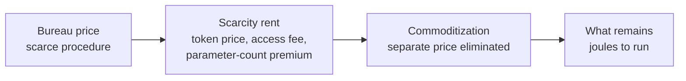

*Revision db13599, 5. November 2026. Daten und Code: [research.openie.dev/data/](/data/#economics). LaTeX PDF: [/pdfs/latex/spellcheck.pdf](/pdfs/latex/spellcheck.pdf) ([Quelle](/pdfs/latex/spellcheck.tex)).*

## Zusammenfassung

Die Rechtschreibprüfung wurde von etwa 1981 bis 1989 für mehrere hundert Dollar verkauft und ist jetzt kostenlos und in die Werkzeuge integriert, die die Menschen bereits benutzen. Dieses Papier dokumentiert diesen Wandel anhand veralteter Quellen und erklärt ihn mit der Ökonomie von Grenzkosten und Bündelung [62, 63].

**In einfachen Worten**

1. Die Menschen mussten früher viel für die Rechtschreibprüfung bezahlen. Jetzt ist sie kostenlos in Telefonen, Browsern und Textverarbeitungsprogrammen enthalten.
2. Sie wurde kostenlos, weil das Prüfen eines Wortes fast nichts kostet, und sie ist am nützlichsten in einem Werkzeug, das man bereits hat.
3. Dasselbe kann bei anderen Computerfähigkeiten geschehen, sobald sie billig auf den Geräten laufen, die die Menschen bereits besitzen, sodass Milliarden von Menschen sie nutzen können.

## Notation

| Begriff | Bedeutung in diesem Papier |
|---|---|
| Automatisierungspfad | Ein Computerverfahren verlässt ein Fachbüro und wird zu einer lokalen Routine auf Hardware, die eine Person bereits besitzt. |
| Existenzbeweis | Ein abgeschlossenes Exemplar dieses Pfades. Rechtschreibprüfung ist ein Beispiel. Das Wort wird nicht im übertragenen Sinne verwendet. |
| Lokal | Die Prüfung läuft auf dem Gerät, das das Dokument enthält. Die ausgelieferte Routine erfordert keine Anmietung eines Frontier‑Rechenzentrums. |
| Gepaarte Hardware | Der Editor, die Tastatur oder das Telefon, das die Person bereits zum Schreiben nutzt. Die Fähigkeit ist keine zweite Maschine. |
| Verfügbar | Die Hardware ist gewöhnlich, nicht eine knappe Anmietung. |
| Zugänglich | Die Person kann die Fähigkeit auf diesem System aktivieren, ohne den Auftrag an ein Fachbüro zu senden. |
| Fähig | Das System kann die Werkzeuge ausführen, die den Auftrag abschließen. |
| Die Vielen (7 Mrd.+) | Mehr als 7 Milliarden Menschen. Die globale Zugangsgruppe, für die das Angebot gedacht ist. |
| Die Wenigen | Die Menschen, die ein Preis bei Knappheit noch erreichen kann. Dies ist eine Preisklasse, keine Kopfzahl: allein Frontier‑Chat erreichte im Oktober 2025 800 Millionen wöchentliche Nutzer [61]. |
| Vorschlag | Eine Rechtschreibempfehlung. Das Dokument wurde noch nicht geändert. |
| Commit | Die Ersetzung wird in das Dokument geschrieben. |
| Vollständigkeit | Das Token bleibt erhalten: es war bekannt, oder ein Kandidat wurde akzeptiert. Weitere Suche liefert keinen Informationswert mehr für dieses Prädikat. |
| Geldpreis | Eine Gebühr, die jemand in Rechnung stellen kann: Token‑Preis, Sitz‑Lizenz, Knappheitsmiete, Zugangsgebühr. Die Kommodifizierung treibt die separate Gebühr auf Null. |
| Parameteranzahl | Die Größe eines Modells. Keine Metrik, die nach der Kommodifizierung der Fähigkeit erhalten bleibt. |
| Joule (J) | SI‑Einheit für Energie. Hier die Energie, die zum Ausführen der Routine verbraucht wird. |
| Lookup, Formel, Modell | Drei Arten von Mechanismen. Ein Wörterbuch‑Abfrage ist ein Lookup. Ein Edit‑Distance‑Generator ist eine Formel. Ein Sprachmodell ist ein Modell. |

## 1. Einleitung

Rechtschreibprüfung ist eine Fähigkeit, die Menschen einst als separates Produkt kauften und die sie jetzt in Werkzeugen erhalten, die sie bereits besitzen. Dieses Papier verfolgt diesen Wandel anhand datierter Preise, der Arbeiten, die das Verfahren entwickelten, der Bibliotheken, die es bereitstellen, und der Maschinen, die es ausführen, und fragt, was dies allgemein für die Computerintelligenz bedeutet.

Menschen zahlten einen Aufpreis. Dann konnte das Ding nicht mehr verkauft werden. Es ist kostenlos und in etwas anderes eingebettet. Die Preise in Abschnitt 2.11 sind diese Tatsache. Die Namen in Abschnitt 2.9 folgen darauf.

Die separate Rechnung des Rechners ist eine datierte Reihe, von den Anita‑Werbungen über den HP‑35 und den TI‑2500 bis zu VisiCalc. Die separate Rechnung der Rechtschreibprüfung endet im Textverarbeitungsprogramm und dann im Betriebssystem. Die Dollar, die die Quellen nicht ausdrucken, bleiben unausgedruckt.

Für die Rechtschreibprüfung ist der Preistrend abgeschlossen. Die Routine ist im Editor zu null Preis eingebettet. Die Joule werden weiterhin verbraucht.

Die Wahl ist der Preis. Knappheits‑Pricing hält eine Fähigkeit zurück und verkauft das Halten. Es erreicht die Menschen, die zahlen können, die wenigen. Globaler Zugang ist die andere Wahl. Die Fähigkeit wird so gebaut, dass sie auf der Maschine läuft, die eine Person bereits besitzt, und die separate Gebühr entfällt. Das erreicht mehr als 7 Milliarden Menschen.

Rechtschreibprüfung ist diese zweite Wahl, fertig. Die Aufgabe besteht darin zu entscheiden, ob ein geschriebenes Token ein Wort ist, und falls nicht, das Wort vorzuschlagen, das der Autor gemeint hat. Kukich (1992) teilt die Aufgabe in Nicht‑Wort‑Erkennung, isolierte Wortkorrektur und kontextabhängige Korrektur. Die ersten beiden wurden gewöhnlich. Sie laufen in Programmen, die Menschen bereits zum Schreiben benutzen. Sie sind Computerintelligenz, keine Geschichte, die erzählt wird, um über ein anderes System zu sprechen.

Die zweite Wahl ist erst abgeschlossen, wenn die Routine billig genug ist, um neben dem Dokument zu laufen, lokal auf der Maschine, die die Datei hält, und gekoppelt an Hardware, die Menschen bereits besitzen. McIlroy (1982) formuliert die Einschränkung in den ersten Sätzen des UNIX‑Spelling‑List‑Papiers. Der Prüfer darf auf Minicomputern verwendet werden, daher muss die Liste kompakt sein. Das ist globaler Zugang als Ingenieurkunst. Ein Grenzmodell, das nur innerhalb eines gemieteten Rechenzentrums antwortet, ist Knappheits‑Pricing weiterhin in Kraft. Es kann fähig sein und dennoch bei den wenigen bleiben, die es mieten können.

Abschnitt 2.11 ist der Aufpreis, datiert. Abschnitt 2.10 ist, wer eine Maschine besitzt, auf der die fertige Fähigkeit laufen kann, und wer nur eine Miete hat. Software, die für die Maschine geschrieben ist, die Menschen bereits nutzen, ist der Weg, wie Zugang die Vielen erreicht. Ein Preis, der die Miete erfordert, ist die Art, wie Knappheit die Wenigen bewahrt.

### Ein Token, in Reihenfolge gelehrt

Norvig (2007) dokumentiert einen lokalen Korrektor und den Aufruf `correction('speling')`, der `spelling` zurückgibt. Dieser Aufruf dient als Lehrbeispiel für den Pfad. Der Produktionsnachweis ist Hunspell in üblichen Editoren, angegeben in Abschnitt 2.5.

1. Die Zeichenkette befindet sich bereits auf der Maschine. Es wird nichts an ein Büro gesendet.
2. Die Suche prüft, ob `speling` in den lokalen Wortzählungen enthalten ist. Das ist nicht der Fall.
3. Eine Formel erzeugt Zeichenketten mit Editierdistanz eins: eine Löschung, eine Transposition, einen Ersatz oder eine Einfügung. Das bekannte Wort `spelling` befindet sich in dieser Menge.
4. Der Vorschlag ist ein Angebot. Das Dokument ändert sich nur, wenn eine Person ihn akzeptiert, oder wenn eine festgelegte Richtlinie ihn akzeptiert. Das ist das Commit.
5. Sobald `spelling` beibehalten wird, ändern weitere Kandidaten das Prädikat „dieses Token ist das Wort, das wir behalten“ nicht. Das ist das Stop.
6. Das Öffnen eines Frontier‑Modells für dieses Token liefert keinen besseren Abschluss. Das Lookup‑plus‑Edit‑Werkzeug hat es bereits abgeschlossen. Die Ablehnung des größeren Aufwands ist kein Rabatt. Es ist die beste Antwort für diese Aufgabe.

Der gleiche Aufsatz zeigt den Fall, dass das lokale Token nicht schließen kann. `correction('where')` bleibt `where`, wenn ein Testpaar `were` erwartete. Das einzelne Wort trägt die Entscheidung nicht. Kukich (1992) bezeichnete dies als das dritte Problem, kontextabhängige Korrektur. Ein größeres Modell kann dort das richtige Werkzeug sein. Der Pfad ist für dieses Werkzeug erst dann abgeschlossen, wenn das Werkzeug auf Hardware läuft, die der Autor bereits besitzt, oder auf einer ressourcenoptimierten zentralen Infrastruktur, die die Person tatsächlich nutzen kann. Ein gemieteter Frontier‑Pass, den der Autor nicht aufrufen kann, bleibt dennoch das Büro.

## 2. Verwandte Arbeiten

### 2.1 Erkennung und Korrektur isolierter Wörter

Damerau (1964) gibt ein Verfahren für ein Wort an, das in einem Wörterbuch fehlt und höchstens einen Fehler aufweist: einen falschen Buchstaben, einen fehlenden Buchstaben, einen zusätzlichen Buchstaben oder eine einzelne Vertauschung. Das nicht identifizierte Wort wird unter jeder dieser Annahmen erneut mit dem Wörterbuch verglichen. Die Zusammenfassung berichtet korrekte Identifikationen für über 95 Prozent dieser Fehlertypen in dem von ihm durchgeführten Test. Dieses Papier zitiert dieses Ergebnis als sein eigenes. Der Test wird nicht wiederholt.

Peterson (1980) gibt einen Überblick über Computerprogramme, die Rechtschreibfehler erkennen und korrigieren. Zu diesem Zeitpunkt ist die Fähigkeit bereits in einer Literatur von funktionierenden Programmen dokumentiert, nicht als Vorschlag, dass ein Programm eines Tages ein Wort prüfen könnte.

Kukich (1992) strukturiert das Feld in die oben genannten drei Probleme. Die Erkennung von Nichtwörtern verwendet eine Wortliste, Musterabgleich oder n‑Gram‑Analyse. Die Korrektur isolierter Wörter schlägt ein Wörterbuchwort für ein erkanntes Nichtwort vor. Die kontextabhängige Korrektur behandelt ein Token, das ein echtes Wort ist und dennoch das falsche Wort darstellt. Der Überblick ist die Karte. Der Existenzbeweis in diesem Papier beruht auf Hunspell in der Produktion: LibreOffice, Firefox, Chrome, Linux‑Distributionen und macOS rufen eine lokale Wörterbuchroutine auf (Hunspell README). Die ersten beiden Kukich‑Probleme verließen den Überblick und gelangten in diese üblichen Editoren. Norvig (2007) bleibt die lehrreiche Durchgangsanleitung von Lookup gefolgt von einer kurzen Bearbeitung, nicht die Produktionsrealität.

### 2.2 Die Liste wurde für die Maschine konzipiert

McIlroy (1982) beschreibt die Wortliste hinter dem UNIX‑Rechtschreibprüfer. Die Zusammenfassung gibt die ingenieurtechnische Vorgabe und das Ergebnis an. Der Prüfer kann auf Minirechnern verwendet werden, daher muss die Liste kompakt sein. Das Entfernen von Präfixen und Suffixen, Hashing und Kompression reduzieren eine Liste von 30 000 englischen Wörtern auf 26 000 16‑Bit‑Maschinenwörter. Johnsons früherer Prüfer sah Wörter eines Dokuments nach, das bereits auf der Maschine war. McIlroys Beitrag für dieses Papier ist die Paarung: Das Wörterbuch wurde komprimiert, weil das Ziel der Minirechner war, den die Menschen tatsächlich benutzen würden, und nicht ein größerer Rechner, der für die Aufgabe reserviert war.

Diese Wortzahlen sind seine veröffentlichten Zahlen.

### 2.3 Ein verrauschter Kanal ist noch immer ein lokales Programm

Kernighan, Church und Gale (1990) bewerten Kandidatenkorrekturen mit einem Noisy-Channel‑Modell: die Wahrscheinlichkeit des Kandidaten multipliziert mit der Wahrscheinlichkeit des Tippfehlers gegeben den Kandidaten. Das Programm ist ein Rechtschreibkorrektor im herkömmlichen Sinne, eine lokale Berechnung über ein Wörterbuch und ein Fehlermodell. Eine bessere Bewertung ist keine andere Implementierung. Das Werkzeug kann schärfer werden und auf der Maschine verbleiben, die den Text enthält.

### 2.4 Ein Korrektor, der auf eine Seite passt und kein Netzwerk benötigt

Norvig (2007) schrieb die Erklärung auf einer Ebene, ohne Rechtschreibfehler‑Daten und ohne Internetverbindung. Das Sprachmodell ist eine lokale Datei von etwa einer Million Wörtern, die in 32 192 verschiedene Wörter aufgeteilt sind und 1 115 504 mal vorkommen. Das Fehlermodell ist bewusst grob: ein bekanntes Wort mit Editierdistanz 0 schlägt jedes Wort mit Distanz 1, das wiederum jedes Wort mit Distanz 2 schlägt. Nach dem Flug wertete er gegen Mengen aus dem Birkbeck‑Korpus von Mitton aus. Er berichtet, dass 75 Prozent von 270 Entwicklungs‑Paaren korrekt waren, bei 41 Wörtern pro Sekunde, und 68 Prozent von 400 End‑Test‑Paaren korrekt, bei 35 Wörtern pro Sekunde. Er stellt fest, dass er seine Ziele für Kürze und Geschwindigkeit erreicht hat, jedoch seine Hoffnung von 80 bis 90 Prozent Genauigkeit verfehlt hat.

Diese Zahlen sind seine gemeldeten Evaluationen. Das Spielzeug ist kein industrieller Prüfer. Ein nützlicher Ausschnitt der Leistungsfähigkeit läuft von einer Datei auf dem Rechner vor dem Programmierer, mit Zehntausenden von Wörtern pro Sekunde, ohne Netzwerk. Das ist die Form eines abgeschlossenen Automatisierungswegs. Die Fehltritte, die er auflistet, insbesondere unbekannte Wörter im Wörterbuch und Entscheidungen, die benachbarte Token benötigen, sind das Residuum. Sie sind Argumente für ein besseres lokales Werkzeug, nicht Argumente dafür, dass die Aufgabe zurück in ein Büro verlagert werden muss.

### 2.5 Die Bibliothek in gewöhnlichen Editoren

Das Hunspell‑Projekt gibt an, dass Hunspell der Rechtschreibprüfer und morphologische Analysator ist, der von LibreOffice, von freien Browsern einschließlich Firefox und Chrome und von anderen Werkzeugen und Betriebssystemen einschließlich Linux‑Distributionen und macOS (Hunspell‑README) verwendet wird. Die Bibliothek liest eine lokale Wörterbuchdatei und eine lokale Affix‑Datei. Das Befehlszeilen‑Werkzeug prüft eine lokale Textdatei. Der Code stammt von MySpell, Kevin Hendricks‘ Implementierung in OpenOffice.org, die wiederum eine Neuimplementierung der Affix‑Rechtschreibung von Geoff Kuenning‘s International Ispell ist. László Némeths Hunspell fügt Unicode und die Morphologie hinzu, die für Sprachen nötig ist, in denen eine reine englische Wortliste das falsche Werkzeug darstellt.

Dieses README gibt an, wo die Bibliothek eingesetzt wird. Die Tatsache, dass sie beiträgt, ist eine Bereitstellungsklasse. Der Prüfer in diesen Programmen ist eine lokale Bibliothek und eine lokale Wortliste.

### 2.6 Das Telefon bereits in der Hand

UITextChecker ist eine UIKit‑Klasse. Der Aufrufer übergibt einen String und eine Sprache. Die Methode liefert den Bereich eines falsch geschriebenen Wortes in diesem String zurück oder meldet, dass kein Fehler gefunden wurde (Apple, UITextChecker). Die Prüfung erfolgt als Aufruf auf dem Gerät, gegen eine Sprache, die das System als verfügbar auflistet. Dieses Papier behauptet keinen Joule‑Wert für diesen Aufruf. Die API‑Form ist die Paarung: Der Text befindet sich bereits in der Textansicht, und der Prüfer ist eine Methode daneben.

Das Rechtschreibprüfungs‑Framework von Android ist ebenfalls auf dem Gerät. Eine Anwendung erweitert `SpellCheckerService`, implementiert eine Sitzung und liefert Vorschläge für den Text, den die Sitzung erhält (Android Developers, spell‑check‑framework; `SpellCheckerService`). Der Prüfer der lateinischen Eingabemethode ist ein lokaler Dienst mit Ländereinstellungen‑Wörterbüchern. Auch hier wird aus der Dokumentation keine Energienummer entnommen. Die Dokumentation platziert die Routine auf dem Telefon.

Hard und Kollegen (2018) trainieren ein Next‑Word‑Modell für die Gboard‑Telefon‑Tastatur mittels föderiertem Lernen. Clients berechnen Updates auf Text, der auf dem Gerät bleibt. Der Server aggregiert diese Updates und erhält den Roh‑Tippen nicht. Derselbe Artikel stellt fest, dass Gboard sowohl Autokorrektur als auch Next‑Word‑Vorhersage bietet und dass die Tastatur bis 2019 über 1 Milliarde Installationen verfügte. Dieser Installations‑Satz ist die eigene Deploy‑Behauptung des Artikels. Er ist keine Zählung der mehr als 7 Milliarden Menschen, auf die sich diese Meinung bezieht.

Das Modell, das sie ausliefern, ist bewusst klein. Nach Quantisierung beträgt es 1,4 Megabyte, mit einem Vokabular von 10 000 Wörtern, unter einer Produktvorgabe, die sie als sichtbare Reaktion innerhalb von etwa 20 Millisekunden und einer Modellgröße von mehreren zehn Megabyte angeben. Die Teilnahme am Training in ihrer Studie ist enger gefasst als die Installationsbasis: nordamerikanische Geräte, mindestens 2 Gigabyte Speicher, Laden, Leerlauf und ein unmetered‑Netzwerk. Diese Studie zitiert die Deploy‑Klasse. Eine Tastatur, die bereits verwendet wird, trägt ein kleines on‑device‑Sprachmodell, und das dort beschriebene Training exportiert den getippten Text nicht. Es zitiert ihre Recall‑Tabellen nicht als Ergebnis der Rechtschreib‑Genauigkeit.

### 2.7 Die Hardware-Lotterie

Hooker (2020; 2021) bezeichnet das Hardware‑Lotterie‑Phänomen: Eine Forschungs­idee gewinnt, weil sie zur verfügbaren Hardware und Software passt, nicht weil sie die beste Idee im abstrakten Sinne ist. Rechtschreibprüfung gewann eine Lotterie, die es wert war, gewonnen zu werden. Die verfügbare Hardware war die Maschine, die das Dokument hielt. Der Algorithmus, der passte, war eine Wortliste plus ein kleines Editier‑Modell. Eine Fähigkeit, die nur zu einem Frontier‑Accelerator passt und nur als Zeit auf diesem Accelerator verkauft wird, befindet sich in einer anderen Lotterie. Hookers Warnung lautet, dass Ideen, die die installierte Hardware verfehlen, selbst dann stagnieren, wenn sie gut sind. Die Design‑Folge in diesem Papier ist die umgekehrte Lesart derselben Tatsache. Wenn das Ziel Computer‑Intelligenz für die Vielen ist, muss die Idee zur Hardware passen, die die Vielen bereits besitzen, oder zu einer Hardware, die ein ressourcen‑optimiertes zentrales Geflecht zu ihnen erweitern kann. Eine knappe Miete anzupassen, ist der Weg, wie eine Fähigkeit bei den Wenigen bleibt.

### 2.8 Was diese Literatur nicht zu beweisen aufgefordert wird

Keine der oben genannten Rechtschreibquellen ist eine Bevölkerungs­tabelle. Wenn in Abschnitt 4 eine Rechtschreibzahl erscheint, handelt es sich um die eigene Zählung der Quelle: Wörter im Wörterbuch, Größe des Test‑Sets, Wörter pro Sekunde oder eine veröffentlichte Identifikationsrate. Abschnitt 2.10 fügt eine andere Klasse hinzu. Jede Hardware‑Zahl ist die Versand‑, Abonnenten‑, Umsatz‑ oder Umfrage­zahl des Verlegers, wobei das Jahr angehängt ist. Mehr als 7 Milliarden Menschen und die wenigen, die einen Knappheits­preis zahlen können, bilden die beiden Klassen in der Meinung. Sie stellen keine Summe dieser Zeilen dar.

### 2.9 Wie Computerautomatisierung bepreist wird

Eine zitierte Rate bleibt innerhalb des Papiers, das sie veröffentlicht hat. Es wird hier keine Kurve angepasst. Es wird weder eine Steigung, Halbwertszeit noch ein Null‑Preis‑Jahr angegeben.

In einfachen Worten, vor den Namen. Menschen zahlten früher einen Aufpreis für Rechtschreibprüfung und für gewöhnliche Berechnung. Rechtschreibprüfung als Basisschicht‑Produkt kann nicht mehr verkauft werden. Sie ist kostenlos und in den Editor, den Browser und das Telefon eingebettet. Gewöhnliche Berechnung ist in das Telefon und den Computer eingebettet. Die unten stehenden Namen sind lediglich Bezeichnungen für diese Reihenfolge.

Drei Regime benennen, wie ein Computer‑Automatisierungstool bepreist wird. Abschnitt 2.11 ist das datierte Band für den Taschenrechner und für die Rechtschreibprüfung. Jeder Preis ist der Preis einer Quelle. Es wird keine Kurve durch sie hindurch angepasst.

**Büropreis.** Während das Verfahren knapp ist, zahlt der Käufer einer Person oder einer gebuchten Maschine. Nordhaus (2007) misst den langfristigen Geldpreis der Berechnung selbst, nicht der Rechtschreibprüfung. In diesem Artikel beginnt der Preis der Berechnung bei etwa 500 \$ pro Million Berechnungen pro Sekunde für manuelle Arbeit und fällt bis $6 \times 10^{-11}$ pro Million Berechnungen pro Sekunde bis 2006, in Preisen von 2006, ein Rückgang in der Größenordnung von 8,3 Billionen. Diese Zahl ist der Quotient dieses Aufsatzes der beiden gerade genannten Endpunkte, 500 \$ / $6 \times 10^{-11}$. Die Endpunkte sind seine berichteten Zahlen. Sie werden hier nicht neu angepasst, und der Quotient ist keine Prognose. Sie dokumentieren, dass der Geldpreis des Substrats der Automatisierung um Größenordnungen gesunken ist. Ein Rückgang dieses Index bedeutet noch nicht die Eliminierung einer separaten Rechnung für ein Produkt, und er ist kein Joule‑Meter.

**Knappheits­preis und das Rennen, das er erzeugt.** Sobald ein Unternehmen das Verfahren versenden kann, kann es mehr verlangen, als es kostet, es zu betreiben. Diese Lücke ist Knappheits‑Rente. Eine Zugangsgebühr und ein Token‑Preis sind dieselbe Lücke in unterschiedlichen Kostümen. Eine Parameter‑Anzahl wird Teil des Kostüms, wenn Käufer lernen, für Größe zu zahlen. Die Rente ist das, was das Rennen erzeugt. Rivalen verdrängen die Rente, indem sie die Fähigkeit in ein Produkt einbinden, das der Käufer bereits besitzt, oder sie ersetzen das Produkt vollständig. Veröffentlichte Inferenzpreise sagen, dass das Rennen für Sprachmodelle im Gange ist und noch nicht abgeschlossen ist. Epoch AI (2025) berichtet von Preisrückgängen bei fester Leistung in der Größenordnung von 9 bis 900‑fach pro Jahr über die Benchmarks in dieser Notiz. Emberson und Roodman (2026) berichten von einem Rückgang von etwa 47 % pro Quartal bei den Kosten einer gegebenen Leistung seit etwa 2023, den sie als etwa 13‑fach pro Jahr zusammenfassen. Das sind ihre Zusammenfassungen ihrer Reihen. Der Index wird nicht neu geschätzt. Es wird keine Linie durch die Punkte gezogen. Keine Rate ist ein Gesetz außerhalb ihres Zeitfensters. Das Paper zur Aufgaben‑Sättigung verwendet denselben zitierten Rückgang als Beweis für eine noch im Gange befindliche Moat‑Verdrängung; diese Behauptung bleibt in diesem Paper.

**Preiseliminierung.** Die Kommodifizierung ist das Ende der separaten Gebühr. Die Fähigkeit bleibt erhalten. Die Rechnungsposition nicht. Rechtschreibprüfung ist das abgeschlossene Beispiel. Hunspell ist eine kostenlose Rechtschreibbibliothek unter einer Dreilizenz (LGPL, GPL und MPL). Das Projekt gibt an, dass LibreOffice, Firefox, Chrome, Linux‑Distributionen und macOS es aufrufen, und dass ein Check ein lokales Wörterbuch liest (Hunspell README). Der Käufer dieser Editoren zahlt keinen Token‑Preis für ein Nichtwort, zahlt keine Zugangsgebühr an ein Rechtschreibbüro und kauft keinen Parameter‑Count. Der Geldpreis der Methode als separates Gut ist null. Das ist Preiseliminierung. Es ist keine Behauptung, dass der Editor selbst kostenlos ist, und es ist keine Behauptung, dass das Telefon kostenlos war. Es ist die Behauptung, dass Rechtschreibkorrektur nicht mehr als eigenes Gut bepreist wird.

**Knappheits‑Preisgestaltung kann auf die Maschine übergehen.** Das Ende des separaten Softwarepreises beendet nicht jeden Knappheits‑Preis. Eine Plattform kann eine neuere Fähigkeit auf ein neueres Gerät legen und für das Gerät Gebühren erheben. Yusuf Mehdi, 20. Mai 2024, definierte einen Copilot+‑PC durch eine neuronale Verarbeitungseinheit von 40 oder mehr TOPS. Die erste Welle nutzt Snapdragon, das kleine Modell läuft auf dieser Einheit, und große Modelle bleiben bei Azure. Apples Konto vom 9. Juni 2025 platziert ein geräteinternes Modell von etwa 3 Milliarden Parametern auf Apple‑Silicon und lässt das größere Modell in Private Cloud Compute. Das sind Preise für ein späteres Gerät und für die Maschine, die es hält. Sie sind keine wiederaufgelebte Rechnung für die Rechtschreibprüfung. Der Prüfer läuft bereits im Editor, im Browser und auf dem Telefon, das die Menschen besitzen, einschließlich der vorherigen Generation, die noch in der Hand ist. Eine Aktualisierung, die jemanden auffordert, eine neue Computerkategorie zu kaufen, um einen Check zu erhalten, den die alte Maschine bereits ausführt, ist Knappheits‑Preisgestaltung der Hardware. Sie erreicht die Menschen, die diese Klasse kaufen. Nur wenige können diese Klasse sein. Sie macht den bereits für mehr als 7 Milliarden Menschen abgeschlossenen Zugang nicht rückgängig.

Kontextabhängige Korrektur ist nicht dieser abgeschlossene Fall. Kukich (1992) nannte sie das dritte Problem: ein Token, das ein echtes Wort ist und dennoch das falsche Wort. Ein größeres Modell kann dort das richtige Gerät sein. Bei der Korrektur grammatischer Fehler korrigieren größere und besser trainierte Modelle besser: GECToR [71] und ein 11‑Milliarden‑Parameter‑mehrsprachiges Modell [72] setzten zum jeweiligen Zeitpunkt den Stand der Technik. Der Kompromiss ist Energie: Luccioni, Jernite und Strubell messen generative Aufgaben als deutlich energieintensiver als Klassifikationsaufgaben pro Inferenz [73]. Der isolierte‑Wort‑Fall von Abschnitt 4.10 ist der Fall, in dem die zusätzliche Ausgabe keinen anderen Token kauft. Das Gerät hat die Zugangs­wahl nur getroffen, wenn es auf Hardware läuft, die die Person bereits besitzt, oder auf einem ressourcenoptimierten zentralen Netzwerk, das die Person nutzen kann. Eine knappe Miete ist die Knappheits­wahl, selbst wenn das Modell auf einem Benchmark genauer ist. Der gewöhnliche Nichtwort‑Job wandert nicht zurück zu dieser Miete, weil der Kontext‑Job unvollständig ist. Keine Joule‑Tabelle, die einen Wörterbuch‑Probe, ein lokales Modell und einen Rechenzentrum‑Aufruf vergleicht, wird hier gedruckt. Keiner dieser Joule‑Werte wurde für dieses Papier gemessen.

Was bleibt, ist die Energie, die zum Durchführen des Vergleichs benötigt wird. Eine lokale Wörterbuch‑Probe verbraucht Joule auf dem Gerät, das das Dokument hält. Hier werden keine Joule gemessen. Es wird keine analytische Gesamtsumme berechnet. `measured_j` ist nicht gesetzt: es wurde kein Zählerstand abgelesen.

Die Vorhersage ergibt sich aus den Regimen, nicht aus einer Regression. Übliche Aufgaben der Computerintelligenz folgen der Rechtschreibprüfung. Ihre Token‑Preise, Parameter‑Zahl‑Prämien, Knappheits‑Renten und Zugangsgebühren werden durch Bündelung auf bereits vorhandener Hardware und durch Methoden, deren Lizenzpreis null ist, weggekämpft. Der Endzustand gilt für mehr als 7 Milliarden Menschen, nicht für die wenigen, die einen Knappheits‑Preis zahlen können. Die Vorhersage scheitert, wenn eine gewöhnliche Aufgabe, wie die Rechtschreibprüfung bereits abschließt, einen dauerhaften separaten Geldpreis behält, nachdem eine lokale Routine gleichen Ergebnisses in den Händen der Personen ist, die das Dokument besitzen. Ein Grenz‑Benchmark, das noch eine Prämie trägt, ist nicht dieses Scheitern. Es ist die Burggraben‑Phase, die Epoch‑Notizen bereits zeigen, dass sie günstiger wird, und die Rechtschreibprüfung zeigt, wie man sie verlässt.

Die gleichen Regime werden in der interaktiven Abbildung [sc-anim-01](/living/spellcheck/#sc-anim-01) dargestellt. Zwei Punkte sind Nordhaus‘ gemeldete Endpunkte. Der gestrichelte Verbinder verbindet diese beiden Endpunkte. Es wird keine Rate geschätzt. Epoch‘s 9‑zu‑900‑Spanne und die etwa‑13‑mal‑Zusammenfassung befinden sich in einem Hinweisfeld. Sie bleiben ihre Zusammenfassungen. Das Rechtschreib‑Prüf‑Panel ist das abgeschlossene Regime: der separate Geldpreis ist weg, und die Joule bleiben ungemessen.

Landauer (1961) setzt eine physikalische Untergrenze für das Löschen eines Bits. Horowitz (2014) ist die praktische CMOS‑Aussage: Datenbewegung dominiert, weit über dieser idealen Grenze. Ein Wörterbuch‑Probe bewegt Bits. Kommodifizierung kann die Rechnung auf null setzen und dennoch diese Bewegung hinterlassen. Keine Joule‑Summe für die Rechtschreibprüfung wird aus einer der beiden Quellen berechnet.

**Bündelung als Strategie.** Die Bündelungs‑Literatur liest dieselbe Geschichte als Strategie wie auch Zugang. Adams und Yellen zeigen, dass ein Bündel ein Werkzeug der Preisdiskriminierung ist [68]. Nalebuff zeigt, dass ein Bündel den Eintritt eines Rivalen verhindern kann, der ein Gut verkauft [69]. Spolsky benannte die Taktik für Software: kommodifiziere dein Komplement, sodass das Produkt, das du verkaufst, mehr wert ist [70]. Jede Lesart stimmt mit dem beobachtbaren überein, das dieser Aufsatz verwendet: der separate Preis der gebündelten Schicht geht gegen null. Sie unterscheiden sich darin, wer die Rente behält. Dieser Unterschied erklärt, warum dieser Aufsatz sowohl verfolgt, wer die Plattform hält, als auch den Preis.

### 2.10 Hardware-Zugang, Kategorie für Kategorie

Hooker benennt die Lotterie. Dieser Abschnitt benennt die Maschinen. Das Argument besteht aus sieben Datensätzen. Eine Telefonlieferung ist keine Rechenzentrumslieferung. Eine Steam‑Umfrage ist kein Zensus von PCs. Eine Umsatzzeile ist keine Stückzahl. Wo ein Unternehmen die Stückzahlen nicht offenlegt, sagt das Papier dies und zitiert die Zahl, die das Unternehmen offengelegt hat. Keine dieser Zahlen ist eine Zählung der Vielen oder der Wenigen. Sie sind keine Summe der Zeilen. Die lebenden Zahlen [sc-hw-01](/living/spellcheck/#sc-hw-01) und [sc-gen-01](/living/spellcheck/#sc-gen-01) sind dieselben Datensätze.

Für jede Kategorie sind die Fragen dieselben. Wer besitzt die Maschine, nach der eigenen Zählung der Quelle. Welche Software‑Stack diese Maschine ausführt. Wie dieser Stack den besten Frontier‑Stack erfüllt. Die Designbehauptung besteht aus einem Satz: Software, die für die global zugängliche Generation geschrieben wurde, hat die größte Wirkung. Die zugängliche Generation ist die, die gerade in der Hand liegt. Rechtschreibprüfung ist das fertige Automatisierungsbeispiel dieses Satzes. McIlroy maß die Liste für den Minicomputer im Einsatz. Energieverbrauch ist die Kennzahl, die bleibt. Diese Zeilen zeigen, wer die Maschine hat. Sie sind nicht Joule.

**Telefone und mobile SoC‑Generationen.** GSMA, The Mobile Economy 2025, zählt 5,8 Milliarden eindeutige mobile Abonnenten zum Ende 2024, eine Penetrationsrate von 71 Prozent und 4,7 Milliarden mobile Internetnutzer. IDCs vorläufiger Worldwide Quarterly Mobile Phone Tracker vom 13. Januar 2026 zählt 1 260,3 Millionen Smartphones, die 2025 ausgeliefert wurden, davon 247,8 Millionen von Apple. IDCs Veröffentlichung vom 13. Januar 2025 zählte 1 238,8 Millionen Smartphones im Jahr 2024. Die Tabelle von 2026 wiederholt 2024 mit 1 236,3 Millionen. Jede Veröffentlichung behält ihre eigene Gesamtsumme. Arm berichtet im Jahresbericht für das am 31. März 2025 endende Geschäftsjahr, dass Arm‑basierte CPUs in mehr als 99 Prozent der weltweit im Geschäftsjahr verkauften Smartphones enthalten waren und dass Kunden kumulativ mehr als 310 Milliarden Arm‑basierte Chips ausgeliefert haben, von den kleinsten Sensoren bis zu Supercomputern. Die kumulative Zahl umfasst den gesamten Arm‑Markt. Es handelt sich nicht um eine Telefonzählung, und der Bericht teilt sie nicht nach SoC‑Generationen auf.

Das 2025‑Handy ist eine aktuelle mobile SoC‑Generation: Apple‑Silicon, Qualcomm Snapdragon, MediaTek, Samsung, Google Tensor. IDC zählt markengebundene Handys. Die Abonnentenzahl bezieht sich auf Personen mit einem Mobilfunkvertrag, nicht auf eine Zählung von SoCs.

Der Software‑Stack dieses Handys enthält bereits einen lokalen Prüfer. UITextChecker und Android `SpellCheckerService` sind das Rechtschreibbeispiel. Ein Modell auf demselben Handy nutzt Apple Core ML und das Foundation‑Models‑Framework, Android LiteRT und NNAPI, Qualcomms QNN‑Compiler, ExecuTorch oder llama.cpp. Apples Bericht vom 9. Juni 2025, abgestimmt auf den technischen Bericht vom 17. Juli 2025, beschreibt ein On‑Device‑Foundation‑Model mit etwa 3 Milliarden Parametern, komprimiert auf 2 Bit pro Gewicht, und ein Server‑Mixture‑of‑Experts‑Modell, das auf Private Cloud Compute läuft. Liquid AIs LFM2‑Bericht entwirft dichte Modelle von 350 Millionen bis 2,6 Milliarden Parametern und ein 8,3 Milliarden Mixture‑of‑Experts‑Modell mit 1,5 Milliarden aktiven Parametern für ExecuTorch, llama.cpp und vLLM und misst sie auf einem Samsung Galaxy S25 mit einem Snapdragon 8 Elite. PrismML gibt an, dass sein Ternary Bonsai 2 27B, das auf Qwen3.8 27B basiert, 98,2 Prozent des Voll‑Präzisions‑Gegenstücks bei einem neunmal kleineren Fußabdruck von 5,9 GB behält. Diese Verhältnisse stammen von PrismML. Dieses Papier misst sie nicht erneut.

Die Schnittstelle zum Frontier‑Stack ist ein kleineres Modell, ein Low‑Bit‑Modell oder ein Aufruf zu einem Server, den der Anbieter betreibt. Apple gibt das in einem Bericht an. Ein Frontier‑Training‑Durchlauf landet nicht auf dem Telefon. Der Designanspruch für diese Zeile: Software, die für die bereits ausgelieferte SoC‑Generation geschrieben wurde und für die Handys, die noch aus Vorjahren im Einsatz sind, hat die größere Wirkung. Rechtschreibprüfung ist diese Software.

**PCs und Laptops.** IDCs Veröffentlichung vom 9. Januar 2025 zählt 262,7 Millionen traditionelle PCs, die 2024 ausgeliefert wurden. IDCs vorläufige Veröffentlichung vom 12. Januar 2026 zählt 284,7 Millionen im Jahr 2025. Die Tabelle für 2026 wiederholt 2024 mit 263,3 Millionen. In der Gewinnkonferenz vom 28. Januar 2026 sagte Satya Nadella, Windows habe 1 Milliarde Windows 11‑Nutzer erreicht, ein Anstieg von über 45 Prozent gegenüber dem Vorjahr. Ein Versandjahr entspricht nicht dieser installierten Basis.

Der Stack besteht aus dem Betriebssystem, dem Browser und einer lokalen Bibliothek. Hunspell ist die Rechtschreib‑Komponente in gewöhnlichen Editoren. Ein Modell auf demselben PC nutzt ONNX Runtime, DirectML, Windows ML, llama.cpp oder ExecuTorch auf der CPU und der integrierten GPU. Eine diskrete GPU ist die nächste Kategorie. Liquid AI misst dieselbe LFM2‑Familie auf einem AMD Ryzen AI 9 HX 370 mit llama.cpp bei Q4_0. Das ist eine Laptop‑CPU‑Messung in ihrem Bericht, keine Messung aus einem Rechenzentrum.

Die Schnittstelle zum Frontier‑Stack ist ein API‑Aufruf oder ein Modell, das in den Speicher der Maschine passt. Die beiden sind unterschiedliche Programme. Das erste ist ein Mietmodell. Das zweite ist der Pfad. Der Designanspruch für diese Zeile: Software für die PC‑Generation, die Menschen bereits nutzen, hat die größere Wirkung. Rechtschreibprüfung wählte diesen Pfad. Ein Gewicht, das einen gemieteten Beschleuniger annimmt, tat dies nicht.

**Consumer‑GPUs.** NVIDIAs Finanzbericht für das Geschäftsjahr 2026, das am 25. Januar 2026 endete, berichtet über Gaming‑Umsätze von 16,0 Milliarden \$. Das ist Umsatz, keine Stückzahl. Jon Peddie Research, 5. März 2026, berichtet über 11,48 Millionen PC‑Grafik‑Add‑in‑Boards, die im vierten Quartal 2025 ausgeliefert wurden, ein Anstieg von 36,0 Prozent gegenüber dem Vorjahr, mit einer Desktop‑Attach‑Rate von 55 Prozent in diesem Quartal. Der gleiche Hinweis sagt, dass Daten‑Center‑GPU‑Boards um 17,0 Prozent gegenüber dem vorherigen Quartal gestiegen sind und veröffentlicht ihre Stückzahl nicht. Eine „installierte Basis“ von 172 Millionen in diesem Hinweis ist ein Prognose‑Endpunkt. Dieses Papier verwendet sie nicht als aktuelle Zählung.

Valves Steam‑Hardware‑ und Software‑Umfrage für September 2026 berichtet, unter den befragten Kunden, NVIDIA GeForce RTX 5070 mit 6,15 Prozent, RTX 5090 mit 0,40 Prozent, RTX 4060 mit 3,89 Prozent, RTX 3060 mit 3,66 Prozent und GTX 1650 mit 2,19 Prozent. Die Umfrage umfasst Steam‑Teilnehmer. Sie ist nicht die Welt. Dieses Papier fügt diese Anteile nicht zu einer Generations‑Summe hinzu. Die Liste ist unvollständig, und die Umfrage enthält eine „Andere“-Kategorie.

Der Stack ist CUDA auf NVIDIA und ROCm oder Vulkan auf AMD. llama.cpp führt ein quantisiertes Modell auf der Karte aus. vLLM stellt ein Modell bereit, wenn die Karte das Gewicht hält. Die Schnittstelle zum Frontier‑Stack ist Quantisierung, ein kleineres Modell oder eine API. Eine Consumer‑Karte führt das Modell aus, das passt. Das Frontier‑Training‑System passt nicht. Der Designanspruch für diese Zeile: Software, die auf das Flaggschiff abzielt, richtet sich an 0,40 Prozent einer Gamer‑Umfrage. Software, die auf die Karten abzielt, die Menschen noch melden, einschließlich 30‑Series‑ und 40‑Series‑Teile, deckt die installierte Generation ab. Das ist die größere Wirkung.

**Datacenter‑Beschleuniger.** NVIDIAs gleiches Finanzjahr‑2026‑Release berichtet über Data‑Center‑Umsatz von 193,7 Milliarden \$ für das Jahr, ein Anstieg von 68 Prozent, und 62,3 Milliarden \$ im vierten Quartal. Das Release gibt keine Stückzahlen von Hopper, Blackwell oder Rubin an. Es beschreibt eine mehrjährige Partnerschaft mit Meta, die Millionen von Blackwell‑ und Rubin‑GPUs umfasst. Dieser Satz ist NVIDIAs Darstellung eines Einsatzplans. Es ist keine geprüfte Zählung von Karten in Racks. Am 28. Oktober 2025 sagte Jensen Huang auf der GTC in Washington, dass 6 Millionen Blackwell‑GPUs in den letzten vier Quartalen ausgeliefert wurden. CNBC berichtete am selben Tag über diesen Satz. Das Finanzjahr‑2026‑Release gibt weiterhin keine Stückzahlen an. Die 6‑Millionen‑Zahl ist Huang‑Aussage. Es ist keine geprüfte Stückzahl. Derselbe Bericht nennt erwartete 500 Milliarden \$ an GPU‑Verkäufen über Blackwell und Rubin. Das ist eine Verkaufserwartung. Dieses Papier wandelt das nicht in eine Stückzahl um.

AMD’s Release vom 3. Februar 2026 berichtet über Data‑Center‑Segment‑Umsatz von 16,6 Milliarden \$ für das Kalenderjahr 2025, ein Anstieg von 32 Prozent, und stellt fest, dass das Wachstum sowohl EPYC‑CPUs als auch Instinct‑GPUs widerspiegelt. Instinct ist keine separate Umsatzlinie, außer einem offengelegten Teil: Instinct‑MI308‑Umsatz im vierten Quartal nach China von etwa 390 Millionen \$. Keine Instinct‑Stückzahl ist im Release enthalten.

Am 28. Januar 2026 sagte Nadella in der Telefonkonferenz, dass Microsofts Flotte NVIDIA, AMD und Microsofts eigenen Maya 200‑Beschleuniger umfasst, den das Unternehmen online gebracht hatte. Amy Hood sagte, dass die Investitionsausgaben in diesem Quartal 37,5 Milliarden \$ betrugen, wobei etwa zwei‑Drittel auf kurzlebige Vermögenswerte, hauptsächlich GPUs und CPUs, entfielen, und dass die Nachfrage das Angebot überstieg. Keine Maya‑Stückzahl ist im Transkript enthalten. Google‑TPU‑ und Amazon‑Trainium‑Stückzahlen sind in den für diesen Abschnitt gelesenen Quellen nicht enthalten. Sie werden genannt, damit die Kategorie nicht auf einen Anbieter reduziert wird. Die fehlende Stückzahl ist das fehlende Register.

Wer sie hat: die Käufer, die für diesen Umsatz Verträge abschließen. Hood sagte, ein Großteil des GPU‑Kapitals sei bereits für die Nutzungsdauer der Hardware vertraglich gesichert. Das ist ein Mietmarkt. Der Stack auf dem Beschleuniger ist CUDA, ROCm und die Servicestacks, die die Karte voraussetzen, einschließlich TensorRT‑LLM und vLLM. Diese Kategorie ist der Frontier‑Stack. Die Schnittstelle aller anderen dazu ist eine API, ein destilliertes Modell oder ein quantisiertes Modell. Der Designanspruch für diese Zeile: Software, die den Beschleuniger benötigt, erreicht die Mieter. Software, die für die Generationen in den anderen Zeilen geschrieben wurde, erreicht die Personen, die diese Maschinen besitzen. Rechtschreibprüfung erledigte das Zweite. Das Erste ist die Büro‑Stufe.

**MCUs, winzige Bauteile und Embedded‑Bauteile.** Arms kumulative Zahl von mehr als 310 Milliarden Chips umfasst Sensoren und Embedded‑Geräte. Der Jahresbericht teilt diese kumulative Zahl nicht in Mikrocontroller auf. IC Insights, 29. März 2022, gibt an, dass 2021 Lieferungen 30,9 Milliarden Mikrocontroller erreichten, nach einem Stückwachstum von 12 Prozent jenes Jahres. Das ist eine Versandzahl für 2021. Derselbe Hinweis prognostiziert 35,8 Milliarden Einheiten für 2026. Die Prognose ist keine aktuelle Zählung.

MLCommons, 17. September 2025, veröffentlicht MLPerf Tiny v1.3. Die Suite misst neuronale Netze, die typischerweise unter 100 Kilobyte liegen. Die Veröffentlichung enthält 70 Ergebnisse über fünf Tests, darunter 27 Energieergebnisse, von Kai Jiang, Qualcomm, STMicroelectronics und Syntiant. Fünf Hardwareplattformen wurden zum ersten Mal benchmarked. Die Tests decken Bildklassifikation, visuelle Wake‑Words, Keyword‑Spotting, Anomalieerkennung und eine Streaming‑Wake‑Word‑Aufgabe ab.

Der Stack ist TensorFlow Lite für Mikrocontroller, CMSIS‑NN und die von den Einreichungen genutzten Vendor‑Runtimes. Das Modell ist Kilobytes. Ein Frontier‑Sprachmodell wird nicht geladen. Die Schnittstelle zum Frontier‑Stack ist ein Task‑Modell, das für das Teil kompiliert ist: ein Wake‑Word, ein Sensor‑Score, ein Kernel. Der Designanspruch für diese Zeile: Software für diese Generation ist die Software, die zum Teil passt. Arms kumulative Auslieferung ist die größte Siliziumzahl in diesem Abschnitt, und es ist kein Rechenzentrum. Der Einfluss folgt dem Teil, das ausgeliefert wird.

**Edge‑Beschleuniger und NPUs in Versandgeräten.** Yusuf Mehdi, 20. Mai 2024, definierte einen Copilot+‑PC durch eine neuronale Verarbeitungseinheit von über 40 TOPS. Die erste Welle nutzt Snapdragon X Elite und Snapdragon X Plus, die laut diesem Beitrag 45 NPU‑TOPS liefern. Die On‑Device‑Erfahrungen sind so spezifiziert, dass sie auf dieser NPU mit kleinen Sprachmodellen laufen, während große Modelle weiterhin über Azure verfügbar bleiben. Gartner, wie von Computerworld am 28. August 2025 aus Gartners Veröffentlichung desselben Tages berichtet, prognostizierte 77,8 Millionen KI‑PCs im Jahr 2025, 31 Prozent des globalen PC‑Marktes. Das ist eine Prognose, die vor Jahresende veröffentlicht wurde. Es ist nicht IDC‑s Gesamtsumme der PCs, und es ist nicht nur die Zahl der Copilot+‑PCs. Canalys, jetzt Teil von Omdia, in Daten vom 25. Februar 2025 und berichtet am 7. März 2025, zählt 15,4 Millionen KI‑fähige PCs, die im vierten Quartal 2024 ausgeliefert wurden, 23 Prozent der PC‑Auslieferungen jenes Quartals. Für das Gesamtjahr 2024 sagt dieselbe Notiz, dass 17 Prozent der ausgelieferten PCs KI‑fähig waren und gibt die Jahresgesamtzahl nicht an. Ihre Definition ist ein Desktop‑ oder Notebook‑Gerät mit einem dedizierten Chipset oder Block für On‑Device‑KI‑Workloads. Beispiele sind AMD XDNA, Apples Neural Engine, Intel AI Boost und Qualcomm Hexagon. Die 15,4 Millionen beziehen sich auf ein abgeschlossenes Quartal. Gartners 77,8 Millionen bleiben eine Prognose.

Apples On‑Device‑Modell mit etwa 3 Milliarden Parametern ist für Apple‑Silicon kompiliert, das die Neural Engine beinhaltet. Apple veröffentlicht keine separate Neural‑Engine‑Auslieferung. Die aktive Gerätebasis ist die frühere Apple‑Zahl, nicht ein NPU‑Zensus.

Der Stack ist Qualcomm QNN, das Windows Copilot Runtime, Apple Core ML und das Foundation‑Models‑Framework, AMD Ryzen AI‑Software, Intels NPU‑Stack und ONNX. Jeder kompiliert einen Graphen für seine NPU. Ein CUDA‑Gewicht ist kein NPU‑Programm, bis ein Compiler es akzeptiert. Die Schnittstelle zum Frontier‑Stack ist die, die Microsoft angibt, und die, die Apple angibt: das kleine Modell auf dem Gerät, das große Modell auf einem Server, den der Anbieter betreibt. Der Designanspruch für diese Zeile: Die NPU in einem gewöhnlichen Telefon oder PC ist die zugängliche Generation. Software, die für diese NPU im Compiler des Anbieters geschrieben wurde, hat die Reichweite. Ein Kernel, der eine Rechenzentrums‑GPU voraussetzt, läuft dort nicht.

**Frühere Generationen noch in Gebrauch.** Die neueste Generation ist eine Auslieferung. Die installierte Generation ist das, was Menschen noch ausführen. Die beiden sind unterschiedliche Zahlen, und mehrere Unternehmen veröffentlichen die zweite nicht.

Phones: 1.260,3 Millionen Smartphones im Jahr 2025 ausgeliefert, gegenüber 5,8 Milliarden eindeutigen mobilen Abonnenten Ende 2024. Abonnenten sind keine Geräte. Die Größenordnung bleibt ohne diese Umrechnung bestehen. Ein Jahr an Geräteauslieferungen entspricht nicht der Abonnentenbasis. Vorherige Geräte bleiben in Gebrauch. Dieses Papier wandelt die Lücke nicht in einen Generationsteil um.

Apple erklärte in der Gewinnkonferenz am 30. Januar 2025 eine installierte Basis von mehr als 2,35 Milliarden aktiven Geräten über alle Produktkategorien hinweg. Die Mitteilung vom 30. Oktober 2025 sagte, dass die installierte Basis einen weiteren Allzeithoch erreicht habe und veröffentlichte keine Ersatzzählung. Die iPhone‑Auslieferungen im Kalenderjahr 2025 von 247,8 Millionen sind ein Produkt in einem Jahr. Sie stellen nicht die aktive Basis dar.

PCs: 1 Milliarde Windows‑11‑Nutzer am 28. Januar 2026, gegenüber 284,7 Millionen im Jahr 2025 ausgelieferten PCs. IDCs Hinweis vom 12. Januar 2026 und Hood‑Äußerungen im Januar‑Call nennen das Ende des Supports für Windows 10 als Grund dafür, dass die PC‑Nachfrage 2025 verschoben wurde. Die vorherige Betriebssystem‑Generation war groß genug, um eine Auffrischung zu bewirken. Ihre verbleibende Anzahl ist im Transkript nicht enthalten. Dieses Papier liefert keine solche Angabe.

Consumer‑GPUs: die Steam‑Umfrage vom September 2026, oben zitiert. RTX 5090 bei 0,40 Prozent. RTX 3060 bei 3,66 Prozent. RTX 4060 bei 3,89 Prozent. GTX 1650 bei 2,19 Prozent. Das neueste Flaggschiff ist nicht die Karte, die die Umfrage am häufigsten meldet.

Datacenter‑Acceleratoren: NVIDIAs Finanzbericht für das Geschäftsjahr 2026 vergleicht Blackwell mit Hopper und gibt keine installierte Stückzahl der noch im Einsatz befindlichen Hopper‑Karten an. Nadella sagte, Software laufe weiterhin aktuelle Modelle auf der alternden Flotte. Das ist die Rechenzentrum‑Form derselben Tatsache, und die Flotte bleibt ein Mietobjekt. Hier wird keine installierte‑Basis‑Einheitszahl erfunden.

Der Design‑Anspruch für diese Zeile und die sechs davor: Software, die für die global zugängliche Generation geschrieben wurde, hat die größte Wirkung. Die zugängliche Generation ist die, die in der Hand liegt, und die oben genannten Quellen zeigen, dass sie nicht dasselbe Objekt ist wie das neueste Die. Rechtschreibprüfung wurde zuerst für den Minicomputer im Einsatz geschrieben, dann für den Editor, dann für das Telefon. Sobald der separate Geldpreis wegfällt, bleibt die Energie zum Betrieb. Ein neueres Die ersetzt diese Metrik nicht durch eine Lizenz.

Die on‑device‑Thesen stimmen mit diesem Anspruch überein und ersetzen nicht den Versand‑Datensatz. Hooker (2020; 2021) sagt, eine Idee gewinnt, indem sie zur vorhandenen Hardware passt. Apples Bericht passt ein Modell mit etwa 3 Milliarden Parametern an Apple‑Silicon an und lässt das größere Modell in Private‑Cloud‑Compute. Liquid AI‑s LFM2‑Bericht sucht Architekturen unter gemessener Latenz und Speicher auf einer Telefon‑CPU und einer Laptop‑CPU und liefert die Gewichte für diese Laufzeiten. PrismMLs öffentliche Behauptung ist, dass ein ternäres Modell das Artefakt ist, das zu einem lokalen Gerät passt, zu den vom Unternehmen angegebenen Verhältnissen. Rechtschreibprüfung bleibt das fertige Beispiel. Der Wörterbuch‑Probe benötigte keines dieser Modelle. Sie benötigte die Maschine, die den Text bereits hielt.

### 2.11 Datierte Preise und wie lange jeder einzelne bekanntermaßen Bestand hatte

Die Regime in Abschnitt 2.9 sind Bezeichnungen. Dieser Abschnitt ist das Preisbändchen. Jede Zeile ist ein Preis, den eine Quelle ausgibt, das Datum, das die Quelle anhängt, und was die Quelle über die Dauer des Preises sagt. Wenn die Quelle eine Werbung ist, ist die Dauer die Lücke bis zur nächsten Werbung, die die Zusammenstellung ausgibt. Diese Lücke ist kein kontinuierliches Preis‑Audit. Wenn zwei Quellen widersprüchen, werden beide gedruckt. Wenn ein Preis nicht auf der Seite steht, wird er nicht eingetragen. Die lebende Tabelle ist [sc-price-01](/living/spellcheck/#sc-price-01).

**Tischrechner, Sumlock Comptometer und Anita.** Der Werbe‑Index auf anita-calculators.info ist eine Zusammenstellung datierter Anzeigen. Er ist keine Preisliste, die vom Unternehmen geführt wird.

Herbst 1949. Eine Plus‑Addiermaschinen‑Anzeige in diesem Index lautet „Now Plus for only \$100.“ Der Index gibt nicht an, wie lange dieser Preis gehalten hat.

Oktober 1961. Die Anita Mk 8 wurde auf der Business Efficiency Exhibition in London vorgestellt. Office Magazine, Dezember 1961, Seiten 1244‑1245, nachgedruckt auf derselben Seite, gibt den Preis mit £335 an und erklärt, dass Bestellungen ab dem 1. Januar 1962 entgegengenommen werden. Die Rezension sagt, dass die Maschine noch nicht allgemein verfügbar war.

Mai 1963. Eine Anzeige im Index preist die Anita Mk 8 zu £355 und den Comptometer 993s zu £265. Der Index verzeichnet keinen Mk 8‑Preis zwischen der Dezember‑1961‑Rezension und dieser Anzeige. Das Intervall ist das Schweigen zwischen den beiden Daten, nicht ein Zertifikat, dass £335 galt.

Januar 1964. Der Index preist den Mk 8 zu £365. Februar 1964. Der Comptometer‑993‑Serie wird als Spanne von £160 bis £330 angegeben.

Januar 1965. Der Index preist den Mk 8 zu £335 und den Mk 9 zu £425. Der Mk 8‑angegebene Preis ist £335 in der Dezember‑1961‑Rezension, £355 im Mai 1963, £365 im Januar 1964 und £335 im Januar 1965. Jede Zahl stammt aus einer Anzeige oder einer Rezension. Keine von ihnen sagt, dass der Preis zwischen den Daten konstant war.

November 1965. Der Index preist den Mk 9 zu £425 und gibt an, dass mehr als 16 000 Anitas in Gebrauch seien und dass die Anita im Januar 1962 eingeführt wurde. Vom Januar‑1965‑Anzeige bis zu dieser bleibt der Mk 9‑Preis im Index unverändert bei £425. Das sind zwei Beobachtungen. Es ist kein monatliches Audit.

Juli 1966. Der Index preist den Mk 10 zu £460.

Juni 1968. „Focus on ANITA“, eine Anzeige in Office Methods and Machines, Juni 1968, Seite 41, wird von den Modellseiten auf anita-calculators.info zitiert. Diese Seiten transkribieren drei Beträge daraus. Mk 10: £480. Die Mk 10‑Seite zitiert die Anzeige: „Price £480.“ Mk 11: £298. Mk 12: £480. Der Index gibt die Beträge weiterhin nicht aus. Der Betrag für Mk 9 fehlt auf der Mk 9‑Seite. Diese Seite preist die Einführung 1964 mit £425, mit Verweis auf „BEE '64“, Industrial Electronics, November 1964, Seite 521. Dieses £425 ist der Einführungspreis. Es ist keine Transkription der Juni‑1968‑Zeile. Der Juni‑1968‑Betrag für Mk 9 ist in den für dieses Papier gelesenen Quellen nicht enthalten. Juli 1966 hatte den Mk 10 mit £460 bepreist. Juni 1968 preist ihn mit £480. Das sind zwei Anzeigen. Die Monate dazwischen sind kein Audit.

April 1969 und Mai 1969. Der Index preist die Anita 1000 in beiden Monaten zu £285. Juli 1969. Die Anita 1010 kostet £320. Februar 1971. Die Anita 1000LSI kostet £192 und die 1010LSI £250. Das sind spätere Modelle. Ein niedrigerer Preis bei einem späteren Modell ist kein Rückgang des Mk 8‑Preises.

**HP‑35.** Drei Quellen stimmen beim Einführungspreis überein und unterscheiden sich beim Kalender der Preis‑Reduktionen.

Computer History Museum, „This Day in History“, 4. Januar 1972: Hewlett‑Packard stellte den HP‑35 vor und er wurde für \$395 verkauft.

Datamath Calculator Museum, HP‑35‑Seite: angekündigt am 4. Januar 1972, verfügbar im Februar 1972, UVP \$395 im Januar 1972, UVP \$295 im Januar 1974. Auf derselben Seite heißt es, dass Anfang 1975 der Preis auf \$195 sank und der Rechner kurz nach dem HP‑21 eingestellt wurde. Außerdem wird der HP‑65, eingeführt am 19. Januar 1974, mit \$795 bepreist. Es wird kein Preisrückgang im Mai 1973 und kein Betrag von \$225 angegeben.

Craig Finseth, hpdata‑Datei für den HP‑35A: Einführungspreis \$395. Das Einführungsdatum in dieser Datei ist der 1. Juli 1972, entnommen aus einer „wall of fame“, mit einem möglichen 1. Februar 1972. Einstellung am 1. Februar 1975 zu \$195. Die Preisänderungszeilen der Datei lauten: 1. Mai 1973 \$295, 1. Mai 1974 \$225 und 1. Februar 1975 \$195. Eine Anmerkung in derselben Datei besagt, dass der Preis auf \$295 stieg, als der HP‑45A eingeführt wurde. Datamath datiert den HP‑45 auf Mai 1973, was dem Monat entspricht, den Finseth für \$295 verwendet, während Datamaths eigene UVP‑Zeile weiterhin \$295 als Januar‑1974‑Zahl anzeigt.

Gedruckt als Zeiträume und nur innerhalb jeder Quelle. Finseths Liste, falls sie als Zeitplan dieser Datei verstanden wird: \$395 vom Einführungsdatum in dieser Datei bis zum 1. Mai 1973; \$295 vom 1. Mai 1973 bis zum 1. Mai 1974; \$225 vom 1. Mai 1974 bis zum 1. Februar 1975; \$195 am Einstellungstag. Das Einführungsdatum in dieser Datei ist selbst als unsicher gekennzeichnet. Datamaths Liste: \$395 als UVP Januar 1972 und \$295 als UVP Januar 1974. Die Seite sagt nicht, dass der Preis zwischenzeitlich durchgehend \$395 betrug. \$195 ist „früh im Jahr 1975“, nicht ein konkreter Tag. Die Monate zwischen der Januar‑1974‑Zahl und dieser 1975‑Zahl sind nicht aufgelistet.

**TI‑2500 Datamath.** Datamath Calculator Museum, TI‑2500 Version 1‑Seite: angekündigt im April 1972 zu einem empfohlenen Verkaufspreis von \$149.95. Die ersten Kunden erhielten die Rechner im Juni 1972 bei Neiman‑Marcus und Sanger‑Harris in Dallas. Formelle Einführung am 21. September 1972. Der empfohlene Verkaufspreis wurde bis zum Datum dieser Einführung auf \$119.95 gesenkt. Die Seite gibt den Tag des Preisrückgangs nicht an. Das dokumentierte Fenster für \$149.95 in dieser Quelle reicht vom April‑Ankündigungszeitraum bis zum 21. September 1972. Spätere Preisreduktionen nach \$119.95 werden auf dieser Seite nicht erwähnt. Auf derselben Seite wird der Bowmar 901B genannt, eingeführt im September 1971, ohne Preisangabe. Datamaths HP‑35‑Seite nennt den HP 9100A von 1968 ohne Preis. Die Preise finden sich auf anderen Seiten, siehe unten.

**HP 9100A.** Der Scan des 1968‑Broschüre‑Auszugs des Computer History Museum, Sammlung 102646164, druckt „Priced at \$4900“ und „hp 9100A Calculator, Price: \$4900.“ Das HP Memory Project gibt denselben Preis von \$4900 auf Seite 130 des Katalogs von 1969 an und erklärt, dass das Modell im September 1968 im Hewlett‑Packard Journal eingeführt wurde. Die Broschüre sagt nicht, wie lange \$4900 gültig war. Ein späterer Preis wird nicht aus einer Seite entnommen, die dieses Papier nicht gelesen hat.

**Bowmar 901B.** Datamath Calculator Museum, Bowmar 901B‑Seite: Einführungsdatum September 1971, neuer Preis \$240. Die Seite gibt einen empfohlenen Verkaufspreis von \$240.00 für den 901B an, der auf dem TMS0103 gestartet wurde. Die Dauer von \$240 wird auf der Seite nicht angegeben.

**Der Taschenrechner als Software.** Wikipedia, VisiCalc, zum Zeitpunkt des Lesens für dieses Papier. Personal Software begann Mitte 1979 VisiCalc für unter US\$100 zu verkaufen. Derselbe Artikel nennt eine formelle Einführung, die für die National Computer Conference vom 4. bis 7. Juni 1979 geplant war. Er zitiert außerdem Peter Jennings: die erste Apple‑II‑Kopie, Version 1.37, ging am 17. Oktober 1979 heraus. Beide Daten stehen im Artikel. Dieses Papier fasst sie nicht zusammen.

Der Artikel stellt fest, dass bis 1982 der Preis von \$100 auf \$250 gestiegen war, mit Verweis auf Softline, März 1982. Der Monat der Erhöhung wird nicht angegeben. Die \$100‑Zahl und die \$250‑Zahl sind zwei datierte Berichte. Die Dauer jedes Preises zwischen diesen Berichten fehlt im Artikel. Ein separater Satz im Artikel bezeichnet es als das \$100‑VisiCalc gegenüber einem \$2.000‑Apple II. Die \$2.000 beziehen sich auf die Maschine, aus späteren Erzählungen im Artikel, nicht auf einen zweiten Softwarepreis.

Der gleiche Artikel sagt, dass Finanzmodellierungssprachen auf Timesharing‑Systemen \$20.000 kosten, mit Verweis auf einen UCLA‑Lehrfall. Das ist ein Büropreis für eine andere Produktklasse, nicht die Rechnung von VisiCalc.

Verkaufszahlen im Artikel, unverändert übernommen: mehr als 39 000 Exemplare im Januar 1983, immer noch das meistverkaufte Softwareprodukt; 5 700 Exemplare im Dezember 1983. Lotus Development erwarb Software Arts und beendete den Verkauf. Die führenden Daten enden 1985. Ein zitiertes InfoWorld‑Element ist datiert auf 2. Juni 1986 und trägt den Titel VisiCalc discontinued. Beide Daten bleiben erhalten.

DOS Days, Lotus 1‑2‑3 Seite: das Programm wurde im Januar 1983 veröffentlicht. Die Seite nennt keinen Preis für Januar 1983. Gregg Williams, Byte, Dezember 1982, Seiten 182‑198, rezensierte eine Vorabkopie. Die Rezension, wie nachgedruckt, sagt, Lotus habe den Preis von 1‑2‑3 auf \$495 festgelegt, und dass das Programm irgendwann im nächsten Monat für den IBM Personal Computer verfügbar sein würde. Diese \$495 sind der vor dem kommerziellen Verkauf festgelegte Preis, gedruckt im Dezember 1982. Es handelt sich nicht um einen Beleg vom 26. Januar 1983. DOS Days gibt keinen eigenen Januar‑Preis an. Es stellt fest, dass Release 2.2 und Release 3 denselben Preis von \$495 hatten, denselben Preis wie Microsoft Excel 2.1 und Borland Quattro Pro zum Zeitpunkt dieses Vergleichs. Wie lange \$495 bereits galt und ob der Preis 1983 \$495 betrug, steht nicht auf dieser Seite. Release 4 für DOS, Mai 1994, fügte eine Rechtschreibprüfung hinzu. Das ist ein Funktionsdatum, kein Preis.

**Rechtschreibprüfung als Produkt, dann als Zeile, die verschwand.**

Wikipedia, „Spell checker“, zum Zeitpunkt des Lesens für dieses Papier. 1961 nutzte Les Earnests Projekt eine Liste von 10 000 zulässigen Wörtern. Februar 1971: Ralph Gorin schrieb SPELL für den DEC PDP‑10 im Stanford Artificial Intelligence Laboratory, in Assembler, und machte es öffentlich zugänglich. Der Artikel nennt keinen Preis. Ein Laborprogramm ist kein Einzelhandelsplan.

Die ersten Rechtschreibprüfungen für Personal‑Computer erschienen 1980. WordCheck für Commodore‑Systeme wurde Ende 1980 veröffentlicht, rechtzeitig für eine Anzeige in Compute!, Januar 1981, Ausgabe 8, Seite 119. Diese Seite wurde gelesen. Die Anzeige stammt von Micro Computer Industries, Ltd. Die WordCheck‑Kopie sagt, das Programm sei für CBM‑ und PET‑32K‑Maschinen mit Dual‑Disk‑Laufwerken verfügbar, und dann: „List price is only \$200.00.“ Auf derselben Seite werden Create‑A‑Base und ein Inventarprogramm ebenfalls mit \$200.00 bepreist. Die WordCheck‑Zahl ist der Satz, der an die Dual‑Disk‑Zeile angehängt ist. Der Wikipedia‑Artikel zitiert sie nicht. Dieses Papier tut es.

Der Artikel stellt fest, dass der Markt für eigenständige Pakete nur kurzlebig war und dass bis Mitte der 1980er‑Jahre WordStar und WordPerfect Rechtschreibprüfungen integriert hatten. „Kurzlebig“ und „bis Mitte der 1980er‑Jahre“ sind die eigenen Grenzen des Artikels. Sie stellen kein Paar von Rechnungsdaten dar. Kein eigenständiger Dollarpreis ist im Artikel angegeben.

Sector Software's Spellbound, 1987, und Microsoft Word seit Word 95 sind die Beispiele des Artikels für interaktive Prüfung. Der Artikel gibt keinen Preis an. Die Quellenangabe für die Word 95‑Klausel lautet Raymond Chen, The Old New Thing, 22 Juni 2026. Word 95 ist das Produkt von 1995. Der separate Preis seiner Prüfung wird nicht genannt, weil die Prüfung im Textverarbeitungsprogramm integriert war.

Edward Mendelson, „A Chronology of Versions“, WPDOS. März 1980: SSI*WP für Data‑General‑Minirechner, US \$5 500 pro Kopie. Die Chronologie sagt nicht, dass diese Kopie eine Rechtschreibprüfung enthielt. Die \$5 500 beziehen sich auf den Textverarbeiter. Die Dauer wird nicht angegeben.

26 November 1982: WordPerfect 2.20 für den IBM PC. Kein Preis in der Chronologie. DOS Days berichtet, dass diese Version ein Wörterbuch mit 30 000 Wörtern enthielt. Die Seite nennt keinen Rechtschreibbefehl für 2.20. Oktober 1983: WordPerfect 3.0 für DOS. Mendelsons Befehlsliste für diese Version weist Alt‑F5, wenn kein Text ausgewählt ist, dem Rechtschreibprüfen zu. Ein Rechtschreibbefehl war also im ausgelieferten DOS‑Produkt bis Oktober 1983 enthalten. DOS Days gibt an, dass Version 3.0 im Oktober 1983 auf der Comdex für \$495 veröffentlicht wurde. Der Preis wird in der Chronologie nicht gedruckt. DOS Days nennt im Absatz zu 3.0 nicht den Rechtschreibprüfer; die Befehlsliste tut es. Die \$495 beziehen sich auf den Textverarbeiter. Der Rechtschreibbefehl erhält keinen eigenen Preis.

30 November 1992: WordPerfect 5.2 für Windows enthält Grammatik 5. 6 Januar 1993: WordPerfect erwirbt Reference Software International, Autor von Grammatik. Die Aufnahme beendet eine separate Grammatik‑Rechnung innerhalb dieses Produkts. Die Chronologie nennt keinen früheren Einzelhandelspreis für Grammatik. Zwei frühere Einzelhandelspreise finden sich auf anderen Seiten. Der Chicago Tribune, 10 April 1988, gibt an, dass Grammatik II \$89 kostet. START, Band 4 Nummer 4, November 1989, gibt Grammatik III mit \$99 von Reference Software an. Keine dieser Seiten liefert einen Preis für Grammatik 5 zum Zeitpunkt der Akquisition. Dieser eigenständige Preis ist in den für dieses Papier gelesenen Quellen nicht enthalten.

Wikipedia, History of Microsoft Word. Word 1.0, veröffentlicht Oktober 1983, kostet \$395, zitiert John Markoff, InfoWorld, 30 Mai 1983. Das ist der Textverarbeiter. Der Artikel sagt nicht, ob Version 1.0 eine Rechtschreibprüfung enthielt. Richard Brodie, der einen Großteil von Version 1 schrieb, sagte in einem E‑Mail‑Interview vom Oktober 2008, veröffentlicht von Benj Edwards am 7 November 2015: „Neben 1.0 fügte 1.1 die Serienbrieffunktion hinzu, 2.0 fügte einfach eine gebündelte Rechtschreibprüfung hinzu, die wir gekauft haben.“ Nach dieser Aussage enthielt Version 1.0 die Rechtschreibprüfung nicht. Version 1.1 fügte Serienbriefe hinzu. Version 2.0 fügte eine Rechtschreibprüfung hinzu, die das Unternehmen gekauft hatte. Michal Necasek, OS/2 Museum, 26 Mai 2018, identifiziert die Rechtschreibprüfung in DOS‑Word 2.x und 3.x, verkauft etwa von 1985 bis 1987, als lizenziert von Software Heaven, Inc. Die \$395 sind kein Preis für die Rechtschreibprüfung. Word für Windows, November 1989, USD \$498. Der Artikel sagt nicht, wie lange \$498 gültig war. Microsoft Write für den Atari ST wurde für \$129.95 verkauft. Ein genannter Einzelhandelspreis. Keine Dauer.

Die in Abschnitt 2.9 bereits genannte Eliminierung ist der letzte Preis auf diesem Band. Der Lizenzpreis von Hunspell als Bibliothek beträgt laut der Tri-Lizenz, die im README angegeben ist, null. Das README veröffentlicht keinen vorherigen Einzelhandelspreis. Der systemweite Prüfer von Apple, der im Rechtschreib‑Artikel als das Betriebssystem beschrieben wird, das Rechtschreibkorrekturen übernimmt, hat in diesem Artikel keinen separaten Preis. Der Zeitraum „kein separater Preis“ beginnt, nach dem Wortlaut des Artikels, Mitte der 1980er‑Jahre für die integrierten Textverarbeitungs‑Prüfer. Der Betriebssystem‑Prüfer ist im Artikel nicht auf ein konkretes Datum festgelegt.

Abbildung 1 stellt die datierten Preise dieses Abschnitts auf einer Achse dar.

*Abbildung 1. Rechtschreibprüfung von einem separaten Preis zu gebündeltem Nullpreis. Datenabbildung, logarithmische Skala: Preise und Daten wie von den Quellen dieses Abschnitts gedruckt (Compute!, Januar 1981; Mendelson, WPDOS; InfoWorld via Wikipedia; Chicago Tribune, 10. April 1988; START, November 1989; Brodie, 2015; das Hunspell‑README). Eine [PNG‑Kopie](/figures/spellcheck/price-to-zero.png) ist beigefügt.*

## 3. Definitionen und Methoden

### 3.1 Der Pfad als Test

Eine Fähigkeit befindet sich auf dem Automatisierungspfad, wenn alle fünf der folgenden Bedingungen erfüllt sind.

1. Die Arbeit befindet sich bereits auf einer Maschine, die einer Person gehört, oder auf einem Netzwerk, das die Person ohne Spezialistenbuchung nutzen kann.
2. Die Fähigkeit läuft als Routine auf dieser Maschine, nicht als Auftrag, der an ein Büro gesendet wird.
3. Die Routine passt in das übliche Speicher‑ und Leistungsbudget dieser Maschine.
4. Das Aufrufen erfordert nicht die Anmietung eines Frontier‑Rechenzentrums.
5. Die von der Routine zurückgegebene Antwort ist das richtige Werkzeug für die Aufgabe. Reichweite wird nicht durch die Rückgabe einer schlechteren Antwort erworben.

Rechtschreibprüfung, in der Form, wie sie in Editoren und Tastaturen integriert ist, erfüllt die fünf Kriterien. Ein Chat‑Modell, das nur in einem gemieteten Frontier‑Rechenzentrum antwortet, misslingt an 2, 3 und 4 für die Person, die die Anmietung nicht hat. Die These lautet, dass Computerintelligenz so lange weiterentwickelt wird, bis sie die fünf Kriterien erfüllt, weil dies der Weg ist, den die Computer‑Automatisierung nimmt, und Rechtschreibprüfung ist das abgeschlossene Beispiel von Computerintelligenz auf diesem Pfad.

### 3.2 Existenzbeweis

Eine Analogie sagt „X ist wie Y“ und spricht dann über X. Ein Existenzbeweis zeigt Y. Hier ist Y die Rechtschreibprüfung. Die Verfahren in Abschnitt 2 sind Y. Die Produkte, die eine lokale Bibliothek aufrufen, sind Y. Rechtschreibprüfung ist ein Existenzbeweis, den irgendeine Computerintelligenz zu einem gebündelten Preis von null kommerzialisiert. Sie zeigt nicht, dass jede Fähigkeit diesen Weg nimmt. Welche Fähigkeiten ihn nehmen, wird durch die Kostenstruktur bestimmt: Grenzkosten nahe null und Komplementarität mit einer Oberfläche, die die Menschen bereits besitzen [62, 63]. Die Behauptung über die Zukunft der Computerintelligenz lautet, dass Entwickler jene beiden Bedingungen gestalten sollten, weil dieses Beispiel bereits abgeschlossen ist. Wo das Beispiel eng ist, sagt das Papier das. Nichtworterkennung und isolierte Wortkorrektur haben den Weg abgeschlossen. Kontextabhängige Korrektur ist das restliche Zahnrad, und sie ist nicht abgeschlossen, bis sie lokal im selben Sinne ist.

### 3.3 Die Personen

Die vielen sind mehr als 7 Milliarden Menschen. Die vernetzte Reichweite eines gebündelten Prüfers ist heute kleiner: Die ITU schätzt 2024 5,5 Milliarden Menschen online [64], und die GSMA zählt 4,7 Milliarden mobile Internetnutzer [21]. Der globale Zugang ist das Ziel; die vernetzten 5 Milliarden zeigen, wo es steht. Die wenigen sind diejenigen, die einen Knappheits‑Preis zahlen können. Diese Meinung befasst sich damit, was geschieht, wenn Technologie für die erste Gruppe gebaut wird, anstatt sie für die zweite Gruppe nach Knappheit zu bepreisen. Rechtschreibprüfung ist der abgeschlossene Fall. Ein Knappheits‑Preis hielt Berechnung und Rechtschreibung als Produkte. Der globale Zugang beendete den separaten Verkauf und bündelte die Fähigkeit in Werkzeuge, die Menschen bereits besitzen. Abschnitt 2.10 dokumentiert, wer welche Maschinen besitzt. Diese Zeilen werden nicht zu einer Zahl von Menschen addiert. Eine Fähigkeit, die nur die kleinere Gruppe mieten kann, hat den Weg nicht abgeschlossen, ungeachtet ihrer Benchmark‑Bewertung.

### 3.4 Was getan wurde

Die Methode besteht in einer Lektüre der Primärquellen in Abschnitt 2.

Im Folgenden verwendete Evidenzklassen:

| Klasse | Bedeutung |
|---|---|
| **Literatur** | Eine veröffentlichte Arbeit oder ein veröffentlichter Aufsatz. Die Zahlen sind die vom Autor berichteten Zahlen. |
| **Projektbeschreibung** | Eine Projekt-README, die beschreibt, wo die jeweilige Bibliothek eingesetzt wird. Keine Vollerhebung. |
| **API** | Herstellerdokumentation eines Aufrufs, der gegen Text ausgeführt wird, den das Gerät bereits enthält. Keine Joule-Messung. |
| **Design** | Eine aus dem betreffenden Dokument abgeleitete Hypothese, zusammen mit der Beobachtung, die sie widerlegen würde. Als Design gekennzeichnet. |
| **Menschen** | Mehr als 7 Milliarden Menschen, und die wenigen, die einen Knappheitspreis zahlen können. |
| **Lieferung oder installierte Basis** | Die eigene Zählung eines Herausgebers: Einheiten, Abonnenten, Umsatz oder eine namentlich genannte Erhebung. Keine Personenzählung. |

## 4. Belege

### 4.1 Behauptung SC-1. Die Korrektur isolierter Wörter ist ein veröffentlichtes Verfahren

Damerau (1964), Peterson (1980) und Kukich (1992) dokumentieren Erkennung und Korrektur als Computerverfahren. Die ersten beiden Probleme von Kukich haben Namen, Methoden und einen Überblick. Die Fähigkeit, auf die dieses Papier hinweist, ist Literatur, kein Spitzname für ein späteres Modell. Klasse: Literatur.

### 4.2 Behauptung SC-2. Das Wörterbuch wurde für die Maschine dimensioniert, die die Menschen betreiben würden

McIlroy (1982) komprimierte die UNIX‑Rechtschreibliste, weil der Prüfer möglicherweise auf Minicomputern laufen sollte. Eine reduzierte Liste von 30 000 englischen Wörtern belegt in seiner Angabe 26 000 16‑Bit‑Wörter. Das Einsatzziel ist die bereits im Dienst befindliche Maschine, nicht eine für die Rechtschreibung angeschaffte Maschine. Klasse: Literatur.

### 4.3 Behauptung SC-3. Ein nützlicher Korrektor benötigt weder ein Netzwerk noch ein Frontier-Modell

Norvig (2007) entwickelte den Korrektor ohne Internetverbindung, aus einer lokalen Zähldatei, und berichtet, dass 68 Prozent von 400 endgültigen Testpaaren korrekt sind bei 35 Wörtern pro Sekunde. Kernighan, Church und Gale (1990) bewerten Kandidaten mit einer lokalen Noisy-Channel‑Berechnung. Keines der Ergebnisse ist ein Argument dafür, dass das Spielzeug von 2007 die beste veröffentlichte Genauigkeit erreicht. Beide sind Argumente dafür, dass das Werkzeug, das die gewöhnliche Aufgabe erledigt, ein Wörterbuch und ein Editiermodell auf der Maschine ist, die das Wort enthält. Klasse: Literatur.

### 4.4 Behauptung SC-4. Gewöhnliche Editoren rufen eine lokale Bibliothek auf

Das Hunspell-README stellt fest, dass LibreOffice, Firefox, Chrome, Linux-Distributionen und macOS die Bibliothek verwenden und dass eine Prüfung lokale Affix- und Wörterbuchdateien einliest. Klasse: Projektbeschreibung. Diese Behauptung gibt nicht an, welchen Anteil der weltweiten Schrift diese Programme abdecken. Sie besagt, dass der Prüfer innerhalb dieser Programme lokal ist.

### 4.5 Behauptung SC-5. Telefone stellen die Rechtschreibprüfung als lokalen Aufruf bereit

UITextChecker prüft eine vom Aufrufer übergebene Zeichenkette (Apple). Androids `SpellCheckerService` liefert Vorschläge in einer Sitzung auf dem Gerät (Android Developers). Klasse: API. Keine Watt‑Abbildung ist beigefügt.

### 4.6 Behauptung SC-6. Tastaturmodelle auf dem Gerät haben die Paarung beibehalten

Hard et al. (2018) trainieren ein Next‑Word‑Modell auf dem Telefon und aggregieren Updates, ohne rohe Tippdaten hochzuladen. Das von ihnen beschriebene Inferenzmodell ist 1,4 Megabyte groß. Ihr „über 1 Milliarde Installationen bis 2019“ ist ihre Installationsbehauptung für Gboard. Die Trainingsberechtigung in der Studie war ein eingeschränkter Teil der Geräte. Klasse: Literatur, beschränkt auf das Pairing. Kein Ergebnis zur Rechtschreibgenauigkeit.

### 4.7 Behauptung SC-7. Die ausgelieferte Hardware ist Lookup, dann eine Formel

Für ein Nichtwort prüft die mitgelieferte Routine eine Wortliste und schlägt eine kleine Korrektur vor. Das ist ein Lookup, dann eine Formel. Ein Modell ist der Residualmechanismus für Kukichs drittes Problem, und Norvigs eigene Fehlanalyse besagt, dass Kontext das ist, was eine höhere Genauigkeit benötigt. Die kleinste Mechanismus zu verwenden, der die Aufgabe erledigt, ist eine Ordnung, keine Verbannung des Kontexts. Klasse: Design, begründet in SC-1 bis SC-5.

### 4.8 Behauptung SC-8. Ein Vorschlag ist noch kein Commit

Die rote Unterstreichung schlägt vor. Das Dokument ändert sich, wenn der Autor einen Kandidaten akzeptiert, oder wenn eine automatische Richtlinie das Token ersetzt. Ein automatischer Ersatz ohne angegebene Richtlinie ist ein nicht zertifizierter Commit. Dieses Papier behauptet nicht, dass jede ausgelieferte Autokorrektur‑Richtlinie ein gutes Commit‑Gate ist. Es behauptet, dass die richtige Form im gewöhnlichen Interface sichtbar ist: den Vorschlag anzeigen, die Akzeptanz protokollieren. Klasse: Design.

### 4.9 Behauptung SC-9. Weitere Kandidaten werden gestoppt, wenn das Token beibehalten wird

Wenn der Autor die Rechtschreibung beibehält, ändern Zeichenketten mit einem Editierabstand von zwei das Vollständigkeitspredikat für dieses Token nicht. Das Erzeugen des restlichen Kandidatenlisten nach dem wahren Predikat wird ohne Aufwand für das geschriebene Ziel ausgegeben. Das Predikat muss niedergelegt werden. „Der Benutzer könnte noch unsicher sein“ ist ein anderes Predikat, und es wird hier nicht stillschweigend substituiert. Klasse: design.

### 4.12 Behauptung SC-12. Die Vielen und die Wenigen sind Personen

Mehr als 7 Milliarden Menschen und die wenigen, die einen Knappheits‑Preis zahlen können. Die Meinung ist, was geschieht, wenn Technologie für globalen Zugang gebaut wird, anstatt nach Knappheit bepreist zu werden. Klasse: Meinung.

Die beiden Zahlen rahmen eine Wahl ein. Sie stellen keinen Zensus dar. Die wenigen bilden eine Preisklasse, nicht eine Kopfzahl. Die Nutzung von Frontier‑Chat liegt bereits darüber. Am 6. Oktober 2025 sagte Sam Altman: „More than 800 million people use ChatGPT every week“ [61]. Diese Reichweite wurde durch eine kostenlose Stufe erreicht. Eine kostenlose Stufe ist ein Bündel im Sinne dieses Papiers: Die Fähigkeit wird ohne separaten Preis ausgeliefert, bezahlt durch andere Produkte und andere Käufer [62, 63]. Somit ist die Angabe von 800 Millionen das in diesem Papier wirksame Prinzip, kein Gegenbeispiel dazu. Was knapp bleibt, ist die Fähigkeit, die für zahlende Nutzer zurückgehalten wird: die Frontier‑Stufe, das Rate‑Limit, die Rechenzentrumsmiete. Die wenigen sind die Personen, die einen Knappheits‑Preis noch erreichen.

### 4.13 Was ein Ergebnis wäre und es nicht ist

Kein Bruchteil geschriebener Wörter, keine Sprachabdeckungsumfrage, kein Energieverbrauch pro Vorschlag und keine Kopfzahl von Frontier‑Datacenter‑Mietern wird berichtet. Die Kategoriezahlen in Abschnitt 2.10 sind die Angaben der Verlage. Sie stellen nicht diese Kopfzahl dar und sie sind keine Ableitung von 7 B+ oder von den wenigen. Diese Messungen der Mieter gehören zu einer anderen Studie.

### 4.14 Behauptung SC-13. Die Geldpreise befinden sich in einem Wettlauf. Sie sind nicht die Metrik

Epoch AI (2025) und Emberson und Roodman (2026) berichten von schnellen Rückgängen des Geldpreises einer fest gemessenen Leistung, zu den in Abschnitt 2.9 genannten Raten. Nordhaus (2007) berichtet von einem viel längeren Rückgang des Geldpreises der Berechnung, zu den dort genannten Größenordnungen. Klasse: Literatur. Dieses Papier passt keine der beiden Reihen an. Ein Token‑Preis, eine Parameterzahl, ein Knappheits­mietzins und eine Zugangsgebühr sind geldseitige Faktoren. Die Theorie besagt, dass die Kommodifizierung sie als separate Gebühren auf null treibt. Die zitierten Reihen zeigen die Richtung für Berechnung im langen Datensatz und für Inferenz im jüngeren Datensatz. Sie stellen keine Kurve dar, die dieses Papier geschätzt hat.

### 4.15 Behauptung SC-14. Die Rechtschreibprüfung hat den separaten Preis bereits eliminiert

Menschen zahlten eine Prämie für einen Rechtschreibprüfer. Dieses Basisschicht‑Produkt kann nicht mehr verkauft werden. Die Premium‑Stufe ist eine Ebene höher, zu Grammatik, Stil und Eingabemethode, und wird weiterhin verkauft: Grammarly bietet einen kostenpflichtigen Plan [65], Druide vertreibt Antidote im Abonnement [66], und JustSystems verkauft die ATOK‑Eingabemethode seit 1983 [67]. Die Basisschicht ist global; die Premium‑Stufe ist eine Ebene höher. Sie ist kostenlos und in den Editor, den Browser und das Telefon eingebettet. Der Lizenzpreis von Hunspell beträgt null, und die Prüfung läuft als lokale Bibliothek in gewöhnlichen Editoren (Hunspell README; Abschnitt 2.5 und Abschnitt 4.4). Es gibt keinen Rest‑Token‑Preis für den Nicht‑Wort‑Fall, den die lokale Komponente schließt. Klasse: Projekt­aussage plus Design. Dies ist das abgeschlossene Automatisierungsbeispiel. Es ist keine Darstellung eines anderen Produkts.

### 4.16 Behauptung SC-15. Was verbleibt, ist Energie

Nachdem der separate Geldpreis weggefallen ist, bleibt die Energie zur Ausführung der Routine erhalten. Die Landauer‑Grenze liefert ein Minimum von $k_B T \ln 2 \approx 2.9 \times 10^{-21}$ J pro gelöschtem Bit bei $T = 300$ K [Landauer 1961], und Horowitz berichtet von praktischen CMOS‑Kosten, die dieses Minimum deutlich überschreiten und von Datenbewegungen dominiert werden [Horowitz 2014]. Für die Rechtschreibprüfung wird hier keine Joule‑Zahl gemessen. Klasse: Physik, ohne Messung.

### 4.17 Behauptung SC-16. Telefone sind eine jährliche Liefermenge zuzüglich einer Abonnentenbasis

GSMA's End‑2024‑Abonnentenzahl und IDC's 2025‑Handy‑Auslieferungen sind unterschiedliche Objekte, angegeben in Abschnitt 2.10. Arm gibt an, dass der im Geschäftsjahr 2025 verkaufte Smartphone‑Anwendungsprozessor in mehr als 99 Prozent der Einheiten ein Arm‑CPU war. Klasse: Auslieferung oder installierte Basis. Die SoC‑Hersteller in diesen Handys erhalten hier keine separaten Die‑Zahlen.

### 4.18 Behauptung SC-17. PCs sind eine jährliche Liefermenge zuzüglich einer im Einsatz befindlichen Windows-Generation

IDC's 2024 und 2025 PC shipments und Nadellas 1 Milliarde Windows 11‑Nutzer, 28. Januar 2026, sind unterschiedliche Objekte. Klasse: Versand oder installierte Basis. Die Windows 11‑Zahl ist kein Zählwert von NPUs.

### 4.19 Behauptung SC-18. Consumer-GPUs verfügen über eine vierteljährliche Stückzahl und eine Umfrage, nicht über eine Flagship-Erhebung

JPRs 11,48 Million Add‑in‑Boards im vierten Quartal 2025 sind eine Lieferung.  
NVIDIAs 16,0 Milliarden \$ Gaming‑Umsatz für das Geschäftsjahr 2026 ist Umsatz.  
Valves Umfrage vom September 2026 ist eine Teilnehmenden‑Umfrage.  
Klasse: Lieferung oder installierte Basis.  
Der RTX‑5090‑Anteil in dieser Umfrage beträgt 0,40 Prozent.  
Dieser Anteil entspricht nicht dem weltweiten GPU‑Bestand.

### 4.20 Behauptung SC-19. Rechenzentrumsbeschleuniger werden als Umsatz ausgewiesen, nicht als Stückzahlerhebung

NVIDIAs Umsatz von 193,7 Milliarden \$ im Rechenzentrum und AMDs Umsatz von 16,6 Milliarden \$ im Rechenzentrum‑Segment sind die veröffentlichten Zahlen. Instinct wird nicht getrennt ausgewiesen, mit Ausnahme des MI308‑China‑Anteils von etwa 390 Millionen \$. Maya 200 wird genannt. TPU‑ und Trainium‑Einheiten sind in den verwendeten Quellen nicht enthalten. Klasse: Versand oder installierte Basis, beschränkt auf das, was offengelegt wurde. NVIDIAs „Millionen“ von Blackwell‑ und Rubin‑GPUs im Meta‑Partnerschaftssatz ist ein bekannter Plan. Huangs 6 Millionen Blackwell‑GPUs in den vier Quartalen vor dem 28. Oktober 2025 ist ein gemeldeter Versand, berichtet von CNBC. Es ist keine Gerätezeile in der Veröffentlichung für das Geschäftsjahr 2026.

### 4.21 Behauptung SC-20. Kleine und eingebettete Komponenten verfügen über einen Benchmark und eine kumulative Chip-Zahl, nicht über eine MCU-Erhebung für 2025

Arm's mehr als 310 Milliarden kumulative Chips umfassen diese Klasse und werden nicht aufgeteilt. IC Insights gibt 30,9 Milliarden Mikrocontroller‑Lieferungen im Jahr 2021 an. MLPerf Tiny v1.3 misst Netze, die typischerweise unter 100 Kilobyte liegen, mit 70 Ergebnissen und 27 Leistungs­ergebnissen. Klasse: Versand oder installierte Basis, plus ein Benchmark. Keine Angabe zur Gesamtsumme der Mikrocontroller‑Einheiten für 2025.

### 4.22 Behauptung SC-21. Ausgelieferte NPUs sind eine Spezifikation, eine Prognose und ein kompiliertes On-Device-Modell

Copilot+ ist eine 40+ TOPS NPU‑Klasse, wobei die erste Welle bei 45 TOPS auf Snapdragon X liegt. Canalys zählt 15,4 Millionen KI‑fähige PCs im vierten Quartal 2024. Gartners 77,8 Millionen KI‑PCs und ein Marktanteil von 31 Prozent stellen eine Prognose vom August 2025 dar. Apples etwa 3‑Milliarden‑Parameter‑On‑Device‑Modell ist die dokumentierte Apple‑Silicon‑Arbeitslast. Klasse: Auslieferung oder installierte Basis, wenn ein Zähler vorhanden ist, und ein Produktspezifikation, wenn keiner vorhanden ist. Die Prognose ist als Prognose gekennzeichnet.

### 4.23 Behauptung SC-22. Frühere Generationen bleiben der zugängliche Bestand

Wo sowohl ein Versandjahr als auch eine Installationsbasis‑Zahl vorhanden sind, stimmen sie nicht überein, und Abschnitt 2.10 teilt sie nicht in einen Anteil auf. Wo die installierte Anzahl fehlt, sagt das Papier „absent“. Steams Kartenliste vom September 2026 ist der einzige Ort, an dem ein neuestes Flaggschiff und ältere Karten in derselben Tabelle erscheinen. Klasse: Versand oder Installationsbasis.

### 4.24 Behauptung SC-23. Software für die zugängliche Generation hat den größten Einfluss

Der Designanspruch ist, dass für die global zugängliche Generation geschriebene Software die größte Wirkung hat. Die zugängliche Generation ist die, die die Quellen in der Hand zeigen. Rechtschreibprüfung ist der abgeschlossene Fall: Die Liste wurde für den Minicomputer dimensioniert, dann den Editor, dann das Telefon. Apple, Liquid AI und PrismML werden als geräteinterne Thesen zitiert, die auf diese Generation abzielen. Ihre Qualitätszahlen bleiben ihre. Klasse: Design, verankert in SC-16 bis SC-22. Keine Joule werden aus der Versandtabelle berechnet.

### 4.25 Behauptung SC-24. Taschenrechnerpreise sind datierte Beobachtungen, keine einzige Kurve

Die Anita, HP 9100A, HP-35, Bowmar 901B, TI-2500, VisiCalc und Lotus‑Preise in Abschnitt 2.11 sind die Preise, die die zitierten Seiten ausdrucken. Zeiträume sind die Intervalle, die diese Seiten unterstützen. Finseth und Datamath stimmen über das Datum der Preissenkung des HP-35 von \$395 auf \$295 nicht überein. Beide Daten werden gedruckt. Klasse: Preishistorie.

### 4.26 Behauptung SC-25. Die Rechtschreibprüfung hat ihren separaten Preis innerhalb von Produkten verloren, deren eigene Preise nur teilweise bekannt sind

Die Januar‑1981‑Anzeige von WordCheck listet \$200,00 für CBM‑ und PET‑32K‑Maschinen mit Dual‑Disk‑Laufwerken auf. WordPerfect 3.0, Oktober 1983, enthält einen Rechtschreib‑Befehl in Mendelsons Liste. DOS Days gibt den Comdex‑Preis dieser Version mit \$495 an. Das ist der Textverarbeiter. Brodie gibt an, dass Word 2.0 einen erworbenen Rechtschreibprüfer hinzufügte und dass 1.1 den Serienbrief, sodass Version 1.0 den Prüfer nicht enthielt. Der Oktober‑1983‑Preis von \$395 ist der Textverarbeiter. Grammatik II kostet \$89 in der Chicago Tribune vom 10 April 1988. Grammatik III kostet \$99 in START, November 1989. Der separate Lizenzpreis von Hunspell beträgt null. Der Betrag für Anita Mk 9 vom Juni 1968 ist in den für dieses Papier gelesenen Quellen nicht enthalten. Ein eigenständiger Preis für Grammatik 5 bei der Akquisition 1993 ist in den für dieses Papier gelesenen Quellen nicht enthalten. Klasse: Preishistorie.

## 5. Diskussion

### 5.1 Cloud-Grammatikprodukte befinden sich auf einem abgeschlossenen Pfad

Einige Grammatikprodukte senden Text an einen entfernten Dienst und geben Ratschläge zurück. Diese Mietschicht existiert. Sie ersetzt nicht den Prüfer, der bereits im Editor läuft. Ein entfernter Dienst kann das richtige Werkzeug für eine Kontextentscheidung sein, die die lokale Liste nicht schließen kann. Sie wird zu einem Rückgriff auf das Büro, wenn sie die einzige Möglichkeit ist, eine Prüfung durchzuführen, die das lokale Werkzeug bereits ausführt. Der Existenzbeweis ist die lokale Routine. Die Mietschicht ist ein späteres Produkt, das auf einem Pfad sitzt, der bereits abgeschlossen ist.

### 5.2 Frontier-Chat ist die Büro-Phase

Ein großes Modell hinter einer API ist ein Fachbüro mit kurzer Warteschlange. Der Automatisierungspfad ist die spätere Phase: Die Zahnräder, die Menschen benötigen, laufen auf Hardware, die sie bereits besitzen, oder auf einem ressourcenoptimierten zentralen Netzwerk, das vielen offensteht. Rechtschreibprüfung ist diese abgeschlossene Phase.

### 5.6 Was gegen die These sprechen würde

Die These scheitert, wenn die Rechtschreibfunktion, die das gewöhnliche Schreiben ermöglichte, ein gemietetes Grenz‑Datencenter erforderte. Abschnitt 2 zeigt das Gegenteil für die Erkennung von Nicht‑Wörtern und die Korrektur isolierter Wörter. Ein Leaderboard, auf dem ein großes Modell Hunspell bei kontextsensitiven Grammatiknamen schlägt, nennt ein Rest‑Getriebe. Dieses Getriebe blockiert den Pfad nur, wenn es nicht auf Hardware laufen kann, die Menschen bereits besitzen, oder auf einem ressourcenoptimierten zentralen Stoff, den sie nutzen können. Diese Messung ist in dieser Studie nicht enthalten. Die Bedingung ist der Test.

**Bundling erklärt den Preis. Es rankt die Maschine nicht.** Bakos und Brynjolfsson zeigten, dass das Bündeln vieler Informationsgüter einem Verkäufer ermöglicht, nahe am durchschnittlichen Bewertungswert zu preisen und mehr vom Gesamtnutzen zu erfassen als beim Einzelverkauf jedes Gutes, weil gebündelte Bewertungen vorhersehbarer sind [62]. Shapiro und Varian stellten dieselbe Ökonomie für Güter mit hohen Fixkosten und nahezu null Grenzkosten dar [63]. Der verlorene Preis der Rechtschreibprüfung ist diese Ökonomie. Die Joule, die verbleiben, sind das, was diese Studie rankt. Nicht jede Fähigkeit ging den Weg der Rechtschreibprüfung. Computer‑aided‑Design‑Suiten, Werkzeuge für elektronische Design‑Automation und das Bloomberg‑Terminal blieben Premium. Jeder von ihnen besitzt ein knappes Komplement: zertifizierte Bibliotheken, Foundry‑Prozessdaten, proprietäre Datenfeeds, Haftung, ein Netzwerk von Nutzern. Eine Fähigkeit, deren Wert in einem solchen Komplement liegt, kann ihren Preis behalten. Eine Fähigkeit, die ein Verfahren auf Hardware ist, die Menschen bereits besitzen, kann das nicht. Gewöhnliche Computer‑Intelligenz ist die zweite Art, wenn sie sich einem lokalen Getriebe nähert. Das ist die Vorhersage, und die Premium‑Überlebenden sind dort, wo sie scheitern.

## 6. Grenzen und Bedrohungen der Validität

Die klassischen Erkennungsarbeiten verwenden englische Wortlisten. Die Funktionsliste von Hunspell besagt, dass reiche Morphologie Affixe benötigt. Die Sprachabdeckung wird hier nicht untersucht. Es wird nicht behauptet, dass für jedes Schriftsystem ein fertiger lokaler Prüfer vorliegt.

Norvigs 68 Prozent sind seine Endtest‑Zahl für ein Spielzeug mit einem fehlerhaften Fehlermodell. Es ist ein Hinweis darauf, dass ein lokales Spielzeug funktioniert. Es ist nicht die Genauigkeit industrieller Rechtschreibprüfung und nicht die Obergrenze.

UITextChecker und `SpellCheckerService` dokumentieren einen lokalen Aufruf. Sie veröffentlichen weder Joule‑Zahlen noch eine Offline‑Garantie für jede Anbieter‑Konfiguration. Hard et al. (2018) ist Vorhersage des nächsten Wortes. Aus diesem Papier wird keine Rechtschreib‑Genauigkeitszahl entnommen.

Die README von Hunspell ist eine Projekt­aussage über Anwender. Sie ist kein Audit des diesjährigen Kernels in jedem benannten Betriebssystem.

Auto‑Korrektur‑Richtlinien unterscheiden sich. Einige übernehmen Änderungen ohne Rückfrage. SC‑8 gibt das Gesetz vor: vorschlagen, dann übernehmen. Anbieter werden hier nicht auditiert.

Mehr als 7 Milliarden Menschen und die wenigen, die einen Knappheits‑Preis zahlen können. Abschnitt 2.10 fügt seine Zeilen zu keiner der beiden Zahlen hinzu.

IDC‑Summen sind vorläufig und die nächste Veröffentlichung wiederholt das Vorjahr. Die Steam‑Umfrage umfasst Teilnehmer, die Hardware gemeldet haben. Gartner’s 77,8 Millionen KI‑PCs ist eine Prognose vom 28. August 2025. NVIDIA und AMD geben in den zitierten Veröffentlichungen keine Beschleuniger‑Einheiten‑Lieferungen an. Arm’s mehr als 310 Milliarden Chips sind kumulativ über alle Märkte. PrismML’s Speicher‑, Geschwindigkeits‑ und Energie‑Faktoren sind die Zahlen des Anbieters. Apples 2,35 Milliarden aktive Geräte umfassen alle Produktkategorien vom 30. Januar 2025, nicht nur iPhones und nicht nur Neural‑Engines. Keine Zeile ist eine Joule‑Messung.

Kein Board wurde synthetisiert oder gemessen. Keine analytische Energie wird berechnet. `measured_j` ist nicht gesetzt.

Der Betrag von Anita Mk 9 aus Juni 1968 fehlt weiterhin. Die Modellseiten transkribieren Mk 10, Mk 11 und Mk 12 aus dieser Anzeige und transkribieren die Mk 9‑Zeile nicht. Finseths HP‑35‑Zeitplan und Datamaths HP‑35‑UVP‑Zeilen sind beide gedruckt. Keine wird dem Kalender des anderen zugeordnet. Der Byte‑Preis für 1‑2‑3 ist der Preis, der vor der kommerziellen Verfügbarkeit festgelegt wurde, nicht ein Beleg vom 26. Januar 1983. Huang’s Blackwell‑Zahl ist eine angegebene Lieferung, nicht eine Zeile im fiskalischen Bericht 2026. IC Insights’ 30,9 Milliarden Mikrocontroller sind Lieferungen von 2021, nicht ein Zensus von 2025. Canalys druckt eine Stückzahl für KI‑fähige PCs im vierten Quartal 2024 und einen Jahresanteil ohne vollständige Jahres‑Stückzahl.

## 7. Schlussfolgerung

Rechtschreibprüfung zeigt, was geschieht, wenn eine Technologie für globalen Zugang gebaut wird, anstatt nach Knappheit bepreist zu werden. Ursache sind Grenzkosten und Komplementarität: Die Grenzkosten der Routine fielen auf etwa null, und sie ergänzte einen Editor, den jeder bereits hatte, sodass das Bündeln den Verkauf übertraf [62, 63].

Menschen zahlten dafür einen Aufpreis, wie Abbildung 1 festhält. Der Prüfer kann nicht mehr verkauft werden. Er ist kostenlos und in den Editor, den Browser und das Telefon eingebettet.

Er endete, weil die Routine billig, lokal und an Hardware gekoppelt war, die die Menschen bereits besaßen. McIlroy passte die Liste an den Minicomputer an. Hunspell sitzt in gewöhnlichen Editoren als lokale Bibliothek. Das Telefon stellt die Prüfung als Aufruf für den bereits vorhandenen Text bereit. Eine Fähigkeit, die nur innerhalb eines gemieteten Rechenzentrums antwortet, hat diese Wahl nicht getroffen. Sie ist weiterhin nach Knappheit bepreist.

Die Maschinen in Abschnitt 2.10 zeigen die Reichweite jeder Wahl. Telefone, PCs, Consumer‑GPUs, Rechenzentrums‑Acceleratoren, Mikrocontroller, versandte NPUs und die vorherige Generation, die noch in Hand ist, haben jeweils ihre eigene Quelle. Software, die für die Maschine geschrieben wird, die die Menschen bereits nutzen, bedeutet globalen Zugang. Ein Preis, der die Anmietung erfordert, bedeutet Knappheit.

## Literaturverzeichnis

[1] Damerau, F. J. A technique for computer detection and correction of spelling errors. Communications of the ACM, 7(3), 171-176, 1964. https://doi.org/10.1145/363958.363994

[2] Peterson, J. L. Computer programs for detecting and correcting spelling errors. Communications of the ACM, 23(12), 676-687, 1980. https://doi.org/10.1145/359038.359041

[3] McIlroy, M. D. Development of a spelling list. IEEE Transactions on Communications, 30(1), 91-99, 1982. https://doi.org/10.1109/TCOM.1982.1095395

[4] Kernighan, M. D., Church, K. W., and Gale, W. A. A spelling correction program based on a noisy channel model. In COLING 1990, 205-210. https://aclanthology.org/C90-2036/ and https://doi.org/10.3115/997939.997975

[5] Kukich, K. Techniques for automatically correcting words in text. ACM Computing Surveys, 24(4), 377-439, 1992. https://doi.org/10.1145/146370.146380

[6] Norvig, P. How to write a spelling corrector. 2007 (page updated through 2016). https://norvig.com/spell-correct.html

[7] Hunspell project. README. Library developed by László Németh, descending from Kevin Hendricks's MySpell and Geoff Kuenning's International Ispell. States use by LibreOffice, Firefox, Chrome, Linux distributions, and macOS. https://github.com/hunspell/hunspell/blob/master/README.md

[8] Apple. UITextChecker. UIKit documentation. https://developer.apple.com/documentation/uikit/uitextchecker

[9] Android Developers. Spell checker framework, and `SpellCheckerService`. https://developer.android.com/develop/ui/views/touch-and-input/spell-checker-framework and https://developer.android.com/reference/android/service/textservice/SpellCheckerService

[10] Hard, A., Rao, K., Mathews, R., Ramaswamy, S., Beaufays, F., Augenstein, S., Eichner, H., Kiddon, C., and Ramage, D. Federated learning for mobile keyboard prediction. arXiv:1811.03604, 2018. https://arxiv.org/abs/1811.03604

[11] Hooker, S. The hardware lottery. arXiv:2009.06489, 2020. Communications of the ACM, 64(12), 58-65, 2021. https://doi.org/10.1145/3467017

[16] Nordhaus, W. D. Two centuries of productivity growth in computing. The Journal of Economic History, 2007. Reported computation prices are his, from around \$500 per million computations per second for manual work to around $6 \times 10^{-11}$ by 2006, in 2006 prices. https://www.cambridge.org/core/journals/journal-of-economic-history/article/two-centuries-of-productivity-growth-in-computing/856EC5947A5857296D3328FA154BA3A3

[17] Epoch AI. LLM inference price trends. 12 March 2025. Declines at fixed performance on the order of 9 to 900 times per year across the benchmarks in that note. Not refit here. https://epoch.ai/data-insights/llm-inference-price-trends

[18] Emberson, L., and Roodman, D. / Epoch AI. The plunging price of thought. 22 September 2026. About a 47 percent decline per quarter, summarized as about 13 times per year, since about 2023. Not refit here. https://epoch.ai/publications/the-plunging-price-of-thought

[19] Landauer, R. Irreversibility and heat generation in the computing process. IBM Journal of Research and Development, 5(3), 183-191, 1961. https://doi.org/10.1147/rd.53.0183

[20] Horowitz, M. Computing's energy problem (and what we can do about it). IEEE International Solid-State Circuits Conference, 2014. https://doi.org/10.1109/ISSCC.2014.6757323

[21] GSMA. The Mobile Economy 2025. End of 2024: 5.8 billion unique mobile subscribers, 71 percent penetration; 4.7 billion mobile internet users. https://www.gsma.com/solutions-and-impact/connectivity-for-good/mobile-economy/wp-content/uploads/2025/02/030325-The-Mobile-Economy-2025.pdf

[22] IDC. Worldwide Quarterly Mobile Phone Tracker, preliminary. 13 January 2025: 1,238.8 million smartphones in 2024. 13 January 2026: 1,260.3 million smartphones in 2025, of which Apple 247.8 million. The 2026 table restates 2024 as 1,236.3 million. 2024 release: https://www.businesswire.com/news/home/20250113500219/en/Worldwide-Smartphone-Shipments-Grew-6.4-in-2024-Despite-Macro-Challenges-according-to-IDC . 2025 preliminary table, IDC tracker dated 13 January 2026: https://it-online.co.za/2026/01/14/samsung-apple-push-global-smartphone-sales-up/

[23] IDC. Worldwide Quarterly Personal Computing Device Tracker. 9 January 2025: 262.7 million traditional PCs in 2024. 12 January 2026, preliminary: 284.7 million in 2025. The 2026 table restates 2024 as 263.3 million. 2024 release: https://www.businesswire.com/news/home/20250108905115/en/The-PC-Market-Closed-out-2024-with-Slight-Growth-and-Mixed-Views-on-What-2025-Will-Bring-according-to-IDC . 2025 preliminary table, IDC tracker dated 12 January 2026: https://www.pressreleasepoint.com/2025-holiday-pc-shipments-exceed-expectations-vendors-accelerate-inventory-purchases-amid-supply

[24] Arm Holdings plc. Annual report and accounts for the year ended 31 March 2025. Arm-based CPUs in greater than 99 percent of smartphones sold that fiscal year. Cumulative customer shipments of Arm-based chips greater than 310 billion. https://www.sec.gov/Archives/edgar/data/1973239/000197323925000035/armholdingsplcukannualre.htm

[25] AppleInsider, report of Apple's fiscal first-quarter 2025 earnings call, 30 January 2025: installed base of more than 2.35 billion active devices, all product categories. The call figure is taken from that report, not from an Apple page: https://appleinsider.com/articles/25/01/30/apple-has-more-than-235-billion-active-devices-up-550-million-since-2022 . Apple's fiscal fourth-quarter 2025 release, 30 October 2025, filed with the SEC: installed base at a new all-time high, with no replacement count published. https://www.sec.gov/Archives/edgar/data/320193/000032019325000077/a8-kex991q4202509272025.htm

[26] The Motley Fool, transcript of Microsoft's fiscal second-quarter 2026 earnings call, 28 January 2026. Nadella: 1 billion Windows 11 users, up over 45 percent year over year. Hood: capital expenditure of \$37.5 billion, roughly two-thirds on short-lived assets, primarily GPUs and CPUs. Maya 200 named. No accelerator unit count. The transcript is a third-party page, not a Microsoft page: https://www.fool.com/earnings/call-transcripts/2026/01/28/microsoft-msft-q2-2026-earnings-call-transcript/

[27] NVIDIA. Financial results for the fourth quarter and fiscal 2026, 25 February 2026. Year ended 25 January 2026. Data Center revenue \$193.7 billion. Gaming revenue \$16.0 billion. No accelerator unit shipments. The Meta sentence on millions of Blackwell and Rubin GPUs is a stated deployment plan. https://nvidianews.nvidia.com/news/nvidia-announces-financial-results-for-fourth-quarter-and-fiscal-2026

[28] AMD. Fourth quarter and full year 2025 financial results, 3 February 2026. Data Center segment revenue \$16.6 billion, EPYC and Instinct together. Fourth-quarter Instinct MI308 revenue to China about \$390 million. No Instinct unit count. https://ir.amd.com/news-events/press-releases/detail/1276/amd-reports-fourth-quarter-and-full-year-2025-financial-results

[29] Jon Peddie Research. PC graphics add-in board Market Watch, 5 March 2026. 11.48 million AIB units in the fourth quarter of 2025. Desktop attach rate 55 percent. Data-center GPU boards up 17.0 percent from the prior quarter, units not stated. The 172 million installed-base line in that note is a forecast endpoint and is not used as a current census. https://www.jonpeddie.com/news/q425-pc-graphics-aib-shipments-decreased-4-4-from-last-quarter-to-11-million-units-with-a-cagr-to-2029-of-5-9/

[30] Valve. Steam Hardware and Software Survey, September 2026. Among reporting clients: RTX 5070 6.15 percent, RTX 5090 0.40 percent, RTX 4060 3.89 percent, RTX 3060 3.66 percent, GTX 1650 2.19 percent. Not a world census. Shares are not summed here. https://store.steampowered.com/hwsurvey/videocard/

[31] MLCommons. MLPerf Tiny v1.3 results, 17 September 2025. Networks typically under 100 kilobytes. 70 results, 27 power results. Submitters: Kai Jiang, Qualcomm, STMicroelectronics, Syntiant. https://mlcommons.org/2025/09/mlperf-tiny-v1-3-results/

[32] Mehdi, Y. Introducing Copilot+ PCs. Microsoft, 20 May 2024. NPU class of 40+ TOPS. First-wave Snapdragon X Elite and X Plus stated at 45 NPU TOPS. On-device small language models, with large models available through Azure. https://blogs.microsoft.com/blog/2024/05/20/introducing-copilot-pcs/

[33] Gartner, as reported by Computerworld, 28 August 2025. Forecast: 77.8 million AI PCs in 2025, 31 percent of the global PC market. A forecast, not a closed shipment census, and not a Copilot+ count. https://www.computerworld.com/article/4047019/ai-pcs-to-surge-claiming-over-half-the-market-by-2026.html and https://www.gartner.com/en/newsroom/press-releases/2025-08-28-gartner-says-artificial-intelligence-pcs-will-represent-31-percent-of-worldwide-pc-market-by-the-end-of-2025

[34] Apple Machine Learning Research. Updates to Apple's On-Device and Server Foundation Language Models, 9 June 2025. Figures aligned to the technical report of 17 July 2025. On-device model of about 3 billion parameters, 2 bits per weight. Server model on Private Cloud Compute. https://machinelearning.apple.com/research/apple-foundation-models-2025-updates

[35] Liquid AI. LFM2 Technical Report. arXiv:2511.23404. Dense models from 350 million to 2.6 billion parameters. Mixture-of-experts model of 8.3 billion total and 1.5 billion active. Deployment through ExecuTorch, llama.cpp, and vLLM. CPU timings on a Galaxy S25 (Snapdragon 8 Elite) and a Ryzen AI 9 HX 370. https://arxiv.org/abs/2511.23404

[36] PrismML. Product statement for Ternary Bonsai 2 27B, described by the firm as built on Qwen3.8 27B: 98.2 percent retention of the full-precision counterpart, 9 times smaller footprint, 5.9 GB. The firm also states 9 times less memory, 8 times faster, and 5 times less energy. Vendor figures. Not remeasured here. https://prismml.com/

[37] Sumlock and Anita advertisement index, compiled at anita-calculators.info. Dated advertisements used here: Autumn 1949 Plus at \$100; May 1963 Anita Mk 8 £355 and Comptometer 993s £265; January 1964 Mk 8 £365; February 1964 Comptometer 993 series £160 to £330; January 1965 Mk 8 £335 and Mk 9 £425; November 1965 Mk 9 £425 and more than 16,000 Anitas in use; July 1966 Mk 10 £460; June 1968 index names the ad and does not transcribe amounts; model pages transcribe Mk 10 £480, Mk 11 £298, Mk 12 £480, and do not transcribe Mk 9; April and May 1969 Anita 1000 £285; July 1969 Anita 1010 £320; February 1971 1000LSI £192 and 1010LSI £250. http://www.anita-calculators.info/html/advertisements_-_brochures.html

[38] Office Magazine. "Simple and Silent," review of the Anita Mk 8, December 1961, pp. 1244-1245. Price £335. Orders from 1 January 1962. Reprint: http://www.anita-calculators.info/html/review_of_anita_mk_8.html

[39] Computer History Museum. This Day in History, 4 January 1972. Hewlett-Packard introduces the HP-35, sold for \$395. https://www.computerhistory.org/tdih/january/4/

[40] Datamath Calculator Museum. Hewlett-Packard HP-35. Announced 4 January 1972, available February 1972. MSRP \$395 in January 1972. MSRP \$295 in January 1974. Price tag \$195 early in 1975, then discontinued. HP-65 introduced 19 January 1974 at \$795. HP 9100A of 1968 named, no price on this page. The price is on the 1968 brochure, reference 48. http://www.datamath.org/Related/HewlettPackard/HP35.htm

[41] Finseth, C. hpdata file for the HP-35A. Introduction price \$395. Introduction date 1 July 1972 from a wall of fame, possibly 1 February 1972. Price changes: 1 May 1973 \$295, 1 May 1974 \$225, 1 February 1975 \$195. Discontinued 1 February 1975 at \$195. https://www.finseth.com/hpdata/hp35a.php

[42] Datamath Calculator Museum. Texas Instruments TI-2500 Datamath Version 1. Announced April 1972 at a suggested retail price of \$149.95. First customers June 1972, Neiman-Marcus and Sanger-Harris, Dallas. Formal introduction 21 September 1972, suggested price reduced to \$119.95 by that date. Bowmar 901B named, September 1971, no price on this page. The price is on the 901B page, reference 49. http://www.datamath.org/BASIC/DATAMATH/ti-2500-1.htm

[43] Wikipedia. VisiCalc. Mid-1979 sale for under US\$100. National Computer Conference introduction scheduled 4 to 7 June 1979. First Apple II copy 17 October 1979, citing Peter Jennings. By 1982 the price had risen from \$100 to \$250, citing Softline, March 1982. More than 39,000 copies in January 1983. 5,700 copies in December 1983. Lotus ended sales, lead date 1985, with an InfoWorld item dated 2 June 1986. Timesharing modeling languages at \$20,000, citing a UCLA case. https://en.wikipedia.org/wiki/VisiCalc

[44] DOS Days. Lotus 1-2-3. Released January 1983. The page does not state the 1983 price. Release 2.2 and Release 3 both \$495, the same price as Microsoft Excel 2.1 and Borland Quattro Pro at the time of that comparison. Release 4 for DOS, May 1994, added a spell checker. https://dosdays.co.uk/topics/Software/lotus_123.php

44a. Williams, G. Lotus Development Corporation's 1-2-3. Byte, December 1982, pp. 182-198. Prerelease review. Lotus had fixed the price at \$495, with availability for the IBM PC sometime next month. Read from the reprint at https://aresluna.org/attached/computerhistory/articles/spreadsheets/lotus123review/

[45] Wikipedia. Spell checker. Earnest, 1961, list of 10,000 words. Gorin, SPELL, February 1971, PDP-10 at Stanford, no price. WordCheck for Commodore, late 1980, Compute! January 1981, issue 8, page 119. The article does not quote the price. The advertisement, read for this paper, lists \$200.00. Standalone market short-lived; by the mid-1980s WordStar and WordPerfect had incorporated checkers. Spellbound, 1987. Interactive checking in Microsoft Word since Word 95, citing Raymond Chen, The Old New Thing, 22 June 2026. System-wide Mac OS X checker, no separate price and no day. https://en.wikipedia.org/wiki/Spell_checking

[46] Mendelson, E. WPDOS: A Chronology of Versions. March 1980: SSI*WP for Data General, US\$5,500 per copy, spelling not stated. 26 November 1982: WordPerfect 2.20 for the IBM PC, no price. October 1983: WordPerfect 3.0 for DOS, Alt-F5 assigned to Spellcheck when no text is selected, no price in the chronology. 30 November 1992: WordPerfect 5.2 for Windows includes Grammatik 5. 6 January 1993: acquisition of Reference Software International. The chronology does not state Grammatik's earlier retail price. https://mendelson.org/wpdos/chronology.html

[47] Wikipedia. History of Microsoft Word. Word 1.0, October 1983, \$395, citing Markoff, InfoWorld, 30 May 1983. The article does not say that version included a spelling checker. Word for Windows, November 1989, USD \$498. Microsoft Write for the Atari ST, \$129.95. Durations of those prices are not in the article. https://en.wikipedia.org/wiki/History_of_Microsoft_Word

[48] Hewlett-Packard. hp 9100A Calculator brochure, 1968. Computer History Museum collection 102646164. "Priced at \$4900." "Price: \$4900." http://archive.computerhistory.org/resources/text/HP/HP.9100A.1968.102646164.pdf

[49] HP Memory Project. The 9100A was introduced in the September 1968 Hewlett-Packard Journal and is priced at \$4900 on page 130 of the 1969 catalog. https://www.hpmemoryproject.org/wb_pages/wall_b_page_11a.htm

[50] Datamath Calculator Museum. Bowmar 901B. Introduced September 1971. New price \$240. Suggested retail price \$240.00. http://datamath.org/Related/Bowmar/901B.htm

[51] Compute! January 1981, issue 8, page 119. Micro Computer Industries, Ltd. WordCheck advertisement. CBM and PET 32K machines with dual disk drives. "List price is only \$200.00."

[52] DOS Days. WordPerfect. Version 2.20 featured a 30,000-word dictionary. Version 3.0, October 1983, Comdex, \$495. The 3.0 paragraph does not name the spell checker. https://dosdays.co.uk/topics/Software/wordperfect.php

[53] Edwards, B. Interview with Charles Simonyi and Richard Brodie, October 2008, published 7 November 2015. Brodie: "Besides 1.0, 1.1 added mail merge, 2.0 simply added a bundled spell checker that we purchased." http://www.vintagecomputing.com/index.php/archives/1165/vcg-anthology-interview-charles-simonyi-and-richard-brodie-creators-of-microsoft-word-2008

[54] Necasek, M. A Word on the CALL 5 Spell. OS/2 Museum, 26 May 2018. Spell checker in DOS Word 2.x and 3.x, sold roughly 1985 to 1987, licensed from Software Heaven, Inc. http://www.os2museum.com/wp/a-word-on-the-call-5-spell/

[55] Chicago Tribune. Software isn't sexist friendly. 10 April 1988. Grammatik II costs \$89. Read at https://bancodeprofissionais.com/1988/04/10/software-isnt-sexist-friendly/ which prints the Tribune article of that date.

[56] Edwards, D. Mac & PC on the ST: Readability and Grammatik III Under pc-ditto. START, vol. 4, no. 4, November 1989. Grammatik III, \$99. https://www.atarimagazines.com/startv4n4/macandpc.php

[57] ANITA model pages. Mk 10, Mk 11, and Mk 12 transcribe "Focus on ANITA," Office Methods and Machines, June 1968, p. 41: Mk 10 £480, Mk 11 £298, Mk 12 £480. Mk 9 page: introduced 1964 at £425, citing Industrial Electronics, November 1964, p. 521. No June 1968 Mk 9 amount. http://www.anita-calculators.info/html/anita_mk_10.html http://www.anita-calculators.info/html/anita_mk_11.html http://www.anita-calculators.info/html/anita_mk_12.html http://www.anita-calculators.info/html/anita_mk_9.html

[58] CNBC. Huang says Nvidia AI chips are now in full production in Arizona. 28 October 2025. Huang: 6 million Blackwell GPUs shipped in the last four quarters. Expected GPU sales of \$500 billion across Blackwell and Rubin are a sales expectation, not a unit count. https://www.cnbc.com/2025/10/28/nvidia-jensen-huang-gtc-washington-dc-ai.html

[59] IC Insights. Microcontrollers Get a Lift From Automotive After 2021 Rebound. 29 March 2022. 30.9 billion microcontroller units delivered in 2021. Forecast of 35.8 billion units in 2026 is not used as a current count. https://www.icinsights.com/news/bulletins/microcontrollers-get-a-lift-from-automotive-after-2021-rebound/

[60] Canalys, now part of Omdia. Data dated 25 February 2025, reported 7 March 2025. 15.4 million AI-capable PCs in the fourth quarter of 2024, 23 percent of PC shipments that quarter. Full year 2024: 17 percent, unit total not printed. Definition: a dedicated chipset or block for on-device AI workloads. https://telecomreseller.com/2025/03/07/ai-capable-pc-shipment-share-rises-to-23-in-q4-2024/

[61] TechCrunch. Bellan, R. Sam Altman says ChatGPT has hit 800M weekly active users. 6 October 2025. Altman at OpenAI DevDay: "More than 800 million people use ChatGPT every week." https://techcrunch.com/2025/10/06/sam-altman-says-chatgpt-has-hit-800m-weekly-active-users/

[62] Bakos, Y., and Brynjolfsson, E. Bundling information goods: pricing, profits, and efficiency. *Management Science* 45(12), 1613-1630, 1999. https://doi.org/10.1287/mnsc.45.12.1613

[63] Shapiro, C., and Varian, H. R. *Information Rules: A Strategic Guide to the Network Economy*. Harvard Business School Press, 1998.

[64] International Telecommunication Union. Facts and Figures 2024, press release, 27 November 2024: an estimated 5.5 billion people online in 2024. https://www.itu.int/en/mediacentre/Pages/PR-2024-11-27-facts-and-figures.aspx
[65] Grammarly. Plans. https://www.grammarly.com/plans (checked 11 October 2026).
[66] Druide informatique. Antidote store. https://www.antidote.info/en/store (checked 11 October 2026).
[67] ATOK. Wikipedia. https://en.wikipedia.org/wiki/ATOK (checked 11 October 2026).
[68] Adams, W. J., and Yellen, J. L. Commodity bundling and the burden of monopoly. *Quarterly Journal of Economics* 90(3), 475-498, 1976. https://doi.org/10.2307/1886045
[69] Nalebuff, B. Bundling as an entry barrier. *Quarterly Journal of Economics* 119(1), 159-187, 2004. https://doi.org/10.1162/003355304772839551
[70] Spolsky, J. Strategy Letter V. Joel on Software, 12 June 2002. https://www.joelonsoftware.com/2002/06/12/strategy-letter-v/
[71] Omelianchuk, K., Atrasevych, V., Chernodub, A., and Skurzhanskyi, O. GECToR: grammatical error correction: tag, not rewrite. BEA 2020. https://doi.org/10.18653/v1/2020.bea-1.16
[72] Rothe, S., Mallinson, J., Malmi, E., Krause, S., and Severyn, A. A simple recipe for multilingual grammatical error correction. ACL 2021. https://doi.org/10.18653/v1/2021.acl-short.89
[73] Luccioni, A. S., Jernite, Y., and Strubell, E. Power hungry processing: watts driving the cost of AI deployment? FAccT 2024. arXiv:2311.16863. https://arxiv.org/abs/2311.16863

## Anhang A. Behauptungskarte

| Claim | Statement | Class |
|---|---|---|
| SC-1 | Detection and isolated-word correction are published computer procedures. | Literatur |
| SC-2 | The UNIX list was compressed so the checker could run on minicomputers. | Literatur |
| SC-3 | A corrector runs from a local file with no network. Norvig's reported final test: 68% of 400 at 35 words/second. | Literatur |
| SC-4 | Hunspell, a local library, is the checker named ordinary editors use. | Projektbeschreibung |
| SC-5 | UITextChecker and Android SpellCheckerService are on-device calls. | API |
| SC-6 | A 1.4 MB next-word model was trained on the phone. Their install claim is theirs. Not a spelling score. | Literatur |
| SC-7 | The shipped nonword gear is Lookup, then Formula. Model is last and residual. | Design |
| SC-8 | A suggestion is a proposal until commit. | Design |
| SC-9 | Further candidates stop when the token is kept. | Design |
| SC-12 | More than 7 billion people, against the few who can pay a scarcity price. Access against scarcity pricing. | Meinung |
| SC-13 | Cited money prices fell. They are not the metric, and no curve is fit here. | Literatur |
| SC-14 | Spell check's separate money price is already gone. | Projektbeschreibung und Design |
| SC-15 | What remains is the energy to run the routine. | Physik |
| SC-16 | Phones: GSMA subscribers and IDC handset shipments are different counts. Arm states the fiscal 2025 smartphone SoC was Arm in greater than 99 percent of units. | Versand oder installierte Basis |
| SC-17 | PCs: IDC shipments and 1 billion Windows 11 users are different counts. | Versand oder installierte Basis |
| SC-18 | Consumer GPUs: JPR quarterly units, NVIDIA Gaming revenue, Steam survey. Flagship share is not the installed card. | Versand oder installierte Basis |
| SC-19 | Datacenter accelerators: NVIDIA and AMD revenue. Huang's 6 million Blackwell GPUs is a stated shipment, not a 10-K unit line. | Versand oder installierte Basis |
| SC-20 | Tiny and embedded: Arm cumulative chips, unsplit. IC Insights: 30.9 billion MCUs in 2021. MLPerf Tiny v1.3. No 2025 MCU census. | Versand oder installierte Basis |
| SC-21 | Shipping NPUs: 40+ TOPS spec, Canalys 15.4 million AI-capable PCs in Q4 2024, Gartner forecast, Apple on-device model. | Spezifikation, Prognose und Versand |
| SC-22 | Prior generations remain in hand. Shipment year and installed base are not divided into a share. | Versand oder installierte Basis |
| SC-23 | Software for the globally accessible generation has the largest impact. Spell check is the finished case. | Design |
| SC-24 | Calculator prices are the cited pages' prices. Durations are only the intervals those pages support. HP-35 cut dates that disagree are both printed. | Preisgeschichte |
| SC-25 | Spell check's separate price ends inside the word processor and the library. Word 1.0 did not include the checker, on Brodie's statement. Prices the sources do not print are left unstated. | Preisgeschichte |

## Anhang C. Was nicht behauptet wird

- Keine neue Rechtschreib‑Genauigkeitsexperiment.
- Keine Ableitung von 7B+ oder von den wenigen aus der Hardware‑Tabelle. Abonnenten, Handgeräte, PCs, GPUs und Beschleuniger‑Umsatz bleiben in ihren eigenen Zeilen.
- Keine erfundenen Beschleuniger‑Einheitenzahlen, keine erfundenen Mikrocontroller‑Zählungen und keine Steam‑Anteile, die zu einer Generation‑Summe hinzugefügt werden.
- Keine Platinenleistung wurde gelesen. `measured_j` ist nicht gesetzt. Das Platinen‑Ergebnis‑Flag ist nicht gesetzt.
- Keine Behauptung, dass das Spielzeug von 2007 industrielle Genauigkeit erreicht.
- Keine Behauptung, dass jede Sprache einen fertigen lokalen Prüfer hat.
- Keine Behauptung, dass ein Cloud‑Grammatik‑Dienst unmöglich oder nutzlos ist. Die Behauptung lautet, dass es nicht die Routine war, die die Rechtschreibprüfung gewöhnlich machte.
- Keine angepasste Preiskurve, kein geschätzter Koeffizient und keine Prognose, die als Messung verkauft wird. Die Raten der Epoche bleiben deren eigene. Der Faktor von etwa 8,3 Billionen in Abschnitt 2.9 ist die Teilung der beiden dort zitierten Nordhaus‑Endpunkte in diesem Aufsatz.
- Kein `measured_j`. Die verbleibende Energie ist die Theorie. Es ist keine Wattmeter‑Messung.
