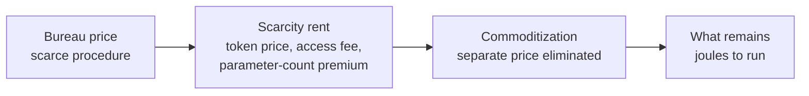

*Revisión db13599, 5 de noviembre de 2026. Datos y código: [research.openie.dev/data/](/data/#economics). PDF LaTeX: [/pdfs/latex/spellcheck.pdf](/pdfs/latex/spellcheck.pdf) ([source](/pdfs/latex/spellcheck.tex)).*

## Resumen

La corrección ortográfica se vendía por cientos de dólares entre 1981 y 1989 y ahora es gratuita y está integrada en las herramientas que la gente ya utiliza. Este artículo documenta ese cambio a partir de fuentes antiguas y lo explica con la economía del costo marginal y el empaquetado [62, 63].

**En palabras sencillas**

1. La gente solía pagar mucho por la corrección ortográfica. Ahora es gratuita en teléfonos, navegadores y procesadores de texto.  
2. Se volvió gratuita porque comprobar una palabra cuesta casi nada de ejecutar, y es más útil dentro de una herramienta que ya se posee.  
3. Lo mismo puede ocurrir con otras habilidades informáticas una vez que se ejecutan de forma barata en los dispositivos que la gente ya posee, de modo que miles de millones de personas puedan utilizarlas.

## Notación

| Term | Meaning in this paper |
|---|---|
| Automation path | Una procedimiento informático abandona una oficina especializada y se convierte en una rutina local en hardware que una persona ya posee. |
| Existence proof | Una instancia completada de esa ruta. El corrector ortográfico es una. La palabra no se usa como figura retórica. |
| Local | La verificación se ejecuta en la máquina que contiene el documento. La rutina enviada no requiere el alquiler de un centro de datos de frontera. |
| Paired hardware | El editor, teclado o teléfono que la persona ya usa para escribir. La capacidad no es una segunda máquina. |
| Available | El hardware es ordinario, no un alquiler escaso. |
| Accessible | La persona puede invocar la capacidad en ese tejido sin enviar el trabajo a una oficina especializada. |
| Capable | El tejido puede ejecutar el equipo que completa el trabajo. |
| The many (7B+) | Más de 7 mil millones de personas. Las personas a las que el acceso global está destinado. |
| The few | Las personas a las que aún puede llegar un precio de escasez. Esta es una clase de precio, no un recuento: el chat de frontera solo superó los 800 millones de usuarios semanales en octubre de 2025 [61]. |
| Proposal | Una sugerencia de ortografía. El documento aún no ha cambiado. |
| Commit | El reemplazo se escribe en el documento. |
| Completeness | El token se conserva: era conocido, o se aceptó un candidato. Una búsqueda posterior tiene cero valor de información sobre ese predicado. |
| Money price | Un cargo que alguien puede facturar: precio del token, licencia por asiento, alquiler por escasez, tarifa de acceso. La comoditización lleva el cargo separado a cero. |
| Parameter count | Un tamaño de un modelo. No es una métrica que sobreviva una vez que la capacidad es una mercancía. |
| Joule (J) | Unidad SI de energía. Aquí, la energía usada para ejecutar la rutina. |
| Lookup, Formula, Model | Tres tipos de mecanismo. Una sonda de diccionario es una búsqueda. Un generador de distancia de edición es una fórmula. Un modelo de lenguaje es un modelo. |

## 1. Introducción

La corrección ortográfica es una capacidad que la gente solía adquirir como producto separado y que ahora se recibe dentro de las herramientas que ya poseen. Este artículo sigue ese cambio a través de precios datados, los documentos que construyeron el procedimiento, las bibliotecas que lo distribuyen y las máquinas que lo ejecutan, y pregunta qué implica para la inteligencia computacional en general.

La gente pagó una prima. Entonces la cosa no podía venderse. Es gratuita, y está integrada en algo más. Los precios en la Sección 2.11 son ese hecho. Los nombres en la Sección 2.9 aparecen después de ello.

La factura separada de la calculadora es una serie datada, desde los anuncios de Anita pasando por la HP-35 y la TI-2500 hasta VisiCalc. La factura separada de la corrección ortográfica termina dentro del procesador de textos y luego del sistema operativo. Los dólares que las fuentes no imprimen permanecen sin imprimir.

Para la corrección ortográfica la tendencia de precios está completa. La rutina está integrada en el editor a precio cero. Los julios siguen consumiéndose.

La elección es el precio. La fijación de precios por escasez retiene una capacidad y vende la retención. Llega a las personas que pueden pagar, a las pocas. El acceso global es la otra opción. La capacidad se construye para ejecutarse en la máquina que una persona ya posee, y el cargo separado termina. Eso alcanza a más de 7 mil millones de personas.

La corrección ortográfica es esa segunda opción, finalizada. La tarea es decidir si un token escrito es una palabra, y si no lo es, proponer la palabra que el autor quiso. Kukich (1992) divide la tarea en detección de no‑palabras, corrección de palabras aisladas y corrección dependiente del contexto. Las dos primeras se convirtieron en ordinarias. Se ejecutan dentro de los programas que la gente ya usa para escribir. Son inteligencia computacional, no una historia contada para hablar de otro sistema.

La segunda opción se completa solo cuando la rutina es lo suficientemente barata como para ejecutarse junto al documento, localmente en la máquina que aloja el archivo, y emparejada con el hardware que la gente ya posee. McIlroy (1982) expone la restricción en las primeras frases del artículo de listas de ortografía de UNIX. El verificador puede usarse en minicomputadoras, por lo que la lista debe ser compacta. Eso es acceso global como ingeniería. Un modelo de frontera que responde solo dentro de un centro de datos alquilado es fijación de precios por escasez aún en vigor. Puede ser capaz y seguir quedando en manos de los pocos que pueden alquilarlo.

La Sección 2.11 es la prima, datada. La Sección 2.10 indica quién posee una máquina en la que la capacidad terminada puede ejecutarse, y quién solo tiene un alquiler. El software escrito para la máquina que la gente ya utiliza es cómo el acceso llega a muchos. Un precio que requiere el alquiler es cómo la escasez mantiene a los pocos.

### Un token, enseñado en orden

Norvig (2007) documenta un corrector local y la llamada `correction('speling')`, que devuelve `spelling`. Recorrer esa llamada como el ejemplo de enseñanza del camino. La prueba de existencia de la producción es Hunspell en editores ordinarios, indicada en la Sección 2.5.

1. La cadena ya está en la máquina. No se envía nada a una oficina.
2. La búsqueda pregunta si `speling` está en los recuentos locales de palabras. No lo está.
3. Una fórmula genera cadenas a distancia de edición uno: una eliminación, una transposición, una sustitución o una inserción. La palabra conocida `spelling` está en ese conjunto.
4. La sugerencia es una propuesta. El documento cambia solo cuando una persona la acepta, o cuando una política declarada la acepta. Eso es el compromiso.
5. Una vez que se conserva `spelling`, los candidatos posteriores no modifican el predicado "este token es la palabra que estamos conservando". Eso es la parada.
6. Abrir un modelo de frontera para este token no obtiene un cierre mejor. El mecanismo de búsqueda‑más‑edición ya lo cerró. Rechazar el gasto mayor no es un descuento. Es la mejor respuesta para este trabajo.

El mismo ensayo muestra el caso en que el token local no puede cerrar. `correction('where')` permanece `where` cuando un par de prueba esperaba `were`. La palabra única no lleva la decisión. Kukich (1992) nombró esto como el tercer problema, corrección dependiente del contexto. Un modelo mayor puede ser el mecanismo adecuado allí. El camino no está terminado para ese mecanismo hasta que el mecanismo se ejecute en el hardware que el escritor ya posee, o en una arquitectura central optimizada de recursos que la persona pueda usar realmente. Un pase de frontera alquilado que el escritor no puede invocar sigue siendo la oficina.

## 2. Trabajo relacionado

### 2.1 Detección y corrección de palabras aisladas

Damerau (1964) propone un método para una palabra que falta en un diccionario y tiene como máximo un error: una letra incorrecta, una letra ausente, una letra extra o una única transposición. La palabra no identificada se compara nuevamente con el diccionario bajo cada una de esas suposiciones. El resumen informa identificaciones correctas para más del 95 por ciento de estos tipos de error en la prueba que realizó. Este artículo cita ese resultado como suyo. No repite la prueba.

Peterson (1980) revisa programas informáticos que detectan y corrigen errores ortográficos. Para esa fecha la capacidad ya era una literatura de programas funcionales, no una propuesta de que un programa pudiera algún día verificar una palabra.

Kukich (1992) organiza el campo en los tres problemas nombrados anteriormente. La detección de no‑palabras utiliza una lista de palabras, coincidencia de patrones o análisis de n‑gramas. La corrección de palabras aisladas propone una palabra del diccionario para una no‑palabra detectada. La corrección dependiente del contexto maneja un token que es una palabra real pero sigue siendo la palabra incorrecta. La revisión es el mapa. La prueba de existencia en este artículo se basa en Hunspell en producción: LibreOffice, Firefox, Chrome, distribuciones de Linux y macOS invocan una rutina de diccionario local (Hunspell README). Los dos primeros problemas de Kukich dejaron la revisión y entraron en esos editores ordinarios. Norvig (2007) sigue siendo la guía docente de Lookup y luego una edición breve, no el hecho de producción.

### 2.2 La lista fue construida para adaptarse a la máquina

McIlroy (1982) describe la lista de palabras detrás del corrector ortográfico UNIX. El resumen indica la restricción de ingeniería y el resultado. El corrector puede usarse en minicomputadoras, por lo que la lista debe ser compacta. Eliminando prefijos y sufijos, aplicando hash y compresión, una lista reducida de 30 000 palabras inglesas se reduce a 26 000 palabras de máquina de 16 bits. El corrector anterior de Johnson buscaba palabras de un documento que ya estaba en la máquina. La contribución de McIlroy, para este artículo, es el emparejamiento: el diccionario se comprimió porque el objetivo era la minicomputadora que la gente realmente ejecutaría, no una máquina mayor reservada para la tarea.

Esos recuentos de palabras son sus recuentos publicados.

### 2.3 Un canal ruidoso sigue siendo un programa local

Kernighan, Church y Gale (1990) clasifican las correcciones candidatas con un modelo de canal ruidoso: la probabilidad del candidato multiplicada por la probabilidad del error tipográfico dado el candidato. El programa es un corrector ortográfico en el sentido ordinario, un cálculo local sobre un diccionario y un modelo de error. Una puntuación mejor no es una implementación diferente. El engranaje puede volverse más preciso y permanecer en la máquina que contiene el texto.

### 2.4 Un corrector que cabe en una página y no requiere red

Norvig (2007) escribió la explicación en un plano, sin datos de errores ortográficos y sin conexión a internet. El modelo de lenguaje es un archivo local de aproximadamente un millón de palabras, contabilizado en 32.192 palabras distintas que aparecen 1.115.504 veces. El modelo de error es deliberadamente crudo: una palabra conocida a distancia de edición 0 supera a cualquier palabra a distancia 1, que a su vez supera a cualquier palabra a distancia 2. Después del vuelo evaluó contra conjuntos extraídos del corpus Birkbeck de Mitton. Informa que el 75 por ciento de 270 pares de desarrollo fueron correctos, a 41 palabras por segundo, y el 68 por ciento de 400 pares de prueba final fueron correctos, a 35 palabras por segundo. Afirma que cumplió sus objetivos de brevedad y velocidad y no alcanzó su esperanza de una precisión del 80 al 90 por ciento.

Esos números son su evaluación reportada. El juguete no es un verificador industrial. Un segmento útil de la capacidad se ejecuta desde un archivo en la máquina frente al programador, a decenas de palabras por segundo, sin la red. Esa es la forma de una ruta de automatización terminada. Los fallos que enumera, especialmente palabras desconocidas del diccionario y decisiones que requieren tokens vecinos, son el residuo. Son argumentos para un mejor engranaje local, no argumentos de que el trabajo deba volver a una oficina.

### 2.5 La biblioteca dentro de los editores ordinarios

El proyecto Hunspell indica que Hunspell es el corrector ortográfico y analizador morfológico utilizado por LibreOffice, por navegadores libres como Firefox y Chrome, y por otras herramientas y sistemas operativos, incluidos distribuciones de Linux y macOS (Hunspell README). La biblioteca lee un archivo de diccionario local y un archivo de afijos local. La herramienta de línea de comandos verifica un archivo de texto local. El código desciende de MySpell, la implementación de Kevin Hendricks en OpenOffice.org, que a su vez es una reimplementación de la ortografía por afijos de International Ispell de Geoff Kuenning. Hunspell de László Németh añade Unicode y la morfología necesaria para lenguas donde una lista de palabras en inglés sin más es inadecuada.

Ese README indica dónde se utiliza la biblioteca. El hecho de que contribuya es una clase de despliegue. El verificador dentro de esos programas es una biblioteca local y una lista de palabras local.

### 2.6 El teléfono ya en la mano

UITextChecker es una clase de UIKit. El llamador pasa una cadena y un idioma. El método devuelve el rango de una palabra mal escrita en esa cadena, o informa que no encontró ninguna (Apple, UITextChecker). La verificación es una llamada en el dispositivo, contra un idioma que el sistema enumera como disponible. Este artículo no afirma una cifra de julios para esa llamada. La forma de la API es el emparejamiento: el texto ya está en la vista de texto, y el verificador es un método al lado de ella.

El marco de corrección ortográfica de Android también está en el dispositivo. Una aplicación extiende `SpellCheckerService`, implementa una sesión, y devuelve sugerencias para el texto que se le da a la sesión (Android Developers, spell-checker framework; `SpellCheckerService`). El verificador del método de entrada latino es un servicio local con diccionarios de localidad. Nuevamente, no se extrae ningún número de energía de esa documentación. La documentación sitúa la rutina en el teléfono.

Hard y colegas (2018) entrenan un modelo de siguiente palabra para el teclado Gboard del teléfono mediante aprendizaje federado. Los clientes calculan actualizaciones sobre texto que permanece en el dispositivo. El servidor agrega esas actualizaciones y no recibe la escritura sin procesar. El mismo artículo indica que Gboard proporciona autocorrección así como predicción de la siguiente palabra, y que el teclado tenía más de 1 000 000 000 de instalaciones a partir de 2019. Esa frase de instalación es la propia afirmación de despliegue del artículo. No es un recuento de las más de 7 000 000 000 de personas a las que se refiere esta opinión.

El modelo que envían es pequeño a propósito. Después de la cuantización ocupa 1,4 megabytes, con un vocabulario de 10 000 palabras, bajo una restricción de producto que declaran como una respuesta visible en aproximadamente 20 milisegundos y un tamaño de modelo de decenas de megabytes. La participación en el entrenamiento de su estudio es más estrecha que la base de instalaciones: dispositivos de Norteamérica, al menos 2 gigabytes de memoria, cargando, inactivos y en una red no medida. Este estudio cita la clase de despliegue. Un teclado que la gente ya usa lleva un pequeño modelo de lenguaje en el dispositivo, y el entrenamiento descrito allí no exporta el texto escrito. No citan sus tablas de recuerdo como un resultado de precisión ortográfica.

### 2.7 La lotería del hardware

Hooker (2020; 2021) denomina la lotería de hardware: una idea de investigación gana porque se ajusta al hardware y software disponibles, no porque sea la mejor idea en abstracto. La corrección ortográfica ganó una lotería que valía la pena ganar. El hardware disponible era la máquina que contenía el documento. El algoritmo que encajaba era una lista de palabras más un pequeño modelo de edición. Una capacidad que solo se ajusta a un acelerador de frontera, y se vende solo como tiempo en ese acelerador, pertenece a una lotería diferente. La advertencia de Hooker es que las ideas que no coinciden con el hardware instalado se estancan incluso cuando son buenas. La consecuencia de diseño en este artículo es la lectura inversa del mismo hecho. Si el objetivo es la inteligencia computacional para muchos, la idea debe ajustarse al hardware que muchos ya poseen, o a un hardware que una arquitectura central optimizada para recursos pueda extenderles. Ajustarse a un recurso escaso de alquiler es cómo una capacidad permanece con unos pocos.

### 2.8 Lo que esta literatura no está llamada a demostrar

Ninguna de las fuentes ortográficas anteriores es una tabla de población. Cuando aparece un número ortográfico en la Sección 4, corresponde al recuento propio de la fuente: palabras del diccionario, tamaño del conjunto de pruebas, palabras por segundo o una tasa de identificación publicada. La Sección 2.10 añade una clase diferente. Cada número de hardware corresponde al envío del editor, suscriptor, ingreso o cifra de una encuesta, con el año adjunto. Más de 7 mil millones de personas, y los pocos que pueden pagar un precio de escasez, son las dos clases en la opinión. No son la suma de esas filas.

### 2.9 Cómo se fija el precio de la automatización computacional

Una tasa citada permanece dentro del artículo que la publicó. No se ajusta ninguna curva aquí. No se indica pendiente, vida media ni año de precio cero.

En palabras sencillas, antes de los nombres. La gente solía pagar una prima por la corrección ortográfica y por el cálculo ordinario. La corrección ortográfica como producto de capa base ya no puede venderse. Es gratuita y está integrada en el editor, el navegador y el teléfono. El cálculo ordinario está integrado en el teléfono y el ordenador. Los nombres a continuación son solo etiquetas para esa secuencia.

Tres regímenes nombran cómo se fija el precio de una herramienta de automatización informática. La Sección 2.11 es la cinta fechada para la calculadora y para la corrección ortográfica. Cada precio es el precio de una fuente. No se ajusta ninguna curva a través de ellos.

**Precio de la oficina.** Mientras el procedimiento sea escaso, el comprador paga a una persona o a una máquina reservada. Nordhaus (2007) mide el precio monetario a largo plazo de la computación misma, no de la corrección ortográfica. En ese artículo el precio de la computación comienza en torno a \$500 por millón de cálculos por segundo para trabajo manual y cae a alrededor de $6 \times 10^{-11}$ por millón de cálculos por segundo para 2006, en precios de 2006, una disminución del orden de 8.3 billones. Esa cifra es el cociente de este ensayo de los dos extremos que acaba de indicar, \$500 / $6 \times 10^{-11}$. Los extremos son sus cifras reportadas. No se vuelven a ajustar aquí, y el cociente no es una previsión. Documentan que el precio monetario del sustrato de la automatización disminuyó en órdenes de magnitud. Una caída en ese índice aún no elimina la factura separada de un producto, y no es un medidor de julios.

**Precio de escasez, y la carrera que crea.** Una vez que una empresa puede enviar el procedimiento, puede cobrar más de lo que cuesta ejecutarlo. Esa diferencia es la renta de escasez. Una tarifa de acceso y un precio token son la misma diferencia en diferentes disfraces. Un recuento de parámetros se vuelve parte del disfraz cuando a los compradores se les enseña a pagar por el tamaño. La renta es lo que crea la carrera. Los rivales desplazan la renta al integrar la capacidad en un producto que el comprador ya posee, o sustituyen el producto por completo. Los precios de inferencia publicados dicen que la carrera está en marcha para los modelos de lenguaje y no ha terminado. Epoch AI (2025) informa caídas de precios a rendimiento fijo del orden de 9 a 900 veces por año en los puntos de referencia de esa nota. Emberson y Roodman (2026) reportan una disminución de aproximadamente el 47 % por trimestre en el costo de un rendimiento dado desde alrededor de 2023, lo que resumen como unas 13 veces por año. Esos son sus resúmenes de sus series. El índice no se vuelve a estimar. No se traza ninguna línea a través de los puntos. Ninguna tasa es una ley más allá de su ventana. El artículo Task Satiation usa la misma caída citada como evidencia de desplazamiento de fosos aún en progreso; esa afirmación permanece en ese artículo.

**Eliminación del precio.** La comoditización es el fin del cargo separado. La capacidad permanece. La línea de factura no. La corrección ortográfica es el ejemplo completado. Hunspell es una biblioteca de corrección ortográfica libre bajo una tri-licencia (LGPL, GPL y MPL). El proyecto indica que LibreOffice, Firefox, Chrome, distribuciones de Linux y macOS la utilizan, y que una verificación lee un diccionario local (Hunspell README). El comprador de esos editores no paga un precio simbólico por una palabra no válida, no paga una tarifa de acceso a una oficina de ortografía y no compra un recuento de parámetros. El precio monetario del método como bien separado es cero. Eso es la eliminación del precio. No es una afirmación de que el editor sea gratuito, y no es una afirmación de que el teléfono fuera gratuito. Es una afirmación de que la corrección ortográfica ya no se valora como un bien propio.

**La fijación de precios por escasez puede trasladarse a la máquina.** El fin del precio separado del software no elimina todo precio por escasez. Una plataforma puede colocar una capacidad más nueva en un dispositivo más reciente y cobrar por el dispositivo. Yusuf Mehdi, 20 de mayo de 2024, definió un PC Copilot+ por una unidad de procesamiento neural de 40 TOPS o más. La primera ola usa Snapdragon, el modelo pequeño se ejecuta en esa unidad, y los modelos grandes permanecen en Azure. La cuenta de Apple del 9 de junio de 2025 coloca un modelo en el dispositivo de aproximadamente 3 mil millones de parámetros en Apple silicon y deja el modelo mayor en Private Cloud Compute. Esos son precios para un equipo posterior y para la máquina que lo aloja. No son una factura revivida para la corrección ortográfica. El verificador ya se ejecuta en el editor, el navegador y el teléfono que la gente posee, incluida la generación anterior aún en mano. Una actualización que pide a alguien comprar una nueva clase de computadora para recibir una verificación que la máquina antigua ya realiza es fijación de precios por escasez del hardware. Llega a las personas que compran esa clase. Sólo unos pocos pueden ser de esa clase. No revierte el acceso ya completado para más de 7 mil millones de personas.

La corrección dependiente del contexto no es ese caso concluido. Kukich (1992) lo nombró como el tercer problema: un token que es una palabra real y sigue siendo la palabra incorrecta. Un modelo mayor puede ser el equipo adecuado allí. En la corrección de errores gramaticales, los modelos más grandes y mejor entrenados corrigen mejor: GECToR [71] y un modelo multilingüe de 11 mil millones de parámetros [72] establecieron el estado del arte en su momento. La compensación es energía: Luccioni, Jernite y Strubell miden que las tareas generativas son mucho más intensivas en energía que las tareas de clasificación por inferencia [73]. El caso de palabra aislada de la Sección 4.10 es el caso donde el gasto extra no compra un token diferente. El equipo ha tomado la opción de acceso solo cuando se ejecuta en hardware que la persona ya posee, o en una infraestructura central optimizada que la persona puede usar. Un alquiler escaso es la opción de escasez, incluso cuando el modelo es más preciso en un benchmark. El trabajo ordinario de palabra no válida no vuelve a ese alquiler porque el trabajo de contexto está inconcluso. No se imprime aquí una tabla de julios comparando una prueba de diccionario, un modelo local y una llamada a un centro de datos. Ninguno de esos julios fue medido para este artículo.

Lo que queda es la energía para ejecutar la comparación. Una prueba de diccionario local gasta julios en el dispositivo que contiene el documento. No se midieron julios aquí. No se calcula un total analítico. `measured_j` no está configurado: no se tomó una lectura del medidor.

La predicción se deriva de los regímenes, no de una regresión. Las tareas ordinarias de inteligencia computacional siguen la corrección ortográfica. Sus precios por token, primas por recuento de parámetros, rentas de escasez y tarifas de acceso se eliminan mediante la agrupación en el hardware que la gente ya posee y por métodos cuyo precio de licencia es cero. El estado final es para más de 7 mil millones de personas, no para los pocos que pueden pagar un precio de escasez. La predicción falla si una tarea ordinaria, del tipo que la corrección ortográfica ya cierra, mantiene un precio monetario separado y duradero después de que una rutina local de resultado igual está en manos de las personas que poseen el documento. Un punto de referencia de frontera que aún lleva una prima no es ese fracaso. Es la etapa de foso, que las notas de Epoch ya muestran que se vuelve más barata, y que la corrección ortográfica muestra cómo abandonar.

Los mismos regímenes se dibujan en la figura interactiva [sc-anim-01](/living/spellcheck/#sc-anim-01). Dos puntos son los extremos reportados por Nordhaus. El conector discontinuo une esos dos extremos. No se estima ninguna tasa. El rango de 9 a 900 de Epoch y el resumen de aproximadamente 13 veces aparecen en un recuadro. Permanecen sus resúmenes. El panel de corrección ortográfica es el régimen completado: el precio monetario separado ha desaparecido, y los julios permanecen sin medir.

Landauer (1961) establece un piso físico para borrar un bit. Horowitz (2014) es la declaración práctica de CMOS: el movimiento de datos domina, muy por encima de ese límite ideal. Una sonda de diccionario mueve bits. La comoditización puede anular la factura y aún dejar ese movimiento. No se calcula ningún total de julios para la corrección ortográfica a partir de ninguna de las citas.

**Agrupación como estrategia.** La literatura sobre agrupación lee la misma historia como estrategia así como acceso. Adams y Yellen demuestran que un paquete es una herramienta de discriminación de precios [68]. Nalebuff muestra que un paquete puede bloquear la entrada a un rival que vende un bien [69]. Spolsky nombró la táctica para software: commoditiza tu complemento, de modo que el producto que vendes valga más [70]. Cada lectura coincide en lo observable que este ensayo utiliza: el precio separado de la capa agrupada tiende a cero. Diferen en quién conserva la renta. Esa diferencia es la razón por la que este ensayo rastrea quién posee la plataforma así como el precio.

### 2.10 Acceso al hardware, categoría por categoría

Hooker nombra la lotería. Esta sección nombra las máquinas. El argumento son siete registros. Un envío de teléfonos no es un envío de centro de datos. Una encuesta de Steam no es un censo de PC. Una línea de ingresos no es un recuento de unidades. Cuando una empresa no divulga unidades, el artículo lo indica y cita la cifra que la empresa sí divulgó. Ninguna de estas cifras es un recuento de los muchos o de los pocos. No son una suma de las filas. Las figuras vivas [sc-hw-01](/living/spellcheck/#sc-hw-01) y [sc-gen-01](/living/spellcheck/#sc-gen-01) son los mismos registros.

Para cada categoría las preguntas son las mismas. Quién tiene la máquina, según el propio recuento de la fuente. Qué pila de software ejecuta esa máquina. Cómo esa pila cumple con la mejor pila de frontera. La afirmación de diseño es una oración: el software escrito para la generación globalmente accesible tiene el mayor impacto. La generación accesible es la que está en mano. La corrección ortográfica es el ejemplo de automatización terminado de esa oración. McIlroy dimensionó la lista para la minicomputadora en servicio. La energía para ejecutar es la métrica que permanece. Estas filas son quién tiene la máquina. No son julios.

**Teléfonos y generaciones de SoC móviles.** GSMA, The Mobile Economy 2025, cuenta 5,8 mil millones de suscriptores móviles únicos a finales de 2024, una tasa de penetración del 71 por ciento, y 4,7 mil millones de usuarios de internet móvil. El rastreador mundial preliminar de teléfonos móviles de IDC del 13 de enero de 2026 cuenta 1 260,3 millones de teléfonos inteligentes enviados en 2025, de los cuales Apple envió 247,8 millones. La publicación de IDC del 13 de enero de 2025 contabilizó 1 238,8 millones de teléfonos inteligentes en 2024. La tabla de 2026 restablece 2024 como 1 236,3 millones. Cada publicación mantiene su propio total. El informe anual de Arm para el año que terminó el 31 de marzo de 2025 indica que los CPU basados en Arm estaban en más del 99 por ciento de los teléfonos inteligentes del mundo vendidos ese año fiscal, y que los clientes habían enviado acumulativamente más de 310 mil millones de chips basados en Arm, desde los sensores más pequeños hasta supercomputadoras. La cifra acumulada corresponde a todo el mercado de Arm. No es un recuento de teléfonos, y el informe no lo divide por generaciones de SoC.

El dispositivo de 2025 es una generación actual de SoC móvil: Apple silicon, Qualcomm Snapdragon, MediaTek, Samsung, Google Tensor. IDC cuenta dispositivos con marca. El recuento de suscriptores son personas con una suscripción móvil, no un recuento de SoC.

La pila de software en ese dispositivo ya incluye un verificador local. UITextChecker y Android `SpellCheckerService` son el caso de ortografía. Un modelo en el mismo dispositivo usa Apple Core ML y el marco Foundation Models, Android LiteRT y NNAPI, el compilador QNN de Qualcomm, ExecuTorch o llama.cpp. La cuenta de Apple del 9 de junio de 2025, alineada al informe técnico del 17 de julio de 2025, describe un modelo de base en el dispositivo de aproximadamente 3 mil millones de parámetros, comprimido a 2 bits por peso, y un modelo de mezcla de expertos en servidor que se ejecuta en Private Cloud Compute. El informe LFM2 de Liquid AI diseña modelos densos de 350 millones a 2,6 mil millones de parámetros, y un modelo de mezcla de expertos de 8,3 mil millones con 1,5 mil millones activos, para ExecuTorch, llama.cpp y vLLM, y los ejecuta en un Samsung Galaxy S25 con Snapdragon 8 Elite. PrismML afirma que su Ternary Bonsai 2 27B, que dice estar construido sobre Qwen3.8 27B, conserva el 98,2 por ciento del contraparte de precisión completa con una huella 9 veces menor, 5,9 GB. Esos ratios son de PrismML. Este artículo no los vuelve a medir.

La interfaz a la pila frontier es un modelo más pequeño, un modelo de bajo número de bits, o una llamada a un servidor que opera el proveedor. Apple indica esa división en un informe. Una ejecución de entrenamiento frontier no se realiza en el teléfono. La afirmación de diseño para esta fila: el software escrito para la generación de SoC ya en envío, y para los dispositivos todavía en uso de años anteriores, tiene el mayor impacto. La corrección ortográfica es ese software.

**PCs y portátiles.** El comunicado de IDC del 9 de enero de 2025 contabiliza 262,7 millones de PC tradicionales enviados en 2024. El comunicado preliminar de IDC del 12 de enero de 2026 contabiliza 284,7 millones en 2025. La tabla de 2026 reexpone 2024 como 263,3 millones. En la llamada de resultados del 28 de enero de 2026, Satya Nadella dijo que Windows había alcanzado 1 000 000 000 de usuarios de Windows 11, un aumento de más del 45 por ciento interanual. Un año de envíos no equivale a esa base instalada.

La pila está compuesta por el sistema operativo, el navegador y una biblioteca local. Hunspell es el caso de corrección ortográfica dentro de los editores habituales. Un modelo en el mismo PC usa ONNX Runtime, DirectML, Windows ML, llama.cpp o ExecuTorch en la CPU y la GPU integrada. Una GPU discreta es la siguiente categoría. Liquid AI cronometró la misma familia LFM2 en un AMD Ryzen AI 9 HX 370 con llama.cpp en Q4_0. Esa es una medida de CPU de portátil en su informe, no una medida de centro de datos.

La interfaz a la pila frontier es una llamada API, o un modelo que cabe en la memoria de la máquina. Los dos son programas diferentes. El primero es un alquiler. El segundo es la ruta. La afirmación de diseño para esta fila: el software para la generación de PC que la gente ya usa tiene el mayor impacto. La corrección ortográfica siguió esa ruta. Un peso que asume un acelerador alquilado no lo hizo.

**GPU de consumo.** El comunicado fiscal 2026 de NVIDIA, año terminado el 25 de enero de 2026, informa ingresos por Gaming de 16,0 mil millones de dólares. Eso son ingresos, no un recuento de unidades. Jon Peddie Research, 5 de marzo de 2026, informa 11,48 millones de tarjetas gráficas de PC añadidas enviadas en el cuarto trimestre de 2025, un aumento del 36,0 por ciento respecto al año anterior, con una tasa de incorporación de escritorio del 55 por ciento ese trimestre. La misma nota indica que las tarjetas GPU de centro de datos aumentaron un 17,0 por ciento respecto al trimestre anterior y no publica su recuento de unidades. Una “base instalada” de 172 millones en esa nota es un punto de pronóstico. Este documento no la utiliza como censo actual.

La encuesta de hardware y software de Steam de Valve para septiembre de 2026 informa, entre los clientes que respondieron, NVIDIA GeForce RTX 5070 al 6,15 por ciento, RTX 5090 al 0,40 por ciento, RTX 4060 al 3,89 por ciento, RTX 3060 al 3,66 por ciento y GTX 1650 al 2,19 por ciento. La encuesta corresponde a participantes de Steam. No representa al mundo. Este documento no incorpora esas cuotas en un total generacional. La lista es parcial y la encuesta incluye una categoría Otros.

La pila es CUDA en NVIDIA, y ROCm o Vulkan en AMD. llama.cpp ejecuta un modelo cuantizado en la tarjeta. vLLM sirve un modelo cuando la tarjeta contiene el peso. La interfaz a la pila frontier es cuantización, un modelo más pequeño, o una API. Una tarjeta de consumo ejecuta el modelo que cabe. El sistema de entrenamiento frontier no cabe. La afirmación de diseño para esta fila: el software dirigido a la gama alta apunta al 0,40 por ciento de una encuesta de gamers. El software dirigido a las tarjetas que la gente sigue reportando, incluidas las series 30 y 40, cubre la generación instalada. Ese es el mayor impacto.

**Aceleradores de centros de datos.** El mismo comunicado fiscal de 2026 de NVIDIA informa ingresos del Centro de Datos de 193,7 mil millones de dólares para el año, un aumento del 68 por ciento, y 62,3 mil millones de dólares en el cuarto trimestre. El comunicado no revela los envíos de unidades de Hopper, Blackwell o Rubin. Describe una asociación plurianual con Meta que incluye millones de GPUs Blackwell y Rubin. Esa frase es la versión de NVIDIA de un plan de despliegue. No es un recuento auditado de tarjetas en bastidores. El 28 de octubre de 2025, en GTC en Washington, Jensen Huang dijo que se habían enviado 6 millones de GPUs Blackwell en los últimos cuatro trimestres. CNBC informó esa frase el mismo día. El comunicado fiscal de 2026 sigue sin revelar los envíos de unidades. La cifra de 6 millones es la declaración de Huang. No es una línea de unidades auditada. El mismo informe cita una expectativa de 500 mil millones de dólares en ventas de GPUs entre Blackwell y Rubin. Esa es una expectativa de ventas. Este artículo no la convierte en un recuento de unidades.

El comunicado de AMD del 3 de febrero de 2026 informa ingresos del segmento de Centro de Datos de 16,6 mil millones de dólares para el calendario 2025, un aumento del 32 por ciento, y afirma que el crecimiento refleja tanto CPUs EPYC como GPUs Instinct. Instinct no es una línea de ingresos separada, salvo una porción divulgada: ingresos del cuarto trimestre de Instinct MI308 a China de aproximadamente 390 millones de dólares. No hay recuento de unidades Instinct en el comunicado.

En la llamada del 28 de enero de 2026, Nadella dijo que la flota de Microsoft incluye NVIDIA, AMD y el propio acelerador Maya 200 de Microsoft, que la empresa había puesto en línea. Amy Hood dijo que el gasto de capital ese trimestre fue de 37,5 mil millones de dólares, con aproximadamente dos tercios en activos de corta vida, principalmente GPUs y CPUs, y que la demanda superó la oferta. No hay recuento de unidades Maya en la transcripción. Los envíos de unidades de Google TPU y Amazon Trainium no aparecen en las fuentes leídas para esta sección. Se nombran para que la categoría no se reduzca a un solo proveedor. El recuento de unidades ausente es el registro.

Quién lo tiene: los compradores que contratan ese ingreso. Hood dijo que gran parte del capital de GPU ya está contratado para la vida útil del hardware. Eso es un mercado de alquiler. La pila sobre el acelerador es CUDA, ROCm y las pilas de servicio que asumen la tarjeta, incluyendo TensorRT-LLM y vLLM. Esta categoría es la pila de frontera. La interfaz de todos los demás a ella es una API, un modelo destilado o un modelo cuantizado. La afirmación de diseño para esta fila: el software que requiere el acelerador llega a los arrendatarios. El software escrito para las generaciones en las otras filas llega a las personas que poseen esas máquinas. La corrección ortográfica hizo lo segundo. Lo primero es la etapa de la oficina.

**MCUs, piezas diminutas y piezas integradas.** La cifra acumulada de Arm de más de 310 mil millones de chips incluye sensores y dispositivos integrados. El informe anual no desglosa esa cifra acumulada en microcontroladores. IC Insights, 29 de marzo de 2022, indica que las entregas de 2021 alcanzaron 30,9 mil millones de microcontroladores, después de un crecimiento unitario del 12 por ciento ese año. Ese es un envío de 2021. La misma nota pronostica 35,8 mil millones de unidades en 2026. El pronóstico no es un recuento actual.

MLCommons, 17 de septiembre de 2025, publicó MLPerf Tiny v1.3. El conjunto mide redes neuronales que normalmente tienen menos de 100 kilobytes. La publicación contiene 70 resultados en cinco pruebas, incluidos 27 resultados de consumo, de Kai Jiang, Qualcomm, STMicroelectronics y Syntiant. Se evaluaron cinco plataformas de hardware por primera vez. Las pruebas abarcan clasificación de imágenes, palabras de activación visual, detección de palabras clave, detección de anomalías y una tarea de activación continua.

La pila es TensorFlow Lite para Microcontroladores, CMSIS‑NN y los tiempos de ejecución de los proveedores que utilizan esas presentaciones. El modelo es kilobytes. Un modelo de lenguaje de frontera no se carga. La interfaz a la pila de frontera es un modelo de tarea compilado para la pieza: una palabra de activación, una puntuación de sensor, un kernel. La afirmación de diseño para esta fila: el software para esta generación es el software que se ajusta a la pieza. El envío acumulado de Arm es la mayor cifra de silicio en esta sección, y no corresponde a un centro de datos. El impacto sigue a la pieza que se envía.

**Aceleradores de borde y NPU en dispositivos comercializados.** Yusuf Mehdi, 20 de mayo de 2024, definió un PC Copilot+ por una unidad de procesamiento neuronal de más de 40 TOPS. La primera ola utiliza Snapdragon X Elite y Snapdragon X Plus, que según esa publicación entregan 45 TOPS de NPU. Las experiencias en el dispositivo se especifican para ejecutarse en esa NPU con modelos de lenguaje pequeños, mientras que los modelos grandes siguen disponibles a través de Azure. Gartner, según lo informó Computerworld el 28 de agosto de 2025 a partir del comunicado de Gartner del mismo día, pronosticó 77,8 millones de PC con IA en 2025, el 31 por ciento del mercado global de PC. Ese es un pronóstico publicado antes de que terminara el año. No es el total de PC completado por IDC, y no es solo el recuento de PC Copilot+. Canalys, ahora parte de Omdia, en datos fechados el 25 de febrero de 2025 y reportados el 7 de marzo de 2025, cuenta 15,4 millones de PC con capacidad de IA enviados en el cuarto trimestre de 2024, el 23 por ciento de los envíos de PC de ese trimestre. Para todo el año 2024 la misma nota indica que el 17 por ciento de los PC enviados eran compatibles con IA y no muestra el total de unidades del año. Su definición es un escritorio o portátil con un chipset o bloque dedicado para cargas de trabajo de IA en el dispositivo. Los ejemplos que menciona son AMD XDNA, Neural Engine de Apple, Intel AI Boost y Qualcomm Hexagon. Los 15,4 millones corresponden a un trimestre cerrado. La cifra de 77,8 millones de Gartner sigue siendo un pronóstico.

El modelo en el dispositivo de Apple, de aproximadamente 3 mil millones de parámetros, se compila para el silicio de Apple, que incluye el Neural Engine. Apple no publica un envío separado del Neural Engine. La base de dispositivos activos es la cifra anterior de Apple, no un censo de NPU.

La pila es Qualcomm QNN, el Runtime de Windows Copilot, Apple Core ML y el marco de Modelos Fundamentales, el software AMD Ryzen AI, la pila NPU de Intel y ONNX. Cada uno compila un grafo para su NPU. Un peso CUDA no es un programa NPU hasta que un compilador lo acepte. La interfaz a la pila de frontera es la que Microsoft indica y la que Apple indica: el modelo pequeño en el dispositivo, el modelo grande en un servidor que opera el proveedor. La afirmación de diseño para esta fila: la NPU dentro de un teléfono o PC ordinario es la generación accesible. El software escrito para esa NPU, en el compilador del proveedor, tiene el alcance. Un kernel que asume una GPU de centro de datos no se ejecuta allí.

**Generaciones anteriores aún en uso.** La última generación es un envío. La generación instalada es la que la gente sigue ejecutando. Son números diferentes, y varias empresas no publican el segundo.

Phones: 1.260,3 millones de teléfonos inteligentes enviados en 2025, frente a 5,8 mil millones de suscriptores móviles únicos a finales de 2024. Los suscriptores no son dispositivos. El hecho de escala se mantiene sin esa conversión. Un año de envíos de dispositivos no equivale a la base de suscriptores. Los dispositivos anteriores siguen en uso. Este artículo no convierte la brecha en una cuota de generación.

Apple, en la llamada de resultados del 30 de enero de 2025, declaró una base instalada de más de 2,35 mil millones de dispositivos activos en todas las categorías de productos. El comunicado del 30 de octubre de 2025 indicó que la base instalada había alcanzado otro máximo histórico y no publicó un recuento de reemplazos. Los envíos de iPhone en el calendario 2025 de 247,8 millones son un producto en un año. No son la base activa.

PCs: 1 mil millones de usuarios de Windows 11 el 28 de enero de 2026, frente a 284,7 millones de PCs enviados en el calendario 2025. La nota de IDC del 12 de enero de 2026 y los comentarios de Hood en la llamada de enero ambos citan el fin del soporte de Windows 10 como una razón del desplazamiento de la demanda de PCs en 2025. La generación anterior de sistemas operativos era lo suficientemente grande como para impulsar una renovación. Su recuento restante no aparece en la transcripción. Este artículo no proporciona uno.

GPU de consumo: la encuesta de Steam de septiembre de 2026, citada arriba. RTX 5090 al 0,40 por ciento. RTX 3060 al 3,66 por ciento. RTX 4060 al 3,89 por ciento. GTX 1650 al 2,19 por ciento. La última bandera no es la tarjeta que la encuesta reporta con mayor frecuencia.

Aceleradores de centro de datos: el comunicado fiscal 2026 de NVIDIA compara Blackwell con Hopper y no brinda el recuento instalado de tarjetas Hopper aún en servicio. Nadella dijo que el software sigue ejecutando modelos actuales en la flota envejecida. Ese es el equivalente en centro de datos del mismo hecho, y la flota sigue siendo un alquiler. No se inventa aquí ningún recuento de unidades de base instalada.

La afirmación de diseño, para esta fila y para las seis anteriores: el software escrito para la generación accesible globalmente tiene el mayor impacto. La generación accesible es la que está en mano, y las fuentes anteriores demuestran que no es el mismo objeto que el último chip. La corrección ortográfica se escribió para la minicomputadora en servicio, luego para el editor, luego para el teléfono. Una vez que el precio monetario separado desaparece, la energía para operar es lo que queda. Un chip más nuevo no reemplaza esa métrica con una licencia.

Las tesis en el dispositivo se alinean con esa afirmación, y no sustituyen el registro de envíos. Hooker (2020; 2021) dice que una idea gana al ajustarse al hardware que existe. El informe de Apple adapta un modelo de aproximadamente 3 mil millones de parámetros a Apple silicon y deja el modelo mayor en Private Cloud Compute. El informe LFM2 de Liquid AI busca arquitecturas bajo latencia medida y memoria en una CPU de teléfono y una CPU de portátil, y envía los pesos para esos entornos de ejecución. La afirmación pública de PrismML es que un modelo ternario es el artefacto que se ajusta a un dispositivo local, en las proporciones que la empresa indica. La corrección ortográfica sigue siendo el ejemplo terminado. La prueba del diccionario no necesitó ninguno de estos modelos. Necesitó la máquina que ya contenía el texto.

### 2.11 Precios fechados, y cuánto tiempo se sabe que duró cada uno

Los regímenes en la Sección 2.9 son nombres. Esta sección es la cinta de precios. Cada fila es un precio que una fuente imprime, la fecha que esa fuente adjunta y lo que esa fuente dice sobre cuánto duró el precio. Cuando la fuente es un anuncio, la duración es el intervalo hasta el siguiente anuncio que la compilación imprime. Ese intervalo no es una auditoría continua de precios. Cuando dos fuentes discrepan, ambas se imprimen. Cuando un precio no está en la página, no se completa. La tabla viva es [sc-price-01](/living/spellcheck/#sc-price-01).

**Calculadoras de escritorio, Sumlock Comptometer y Anita.** El índice de anuncios en anita-calculators.info es una compilación de anuncios fechados. No es una lista de precios mantenida por la empresa.

Otoño de 1949. Un anuncio de la máquina sumadora Plus en ese índice dice “Now Plus for only \$100.” El índice no indica cuánto tiempo duró ese precio.

Octubre de 1961. La Anita Mk 8 se lanzó en la Business Efficiency Exhibition en Londres. Office Magazine, diciembre de 1961, páginas 1244-1245, reimpreso en el mismo sitio, indica el precio como £335 y afirma que los pedidos se tomarían a partir del 1 de enero de 1962. La reseña dice que la máquina aún no estaba disponible de forma general.

Mayo de 1963. Un anuncio en el índice fija el precio de la Anita Mk 8 en £355 y el del Comptometer 993s en £265. El índice no registra un precio de la Mk 8 entre la reseña de diciembre de 1961 y este anuncio. El intervalo es el silencio entre esas dos fechas, no un certificado de que £335 se mantuvo.

Enero de 1964. El índice fija la Mk 8 en £365. Febrero de 1964. La serie Comptometer 993 se cotiza como un rango, £160 a £330.

Enero de 1965. El índice fija la Mk 8 en £335 y la Mk 9 en £425. El precio anunciado de la Mk 8 es £335 en la reseña de diciembre de 1961, £355 en mayo de 1963, £365 en enero de 1964 y £335 en enero de 1965. Cada cifra corresponde a un anuncio o a una reseña. Ninguna de ellas indica que el precio fuera constante entre fechas.

Noviembre de 1965. El índice fija la Mk 9 en £425 y afirma que más de 16 000 Anitas estaban en uso, y que la Anita se introdujo en enero de 1962. Desde el anuncio de enero de 1965 hasta este, el precio de la Mk 9 en el índice permanece sin cambios en £425. Son dos observaciones. No es una auditoría mensual.

Julio de 1966. El índice fija la Mk 10 en £460.

Junio de 1968. “Focus on ANITA,” un anuncio en Office Methods and Machines, junio de 1968, página 41, es citado por las páginas de modelo en anita-calculators.info. Esas páginas transcriben tres cantidades de él. Mk 10: £480. La página de la Mk 10 cita el anuncio: “Price £480.” Mk 11: £298. Mk 12: £480. El índice aún no imprime las cantidades. La cantidad de la Mk 9 no está en la página de la Mk 9. Esa página fija la introducción de 1964 en £425, citando “BEE ’64,” Industrial Electronics, noviembre de 1964, página 521. Ese £425 es el precio de introducción. No es una transcripción de la línea de junio de 1968. La cantidad de la Mk 9 de junio de 1968 no está en las fuentes leídas para este artículo. Julio de 1966 había fijado la Mk 10 en £460. Junio de 1968 la fija en £480. Son dos anuncios. Los meses entre ellos no constituyen una auditoría.

Abril de 1969 y mayo de 1969. El índice fija la Anita 1000 en £285 en ambos meses. Julio de 1969. La Anita 1010 cuesta £320. Febrero de 1971. La Anita 1000LSI cuesta £192 y la 1010LSI £250. Estos son modelos posteriores. Un precio más bajo en un modelo posterior no constituye una reducción del precio de la Mk 8.

**HP-35.** Tres fuentes coinciden en el precio de introducción y discrepan en el calendario de las reducciones.

Museo de Historia de la Computación, “Este día en la historia”, 4 de enero de 1972: Hewlett‑Packard presentó la HP‑35 y se vendió por 395 \$.

Museo de Calculadoras Datamath, página de la HP‑35: anunciada el 4 de enero de 1972, disponible en febrero de 1972, precio de venta sugerido 395 \$ en enero de 1972, precio de venta sugerido 295 \$ en enero de 1974. La misma página indica que a principios de 1975 la etiqueta de precio bajó a 195 \$ y la calculadora se descontinuó poco después de la HP‑21. También fija el precio de la HP‑65, introducida el 19 de enero de 1974, en 795 \$. No lista un recorte de mayo de 1973 y no menciona 225 \$.

Craig Finseth, archivo hpdata para la HP‑35A: precio de introducción 395 \$. La fecha de introducción en ese archivo es el 1 de julio de 1972, tomada de un “muro de la fama”, con una posible fecha del 1 de febrero de 1972. Descontinuación el 1 de febrero de 1975 a 195 \$. Las líneas de cambio de precio del archivo son 1 de mayo de 1973 a 295 \$, 1 de mayo de 1974 a 225 \$, y 1 de febrero de 1975 a 195 \$. Una nota en el mismo archivo dice que el precio subió a 295 \$ cuando se introdujo la HP‑45A. Datamath fecha la HP‑45 a mayo de 1973, que es el mes que Finseth usa para 295 \$, mientras que la propia línea de MSRP de Datamath sigue mostrando 295 \$ como cifra de enero de 1974.

Impreso como duraciones, y solo dentro de cada fuente. Lista de Finseth, si se toma como el programa de ese archivo: 395 \$ desde la fecha de introducción en ese archivo hasta el 1 de mayo de 1973; 295 \$ desde el 1 de mayo de 1973 hasta el 1 de mayo de 1974; 225 \$ desde el 1 de mayo de 1974 hasta el 1 de febrero de 1975; 195 \$ en la fecha de descontinuación. La fecha de introducción en ese archivo está marcada como incierta. Lista de Datamath: 395 \$ como el MSRP de enero de 1972, y 295 \$ como el MSRP de enero de 1974. La página no dice que el precio se mantuvo en 395 \$ para cada mes intermedio. 195 \$ es “a principios del año 1975”, no un día. Los meses entre la cifra de enero de 1974 y esa cifra de 1975 no están desglosados.

**TI‑2500 Datamath.** Museo de Calculadoras Datamath, página Versión 1 del TI‑2500: anunciado en abril de 1972 a un precio de venta sugerido de 149,95 \$. Los primeros clientes recibieron calculadoras en junio de 1972 en Neiman‑Marcus y Sanger‑Harris en Dallas. Introducción formal el 21 de septiembre de 1972. El precio de venta sugerido se redujo a 119,95 \$ para la fecha de esa introducción. La página no indica el día del recorte. La ventana documentada para 149,95 \$ en esta fuente va desde el anuncio de abril hasta el 21 de septiembre de 1972. Recortes posteriores después de 119,95 \$ no aparecen en esta página. La misma página menciona el Bowmar 901B, introducido en septiembre de 1971, y no le asigna precio. La página de la HP‑35 de Datamath menciona la HP 9100A de 1968 y no le asigna precio. Los precios aparecen en otras páginas, leídos a continuación.

**HP 9100A.** El escaneo del Museo de Historia de la Computación del folleto de 1968, colección 102646164, imprime “Precio 4900 \$” y “calculadora hp 9100A, Precio: 4900 \$”. El proyecto HP Memory indica el mismo 4900 \$ como precio en la página 130 del catálogo de 1969, y afirma que el modelo se introdujo en el Hewlett‑Packard Journal de septiembre de 1968. El folleto no indica cuánto tiempo duró el precio de 4900 \$. Un precio posterior no se extrae de una página que este documento no haya leído.

**Bowmar 901B.** Museo de Calculadoras Datamath, página del Bowmar 901B: fecha de introducción septiembre de 1971, nuevo precio 240 \$. La página indica un precio de venta sugerido de 240,00 \$ para el 901B lanzado en el TMS0103. La duración de 240 \$ no aparece en la página.

**El calculador como software.** Wikipedia, VisiCalc, según la página leída para este artículo. Personal Software comenzó a vender VisiCalc a mediados de 1979 por menos de US\$100. El mismo artículo cita una introducción formal programada para la National Computer Conference, del 4 al 7 de junio de 1979. También cita a Peter Jennings: la primera copia de Apple II, versión 1.37, salió el 17 de octubre de 1979. Ambas fechas aparecen en el artículo. Este artículo no las colapsa.

El artículo indica que para 1982 el precio había subido de \$100 a \$250, citando Softline, marzo de 1982. No indica el mes del aumento. La cifra de \$100 y la de \$250 son dos informes fechados. La duración de cada precio entre esos informes no está en el artículo. Una oración separada en el artículo lo llama el VisiCalc de \$100 frente a un Apple II de \$2 000. Ese \$2 000 corresponde a la máquina, según relatos posteriores en el artículo, no a un segundo precio de software.

El mismo artículo dice que los lenguajes de modelado financiero en sistemas de tiempo compartido costaban \$20 000, citando un caso de estudio de UCLA. Ese es un precio de oficina para una clase de producto diferente, no la factura de VisiCalc.

Cifras de ventas en el artículo, mantenidas tal como las indica: más de 39 000 copias en enero de 1983, todavía el producto de software más vendido; 5 700 copias en diciembre de 1983. Lotus Development adquirió Software Arts y terminó las ventas. Las fechas principales llegan hasta 1985. Un ítem citado de InfoWorld está fechado el 2 de junio de 1986 y lleva el título VisiCalc discontinued. Ambas fechas permanecen.

DOS Days, página de Lotus 1‑2‑3: el programa se lanzó en enero de 1983. La página no indica el precio de enero de 1983. Gregg Williams, Byte, diciembre de 1982, páginas 182‑198, revisó una copia prerelease. La reseña, tal como se reimpresó, dice que Lotus había fijado el precio de 1‑2‑3 en \$495, y que el programa estaría disponible para la IBM Personal Computer algún mes después. Ese \$495 es el precio fijado antes de la venta comercial, impreso en diciembre de 1982. No es un recibo fechado el 26 de enero de 1983. DOS Days aún no imprime un precio de enero propio. Indica que la Release 2.2 y la Release 3 costaban lo mismo, \$495, el mismo precio que Microsoft Excel 2.1 y Borland Quattro Pro en el momento de esa comparación. Cuánto tiempo había durado ya el \$495, y si el precio de 1983 era \$495, no aparecen en esa página. La Release 4 para DOS, mayo de 1994, añadió un corrector ortográfico. Esa es una fecha de característica, no un precio.

**Corrector ortográfico como producto, luego como una línea que desapareció.**

Wikipedia, "Spell checker", según la lectura para este artículo. En 1961 el proyecto de Les Earnest utilizó una lista de 10 000 palabras aceptables. Febrero de 1971: Ralph Gorin escribió SPELL para el DEC PDP‑10 en el Laboratorio de Inteligencia Artificial de Stanford, en ensamblador, y lo puso a disposición del público. El artículo no indica precio. Un programa de laboratorio no es un calendario de venta al por menor.

Los primeros correctores para computadoras personales aparecieron en 1980. WordCheck para sistemas Commodore se lanzó a finales de 1980 a tiempo para un anuncio en Compute!, enero de 1981, número 8, página 119. Esa página fue leída. El anuncio es de Micro Computer Industries, Ltd. La copia de WordCheck indica que el programa está disponible para máquinas CBM y PET de 32 K con unidades de disco dual, y luego: "List price is only \$200.00." La misma página también fija el precio de Create‑A‑Base y de un programa de inventario en \$200.00. La cifra de WordCheck es la oración adjunta a la línea de doble disco. El artículo de Wikipedia no la cita. Este artículo sí lo hace.

El artículo dice que el mercado de paquetes independientes fue de corta duración, y que a mediados de la década de 1980 WordStar y WordPerfect habían incorporado correctores ortográficos. “Corta duración” y “a mediados de la década de 1980” son los propios límites del artículo. No son un par de fechas de factura. No hay un precio en dólares independiente en el artículo.

Spellbound de Sector Software, 1987, y Microsoft Word desde Word 95, son los ejemplos del artículo de verificación interactiva. El artículo no brinda ningún precio. La cita para la cláusula de Word 95 es Raymond Chen, The Old New Thing, 22 June 2026. Word 95 es el producto de 1995. El precio separado de su corrector no se indica porque el corrector estaba dentro del procesador de textos.

Edward Mendelson, “A Chronology of Versions,” WPDOS. March 1980: SSI*WP para minicomputadoras Data General, US\$5,500 por copia. La cronología no dice que esa copia incluía un corrector ortográfico. Ese US\$5,500 es el procesador de textos. Su duración no se indica.

26 November 1982: WordPerfect 2.20 para IBM PC. No hay precio en la cronología. DOS Days dice que esa versión incluía un diccionario de 30,000 palabras. La página no nombra un comando de corrección ortográfica para la 2.20. October 1983: WordPerfect 3.0 para DOS. La lista de comandos de Mendelson para esa versión asigna Alt‑F5, cuando no hay texto seleccionado, a Spellcheck. Un comando de corrección ortográfica estaba en el producto DOS enviado en octubre de 1983. DOS Days indica que la versión 3.0 se lanzó en Comdex en octubre de 1983 por US\$495. La cronología no imprime ese precio. DOS Days no nombra el corrector ortográfico en el párrafo de la 3.0. La lista de comandos sí lo hace. Los US\$495 son el procesador de textos. El comando de corrección no tiene su propio precio.

30 November 1992: WordPerfect 5.2 para Windows incluye Grammatik 5. 6 January 1993: WordPerfect adquiere Reference Software International, autor de Grammatik. La inclusión es el fin de una factura separada de gramática dentro de ese producto. La cronología no indica el precio minorista anterior de Grammatik. Dos precios minoristas anteriores aparecen en otras páginas. El Chicago Tribune, 10 April 1988, indica que Grammatik II cuesta US\$89. START, volumen 4 número 4, November 1989, indica Grammatik III a US\$99, de Reference Software. Ninguna de esas páginas es un precio para Grammatik 5 en la adquisición. Ese precio independiente no está en las fuentes leídas para este artículo.

Wikipedia, History of Microsoft Word. Word 1.0, lanzado en October 1983, con un costo de US\$395, citando John Markoff, InfoWorld, 30 May 1983. Ese es el procesador de textos. El artículo no dice si la versión 1.0 contenía un corrector ortográfico. Richard Brodie, quien escribió gran parte de la versión 1, dijo en una entrevista por correo electrónico de octubre de 2008 publicada por Benj Edwards el 7 November 2015: “Además de 1.0, 1.1 añadió combinación de correspondencia, 2.0 simplemente añadió un corrector ortográfico empaquetado que compramos.” Según esa declaración, la versión 1.0 no incluía el corrector ortográfico. La versión 1.1 añadió combinación de correspondencia. La versión 2.0 añadió un corrector ortográfico que la empresa compró. Michal Necasek, OS/2 Museum, 26 May 2018, identifica el corrector ortográfico en DOS Word 2.x y 3.x, vendido aproximadamente de 1985 a 1987, como licenciado de Software Heaven, Inc. Los US\$395 no son un precio de corrección ortográfica. Word for Windows, November 1989, USD US\$498. El artículo no dice cuánto duró el US\$498. Microsoft Write para Atari ST se vendió a US\$129.95. Un precio minorista declarado. No hay duración.

La eliminación ya indicada en la Sección 2.9 es el último precio en esta cinta. El precio de la licencia de Hunspell como biblioteca es cero bajo la trilicencia que indica el README. El README no publica un programa de precios minorista previo. El verificador de ortografía a nivel del sistema de Apple, descrito en el artículo de corrección ortográfica como el sistema operativo que asume las correcciones de ortografía, no tiene un precio separado en ese artículo. La duración de “no precio separado” comienza, según la redacción de ese artículo, a mediados de la década de 1980 para los verificadores de procesadores de texto incorporados. El verificador del sistema operativo no está fechado a un día en el artículo.

Figura 1 coloca los precios fechados de esta sección en un eje.

*Figura 1. Corrección ortográfica de un precio separado a cero incluido. Figura de datos, escala logarítmica: precios y fechas tal como aparecen en las fuentes de esta sección (Compute!, enero 1981; Mendelson, WPDOS; InfoWorld vía Wikipedia; Chicago Tribune, 10 de abril de 1988; START, noviembre 1989; Brodie, 2015; el README de Hunspell). Se proporciona una [copia PNG](/figures/spellcheck/price-to-zero.png)*.

## 3. Definiciones y métodos

### 3.1 La ruta, como prueba

Una capacidad está en la ruta de automatización cuando se cumplen los cinco siguientes requisitos.

1. El trabajo ya está disponible en una máquina que la persona posee, o en una infraestructura que la persona puede usar sin necesidad de reservar a un especialista.
2. La capacidad se ejecuta como una rutina en esa máquina, no como una tarea enviada a una oficina externa.
3. La rutina se ajusta al entorno de memoria y consumo de energía ordinario de esa máquina.
4. Su invocación no requiere alquilar un centro de datos de frontera.
5. La respuesta que devuelve la rutina es el equipo adecuado para la tarea. No se adquiere alcance devolviendo una respuesta peor.

El corrector ortográfico, en la forma que se envía dentro de editores y teclados, cumple los cinco. Un modelo de chat que responde solo dentro de un centro de datos de frontera alquilado falla en 2, 3 y 4 para la persona que no tiene el alquiler. La tesis es que la inteligencia computacional se desarrollará hasta que cumpla los cinco, porque ese es el camino que sigue la automatización informática, y el corrector ortográfico es el ejemplo completado de inteligencia computacional en esa ruta.

### 3.2 Prueba de existencia

Una analogía dice “X es como Y” y luego habla de X. Una prueba de existencia muestra Y. Aquí Y es la corrección ortográfica. Los procedimientos en la Sección 2 son Y. Los productos que llaman a una biblioteca local son Y. La corrección ortográfica es una prueba de existencia de que alguna inteligencia computacional la convierte en un bien empaquetado de precio cero. No muestra que toda capacidad siga ese camino. Qué capacidades lo hacen está determinado por la estructura de costos: costo marginal cercano a cero y complementariedad con una superficie que la gente ya posee [62, 63]. La afirmación sobre el futuro de la inteligencia computacional es que los constructores deben diseñar esas dos condiciones, porque este caso ya ha finalizado. Cuando el caso es estrecho, el artículo lo indica. La detección de palabras no válidas y la corrección de palabras aisladas completaron el camino. La corrección dependiente del contexto es el engranaje residual, y no está finalizada hasta que sea local en el mismo sentido.

### 3.3 Las personas

La mayoría son más de 7 mil millones de personas. El alcance conectado de un verificador empaquetado hoy es menor: la UIT estima 5,5 mil millones de personas en línea en 2024 [64], y la GSMA cuenta 4,7 mil millones de usuarios de internet móvil [21]. El acceso global es la dirección; los 5 mil millones conectados son donde se encuentra. Los pocos son aquellos que pueden pagar un precio de escasez. Esta opinión trata sobre lo que ocurre cuando la tecnología se construye para el primer grupo en lugar de fijarse, por escasez, para el segundo. La corrección ortográfica es el caso concluido. Un precio de escasez mantuvo el cálculo y la ortografía como productos. El acceso global eliminó la venta separada y empaquetó la capacidad en herramientas que la gente ya posee. La sección 2.10 registra quién posee qué máquinas. esas filas no se suman a ninguno de los dos números de personas. Una capacidad que solo el grupo más pequeño puede alquilar no ha completado el camino, sea cual sea su puntuación de referencia.

### 3.4 Lo que se hizo

El método consiste en una lectura de las fuentes primarias de la Sección 2.

Clases de evidencia utilizadas a continuación:

| Clase | Significado |
|---|---|
| **Literatura** | Un artículo o ensayo publicado. Los números son los números reportados por el autor. |
| **Declaración de proyecto** | Un README de proyecto que describe dónde se utiliza su biblioteca. No es un censo. |
| **API** | Documentación del proveedor de una llamada que se ejecuta sobre texto que el dispositivo ya contiene. No es una medición en julios. |
| **Diseño** | Una hipótesis formulada a partir de ese registro, con la observación que la refutaría. Marcada como diseño. |
| **Personas** | Más de 7 mil millones de personas, y los pocos que pueden pagar un precio de escasez. |
| **Envío o base instalada** | El recuento propio de un editor: unidades, suscriptores, ingresos o una encuesta nombrada. No es un recuento de personas. |

## 4. Evidencia

### 4.1 Afirmación SC-1. La corrección de palabras aisladas es un procedimiento publicado

Damerau (1964), Peterson (1980) y Kukich (1992) documentan la detección y corrección como procedimientos informáticos. Los dos primeros problemas de Kukich tienen nombres, métodos y una encuesta. La capacidad a la que alude este artículo es la literatura, no un apodo para un modelo posterior. Clase: literatura.

### 4.2 Afirmación SC-2. El diccionario fue dimensionado para la máquina que las personas ejecutarían

McIlroy (1982) comprimió la lista de palabras de UNIX porque el verificador podría ejecutarse en minicomputadoras. Una lista reducida de 30 000 palabras en inglés ocupa 26 000 palabras de 16 bits según su cálculo. El objetivo de despliegue es la máquina ya en servicio, no una máquina adquirida para la ortografía. Clase: literatura.

### 4.3 Afirmación SC-3. Un corrector útil no necesita red ni un modelo de frontera

Norvig (2007) construyó el corrector sin conexión a internet, a partir de un archivo de recuento local, y reporta un 68 por ciento de 400 pares de prueba final correctos a 35 palabras por segundo. Kernighan, Church y Gale (1990) clasifican los candidatos con un cálculo de canal ruidoso local. Ningún resultado constituye un argumento de que el juguete de 2007 coincide con la mejor precisión publicada. Ambos son argumentos de que el mecanismo que realiza la tarea ordinaria es un diccionario y un modelo de edición en la máquina que contiene la palabra. Clase: literatura.

### 4.4 Afirmación SC-4. Los editores ordinarios invocan una biblioteca local

El README de Hunspell indica que LibreOffice, Firefox, Chrome, distribuciones de Linux y macOS utilizan la biblioteca, y que una verificación lee archivos locales de afijos y de diccionario. Clase: declaración del proyecto. Esta afirmación no indica qué fracción de la escritura mundial cubren esos programas. Señala que el corrector dentro de esos programas es local.

### 4.5 Afirmación SC-5. Los teléfonos exponen la corrección ortográfica como una llamada local

UITextChecker verifica una cadena que el llamador pasa (Apple). Android's `SpellCheckerService` devuelve sugerencias en una sesión en el dispositivo (Android Developers). Clase: API. No se adjunta ninguna figura de vatios.

### 4.6 Afirmación SC-6. Los modelos de teclado en el dispositivo mantuvieron el emparejamiento

Hard et al. (2018) entrenan un modelo de predicción de la siguiente palabra en el teléfono y agregan actualizaciones sin cargar los datos de escritura sin procesar. El modelo de inferencia que describen tiene 1,4 megabytes. Su afirmación de “más de 1 mil millones de instalaciones a partir de 2019” corresponde a su reclamo de instalaciones para Gboard. La elegibilidad para el entrenamiento en el estudio fue un subconjunto restringido de dispositivos. Clase: literatura, limitado al emparejamiento. No se trata de un resultado de precisión ortográfica.

### 4.7 Afirmación SC-7. El equipo que se distribuyó es Lookup, seguido de una fórmula

Para una no‑palabra, la rutina enviada explora una lista de palabras y propone una pequeña edición. Eso es una búsqueda, luego una fórmula. Un modelo es el mecanismo residual para el tercer problema de Kukich, y el propio análisis de errores de Norvig dice que el contexto es lo que una mayor precisión necesita. Usar el mecanismo más pequeño que completa la tarea es un ordenamiento, no una prohibición del contexto. Clase: diseño, fundamentado en SC‑1 a través de SC‑5.

### 4.8 Afirmación SC-8. Una sugerencia no es aún una confirmación

La subrayado rojo propone. El documento cambia cuando el autor acepta una propuesta, o cuando una política automática reemplaza el token. Un reemplazo automático sin una política declarada es un commit no certificado. Este artículo no afirma que toda política de autocorrección enviada sea una buena puerta de commit. Afirma que la forma correcta es visible en la interfaz ordinaria: mostrar la propuesta, registrar la aceptación. Clase: diseño.

### 4.9 Afirmación SC-9. Los candidatos adicionales se detienen cuando el token se conserva

Una vez que el escritor mantiene `spelling`, más cadenas a distancia de edición dos no cambian el predicado de completitud para ese token. Generar el resto de la lista de candidatos después de que el predicado sea verdadero se gasta sin incremento en el objetivo escrito. El predicado debe anotarse. "The user might still be unsure" es un predicado diferente, y no se sustituye silenciosamente aquí. Clase: design.

### 4.12 Afirmación SC-12. Los muchos y los pocos son personas

Más de 7 mil millones de personas, y los pocos que pueden pagar un precio de escasez. La opinión es lo que ocurre cuando la tecnología se construye para acceso global en lugar de ser tarifada por escasez. Clase: opinión.

Los dos números enmarcan una elección. No son un censo. Los pocos son una clase de precio, no un recuento de personas. El uso del chat de frontera ya ha superado eso. El 6 de octubre de 2025 Sam Altman dijo: "Más de 800 millones de personas usan ChatGPT cada semana" [61]. Ese alcance se logró mediante un nivel gratuito. Un nivel gratuito es un paquete en el sentido de este artículo: la capacidad se entrega sin un precio separado, pagado por otros productos y otros compradores [62, 63]. Así que la cifra de 800 millones es el mecanismo de este artículo en acción, no un contraejemplo al mismo. Lo que sigue siendo escaso es la capacidad reservada para quienes pagan: el nivel de frontera, el límite de velocidad, el alquiler del centro de datos. Los pocos son las personas a las que aún llega un precio de escasez.

### 4.13 Lo que sería un resultado y no lo es

Ninguna fracción de palabras escritas, ninguna encuesta de cobertura lingüística, ninguna energía por sugerencia y ningún recuento de personal de arrendatarios de centros de datos de frontera se informa. Las cifras de la categoría en la Sección 2.10 son las cifras de los editores. No son ese recuento de personal, y no son una derivación de 7B+ o de los pocos. esas mediciones de arrendatarios pertenecen a un estudio diferente.

### 4.14 Afirmación SC-13. Los precios monetarios están en una carrera. No son la métrica

Epoch AI (2025) y Emberson y Roodman (2026) informan rápidas disminuciones en el precio monetario de un rendimiento medido fijo, a las tasas nombradas en la Sección 2.9. Nordhaus (2007) informa una disminución mucho más prolongada en el precio monetario de la computación, a las magnitudes nombradas allí. Clase: literatura. Este artículo no reajusta ninguna de las series. Un precio de token, un recuento de parámetros, una renta de escasez y una tarifa de acceso son factores del lado del dinero. La teoría dice que la comoditización los lleva a cero como cargos separados. Las series citadas muestran la dirección para la computación en el registro a largo plazo y para la inferencia en el registro reciente. No son una curva que este artículo haya estimado.

### 4.15 Afirmación SC-14. La corrección ortográfica ya ha eliminado el precio separado

Las personas pagaban una prima por un corrector ortográfico. Ese producto de capa base ya no puede venderse. El nivel premium se desplazó a una capa superior, a la gramática, el estilo y el método de entrada, y sigue vendiéndose: Grammarly ofrece un plan de pago [65], Druide vende Antidote por suscripción [66], y JustSystems ha comercializado el método de entrada ATOK desde 1983 [67]. La capa base es global; lo premium se movió a una capa superior. Es gratuito y está integrado en el editor, el navegador y el teléfono. El precio de la licencia de Hunspell es cero, y la verificación se ejecuta como una biblioteca local dentro de editores ordinarios (Hunspell README; Sección 2.5 y Sección 4.4). No hay precio residual de token para el caso de palabra no válida que cierra el equipo local. Clase: declaración del proyecto más diseño. Este es el ejemplo de automatización completado. No es una ilustración de un producto diferente.

### 4.16 Afirmación SC-15. Lo que queda es energía

Después de que desaparece el precio del dinero separado, la energía para ejecutar la rutina permanece. El límite de Landauer establece un piso de $k_B T \ln 2 \approx 2.9 \times 10^{-21}$ J por bit borrado a $T = 300$ K [Landauer 1961], y Horowitz informa costos prácticos de CMOS muy por encima de ese piso, dominados por el movimiento de datos [Horowitz 2014]. No se mide aquí ninguna cifra de julios para la corrección ortográfica. Clase: física, sin medición.

### 4.17 Afirmación SC-16. Los teléfonos son un envío anual más una base de suscriptores

El recuento de suscriptores de GSMA a finales de 2024 y el envío de dispositivos de IDC para 2025 son objetos diferentes, indicados en la Sección 2.10. Arm afirma que el procesador de aplicación para smartphones vendido en su ejercicio fiscal 2025 fue una CPU Arm en más del 99 por ciento de las unidades. Clase: envío o base instalada. Los proveedores de SoC dentro de esos dispositivos no se proporcionan recuentos de dies separados aquí.

### 4.18 Afirmación SC-17. Las PC son un envío anual más una generación de Windows en uso

Los envíos de PC de IDC en 2024 y 2025 y los 1 mil millones de usuarios de Windows 11 de Nadella, 28 de enero de 2026, son objetos diferentes. Clase: envío o base instalada. La cifra de Windows 11 no es un recuento de NPUs.

### 4.19 Afirmación SC-18. Las GPU de consumo tienen un recuento trimestral de unidades y una encuesta, no un censo de modelos insignia

Los 11.48 millones de tarjetas add-in de JPR en el cuarto trimestre de 2025 son un envío.  
Los ingresos por Gaming de NVIDIA de \$16.0 mil millones para el ejercicio fiscal 2026 son ingresos.  
La encuesta de Valve de septiembre de 2026 es una encuesta de participantes.  
Clase: envío o base instalada.  
La participación del RTX 5090 en esa encuesta es 0.40 por ciento.  
Esa participación no es el stock mundial de GPU.

### 4.20 Afirmación SC-19. Los aceleradores para centros de datos se divulgan como ingresos, no como un censo de unidades

Los ingresos del Centro de Datos de NVIDIA ascienden a 193,7 mil millones de dólares y los ingresos del segmento de Centro de Datos de AMD a 16,6 mil millones de dólares, según las cifras divulgadas. Instinct no se separa, salvo la porción de MI308 China de aproximadamente 390 millones de dólares. Se menciona Maya 200. Las unidades TPU y Trainium no aparecen en las fuentes utilizadas. Clase: envío o base instalada, limitado a lo que se haya divulgado. Los “millones” de GPU Blackwell y Rubin de NVIDIA en la frase de la asociación con Meta constituyen un plan declarado. Los 6 millones de GPU Blackwell de Huang en los cuatro trimestres anteriores al 28 de octubre de 2025 son un envío declarado, informado por CNBC. No se trata de una línea de unidades en el comunicado fiscal de 2026.

### 4.21 Afirmación SC-20. Los componentes diminutos e integrados tienen un benchmark y una cifra acumulada de chips, no un censo de MCU de 2025

Los más de 310 mil millones de chips acumulados de Arm incluyen esta clase y no están divididos. IC Insights indica 30,9 mil millones de entregas de microcontroladores en 2021. MLPerf Tiny v1.3 mide redes típicamente por debajo de 100 kilobytes, con 70 resultados y 27 resultados de consumo. Clase: envío o base instalada, más un benchmark. No se indica un total de unidades de microcontrolador para 2025.

### 4.22 Afirmación SC-21. Las NPU en distribución son una especificación, una previsión y un modelo compilado en el dispositivo

Copilot+ es una NPU de clase 40+ TOPS, con la primera ola en 45 TOPS en Snapdragon X. Canalys cuenta 15,4 millones de PC con capacidad de IA en el cuarto trimestre de 2024. La previsión de Gartner de 77,8 millones de PC con IA y una cuota del 31 por ciento es una previsión de agosto de 2025. El modelo de Apple de aproximadamente 3 mil millones de parámetros en el dispositivo es la carga de trabajo documentada de Apple silicon. Clase: envío o base instalada donde existe un recuento, y una especificación de producto donde no lo hay. La previsión está etiquetada como una previsión.

### 4.23 Afirmación SC-22. Las generaciones anteriores siguen siendo el stock accesible

Donde tanto un año de envío como una cifra de base instalada existen, no coinciden, y la Sección 2.10 no los divide en una parte. Cuando el recuento instalado está ausente, el documento dice ausente. La lista de tarjetas de Steam de septiembre de 2026 es el único lugar donde una última bandera y tarjetas más antiguas aparecen en la misma tabla. Clase: envío o base instalada.

### 4.24 Afirmación SC-23. El software para la generación accesible tiene el mayor impacto

La afirmación de diseño es que el software escrito para la generación globalmente accesible tiene el mayor impacto. La generación accesible es la que las fuentes muestran en mano. La corrección ortográfica es el caso final: la lista se dimensionó para la minicomputadora, luego el editor, luego el teléfono. Apple, Liquid AI y PrismML se citan como tesis en el dispositivo dirigidas a esa generación. Sus números de calidad permanecen propios. Clase: diseño, fundamentado en SC-16 a SC-22. No se calculan julios a partir de la tabla de envíos.

### 4.25 Afirmación SC-24. Los precios de las calculadoras son observaciones fechadas, no una curva única

Los precios de Anita, HP 9100A, HP-35, Bowmar 901B, TI-2500, VisiCalc y Lotus en la Sección 2.11 son los precios que imprimen las páginas citadas. Las duraciones son los intervalos que esas páginas respaldan. Finseth y Datamath discrepan sobre la fecha del recorte del HP-35 de \$395 a \$295. Ambas fechas están impresas. Clase: historia de precios.

### 4.26 Afirmación SC-25. La corrección ortográfica perdió su precio separado dentro de productos cuyos propios precios solo se conocen parcialmente

El anuncio de WordCheck de enero de 1981 indica \$200.00 para las máquinas CBM y PET de 32K con unidades de disco dual. WordPerfect 3.0, octubre de 1983, incluye un comando de corrección ortográfica en la lista de Mendelson. DOS Days indica el precio en Comdex de esa versión como \$495. Ese es el procesador de textos. Brodie afirma que Word 2.0 añadió un corrector ortográfico adquirido y que la versión 1.1 añadió combinación de correspondencia, por lo que la versión 1.0 no incluía el corrector. El precio de octubre de 1983 de \$395 corresponde al procesador de textos. Grammatik II cuesta \$89 en el Chicago Tribune del 10 de abril de 1988. Grammatik III cuesta \$99 en START, noviembre de 1989. La licencia separada de Hunspell tiene precio cero. La cantidad de Anita Mk 9 de junio de 1968 no se encuentra en las fuentes leídas para este artículo. Un precio independiente de Grammatik 5 en la adquisición de 1993 no se encuentra en las fuentes leídas para este artículo. Clase: historia de precios.

## 5. Discusión

### 5.1 Los productos de gramática en la nube se sitúan sobre una ruta concluida

Algunos productos de gramática envían texto a un servicio remoto y devuelven recomendaciones. Esa capa de alquiler existe. No sustituye al verificador que ya se ejecuta dentro del editor. Un servicio remoto puede ser la herramienta adecuada para una decisión de contexto que la lista local no puede cerrar. Se convierte en una devolución al despacho cuando es la única forma de realizar una comprobación que el equipo local ya lleva a cabo. La prueba de existencia es la rutina local. La capa de alquiler es un producto posterior que se sitúa sobre una ruta que ya ha finalizado.

### 5.2 El chat de frontera es la etapa de la oficina centralizada

Un modelo grande detrás de una API es una oficina especializada con una cola corta. La ruta de automatización es la etapa posterior: los engranajes que la gente necesita ejecutar en hardware que ya poseen, o en una infraestructura central optimizada para recursos y abierta a muchos. La corrección ortográfica es esa etapa final.

### 5.6 Qué contaría en contra de la tesis

La tesis falla si la capacidad de ortografía que alcanzó la escritura ordinaria requirió un centro de datos fronterizo alquilado. La sección 2 muestra lo contrario para la detección de no‑palabras y la corrección de palabras aisladas. Un tablero de líderes en el que un modelo grande supera a Hunspell en nombres de gramática sensibles al contexto nombra un engranaje residual. Ese engranaje contrarresta la ruta solo si no puede ejecutarse en el hardware que la gente ya posee o en una tela central optimizada en recursos que puedan usar. Esa medida no está incluida en este estudio. La condición es la prueba.

**El empaquetado explica el precio. No clasifica la máquina.** Bakos y Brynjolfsson demostraron que empaquetar muchos bienes de información permite a un vendedor fijar precios cerca de la valoración media y capturar más del valor total que vendiendo cada bien por separado, porque las valoraciones empaquetadas son más predecibles [62]. Shapiro y Varian expusieron la misma economía para bienes con costos fijos altos y costos marginales casi nulos [63]. El precio perdido del corrector ortográfico es esa economía. Los julios que quedan son lo que este estudio clasifica. No todas las capacidades siguieron el destino del corrector ortográfico. Los suites de diseño asistido por computadora, las herramientas de automatización de diseño electrónico y el terminal Bloomberg se mantuvieron premium. Cada uno posee un complemento escaso: bibliotecas certificadas, datos de procesos de fundición, flujos de datos propietarios, responsabilidad, una red de usuarios. Una capacidad cuyo valor reside en tal complemento puede mantener su precio. Una capacidad que es un procedimiento sobre hardware que la gente ya tiene no puede. La inteligencia informática ordinaria es el segundo tipo cuando se cierra sobre un engranaje local. Esa es la predicción, y los supervivientes premium son donde fallaría.

## 6. Límites y amenazas a la validez

Los artículos clásicos de detección utilizan listas de palabras en inglés. La lista de características de Hunspell indica que una morfología rica necesita afijos. La cobertura de idiomas no se examina aquí. No se afirma haber completado un verificador local para cada sistema de escritura.

El 68 por ciento de Norvig es su cifra de prueba final para un juguete con un modelo de error defectuoso. Es evidencia de que un juguete local funciona. No es la precisión de un corrector ortográfico industrial, y no representa el techo máximo.

`UITextChecker` y `SpellCheckerService` documentan una llamada local. No publican julios ni garantía offline para cada configuración de proveedor. Hard et al. (2018) trata de predicción de la siguiente palabra. No se extrae ningún número de precisión ortográfica de ese artículo.

El README de Hunspell es una declaración del proyecto sobre adoptantes. No es una auditoría del motor de este año dentro de cada sistema operativo nombrado.

Las políticas de autocorrección difieren. Algunas confirman sin preguntar. SC-8 establece la ley: proponer, luego confirmar. Los proveedores no son auditados aquí.

Más de 7 000 000 000 de personas, y los pocos que pueden pagar un precio de escasez. La sección 2.10 no suma sus filas a ninguno de los dos números.

Los totales de IDC son preliminares y la próxima publicación restablece el año anterior. La encuesta de Steam corresponde a participantes que reportaron hardware. Los 77,8 millones de PC con IA de Gartner son una previsión fechada el 28 de agosto de 2025. NVIDIA y AMD no divulgan los envíos de unidades de aceleradores en los comunicados citados. Los más de 310 000 000 000 de chips de Arm son acumulativos en todos los mercados. Los factores de memoria, velocidad y energía de PrismML son cifras del proveedor. Los 2,35 mil millones de dispositivos activos de Apple abarcan todas las categorías de producto al 30 de enero de 2025, no solo iPhones ni Neural Engines. Ninguna fila mide julios.

Ninguna placa fue sintetizada ni medida. No se calculó energía analítica. `` `measured_j` `` no está configurado.

El monto de Anita Mk 9 de junio de 1968 sigue ausente. Las páginas del modelo transcriben Mk 10, Mk 11 y Mk 12 de ese anuncio y no transcriben la línea Mk 9. Las líneas de horario HP-35 de Finseth y el MSRP HP-35 de Datamath están ambas impresas. Ninguna se promociona en el calendario de la otra. El precio de Byte para 1-2-3 es el precio fijado antes de la disponibilidad comercial, no un recibo del 26 de enero de 1983. El recuento de Blackwell de Huang es un envío declarado, no una línea del comunicado fiscal 2026. Los 30,9 mil millones de microcontroladores de IC Insights son entregas de 2021, no un censo de 2025. Canalys publica un recuento de unidades del cuarto trimestre de 2024 para PC compatibles con IA y una participación anual completa sin un recuento de unidades anual completo.

## 7. Conclusión

La corrección ortográfica muestra lo que ocurre cuando una tecnología se construye para acceso global en lugar de precios basada en la escasez. Su causa es el costo marginal y la complementariedad: el costo marginal de la rutina cayó a aproximadamente cero, y complementó a un editor que todos ya tenían, de modo que empaquetarla superó su venta [62, 63].

Las personas pagaron una prima por ella, como registra la Figura 1. El corrector ya no puede venderse. Es gratuito, y está integrado en el editor, el navegador y el teléfono.

Se completó porque la rutina era barata, local y emparejada con hardware que la gente ya poseía. McIlroy ajustó la lista al minicomputador. Hunspell se encuentra dentro de editores ordinarios como una biblioteca local. El teléfono expone la corrección como una llamada sobre el texto que ya contiene. Una capacidad que responde solo dentro de un centro de datos alquilado no ha tomado esa opción. Sigue estando valorada por la escasez.

Las máquinas en la Sección 2.10 representan el alcance de cada opción. Teléfonos, PC, GPU de consumo, aceleradores de centros de datos, microcontroladores, NPU de envío y la generación anterior aún en mano cada una tiene su propia fuente. El software escrito para la máquina que la gente ya utiliza es acceso global. Un precio que requiere el alquiler es escasez.

## Referencias

[1] Damerau, F. J. A technique for computer detection and correction of spelling errors. Communications of the ACM, 7(3), 171-176, 1964. https://doi.org/10.1145/363958.363994

[2] Peterson, J. L. Computer programs for detecting and correcting spelling errors. Communications of the ACM, 23(12), 676-687, 1980. https://doi.org/10.1145/359038.359041

[3] McIlroy, M. D. Development of a spelling list. IEEE Transactions on Communications, 30(1), 91-99, 1982. https://doi.org/10.1109/TCOM.1982.1095395

[4] Kernighan, M. D., Church, K. W., and Gale, W. A. A spelling correction program based on a noisy channel model. In COLING 1990, 205-210. https://aclanthology.org/C90-2036/ and https://doi.org/10.3115/997939.997975

[5] Kukich, K. Techniques for automatically correcting words in text. ACM Computing Surveys, 24(4), 377-439, 1992. https://doi.org/10.1145/146370.146380

[6] Norvig, P. How to write a spelling corrector. 2007 (page updated through 2016). https://norvig.com/spell-correct.html

[7] Hunspell project. README. Library developed by László Németh, descending from Kevin Hendricks's MySpell and Geoff Kuenning's International Ispell. States use by LibreOffice, Firefox, Chrome, Linux distributions, and macOS. https://github.com/hunspell/hunspell/blob/master/README.md

[8] Apple. UITextChecker. UIKit documentation. https://developer.apple.com/documentation/uikit/uitextchecker

[9] Android Developers. Spell checker framework, and `SpellCheckerService`. https://developer.android.com/develop/ui/views/touch-and-input/spell-checker-framework and https://developer.android.com/reference/android/service/textservice/SpellCheckerService

[10] Hard, A., Rao, K., Mathews, R., Ramaswamy, S., Beaufays, F., Augenstein, S., Eichner, H., Kiddon, C., and Ramage, D. Federated learning for mobile keyboard prediction. arXiv:1811.03604, 2018. https://arxiv.org/abs/1811.03604

[11] Hooker, S. The hardware lottery. arXiv:2009.06489, 2020. Communications of the ACM, 64(12), 58-65, 2021. https://doi.org/10.1145/3467017

[16] Nordhaus, W. D. Two centuries of productivity growth in computing. The Journal of Economic History, 2007. Reported computation prices are his, from around \$500 per million computations per second for manual work to around $6 \times 10^{-11}$ by 2006, in 2006 prices. https://www.cambridge.org/core/journals/journal-of-economic-history/article/two-centuries-of-productivity-growth-in-computing/856EC5947A5857296D3328FA154BA3A3

[17] Epoch AI. LLM inference price trends. 12 March 2025. Declines at fixed performance on the order of 9 to 900 times per year across the benchmarks in that note. Not refit here. https://epoch.ai/data-insights/llm-inference-price-trends

[18] Emberson, L., and Roodman, D. / Epoch AI. The plunging price of thought. 22 September 2026. About a 47 percent decline per quarter, summarized as about 13 times per year, since about 2023. Not refit here. https://epoch.ai/publications/the-plunging-price-of-thought

[19] Landauer, R. Irreversibility and heat generation in the computing process. IBM Journal of Research and Development, 5(3), 183-191, 1961. https://doi.org/10.1147/rd.53.0183

[20] Horowitz, M. Computing's energy problem (and what we can do about it). IEEE International Solid-State Circuits Conference, 2014. https://doi.org/10.1109/ISSCC.2014.6757323

[21] GSMA. The Mobile Economy 2025. End of 2024: 5.8 billion unique mobile subscribers, 71 percent penetration; 4.7 billion mobile internet users. https://www.gsma.com/solutions-and-impact/connectivity-for-good/mobile-economy/wp-content/uploads/2025/02/030325-The-Mobile-Economy-2025.pdf

[22] IDC. Worldwide Quarterly Mobile Phone Tracker, preliminary. 13 January 2025: 1,238.8 million smartphones in 2024. 13 January 2026: 1,260.3 million smartphones in 2025, of which Apple 247.8 million. The 2026 table restates 2024 as 1,236.3 million. 2024 release: https://www.businesswire.com/news/home/20250113500219/en/Worldwide-Smartphone-Shipments-Grew-6.4-in-2024-Despite-Macro-Challenges-according-to-IDC . 2025 preliminary table, IDC tracker dated 13 January 2026: https://it-online.co.za/2026/01/14/samsung-apple-push-global-smartphone-sales-up/

[23] IDC. Worldwide Quarterly Personal Computing Device Tracker. 9 January 2025: 262.7 million traditional PCs in 2024. 12 January 2026, preliminary: 284.7 million in 2025. The 2026 table restates 2024 as 263.3 million. 2024 release: https://www.businesswire.com/news/home/20250108905115/en/The-PC-Market-Closed-out-2024-with-Slight-Growth-and-Mixed-Views-on-What-2025-Will-Bring-according-to-IDC . 2025 preliminary table, IDC tracker dated 12 January 2026: https://www.pressreleasepoint.com/2025-holiday-pc-shipments-exceed-expectations-vendors-accelerate-inventory-purchases-amid-supply

[24] Arm Holdings plc. Annual report and accounts for the year ended 31 March 2025. Arm-based CPUs in greater than 99 percent of smartphones sold that fiscal year. Cumulative customer shipments of Arm-based chips greater than 310 billion. https://www.sec.gov/Archives/edgar/data/1973239/000197323925000035/armholdingsplcukannualre.htm

[25] AppleInsider, report of Apple's fiscal first-quarter 2025 earnings call, 30 January 2025: installed base of more than 2.35 billion active devices, all product categories. The call figure is taken from that report, not from an Apple page: https://appleinsider.com/articles/25/01/30/apple-has-more-than-235-billion-active-devices-up-550-million-since-2022 . Apple's fiscal fourth-quarter 2025 release, 30 October 2025, filed with the SEC: installed base at a new all-time high, with no replacement count published. https://www.sec.gov/Archives/edgar/data/320193/000032019325000077/a8-kex991q4202509272025.htm

[26] The Motley Fool, transcript of Microsoft's fiscal second-quarter 2026 earnings call, 28 January 2026. Nadella: 1 billion Windows 11 users, up over 45 percent year over year. Hood: capital expenditure of \$37.5 billion, roughly two-thirds on short-lived assets, primarily GPUs and CPUs. Maya 200 named. No accelerator unit count. The transcript is a third-party page, not a Microsoft page: https://www.fool.com/earnings/call-transcripts/2026/01/28/microsoft-msft-q2-2026-earnings-call-transcript/

[27] NVIDIA. Financial results for the fourth quarter and fiscal 2026, 25 February 2026. Year ended 25 January 2026. Data Center revenue \$193.7 billion. Gaming revenue \$16.0 billion. No accelerator unit shipments. The Meta sentence on millions of Blackwell and Rubin GPUs is a stated deployment plan. https://nvidianews.nvidia.com/news/nvidia-announces-financial-results-for-fourth-quarter-and-fiscal-2026

[28] AMD. Fourth quarter and full year 2025 financial results, 3 February 2026. Data Center segment revenue \$16.6 billion, EPYC and Instinct together. Fourth-quarter Instinct MI308 revenue to China about \$390 million. No Instinct unit count. https://ir.amd.com/news-events/press-releases/detail/1276/amd-reports-fourth-quarter-and-full-year-2025-financial-results

[29] Jon Peddie Research. PC graphics add-in board Market Watch, 5 March 2026. 11.48 million AIB units in the fourth quarter of 2025. Desktop attach rate 55 percent. Data-center GPU boards up 17.0 percent from the prior quarter, units not stated. The 172 million installed-base line in that note is a forecast endpoint and is not used as a current census. https://www.jonpeddie.com/news/q425-pc-graphics-aib-shipments-decreased-4-4-from-last-quarter-to-11-million-units-with-a-cagr-to-2029-of-5-9/

[30] Valve. Steam Hardware and Software Survey, September 2026. Among reporting clients: RTX 5070 6.15 percent, RTX 5090 0.40 percent, RTX 4060 3.89 percent, RTX 3060 3.66 percent, GTX 1650 2.19 percent. Not a world census. Shares are not summed here. https://store.steampowered.com/hwsurvey/videocard/

[31] MLCommons. MLPerf Tiny v1.3 results, 17 September 2025. Networks typically under 100 kilobytes. 70 results, 27 power results. Submitters: Kai Jiang, Qualcomm, STMicroelectronics, Syntiant. https://mlcommons.org/2025/09/mlperf-tiny-v1-3-results/

[32] Mehdi, Y. Introducing Copilot+ PCs. Microsoft, 20 May 2024. NPU class of 40+ TOPS. First-wave Snapdragon X Elite and X Plus stated at 45 NPU TOPS. On-device small language models, with large models available through Azure. https://blogs.microsoft.com/blog/2024/05/20/introducing-copilot-pcs/

[33] Gartner, as reported by Computerworld, 28 August 2025. Forecast: 77.8 million AI PCs in 2025, 31 percent of the global PC market. A forecast, not a closed shipment census, and not a Copilot+ count. https://www.computerworld.com/article/4047019/ai-pcs-to-surge-claiming-over-half-the-market-by-2026.html and https://www.gartner.com/en/newsroom/press-releases/2025-08-28-gartner-says-artificial-intelligence-pcs-will-represent-31-percent-of-worldwide-pc-market-by-the-end-of-2025

[34] Apple Machine Learning Research. Updates to Apple's On-Device and Server Foundation Language Models, 9 June 2025. Figures aligned to the technical report of 17 July 2025. On-device model of about 3 billion parameters, 2 bits per weight. Server model on Private Cloud Compute. https://machinelearning.apple.com/research/apple-foundation-models-2025-updates

[35] Liquid AI. LFM2 Technical Report. arXiv:2511.23404. Dense models from 350 million to 2.6 billion parameters. Mixture-of-experts model of 8.3 billion total and 1.5 billion active. Deployment through ExecuTorch, llama.cpp, and vLLM. CPU timings on a Galaxy S25 (Snapdragon 8 Elite) and a Ryzen AI 9 HX 370. https://arxiv.org/abs/2511.23404

[36] PrismML. Product statement for Ternary Bonsai 2 27B, described by the firm as built on Qwen3.8 27B: 98.2 percent retention of the full-precision counterpart, 9 times smaller footprint, 5.9 GB. The firm also states 9 times less memory, 8 times faster, and 5 times less energy. Vendor figures. Not remeasured here. https://prismml.com/

[37] Sumlock and Anita advertisement index, compiled at anita-calculators.info. Dated advertisements used here: Autumn 1949 Plus at \$100; May 1963 Anita Mk 8 £355 and Comptometer 993s £265; January 1964 Mk 8 £365; February 1964 Comptometer 993 series £160 to £330; January 1965 Mk 8 £335 and Mk 9 £425; November 1965 Mk 9 £425 and more than 16,000 Anitas in use; July 1966 Mk 10 £460; June 1968 index names the ad and does not transcribe amounts; model pages transcribe Mk 10 £480, Mk 11 £298, Mk 12 £480, and do not transcribe Mk 9; April and May 1969 Anita 1000 £285; July 1969 Anita 1010 £320; February 1971 1000LSI £192 and 1010LSI £250. http://www.anita-calculators.info/html/advertisements_-_brochures.html

[38] Office Magazine. "Simple and Silent," review of the Anita Mk 8, December 1961, pp. 1244-1245. Price £335. Orders from 1 January 1962. Reprint: http://www.anita-calculators.info/html/review_of_anita_mk_8.html

[39] Computer History Museum. This Day in History, 4 January 1972. Hewlett-Packard introduces the HP-35, sold for \$395. https://www.computerhistory.org/tdih/january/4/

[40] Datamath Calculator Museum. Hewlett-Packard HP-35. Announced 4 January 1972, available February 1972. MSRP \$395 in January 1972. MSRP \$295 in January 1974. Price tag \$195 early in 1975, then discontinued. HP-65 introduced 19 January 1974 at \$795. HP 9100A of 1968 named, no price on this page. The price is on the 1968 brochure, reference 48. http://www.datamath.org/Related/HewlettPackard/HP35.htm

[41] Finseth, C. hpdata file for the HP-35A. Introduction price \$395. Introduction date 1 July 1972 from a wall of fame, possibly 1 February 1972. Price changes: 1 May 1973 \$295, 1 May 1974 \$225, 1 February 1975 \$195. Discontinued 1 February 1975 at \$195. https://www.finseth.com/hpdata/hp35a.php

[42] Datamath Calculator Museum. Texas Instruments TI-2500 Datamath Version 1. Announced April 1972 at a suggested retail price of \$149.95. First customers June 1972, Neiman-Marcus and Sanger-Harris, Dallas. Formal introduction 21 September 1972, suggested price reduced to \$119.95 by that date. Bowmar 901B named, September 1971, no price on this page. The price is on the 901B page, reference 49. http://www.datamath.org/BASIC/DATAMATH/ti-2500-1.htm

[43] Wikipedia. VisiCalc. Mid-1979 sale for under US\$100. National Computer Conference introduction scheduled 4 to 7 June 1979. First Apple II copy 17 October 1979, citing Peter Jennings. By 1982 the price had risen from \$100 to \$250, citing Softline, March 1982. More than 39,000 copies in January 1983. 5,700 copies in December 1983. Lotus ended sales, lead date 1985, with an InfoWorld item dated 2 June 1986. Timesharing modeling languages at \$20,000, citing a UCLA case. https://en.wikipedia.org/wiki/VisiCalc

[44] DOS Days. Lotus 1-2-3. Released January 1983. The page does not state the 1983 price. Release 2.2 and Release 3 both \$495, the same price as Microsoft Excel 2.1 and Borland Quattro Pro at the time of that comparison. Release 4 for DOS, May 1994, added a spell checker. https://dosdays.co.uk/topics/Software/lotus_123.php

44a. Williams, G. Lotus Development Corporation's 1-2-3. Byte, December 1982, pp. 182-198. Prerelease review. Lotus had fixed the price at \$495, with availability for the IBM PC sometime next month. Read from the reprint at https://aresluna.org/attached/computerhistory/articles/spreadsheets/lotus123review/

[45] Wikipedia. Spell checker. Earnest, 1961, list of 10,000 words. Gorin, SPELL, February 1971, PDP-10 at Stanford, no price. WordCheck for Commodore, late 1980, Compute! January 1981, issue 8, page 119. The article does not quote the price. The advertisement, read for this paper, lists \$200.00. Standalone market short-lived; by the mid-1980s WordStar and WordPerfect had incorporated checkers. Spellbound, 1987. Interactive checking in Microsoft Word since Word 95, citing Raymond Chen, The Old New Thing, 22 June 2026. System-wide Mac OS X checker, no separate price and no day. https://en.wikipedia.org/wiki/Spell_checking

[46] Mendelson, E. WPDOS: A Chronology of Versions. March 1980: SSI*WP for Data General, US\$5,500 per copy, spelling not stated. 26 November 1982: WordPerfect 2.20 for the IBM PC, no price. October 1983: WordPerfect 3.0 for DOS, Alt-F5 assigned to Spellcheck when no text is selected, no price in the chronology. 30 November 1992: WordPerfect 5.2 for Windows includes Grammatik 5. 6 January 1993: acquisition of Reference Software International. The chronology does not state Grammatik's earlier retail price. https://mendelson.org/wpdos/chronology.html

[47] Wikipedia. History of Microsoft Word. Word 1.0, October 1983, \$395, citing Markoff, InfoWorld, 30 May 1983. The article does not say that version included a spelling checker. Word for Windows, November 1989, USD \$498. Microsoft Write for the Atari ST, \$129.95. Durations of those prices are not in the article. https://en.wikipedia.org/wiki/History_of_Microsoft_Word

[48] Hewlett-Packard. hp 9100A Calculator brochure, 1968. Computer History Museum collection 102646164. "Priced at \$4900." "Price: \$4900." http://archive.computerhistory.org/resources/text/HP/HP.9100A.1968.102646164.pdf

[49] HP Memory Project. The 9100A was introduced in the September 1968 Hewlett-Packard Journal and is priced at \$4900 on page 130 of the 1969 catalog. https://www.hpmemoryproject.org/wb_pages/wall_b_page_11a.htm

[50] Datamath Calculator Museum. Bowmar 901B. Introduced September 1971. New price \$240. Suggested retail price \$240.00. http://datamath.org/Related/Bowmar/901B.htm

[51] Compute! January 1981, issue 8, page 119. Micro Computer Industries, Ltd. WordCheck advertisement. CBM and PET 32K machines with dual disk drives. "List price is only \$200.00."

[52] DOS Days. WordPerfect. Version 2.20 featured a 30,000-word dictionary. Version 3.0, October 1983, Comdex, \$495. The 3.0 paragraph does not name the spell checker. https://dosdays.co.uk/topics/Software/wordperfect.php

[53] Edwards, B. Interview with Charles Simonyi and Richard Brodie, October 2008, published 7 November 2015. Brodie: "Besides 1.0, 1.1 added mail merge, 2.0 simply added a bundled spell checker that we purchased." http://www.vintagecomputing.com/index.php/archives/1165/vcg-anthology-interview-charles-simonyi-and-richard-brodie-creators-of-microsoft-word-2008

[54] Necasek, M. A Word on the CALL 5 Spell. OS/2 Museum, 26 May 2018. Spell checker in DOS Word 2.x and 3.x, sold roughly 1985 to 1987, licensed from Software Heaven, Inc. http://www.os2museum.com/wp/a-word-on-the-call-5-spell/

[55] Chicago Tribune. Software isn't sexist friendly. 10 April 1988. Grammatik II costs \$89. Read at https://bancodeprofissionais.com/1988/04/10/software-isnt-sexist-friendly/ which prints the Tribune article of that date.

[56] Edwards, D. Mac & PC on the ST: Readability and Grammatik III Under pc-ditto. START, vol. 4, no. 4, November 1989. Grammatik III, \$99. https://www.atarimagazines.com/startv4n4/macandpc.php

[57] ANITA model pages. Mk 10, Mk 11, and Mk 12 transcribe "Focus on ANITA," Office Methods and Machines, June 1968, p. 41: Mk 10 £480, Mk 11 £298, Mk 12 £480. Mk 9 page: introduced 1964 at £425, citing Industrial Electronics, November 1964, p. 521. No June 1968 Mk 9 amount. http://www.anita-calculators.info/html/anita_mk_10.html http://www.anita-calculators.info/html/anita_mk_11.html http://www.anita-calculators.info/html/anita_mk_12.html http://www.anita-calculators.info/html/anita_mk_9.html

[58] CNBC. Huang says Nvidia AI chips are now in full production in Arizona. 28 October 2025. Huang: 6 million Blackwell GPUs shipped in the last four quarters. Expected GPU sales of \$500 billion across Blackwell and Rubin are a sales expectation, not a unit count. https://www.cnbc.com/2025/10/28/nvidia-jensen-huang-gtc-washington-dc-ai.html

[59] IC Insights. Microcontrollers Get a Lift From Automotive After 2021 Rebound. 29 March 2022. 30.9 billion microcontroller units delivered in 2021. Forecast of 35.8 billion units in 2026 is not used as a current count. https://www.icinsights.com/news/bulletins/microcontrollers-get-a-lift-from-automotive-after-2021-rebound/

[60] Canalys, now part of Omdia. Data dated 25 February 2025, reported 7 March 2025. 15.4 million AI-capable PCs in the fourth quarter of 2024, 23 percent of PC shipments that quarter. Full year 2024: 17 percent, unit total not printed. Definition: a dedicated chipset or block for on-device AI workloads. https://telecomreseller.com/2025/03/07/ai-capable-pc-shipment-share-rises-to-23-in-q4-2024/

[61] TechCrunch. Bellan, R. Sam Altman says ChatGPT has hit 800M weekly active users. 6 October 2025. Altman at OpenAI DevDay: "More than 800 million people use ChatGPT every week." https://techcrunch.com/2025/10/06/sam-altman-says-chatgpt-has-hit-800m-weekly-active-users/

[62] Bakos, Y., and Brynjolfsson, E. Bundling information goods: pricing, profits, and efficiency. *Management Science* 45(12), 1613-1630, 1999. https://doi.org/10.1287/mnsc.45.12.1613

[63] Shapiro, C., and Varian, H. R. *Information Rules: A Strategic Guide to the Network Economy*. Harvard Business School Press, 1998.

[64] International Telecommunication Union. Facts and Figures 2024, press release, 27 November 2024: an estimated 5.5 billion people online in 2024. https://www.itu.int/en/mediacentre/Pages/PR-2024-11-27-facts-and-figures.aspx
[65] Grammarly. Plans. https://www.grammarly.com/plans (checked 11 October 2026).
[66] Druide informatique. Antidote store. https://www.antidote.info/en/store (checked 11 October 2026).
[67] ATOK. Wikipedia. https://en.wikipedia.org/wiki/ATOK (checked 11 October 2026).
[68] Adams, W. J., and Yellen, J. L. Commodity bundling and the burden of monopoly. *Quarterly Journal of Economics* 90(3), 475-498, 1976. https://doi.org/10.2307/1886045
[69] Nalebuff, B. Bundling as an entry barrier. *Quarterly Journal of Economics* 119(1), 159-187, 2004. https://doi.org/10.1162/003355304772839551
[70] Spolsky, J. Strategy Letter V. Joel on Software, 12 June 2002. https://www.joelonsoftware.com/2002/06/12/strategy-letter-v/
[71] Omelianchuk, K., Atrasevych, V., Chernodub, A., and Skurzhanskyi, O. GECToR: grammatical error correction: tag, not rewrite. BEA 2020. https://doi.org/10.18653/v1/2020.bea-1.16
[72] Rothe, S., Mallinson, J., Malmi, E., Krause, S., and Severyn, A. A simple recipe for multilingual grammatical error correction. ACL 2021. https://doi.org/10.18653/v1/2021.acl-short.89
[73] Luccioni, A. S., Jernite, Y., and Strubell, E. Power hungry processing: watts driving the cost of AI deployment? FAccT 2024. arXiv:2311.16863. https://arxiv.org/abs/2311.16863

## Apéndice A. Mapa de afirmaciones

| Claim | Statement | Class |
|---|---|---|
| SC-1 | La detección y la corrección de palabras aisladas son procedimientos informáticos publicados. | Literature |
| SC-2 | La lista UNIX se comprimió para que el verificador pudiera ejecutarse en minicomputadoras. | Literature |
| SC-3 | Un corrector se ejecuta a partir de un archivo local sin red. La prueba final reportada por Norvig: 68% de 400 a 35 palabras/segundo. | Literature |
| SC-4 | Hunspell, una biblioteca local, es el verificador que utilizan los editores ordinarios. | Project statement |
| SC-5 | UITextChecker y Android SpellCheckerService son llamadas en el dispositivo. | API |
| SC-6 | Se entrenó un modelo de siguiente palabra de 1.4 MB en el teléfono. Su afirmación de instalación les corresponde. No es una puntuación ortográfica. | Literature |
| SC-7 | El equipo no‑palabra enviado es Lookup, luego Formula. El modelo es el último y residual. | Design |
| SC-8 | Una sugerencia es una propuesta hasta que se confirma. | Design |
| SC-9 | Los candidatos adicionales se detienen cuando se conserva el token. | Design |
| SC-12 | Más de 7 000 000 000 de personas, frente a los pocos que pueden pagar un precio de escasez. Acceso contra precios de escasez. | Opinion |
| SC-13 | Los precios monetarios citados cayeron. No son la métrica, y aquí no se ajusta ninguna curva. | Literature |
| SC-14 | El precio monetario separado del corrector ortográfico ya ha desaparecido. | Project statement and design |
| SC-15 | Lo que queda es la energía para ejecutar la rutina. | Physics |
| SC-16 | Teléfonos: los suscriptores de GSMA y los envíos de dispositivos IDC son recuentos diferentes. Arm indica que el SoC de smartphones del ejercicio fiscal 2025 fue de Arm en más del 99 % de las unidades. | Shipment or installed base |
| SC-17 | PC: los envíos de IDC y 1 000 000 000 de usuarios de Windows 11 son recuentos diferentes. | Shipment or installed base |
| SC-18 | GPU de consumo: unidades trimestrales de JPR, ingresos de NVIDIA Gaming, encuesta de Steam. La cuota de los modelos insignia no corresponde a la tarjeta instalada. | Shipment or installed base |
| SC-19 | Aceleradores de centros de datos: ingresos de NVIDIA y AMD. Los 6 millones de GPU Blackwell de Huang son un envío declarado, no una línea de unidades en el 10‑K. | Shipment or installed base |
| SC-20 | Pequeños y embebidos: chips acumulados de Arm, sin dividir. IC Insights: 30,9 mil millones de MCU en 2021. MLPerf Tiny v1.3. No hay censo de MCU para 2025. | Shipment or installed base |
| SC-21 | Envío de NPU: especificación de más de 40 TOPS, Canalys 15,4 millones de PC con IA en el cuarto trimestre de 2024, pronóstico de Gartner, modelo en el dispositivo de Apple. | Spec, forecast, and shipment |
| SC-22 | Las generaciones anteriores permanecen en mano. El año de envío y la base instalada no se dividen en una cuota. | Shipment or installed base |
| SC-23 | El software para la generación de acceso global tiene el mayor impacto. El corrector ortográfico es el caso concluido. | Design |
| SC-24 | Los precios de las calculadoras son los precios de las páginas citadas. Las duraciones son solo los intervalos que esas páginas respaldan. Las fechas de corte del HP‑35 que difieren están ambas impresas. | Price history |
| SC-25 | El precio separado del corrector ortográfico termina dentro del procesador de texto y la biblioteca. Word 1.0 no incluía el verificador, según la declaración de Brodie. Los precios que las fuentes no imprimen quedan sin declarar. | Price history |

## Apéndice C. Lo que no se afirma

- No hay experimento de precisión ortográfica nuevo.
- No hay derivación de 7B+ ni de los pocos a partir de la tabla de hardware. Los suscriptores, teléfonos, PC, GPU y los ingresos de aceleradores permanecen en sus propias filas.
- No hay recuentos de unidades de acelerador inventados, no hay censo de microcontroladores inventado, y no se añaden participaciones de Steam a un total generacional.
- No se leyó la potencia de la placa. `` `measured_j` `` no está configurado. La bandera de resultado de la placa no está configurada.
- No se afirma que el juguete de 2007 coincida con la precisión industrial.
- No se afirma que cada idioma tenga un verificador local terminado.
- No se afirma que un servicio de gramática en la nube sea imposible o inútil. La afirmación es que no es la rutina la que hizo que la corrección ortográfica fuera ordinaria.
- No hay curva de precios ajustada, no hay coeficiente estimado, y no hay pronóstico vendido como una medida. Las tarifas de Epoch permanecen suyas. El factor de aproximadamente 8.3 billones en la Sección 2.9 es la división de este ensayo de los dos extremos de Nordhaus citados allí.
- No `` `measured_j` ``. La energía restante es la teoría. No es una lectura de vatímetro.
