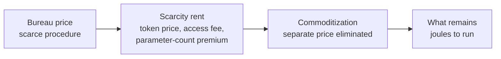

*Révision db13599, 5 novembre 2026. Données et code: [research.openie.dev/data/](/data/#economics). PDF LaTeX: [/pdfs/latex/spellcheck.pdf](/pdfs/latex/spellcheck.pdf) ([source](/pdfs/latex/spellcheck.tex)).*

## Résumé

La vérification orthographique était vendue à plusieurs centaines de dollars entre 1981 et 1989 et est aujourd’hui gratuite, intégrée aux outils que les gens utilisent déjà. Cet article documente ce changement à partir de sources datées et l’explique à l’aide de l’économie du coût marginal et du regroupement [62, 63].

**En termes simples**

1. Les gens payaient cher la vérification orthographique. Aujourd’hui elle est gratuite dans les téléphones, les navigateurs et les traitements de texte.
2. Elle est devenue gratuite parce que vérifier un mot coûte presque rien à exécuter, et elle est le plus utile au sein d’un outil déjà possédé.
3. Le même phénomène peut se produire pour d’autres compétences informatiques dès qu’elles s’exécutent à faible coût sur les appareils que les gens possèdent déjà, permettant ainsi à des milliards de personnes de les utiliser.

## Notation

| Terme | Signification dans cet article |
|---|---|
| Chemin d’automatisation | Une procédure informatique quitte un bureau spécialisé et devient une routine locale sur le matériel qu’une personne possède déjà. |
| Preuve d’existence | Une instance terminée de ce chemin. La correction orthographique en est un exemple. Le terme n’est pas employé comme figure de style. |
| Local | La vérification s’exécute sur la machine qui contient le document. La routine livrée ne nécessite pas de location de centre de données de pointe. |
| Matériel apparié | L’éditeur, le clavier ou le téléphone que la personne utilise déjà pour écrire. La capacité ne constitue pas une seconde machine. |
| Disponible | Le matériel est ordinaire, pas une location rare. |
| Accessible | La personne peut invoquer la capacité sur ce tissu sans envoyer la tâche à un bureau spécialisé. |
| Capable | Le tissu peut exécuter le dispositif qui finalise la tâche. |
| Les nombreux (7 M+) | Plus de 7 milliards de personnes. L’accès mondial auquel ces personnes sont destinées. |
| Les quelques | Les personnes qu’un prix de rareté peut encore atteindre. Il s’agit d’une classe de prix, pas d’un dénombrement : le chat de pointe a dépassé 800 millions d’utilisateurs hebdomadaires en octobre 2025 [61]. |
| Proposition | Une suggestion d’orthographe. Le document n’a pas encore été modifié. |
| Validation | Le remplacement est inscrit dans le document. |
| Exhaustivité | Le jeton est conservé : il était connu, ou un candidat a été accepté. Une recherche supplémentaire n’apporte alors aucune valeur d’information sur ce prédicat. |
| Prix monétaire | Un frais que quelqu’un peut facturer : prix du jeton, licence par poste, location de rareté, frais d’accès. La marchandisation fait tendre le frais séparé vers zéro. |
| Nombre de paramètres | Une taille de modèle. Ce n’est pas une métrique qui subsiste une fois que la capacité devient une commodité. |
| Joule (J) | Unité SI d’énergie. Ici, l’énergie utilisée pour exécuter la routine. |
| Recherche, Formule, Modèle | Trois types de mécanisme. Une interrogation de dictionnaire est une recherche. Un générateur de distance d’édition est une formule. Un modèle de langage est un modèle. |

## 1. Introduction

La vérification orthographique est une capacité que les gens achetaient autrefois comme produit séparé et qu’ils reçoivent maintenant dans les outils qu’ils possèdent déjà. Cet article suit ce changement à travers les prix datés, les articles qui ont construit la procédure, les bibliothèques qui la livrent et les machines qui l’exécutent, et se demande ce que cela implique pour l’intelligence informatique en général.

Les gens payaient une prime. Ensuite, la chose ne pouvait plus être vendue. Elle est gratuite, et elle est intégrée à autre chose. Les prix de la Section 2.11 sont ce fait. Les noms de la Section 2.9 viennent après cela.

La facture séparée du calculateur est une série datée, des publicités Anita aux HP-35 et TI-2500 jusqu’à VisiCalc. La facture séparée de la vérification orthographique se termine dans le traitement de texte puis dans le système d’exploitation. Les dollars que les sources n’impriment pas restent non imprimés.

Pour la vérification orthographique, la tendance des prix est complète. La routine est intégrée à l’éditeur à prix nul. Les joules sont toujours consommés.

Le choix est le prix. La tarification par rareté retient une capacité et vend la rétention. Elle atteint les personnes qui peuvent payer, les quelques‑uns. L’accès mondial est l’autre option. La capacité est conçue pour fonctionner sur la machine qu’une personne possède déjà, et la charge séparée disparaît. Cela atteint plus de 7 milliards de personnes.

La vérification orthographique est ce second choix, achevé. La tâche consiste à décider si un jeton écrit est un mot, et s’il ne l’est pas, à proposer le mot que l’auteur voulait. Kukich (1992) divise la tâche en détection de non‑mots, correction de mots isolés et correction dépendante du contexte. Les deux premières sont devenues ordinaires. Elles s’exécutent dans les programmes que les gens utilisent déjà pour écrire. Elles sont de l’intelligence informatique, pas une histoire racontée pour parler d’un autre système.

Le second choix ne se termine que lorsque la routine est suffisamment bon marché pour fonctionner à côté du document, localement sur la machine qui détient le fichier, et couplée au matériel que les gens possèdent déjà. McIlroy (1982) expose la contrainte dans les premières phrases de l’article UNIX spelling‑list. Le vérificateur peut être utilisé sur des mini‑ordinateurs, donc la liste doit être compacte. C’est l’accès mondial en tant qu’ingénierie. Un modèle de frontière qui répond uniquement depuis un centre de données loué reste une tarification par rareté toujours en vigueur. Il peut être performant et rester réservé aux quelques‑uns qui peuvent le louer.

La Section 2.11 est la prime, datée. La Section 2.10 indique qui possède une machine sur laquelle la capacité achevée peut s’exécuter, et qui ne possède qu’une location. Le logiciel écrit pour la machine que les gens utilisent déjà est la façon dont l’accès atteint le grand nombre. Un prix qui nécessite la location est la manière dont la rareté conserve les quelques‑uns.

### Un token, enseigné dans l'ordre

Norvig (2007) décrit un correcteur local et l’appel `correction('speling')`, qui renvoie `spelling`. Parcourez cet appel comme exemple pédagogique du chemin. La preuve d’existence de la production est Hunspell dans les éditeurs ordinaires, indiquée dans la Section 2.5.

1. La chaîne est déjà sur la machine. Rien n’est envoyé à un bureau.
2. La recherche demande si `speling` figure dans les comptes de mots locaux. Ce n’est pas le cas.
3. Une formule génère des chaînes à distance d’édition un : une suppression, une transposition, un remplacement ou une insertion. Le mot connu `spelling` se trouve dans cet ensemble.
4. La suggestion est une proposition. Le document ne change que lorsqu’une personne l’accepte, ou lorsqu’une politique déclarée l’accepte. C’est le commit.
5. Une fois `spelling` conservé, d’autres candidats ne modifient pas le prédicat « ce token est le mot que nous conservons ». C’est l’arrêt.
6. Ouvrir un modèle de frontière pour ce token n’obtient pas une meilleure clôture. L’engrenage recherche‑plus‑édition l’a déjà clôturé. Refuser la dépense plus importante n’est pas une remise. C’est la meilleure réponse pour cette tâche.

Le même essai montre le cas où le token local ne peut pas clôturer. `correction('where')` reste `where` lorsqu’une paire de test attendait `were`. Le mot unique ne porte pas la décision. Kukich (1992) a nommé cela le troisième problème, la correction dépendante du contexte. Un modèle plus grand peut être l’engrenage adéquat dans ce cas. Le chemin n’est pas terminé pour cet engrenage tant que l’engrenage s’exécute sur le matériel que l’auteur possède déjà, ou sur un tissu central optimisé en ressources que la personne peut réellement utiliser. Un passe de frontière loué que l’auteur ne peut pas invoquer reste le bureau.

## 2. Travaux connexes

### 2.1 Détection et correction de mots isolés

Damerau (1964) propose une méthode pour un mot absent d’un dictionnaire et comportant au plus une erreur : une lettre incorrecte, une lettre manquante, une lettre supplémentaire ou une transposition unique. Le mot non identifié est comparé au dictionnaire à nouveau sous chacune de ces hypothèses. Le résumé indique des identifications correctes pour plus de 95 % de ces types d’erreurs dans le test qu’il a effectué. Ce papier cite ce résultat comme le sien. Il ne répète pas le test.

Peterson (1980) passe en revue les programmes informatiques qui détectent et corrigent les fautes d’orthographe. À cette date, la capacité constitue une littérature de programmes fonctionnels, et non une proposition selon laquelle un programme pourrait éventuellement vérifier un mot.

Kukich (1992) organise le domaine selon les trois problèmes nommés ci‑dessus. La détection de non‑mots utilise une liste de mots, le filtrage de motifs ou l’analyse de n‑grammes. La correction de mots isolés propose un mot du dictionnaire pour un non‑mot détecté. La correction dépendante du contexte traite un jeton qui est un vrai mot mais qui reste le mauvais mot. L’enquête constitue la cartographie. La preuve d’existence dans cet article repose sur Hunspell en production : LibreOffice, Firefox, Chrome, les distributions Linux et macOS appellent une routine de dictionnaire locale (Hunspell README). Les deux premiers problèmes de Kukich ont quitté l’enquête pour entrer dans ces éditeurs ordinaires. Norvig (2007) demeure le didacticiel d’enseignement du Lookup puis d’une courte édition, et non le fait de production.

### 2.2 La liste a été construite pour correspondre à la machine

McIlroy (1982) décrit la liste de mots à l'origine du correcteur orthographique UNIX. Le résumé indique la contrainte d'ingénierie et le résultat. Le correcteur peut être utilisé sur des mini‑ordinateurs, de sorte que la liste doit être compacte. En supprimant les préfixes et suffixes, en hachant et en compressant, une liste réduite de 30 000 mots anglais est ramenée à 26 000 mots machine de 16 bits. Le correcteur antérieur de Johnson recherchait les mots d'un document déjà présent sur la machine. La contribution de McIlroy, pour cet article, est l'association : le dictionnaire a été compressé parce que la cible était le mini‑ordinateur que les utilisateurs exécuteraient réellement, et non une machine plus grande réservée à la tâche.

Ces décomptes de mots sont ses décomptes publiés.

### 2.3 Un canal bruité reste un programme local

Kernighan, Church et Gale (1990) classent les corrections candidates à l’aide d’un modèle à canal bruyant : la probabilité du candidat multipliée par la probabilité de la faute de frappe donnée le candidat. Le programme est un correcteur orthographique au sens habituel, un calcul local sur un dictionnaire et un modèle d’erreur. Un meilleur score n’est pas un déploiement différent. L’engrenage peut devenir plus précis tout en restant sur la machine qui contient le texte.

### 2.4 Un correcteur tenant en une page et ne nécessitant aucun réseau

Norvig (2007) a rédigé l’explication sur un avion, sans données d’erreurs d’orthographe et sans connexion internet. Le modèle de langue est un fichier local d’environ un million de mots, comptant 32 192 mots distincts apparaissant 1 115 504 fois. Le modèle d’erreur est délibérément grossier : un mot connu à distance d’édition 0 l’emporte sur tout mot à distance 1, qui l’emporte sur tout mot à distance 2. Après le vol il a évalué contre des ensembles tirés du corpus Birkbeck de Mitton. Il rapporte 75 pour cent de 270 paires de développement correctes, à 41 mots par seconde, et 68 pour cent de 400 paires de test final correctes, à 35 mots par seconde. Il indique qu’il a atteint ses objectifs de concision et de rapidité et qu’il n’a pas atteint son espoir de 80 à 90 pour cent de précision.

Ces chiffres sont son évaluation rapportée. Le jouet n’est pas un vérificateur industriel. Une tranche utile de la capacité provient d’un fichier sur la machine devant le programmeur, à quelques dizaines de mots par seconde, sans réseau. C’est la forme d’un chemin d’automatisation achevé. Les manques qu’il énumère, en particulier les mots inconnus du dictionnaire et les décisions nécessitant des jetons voisins, sont le résidu. Ce sont des arguments en faveur d’un meilleur équipement local, et non des arguments indiquant que la tâche doit revenir à un bureau.

### 2.5 La bibliothèque intégrée aux éditeurs ordinaires

Le projet Hunspell indique que Hunspell est le correcteur orthographique et l’analyseur morphologique utilisés par LibreOffice, par les navigateurs libres dont Firefox et Chrome, ainsi que par d’autres outils et systèmes d’exploitation, y compris les distributions Linux et macOS (Hunspell README). La bibliothèque lit un fichier de dictionnaire local et un fichier d’affixes local. L’outil en ligne de commande vérifie un fichier texte local. Le code descend de MySpell, l’implémentation de Kevin Hendricks dans OpenOffice.org, elle‑même une réimplémentation de l’orthographe à affixes de Geoff Kuenning, International Ispell. Hunspell de László Németh ajoute l’Unicode et la morphologie nécessaires pour les langues où une simple liste de mots anglais est inadaptée.

Ce README indique où la bibliothèque est utilisée. Le fait qu’elle contribue relève de la classe de déploiement. Le correcteur intégré à ces programmes est une bibliothèque locale et une liste de mots locale.

### 2.6 Le téléphone déjà en main

UITextChecker est une classe UIKit. L’appelant fournit une chaîne et une langue. La méthode renvoie l’intervalle d’un mot mal orthographié dans cette chaîne, ou indique qu’aucun n’a été trouvé (Apple, UITextChecker). La vérification est un appel sur l’appareil, contre une langue que le système répertorie comme disponible. Cet article ne prétend pas fournir une valeur en joules pour cet appel. La forme de l’API est l’appariement : le texte est déjà dans la vue texte, et le vérificateur est une méthode à côté.

Le cadre de vérification orthographique d’Android est également sur l’appareil. Une application étend `SpellCheckerService`, implémente une session, et renvoie des suggestions pour le texte fourni à la session (Android Developers, spell-checker framework; `SpellCheckerService`). Le vérificateur de la méthode d’entrée latine est un service local avec des dictionnaires de paramètres régionaux. Encore une fois, aucun chiffre énergétique n’est tiré de cette documentation. La documentation place la routine sur le téléphone.

Hard et ses collègues (2018) entraînent un modèle de prédiction du mot suivant pour le clavier Gboard par apprentissage fédéré. Les clients calculent des mises à jour sur du texte qui reste sur l’appareil. Le serveur agrège ces mises à jour et ne reçoit pas la saisie brute. Le même article indique que Gboard fournit à la fois la correction automatique et la prédiction du mot suivant, et que le clavier comptait plus d’un milliard d’installations en 2019. Cette phrase d’installation constitue la revendication de déploiement propre à l’article. Ce n’est pas un dénombrement des plus de sept milliards de personnes concernées par cette opinion.

Le modèle qu’ils diffusent est volontairement petit. Après quantification, il fait 1,4 mégaoctets, avec un vocabulaire de 10 000 mots, sous une contrainte produit qu’ils décrivent comme une réponse visible en environ 20 millisecondes et une taille de modèle de plusieurs dizaines de mégaoctets. La participation à l’entraînement dans leur étude est plus restreinte que la base d’installation : appareils nord‑américains, au moins 2 gigaoctets de mémoire, en charge, inactifs, et sur un réseau non mesuré. Cette étude cite la classe de déploiement. Un clavier déjà utilisé par les utilisateurs porte un petit modèle linguistique sur l’appareil, et la formation décrite ne transmet pas le texte tapé. Elle ne cite pas leurs tableaux de rappel comme résultat de précision orthographique.

### 2.7 La loterie matérielle

Hooker (2020; 2021) nomme la loterie matérielle : une idée de recherche l’emporte parce qu’elle correspond au matériel et aux logiciels disponibles, et non parce qu’elle est la meilleure idée en théorie. La correction orthographique a gagné une loterie qui valait la peine d’être remportée. Le matériel disponible était la machine qui contenait le document. L’algorithme qui convenait était une liste de mots plus un petit modèle d’édition. Une capacité qui ne s’adapte qu’à un accélérateur de pointe, et qui n’est vendue que sous forme de temps sur cet accélérateur, relève d’une autre loterie. L’avertissement de Hooker est que les idées qui ne correspondent pas au matériel installé s’enlisent même lorsqu’elles sont bonnes. La conséquence de conception dans cet article est la lecture inverse du même fait. Si le but est l’intelligence informatique pour le plus grand nombre, l’idée doit s’adapter au matériel que le plus grand nombre possède déjà, ou à un matériel qu’un tissu central optimisé en ressources peut leur étendre. S’ajuster à une location rare est la façon dont une capacité reste réservée à quelques-uns.

### 2.8 Ce que cette littérature n'est pas invitée à démontrer

Aucune des sources d’orthographe ci‑above n’est un tableau de population. Lorsqu’un nombre d’orthographe apparaît dans la Section 4, il s’agit du compte propre à la source : mots du dictionnaire, taille du jeu de test, mots par seconde, ou taux d’identification publié. La Section 2.10 ajoute une classe différente. Chaque nombre matériel correspond à l’expédition du diffuseur, à l’abonné, au revenu, ou à la donnée d’enquête, avec l’année associée. Plus de 7 milliards de personnes, et les quelques‑unes qui peuvent payer un prix de rareté, constituent les deux classes dans l’opinion. Elles ne sont pas la somme de ces lignes.

### 2.9 Comment l'automatisation informatique est tarifée

Un taux cité reste à l’intérieur du document qui l’a publié. Aucun ajustement de courbe n’est effectué ici. Aucun pente, demi‑vie, ou année de prix nul n’est indiqué.

En termes simples, avant les noms. Les gens payaient autrefois une prime pour la correction orthographique et pour le calcul ordinaire. La correction orthographique en tant que produit de base ne peut plus être vendue. Elle est gratuite, et elle est intégrée à l’éditeur, au navigateur et au téléphone. Le calcul ordinaire est intégré au téléphone et à l’ordinateur. Les noms ci‑dessous ne sont que des étiquettes pour cette séquence.

Trois régimes nomment la façon dont un outil d’automatisation informatique est tarifé. La section 2.11 est la bande datée pour le calculateur et pour la correction orthographique. Chaque prix est le prix d’une source. Aucun ajustement de courbe n’est réalisé à travers eux.

**Prix de bureau.** Tant que la procédure est rare, l’acheteur paie une personne ou une machine réservée. Nordhaus (2007) mesure le prix monétaire à long terme du calcul lui‑même, pas de la correction orthographique. Dans cet article le prix du calcul commence à environ 500 \$ par million de calculs par seconde pour le travail manuel et chute à environ $6 \times 10^{-11}$ par million de calculs par seconde d’ici 2006, en prix de 2006, une diminution de l’ordre de 8,3 trillions. Ce chiffre est le quotient de cet essai des deux extrémités qu’il vient d’énoncer, 500 \$ / $6 \times 10^{-11}$. Les extrémités sont ses chiffres rapportés. Elles ne sont pas réajustées ici, et le quotient n’est pas une prévision. Elles documentent que le prix monétaire du substrat de l’automatisation a baissé de plusieurs ordres de grandeur. Une baisse de cet indice n’équivaut pas encore à l’élimination d’une facture distincte d’un produit, et ce n’est pas un compteur de joules.

**Prix de rareté, et la course qu’il engendre.** Une fois qu’une entreprise peut expédier la procédure, elle peut facturer plus que le coût d’exécution. Cet écart est le loyer de rareté. Un frais d’accès et un prix de jeton sont le même écart sous des déguisements différents. Un compte de paramètres devient partie du déguisement lorsque les acheteurs apprennent à payer pour la taille. Le loyer est ce qui crée la course. Les rivaux remplacent le loyer en intégrant la capacité dans un produit que l’acheteur possède déjà, ou ils remplacent le produit entièrement. Les prix d’inférence publiés indiquent que la course est en cours pour les modèles de langage et n’est pas terminée. Epoch AI (2025) rapporte des baisses de prix à performance fixe de l’ordre de 9 à 900 fois par an à travers les bancs d’essai cités dans cette note. Emberson et Roodman (2026) rapportent une baisse d’environ 47 % par trimestre du coût d’une performance donnée depuis environ 2023, ce qu’ils résument à environ 13 fois par an. Ce sont leurs résumés de leurs séries. L’indice n’est pas ré‑estimé. Aucun trait n’est tracé à travers les points. Aucun taux n’est une loi au‑delà de leur fenêtre. Le papier sur la satiété des tâches utilise la même chute citée comme preuve d’un déplacement de rempart encore en cours ; cette affirmation demeure dans ce papier.

**Élimination du prix.** La marchandisation est la fin de la charge séparée. La capacité demeure. La ligne de facture ne le fait pas. Le correcteur orthographique est l’exemple achevé. Hunspell est une bibliothèque de correction orthographique libre sous une triple licence (LGPL, GPL et MPL). Le projet indique que LibreOffice, Firefox, Chrome, les distributions Linux et macOS l’appellent, et qu’une vérification lit un dictionnaire local (Hunspell README). L’acheteur de ces éditeurs ne paie pas de prix symbolique pour un non‑mot, ne paie pas de frais d’accès à un bureau d’orthographe, et n’achète pas un nombre de paramètres. Le prix monétaire de la méthode en tant que bien séparé est nul. C’est l’élimination du prix. Il ne s’agit pas d’une affirmation selon laquelle l’éditeur lui‑même est gratuit, et il ne s’agit pas d’une affirmation selon laquelle le téléphone était gratuit. Il s’agit d’une affirmation selon laquelle la correction orthographique n’est plus tarifée comme un bien propre.

**La tarification de rareté peut se déplacer vers la machine.** Mettre fin au prix séparé du logiciel ne met pas fin à chaque prix de rareté. Une plateforme peut placer une capacité plus récente sur un appareil plus récent et facturer l’appareil. Yusuf Mehdi, 20 mai 2024, a défini un PC Copilot+ par une unité de traitement neuronal de 40 TOPS ou plus. La première vague utilise Snapdragon, le petit modèle fonctionne sur cette unité, et les grands modèles restent sur Azure. Le compte d’Apple du 9 juin 2025 place un modèle sur l’appareil d’environ 3 milliards de paramètres sur le silicium Apple et laisse le modèle plus grand sur Private Cloud Compute. Ce sont des prix pour un équipement ultérieur et pour la machine qui le porte. Ce ne sont pas une facture relancée pour le correcteur orthographique. Le vérificateur fonctionne déjà sur l’éditeur, le navigateur et le téléphone que les gens possèdent, y compris la génération précédente encore en main. Un rafraîchissement qui demande à quelqu’un d’acheter une nouvelle classe d’ordinateur pour recevoir une vérification que l’ancienne machine effectue déjà constitue une tarification de rareté du matériel. Elle atteint les personnes qui achètent cette classe. Seules quelques‑unes peuvent appartenir à cette classe. Cela n’annule pas l’accès déjà fourni à plus de 7 milliards de personnes.

La correction dépendante du contexte n’est pas ce cas achevé. Kukich (1992) l’a nommé comme le troisième problème : un token qui est un vrai mot et qui reste le mauvais mot. Un modèle plus grand peut être le bon équipement dans ce cas. En correction d’erreurs grammaticales, les modèles plus grands et mieux entraînés corrigent mieux : GECToR [71] et un modèle multilingue de 11 milliards de paramètres [72] ont établi l’état de l’art à leur époque. Le compromis est l’énergie : Luccioni, Jernite et Strubell mesurent les tâches génératives comme bien plus consommatrices d’énergie que les tâches de classification par inférence [73]. Le cas du mot isolé de la Section 4.10 est le cas où la dépense supplémentaire n’achète aucun token différent. L’équipement a pris le choix d’accès uniquement lorsqu’il fonctionne sur le matériel que la personne possède déjà, ou sur un tissu central optimisé en ressources que la personne peut utiliser. Une location rare est le choix de rareté, même lorsque le modèle est plus précis sur un benchmark. Le travail ordinaire de non‑mot ne revient pas à cette location parce que le travail contextuel n’est pas achevé. Aucun tableau de joules comparant une sonde de dictionnaire, un modèle local et un appel de centre de données n’est imprimé ici. Aucun de ces joules n’a été mesuré pour cet article.

Ce qui reste est l’énergie nécessaire pour exécuter la comparaison. Une sonde de dictionnaire locale consomme des joules sur l’appareil qui détient le document. Aucun joule n’est mesuré ici. Aucun total analytique n’est calculé. `measured_j` n’est pas défini : aucune lecture de compteur n’a été prise.

La prédiction découle des régimes, pas d’une régression. Les tâches ordinaires d’intelligence informatique suivent la correction orthographique. Leurs prix de jeton, primes liées au nombre de paramètres, rentes de rareté et frais d’accès sont éliminés par le regroupement sur le matériel que les gens possèdent déjà et par des méthodes dont le prix de licence est nul. L’état final concerne plus de 7 milliards de personnes, pas seulement les quelques‑unes qui peuvent payer un prix de rareté. La prédiction échoue si une tâche ordinaire, du type que la correction orthographique résout déjà, conserve un prix monétaire distinct après qu’une routine locale produisant le même résultat soit entre les mains des personnes qui détiennent le document. Un benchmark de pointe qui porte encore une prime n’est pas cet échec. C’est le stade de la douve, que les notes d’Epoch montrent déjà en train de devenir moins cher, et que la correction orthographique montre comment quitter.

Les mêmes régimes sont illustrés dans la figure interactive [sc-anim-01](/living/spellcheck/#sc-anim-01). Deux points représentent les extrémités rapportées par Nordhaus. Le connecteur en pointillés relie ces deux extrémités. Aucun taux n’est estimé. La fourchette 9‑to‑900 d’Epoch et le résumé d’environ 13 fois se trouvent dans une annotation. Elles conservent leurs résumés. Le panneau de correction orthographique représente le régime achevé : le prix monétaire distinct a disparu, et les joules restent non mesurés.

Landauer (1961) fixe un plancher physique pour l’effacement d’un bit. Horowitz (2014) constitue l’énoncé pratique du CMOS : le déplacement des données domine, bien au‑delà de cette limite idéale. Un sondage de dictionnaire déplace des bits. La marchandisation peut ramener la facture à zéro tout en conservant ce déplacement. Aucun total de joules pour la correction orthographique n’est calculé à partir de l’une ou l’autre citation.

**Le regroupement comme stratégie.** La littérature sur le regroupement raconte la même histoire que la stratégie ainsi que l’accès. Adams et Yellen montrent qu’un regroupement est un outil de discrimination tarifaire [68]. Nalebuff montre qu’un regroupement peut barrer l’entrée à un concurrent qui ne vend qu’un bien [69]. Spolsky a nommé la tactique pour les logiciels : marchandiser votre complément, de sorte que le produit que vous vendez vaille davantage [70]. Chaque lecture s’accorde sur l’observable utilisé dans cet essai : le prix distinct de la couche regroupée tombe à zéro. Elles diffèrent sur qui conserve la rente. Cette différence explique pourquoi cet essai suit à la fois qui détient la plateforme et le prix.

### 2.10 Accès au matériel, catégorie par catégorie

Hooker nomme la loterie. Cette section nomme les machines. L’argument est sept enregistrements. Un envoi de téléphones n’est pas un envoi de centre de données. Une enquête Steam n’est pas un recensement d’ordinateurs personnels. Une ligne de revenu n’est pas un compte d’unités. Lorsqu’une entreprise ne divulgue pas le nombre d’unités, l’article le signale et cite la donnée que l’entreprise a divulguée. Aucun de ces chiffres n’est un compte du nombreux ou du peu. Ils ne sont pas la somme des lignes. Les figures vivantes [sc-hw-01](/living/spellcheck/#sc-hw-01) et [sc-gen-01](/living/spellcheck/#sc-gen-01) sont les mêmes enregistrements.

Pour chaque catégorie les questions sont les mêmes. Qui possède la machine, selon le compte propre de la source. Quel empilement logiciel cette machine exécute. Comment cet empilement répond à l’empilement de pointe le plus avancé. L’affirmation de conception est une phrase : le logiciel écrit pour la génération accessible mondialement a le plus grand impact. La génération accessible est celle en main. Le correcteur orthographique est l’exemple d’automatisation achevé de cette phrase. McIlroy a dimensionné la liste pour le mini‑ordinateur en service. L’énergie à consommer est la métrique qui reste. Ces lignes indiquent qui possède la machine. Elles ne sont pas des joules.

**Téléphones et générations SoC mobiles.** GSMA, *The Mobile Economy 2025*, compte 5,8 milliards d’abonnés mobiles uniques à la fin de 2024, un taux de pénétration de 71 pour cent, et 4,7 milliards d’utilisateurs d’Internet mobile. Le suivi préliminaire mondial trimestriel des téléphones mobiles d’IDC du 13 janvier 2026 compte 1 260,3 millions de smartphones expédiés en 2025, dont Apple en a expédié 247,8 millions. La version d’IDC du 13 janvier 2025 comptait 1 238,8 millions de smartphones en 2024. Le tableau de 2026 réaffirme 2024 à 1 236,3 millions. Chaque version conserve son propre total. Le rapport annuel d’Arm pour l’exercice clos le 31 mars 2025 indique que les CPU basés sur Arm étaient présents dans plus de 99 pour cent des smartphones mondiaux vendus cette année fiscale, et que les clients avaient cumulativement expédié plus de 310 milliards de puces basées sur Arm, des plus petits capteurs aux supercalculateurs. Le chiffre cumulé représente l’ensemble du marché Arm. Ce n’est pas un compte de téléphones, et le rapport ne le découpe pas par générations SoC.

Le téléphone de 2025 correspond à une génération actuelle de SoC mobiles : Apple silicon, Qualcomm Snapdragon, MediaTek, Samsung, Google Tensor. IDC compte les téléphones de marque. Le nombre d’abonnés correspond aux personnes disposant d’un abonnement mobile, pas à un compte de SoC.

L’empilement logiciel de ce téléphone comprend déjà un correcteur local. UITextChecker et le service Android `SpellCheckerService` sont le cas d’orthographe. Un modèle sur le même téléphone utilise Apple Core ML et le cadre Foundation Models, Android LiteRT et NNAPI, le compilateur QNN de Qualcomm, ExecuTorch, ou llama.cpp. Le compte d’Apple du 9 juin 2025, aligné au rapport technique du 17 juillet 2025, décrit un modèle de fondation sur l’appareil d’environ 3 milliards de paramètres, compressé à 2 bits par poids, et un modèle serveur mixture‑of‑experts fonctionnant sur Private Cloud Compute. Le rapport LFM2 de Liquid AI conçoit des modèles denses de 350 millions à 2,6 milliards de paramètres, et un modèle mixture‑of‑experts de 8,3 milliards avec 1,5 milliard actif, pour ExecuTorch, llama.cpp et vLLM, et les exécute sur un Samsung Galaxy S25 équipé d’un Snapdragon 8 Elite. PrismML indique que son Ternary Bonsai 2 27B, qu’il affirme être construit sur Qwen3.8 27B, conserve 98,2 pour cent du contre‑partie en pleine précision avec une empreinte 9 fois plus petite, 5,9 GB. Ces ratios proviennent de PrismML. Cet article ne les re‑mesure pas.

L’interface vers la pile frontier est un modèle plus petit, un modèle à faible précision, ou un appel à un serveur exploité par le fournisseur. Apple indique cette division dans un rapport. Une exécution d’entraînement frontier n’est pas déployée sur le téléphone. La revendication de conception pour cette ligne : le logiciel écrit pour la génération de SoC déjà commercialisée, et pour les téléphones encore utilisés des années précédentes, a le plus grand impact. La correction orthographique est ce logiciel.

**PC et ordinateurs portables.** Le communiqué d’IDC du 9 janvier 2025 indique 262,7 millions d’ordinateurs personnels traditionnels expédiés en 2024. Le communiqué préliminaire d’IDC du 12 janvier 2026 indique 284,7 millions en 2025. Le tableau de 2026 réaffirme 2024 à 263,3 millions. Lors de la conférence téléphonique du 28 janvier 2026, Satya Nadella a déclaré que Windows avait atteint 1 milliard d’utilisateurs de Windows 11, soit une hausse de plus de 45 pour cent d’une année sur l’autre. Une année d’expédition n’est pas cette base installée.

La pile comprend le système d’exploitation, le navigateur et une bibliothèque locale. Hunspell assure la correction orthographique dans les éditeurs classiques. Un modèle sur le même PC utilise ONNX Runtime, DirectML, Windows ML, llama.cpp ou ExecuTorch sur le CPU et le GPU intégré. Un GPU discret constitue la catégorie suivante. Liquid AI mesure la même famille LFM2 sur un AMD Ryzen AI 9 HX 370 avec llama.cpp en Q4_0. Il s’agit d’une mesure CPU d’ordinateur portable dans leur rapport, pas d’une mesure de centre de données.

L’interface vers la pile frontier est un appel d’API, ou un modèle qui tient dans la mémoire de la machine. Les deux sont des programmes différents. Le premier est une location. Le second est le chemin. La revendication de conception pour cette ligne : le logiciel pour la génération de PC que les gens utilisent déjà a le plus grand impact. La correction orthographique a suivi ce chemin. Un poids qui suppose un accélérateur loué ne l’a pas fait.

**GPU grand public.** Le communiqué fiscal 2026 de NVIDIA, clôturé le 25 janvier 2026, indique un revenu Gaming de 16,0 milliards de dollars. Il s’agit de revenu, pas d’un compte d’unités. Jon Peddie Research, 5 mars 2026, indique 11,48 millions de cartes graphiques PC expédiées au quatrième trimestre 2025, soit une hausse de 36,0 pour cent par rapport à l’année précédente, avec un taux d’attachement desktop de 55 pour cent ce trimestre‑ci. La même note indique que les cartes GPU de centre de données ont augmenté de 17,0 pour cent par rapport au trimestre précédent et ne publie pas leur nombre d’unités. Une « base installée » de 172 millions dans cette note est une prévision finale. Ce document ne l’utilise pas comme recensement actuel.

L’enquête Valve Steam Hardware and Software Survey de septembre 2026 rapporte, parmi les répondants, NVIDIA GeForce RTX 5070 à 6,15 pour cent, RTX 5090 à 0,40 pour cent, RTX 4060 à 3,89 pour cent, RTX 3060 à 3,66 pour cent et GTX 1650 à 2,19 pour cent. L’enquête porte sur les participants Steam. Ce n’est pas le monde entier. Ce document n’ajoute pas ces parts à un total générationnel. La liste est partielle, et l’enquête comporte une catégorie Autre.

La pile est CUDA sur NVIDIA, et ROCm ou Vulkan sur AMD. llama.cpp exécute un modèle quantifié sur la carte. vLLM sert un modèle lorsque la carte contient le poids. L’interface vers la pile frontier est la quantisation, un modèle plus petit, ou une API. Une carte grand public exécute le modèle qui tient. Le système d’entraînement frontier ne tient pas. La revendication de conception pour cette ligne : le logiciel destiné au produit phare vise 0,40 pour cent d’une enquête de joueurs. Le logiciel destiné aux cartes que les gens signalent encore, y compris les séries 30 et 40, couvre la génération installée. C’est le plus grand impact.

**Accélérateurs de centre de données.** Le communiqué de même exercice fiscal 2026 de NVIDIA indique un chiffre d’affaires du Data Center de 193,7 milliards de dollars pour l’année, en hausse de 68 pour cent, et de 62,3 milliards de dollars au quatrième trimestre. Le communiqué ne divulgue pas les expéditions unitaires de Hopper, Blackwell ou Rubin. Il décrit un partenariat pluriannuel avec Meta qui comprend des millions de GPU Blackwell et Rubin. Cette phrase constitue le compte rendu de NVIDIA d’un plan de déploiement. Ce n’est pas un décompte audité de cartes dans les racks. Le 28 octobre 2025, lors du GTC à Washington, Jensen Huang a déclaré que 6 millions de GPU Blackwell avaient été expédiés au cours des quatre derniers trimestres. CNBC a rapporté cette phrase le même jour. Le communiqué fiscal 2026 ne révèle toujours pas les expéditions unitaires. Le chiffre de 6 millions est la déclaration de Huang. Ce n’est pas une ligne d’unité auditée. Le même rapport cite une prévision de 500 milliards de dollars de ventes de GPU pour Blackwell et Rubin. Il s’agit d’une prévision de ventes. Ce document ne la transforme pas en un décompte d’unités.

Le communiqué du 3 février 2026 d’AMD indique un chiffre d’affaires du segment Data Center de 16,6 milliards de dollars pour l’année civile 2025, en hausse de 32 pour cent, et précise que la croissance reflète à la fois les CPU EPYC et les GPU Instinct. Instinct n’est pas une ligne de revenu distincte, à l’exception d’une tranche divulguée : les revenus du quatrième trimestre d’Instinct MI308 vers la Chine d’environ 390 millions de dollars. Aucun décompte d’unités Instinct n’est présent dans le communiqué.

Lors de l’appel du 28 janvier 2026, Nadella a indiqué que le parc de Microsoft comprend des GPU NVIDIA, AMD et l’accélérateur Maya 200 propre à Microsoft, récemment mis en service. Amy Hood a déclaré que les dépenses d’investissement ce trimestre s’élevaient à 37,5 milliards de dollars, dont environ deux tiers concernaient des actifs à durée de vie courte, principalement des GPU et des CPU, et que la demande dépassait l’offre. Aucun décompte d’unités Maya n’est présent dans la transcription. Les expéditions d’unités TPU de Google et Trainium d’Amazon ne figurent pas dans les sources consultées pour cette section. Elles sont nommées afin que la catégorie ne soit pas réduite à un seul fournisseur. Le décompte d’unités manquant constitue le registre.

Qui le possède : les acheteurs qui contractent ce revenu. Hood a indiqué qu’une grande partie du capital GPU est déjà contractée pour la durée de vie utile du matériel. Il s’agit d’un marché de location. La pile logicielle sur l’accélérateur comprend CUDA, ROCm et les piles de service qui supposent la carte, y compris TensorRT-LLM et vLLM. Cette catégorie représente la pile de pointe. L’interface de tous les autres à celle‑ci est une API, un modèle distillé ou un modèle quantifié. La revendication de conception pour cette ligne : le logiciel qui nécessite l’accélérateur atteint les locataires. Le logiciel écrit pour les générations des autres lignes atteint les personnes qui détiennent ces machines. La vérification orthographique a effectué le second. Le premier correspond à l’étape du bureau.

**MCU, petites pièces et pièces embarquées.** Le chiffre cumulé d’Arm de plus de 310 milliards de puces comprend les capteurs et les dispositifs embarqués. Le rapport annuel ne ventile pas ce chiffre cumulé en microcontrôleurs. IC Insights, 29 mars 2022, indique que les livraisons de 2021 ont atteint 30,9 milliards de microcontrôleurs, après une croissance unitée de 12 pour cent cette année‑là. Il s’agit d’une expédition de 2021. La même note prévoit 35,8 milliards d’unités en 2026. La prévision n’est pas un compte actuel.

MLCommons, 17 septembre 2025, publié MLPerf Tiny v1.3. La suite mesure des réseaux neuronaux généralement inférieurs à 100 kilooctets. La version comprend 70 résultats sur cinq tests, dont 27 résultats de consommation, de Kai Jiang, Qualcomm, STMicroelectronics et Syntiant. Cinq plates‑formes matérielles ont été évaluées pour la première fois. Les tests couvrent la classification d’images, les mots‑veille visuels, la détection de mots‑clés, la détection d’anomalies et une tâche de mot‑veille en flux continu.

La pile est TensorFlow Lite for Microcontrollers, CMSIS‑NN et les runtimes fournisseurs utilisés par ces soumissions. Le modèle est en kilooctets. Un modèle de langage de pointe ne se charge pas. L’interface vers la pile de pointe est un modèle de tâche compilé pour la pièce : un mot‑veille, un score de capteur, un noyau. L’affirmation de conception pour cette ligne : le logiciel de cette génération est le logiciel qui s’adapte à la pièce. L’expédition cumulative d’Arm est le chiffre de silicium le plus élevé de cette section, et il ne s’agit pas d’un centre de données. L’impact suit la pièce qui est expédiée.

**Accélérateurs de bord et NPU dans les appareils commercialisés.** Yusuf Mehdi, 20 mai 2024, a défini un PC Copilot+ par un unité de traitement neuronal de plus de 40 TOPS. La première vague utilise Snapdragon X Elite et Snapdragon X Plus, que cet article indique fournir 45 TOPS NPU. Les expériences sur l’appareil sont spécifiées pour fonctionner sur ce NPU avec de petits modèles de langage, tandis que les grands modèles restent disponibles via Azure. Gartner, tel que rapporté par Computerworld le 28 août 2025 à partir du communiqué de Gartner du même jour, prévoit 77,8 millions de PC IA en 2025, soit 31 pour cent du marché mondial des PC. Il s’agit d’une prévision publiée avant la clôture de l’année. Ce n’est pas le total PC complet d’IDC, et ce n’est pas uniquement le nombre de PC Copilot+. Canalys, désormais partie d’Omdia, dans des données datées du 25 février 2025 et rapportées le 7 mars 2025, compte 15,4 millions de PC compatibles IA expédiés au quatrième trimestre 2024, soit 23 pour cent des expéditions de PC ce trimestre‑là. Pour l’ensemble de l’année 2024, la même note indique que 17 pour cent des PC expédiés étaient compatibles IA et ne donne pas le total annuel d’unités. Sa définition est un ordinateur de bureau ou portable doté d’un chipset ou d’un bloc dédié aux charges de travail IA sur l’appareil. Les exemples cités sont AMD XDNA, le Neural Engine d’Apple, Intel AI Boost et le Hexagon de Qualcomm. Les 15,4 millions correspondent à un trimestre clôturé. Les 77,8 millions de Gartner restent une prévision.

Le modèle sur l’appareil d’Apple, d’environ 3 milliards de paramètres, est compilé pour le silicium Apple, qui comprend le Neural Engine. Apple ne publie pas d’expédition distincte du Neural Engine. La base d’appareils actifs est le chiffre Apple antérieur, et non un recensement des NPU.

La pile est Qualcomm QNN, le Runtime Windows Copilot, Apple Core ML et le cadre Foundation Models, le logiciel AMD Ryzen AI, la pile NPU d’Intel et ONNX. Chacun compile un graphe pour son NPU. Un poids CUDA n’est pas un programme NPU tant qu’un compilateur ne l’accepte pas. L’interface vers la pile de pointe est celle que Microsoft indique et celle qu’Apple indique : le petit modèle sur l’appareil, le grand modèle sur un serveur exploité par le fournisseur. L’affirmation de conception pour cette ligne : le NPU à l’intérieur d’un téléphone ou PC ordinaire est la génération accessible. Le logiciel écrit pour ce NPU, dans le compilateur du fournisseur, a la portée. Un noyau qui suppose un GPU de centre de données ne fonctionne pas là‑bas.

**Générations antérieures encore en main.** La génération la plus récente est une expédition. La génération installée est ce que les gens utilisent encore. Les deux sont des chiffres différents, et plusieurs entreprises ne publient pas le second.

Téléphones : 1 260,3 millions de smartphones expédiés en 2025, contre 5,8 milliards d’abonnés mobiles uniques à la fin de 2024. Les abonnés ne sont pas des terminaux. Le fait d’échelle tient sans cette conversion. Un an d’expéditions de terminaux ne constitue pas la base d’abonnés. Les terminaux antérieurs restent en usage. Cet article ne transforme pas l’écart en part de génération.

Apple, lors de la conférence téléphonique des résultats du 30 janvier 2025, a déclaré une base installée de plus de 2,35 milliards d’appareils actifs toutes catégories confondues. Le communiqué du 30 octobre 2025 a indiqué que la base installée avait atteint un nouveau record historique et n’a pas publié de compte de remplacement. Les expéditions d’iPhone du calendrier 2025, à 247,8 millions, ne représentent qu’un produit en une année. Elles ne constituent pas la base active.

PC : 1 milliard d’utilisateurs de Windows 11 au 28 janvier 2026, contre 284,7 millions de PC expédiés au cours du calendrier 2025. La note d’IDC du 12 janvier 2026 et les remarques de Hood lors de l’appel de janvier évoquent toutes deux la fin du support de Windows 10 comme raison du déplacement de la demande de PC en 2025. La génération précédente de systèmes d’exploitation était suffisamment importante pour entraîner un rafraîchissement. Son nombre restant n’est pas indiqué dans la transcription. Cet article ne fournit pas de donnée à ce sujet.

GPU grand public : l’enquête Steam de septembre 2026, citée ci‑dessus. RTX 5090 à 0,40 pour cent. RTX 3060 à 3,66 pour cent. RTX 4060 à 3,89 pour cent. GTX 1650 à 2,19 pour cent. Le dernier drapeau phare n’est pas la carte la plus souvent rapportée par l’enquête.

Accélérateurs de centre de données : le communiqué fiscal 2026 de NVIDIA compare Blackwell à Hopper et ne donne pas le nombre installé de cartes Hopper encore en service. Nadella a déclaré que le logiciel continue d’exécuter les modèles actuels sur la flotte vieillissante. Il s’agit de la forme de centre de données du même fait, et la flotte reste une location. Aucun compte d’unité de base installée n’est inventé ici.

L’affirmation de conception, pour cette ligne et les six précédentes : le logiciel écrit pour la génération globalement accessible a le plus grand impact. La génération accessible est celle en main, et les sources ci‑dessus montrent qu’il ne s’agit pas du même objet que le dernier die. La correction orthographique a été écrite d’abord pour le mini‑ordinateur en service, puis pour l’éditeur, puis pour le téléphone. Une fois le prix monétaire séparé disparu, l’énergie nécessaire à l’exécution demeure. Un die plus récent ne remplace pas cette métrique par une licence.

Les thèses sur l’appareil s’alignent avec cette affirmation, et elles ne remplacent pas le registre d’expéditions. Hooker (2020 ; 2021) affirme qu’une idée l’emporte en s’ajustant au matériel existant. Le rapport d’Apple ajuste un modèle d’environ 3 milliards de paramètres au silicium Apple et laisse le modèle plus grand sur Private Cloud Compute. Le rapport LFM2 de Liquid AI explore les architectures sous latence mesurée et mémoire sur un CPU de téléphone et un CPU d’ordinateur portable, et expédie les poids pour ces environnements d’exécution. L’affirmation publique de PrismML est qu’un modèle ternaire est l’artéfact qui s’ajuste à un dispositif local, aux ratios indiqués par l’entreprise. La correction orthographique reste l’exemple achevé. Le test du dictionnaire n’a nécessité aucun de ces modèles. Il a requis la machine qui contenait déjà le texte.

### 2.11 Prix datés, et durée connue de chacun

Les régimes de la Section 2.9 sont des noms. Cette section constitue la bande de prix. Chaque ligne correspond à un prix imprimé par une source, à la date que la source associe, et à ce que la source indique concernant la durée du prix. Lorsque la source est une publicité, la durée correspond à l’écart jusqu’à la prochaine publicité imprimée par la compilation. Cet écart ne constitue pas un audit de prix continu. Lorsque deux sources divergent, les deux sont imprimées. Lorsqu’un prix n’apparaît pas sur la page, il n’est pas renseigné. Le tableau vivant est [sc-price-01](/living/spellcheck/#sc-price-01).

**Calculatrices de bureau, Sumlock Comptometer et Anita.** L’indice publicitaire sur anita-calculators.info est une compilation de publicités datées. Il ne s’agit pas d’une liste de prix tenue par l’entreprise.

Automne 1949. Une publicité pour la machine à additionner Plus dans cet indice indique « Now Plus for only \$100 ». L’indice ne précise pas la durée de ce prix.

Octobre 1961. L’Anita Mk 8 a été lancée à la Business Efficiency Exhibition de Londres. Office Magazine, décembre 1961, pages 1244‑1245, reproduites sur le même site, indique le prix à £335 et précise que les commandes seraient prises à partir du 1 janvier 1962. La revue indique que la machine n’était pas encore disponible de façon générale.

Mai 1963. Une publicité dans l’indice fixe le prix de l’Anita Mk 8 à £355 et celui du Comptometer 993s à £265. L’indice ne consigne aucun prix pour le Mk 8 entre la revue de décembre 1961 et cette publicité. L’intervalle correspond au silence entre ces deux dates, et non à une certification que £335 était maintenu.

Janvier 1964. L’indice fixe le Mk 8 à £365. Février 1964. Le Comptometer 993 est proposé dans une fourchette, de £160 à £330.

Janvier 1965. L’indice fixe le Mk 8 à £335 et le Mk 9 à £425. Le prix publicitaire du Mk 8 est de £335 dans la revue de décembre 1961, de £355 en mai 1963, de £365 en janvier 1964, et de £335 en janvier 1965. Chaque chiffre provient d’une publicité ou d’une revue. Aucun d’eux ne stipule que le prix était constant entre les dates.

Novembre 1965. L’indice fixe le Mk 9 à £425 et indique que plus de 16 000 Anita étaient en usage, et que l’Anita a été introduite en janvier 1962. Entre la publicité de janvier 1965 et celle‑ci, le prix du Mk 9 dans l’indice reste inchangé à £425. Il s’agit de deux observations, pas d’un audit mensuel.

Juillet 1966. L’indice fixe le Mk 10 à £460.

Juin 1968. « Focus on ANITA », une publicité dans Office Methods and Machines, juin 1968, page 41, est citée par les pages modèles sur anita-calculators.info. Ces pages retranscrivent trois montants : Mk 10 : £480. La page du Mk 10 cite la publicité : « Price £480 ». Mk 11 : £298. Mk 12 : £480. L’indice ne publie toujours pas ces montants. Le montant du Mk 9 n’apparaît pas sur la page du Mk 9. Cette page fixe le prix d’introduction de 1964 à £425, en citant « BEE '64 », Industrial Electronics, novembre 1964, page 521. Ce £425 est le prix d’introduction, pas une transcription de la ligne de juin 1968. Le montant du Mk 9 de juin 1968 n’est présent dans aucune des sources lues pour cet article. Juillet 1966 avait fixé le Mk 10 à £460. Juin 1968 le fixe à £480. Ce sont deux publicités. Les mois qui les séparent ne constituent pas un audit.

Avril 1969 et mai 1969. L’indice fixe l’Anita 1000 à £285 les deux mois. Juillet 1969. L’Anita 1010 est à £320. Février 1971. L’Anita 1000LSI est à £192 et l’1010LSI à £250. Il s’agit de modèles ultérieurs. Un prix plus bas sur un modèle ultérieur ne constitue pas une réduction du prix du Mk 8.

**HP-35.** Trois sources s’accordent sur le prix d’introduction et divergent quant au calendrier des réductions.

Musée d’histoire de l’informatique, « This Day in History », 4 janvier 1972 : Hewlett‑Packard a présenté le HP‑35 et il était vendu à 395 \$.

Musée des calculateurs Datamath, page HP‑35 : annoncé le 4 janvier 1972, disponible en février 1972, PDSF 395 \$ en janvier 1972, PDSF 295 \$ en janvier 1974. La même page indique qu’au début de 1975 le prix a baissé à 195 \$ et que le calculateur a été retiré peu après le HP‑21. Elle indique également le prix du HP‑65, introduit le 19 janvier 1974, à 795 \$. Aucun rabais de mai 1973 n’est mentionné et aucun 225 \$ n’est indiqué.

Craig Finseth, fichier hpdata pour le HP‑35A : prix d’introduction 395 \$. La date d’introduction dans ce fichier est le 1 juillet 1972, tirée d’un « wall of fame », avec une possible date du 1 février 1972. Arrêt de production le 1 février 1975 à 195 \$. Les lignes de changement de prix du fichier sont le 1 mai 1973 à 295 \$, le 1 mai 1974 à 225 \$, et le 1 février 1975 à 195 \$. Une note dans le même fichier indique que le prix est passé à 295 \$ lorsque le HP‑45A a été introduit. Datamath date le HP‑45 à mai 1973, ce qui correspond au mois utilisé par Finseth pour 295 \$, tandis que la ligne PDSF de Datamath indique encore 295 \$ comme chiffre de janvier 1974.

Présentés comme des durées, et uniquement à l’intérieur de chaque source. Liste de Finseth, si l’on suit le calendrier du fichier : 395 \$ du jour d’introduction indiqué dans le fichier jusqu’au 1 mai 1973 ; 295 \$ du 1 mai 1973 au 1 mai 1974 ; 225 \$ du 1 mai 1974 au 1 février 1975 ; 195 \$ à la date d’arrêt. La date d’introduction dans ce fichier est elle‑même incertaine. Liste de Datamath : 395 \$ comme PDSF de janvier 1972, et 295 \$ comme PDSF de janvier 1974. La page ne précise pas que le prix est resté à 395 \$ chaque mois entre‑temps. 195 \$ est « début de l’année 1975 », pas un jour précis. Les mois entre le chiffre de janvier 1974 et celui de 1975 ne sont pas détaillés.

**TI‑2500 Datamath.** Musée des calculateurs Datamath, page Version 1 du TI‑2500 : annoncé en avril 1972 à un prix de détail suggéré de 149,95 \$. Les premiers clients ont reçu les calculateurs en juin 1972 chez Neiman‑Marcus et Sanger‑Harris à Dallas. Introduction officielle le 21 septembre 1972. Le prix de détail suggéré a été réduit à 119,95 \$ à la date de cette introduction. La page ne donne pas le jour de la réduction. La fenêtre documentée pour 149,95 \$ dans cette source s’étend d’avril 1972 au 21 septembre 1972. Les réductions ultérieures après 119,95 \$ ne figurent pas sur cette page. La même page cite le Bowmar 901B, introduit en septembre 1971, sans indiquer de prix. La page HP‑35 de Datamath cite le HP 9100A de 1968 sans prix. Les prix se trouvent sur d’autres pages, comme indiqué ci‑dessous.

**HP 9100A.** Le scan du Musée d’histoire de l’informatique du prospectus de 1968, collection 102646164, indique « Priced at \$4900 » et « hp 9100A Calculator, Price: \$4900 ». Le projet HP Memory indique le même prix de 4900 \$ à la page 130 du catalogue de 1969, et précise que le modèle a été présenté dans le Hewlett‑Packard Journal de septembre 1968. Le prospectus ne précise pas la durée de validité du prix de 4900 \$. Un prix ultérieur n’est pas tiré d’une page que cet article n’a pas consultée.

**Bowmar 901B.** Musée des calculateurs Datamath, page Bowmar 901B : date d’introduction septembre 1971, nouveau prix 240 \$. La page indique un prix de détail suggéré de 240,00 \$ pour le 901B lancé sur le TMS0103. La durée du prix de 240 \$ n’est pas indiquée sur la page.

**Le calculateur en tant que logiciel.** Wikipedia, VisiCalc, tel que lu pour cet article. Personal Software a commencé à vendre VisiCalc à la mi‑1979 pour moins de US\$100. Le même article cite une introduction officielle prévue pour la National Computer Conference, du 4 au 7 juin 1979. Il cite également Peter Jennings : la première copie d’Apple II, version 1.37, est sortie le 17 octobre 1979. Les deux dates figurent dans l’article. Cet article ne les regroupe pas.

L’article indique qu’en 1982 le prix était passé de \$100 à \$250, selon Softline, mars 1982. Il ne précise pas le mois de l’augmentation. Le chiffre de \$100 et celui de \$250 sont deux rapports datés. La durée de chaque prix entre ces rapports n’est pas indiquée dans l’article. Une phrase séparée de l’article le qualifie de VisiCalc à \$100 contre un Apple II à \$2 000. Ce \$2 000 correspond à la machine, d’après des récits ultérieurs de l’article, et non à un second prix logiciel.

Le même article indique que les langages de modélisation financière sur systèmes à partage de temps coûtaient \$20 000, selon une étude de cas enseignée à l’UCLA. Il s’agit d’un prix de bureau pour une classe de produit différente, pas d’une facture VisiCalc.

Les chiffres de ventes dans l’article, conservés tels qu’ils y sont présentés : plus de 39 000 copies en janvier 1983, toujours le produit logiciel le plus vendu ; 5 700 copies en décembre 1983. Lotus Development a acquis Software Arts et a mis fin aux ventes. Les dates de fin s’étendent jusqu’en 1985. Un article d’InfoWorld, daté du 2 juin 1986, est intitulé VisiCalc discontinued. Les deux dates sont conservées.

DOS Days, page Lotus 1‑2‑3 : le programme a été publié en janvier 1983. La page ne indique pas le prix de janvier 1983. Gregg Williams, Byte, décembre 1982, pages 182‑198, a examiné une copie pré‑release. La critique, telle que réimprimée, indique que Lotus avait fixé le prix de 1‑2‑3 à \$495, et que le programme serait disponible pour l’IBM Personal Computer le mois suivant. Ce \$495 est le prix fixé avant la vente commerciale, imprimé en décembre 1982. Ce n’est pas un reçu daté du 26 janvier 1983. DOS Days ne publie toujours pas de prix de janvier. Il indique que les versions Release 2.2 et Release 3 coûtent le même prix, \$495, identique à celui de Microsoft Excel 2.1 et Borland Quattro Pro au moment de la comparaison. La durée de validité du \$495 et si le prix de 1983 était bien \$495 ne sont pas précisés sur cette page. Release 4 pour DOS, mai 1994, a ajouté un correcteur orthographique. Il s’agit d’une date de fonctionnalité, pas d’un prix.

**Correcteur orthographique en tant que produit, puis en tant que ligne disparue.**

Wikipedia, « Spell checker », tel que lu pour cet article. En 1961, le projet de Les Earnest utilisait une liste de 10 000 mots acceptables. Février 1971 : Ralph Gorin a écrit SPELL pour le DEC PDP‑10 au laboratoire d’intelligence artificielle de Stanford, en assembleur, et l’a rendu accessible publiquement. L’article ne mentionne aucun prix. Un programme de laboratoire n’est pas un tarif de vente au détail.

Les premiers correcteurs orthographiques pour ordinateurs personnels sont apparus en 1980. WordCheck pour les systèmes Commodore a été publié fin 1980, juste à temps pour une publicité dans Compute !, janvier 1981, numéro 8, page 119. Cette page a été lue. La publicité provient de Micro Computer Industries, Ltd. La copie de WordCheck indique que le programme est disponible pour les machines CBM et PET 32 K avec double lecteur de disque, puis : « List price is only \$200.00. ». La même page indique également les prix de Create‑A‑Base et d’un programme d’inventaire à \$200.00. Le chiffre de WordCheck correspond à la phrase rattachée à la ligne du double disque. L’article Wikipedia ne le cite pas. Cet article le cite.

L’article indique que le marché des paquets autonomes était de courte durée, et qu’à la mi‑1980s WordStar et WordPerfect avaient intégré des correcteurs orthographiques. « de courte durée » et « à la mi‑1980s » sont les limites propres à l’article. Elles ne constituent pas une paire de dates de facture. Aucun prix en dollars autonome n’est présent dans l’article.

Spellbound de Sector Software, 1987, et Microsoft Word depuis Word 95, sont les exemples d’interrogation interactive fournis par l’article. L’article ne donne aucun prix. La citation pour la clause Word 95 est Raymond Chen, The Old New Thing, 22 juin 2026. Word 95 est le produit de 1995. Le prix séparé de son correcteur n’est pas indiqué parce que le correcteur était intégré au traitement de texte.

Edward Mendelson, « A Chronology of Versions », WPDOS. mars 1980 : SSI*WP pour les mini‑ordinateurs Data General, US\$5 500 par copie. La chronologie ne précise pas que la copie comprenait un correcteur orthographique. Ce 5 500 \$ correspond au traitement de texte. Sa durée n’est pas indiquée.

26 novembre 1982 : WordPerfect 2.20 pour l’IBM PC. Aucun prix dans la chronologie. DOS Days indique que cette version comportait un dictionnaire de 30 000 mots. La page ne nomme pas de commande de correction orthographique pour la version 2.20. octobre 1983 : WordPerfect 3.0 pour DOS. La liste de commandes de Mendelson pour cette version assigne Alt‑F5, lorsqu’aucun texte n’est sélectionné, à Spellcheck. Une commande de correction orthographique était donc présente dans le produit DOS expédié en octobre 1983. DOS Days indique que la version 3.0 a été présentée à Comdex en octobre 1983 pour US\$495. La chronologie n’imprime pas ce prix. DOS Days ne nomme pas, dans le paragraphe 3.0, le correcteur orthographique. La liste de commandes le fait. Le US\$495 correspond au traitement de texte. La commande de correction n’a pas de prix propre.

30 novembre 1992 : WordPerfect 5.2 pour Windows inclut Grammatik 5. 6 janvier 1993 : WordPerfect acquiert Reference Software International, auteur de Grammatik. L’inclusion marque la fin d’une facture séparée de grammaire dans ce produit. La chronologie ne précise pas le prix de détail antérieur de Grammatik. Deux prix de détail antérieurs figurent sur d’autres pages. Le Chicago Tribune, 10 avril 1988, indique que Grammatik II coûte US\$89. START, volume 4 numéro 4, novembre 1989, indique Grammatik III à US\$99, de Reference Software. Aucune de ces pages ne fournit un prix pour Grammatik 5 lors de l’acquisition. Ce prix autonome n’est pas présent dans les sources consultées pour cet article.

Wikipedia, History of Microsoft Word. Word 1.0, sorti en octobre 1983, coûtant US\$395, selon John Markoff, InfoWorld, 30 mai 1983. Il s’agit du traitement de texte. L’article ne précise pas si la version 1.0 contenait un correcteur orthographique. Richard Brodie, qui a rédigé une grande partie de la version 1, a déclaré dans une interview par courriel d’octobre 2008 publiée par Benj Edwards le 7 novembre 2015 : « En plus de la 1.0, la 1.1 a ajouté la fusion de courrier, la 2.0 a simplement ajouté un correcteur orthographique intégré que nous avons acheté. » D’après cette déclaration, la version 1.0 ne comportait pas le correcteur. La version 1.1 a ajouté la fusion de courrier. La version 2.0 a ajouté un correcteur orthographique acheté par la société. Michal Necasek, OS/2 Museum, 26 mai 2018, identifie le correcteur orthographique dans DOS Word 2.x et 3.x, vendu approximativement de 1985 à 1987, comme étant sous licence de Software Heaven, Inc. Le US\$395 n’est pas un prix de correcteur. Word pour Windows, novembre 1989, USD 498. L’article ne précise pas la durée de ce prix de 498 \$. Microsoft Write pour l’Atari ST était vendu à US\$129.95. Un prix de détail indiqué. Aucune durée.

L'élimination déjà mentionnée dans la Section 2.9 constitue le dernier prix sur ce ruban. Le prix de licence de Hunspell en tant que bibliothèque est nul selon la tri‑licence indiquée dans le README. Le README ne publie aucun calendrier de vente au détail antérieur. Le vérificateur système d'Apple, décrit dans l'article de vérification orthographique comme le système d'exploitation prenant en charge les corrections orthographiques, n’a pas de prix séparé dans cet article. La durée du « pas de prix séparé » commence, d’après la formulation de cet article, au milieu des années 1980 pour les vérificateurs de traitement de texte incorporés. Le vérificateur du système d'exploitation n’est pas daté à un jour précis dans l’article.

Figure 1 place les prix datés de cette section sur un axe.

*Figure 1. Vérification orthographique d’un prix séparé à zéro groupé. Figure de données, échelle logarithmique : prix et dates tels qu’imprimés par les sources de cette section (Compute!, janvier 1981 ; Mendelson, WPDOS ; InfoWorld via Wikipedia ; Chicago Tribune, 10 avril 1988 ; START, novembre 1989 ; Brodie, 2015 ; le README de Hunspell). Un [copie PNG](/figures/spellcheck/price-to-zero.png) est fourni.*

## 3. Définitions et méthodes

### 3.1 Le chemin, comme épreuve

Une capacité se trouve sur la voie de l’automatisation lorsque les cinq conditions suivantes sont toutes remplies.

1. Le travail est déjà installé sur une machine dont une personne dispose, ou sur un tissu que la personne peut utiliser sans réservation d’un spécialiste.
2. La capacité s’exécute comme une routine sur cette machine, et non comme une tâche envoyée à un bureau.
3. La routine respecte l’enveloppe ordinaire de mémoire et de puissance de cette machine.
4. Son invocation ne nécessite pas la location d’un centre de données de pointe.
5. La réponse renvoyée par la routine constitue l’équipement adéquat pour la tâche. La portée n’est pas achetée en renvoyant une réponse moins adaptée.

Le correcteur orthographique, sous la forme intégrée aux éditeurs et aux claviers, satisfait les cinq critères. Un modèle de conversation qui ne répond qu’à l’intérieur d’un centre de données de pointe loué échoue aux points 2, 3 et 4 pour la personne qui ne possède pas la location. La thèse est que l’intelligence informatique sera développée jusqu’à satisfaire les cinq critères, car tel est le chemin suivi par l’automatisation informatique, et le correcteur orthographique constitue l’exemple achevé d’intelligence informatique sur cette voie.

### 3.2 Preuve d'existence

Une analogie dit « X est comme Y » puis parle de X. Une preuve d’existence présente Y. Ici Y est la correction orthographique. Les procédures de la Section 2 sont Y. Les produits qui appellent une bibliothèque locale sont Y. La correction orthographique est une preuve d’existence qu’une intelligence informatique commodétise à prix nul intégré. Elle ne montre pas que chaque capacité suit ce chemin. Les capacités qui le suivent sont déterminées par la structure de coûts : coût marginal proche de zéro, et complémentarité avec une surface que les gens possèdent déjà [62, 63]. L’affirmation concernant l’avenir de l’intelligence informatique est que les concepteurs doivent concevoir ces deux conditions, car cet exemple est déjà achevé. Lorsque l’exemple est étroit, le papier le précise. La détection de non‑mots et la correction de mots isolés ont achevé le chemin. La correction dépendante du contexte est l’engrenage résiduel, et elle n’est pas terminée tant qu’elle n’est pas locale dans le même sens.

### 3.3 Les personnes

Les nombreux sont plus de 7 milliards de personnes. La portée connectée d’un vérificateur groupé aujourd’hui est plus petite : l’UIT estime 5,5 milliard de personnes en ligne en 2024 [64], et la GSMA compte 4,7 milliard d’utilisateurs d’internet mobile [21]. L’accès mondial est la direction ; les 5 milliards connectés représentent la situation actuelle. Les quelques sont ceux qui peuvent payer un prix de rareté. Cette opinion porte sur ce qui se passe lorsque la technologie est conçue pour le premier groupe au lieu d’être tarifée, par rareté, pour le second. La correction orthographique est le cas abouti. Un prix de rareté a maintenu le calcul et l’orthographe comme produits. L’accès mondial a mis fin à la vente séparée et a intégré la capacité dans des outils que les gens possèdent déjà. La section 2.10 consigne qui possède quelles machines. Ces lignes ne sont pas additionnées pour obtenir le nombre de personnes. Une capacité que le groupe plus restreint peut louer n’a pas achevé le chemin, quel que soit son score de référence.

### 3.4 Ce qui a été fait

La méthode consiste en une lecture des sources primaires présentées dans la Section 2.

Classes de preuves utilisées ci-dessous :

| Classe | Signification |
|---|---|
| **Littérature** | Un article ou essai publié. Les chiffres sont ceux rapportés par l'auteur. |
| **Déclaration de projet** | Un fichier README de projet décrivant les contextes d'utilisation de sa bibliothèque. Il ne s'agit pas d'un recensement. |
| **API** | Documentation fournisseur d'un appel s'exécutant sur du texte déjà détenu par l'appareil. Il ne s'agit pas d'une mesure en joules. |
| **Conception** | Une hypothèse formulée à partir de ce document, accompagnée de l'observation qui permettrait de la réfuter. Marquée comme conception. |
| **Personnes** | Plus de 7 milliards de personnes, et le petit nombre d'entre elles pouvant acquitter un prix de rareté. |
| **Expédition ou parc installé** | Le décompte propre à un éditeur : unités, abonnés, chiffre d'affaires, ou une enquête nommée. Il ne s'agit pas d'un décompte des personnes. |

## 4. Éléments de preuve

### 4.1 Affirmation SC-1. La correction de mots isolés est une procédure publiée

Damerau (1964), Peterson (1980) et Kukich (1992) documentent la détection et la correction comme procédures informatiques. Les deux premiers problèmes de Kukich portent des noms, des méthodes et une revue. La capacité que cet article souligne concerne la littérature, et non un surnom pour un modèle ultérieur. Classe : littérature.

### 4.2 Affirmation SC-2. Le dictionnaire a été dimensionné pour la machine que les utilisateurs allaient employer

McIlroy (1982) a compressé la liste d’orthographe UNIX parce que le vérificateur pouvait être exécuté sur des mini‑ordinateurs. Une liste réduite de 30 000 mots anglais occupe 26 000 mots de 16 bits selon son compte. La cible de déploiement est la machine déjà en service, et non une machine acquise spécialement pour l’orthographe. Classe : littérature.

### 4.3 Affirmation SC-3. Un correcteur utile ne nécessite ni réseau ni modèle de frontière

Norvig (2007) a construit le correcteur sans connexion Internet, à partir d’un fichier de comptage local, et rapporte 68 pour cent de 400 paires de test final correctes à 35 mots par seconde. Kernighan, Church et Gale (1990) classent les candidats avec un calcul de canal bruyant local. Aucun des deux résultats n’est une argumentation selon laquelle le jouet de 2007 atteint la meilleure précision publiée. Les deux constituent des arguments selon lesquels l’engrenage qui accomplit la tâche ordinaire est un dictionnaire et un modèle d’édition sur la machine qui contient le mot. Classe : littérature.

### 4.4 Affirmation SC-4. Les éditeurs ordinaires font appel à une bibliothèque locale

Le README de Hunspell indique que LibreOffice, Firefox, Chrome, les distributions Linux et macOS utilisent la bibliothèque, et qu’une vérification lit les fichiers d’affixes et de dictionnaire locaux. Classe : énoncé de projet. Cette affirmation ne précise pas quelle fraction de l’écriture mondiale ces programmes couvrent. Elle indique que le correcteur intégré à ces programmes est local.

### 4.5 Affirmation SC-5. Les téléphones exposent la vérification orthographique comme un appel local

UITextChecker vérifie une chaîne que l’appelant transmet (Apple). Le `SpellCheckerService` d'Android renvoie des suggestions dans une session sur l’appareil (Android Developers). Classe : API. Aucun diagramme de puissance n’est joint.

### 4.6 Affirmation SC-6. Les modèles de clavier embarqués ont maintenu le couplage

Hard et al. (2018) entraînent un modèle de prédiction du mot suivant sur le téléphone et agrègent les mises à jour sans télécharger les frappes brutes. Le modèle d’inférence qu’ils décrivent fait 1,4 mégaoctets. Leur « plus d’un milliard d’installations en 2019 » correspond à leur affirmation d’installation pour Gboard. L’éligibilité à l’entraînement dans l’étude était un sous‑ensemble restreint d’appareils. Classe : littérature, limité à l’appariement. Ce n’est pas un résultat de précision orthographique.

### 4.7 Affirmation SC-7. Le matériel livré est Lookup, puis une formule

Pour un nonmot, la routine fournie interroge une liste de mots et propose une petite correction. Il s'agit d'une recherche, puis d'une formule. Un modèle est le mécanisme résiduel du troisième problème de Kukich, et l'analyse d'erreurs de Norvig indique que le contexte est ce dont une précision plus élevée a besoin. Utiliser le plus petit mécanisme qui accomplit la tâche constitue un ordre, et non une interdiction du contexte. Classe : conception, fondée sur SC-1 à SC-5.

### 4.8 Affirmation SC-8. Une suggestion n'est pas encore une validation

La soulignement rouge propose. Le document change lorsque l’auteur accepte une proposition, ou lorsqu’une politique automatique remplace le jeton. Un remplacement automatique sans politique déclarée constitue un commit non certifié. Cet article ne prétend pas que chaque politique d’autocorrection déployée constitue une bonne porte de validation. Il affirme que la forme correcte est visible dans l’interface ordinaire : afficher la proposition, enregistrer l’acceptation. Classe : conception.

### 4.9 Affirmation SC-9. Les candidats supplémentaires s'arrêtent lorsque le token est conservé

Une fois que l'auteur conserve `spelling`, davantage de chaînes à distance d'édition deux ne modifient pas le prédicat de complétude pour ce jeton. Générer le reste de la liste de candidats après que le prédicat soit vrai est dépensé sans augmentation de l'objectif écrit. Le prédicat doit être consigné. « The user might still be unsure » est un prédicat différent, et il n'est pas substitué silencieusement ici. Classe : design.

### 4.12 Affirmation SC-12. Le grand nombre et le petit nombre sont des personnes

Plus de 7 milliards de personnes, et les quelques‑uns qui peuvent payer un prix de rareté. L’opinion porte sur ce qui se passe lorsque la technologie est conçue pour un accès mondial plutôt que tarifée selon la rareté. Classe : opinion.

Les deux chiffres encadrent un choix. Ils ne constituent pas un recensement. Les quelques‑uns forment une classe de prix, pas un dénombrement. L’utilisation du chat de pointe est déjà dépassée. Le 6 octobre 2025, Sam Altman a déclaré : « Plus de 800 millions de personnes utilisent ChatGPT chaque semaine » [61]. Cette portée a été obtenue grâce à un niveau gratuit. Un niveau gratuit est un ensemble au sens de cet article : la capacité est fournie sans prix séparé, financée par d’autres produits et d’autres acheteurs [62, 63]. Ainsi, le chiffre de 800 millions représente le mécanisme décrit dans cet article, et non un contre‑exemple. Ce qui reste rare, c’est la capacité réservée à ceux qui paient : le niveau de pointe, la limitation de débit, la location du centre de données. Les quelques‑uns sont les personnes que le prix de rareté atteint encore.

### 4.13 Ce qui constituerait un résultat et ce qui n'en est pas un

Aucune fraction de mots écrits, aucune enquête de couverture linguistique, aucune énergie par suggestion, et aucun effectif de locataires de centres de données de pointe n’est rapporté. Les chiffres de catégorie de la Section 2.10 sont les chiffres des éditeurs. Ils ne correspondent pas à cet effectif, et ils ne sont pas une dérivation de 7 B+ ou du petit nombre. Ces mesures des locataires appartiennent à une étude différente.

### 4.14 Affirmation SC-13. Les prix monétaires sont en compétition. Ils ne constituent pas la métrique

Epoch AI (2025) et Emberson et Roodman (2026) rapportent des baisses rapides du prix monétaire d'une performance mesurée fixe, aux taux mentionnés dans la Section 2.9. Nordhaus (2007) rapporte un déclin bien plus long du prix monétaire du calcul, aux magnitudes mentionnées à cet endroit. Classe : littérature. Ce document ne réajuste aucune des deux séries. Un prix par jeton, un nombre de paramètres, une rente de rareté et des frais d'accès sont des facteurs du côté monétaire. La théorie indique que la marchandisation les ramène à zéro en tant que charges distinctes. Les séries citées montrent la direction pour le calcul dans l'enregistrement de long terme et pour l'inférence dans l'enregistrement récent. Elles ne constituent pas une courbe estimée par ce document.

### 4.15 Affirmation SC-14. La vérification orthographique a déjà supprimé le prix séparé

Les utilisateurs paient un supplément pour un correcteur orthographique. Ce produit de base ne peut plus être vendu. Le niveau premium a été déplacé vers une couche supérieure, à savoir la grammaire, le style et la méthode de saisie, et il est toujours commercialisé : Grammarly propose un abonnement payant [65], Druide vend Antidote par abonnement [66], et JustSystems commercialise la méthode de saisie ATOK depuis 1983 [67]. La couche de base est globale ; le premium a été déplacé vers une couche supérieure. Elle est gratuite et intégrée à l’éditeur, au navigateur et au téléphone. Le prix de la licence de Hunspell est nul, et la vérification s’exécute comme une bibliothèque locale dans les éditeurs classiques (Hunspell README ; Section 2.5 et Section 4.4). Il n’existe aucun prix résiduel de jeton pour le cas du non‑mot que le dispositif local ferme. Classe : énoncé du projet plus conception. Il s’agit de l’exemple d’automatisation achevé. Ce n’est pas une illustration d’un produit différent.

### 4.16 Affirmation SC-15. Ce qui reste, c'est l'énergie

Après que le coût monétaire distinct a disparu, l'énergie nécessaire pour exécuter la routine demeure. La limite de Landauer donne un plancher de $k_B T \ln 2 \approx 2.9 \times 10^{-21}$ J par bit effacé à $T = 300$ K [Landauer 1961], et Horowitz rapporte des coûts CMOS pratiques bien au-dessus de ce plancher, dominés par le déplacement des données [Horowitz 2014]. Aucune valeur en joules pour la vérification orthographique n'est mesurée ici. Classe : physique, sans mesure.

### 4.17 Affirmation SC-16. Les téléphones représentent une livraison annuelle plus une base d'abonnés

Le nombre d’abonnés de la GSMA à la fin de 2024 et les expéditions de terminaux IDC en 2025 sont des objets différents, indiqués dans la Section 2.10. Arm indique que le processeur d’application smartphone vendu au cours de son exercice fiscal 2025 était un CPU Arm dans plus de 99 pour cent des unités. Classe : expédition ou base installée. Les fournisseurs de SoC présents dans ces terminaux ne font pas l’objet de comptes de puces séparés ici.

### 4.18 Affirmation SC-17. Les PC représentent une livraison annuelle plus une génération Windows en usage

Les expéditions de PC d'IDC pour 2024 et 2025 et les 1 milliard d'utilisateurs de Windows 11 de Nadella, 28 janvier 2026, sont des objets différents. Classe : expédition ou base installée. Le chiffre de Windows 11 n’est pas un décompte de NPUs.

### 4.19 Affirmation SC-18. Les GPU grand public disposent d'un comptage trimestriel d'unités et d'une enquête, et non d'un recensement des modèles phares

Les 11,48 millions de cartes d'extension de JPR au quatrième trimestre 2025 constituent un envoi.  
Le chiffre d'affaires Gaming de NVIDIA de 16,0 milliards de dollars pour l'exercice 2026 constitue un chiffre d'affaires.  
L'enquête de Valve de septembre 2026 est une enquête auprès des participants.  
Classe : envoi ou base installée.  
La part du RTX 5090 dans cette enquête est de 0,40 pour cent.  
Cette part ne représente pas le stock mondial de GPU.

### 4.20 Affirmation SC-19. Les accélérateurs de centres de données sont divulgués sous forme de chiffre d'affaires, et non de recensement d'unités

Le chiffre d'affaires du centre de données de NVIDIA s'élève à 193,7 milliards de dollars et celui du segment centre de données d'AMD à 16,6 milliards de dollars, selon les chiffres divulgués. Instinct n'est pas séparé, à l'exception de la tranche chinoise du MI308 d'environ 390 millions de dollars. Maya 200 est nommé. Les unités TPU et Trainium ne figurent pas dans les sources utilisées. Classe : expédition ou base installée, limitée à ce qui a été divulgué. Les « millions » de GPU Blackwell et Rubin de NVIDIA dans la phrase sur le partenariat avec Meta constituent un plan déclaré. Les 6 millions de GPU Blackwell de Huang au cours des quatre trimestres précédant le 28 octobre 2025 constituent un envoi déclaré, rapporté par CNBC. Ce n'est pas une ligne d'unité dans le communiqué fiscal 2026.

### 4.21 Affirmation SC-20. Les composants embarqués et miniaturisés disposent d'un benchmark et d'un chiffre cumulatif de puces, et non d'un recensement MCU 2025

Les plus de 310 milliards de puces cumulées d'Arm incluent cette classe et ne sont pas réparties. IC Insights indique 30,9 milliards de livraisons de microcontrôleurs en 2021. MLPerf Tiny v1.3 mesure des réseaux généralement inférieurs à 100 kilooctets, avec 70 résultats et 27 résultats de consommation. Classe : expédition ou base installée, plus un benchmark. Aucun total d'unités de microcontrôleur pour 2025 n’est indiqué.

### 4.22 Affirmation SC-21. Les NPU embarqués livrés sont une spécification, une prévision et un modèle compilé sur appareil

Copilot+ est une NPU de classe 40+ TOPS, avec la première vague à 45 TOPS sur Snapdragon X. Canalys compte 15,4 millions de PC capables d’IA au quatrième trimestre 2024. Les 77,8 millions de PC IA de Gartner et la part de 31 pour cent sont une prévision d’août 2025. Le modèle sur appareil d’Apple d’environ 3 milliards de paramètres est la charge de travail documentée du silicium Apple. Classe : expédition ou base installée lorsqu’un décompte existe, et spécification produit lorsqu’il n’existe pas. La prévision est étiquetée prévision.

### 4.23 Affirmation SC-22. Les générations précédentes demeurent le stock accessible

Où une année d’expédition et une donnée de base installée existent toutes deux, elles ne correspondent pas, et la Section 2.10 ne les divise pas en part. Lorsque le compte installé est absent, le document indique absent. La liste de cartes de septembre 2026 de Steam est le seul endroit où un drapeau récent et des cartes plus anciennes se trouvent dans le même tableau. Classe : expédition ou base installée.

### 4.24 Affirmation SC-23. Le logiciel destiné à la génération accessible a le plus grand impact

La revendication de conception est que le logiciel écrit pour la génération globalement accessible a le plus grand impact. La génération accessible est celle que les sources montrent en main. La correction orthographique est le cas finalisé : la liste a été dimensionnée pour le mini-ordinateur, puis l'éditeur, puis le téléphone. Apple, Liquid AI et PrismML sont cités comme thèses sur dispositif visant cette génération. Leurs chiffres de qualité restent les leurs. Classe : conception, fondée sur SC-16 à SC-22. Aucun joule n'est calculé à partir du tableau d'expédition.

### 4.25 Affirmation SC-24. Les prix des calculatrices sont des observations datées, et non une courbe unique

Les prix d'Anita, HP 9100A, HP-35, Bowmar 901B, TI-2500, VisiCalc et Lotus dans la Section 2.11 sont les prix imprimés sur les pages citées. Les durées sont les intervalles que ces pages couvrent. Finseth et Datamath divergent quant à la date de la réduction du HP-35 de \$395 à \$295. Les deux dates sont imprimées. Classe : histoire des prix.

### 4.26 Affirmation SC-25. La vérification orthographique a perdu son prix séparé au sein de produits dont les prix propres ne sont que partiellement connus

L’annonce de WordCheck de janvier 1981 indique 200,00 \$ pour les machines CBM et PET 32K équipées de deux lecteurs de disque. WordPerfect 3.0, octobre 1983, comporte une commande de vérification orthographique dans la liste de Mendelson. DOS Days indique le prix Comdex de cette version à 495 \$. Il s’agit du traitement de texte. Brodie indique que Word 2.0 a ajouté un correcteur orthographique acheté et que la version 1.1 a ajouté la fusion de courrier, de sorte que la version 1.0 n’incluait pas le correcteur. Le prix d’octobre 1983 de 395 \$ correspond au traitement de texte. Grammatik II coûte 89 \$ dans le Chicago Tribune du 10 avril 1988. Grammatik III coûte 99 \$ dans START, novembre 1989. Le prix de la licence séparée de Hunspell est nul. Le montant de l’Anita Mk 9 de juin 1968 ne figure pas dans les sources lues pour cet article. Un prix autonome de Grammatik 5 lors de l’acquisition de 1993 ne figure pas dans les sources lues pour cet article. Classe : historique des prix.

## 5. Discussion

### 5.1 Les produits de grammaire en nuage reposent sur un chemin achevé

Certains produits grammaticaux envoient le texte à un service distant et renvoient des conseils. Cette couche de location existe. Elle ne remplace pas le vérificateur qui s’exécute déjà dans l’éditeur. Un service distant peut être l’outil approprié pour une décision de contexte que la liste locale ne peut pas clôturer. Il devient un retour au bureau lorsqu’il s’agit du seul moyen d’effectuer une vérification que l’outil local réalise déjà. La preuve d’existence est la routine locale. La couche de location est un produit ultérieur placé au-dessus d’un chemin déjà achevé.

### 5.2 La conversation de frontière est le stade du bureau

Un grand modèle derrière une API constitue un bureau spécialisé avec une file d’attente courte. Le chemin d’automatisation correspond à l’étape ultérieure : les personnes qui manipulent les engrenages doivent s’exécuter sur le matériel déjà disponible, ou sur un tissu central optimisé en ressources et ouvert à un grand nombre. La vérification orthographique représente cette étape finale.

### 5.6 Ce qui pourrait infirmer la thèse

La thèse échoue si la capacité d’orthographe qui a atteint l’écriture ordinaire nécessitait un centre de données frontal loué. La section 2 montre le contraire pour la détection de non‑mots et la correction de mots isolés. Un tableau de classement sur lequel un grand modèle bat Hunspell sur les noms de grammaire sensibles au contexte désigne un engrenage résiduel. Cet engrenage contrecarre le chemin uniquement s’il ne peut pas s’exécuter sur le matériel que les gens possèdent déjà ou sur un tissu central optimisé en ressources qu’ils peuvent utiliser. Cette mesure n’est pas incluse dans cette étude. La condition est le test.

**L’agrégation explique le prix. Elle ne classe pas la machine.** Bakos et Brynjolfsson ont montré que l’agrégation de nombreux biens d’information permet à un vendeur de fixer un prix proche de la valeur moyenne et de capter plus de valeur totale que la vente de chaque bien séparément, parce que les évaluations agrégées sont plus prévisibles [62]. Shapiro et Varian ont exposé la même économie pour les biens à coût fixe élevé et à coût marginal quasi nul [63]. Le prix perdu du correcteur orthographique correspond à cette économie. Les joules qui restent sont ce que cette étude classe. Toutes les capacités n’ont pas suivi le même sort que le correcteur orthographique. Les suites de conception assistée par ordinateur, les outils d’automatisation de la conception électronique et le terminal Bloomberg sont restés premium. Chacun détient un complément rare : bibliothèques certifiées, données de processus de fonderie, flux de données propriétaires, responsabilité, un réseau d’utilisateurs. Une capacité dont la valeur réside dans un tel complément peut conserver son prix. Une capacité qui est une procédure sur le matériel que les gens possèdent déjà ne le peut pas. L’intelligence informatique ordinaire est le second type lorsqu’elle se rapproche d’un engrenage local. C’est la prédiction, et les survivants premium sont ceux où elle échouerait.

## 6. Limites et menaces à la validité

Les articles classiques de détection utilisent des listes de mots anglais. La liste de fonctionnalités de Hunspell indique que la morphologie riche nécessite des affixes. La couverture linguistique n’est pas étudiée ici. Aucun vérificateur local achevé pour chaque système d’écriture n’est revendiqué.

Le 68 pour cent de Norvig est son chiffre de test final pour un jouet avec un modèle d’erreur défectueux. C’est la preuve qu’un jouet local fonctionne. Ce n’est pas la précision d’un correcteur orthographique industriel, et ce n’est pas le plafond.

UITextChecker et `SpellCheckerService` documentent un appel local. Ils ne publient aucun joule et aucune garantie hors ligne pour chaque configuration de fournisseur. Hard et al. (2018) portent sur la prédiction du mot suivant. Aucun chiffre de précision orthographique n’est extrait de cet article.

Le README de Hunspell est une déclaration de projet concernant les adoptants. Ce n’est pas un audit du moteur de cette année dans chaque système d’exploitation nommé.

Les politiques d’autocorrection diffèrent. Certaines s’engagent sans demander. SC-8 énonce la loi : proposer, puis s’engager. Aucun audit des fournisseurs n’est réalisé ici.

Plus de 7 milliards de personnes, et les quelques‑unes qui peuvent payer un prix de rareté. La section 2.10 n’ajoute pas ses lignes à aucun des deux nombres.

Les totaux IDC sont préliminaires et la prochaine version reformule l’année précédente. L’enquête Steam concerne les participants qui ont déclaré leur matériel. Les 77,8 millions d’ordinateurs IA de Gartner sont une prévision datée du 28 août 2025. NVIDIA et AMD ne divulguent pas les expéditions d’unités d’accélérateurs dans les communiqués cités. Les plus de 310 milliards de puces d’Arm sont cumulatives sur tous les marchés. Les facteurs de mémoire, de vitesse et d’énergie de PrismML sont les chiffres du fournisseur. Les 2,35 milliards d’appareils actifs d’Apple couvrent toutes les catégories de produits au 30 janvier 2025, pas seulement les iPhone ni les Neural Engines. Aucune ligne ne représente une mesure en joules.

Aucun circuit n’a été synthétisé ou mesuré. Aucune énergie analytique n’a été calculée. `measured_j` n’est pas défini.

Le montant Anita Mk 9 de juin 1968 est toujours absent. Les pages du modèle retranscrivent Mk 10, Mk 11 et Mk 12 à partir de cette publicité et ne retranscrivent pas la ligne Mk 9. Les lignes d’horaire HP‑35 de Finseth et le MSRP HP‑35 de Datamath sont toutes deux imprimées. Aucune n’est promue au calendrier de l’autre. Le prix Byte pour 1‑2‑3 est le prix fixé avant la disponibilité commerciale, pas un reçu du 26 janvier 1983. Le compte Blackwell de Huang est un envoi déclaré, pas une ligne du communiqué fiscal 2026. Les 30,9 milliards de microcontrôleurs d’IC Insights sont des livraisons de 2021, pas un recensement de 2025. Canalys imprime un compte d’unités du quatrième trimestre 2024 pour les PC capables d’IA et une part annuelle complète sans un compte d’unités annuel complet.

## 7. Conclusion

La vérification orthographique montre ce qui se produit lorsqu’une technologie est conçue pour un accès mondial plutôt que tarifée selon la rareté. Sa cause est le coût marginal et la complémentarité : le coût marginal de la routine est tombé à environ zéro, et elle complétait un éditeur que tout le monde possédait déjà, de sorte que le regroupement a surpassé la vente [62, 63].

Les utilisateurs ont payé une prime pour cela, comme l’indique la Figure 1. Le correcteur ne peut plus être vendu. Il est gratuit, et il est intégré à l’éditeur, au navigateur et au téléphone.

Il a disparu parce que la routine était bon marché, locale et associée à du matériel déjà présent. McIlroy a adapté la liste au mini‑ordinateur. Hunspell se trouve à l’intérieur des éditeurs ordinaires comme une bibliothèque locale. Le téléphone expose la vérification comme un appel sur le texte qu’il possède déjà. Une capacité qui ne répond qu’à l’intérieur d’un centre de données loué n’a pas adopté ce choix. Elle reste tarifée selon la rareté.

Les machines de la Section 2.10 représentent la portée de chaque choix. Téléphones, PC, GPU grand public, accélérateurs de centre de données, microcontrôleurs, NPU d’expédition et la génération précédente encore en main possèdent chacune leur propre source. Un logiciel écrit pour la machine que les gens utilisent déjà constitue un accès mondial. Un prix qui nécessite la location constitue une rareté.

## Références

[1] Damerau, F. J. A technique for computer detection and correction of spelling errors. Communications of the ACM, 7(3), 171-176, 1964. https://doi.org/10.1145/363958.363994

[2] Peterson, J. L. Computer programs for detecting and correcting spelling errors. Communications of the ACM, 23(12), 676-687, 1980. https://doi.org/10.1145/359038.359041

[3] McIlroy, M. D. Development of a spelling list. IEEE Transactions on Communications, 30(1), 91-99, 1982. https://doi.org/10.1109/TCOM.1982.1095395

[4] Kernighan, M. D., Church, K. W., and Gale, W. A. A spelling correction program based on a noisy channel model. In COLING 1990, 205-210. https://aclanthology.org/C90-2036/ and https://doi.org/10.3115/997939.997975

[5] Kukich, K. Techniques for automatically correcting words in text. ACM Computing Surveys, 24(4), 377-439, 1992. https://doi.org/10.1145/146370.146380

[6] Norvig, P. How to write a spelling corrector. 2007 (page updated through 2016). https://norvig.com/spell-correct.html

[7] Hunspell project. README. Library developed by László Németh, descending from Kevin Hendricks's MySpell and Geoff Kuenning's International Ispell. States use by LibreOffice, Firefox, Chrome, Linux distributions, and macOS. https://github.com/hunspell/hunspell/blob/master/README.md

[8] Apple. UITextChecker. UIKit documentation. https://developer.apple.com/documentation/uikit/uitextchecker

[9] Android Developers. Spell checker framework, and `SpellCheckerService`. https://developer.android.com/develop/ui/views/touch-and-input/spell-checker-framework and https://developer.android.com/reference/android/service/textservice/SpellCheckerService

[10] Hard, A., Rao, K., Mathews, R., Ramaswamy, S., Beaufays, F., Augenstein, S., Eichner, H., Kiddon, C., and Ramage, D. Federated learning for mobile keyboard prediction. arXiv:1811.03604, 2018. https://arxiv.org/abs/1811.03604

[11] Hooker, S. The hardware lottery. arXiv:2009.06489, 2020. Communications of the ACM, 64(12), 58-65, 2021. https://doi.org/10.1145/3467017

[16] Nordhaus, W. D. Two centuries of productivity growth in computing. The Journal of Economic History, 2007. Reported computation prices are his, from around \$500 per million computations per second for manual work to around $6 \times 10^{-11}$ by 2006, in 2006 prices. https://www.cambridge.org/core/journals/journal-of-economic-history/article/two-centuries-of-productivity-growth-in-computing/856EC5947A5857296D3328FA154BA3A3

[17] Epoch AI. LLM inference price trends. 12 March 2025. Declines at fixed performance on the order of 9 to 900 times per year across the benchmarks in that note. Not refit here. https://epoch.ai/data-insights/llm-inference-price-trends

[18] Emberson, L., and Roodman, D. / Epoch AI. The plunging price of thought. 22 September 2026. About a 47 percent decline per quarter, summarized as about 13 times per year, since about 2023. Not refit here. https://epoch.ai/publications/the-plunging-price-of-thought

[19] Landauer, R. Irreversibility and heat generation in the computing process. IBM Journal of Research and Development, 5(3), 183-191, 1961. https://doi.org/10.1147/rd.53.0183

[20] Horowitz, M. Computing's energy problem (and what we can do about it). IEEE International Solid-State Circuits Conference, 2014. https://doi.org/10.1109/ISSCC.2014.6757323

[21] GSMA. The Mobile Economy 2025. End of 2024: 5.8 billion unique mobile subscribers, 71 percent penetration; 4.7 billion mobile internet users. https://www.gsma.com/solutions-and-impact/connectivity-for-good/mobile-economy/wp-content/uploads/2025/02/030325-The-Mobile-Economy-2025.pdf

[22] IDC. Worldwide Quarterly Mobile Phone Tracker, preliminary. 13 January 2025: 1,238.8 million smartphones in 2024. 13 January 2026: 1,260.3 million smartphones in 2025, of which Apple 247.8 million. The 2026 table restates 2024 as 1,236.3 million. 2024 release: https://www.businesswire.com/news/home/20250113500219/en/Worldwide-Smartphone-Shipments-Grew-6.4-in-2024-Despite-Macro-Challenges-according-to-IDC . 2025 preliminary table, IDC tracker dated 13 January 2026: https://it-online.co.za/2026/01/14/samsung-apple-push-global-smartphone-sales-up/

[23] IDC. Worldwide Quarterly Personal Computing Device Tracker. 9 January 2025: 262.7 million traditional PCs in 2024. 12 January 2026, preliminary: 284.7 million in 2025. The 2026 table restates 2024 as 263.3 million. 2024 release: https://www.businesswire.com/news/home/20250108905115/en/The-PC-Market-Closed-out-2024-with-Slight-Growth-and-Mixed-Views-on-What-2025-Will-Bring-according-to-IDC . 2025 preliminary table, IDC tracker dated 12 January 2026: https://www.pressreleasepoint.com/2025-holiday-pc-shipments-exceed-expectations-vendors-accelerate-inventory-purchases-amid-supply

[24] Arm Holdings plc. Annual report and accounts for the year ended 31 March 2025. Arm-based CPUs in greater than 99 percent of smartphones sold that fiscal year. Cumulative customer shipments of Arm-based chips greater than 310 billion. https://www.sec.gov/Archives/edgar/data/1973239/000197323925000035/armholdingsplcukannualre.htm

[25] AppleInsider, report of Apple's fiscal first-quarter 2025 earnings call, 30 January 2025: installed base of more than 2.35 billion active devices, all product categories. The call figure is taken from that report, not from an Apple page: https://appleinsider.com/articles/25/01/30/apple-has-more-than-235-billion-active-devices-up-550-million-since-2022 . Apple's fiscal fourth-quarter 2025 release, 30 October 2025, filed with the SEC: installed base at a new all-time high, with no replacement count published. https://www.sec.gov/Archives/edgar/data/320193/000032019325000077/a8-kex991q4202509272025.htm

[26] The Motley Fool, transcript of Microsoft's fiscal second-quarter 2026 earnings call, 28 January 2026. Nadella: 1 billion Windows 11 users, up over 45 percent year over year. Hood: capital expenditure of \$37.5 billion, roughly two-thirds on short-lived assets, primarily GPUs and CPUs. Maya 200 named. No accelerator unit count. The transcript is a third-party page, not a Microsoft page: https://www.fool.com/earnings/call-transcripts/2026/01/28/microsoft-msft-q2-2026-earnings-call-transcript/

[27] NVIDIA. Financial results for the fourth quarter and fiscal 2026, 25 February 2026. Year ended 25 January 2026. Data Center revenue \$193.7 billion. Gaming revenue \$16.0 billion. No accelerator unit shipments. The Meta sentence on millions of Blackwell and Rubin GPUs is a stated deployment plan. https://nvidianews.nvidia.com/news/nvidia-announces-financial-results-for-fourth-quarter-and-fiscal-2026

[28] AMD. Fourth quarter and full year 2025 financial results, 3 February 2026. Data Center segment revenue \$16.6 billion, EPYC and Instinct together. Fourth-quarter Instinct MI308 revenue to China about \$390 million. No Instinct unit count. https://ir.amd.com/news-events/press-releases/detail/1276/amd-reports-fourth-quarter-and-full-year-2025-financial-results

[29] Jon Peddie Research. PC graphics add-in board Market Watch, 5 March 2026. 11.48 million AIB units in the fourth quarter of 2025. Desktop attach rate 55 percent. Data-center GPU boards up 17.0 percent from the prior quarter, units not stated. The 172 million installed-base line in that note is a forecast endpoint and is not used as a current census. https://www.jonpeddie.com/news/q425-pc-graphics-aib-shipments-decreased-4-4-from-last-quarter-to-11-million-units-with-a-cagr-to-2029-of-5-9/

[30] Valve. Steam Hardware and Software Survey, September 2026. Among reporting clients: RTX 5070 6.15 percent, RTX 5090 0.40 percent, RTX 4060 3.89 percent, RTX 3060 3.66 percent, GTX 1650 2.19 percent. Not a world census. Shares are not summed here. https://store.steampowered.com/hwsurvey/videocard/

[31] MLCommons. MLPerf Tiny v1.3 results, 17 September 2025. Networks typically under 100 kilobytes. 70 results, 27 power results. Submitters: Kai Jiang, Qualcomm, STMicroelectronics, Syntiant. https://mlcommons.org/2025/09/mlperf-tiny-v1-3-results/

[32] Mehdi, Y. Introducing Copilot+ PCs. Microsoft, 20 May 2024. NPU class of 40+ TOPS. First-wave Snapdragon X Elite and X Plus stated at 45 NPU TOPS. On-device small language models, with large models available through Azure. https://blogs.microsoft.com/blog/2024/05/20/introducing-copilot-pcs/

[33] Gartner, as reported by Computerworld, 28 August 2025. Forecast: 77.8 million AI PCs in 2025, 31 percent of the global PC market. A forecast, not a closed shipment census, and not a Copilot+ count. https://www.computerworld.com/article/4047019/ai-pcs-to-surge-claiming-over-half-the-market-by-2026.html and https://www.gartner.com/en/newsroom/press-releases/2025-08-28-gartner-says-artificial-intelligence-pcs-will-represent-31-percent-of-worldwide-pc-market-by-the-end-of-2025

[34] Apple Machine Learning Research. Updates to Apple's On-Device and Server Foundation Language Models, 9 June 2025. Figures aligned to the technical report of 17 July 2025. On-device model of about 3 billion parameters, 2 bits per weight. Server model on Private Cloud Compute. https://machinelearning.apple.com/research/apple-foundation-models-2025-updates

[35] Liquid AI. LFM2 Technical Report. arXiv:2511.23404. Dense models from 350 million to 2.6 billion parameters. Mixture-of-experts model of 8.3 billion total and 1.5 billion active. Deployment through ExecuTorch, llama.cpp, and vLLM. CPU timings on a Galaxy S25 (Snapdragon 8 Elite) and a Ryzen AI 9 HX 370. https://arxiv.org/abs/2511.23404

[36] PrismML. Product statement for Ternary Bonsai 2 27B, described by the firm as built on Qwen3.8 27B: 98.2 percent retention of the full-precision counterpart, 9 times smaller footprint, 5.9 GB. The firm also states 9 times less memory, 8 times faster, and 5 times less energy. Vendor figures. Not remeasured here. https://prismml.com/

[37] Sumlock and Anita advertisement index, compiled at anita-calculators.info. Dated advertisements used here: Autumn 1949 Plus at \$100; May 1963 Anita Mk 8 £355 and Comptometer 993s £265; January 1964 Mk 8 £365; February 1964 Comptometer 993 series £160 to £330; January 1965 Mk 8 £335 and Mk 9 £425; November 1965 Mk 9 £425 and more than 16,000 Anitas in use; July 1966 Mk 10 £460; June 1968 index names the ad and does not transcribe amounts; model pages transcribe Mk 10 £480, Mk 11 £298, Mk 12 £480, and do not transcribe Mk 9; April and May 1969 Anita 1000 £285; July 1969 Anita 1010 £320; February 1971 1000LSI £192 and 1010LSI £250. http://www.anita-calculators.info/html/advertisements_-_brochures.html

[38] Office Magazine. "Simple and Silent," review of the Anita Mk 8, December 1961, pp. 1244-1245. Price £335. Orders from 1 January 1962. Reprint: http://www.anita-calculators.info/html/review_of_anita_mk_8.html

[39] Computer History Museum. This Day in History, 4 January 1972. Hewlett-Packard introduces the HP-35, sold for \$395. https://www.computerhistory.org/tdih/january/4/

[40] Datamath Calculator Museum. Hewlett-Packard HP-35. Announced 4 January 1972, available February 1972. MSRP \$395 in January 1972. MSRP \$295 in January 1974. Price tag \$195 early in 1975, then discontinued. HP-65 introduced 19 January 1974 at \$795. HP 9100A of 1968 named, no price on this page. The price is on the 1968 brochure, reference 48. http://www.datamath.org/Related/HewlettPackard/HP35.htm

[41] Finseth, C. hpdata file for the HP-35A. Introduction price \$395. Introduction date 1 July 1972 from a wall of fame, possibly 1 February 1972. Price changes: 1 May 1973 \$295, 1 May 1974 \$225, 1 February 1975 \$195. Discontinued 1 February 1975 at \$195. https://www.finseth.com/hpdata/hp35a.php

[42] Datamath Calculator Museum. Texas Instruments TI-2500 Datamath Version 1. Announced April 1972 at a suggested retail price of \$149.95. First customers June 1972, Neiman-Marcus and Sanger-Harris, Dallas. Formal introduction 21 September 1972, suggested price reduced to \$119.95 by that date. Bowmar 901B named, September 1971, no price on this page. The price is on the 901B page, reference 49. http://www.datamath.org/BASIC/DATAMATH/ti-2500-1.htm

[43] Wikipedia. VisiCalc. Mid-1979 sale for under US\$100. National Computer Conference introduction scheduled 4 to 7 June 1979. First Apple II copy 17 October 1979, citing Peter Jennings. By 1982 the price had risen from \$100 to \$250, citing Softline, March 1982. More than 39,000 copies in January 1983. 5,700 copies in December 1983. Lotus ended sales, lead date 1985, with an InfoWorld item dated 2 June 1986. Timesharing modeling languages at \$20,000, citing a UCLA case. https://en.wikipedia.org/wiki/VisiCalc

[44] DOS Days. Lotus 1-2-3. Released January 1983. The page does not state the 1983 price. Release 2.2 and Release 3 both \$495, the same price as Microsoft Excel 2.1 and Borland Quattro Pro at the time of that comparison. Release 4 for DOS, May 1994, added a spell checker. https://dosdays.co.uk/topics/Software/lotus_123.php

44a. Williams, G. Lotus Development Corporation's 1-2-3. Byte, December 1982, pp. 182-198. Prerelease review. Lotus had fixed the price at \$495, with availability for the IBM PC sometime next month. Read from the reprint at https://aresluna.org/attached/computerhistory/articles/spreadsheets/lotus123review/

[45] Wikipedia. Spell checker. Earnest, 1961, list of 10,000 words. Gorin, SPELL, February 1971, PDP-10 at Stanford, no price. WordCheck for Commodore, late 1980, Compute! January 1981, issue 8, page 119. The article does not quote the price. The advertisement, read for this paper, lists \$200.00. Standalone market short-lived; by the mid-1980s WordStar and WordPerfect had incorporated checkers. Spellbound, 1987. Interactive checking in Microsoft Word since Word 95, citing Raymond Chen, The Old New Thing, 22 June 2026. System-wide Mac OS X checker, no separate price and no day. https://en.wikipedia.org/wiki/Spell_checking

[46] Mendelson, E. WPDOS: A Chronology of Versions. March 1980: SSI*WP for Data General, US\$5,500 per copy, spelling not stated. 26 November 1982: WordPerfect 2.20 for the IBM PC, no price. October 1983: WordPerfect 3.0 for DOS, Alt-F5 assigned to Spellcheck when no text is selected, no price in the chronology. 30 November 1992: WordPerfect 5.2 for Windows includes Grammatik 5. 6 January 1993: acquisition of Reference Software International. The chronology does not state Grammatik's earlier retail price. https://mendelson.org/wpdos/chronology.html

[47] Wikipedia. History of Microsoft Word. Word 1.0, October 1983, \$395, citing Markoff, InfoWorld, 30 May 1983. The article does not say that version included a spelling checker. Word for Windows, November 1989, USD \$498. Microsoft Write for the Atari ST, \$129.95. Durations of those prices are not in the article. https://en.wikipedia.org/wiki/History_of_Microsoft_Word

[48] Hewlett-Packard. hp 9100A Calculator brochure, 1968. Computer History Museum collection 102646164. "Priced at \$4900." "Price: \$4900." http://archive.computerhistory.org/resources/text/HP/HP.9100A.1968.102646164.pdf

[49] HP Memory Project. The 9100A was introduced in the September 1968 Hewlett-Packard Journal and is priced at \$4900 on page 130 of the 1969 catalog. https://www.hpmemoryproject.org/wb_pages/wall_b_page_11a.htm

[50] Datamath Calculator Museum. Bowmar 901B. Introduced September 1971. New price \$240. Suggested retail price \$240.00. http://datamath.org/Related/Bowmar/901B.htm

[51] Compute! January 1981, issue 8, page 119. Micro Computer Industries, Ltd. WordCheck advertisement. CBM and PET 32K machines with dual disk drives. "List price is only \$200.00."

[52] DOS Days. WordPerfect. Version 2.20 featured a 30,000-word dictionary. Version 3.0, October 1983, Comdex, \$495. The 3.0 paragraph does not name the spell checker. https://dosdays.co.uk/topics/Software/wordperfect.php

[53] Edwards, B. Interview with Charles Simonyi and Richard Brodie, October 2008, published 7 November 2015. Brodie: "Besides 1.0, 1.1 added mail merge, 2.0 simply added a bundled spell checker that we purchased." http://www.vintagecomputing.com/index.php/archives/1165/vcg-anthology-interview-charles-simonyi-and-richard-brodie-creators-of-microsoft-word-2008

[54] Necasek, M. A Word on the CALL 5 Spell. OS/2 Museum, 26 May 2018. Spell checker in DOS Word 2.x and 3.x, sold roughly 1985 to 1987, licensed from Software Heaven, Inc. http://www.os2museum.com/wp/a-word-on-the-call-5-spell/

[55] Chicago Tribune. Software isn't sexist friendly. 10 April 1988. Grammatik II costs \$89. Read at https://bancodeprofissionais.com/1988/04/10/software-isnt-sexist-friendly/ which prints the Tribune article of that date.

[56] Edwards, D. Mac & PC on the ST: Readability and Grammatik III Under pc-ditto. START, vol. 4, no. 4, November 1989. Grammatik III, \$99. https://www.atarimagazines.com/startv4n4/macandpc.php

[57] ANITA model pages. Mk 10, Mk 11, and Mk 12 transcribe "Focus on ANITA," Office Methods and Machines, June 1968, p. 41: Mk 10 £480, Mk 11 £298, Mk 12 £480. Mk 9 page: introduced 1964 at £425, citing Industrial Electronics, November 1964, p. 521. No June 1968 Mk 9 amount. http://www.anita-calculators.info/html/anita_mk_10.html http://www.anita-calculators.info/html/anita_mk_11.html http://www.anita-calculators.info/html/anita_mk_12.html http://www.anita-calculators.info/html/anita_mk_9.html

[58] CNBC. Huang says Nvidia AI chips are now in full production in Arizona. 28 October 2025. Huang: 6 million Blackwell GPUs shipped in the last four quarters. Expected GPU sales of \$500 billion across Blackwell and Rubin are a sales expectation, not a unit count. https://www.cnbc.com/2025/10/28/nvidia-jensen-huang-gtc-washington-dc-ai.html

[59] IC Insights. Microcontrollers Get a Lift From Automotive After 2021 Rebound. 29 March 2022. 30.9 billion microcontroller units delivered in 2021. Forecast of 35.8 billion units in 2026 is not used as a current count. https://www.icinsights.com/news/bulletins/microcontrollers-get-a-lift-from-automotive-after-2021-rebound/

[60] Canalys, now part of Omdia. Data dated 25 February 2025, reported 7 March 2025. 15.4 million AI-capable PCs in the fourth quarter of 2024, 23 percent of PC shipments that quarter. Full year 2024: 17 percent, unit total not printed. Definition: a dedicated chipset or block for on-device AI workloads. https://telecomreseller.com/2025/03/07/ai-capable-pc-shipment-share-rises-to-23-in-q4-2024/

[61] TechCrunch. Bellan, R. Sam Altman says ChatGPT has hit 800M weekly active users. 6 October 2025. Altman at OpenAI DevDay: "More than 800 million people use ChatGPT every week." https://techcrunch.com/2025/10/06/sam-altman-says-chatgpt-has-hit-800m-weekly-active-users/

[62] Bakos, Y., and Brynjolfsson, E. Bundling information goods: pricing, profits, and efficiency. *Management Science* 45(12), 1613-1630, 1999. https://doi.org/10.1287/mnsc.45.12.1613

[63] Shapiro, C., and Varian, H. R. *Information Rules: A Strategic Guide to the Network Economy*. Harvard Business School Press, 1998.

[64] International Telecommunication Union. Facts and Figures 2024, press release, 27 November 2024: an estimated 5.5 billion people online in 2024. https://www.itu.int/en/mediacentre/Pages/PR-2024-11-27-facts-and-figures.aspx
[65] Grammarly. Plans. https://www.grammarly.com/plans (checked 11 October 2026).
[66] Druide informatique. Antidote store. https://www.antidote.info/en/store (checked 11 October 2026).
[67] ATOK. Wikipedia. https://en.wikipedia.org/wiki/ATOK (checked 11 October 2026).
[68] Adams, W. J., and Yellen, J. L. Commodity bundling and the burden of monopoly. *Quarterly Journal of Economics* 90(3), 475-498, 1976. https://doi.org/10.2307/1886045
[69] Nalebuff, B. Bundling as an entry barrier. *Quarterly Journal of Economics* 119(1), 159-187, 2004. https://doi.org/10.1162/003355304772839551
[70] Spolsky, J. Strategy Letter V. Joel on Software, 12 June 2002. https://www.joelonsoftware.com/2002/06/12/strategy-letter-v/
[71] Omelianchuk, K., Atrasevych, V., Chernodub, A., and Skurzhanskyi, O. GECToR: grammatical error correction: tag, not rewrite. BEA 2020. https://doi.org/10.18653/v1/2020.bea-1.16
[72] Rothe, S., Mallinson, J., Malmi, E., Krause, S., and Severyn, A. A simple recipe for multilingual grammatical error correction. ACL 2021. https://doi.org/10.18653/v1/2021.acl-short.89
[73] Luccioni, A. S., Jernite, Y., and Strubell, E. Power hungry processing: watts driving the cost of AI deployment? FAccT 2024. arXiv:2311.16863. https://arxiv.org/abs/2311.16863

## Annexe A. Carte des affirmations

| Claim | Statement | Class |
|---|---|---|
| SC-1 | La détection et la correction de mots isolés sont des procédures informatiques publiées. | Literature |
| SC-2 | La liste UNIX a été compressée afin que le vérificateur puisse fonctionner sur des mini-ordinateurs. | Literature |
| SC-3 | Un correcteur s'exécute à partir d'un fichier local sans réseau. Le test final rapporté par Norvig : 68 % de 400 à 35 mots/seconde. | Literature |
| SC-4 | Hunspell, une bibliothèque locale, est le vérificateur nommé utilisé par les éditeurs ordinaires. | Project statement |
| SC-5 | UITextChecker et Android SpellCheckerService sont des appels sur l'appareil. | API |
| SC-6 | Un modèle de prédiction du mot suivant de 1,4 Mo a été entraîné sur le téléphone. Leur affirmation d'installation leur appartient. Ce n'est pas un score d'orthographe. | Literature |
| SC-7 | L'outil non-mot fourni est Lookup, puis Formula. Le modèle est le dernier et résiduel. | Design |
| SC-8 | Une suggestion est une proposition jusqu'à validation. | Design |
| SC-9 | Les candidats supplémentaires s'arrêtent lorsque le jeton est conservé. | Design |
| SC-12 | Plus de 7 milliards de personnes, contre les quelques‑uns qui peuvent payer un prix de rareté. L'accès contre la tarification de rareté. | Opinion |
| SC-13 | Les prix monétaires cités ont baissé. Ils ne constituent pas la métrique, et aucune courbe n'est ajustée ici. | Literature |
| SC-14 | Le prix monétaire séparé du correcteur orthographique a déjà disparu. | Project statement and design |
| SC-15 | Ce qui reste est l'énergie nécessaire pour exécuter la routine. | Physics |
| SC-16 | Téléphones : les abonnés GSMA et les expéditions de téléphones IDC sont des décomptes différents. Arm indique que le SoC smartphone de l'exercice 2025 était Arm dans plus de 99 % des unités. | Shipment or installed base |
| SC-17 | PC : les expéditions IDC et les 1 milliard d'utilisateurs de Windows 11 sont des décomptes différents. | Shipment or installed base |
| SC-18 | GPU grand public : unités trimestrielles JPR, revenus de jeu NVIDIA, enquête Steam. La part du modèle phare n'est pas la carte installée. | Shipment or installed base |
| SC-19 | Accélérateurs de centre de données : revenus NVIDIA et AMD. Les 6 millions de GPU Blackwell de Huang sont une expédition déclarée, pas une ligne d'unité 10‑K. | Shipment or installed base |
| SC-20 | Petits et embarqués : puces cumulatives Arm, non scindées. IC Insights : 30,9 milliards de MCU en 2021. MLPerf Tiny v1.3. Aucun recensement MCU 2025. | Shipment or installed base |
| SC-21 | Expédition de NPU : spécification 40+ TOPS, Canalys 15,4 millions de PC capables d'IA au T4 2024, prévision Gartner, modèle sur l'appareil d'Apple. | Spec, forecast, and shipment |
| SC-22 | Les générations antérieures restent en main. L'année d'expédition et la base installée ne sont pas divisées en part. | Shipment or installed base |
| SC-23 | Le logiciel pour la génération accessible mondialement a le plus grand impact. Le correcteur orthographique est le cas abouti. | Design |
| SC-24 | Les prix des calculatrices sont les prix des pages citées. Les durées ne sont que les intervalles supportés par ces pages. Les dates de coupe HP‑35 qui divergent sont toutes deux imprimées. | Price history |
| SC-25 | Le prix séparé du correcteur orthographique se trouve à l'intérieur du traitement de texte et de la bibliothèque. Word 1.0 n'incluait pas le vérificateur, selon la déclaration de Brodie. Les prix que les sources n'impriment pas restent non indiqués. | Price history |

## Annexe C. Ce qui n'est pas affirmé

- Aucun nouvelle expérience d'exactitude orthographique.  
- Aucun dérivation de 7B+ ou du petit nombre à partir du tableau matériel. Les abonnés, les téléphones, les PC, les GPU et les revenus des accélérateurs restent dans leurs propres lignes.  
- Aucun comptage d'unités d'accélérateur inventé, aucun recensement de microcontrôleurs inventé, et aucune part Steam ajoutée à un total de génération.  
- Aucune puissance de carte n'a été lue. `measured_j` n'est pas défini. Le drapeau de résultat de la carte n'est pas défini.  
- Aucune affirmation que le jouet de 2007 atteigne une précision industrielle.  
- Aucune affirmation que chaque langue possède un vérificateur local achevé.  
- Aucune affirmation qu'un service de grammaire cloud soit impossible ou inutile. L'affirmation est que ce n'est pas la routine qui a rendu la vérification orthographique ordinaire.  
- Aucun courbe de prix ajustée, aucun coefficient estimé, et aucune prévision vendue comme mesure. Les taux d'Epoch restent les leurs. Le facteur d'environ 8.3 trillion dans la Section 2.9 est la division effectuée dans cet essai des deux extrémités de Nordhaus citées là.  
- Aucun `measured_j`. L'énergie restante est la théorie. Ce n'est pas une lecture de wattmètre.
