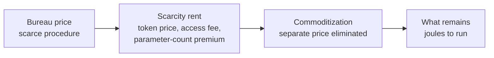

संशोधन db13599, 5 November 2026। डेटा और कोड: [research.openie.dev/data/](/data/#economics). LaTeX PDF: [/pdfs/latex/spellcheck.pdf](/pdfs/latex/spellcheck.pdf) ([source](/pdfs/latex/spellcheck.tex)).

## सारांश

स्पेल चेक को 1981 से 1989 के बीच सैकड़ों डॉलर में बेचा जाता था और अब यह मुफ्त है तथा उन उपकरणों में निर्मित है जो लोग पहले से ही उपयोग करते हैं। यह पत्रिका इस परिवर्तन को पुरानी स्रोतों से दस्तावेज़ करती है और इसे सीमांत लागत और बंडलिंग की अर्थशास्त्र के साथ समझाती है [62, 63]।

**सरल शब्दों में**

1. लोग स्पेल चेक के लिए बहुत भुगतान करते थे। अब यह फ़ोन, ब्राउज़र और वर्ड प्रोसेसर में मुफ्त है।
2. यह मुफ्त हो गया क्योंकि शब्द की जाँच चलाने की लागत लगभग शून्य है, और यह उस उपकरण के भीतर सबसे उपयोगी है जो आपके पास पहले से है।
3. वही अन्य कंप्यूटर कौशलों के साथ भी हो सकता है जब वे उन उपकरणों पर सस्ते में चलने लगें जो लोग पहले से ही रखते हैं, जिससे अरबों लोग उनका उपयोग कर सकें।

## संकेतन

| Term | Meaning in this paper |
|---|---|
| Automation path | एक कंप्यूटर प्रक्रिया विशेषज्ञ ब्यूरो को छोड़ देती है और वह स्थानीय रूटीन बन जाती है उस हार्डवेयर पर जो व्यक्ति के पास पहले से है। |
| Existence proof | उस पाथ का पूर्ण उदाहरण। स्पेल चेक एक है। शब्द को रूपक के रूप में नहीं प्रयोग किया गया है। |
| Local | जाँच उस मशीन पर चलती है जो दस्तावेज़ रखती है। शिप किया गया रूटीन को किसी फ्रंटियर डेटा सेंटर किराए की आवश्यकता नहीं होती। |
| Paired hardware | संपादक, कीबोर्ड, या फोन जो व्यक्ति पहले से लिखने के लिए उपयोग करता है। क्षमता एक द्वितीय मशीन नहीं है। |
| Available | हार्डवेयर सामान्य है, दुर्लभ किराया नहीं है। |
| Accessible | व्यक्ति उस फैब्रिक पर क्षमता को बुला सकता है बिना कार्य को विशेषज्ञ ब्यूरो को भेजे। |
| Capable | फैब्रिक वह गियर चला सकता है जो कार्य को समाप्त करता है। |
| The many (7B+) | 7 अरब से अधिक लोग। लोग जिनके लिए वैश्विक पहुंच है। |
| The few | वे लोग जिन्हें एक कमी कीमत अभी भी पहुँच सकती है। यह एक मूल्य वर्ग है, जनसंख्या नहीं: फ्रंटियर चैट अकेले अक्टूबर 2025 में 800 मिलियन साप्ताहिक उपयोगकर्ताओं को पार कर गया [61]। |
| Proposal | एक वर्तनी सुझाव। दस्तावेज़ अभी तक नहीं बदला है। |
| Commit | प्रतिस्थापन दस्तावेज़ में लिखा जाता है। |
| Completeness | टोकन रखा जाता है: वह ज्ञात था, या एक उम्मीदवार स्वीकार किया गया था। आगे की खोज का उस भविष्यवाणी पर शून्य सूचना मूल्य होता है। |
| Money price | एक शुल्क जिसे कोई इनवॉइस कर सकता है: टोकन मूल्य, सीट लाइसेंस, कमी किराया, एक्सेस फ़ी। वस्तुकरण अलग शुल्क को शून्य तक ले जाता है। |
| Parameter count | मॉडल का आकार। वह माप नहीं जो क्षमता वस्तु बन जाने पर बना रहता है। |
| Joule (J) | ऊर्जा की SI इकाई। यहाँ, रूटीन चलाने के लिए उपयोग की गई ऊर्जा। |
| Lookup, Formula, Model | तीन प्रकार की तंत्र। एक शब्दकोश जांच एक लुकअप है। एक एडिट-डिस्टेंस जनरेटर एक फॉर्मूला है। एक भाषा मॉडल एक मॉडल है। |

## 1. परिचय

स्पेल चेक एक क्षमता है जिसे लोग पहले अलग उत्पाद के रूप में खरीदते थे और अब वह उपकरणों के भीतर प्राप्त करते हैं जो उनके पास पहले से ही हैं। यह पत्र उस परिवर्तन को तिथि‑निर्धारित मूल्यों, वह पत्रिकाएँ जो प्रक्रिया को निर्मित करती थीं, वह पुस्तकालयें जो इसे शिप करती हैं और वह मशीनें जो इसे चलाती हैं, के माध्यम से अनुसरण करता है, और पूछता है कि यह सामान्य रूप से कंप्यूटर बुद्धिमत्ता के लिए क्या संकेत देता है।

लोगों ने प्रीमियम का भुगतान किया। फिर वह वस्तु नहीं बेची जा सकी। यह मुफ्त है, और यह किसी अन्य चीज़ में बंडल किया गया है। अनुभाग 2.11 में मूल्य वही तथ्य दर्शाते हैं। अनुभाग 2.9 में नाम उसके बाद आते हैं।

कैल्कुलेटर का अलग इनवॉइस एक तिथि‑निर्धारित श्रृंखला है, अनीता विज्ञापनों से लेकर HP-35 और TI-2500 तक और फिर VisiCalc तक। स्पेल चेक का अलग इनवॉइस शब्द प्रोसेसर के भीतर समाप्त होता है और फिर ऑपरेटिंग सिस्टम में। वह डॉलर जो स्रोत प्रिंट नहीं करते, वह अप्रिंटेड ही रहता है।

स्पेल चेक के लिए मूल्य प्रवृत्ति पूर्ण है। यह रूटीन संपादक में शून्य मूल्य पर बंडल किया गया है। जूल अभी भी खर्च होते हैं।

चयन मूल्य है। दुर्लभता‑मूल्य निर्धारण एक क्षमता को रोकता है और धारण को बेचता है। यह उन लोगों तक पहुँचता है जो भुगतान कर सकते हैं, कुछ ही लोगों तक। वैश्विक पहुँच दूसरा विकल्प है। क्षमता को उस मशीन पर चलाने के लिए निर्मित किया जाता है जो व्यक्ति पहले से ही रखता है, और अलग शुल्क समाप्त हो जाता है। यह 7 अरब से अधिक लोगों तक पहुँचता है।

स्पेल चेक वही दूसरा विकल्प है, समाप्त। कार्य यह तय करना है कि कोई लिखित टोकन शब्द है या नहीं, और यदि नहीं है तो लेखक का अभिप्रेत शब्द प्रस्तावित करना है। Kukich (1992) कार्य को गैर‑शब्द पहचान, अलग‑शब्द सुधार और संदर्भ‑निर्भर सुधार में विभाजित करता है। पहले दो सामान्य हो गए हैं। वे उन कार्यक्रमों के भीतर चलते हैं जिन्हें लोग पहले से लिखने के लिए उपयोग करते हैं। वे कंप्यूटर बुद्धिमत्ता हैं, न कि किसी अन्य प्रणाली के बारे में बात करने के लिए बताई गई कहानी।

दूसरा विकल्प तभी समाप्त होता है जब रूटीन पर्याप्त सस्ता हो जाए ताकि दस्तावेज़ के बगल में, फ़ाइल रखने वाली मशीन के स्थानीय स्तर पर चल सके, और उन हार्डवेयर के साथ जो लोग पहले से रखते हैं। McIlroy (1982) UNIX स्पेलिंग‑लिस्ट पत्र के पहले वाक्यों में प्रतिबंध को बताता है। चेकर को मिनीकम्प्यूटरों पर उपयोग किया जा सकता है, इसलिए सूची को संक्षिप्त होना चाहिए। यही इंजीनियरिंग के रूप में वैश्विक पहुँच है। एक फ्रंटियर मॉडल जो केवल किराए के डेटा‑सेंटर के भीतर उत्तर देता है, वह अभी भी दुर्लभता‑मूल्य निर्धारण को लागू रखता है। यह सक्षम हो सकता है और फिर भी उन कुछ लोगों के साथ रह सकता है जो इसे किराए पर ले सकते हैं।

अनुभाग 2.11 प्रीमियम, तिथि‑निर्धारित है। अनुभाग 2.10 वह है जो मशीन रखता है जिस पर समाप्त क्षमता चल सकती है, और कौन केवल किराया रखता है। वह सॉफ़्टवेयर जो उस मशीन के लिए लिखा गया है जिसे लोग पहले से चलाते हैं, वह कई लोगों तक पहुँच का मार्ग है। वह मूल्य जो किराए की आवश्यकता रखता है, वह है कि कैसे दुर्लभता कुछ ही लोगों को रखती है।

### एक टोकन, क्रम में सिखाया गया

Norvig (2007) ने एक स्थानीय सुधारक और कॉल `correction('speling')` का दस्तावेज़ीकरण किया है, जो `spelling` लौटाता है। इस कॉल को पथ के शिक्षण उदाहरण के रूप में चलाएँ। उत्पादन अस्तित्व प्रमाण Hunspell है जो सामान्य संपादकों में मौजूद है, जैसा कि अनुभाग 2.5 में कहा गया है।

1. स्ट्रिंग पहले से ही मशीन पर है। कुछ भी किसी ब्यूरो को नहीं भेजा जाता।
2. लुकअप पूछता है कि `speling` स्थानीय शब्द गणनाओं में है या नहीं। यह नहीं है।
3. एक सूत्र एक-एडिट दूरी पर स्ट्रिंग बनाता है: एक विलोपन, एक अदला‑बदली, एक प्रतिस्थापन, या एक सम्मिलन। ज्ञात शब्द `spelling` उस सेट में है।
4. सुझाव एक प्रस्ताव है। दस्तावेज़ केवल तब बदलता है जब कोई व्यक्ति इसे स्वीकार करता है, या जब कोई घोषित नीति इसे स्वीकार करती है। यही कमिट है।
5. एक बार `spelling` रख लिया गया, आगे के उम्मीदवार इस भविष्यवाणी को नहीं बदलते कि “यह टोकन वह शब्द है जिसे हम रख रहे हैं।” यही रोक है।
6. इस टोकन के लिए एक फ्रंटियर मॉडल खोलने से बेहतर निकटता नहीं मिलती। लुकअप‑प्लस‑एडिट गियर ने पहले ही इसे बंद कर दिया था। बड़े खर्च को अस्वीकार करना कोई छूट नहीं है। यह इस कार्य के लिए सर्वोत्तम उत्तर है।

उसी निबंध में यह मामला दिखाया गया है कि स्थानीय टोकन बंद नहीं हो सकता। `correction('where')` `where` ही रहता है जबकि परीक्षण युग्म ने `were` की अपेक्षा की थी। एकल शब्द निर्णय नहीं लेता। Kukich (1992) ने इसे तीसरी समस्या, संदर्भ‑निर्भर सुधार कहा। वहाँ एक बड़ा मॉडल सही गियर हो सकता है। उस गियर के लिए पथ तब तक समाप्त नहीं होता जब तक गियर उस हार्डवेयर पर नहीं चलता जो लेखक के पास पहले से है, या किसी संसाधन‑अनुकूलित केंद्रीय फैब्रिक पर नहीं चलता जिसे व्यक्ति वास्तव में उपयोग कर सकता है। एक किराए पर लिया गया फ्रंटियर पास जिसे लेखक नहीं बुला सकता, वह अभी भी ब्यूरो ही है।

## 2. संबंधित कार्य

### 2.1 पहचान और पृथक-शब्द सुधार

Damerau (1964) एक विधि प्रस्तुत करता है वह शब्द जिसके शब्दकोश में अभाव है और जिसमें अधिकतम एक त्रुटि हो: एक गलत अक्षर, एक अनुपस्थित अक्षर, एक अतिरिक्त अक्षर, या एकल स्थानांतरण। अपरिचित शब्द की तुलना शब्दकोश से प्रत्येक धारणाओं के तहत फिर से की जाती है। सारांश में इन त्रुटि प्रकारों में से 95 प्रतिशत से अधिक की सही पहचान की रिपोर्ट की गई है जो उसने चलाए परीक्षण पर आधारित है। यह पत्र उस परिणाम को उसके रूप में उद्धृत करता है। यह परीक्षण को दोहराता नहीं है।

Peterson (1980) उन कंप्यूटर कार्यक्रमों का सर्वेक्षण करता है जो वर्तनी त्रुटियों का पता लगाते और सुधारते हैं। उस तिथि तक यह क्षमता कार्यरत कार्यक्रमों का साहित्य बन चुकी थी, न कि यह प्रस्ताव कि कोई कार्यक्रम भविष्य में शब्द की जाँच कर सकता है।

Kukich (1992) क्षेत्र को ऊपर उल्लिखित तीन समस्याओं में व्यवस्थित करता है। गैर‑शब्द पहचान शब्द सूची, पैटर्न मिलान, या n‑gram विश्लेषण का उपयोग करती है। अलग‑शब्द सुधार एक पहचाने गए गैर‑शब्द के लिए शब्दकोश शब्द का प्रस्ताव रखती है। संदर्भ‑निर्भर सुधार एक टोकन को संभालती है जो वास्तविक शब्द है परन्तु अभी भी गलत शब्द है। सर्वेक्षण मानचित्र है। इस पत्र में अस्तित्व प्रमाण Hunspell पर आधारित है जो उत्पादन में उपयोग होता है: LibreOffice, Firefox, Chrome, Linux वितरण, और macOS स्थानीय शब्दकोश प्रक्रिया (Hunspell README) को कॉल करते हैं। पहले दो Kukich समस्याएँ सर्वेक्षण को छोड़कर उन सामान्य संपादकों में प्रवेश कर गईं। Norvig (2007) Lookup फिर एक छोटा संपादन का शिक्षण मार्गदर्शन बना रहता है, न कि उत्पादन तथ्य।

### 2.2 सूची मशीन के अनुकूल बनाई गई थी

McIlroy (1982) यूनिक्स स्पेलिंग चेकर के पीछे शब्द सूची का वर्णन करता है। सारांश में अभियांत्रिकीय प्रतिबंध और परिणाम बताया गया है। चेकर को मिनीकम्प्यूटरों पर उपयोग किया जा सकता है, इसलिए सूची को संक्षिप्त होना चाहिए। उपसर्ग और प्रत्यय हटाना, हैशिंग, और संपीड़न 30,000 अंग्रेज़ी शब्दों की घटाई गई सूची को 26,000 16‑बिट मशीन शब्दों तक ले जाता है। Johnson के पहले चेकर ने उस दस्तावेज़ के शब्दों को देखा जो पहले से ही मशीन पर मौजूद था। इस पत्र के लिए McIlroy का योगदान यह है कि शब्दकोश को संपीड़ित किया गया क्योंकि लक्ष्य वह मिनीकम्प्यूटर था जिसे लोग वास्तव में चलाते थे, न कि कोई बड़ा मशीन जो कार्य के लिए आरक्षित था।

वे शब्द गणनाएँ उनके प्रकाशित आँकड़े हैं।

### 2.3 एक शोरयुक्त चैनल फिर भी एक स्थानीय कार्यक्रम है

Kernighan, Church, और Gale (1990) उम्मीदवार सुधारों को एक शोर-चैनल मॉडल के साथ क्रमबद्ध करते हैं: उम्मीदवार की संभावना गुणा उम्मीदवार के दिए गए टाइपो की संभावना। यह प्रोग्राम सामान्य अर्थ में एक वर्तनी सुधारक है, शब्दकोश और त्रुटि मॉडल पर एक स्थानीय गणना। एक बेहतर स्कोर अलग तैनाती नहीं है। गियर अधिक तीक्ष्ण हो सकता है और उस मशीन पर बना रह सकता है जो पाठ को रखती है।

### 2.4 एक सुधारक जो एक पृष्ठ में समाता है और किसी नेटवर्क की आवश्यकता नहीं रखता

Norvig (2007) ने एक विमान पर स्पेलिंग‑त्रुटि डेटा और इंटरनेट कनेक्शन के बिना व्याख्या लिखी। भाषा मॉडल लगभग एक मिलियन शब्दों की स्थानीय फ़ाइल है, जिसमें 32,192 विशिष्ट शब्द 1,115,504 बार प्रकट होते हैं। त्रुटि मॉडल जानबूझकर सरल है: संपादन दूरी 0 पर ज्ञात शब्द किसी भी दूरी 1 के शब्द से बेहतर है, जो किसी भी दूरी 2 के शब्द से बेहतर है। उड़ान के बाद उन्होंने Mitton के Birkbeck कॉर्पस से निकाले गए सेटों के विरुद्ध मूल्यांकन किया। उन्होंने 270 विकास जोड़ों में 75 प्रतिशत सही, 41 शब्द प्रति सेकंड की गति, और 400 अंतिम‑परीक्षण जोड़ों में 68 प्रतिशत सही, 35 शब्द प्रति सेकंड की गति रिपोर्ट की। उन्होंने कहा कि उन्होंने संक्षिप्तता और गति के अपने लक्ष्य पूरे किए लेकिन 80 से 90 प्रतिशत शुद्धता की आशा नहीं पूरी कर पाए।

वे संख्याएँ उनका रिपोर्ट किया गया मूल्यांकन हैं। यह टॉय औद्योगिक जाँचकर्ता नहीं है। क्षमता का एक उपयोगी भाग प्रोग्रामर के सामने मशीन पर फ़ाइल से आता है, प्रति सेकंड दर्जनों शब्दों की गति के साथ, बिना नेटवर्क के। यही पूर्ण स्वचालन पथ का रूप है। उन्होंने जिन चूकों की सूची दी है, विशेषकर अज्ञात शब्दकोश शब्द और पड़ोसी टोकन की आवश्यकता वाले निर्णय, वे शेष त्रुटियाँ हैं। ये बेहतर स्थानीय उपकरण के लिए तर्क हैं, न कि यह तर्क कि कार्य को फिर से किसी कार्यालय में ले जाना चाहिए।

### 2.5 सामान्य संपादकों के भीतर का पुस्तकालय

Hunspell परियोजना के अनुसार Hunspell वह वर्तनी जाँचकर्ता और रूपात्मक विश्लेषक है जिसका उपयोग LibreOffice, Firefox और Chrome सहित मुक्त ब्राउज़र, तथा Linux वितरण और macOS सहित अन्य उपकरणों और ऑपरेटिंग सिस्टम द्वारा किया जाता है (Hunspell README)। यह लाइब्रेरी स्थानीय शब्दकोश फ़ाइल और स्थानीय उपसर्ग फ़ाइल पढ़ती है। कमांड‑लाइन उपकरण स्थानीय पाठ फ़ाइल की जाँच करता है। कोड MySpell से उत्पन्न हुआ है, जो Kevin Hendricks का OpenOffice.org में कार्यान्वयन है, स्वयं Geoff Kuenning के International Ispell से उपसर्ग वर्तनी का पुनः कार्यान्वयन है। László Németh का Hunspell Unicode और उन भाषाओं के लिए आवश्यक रूपविज्ञान जोड़ता है जहाँ केवल अंग्रेज़ी शब्द सूची उपयुक्त नहीं होती।

वह README बताता है कि लाइब्रेरी कहाँ उपयोग की जाती है। इसका योगदान परिनियोजन वर्ग है। उन कार्यक्रमों के भीतर जाँचकर्ता एक स्थानीय लाइब्रेरी और एक स्थानीय शब्द सूची है।

### 2.6 हाथ में पहले से मौजूद फ़ोन

UITextChecker एक UIKit वर्ग है। कॉलर एक स्ट्रिंग और एक भाषा पास करता है। यह विधि उस स्ट्रिंग में गलत वर्तनी वाले शब्द की सीमा लौटाती है, या यह रिपोर्ट करती है कि कोई नहीं मिला (Apple, UITextChecker)। जांच डिवाइस पर की जाती है, उस भाषा के विरुद्ध जो प्रणाली उपलब्ध सूची में दर्शाती है। इस पत्र में उस कॉल के लिए कोई जूल आंकड़ा नहीं दिया गया है। API का रूप यह जोड़ी है: पाठ पहले से ही टेक्स्ट व्यू में है, और चेकर उसके बगल में एक विधि है।

Android का स्पेल‑चेकर फ्रेमवर्क भी डिवाइस पर है। एक अनुप्रयोग `SpellCheckerService` को विस्तारित करता है, एक सत्र लागू करता है, और सत्र को दिया गया पाठ के लिए सुझाव लौटाता है (Android Developers, spell‑checker framework; `SpellCheckerService`)। लैटिन इनपुट विधि का चेकर स्थानीय सेवा है जिसमें लोकेल शब्दकोश होते हैं। फिर भी, उस दस्तावेज़ से कोई ऊर्जा संख्या नहीं ली गई है। दस्तावेज़ इस रूटीन को फोन पर रखता है।

Hard और सहयोगी (2018) ने Gboard फ़ोन कीबोर्ड के लिए फेडरेटेड लर्निंग द्वारा एक अगला‑शब्द मॉडल प्रशिक्षित किया। क्लाइंट डिवाइस पर रहने वाले पाठ पर अपडेट की गणना करते हैं। सर्वर उन अपडेट को एकत्र करता है और कच्चा टाइपिंग डेटा प्राप्त नहीं करता। वही पत्र बताता है कि Gboard ऑटो‑करैक्शन के साथ-साथ अगला‑शब्द भविष्यवाणी भी प्रदान करता है, और 2019 तक कीबोर्ड के 1 अरब से अधिक इंस्टॉल थे। वह इंस्टॉल वाक्य पत्र का अपना तैनाती दावा है। यह उन 7 अरब से अधिक लोगों की गिनती नहीं है जिनके बारे में यह राय है।

वे जो मॉडल वितरित करते हैं वह जानबूझकर छोटा है। क्वांटाइज़ेशन के बाद इसका आकार 1.4 मेगाबाइट है, 10 000‑शब्द शब्दावली के साथ, एक उत्पाद प्रतिबंध के तहत जिसे वे लगभग 20 मिलीसेकंड के भीतर दृश्य प्रतिक्रिया और दशकों मेगाबाइट मॉडल आकार के रूप में बताते हैं। उनके अध्ययन में प्रशिक्षण भागीदारी इंस्टॉल आधार से संकीर्ण है: उत्तर अमेरिकी डिवाइस, कम से कम 2 गिगाबाइट मेमोरी, चार्जिंग, निष्क्रिय, और अनमीटर नेटवर्क पर। यह अध्ययन तैनाती वर्ग का उल्लेख करता है। एक कीबोर्ड जिसे लोग पहले से उपयोग करते हैं, एक छोटा ऑन‑डिवाइस भाषा मॉडल ले जाता है, और वहाँ वर्णित प्रशिक्षण टाइप किया गया पाठ निर्यात नहीं करता। यह उनके रिकॉल तालिकाओं को वर्तनी‑सटीकता परिणाम के रूप में उद्धृत नहीं करता।

### 2.7 हार्डवेयर लॉटरी

Hooker (2020; 2021) हार्डवेयर लॉटरी को परिभाषित करते हैं: एक शोध विचार जीतता है क्योंकि वह उपलब्ध हार्डवेयर और सॉफ़्टवेयर में फिट बैठता है, न कि क्योंकि वह सार में सबसे अच्छा विचार है। स्पेल‑चेक ने एक ऐसी लॉटरी जीती जो जीतने योग्य थी। उपलब्ध हार्डवेयर वह मशीन थी जो दस्तावेज़ को रखती थी। वह एल्गोरिद्म जो फिट बैठता था वह शब्द सूची प्लस एक छोटा संपादन मॉडल था। एक क्षमता जो केवल एक फ्रंटियर एक्सेलेरेटर में फिट होती है, और केवल उस एक्सेलेरेटर पर समय के रूप में बेची जाती है, वह एक अलग लॉटरी में आती है। Hooker की चेतावनी यह है कि स्थापित हार्डवेयर से चूकने वाले विचार भी तब रुक जाते हैं जब वे अच्छे हों। इस पत्र में डिज़ाइन परिणाम वही तथ्य का उलटा पढ़ना है। यदि लक्ष्य कई लोगों के लिए कंप्यूटर बुद्धिमत्ता प्रदान करना है, तो विचार को उन हार्डवेयर के साथ फिट होना चाहिए जो कई लोगों के पास पहले से है, या ऐसा हार्डवेयर जिससे एक संसाधन‑अनुकूलित केंद्रीय फैब्रिक उन्हें विस्तारित कर सके। एक दुर्लभ किराए में फिट होना ही वह तरीका है जिससे कोई क्षमता कुछ ही लोगों के पास बनी रहती है।

### 2.8 यह साहित्य क्या सिद्ध करने के लिए नहीं कहा गया

ऊपर उल्लिखित कोई भी वर्तनी स्रोत जनसंख्या तालिका नहीं है। जब सेक्शन 4 में कोई वर्तनी संख्या आती है, तो वह स्रोत की अपनी गणना होती है: शब्दकोश शब्द, परीक्षण‑सेट आकार, प्रति सेकंड शब्द, या प्रकाशित पहचान दर। सेक्शन 2.10 एक अलग वर्ग जोड़ता है। प्रत्येक हार्डवेयर संख्या प्रकाशक की शिपमेंट, सब्सक्राइबर, राजस्व, या सर्वेक्षण आंकड़ा होती है, जिसके साथ वर्ष संलग्न होता है। 7 अरब से अधिक लोग, और वे कुछ लोग जो कमी मूल्य चुकाने में सक्षम हैं, यह दो वर्ग हैं जो राय में प्रस्तुत किए गए हैं। वे उन पंक्तियों का योग नहीं हैं।

### 2.9 कंप्यूटर स्वचालन का मूल्य-निर्धारण कैसे होता है

एक उद्धृत दर उस पत्र के भीतर रहती है जिसमें इसे प्रकाशित किया गया था। यहाँ कोई वक्र फिट नहीं किया गया है। कोई ढाल, अर्ध-आयु, या शून्य-कीमत वर्ष का उल्लेख नहीं किया गया है।

सरल शब्दों में, नामों से पहले। लोग स्पेल‑चेक और सामान्य गणना के लिए प्रीमियम चुकाते थे। बेस‑लेयर उत्पाद के रूप में स्पेल‑चेक अब बेचा नहीं जा सकता। यह मुफ्त है, और यह संपादक, ब्राउज़र, तथा फोन में बंडल किया गया है। सामान्य गणना फोन और कंप्यूटर में बंडल की गई है। नीचे दिए गए नाम केवल उस क्रम के लेबल हैं।

तीन व्यवस्थाएँ बताती हैं कि एक कंप्यूटर‑ऑटोमेशन टूल की कीमत कैसे निर्धारित की जाती है। अनुभाग 2.11 कैलकुलेटर और स्पेल‑चेक के लिए पुरानी टेप है। प्रत्येक कीमत एक स्रोत की कीमत है। इन पर कोई वक्र फिट नहीं किया गया है।

**Bureau price.** जबकि प्रक्रिया दुर्लभ है, खरीदार व्यक्ति या बुक की गई मशीन को भुगतान करता है। Nordhaus (2007) गणना स्वयं की दीर्घकालिक धन कीमत को मापते हैं, न कि स्पेल‑चेक की। उस लेख में गणना की कीमत लगभग \$500 प्रति मिलियन गणनाओं प्रति सेकंड से शुरू होती है मैनुअल कार्य के लिए और 2006 तक लगभग $6 \times 10^{-11}$ प्रति मिलियन गणनाओं प्रति सेकंड तक गिरती है, 2006 की कीमतों में, लगभग 8.3 ट्रिलियन की गिरावट के क्रम में। यह आंकड़ा इस निबंध का दो अंतिम बिंदुओं का भागफल है, \$500 / $6 \times 10^{-11}$। अंतिम बिंदु उनके रिपोर्ट किए गए आंकड़े हैं। इन्हें यहाँ पुनः फिट नहीं किया गया है, और भागफल कोई पूर्वानुमान नहीं है। वे दस्तावेज़ करते हैं कि ऑटोमेशन के उपसर्ग की धन कीमत क्रमशः कई गुना घट गई है। उस सूचकांक में गिरावट अभी तक किसी उत्पाद के अलग इनवॉइस को समाप्त नहीं करती, और यह जूल मीटर नहीं है।

**Scarcity price, and the race it creates.** एक बार जब कोई फर्म प्रक्रिया को शिप कर सकता है, तो वह चलाने की लागत से अधिक चार्ज कर सकता है। यह अंतराल दुर्लभता किराया है। एक एक्सेस फ़ी और एक टोकन कीमत अलग‑अलग रूप में वही अंतराल हैं। जब खरीदारों को आकार के लिए भुगतान करना सिखाया जाता है, तो पैरामीटर गिनती उस रूप का हिस्सा बन जाती है। किराया वह है जो दौड़ बनाता है। प्रतिद्वंद्वी किराए को बंडल करके क्षमता को उस उत्पाद में सम्मिलित करके जिसे खरीदार पहले से ही रखता है, या वे उत्पाद को पूरी तरह से बदल देते हैं। प्रकाशित अनुमान कीमतें कहती हैं कि भाषा मॉडलों के लिए दौड़ चल रही है और अभी समाप्त नहीं हुई है। Epoch AI (2025) नोट में बेंचमार्क के पार वार्षिक 9 से 900 गुना की स्थिर प्रदर्शन पर कीमत गिरावट की रिपोर्ट करता है। Emberson और Roodman (2026) लगभग 2023 से किसी निश्चित प्रदर्शन की लागत में प्रति तिमाही 47 प्रतिशत गिरावट की रिपोर्ट करते हैं, जिसे वे लगभग 13 गुना वार्षिक के रूप में सारांशित करते हैं। ये उनके श्रृंखला के सारांश हैं। सूचकांक को पुनः‑अंदाज़ा नहीं किया गया है। बिंदुओं के माध्यम से कोई रेखा नहीं खींची गई है। न तो कोई दर उनके विंडो के बाहर कोई नियम है। Task Satiation पेपर वही उद्धृत गिरावट को मोआट विस्थापन के प्रमाण के रूप में उपयोग करता है; वह दावा उसी पेपर में बना रहता है।

**मूल्य निर्धारण समाप्ति।** वस्तुकरण अलग शुल्क के अंत को दर्शाता है। क्षमता बनी रहती है। चालान पंक्ति नहीं बनती। वर्तनी जाँच पूर्ण उदाहरण है। Hunspell एक मुक्त वर्तनी‑जाँच लाइब्रेरी है जो त्रि‑लाइसेंस (LGPL, GPL, और MPL) के तहत उपलब्ध है। परियोजना बताती है कि LibreOffice, Firefox, Chrome, Linux वितरण, और macOS इसे कॉल करते हैं, और कि जाँच स्थानीय शब्दकोश (Hunspell README) पढ़ती है। उन संपादकों के खरीदार गैर‑शब्द के लिए कोई टोकन मूल्य नहीं देते, वर्तनी ब्यूरो को कोई पहुँच शुल्क नहीं देते, और पैरामीटर गणना नहीं खरीदते। विधि की धनात्मक कीमत एक अलग वस्तु के रूप में शून्य है। यही मूल्य निर्धारण समाप्ति है। यह दावा नहीं है कि संपादक स्वयं मुफ्त है, और यह दावा नहीं है कि फोन मुफ्त था। यह दावा है कि वर्तनी सुधार अब अपने स्वयं के वस्तु के रूप में मूल्यांकित नहीं किया जाता।

**कमी मूल्य निर्धारण मशीन पर स्थानांतरित हो सकता है।** अलग सॉफ़्टवेयर मूल्य समाप्त करने से सभी कमी मूल्य समाप्त नहीं होते। एक मंच नई क्षमता को नए उपकरण पर रख सकता है और उपकरण के लिए शुल्क ले सकता है। Yusuf Mehdi, 20 मई 2024, ने 40 या अधिक TOPS वाले न्यूरल प्रोसेसिंग यूनिट द्वारा परिभाषित Copilot+ PC का उल्लेख किया। पहली लहर Snapdragon का उपयोग करती है, छोटा मॉडल उस यूनिट पर चलता है, और बड़े मॉडल Azure पर रहते हैं। Apple का 9 जून 2025 खाता लगभग 3 अरब पैरामीटर वाले ऑन‑डिवाइस मॉडल को Apple सिलिकॉन पर रखता है और बड़े मॉडल को प्राइवेट क्लाउड कंप्यूट पर छोड़ता है। ये बाद के गियर और उसे धारण करने वाले मशीन के लिए कीमतें हैं। ये वर्तनी जाँच के लिए पुनः जारी किया गया चालान नहीं हैं। जाँच पहले से ही संपादक, ब्राउज़र, और फोन पर चलती है, जिसमें हाथ में मौजूद पूर्व पीढ़ी भी शामिल है। एक नवीनीकरण जो किसी को नई वर्ग की कंप्यूटर खरीदने के लिए कहता है ताकि वह जाँच प्राप्त कर सके जो पुराना मशीन पहले ही कर रहा था, वह हार्डवेयर की कमी मूल्य निर्धारण है। यह उन लोगों तक पहुँचता है जो उस वर्ग को खरीदते हैं। केवल कुछ ही उस वर्ग में आते हैं। यह 7 अरब से अधिक लोगों के लिए पहले से समाप्त पहुँच को उलटता नहीं है।

संदर्भ‑निर्भर सुधार वह समाप्त मामला नहीं है। Kukich (1992) ने इसे तीसरी समस्या के रूप में नामित किया: एक टोकन जो वास्तविक शब्द है लेकिन फिर भी गलत शब्द है। यहाँ बड़ा मॉडल सही गियर हो सकता है। व्याकरणिक त्रुटि सुधार में, बड़े और बेहतर प्रशिक्षित मॉडल बेहतर सुधार करते हैं: GECToR [71] और 11‑बिलियन‑पैरामीटर बहुभाषी मॉडल [72] ने अपने समय में स्थिति‑की‑कला स्थापित की। समझौता ऊर्जा है: Luccioni, Jernite और Strubell ने जनरेटिव कार्यों को वर्गीकरण कार्यों की तुलना में प्रति अनुमान अधिक ऊर्जा‑गहन मापा [73]। अनुभाग 4.10 का अलग‑शब्द मामला वह स्थिति है जहाँ अतिरिक्त खर्च कोई अलग टोकन नहीं खरीदता। गियर ने पहुँच विकल्प केवल तब लिया है जब वह उस हार्डवेयर पर चलता है जो व्यक्ति पहले से रखता है, या संसाधन‑अनुकूलित केंद्रीय फैब्रिक पर जिसे व्यक्ति उपयोग कर सकता है। एक दुर्लभ किराया ही कमी विकल्प है, भले ही मॉडल बेंचमार्क पर अधिक सटीक हो। सामान्य गैर‑शब्द कार्य उस किराए पर वापस नहीं जाता क्योंकि संदर्भ कार्य अधूरा है। यहाँ कोई जौल तालिका नहीं छपी है जो शब्दकोश प्रोब, स्थानीय मॉडल, और डेटा‑सेंटर कॉल की तुलना करती हो। इन जौलों में से कोई भी इस पत्र के लिए मापा नहीं गया।

बचे हुए हैं तुलना चलाने की ऊर्जा। एक स्थानीय शब्दकोश प्रोब दस्तावेज़ धारण करने वाले उपकरण पर जौले खर्च करता है। यहाँ कोई जौल मापा नहीं गया। कोई विश्लेषणात्मक कुल गणना नहीं की गई। `measured_j` सेट नहीं है: कोई मीटर रीडिंग नहीं ली गई।

भविष्यवाणी नियमों से आती है, न कि प्रतिगमन से। सामान्य कंप्यूटर‑बुद्धिमत्ता कार्य वर्तनी जाँच का अनुसरण करते हैं। उनके टोकन मूल्य, पैरामीटर‑गणना प्रीमिया, दुर्लभता किराए, और पहुँच शुल्क हार्डवेयर पर बंडलिंग द्वारा प्रतिस्पर्धा में समाप्त हो जाते हैं, जिसे लोग पहले से ही रखते हैं और ऐसी विधियों द्वारा जिनका लाइसेंस मूल्य शून्य है। अंतिम स्थिति 7 अरब से अधिक लोगों के लिए है, न कि उन कुछ के लिए जो दुर्लभता मूल्य चुका सकते हैं। भविष्यवाणी विफल होती है यदि कोई सामान्य कार्य, जैसे कि वर्तनी जाँच पहले ही समाप्त करती है, दस्तावेज़ को रखने वाले लोगों के हाथों में समान परिणाम वाली स्थानीय प्रक्रिया के बाद भी एक स्थायी अलग धन मूल्य रखता है। एक सीमा‑बेंचमार्क जो अभी भी प्रीमियम रखता है, वह विफलता नहीं है। यह वह खाई चरण है, जिसे Epoch के नोट्स पहले ही सस्ता होते दिखा रहे हैं, और जिसे वर्तनी जाँच दिखाती है कि कैसे छोड़ना है।

इसी नियमों को इंटरैक्टिव चित्र में दर्शाया गया है [sc-anim-01](/living/spellcheck/#sc-anim-01). दो बिंदु Nordhaus के रिपोर्ट किए गए अंत बिंदु हैं। डैश‑डॉट कनेक्टर उन दो अंत बिंदुओं को जोड़ता है। कोई दर अनुमानित नहीं की गई है। Epoch की 9‑से‑900 सीमा और लगभग‑13‑गुना सारांश एक कॉलआउट में स्थित हैं। वे अपने सारांशों को बनाए रखते हैं। वर्तनी‑जाँच पैनल पूर्ण नियम है: अलग धन मूल्य समाप्त हो गया है, और जूल अभी भी मीटर‑रहित है।

Landauer (1961) बिट मिटाने पर एक भौतिक न्यूनतम निर्धारित करता है। Horowitz (2014) व्यावहारिक CMOS कथन है: डेटा गति प्रमुख है, वह आदर्श सीमा से बहुत ऊपर है। एक शब्दकोश प्रोब बिट्स को स्थानांतरित करता है। वस्तु‑करण इनवॉइस को शून्य कर सकता है और फिर भी उस गति को छोड़ सकता है। वर्तनी जाँच के लिए कोई जूल कुल नहीं निकाला गया है, चाहे कोई भी उद्धरण उपयोग किया गया हो।

**रणनीति के रूप में बंडलिंग।** बंडलिंग साहित्य रणनीति तथा पहुँच के समान इतिहास को पढ़ता है। Adams और Yellen दिखाते हैं कि बंडल मूल्य भेदभाव का उपकरण है [68]. Nalebuff दर्शाते हैं कि बंडल एक प्रतिस्पर्धी को प्रवेश से रोक सकता है जो एक वस्तु बेचता है [69]. Spolsky ने सॉफ़्टवेयर के लिए इस रणनीति को नाम दिया: अपने पूरक को वस्तु‑करण करें, ताकि आप जो उत्पाद बेचते हैं वह अधिक मूल्यवान हो [70]. प्रत्येक पढ़ाई इस निबंध द्वारा उपयोग किए गए अवलोकन पर सहमत है: बंडल की अलग कीमत शून्य हो जाती है। वे इस बात पर भिन्न होते हैं कि किराया किसके पास रहता है। यही अंतर इस निबंध को प्लेटफ़ॉर्म के धारक तथा मूल्य दोनों को ट्रैक करने के लिए प्रेरित करता है।

### 2.10 हार्डवेयर पहुँच, श्रेणी दर श्रेणी

Hooker नाम देता है लॉटरी को। यह अनुभाग मशीनों के नाम बताता है। तर्क सात रिकॉर्ड्स का है। एक फ़ोन शिपमेंट डेटा सेंटर शिपमेंट नहीं है। एक Steam सर्वेक्षण PCs की जनगणना नहीं है। एक राजस्व रेखा इकाई गिनती नहीं है। जहाँ कोई फर्म इकाइयों का खुलासा नहीं करती, वह पेपर ऐसा कहता है और उस आंकड़े का उल्लेख करता है जो फर्म ने प्रकाशित किया था। इन आंकड़ों में से कोई भी कई या कुछ का गिनती नहीं है। वे पंक्तियों का योग नहीं हैं। जीवित आंकड़े [sc-hw-01](/living/spellcheck/#sc-hw-01) और [sc-gen-01](/living/spellcheck/#sc-gen-01) समान रिकॉर्ड्स हैं।

प्रत्येक श्रेणी के लिए प्रश्न समान हैं। कौन मशीन रखता है, स्रोत की अपनी गिनती पर। वह सॉफ़्टवेयर स्टैक क्या है जो वह मशीन चलाती है। वह स्टैक कैसे सर्वश्रेष्ठ फ्रंटियर स्टैक को पूरा करता है। डिज़ाइन दावा एक वाक्य है: वैश्विक रूप से सुलभ पीढ़ी के लिए लिखा गया सॉफ़्टवेयर सबसे बड़ा प्रभाव रखता है। सुलभ पीढ़ी वह है जो हाथ में है। स्पेल चेक इस वाक्य का पूर्ण स्वचालन उदाहरण है। McIlroy ने सेवा में मिनीकंप्यूटर के लिए सूची को आकार दिया। चलाने की ऊर्जा वह मीट्रिक है जो बची रहती है। ये पंक्तियाँ बताती हैं कौन मशीन रखता है। वे जूल नहीं हैं।

**फ़ोन और मोबाइल SoC पीढ़ियाँ।** GSMA, The Mobile Economy 2025, 2024 के अंत में 5.8 अरब अद्वितीय मोबाइल सब्सक्राइबर्स की गिनती करता है, 71 प्रतिशत पैठ दर के साथ, और 4.7 अरब मोबाइल इंटरनेट उपयोगकर्ता। IDC का प्रारंभिक Worldwide Quarterly Mobile Phone Tracker 13 जनवरी 2026 को 2025 में 1,260.3 मिलियन स्मार्टफ़ोन शिप्ड की गिनती करता है, जिसमें Apple ने 247.8 मिलियन शिप किए। IDC का 13 जनवरी 2025 रिलीज़ ने 2024 में 1,238.8 मिलियन स्मार्टफ़ोन गिने। 2026 की तालिका 2024 को 1,236.3 मिलियन के रूप में दोहराती है। प्रत्येक रिलीज़ अपना कुल रखती है। Arm की वार्षिक रिपोर्ट वर्ष समाप्त 31 मार्च 2025 के लिए बताती है कि Arm‑आधारित CPUs उस वित्तीय वर्ष में बेचे गए विश्व के 99 प्रतिशत से अधिक स्मार्टफ़ोन में थे, और ग्राहकों ने कुल मिलाकर 310 अरब से अधिक Arm‑आधारित चिप्स शिप किए हैं, सबसे छोटे सेंसर से सुपरकंप्यूटर तक। संचयी आंकड़ा सभी Arm बाजार को दर्शाता है। यह फ़ोन गिनती नहीं है, और रिपोर्ट इसे SoC पीढ़ियों में विभाजित नहीं करती।

2025 का हैंडसेट वर्तमान मोबाइल SoC पीढ़ी है: Apple silicon, Qualcomm Snapdragon, MediaTek, Samsung, Google Tensor। IDC ब्रांडेड हैंडसेट गिनता है। सब्सक्राइबर गिनती वह लोग हैं जिनके पास मोबाइल सब्सक्रिप्शन है, SoC की गिनती नहीं।

उस हैंडसेट पर सॉफ़्टवेयर स्टैक में पहले से ही एक स्थानीय चेकर शामिल है। UITextChecker और Android `SpellCheckerService` वर्तनी केस हैं। उसी हैंडसेट पर एक मॉडल Apple Core ML और Foundation Models फ्रेमवर्क, Android LiteRT और NNAPI, Qualcomm का QNN कंपाइलर, ExecuTorch, या llama.cpp का उपयोग करता है। Apple का 9 जून 2025 खाता, 17 जुलाई 2025 तकनीकी रिपोर्ट के साथ संरेखित, लगभग 3 अरब पैरामीटर वाले ऑन‑डिवाइस फाउंडेशन मॉडल का वर्णन करता है, जिसे प्रति वज़न 2 बिट में संकुचित किया गया है, और एक सर्वर mixture‑of‑experts मॉडल जो Private Cloud Compute पर चलता है। Liquid AI का LFM2 रिपोर्ट 350 मिलियन से 2.6 अरब पैरामीटर तक के घने मॉडल डिज़ाइन करता है, और 8.3 अरब mixture‑of‑experts मॉडल जिसमें 1.5 अरब सक्रिय हैं, ExecuTorch, llama.cpp, और vLLM के लिए, और उन्हें Samsung Galaxy S25 पर Snapdragon 8 Elite के साथ समय देता है। PrismML कहता है कि उसका Ternary Bonsai 2 27B, जिसे वह Qwen3.8 27B पर निर्मित बताता है, पूर्ण‑प्रेसिशन समकक्ष का 98.2 प्रतिशत रखता है, जबकि 9 गुना छोटा फुटप्रिंट, 5.9 GB है। ये अनुपात PrismML के हैं। यह पेपर उन्हें पुनः मापता नहीं है।

फ़्रंटियर स्टैक के इंटरफ़ेस के लिए एक छोटा मॉडल, कम‑बिट मॉडल, या विक्रेता द्वारा संचालित सर्वर को कॉल किया जाता है। Apple ने एक रिपोर्ट में इस विभाजन को बताया है। फ़्रंटियर प्रशिक्षण रन फ़ोन पर नहीं चलता। इस पंक्ति के लिए डिज़ाइन दावा: SoC पीढ़ी के लिए लिखा गया सॉफ़्टवेयर, जो पहले से शिप हो रहा है, और पिछले वर्षों से अभी भी उपयोग में रहने वाले हैंडसेट्स के लिए, अधिक प्रभाव रखता है। वर्तनी जाँच वही सॉफ़्टवेयर है।

**PCs और लैपटॉप।** IDC की 9 जनवरी 2025 की रिलीज़ में 2024 में 262.7 मिलियन पारंपरिक PCs की शिपमेंट बताई गई है। IDC की प्रारंभिक 12 जनवरी 2026 की रिलीज़ में 2025 में 284.7 मिलियन बताई गई है। 2026 की तालिका में 2024 को 263.3 मिलियन के रूप में दोहराया गया है। 28 जनवरी 2026 के आय कॉल पर, Satya Nadella ने कहा कि Windows ने 1 अर्ब Windows 11 उपयोगकर्ताओं को पहुँच लिया है, जो वर्ष‑दर‑वर्ष 45 प्रतिशत से अधिक बढ़ा है। एक शिपमेंट वर्ष स्थापित आधार नहीं है।

स्टैक में ऑपरेटिंग सिस्टम, ब्राउज़र, और एक स्थानीय लाइब्रेरी शामिल है। Hunspell सामान्य संपादकों में वर्तनी केस है। उसी PC पर एक मॉडल ONNX Runtime, DirectML, Windows ML, llama.cpp, या ExecuTorch का उपयोग CPU और एकीकृत GPU पर करता है। एक डिस्क्रीट GPU अगली श्रेणी है। Liquid AI ने समान LFM2 परिवार को AMD Ryzen AI 9 HX 370 पर Q4_0 के साथ llama.cpp पर मापा है। यह उनके रिपोर्ट में लैपटॉप CPU माप है, न कि डेटा‑सेंटर माप।

फ़्रंटियर स्टैक का इंटरफ़ेस एक API कॉल है, या एक मॉडल जो मशीन की मेमोरी में फिट हो जाता है। दोनों अलग‑अलग प्रोग्राम हैं। पहला किराए पर दिया गया है। दूसरा मार्ग है। इस पंक्ति के लिए डिज़ाइन दावा: PC पीढ़ी के लिए सॉफ़्टवेयर, जिसे लोग पहले से चला रहे हैं, अधिक प्रभाव रखता है। वर्तनी जाँच ने वही मार्ग अपनाया। एक वजन जो किराए पर ली गई एक्सेलेरेटर मानता है, वह नहीं किया।

**कंज्यूमर GPUs।** NVIDIA की वित्तीय 2026 रिलीज़, वर्ष समाप्त 25 जनवरी 2026, में गेमिंग राजस्व \$16.0 बिलियन बताया गया है। यह राजस्व है, इकाई गिनती नहीं। Jon Peddie Research, 5 मार्च 2026, ने चौथे तिमाही 2025 में 11.48 मिलियन PC ग्राफ़िक्स एड‑इन बोर्ड शिप किए जाने की रिपोर्ट की है, जो पिछले वर्ष से 36.0 प्रतिशत बढ़ा है, और उस तिमाही में डेस्कटॉप अटैच रेट 55 प्रतिशत था। वही नोट कहता है कि डेटा‑सेंटर GPU बोर्ड पिछले तिमाही से 17.0 प्रतिशत बढ़े, लेकिन उनका इकाई गिनती प्रकाशित नहीं किया गया। उस नोट में 172 मिलियन “स्थापित आधार” एक भविष्यवाणी अंत बिंदु है। इस पेपर ने इसे वर्तमान जनगणना के रूप में उपयोग नहीं किया।

Valve की Steam हार्डवेयर और सॉफ़्टवेयर सर्वेक्षण सितंबर 2026 के लिए, उत्तर देने वाले ग्राहकों में NVIDIA GeForce RTX 5070 6.15 प्रतिशत, RTX 5090 0.40 प्रतिशत, RTX 4060 3.89 प्रतिशत, RTX 3060 3.66 प्रतिशत, और GTX 1650 2.19 प्रतिशत रिपोर्ट किए गए हैं। सर्वेक्षण Steam प्रतिभागियों का है, न कि विश्व का। इस पेपर ने इन हिस्सों को किसी पीढ़ी के कुल में नहीं जोड़ा। सूची आंशिक है, और सर्वेक्षण में एक “Other” बिन भी है।

स्टैक में NVIDIA पर CUDA, और AMD पर ROCm या Vulkan शामिल हैं। llama.cpp कार्ड पर एक क्वांटाइज़्ड मॉडल चलाता है। vLLM मॉडल को सर्व करता है जब कार्ड में वजन रहता है। फ़्रंटियर स्टैक का इंटरफ़ेस क्वांटाइज़ेशन, एक छोटा मॉडल, या एक API है। कंज्यूमर कार्ड वह मॉडल चलाता है जो फिट हो जाता है। फ़्रंटियर प्रशिक्षण प्रणाली फिट नहीं होती। इस पंक्ति के लिए डिज़ाइन दावा: फ़्लैगशिप के लिए लक्षित सॉफ़्टवेयर एक गेमर सर्वेक्षण के 0.40 प्रतिशत पर लक्षित है। सॉफ़्टवेयर जो उन कार्डों को लक्षित करता है जिन्हें लोग अभी भी रिपोर्ट करते हैं, जिसमें 30‑सीरीज़ और 40‑सीरीज़ भाग शामिल हैं, स्थापित पीढ़ी को कवर करता है। यही बड़ा प्रभाव है।

**डेटासेंटर एक्सेलेरेटर।** NVIDIA की उसी वित्तीय 2026 रिलीज़ में डेटा सेंटर राजस्व के रूप में \$193.7 बिलियन बताया गया है, जो 68 प्रतिशत की वृद्धि है, और चौथे तिमाही में \$62.3 बिलियन। रिलीज़ में Hopper, Blackwell, या Rubin की इकाई शिपमेंट का खुलासा नहीं किया गया है। यह Meta के साथ कई वर्षों की साझेदारी का वर्णन करती है जिसमें लाखों Blackwell और Rubin GPU शामिल हैं। वह वाक्य NVIDIA का तैनाती योजना का विवरण है। यह रैक में कार्डों की ऑडिटेड गिनती नहीं है। 28 अक्टूबर 2025 को वाशिंगटन में GTC पर Jensen Huang ने कहा कि पिछले चार तिमाहियों में 6 मिलियन Blackwell GPU शिप हो चुके हैं। CNBC ने उसी दिन वह वाक्य रिपोर्ट किया। वित्तीय 2026 रिलीज़ अभी भी इकाई शिपमेंट का खुलासा नहीं करती। 6 मिलियन का आंकड़ा Huang का बयान है। यह ऑडिटेड इकाई लाइन नहीं है। उसी रिपोर्ट में Blackwell और Rubin के बीच GPU बिक्री के रूप में \$500 बिलियन की अपेक्षा का उल्लेख है। यह बिक्री की अपेक्षा है। यह पेपर इसे इकाई गिनती में नहीं बदलता।

AMD की 3 फरवरी 2026 की रिलीज़ में कैलेंडर 2025 के लिए डेटा सेंटर खंड राजस्व \$16.6 बिलियन बताया गया है, जो 32 प्रतिशत की वृद्धि है, और कहा गया है कि यह वृद्धि EPYC CPU और Instinct GPU दोनों से आती है। Instinct एक अलग राजस्व लाइन नहीं है, सिवाय एक खुलासे के: चौथे तिमाही में चीन को Instinct MI308 राजस्व लगभग \$390 मिलियन। रिलीज़ में कोई Instinct इकाई गिनती नहीं है।

28 जनवरी 2026 की कॉल पर, Nadella ने कहा कि Microsoft की फ़्लीट में NVIDIA, AMD, और Microsoft का अपना Maya 200 एक्सेलेरेटर शामिल है, जिसे कंपनी ने ऑनलाइन लाया था। Amy Hood ने कहा कि उस तिमाही में पूंजी व्यय \$37.5 बिलियन था, जिसमें लगभग दो‑तीहाई अल्पकालिक संपत्तियों पर, मुख्यतः GPU और CPU, खर्च हुआ, और मांग आपूर्ति से अधिक थी। ट्रांसक्रिप्ट में Maya की कोई इकाई गिनती नहीं है। Google TPU और Amazon Trainium की इकाई शिपमेंट इस अनुभाग के लिए पढ़े गए स्रोतों में नहीं हैं। उन्हें इस प्रकार नामित किया गया है ताकि श्रेणी को एक विक्रेता तक सीमित न किया जाए। अनुपस्थित इकाई गिनती ही रिकॉर्ड है।

किसके पास है: वह खरीदार जो उस राजस्व के लिए अनुबंध करते हैं। Hood ने कहा कि अधिकांश GPU पूंजी पहले ही हार्डवेयर के उपयोगी जीवनकाल के लिए अनुबंधित है। यह एक किराया बाजार है। एक्सेलेरेटर पर स्टैक CUDA, ROCm, और सर्विंग स्टैक हैं जो कार्ड को मानते हैं, जिसमें TensorRT-LLM और vLLM शामिल हैं। यह श्रेणी फ्रंटियर स्टैक है। दूसरों का इंटरफ़ेस API, एक संक्षिप्त मॉडल, या एक क्वांटाइज़्ड मॉडल है। इस पंक्ति के लिए डिज़ाइन दावा: वह सॉफ़्टवेयर जो एक्सेलेरेटर की आवश्यकता रखता है, किरायेदारों तक पहुँचता है। अन्य पंक्तियों में लिखे सॉफ़्टवेयर उन लोगों तक पहुँचते हैं जो उन मशीनों को रखते हैं। स्पेल चेक ने दूसरा किया। पहला ब्यूरो चरण है।

**MCU, छोटे भाग, और एम्बेडेड भाग।** Arm की संचयी संख्या 310 बिलियन से अधिक चिप्स में सेंसर और एम्बेडेड डिवाइस शामिल हैं। वार्षिक रिपोर्ट इस संचयी संख्या को माइक्रोकंट्रोलर में विभाजित नहीं करती। IC Insights, 29 मार्च 2022, के अनुसार 2021 की डिलीवरी 30.9 बिलियन माइक्रोकंट्रोलर तक पहुँची, उस वर्ष 12 प्रतिशत की इकाई वृद्धि के बाद। यह 2021 की शिपमेंट है। वही नोट 2026 में 35.8 बिलियन इकाइयों की भविष्यवाणी करता है। भविष्यवाणी वर्तमान गिनती नहीं है।

MLCommons, 17 September 2025, प्रकाशित MLPerf Tiny v1.3. यह सूट उन न्यूरल नेटवर्क्स को मापता है जो सामान्यतः 100 kilobytes से कम होते हैं। रिलीज़ में पाँच परीक्षणों में 70 परिणाम शामिल हैं, जिनमें 27 पावर परिणाम Kai Jiang, Qualcomm, STMicroelectronics, और Syntiant से हैं। पहली बार पाँच हार्डवेयर प्लेटफ़ॉर्म का बेंचमार्क किया गया। परीक्षण इमेज वर्गीकरण, विज़ुअल वेक वर्ड्स, कीवर्ड स्पॉटिंग, एनोमली डिटेक्शन, और एक स्ट्रीमिंग वेक‑वर्ड कार्य को कवर करते हैं।

स्टैक TensorFlow Lite for Microcontrollers, CMSIS‑NN, और उन विक्रेता रनटाइम्स का है जो इन सबमिशन में उपयोग होते हैं। मॉडल kilobytes में है। एक फ़्रंटियर भाषा मॉडल लोड नहीं होता। फ़्रंटियर स्टैक के लिए इंटरफ़ेस वह टास्क मॉडल है जो भाग के लिए संकलित किया गया है: एक वेक वर्ड, एक सेंसर स्कोर, एक कर्नेल। इस पंक्ति के लिए डिज़ाइन दावा: इस पीढ़ी का सॉफ़्टवेयर वही सॉफ़्टवेयर है जो भाग में फिट बैठता है। Arm की संचयी शिपमेंट इस सेक्शन में सबसे बड़ी सिलिकॉन संख्या है, और यह डेटासेंटर नहीं है। प्रभाव उस भाग के बाद आता है जो शिप होता है।

**Edge accelerators and NPUs in shipping devices.** Yusuf Mehdi, 20 May 2024, ने 40+ TOPS वाले न्यूरल प्रोसेसिंग यूनिट द्वारा Copilot+ PC को परिभाषित किया। पहली लहर Snapdragon X Elite और Snapdragon X Plus का उपयोग करती है, जो उस पोस्ट के अनुसार 45 NPU TOPS प्रदान करती है। ऑन‑डिवाइस अनुभवों को छोटे भाषा मॉडलों के साथ उस NPU पर चलाने के लिए निर्दिष्ट किया गया है, जबकि बड़े मॉडल Azure के माध्यम से उपलब्ध रहते हैं। Gartner, जैसा कि Computerworld ने 28 August 2025 को Gartner की उसी दिन की रिलीज़ से रिपोर्ट किया, ने 2025 में 77.8 million AI PCs का पूर्वानुमान लगाया, जो वैश्विक PC बाजार का 31 प्रतिशत है। यह वह पूर्वानुमान है जो वर्ष समाप्त होने से पहले प्रकाशित हुआ। यह IDC के पूर्ण PC कुल नहीं है, और न ही यह केवल Copilot+ PCs की गिनती है। Canalys, अब Omdia का हिस्सा, ने 25 February 2025 के डेटा और 7 March 2025 की रिपोर्ट में कहा कि चौथे तिमाही 2024 में 15.4 million AI‑सक्षम PCs शिप हुए, जो उस तिमाही के PC शिपमेंट का 23 प्रतिशत है। पूर्ण वर्ष 2024 के लिए वही नोट कहता है कि शिप हुए PCs का 17 प्रतिशत AI‑सक्षम था और वर्ष का इकाई कुल नहीं दिया गया। इसकी परिभाषा एक डेस्कटॉप या नोटबुक है जिसमें ऑन‑डिवाइस AI वर्कलोड्स के लिए समर्पित चिपसेट या ब्लॉक हो। इसके उदाहरण AMD XDNA, Apple का Neural Engine, Intel AI Boost, और Qualcomm Hexagon हैं। 15.4 million एक बंद तिमाही का आंकड़ा है। Gartner का 77.8 million अभी भी एक पूर्वानुमान है।

Apple का ऑन‑डिवाइस मॉडल लगभग 3 billion पैरामीटर का है और Apple सिलिकॉन के लिए संकलित किया गया है, जिसमें Neural Engine शामिल है। Apple अलग से Neural Engine शिपमेंट प्रकाशित नहीं करता। सक्रिय‑डिवाइस आधार पहले के Apple आंकड़े पर आधारित है, न कि NPU जनगणना पर।

स्टैक Qualcomm QNN, Windows Copilot Runtime, Apple Core ML और Foundation Models फ्रेमवर्क, AMD Ryzen AI सॉफ़्टवेयर, Intel का NPU स्टैक, और ONNX है। प्रत्येक अपने NPU के लिए ग्राफ़ संकलित करता है। एक CUDA वेट तब तक NPU प्रोग्राम नहीं है जब तक कि कोई कंपाइलर उसे स्वीकार न करे। फ़्रंटियर स्टैक के लिए इंटरफ़ेस वही है जो Microsoft बताता है और वही जो Apple बताता है: डिवाइस पर छोटा मॉडल, सर्वर पर बड़ा मॉडल जो विक्रेता चलाता है। इस पंक्ति के लिए डिज़ाइन दावा: सामान्य फोन या PC के भीतर का NPU ही सुलभ पीढ़ी है। उस NPU के लिए विक्रेता के कंपाइलर में लिखा सॉफ़्टवेयर ही पहुँच रखता है। एक कर्नेल जो डेटासेंटर GPU मानता है, वहाँ नहीं चलता।

**Prior generations still in hand.** नवीनतम पीढ़ी एक शिपमेंट है। स्थापित पीढ़ी वह है जिसे लोग अभी भी चलाते हैं। दोनों अलग-अलग संख्याएँ हैं, और कई फर्में दूसरा आंकड़ा प्रकाशित नहीं करतीं।

फ़ोन: 2025 में 1,260.3 मिलियन स्मार्टफ़ोन शिप किए गए, जबकि 2024 के अंत में 5.8 अरब अद्वितीय मोबाइल सब्सक्राइबर थे। सब्सक्राइबर डिवाइस नहीं हैं। यह पैमाना तथ्य बिना उस रूपांतरण के खड़ा है। एक वर्ष के डिवाइस शिपमेंट सब्सक्राइबर बेस नहीं हैं। पूर्व डिवाइस अभी भी उपयोग में हैं। यह पत्र अंतर को पीढ़ी शेयर में नहीं बदलता।

Apple ने 30 जनवरी 2025 की आय कॉल पर कहा कि विभिन्न उत्पाद श्रेणियों में 2.35 अरब से अधिक सक्रिय उपकरणों का स्थापित आधार है। 30 अक्टूबर 2025 के रिलीज़ ने कहा कि स्थापित आधार एक और सर्वकालिक उच्च स्तर पर पहुँच गया है और उसने प्रतिस्थापन गिनती प्रकाशित नहीं की। कैलेंडर 2025 में iPhone शिपमेंट 247.8 मिलियन एक वर्ष में एक उत्पाद है। वे सक्रिय आधार नहीं हैं।

PCs: 28 जनवरी 2026 तक 1 अरब Windows 11 उपयोगकर्ता, जबकि कैलेंडर 2025 में 284.7 मिलियन PC शिप किए गए। IDC की 12 जनवरी 2026 की नोट और Hood के जनवरी कॉल पर टिप्पणी दोनों ने Windows 10 के समर्थन समाप्त होने को 2025 PC मांग के स्थानांतरित होने का कारण बताया। पूर्व ऑपरेटिंग‑सिस्टम पीढ़ी इतनी बड़ी थी कि वह रिफ्रेश को प्रेरित कर सके। उसका शेष गणना ट्रांसक्रिप्ट में नहीं है। यह पत्र कोई गणना प्रदान नहीं करता।

उपभोक्ता GPUs: ऊपर उद्धृत सितंबर 2026 के Steam सर्वेक्षण। RTX 5090 0.40 प्रतिशत पर। RTX 3060 3.66 प्रतिशत पर। RTX 4060 3.89 प्रतिशत पर। GTX 1650 2.19 प्रतिशत पर। नवीनतम फ़्लैगशिप वह कार्ड नहीं है जिसे सर्वेक्षण सबसे अधिक रिपोर्ट करता है।

डेटा‑सेंटर एक्सेलेरेटर: NVIDIA की वित्तीय 2026 रिलीज़ Blackwell की तुलना Hopper से करती है और Hopper कार्डों की स्थापित गिनती नहीं देती जो अभी भी सेवा में हैं। Nadella ने कहा कि सॉफ़्टवेयर पुरानी फ़्लीट पर वर्तमान मॉडल चलाता रहता है। यह वही तथ्य का डेटा‑सेंटर रूप है, और फ़्लीट अभी भी किराए पर है। यहाँ कोई स्थापित‑बेस इकाई गिनती निर्मित नहीं की गई है।

डिज़ाइन दावा, इस पंक्ति के लिए और उससे पहले की छह पंक्तियों के लिए: वैश्विक रूप से सुलभ पीढ़ी के लिए लिखा सॉफ़्टवेयर सबसे बड़ा प्रभाव रखता है। सुलभ पीढ़ी वह है जो हाथ में है, और ऊपर के स्रोत दिखाते हैं कि यह नवीनतम डाई के समान वस्तु नहीं है। स्पेल‑चेक को पहले सेवा में मौजूद मिनीकंप्यूटर के लिए लिखा गया, फिर एडिटर के लिए, फिर फ़ोन के लिए। एक बार अलग कीमत हट जाने पर, चलाने की ऊर्जा ही बचती है। एक नई डाई उस मीट्रिक को लाइसेंस के साथ नहीं बदलती।

डिवाइस‑पर थिसिस इस दावे के साथ मेल खाती हैं, और वे शिपमेंट रिकॉर्ड को नहीं बदलतीं। Hooker (2020; 2021) कहते हैं कि कोई विचार हार्डवेयर के अनुकूल होने से जीतता है जो मौजूद है। Apple की रिपोर्ट लगभग 3 अरब पैरामीटर मॉडल को Apple सिलिकॉन पर फिट करती है और बड़े मॉडल को प्राइवेट क्लाउड कंप्यूट पर छोड़ देती है। Liquid AI की LFM2 रिपोर्ट फोन CPU और लैपटॉप CPU पर मापी गई लेटेंसी और मेमोरी के तहत आर्किटेक्चर खोजती है, और उन रन‑टाइम्स के लिए वज़न शिप करती है। PrismML का सार्वजनिक दावा है कि एक टर्नरी मॉडल स्थानीय डिवाइस में फिट होने वाला वस्तु है, जैसा कि कंपनी बताती है। स्पेल‑चेक समाप्त उदाहरण बना रहता है। शब्दकोश प्रोब को इन मॉडलों की आवश्यकता नहीं थी। उसे केवल वह मशीन चाहिए थी जो पहले से ही पाठ रखती थी।

### 2.11 दिनांकित मूल्य, और प्रत्येक कितने समय तक ज्ञात रहा

सेक्शन 2.9 में दिए गए नियम नाम हैं। यह अनुभाग मूल्य टेप है। प्रत्येक पंक्ति में वह मूल्य है जो कोई स्रोत प्रिंट करता है, वह तिथि जो स्रोत जोड़ता है, और वह जानकारी जो स्रोत यह बताने के लिए देता है कि वह मूल्य कितने समय तक बना रहा। जहाँ स्रोत एक विज्ञापन है, अवधि अगला विज्ञापन तक का अंतराल है जो संकलन प्रिंट करता है। वह अंतराल निरंतर मूल्य ऑडिट नहीं है। जहाँ दो स्रोत असहमत होते हैं, दोनों को प्रिंट किया जाता है। जहाँ कोई मूल्य पृष्ठ पर नहीं है, वह भर नहीं दिया जाता। जीवित तालिका है [sc-price-01](/living/spellcheck/#sc-price-01)।

**डेस्क कैलकुलेटर, Sumlock Comptometer और Anita.** anita-calculators.info पर विज्ञापन सूचकांक तिथि वाले विज्ञापनों का संकलन है। यह कंपनी द्वारा रखी गई मूल्य सूची नहीं है।

शरद 1949. उस सूचकांक पर Plus जोड़ने‑मशीन का विज्ञापन कहता है “अब Plus केवल \$100 में।” सूचकांक नहीं बताता कि वह मूल्य कितने समय तक बना रहा।

अक्टूबर 1961. Anita Mk 8 को लंदन में Business Efficiency Exhibition में लॉन्च किया गया। Office Magazine, दिसंबर 1961, पृष्ठ 1244‑1245, उसी साइट पर पुनः प्रकाशित, मूल्य को £335 बताता है और कहता है कि आदेश 1 जनवरी 1962 से लिये जाएंगे। समीक्षा कहती है कि मशीन अभी सामान्य रूप से उपलब्ध नहीं थी।

मई 1963. सूचकांक पर एक विज्ञापन Anita Mk 8 को £355 और Comptometer 993s को £265 बताता है। सूचकांक दिसंबर 1961 की समीक्षा और इस विज्ञापन के बीच Mk 8 का कोई मूल्य रिकॉर्ड नहीं करता। वह अंतराल उन दो तिथियों के बीच की चुप्पी है, न कि यह प्रमाण कि £335 बना रहा।

जनवरी 1964. सूचकांक Mk 8 को £365 बताता है। फरवरी 1964. Comptometer 993 श्रृंखला को एक सीमा के रूप में मूल्य दिया गया है, £160 से £330 तक।

जनवरी 1965. सूचकांक Mk 8 को £335 और Mk 9 को £425 बताता है। Mk 8 का विज्ञापित मूल्य दिसंबर 1961 की समीक्षा में £335, मई 1963 में £355, जनवरी 1964 में £365, और जनवरी 1965 में £335 है। प्रत्येक आंकड़ा एक विज्ञापन या एक समीक्षा है। कोई भी यह नहीं कहता कि मूल्य तिथियों के बीच स्थिर रहा।

नवंबर 1965. सूचकांक Mk 9 को £425 बताता है और कहता है कि 16,000 से अधिक Anita उपयोग में हैं, तथा Anita को जनवरी 1962 में प्रस्तुत किया गया था। जनवरी 1965 के विज्ञापन से इस विज्ञापन तक, सूचकांक पर Mk 9 का मूल्य £425 अपरिवर्तित रहता है। यह दो अवलोकन हैं। यह मासिक ऑडिट नहीं है।

जुलाई 1966. सूचकांक Mk 10 को £460 बताता है।

जून 1968. “Focus on ANITA,” Office Methods and Machines, जून 1968, पृष्ठ 41 में एक विज्ञापन, anita-calculators.info पर मॉडल पृष्ठों द्वारा उद्धृत है। उन पृष्ठों ने उससे तीन राशियाँ प्रतिलिपि की हैं। Mk 10: £480। Mk 10 पृष्ठ विज्ञापन को उद्धृत करता है: “Price £480.” Mk 11: £298। Mk 12: £480। सूचकांक अभी भी उन राशियों को प्रिंट नहीं करता। Mk 9 की राशि Mk 9 पृष्ठ पर नहीं है। वह पृष्ठ 1964 की शुरुआत को £425 पर मूल्य देता है, “BEE '64,” Industrial Electronics, नवंबर 1964, पृष्ठ 521 का उद्धरण देते हुए। वह £425 परिचय मूल्य है। यह जून 1968 की पंक्ति का प्रतिलिपि नहीं है। जून 1968 का Mk 9 मूल्य इस पेपर के लिए पढ़े गए स्रोतों में नहीं है। जुलाई 1966 ने Mk 10 को £460 पर मूल्य दिया था। जून 1968 ने इसे £480 पर मूल्य दिया। ये दो विज्ञापन हैं। उनके बीच के महीने ऑडिट नहीं हैं।

अप्रैल 1969 और मई 1969. सूचकांक Anita 1000 को दोनों महीनों में £285 बताता है। जुलाई 1969. Anita 1010 को £320 है। फरवरी 1971. Anita 1000LSI को £192 और 1010LSI को £250 है। ये बाद के मॉडल हैं। बाद के मॉडल पर कम मूल्य Mk 8 के मूल्य में कट नहीं है।

**HP-35.** तीन स्रोत परिचय मूल्य पर सहमत हैं और कट के कैलेंडर पर असहमत हैं।

Computer History Museum, "This Day in History," 4 January 1972: Hewlett-Packard ने HP-35 प्रस्तुत किया और इसकी कीमत \$395 थी।

Datamath Calculator Museum, HP-35 पृष्ठ: 4 January 1972 को घोषणा की गई, February 1972 में उपलब्ध, January 1972 में MSRP \$395, January 1974 में MSRP \$295। उसी पृष्ठ पर कहा गया है कि 1975 की शुरुआत में कीमत \$195 तक गिर गई और HP-21 के बाद यह कैलकुलेटर जल्द ही बंद कर दिया गया। यह HP-65 की कीमत भी बताता है, जो 19 January 1974 को प्रस्तुत किया गया, जिसकी कीमत \$795 थी। इसमें May 1973 की कट का उल्लेख नहीं है और \$225 का उल्लेख नहीं है।

Craig Finseth, hpdata फ़ाइल HP-35A के लिए: परिचय कीमत \$395। उस फ़ाइल में परिचय तिथि 1 July 1972 है, जो "wall of fame" से ली गई है, संभावित 1 February 1972 के साथ। बंद करने की तिथि 1 February 1975 है, कीमत \$195। फ़ाइल की मूल्य‑परिवर्तन पंक्तियाँ हैं 1 May 1973 को \$295, 1 May 1974 को \$225, और 1 February 1975 को \$195। उसी फ़ाइल में एक नोट है कि HP-45A के परिचय पर कीमत \$295 हो गई। Datamath HP-45 को May 1973 में तिथि देता है, जो Finseth द्वारा \$295 के लिए उपयोग किया गया माह है, जबकि Datamath की अपनी MSRP पंक्ति अभी भी January 1974 की \$295 दिखाती है।

प्रत्येक स्रोत के भीतर केवल अवधि के रूप में मुद्रित। Finseth की सूची, यदि उस फ़ाइल की अनुसूची के रूप में ली जाए: \$395 उस फ़ाइल की परिचय तिथि से 1 May 1973 तक; \$295 1 May 1973 से 1 May 1974 तक; \$225 1 May 1974 से 1 February 1975 तक; \$195 बंद करने की तिथि पर। उस फ़ाइल में परिचय तिथि स्वयं अनिश्चित चिह्नित है। Datamath की सूची: \$395 January 1972 की MSRP, और \$295 January 1974 की MSRP। पृष्ठ यह नहीं कहता कि \$395 की कीमत बीच के हर महीने में बनी रही। \$195 "early in the year 1975" है, न कि किसी दिन की। January 1974 की आकृति और 1975 की उस आकृति के बीच के महीने सूचीबद्ध नहीं हैं।

**TI-2500 Datamath.** Datamath Calculator Museum, TI-2500 Version 1 पृष्ठ: April 1972 में \$149.95 की सुझाई गई खुदरा कीमत पर घोषणा की गई। पहले ग्राहक June 1972 में Dallas के Neiman-Marcus और Sanger-Harris से कैलकुलेटर प्राप्त किए। औपचारिक परिचय 21 September 1972 को हुआ। सुझाई गई खुदरा कीमत को उस परिचय की तिथि तक \$119.95 तक घटा दिया गया। पृष्ठ कट की दिनांक नहीं देता। इस स्रोत में \$149.95 की दस्तावेज़ित अवधि April घोषणा से 21 September 1972 तक चलती है। \$119.95 के बाद के बाद के कट इस पृष्ठ पर नहीं हैं। वही पृष्ठ Bowmar 901B को September 1971 में प्रस्तुत करता है, लेकिन इसकी कीमत नहीं देता। Datamath की HP-35 पृष्ठ HP 9100A को 1968 की बताती है और इसकी कीमत नहीं देती। कीमतें अन्य पृष्ठों पर हैं, नीचे पढ़ें।

**HP 9100A.** Computer History Museum की 1968 ब्रॉशर स्कैन, संग्रह 102646164, में "Priced at \$4900" और "hp 9100A Calculator, Price: \$4900" लिखा है। HP Memory Project समान \$4900 को 1969 के कैटलॉग पृष्ठ 130 पर कीमत के रूप में बताता है, और कहता है कि मॉडल September 1968 के Hewlett-Packard Journal में प्रस्तुत किया गया था। ब्रॉशर नहीं बताता कि \$4900 कितने समय तक रहा। बाद की कीमत इस पेपर द्वारा नहीं पढ़ी गई किसी पृष्ठ से नहीं ली गई।

**Bowmar 901B.** Datamath Calculator Museum, Bowmar 901B पृष्ठ: परिचय तिथि September 1971, नई कीमत \$240। पृष्ठ 901B के लिए \$240.00 की सुझाई गई खुदरा कीमत बताता है, जो TMS0103 पर लॉन्च किया गया था। \$240 की अवधि पृष्ठ पर नहीं दी गई।

**सॉफ़्टवेयर के रूप में कैलकुलेटर।** Wikipedia, VisiCalc, इस पेपर के लिए पढ़े गए पृष्ठ के अनुसार। Personal Software ने मध्य‑1979 में VisiCalc को US\$100 से कम में बेचना शुरू किया। वही लेख राष्ट्रीय कंप्यूटर सम्मेलन, 4 से 7 जून 1979 के लिए निर्धारित औपचारिक परिचय का उल्लेख करता है। यह Peter Jennings का भी उद्धरण देता है: पहला Apple II कॉपी, संस्करण 1.37, 17 अक्टूबर 1979 को जारी हुआ। दोनों तिथियां लेख में हैं। यह पेपर उन्हें मिलाता नहीं है।

लेख के अनुसार 1982 तक कीमत \$100 से बढ़कर \$250 हो गई, Softline, मार्च 1982 का उद्धरण देते हुए। वृद्धि का महीना नहीं दिया गया है। \$100 का आंकड़ा और \$250 का आंकड़ा दो अलग‑अलग तिथि वाले रिपोर्ट हैं। उन रिपोर्टों के बीच की अवधि लेख में नहीं है। लेख में एक अलग वाक्य में इसे \$100 VisiCalc बनाम \$2,000 Apple II कहा गया है। वह \$2,000 मशीन की कीमत है, बाद के पुनर्कथनों से, न कि दूसरा सॉफ़्टवेयर मूल्य।

उसी लेख में कहा गया है कि टाइम‑शेयरिंग सिस्टम पर वित्तीय मॉडलिंग भाषाओं की लागत \$20,000 थी, UCLA शिक्षण केस का उद्धरण देते हुए। यह एक अलग उत्पाद वर्ग की ब्यूरो कीमत है, न कि VisiCalc की इनवॉइस।

लेख में बिक्री आंकड़े उसी तरह रखे गए हैं जैसा लेख में दिया गया है: जनवरी 1983 में 39,000 से अधिक प्रतियां, अभी भी सर्वश्रेष्ठ‑बिकने वाला सॉफ़्टवेयर उत्पाद; दिसंबर 1983 में 5,700 प्रतियां। Lotus Development ने Software Arts का अधिग्रहण किया और बिक्री समाप्त कर दी। प्रमुख तिथियां 1985 तक समाप्त होती हैं। एक उद्धृत InfoWorld आइटम की तिथि 2 जून 1986 है और शीर्षक VisiCalc discontinued है। दोनों तिथियां बनी रहती हैं।

DOS Days, Lotus 1-2-3 पृष्ठ: कार्यक्रम जनवरी 1983 में जारी किया गया। पृष्ठ जनवरी 1983 की कीमत नहीं बताता। Gregg Williams, Byte, दिसंबर 1982, पृष्ठ 182‑198, ने एक प्री‑रिलीज़ कॉपी की समीक्षा की। पुनःप्रकाशित समीक्षा में कहा गया है कि Lotus ने 1-2-3 की कीमत \$495 तय की थी, और कार्यक्रम IBM Personal Computer के लिए अगले महीने उपलब्ध होगा। वह \$495 वह कीमत है जो व्यावसायिक बिक्री से पहले दिसंबर 1982 में निर्धारित की गई थी। यह 26 जनवरी 1983 की रसीद नहीं है। DOS Days अभी भी अपना स्वयं का जनवरी मूल्य नहीं देता। यह बताता है कि रिलीज़ 2.2 और रिलीज़ 3 की कीमत समान है, \$495, वही कीमत जो Microsoft Excel 2.1 और Borland Quattro Pro के समय तुलना में थी। यह पृष्ठ नहीं बताता कि \$495 कितनी देर तक चला, और क्या 1983 की कीमत भी \$495 थी। रिलीज़ 4 for DOS, मई 1994, ने एक स्पेल चेकर जोड़ा। यह एक फीचर तिथि है, न कि कीमत।

**उत्पाद के रूप में स्पेल चेकर, फिर एक ऐसी पंक्ति जो गायब हो गई।**

Wikipedia, "Spell checker," इस पेपर के लिए पढ़ा गया। 1961 में Les Earnest की परियोजना ने 10,000 स्वीकार्य शब्दों की सूची का उपयोग किया। फरवरी 1971: Ralph Gorin ने Stanford के Artificial Intelligence Laboratory में DEC PDP-10 के लिए assembly में SPELL लिखा और इसे सार्वजनिक रूप से उपलब्ध कराया। लेख कोई कीमत नहीं बताता। एक प्रयोगशाला कार्यक्रम खुदरा शेड्यूल नहीं है।

पहले व्यक्तिगत‑कंप्यूटर चेकर 1980 में आए। WordCheck for Commodore systems देर 1980 में जारी हुआ, Compute! के जनवरी 1981, अंक 8, पृष्ठ 119 में विज्ञापन के समय। वह पृष्ठ पढ़ा गया। विज्ञापन Micro Computer Industries, Ltd. से है। WordCheck कॉपी कहती है कि कार्यक्रम CBM और PET 32K मशीनों के साथ दोहरी डिस्क ड्राइव के लिए उपलब्ध है, और फिर: "List price is only \$200.00." उसी पृष्ठ में Create‑A‑Base और एक इन्वेंट्री प्रोग्राम की कीमत भी \$200.00 बताई गई है। WordCheck का आंकड़ा दोहरी‑डिस्क पंक्ति के साथ जुड़ा वाक्य है। Wikipedia लेख इसका उद्धरण नहीं देता। यह पेपर करता है।

लेख कहता है कि स्टैंडअलोन पैकेजों का बाजार अल्पकालिक था, और मध्य‑1980 के दशक तक WordStar और WordPerfect ने स्पेल चेकर को सम्मिलित कर लिया था। “अल्पकालिक” और “मध्य‑1980 के दशक तक” लेख की अपनी सीमाएँ हैं। वे इनवॉइस तिथियों की जोड़ी नहीं हैं। लेख में कोई स्टैंडअलोन डॉलर मूल्य नहीं दिया गया है।

Sector Software का Spellbound, 1987, और Microsoft Word, Word 95 से, लेख के इंटरैक्टिव जाँच के उदाहरण हैं। लेख इन दोनों के लिए कोई मूल्य नहीं देता। Word 95 क्लॉज़ का उद्धरण Raymond Chen, The Old New Thing, 22 June 2026 है। Word 95 1995 का उत्पाद है। उसके चेकर का अलग मूल्य नहीं बताया गया क्योंकि चेकर शब्द प्रोसेसर के भीतर ही था।

Edward Mendelson, “A Chronology of Versions,” WPDOS. मार्च 1980: SSI*WP for Data General मिनीकम्प्यूटर, प्रति प्रति US\$5,500। इस कालक्रम में यह नहीं कहा गया है कि उस प्रति में स्पेलिंग चेकर शामिल था। वह \$5,500 शब्द प्रोसेसर का मूल्य है। इसकी अवधि नहीं बताई गई है।

26 नवंबर 1982: IBM PC के लिए WordPerfect 2.20। कालक्रम में कोई मूल्य नहीं है। DOS Days कहता है कि इस संस्करण में 30,000‑शब्द शब्दकोश था। पृष्ठ 2.20 के लिए कोई स्पेल‑चेक कमांड नाम नहीं देता। अक्टूबर 1983: DOS के लिए WordPerfect 3.0। Mendelson की कमांड सूची उस संस्करण के लिए Alt‑F5 को, जब कोई पाठ चयनित नहीं हो, Spellcheck को सौंपती है। एक स्पेल‑चेक कमांड अक्टूबर 1983 तक शिपिंग DOS उत्पाद में था। DOS Days बताता है कि संस्करण 3.0 को अक्टूबर 1983 में Comdex पर \$495 में जारी किया गया। कालक्रम उस मूल्य को नहीं दिखाता। DOS Days 3.0 पैराग्राफ में स्पेल चेकर का नाम नहीं लेता; कमांड सूची करता है। \$495 शब्द प्रोसेसर का मूल्य है। स्पेल कमांड को अपना अलग मूल्य नहीं दिया गया।

30 नवंबर 1992: Windows के लिए WordPerfect 5.2 में Grammatik 5 शामिल है। 6 जनवरी 1993: WordPerfect ने Reference Software International, Grammatik के लेखक, को अधिग्रहित किया; यह सम्मिलन उस उत्पाद में अलग व्याकरण इनवॉइस के अंत को दर्शाता है। कालक्रम Grammatik के पूर्ववर्ती रिटेल मूल्य नहीं बताता। दो पूर्ववर्ती रिटेल मूल्य अन्य पृष्ठों पर हैं। Chicago Tribune, 10 अप्रैल 1988, कहता है कि Grammatik II की कीमत \$89 है। START, खंड 4 संख्या 4, नवंबर 1989, कहता है कि Grammatik III की कीमत \$99 है, Reference Software से। कोई पृष्ठ Grammatik 5 की अधिग्रहण पर मूल्य नहीं देता। वह स्टैंडअलोन मूल्य इस पेपर के लिए पढ़े गए स्रोतों में नहीं है।

Wikipedia, History of Microsoft Word. Word 1.0, अक्टूबर 1983 में जारी, कीमत \$395, John Markoff, InfoWorld, 30 May 1983 द्वारा उद्धृत। यह शब्द प्रोसेसर का मूल्य है। लेख नहीं कहता कि संस्करण 1.0 में स्पेल चेकर था या नहीं। Richard Brodie, जिन्होंने संस्करण 1 का अधिकांश भाग लिखा, एक अक्टूबर 2008 ई‑मेल साक्षात्कार में, Benj Edwards द्वारा 7 नवंबर 2015 को प्रकाशित, कहते हैं: “Besides 1.0, 1.1 added mail merge, 2.0 simply added a bundled spell checker that we purchased.” इस कथन के अनुसार, संस्करण 1.0 में स्पेल चेकर नहीं था। संस्करण 1.1 ने मेल मर्ज जोड़ा। संस्करण 2.0 ने वह स्पेल चेकर जो कंपनी ने खरीदा, जोड़ा। Michal Necasek, OS/2 Museum, 26 May 2018, DOS Word 2.x और 3.x में स्पेल चेकर को पहचानते हैं, जो लगभग 1985‑1987 तक बेचा गया, Software Heaven, Inc. से लाइसेंस प्राप्त। \$395 स्पेल‑चेक मूल्य नहीं है। Word for Windows, नवंबर 1989, USD \$498। लेख नहीं कहता कि \$498 कितनी देर तक रहा। Microsoft Write for the Atari ST की रिटेल कीमत \$129.95 थी। एक घोषित रिटेल मूल्य। अवधि नहीं बताई गई।

सेक्शन 2.9 में पहले ही उल्लेखित समाप्ति इस टेप पर अंतिम मूल्य है। Hunspell का लाइसेंस मूल्य एक लाइब्रेरी के रूप में त्रि-लाइसेंस के तहत शून्य है जैसा कि README में कहा गया है। README पूर्ववर्ती रिटेल शेड्यूल प्रकाशित नहीं करता। Apple का सिस्टम-व्यापी चेकर, स्पेल‑चेक लेख में वर्णित कि ऑपरेटिंग सिस्टम स्पेलिंग सुधारों को संभाल रहा है, उस लेख में कोई अलग मूल्य नहीं रखता। "कोई अलग मूल्य नहीं" की अवधि, उस लेख के शब्दों के अनुसार, 1980 के मध्य से सम्मिलित वर्ड‑प्रोसेसर चेकरों के लिए शुरू होती है। ऑपरेटिंग‑सिस्टम चेकर को लेख में किसी विशिष्ट तिथि से नहीं जोड़ा गया है।

चित्र 1 इस सेक्शन के तिथि‑निर्धारित मूल्यों को एक अक्ष पर रखता है।

*चित्र 1. अलग मूल्य से बंडल शून्य तक स्पेल‑चेक। डेटा चित्र, लॉग स्केल: इस सेक्शन के स्रोतों द्वारा मुद्रित मूल्य और तिथियाँ (Compute!, जनवरी 1981; Mendelson, WPDOS; InfoWorld via Wikipedia; Chicago Tribune, 10 अप्रैल 1988; START, नवंबर 1989; Brodie, 2015; Hunspell README)। एक [PNG copy](/figures/spellcheck/price-to-zero.png) प्रदान किया गया है।*

## 3. परिभाषाएँ और विधियाँ

### 3.1 पथ, एक परीक्षण के रूप में

एक क्षमता तब स्वचालन पथ पर होती है जब निम्नलिखित पाँच शर्तें सभी सत्य हों।

1. कार्य पहले से ही उस मशीन पर स्थित हो जो व्यक्ति के पास है, या ऐसे कपड़े (fabric) पर हो जिसे व्यक्ति बिना किसी विशेषज्ञ बुकिंग के उपयोग कर सके।
2. क्षमता उस मशीन पर एक रूटीन के रूप में चलती है, न कि किसी ब्यूरो को भेजे गए कार्य के रूप में।
3. रूटीन उस मशीन की सामान्य मेमोरी और पावर सीमा में फिट बैठता है।
4. इसे बुलाने के लिए किसी फ्रंटियर डेटा सेंटर को किराए पर लेने की आवश्यकता नहीं होती।
5. रूटीन द्वारा लौटाया गया उत्तर कार्य के लिए सही उपकरण है। पहुँच (reach) को खराब उत्तर लौटाकर नहीं खरीदा जाता।

स्पेल चेक, जो संपादकों और कीबोर्डों के भीतर शिप किया गया है, इन पाँच शर्तों को पूरा करता है। एक चैट मॉडल जो केवल किराए पर ली गई फ्रंटियर डेटा सेंटर के भीतर उत्तर देता है, व्यक्ति के लिए जो किराया नहीं रखता, शर्त 2, 3 और 4 को विफल करता है। सिद्धांत यह है कि कंप्यूटर बुद्धिमत्ता तब तक निर्मित की जाएगी जब तक वह इन पाँच शर्तों को नहीं पूरा करती, क्योंकि यही कंप्यूटर स्वचालन का मार्ग है, और स्पेल चेक इस मार्ग पर कंप्यूटर बुद्धिमत्ता का पूर्ण उदाहरण है।

### 3.2 अस्तित्व प्रमाण

एक उपमा कहती है “X, Y के समान है” और फिर X के बारे में बात करती है। एक अस्तित्व प्रमाण Y को प्रदर्शित करता है। यहाँ Y वर्तनी जाँच है। अनुभाग 2 में दी गई प्रक्रियाएँ Y हैं। स्थानीय पुस्तकालय को कॉल करने वाले उत्पाद Y हैं। वर्तनी जाँच एक अस्तित्व प्रमाण है कि कुछ कंप्यूटर बुद्धिमत्ता इसे शून्य मूल्य पर बंडल करके वस्तु बनाती है। यह नहीं दर्शाता कि हर क्षमता उस मार्ग को अपनाती है। कौन‑सी क्षमताएँ इसे अपनाती हैं, यह लागत संरचना द्वारा निर्धारित होता है: सीमांत लागत लगभग शून्य, और उन सतहों के साथ पूरकता जो लोग पहले से ही रखते हैं [62, 63]। कंप्यूटर बुद्धिमत्ता के भविष्य के बारे में दावा यह है कि निर्माताओं को इन दो शर्तों को इंजीनियर करना चाहिए, क्योंकि यह उदाहरण पहले ही समाप्त हो चुका है। जहाँ उदाहरण संकीर्ण है, वह पत्र ऐसा कहता है। गैर‑शब्द पहचान और अलग‑शब्द सुधार ने मार्ग पूरा कर दिया है। संदर्भ‑निर्भर सुधार शेष गियर है, और यह तभी समाप्त माना जाएगा जब यह उसी अर्थ में स्थानीय हो।

### 3.3 लोग

बहुसंख्यक 7 अरब से अधिक लोग हैं। आज एक बंडल्ड चेकर की कनेक्टेड पहुँच छोटी है: ITU का अनुमान है कि 2024 में 5.5 अरब लोग ऑनलाइन हैं [64], और GSMA ने 4.7 अरब मोबाइल इंटरनेट उपयोगकर्ताओं की गिनती की है [21]। वैश्विक पहुँच ही दिशा है; कनेक्टेड 5 अरब वही हैं जहाँ यह स्थित है। अल्पसंख्यक वे हैं जो कमी मूल्य पर भुगतान कर सकते हैं। यह राय इस बात पर है कि जब तकनीक पहले समूह के लिए बनाई जाती है न कि दूसरे के लिए कमी के आधार पर मूल्य निर्धारित किया जाता है तो क्या होता है। स्पेल चेक इसका पूर्ण उदाहरण है। एक कमी मूल्य ने गणना और वर्तनी को उत्पादों के रूप में रखा। वैश्विक पहुँच ने अलग बिक्री को समाप्त कर दिया और क्षमता को उन उपकरणों में बंडल कर दिया जो लोग पहले से ही रखते हैं। **Section 2.10** रिकॉर्ड करता है कि कौन कौन सी मशीनें रखता है। उन पंक्तियों को न तो लोगों की संख्या में जोड़ा गया है न ही किसी अन्य संख्या में। एक क्षमता जो केवल छोटे समूह द्वारा किराए पर ली जा सकती है, वह मार्ग समाप्त नहीं करती, चाहे उसका बेंचमार्क स्कोर कुछ भी हो।

### 3.4 क्या किया गया

यह विधि धारा 2 में प्राथमिक स्रोतों का पाठन है।

नीचे प्रयुक्त साक्ष्य वर्ग:

| वर्ग | अर्थ |
|---|---|
| **साहित्य** | एक प्रकाशित शोधपत्र या निबंध। संख्याएँ लेखक द्वारा प्रतिवेदित संख्याएँ हैं। |
| **परियोजना विवरण** | एक परियोजना README जो यह वर्णन करता है कि उसकी लाइब्रेरी कहाँ उपयोग की जाती है। यह जनगणना नहीं है। |
| **API** | किसी विक्रेता का उस कॉल का दस्तावेज़ीकरण जो उस पाठ के विरुद्ध चलती है जिसे डिवाइस पहले से धारण करता है। यह जूल मापन नहीं है। |
| **अभिकल्प** | उस अभिलेख से निकाला गया एक कथित परिकल्पना, साथ में वह प्रेक्षण जो इसे खंडित करेगा। अभिकल्प के रूप में चिह्नित। |
| **जन** | 7 अरब से अधिक लोग, और वे कुछ लोग जो एक दुर्लभता मूल्य चुका सकते हैं। |
| **प्रेषण या स्थापित आधार** | किसी प्रकाशक की स्वयं की गणना: इकाइयाँ, अभिदाता, राजस्व, या एक नामित सर्वेक्षण। यह लोगों की गणना नहीं है। |

## 4. साक्ष्य

### 4.1 दावा SC-1. पृथक-शब्द सुधार एक प्रकाशित प्रक्रिया है

Damerau (1964), Peterson (1980), और Kukich (1992) डिटेक्शन और करेक्शन को कंप्यूटर प्रक्रियाओं के रूप में प्रलेखित करते हैं। Kukich की पहली दो समस्याओं के नाम, विधियाँ, और एक सर्वेक्षण है। इस पत्र द्वारा इंगित क्षमता यह साहित्य है, न कि बाद के मॉडल का उपनाम। वर्ग: साहित्य।

### 4.2 दावा SC-2. शब्दकोश उस मशीन के लिए आकारित किया गया था जिसे लोग चलाते

McIlroy (1982) ने UNIX वर्तनी सूची को संकुचित किया क्योंकि जाँचकर्ता को मिनीकम्प्यूटरों पर चलना पड़ सकता था। उनके विवरण में 30,000 अंग्रेज़ी शब्दों की घटित सूची 26,000 16-bit शब्दों में समाहित है। तैनाती लक्ष्य वह मशीन है जो पहले से सेवा में है, न कि वर्तनी के लिये अधिग्रहीत नई मशीन। वर्ग: साहित्य।

### 4.3 दावा SC-3. एक उपयोगी सुधारक को नेटवर्क या फ्रंटियर मॉडल की आवश्यकता नहीं है

Norvig (2007) ने कोई इंटरनेट कनेक्शन नहीं होने पर, स्थानीय गिनती फ़ाइल से सुधारक बनाया, और 35 शब्द प्रति सेकंड की गति पर 400 अंतिम‑परीक्षण जोड़ों में से 68 प्रतिशत सही रिपोर्ट किया। Kernighan, Church, और Gale (1990) स्थानीय शोर‑चैनल गणना के साथ उम्मीदवारों को क्रमबद्ध करते हैं। न तो परिणाम यह तर्क देता है कि 2007 का खिलौना सबसे प्रकाशित शुद्धता से मेल खाता है। दोनों यह तर्क देते हैं कि सामान्य कार्य करने वाला उपकरण शब्दकोश और मशीन पर स्थित संपादन मॉडल है जो शब्द को रखता है। वर्ग: साहित्य।

### 4.4 दावा SC-4. सामान्य संपादक एक स्थानीय पुस्तकालय को कॉल करते हैं

Hunspell README में कहा गया है कि LibreOffice, Firefox, Chrome, Linux वितरण और macOS इस लाइब्रेरी का उपयोग करते हैं, और एक जाँच स्थानीय affix और शब्दकोश फ़ाइलों को पढ़ती है। वर्ग: परियोजना विवरण। यह दावा यह नहीं बताता कि इन कार्यक्रमों द्वारा विश्व की लेखन का कौन‑सा भाग कवर किया गया है। यह कहता है कि इन कार्यक्रमों के भीतर जाँचकर्ता स्थानीय है।

### 4.5 दावा SC-5. फ़ोन वर्तनी जाँच को एक स्थानीय कॉल के रूप में उजागर करते हैं

UITextChecker कॉलर द्वारा पास की गई स्ट्रिंग की जाँच करता है (Apple). Android के `SpellCheckerService` डिवाइस पर एक सत्र में सुझाव लौटाता है (Android Developers). वर्ग: API. कोई वाट आकृति संलग्न नहीं है।

### 4.6 दावा SC-6. ऑन-डिवाइस कीबोर्ड मॉडलों ने युग्मन बनाए रखा

Hard et al. (2018) ने फ़ोन पर एक अगला‑शब्द मॉडल प्रशिक्षित किया और कच्चा टाइपिंग डेटा अपलोड किए बिना अपडेट को एकत्र किया। वे जिस अनुमान मॉडल का वर्णन करते हैं वह 1.4 मेगाबाइट है। उनका “2019 तक 1 अरब से अधिक इंस्टॉल” का दावा Gboard के इंस्टॉल आंकड़े को दर्शाता है। अध्ययन में प्रशिक्षण योग्यता उपकरणों के एक सीमित उपसमुच्चय तक सीमित थी। वर्ग: साहित्य, जोड़ीकरण तक सीमित। यह वर्तनी‑सटीकता परिणाम नहीं है।

### 4.7 दावा SC-7. जो गियर भेजा गया वह Lookup है, फिर एक सूत्र

एक गैर‑शब्द के लिए, भेजी गई प्रक्रिया शब्द सूची को जांचती है और एक छोटा संपादन प्रस्तावित करती है। यह एक लुक‑अप है, फिर एक सूत्र। एक मॉडल कुकिच की तीसरी समस्या के लिए शेष तंत्र है, और नॉरविग के अपने त्रुटि विश्लेषण में कहा गया है कि संदर्भ वह चीज़ है जिसकी उच्च सटीकता को आवश्यकता होती है। सबसे छोटे तंत्र का उपयोग करना जो कार्य को समाप्त करता है, एक क्रमबद्धता है, न कि संदर्भ पर प्रतिबंध। वर्ग: डिजाइन, SC‑1 से SC‑5 तक आधारित।

### 4.8 दावा SC-8. एक सुझाव अभी तक एक कमिट नहीं है

लाल रेखांकन प्रस्तावित करता है। दस्तावेज़ तब बदलता है जब लेखक किसी उम्मीदवार को स्वीकार करता है, या जब कोई स्वचालित नीति टोकन को बदल देती है। कोई स्पष्ट नीति के बिना स्वचालित प्रतिस्थापन एक असर्टिफ़ाइड कमिट है। यह लेख यह दावा नहीं करता कि प्रत्येक शिप्ड ऑटो‑करेक्ट नीति एक अच्छा कमिट गेट है। यह दावा करता है कि सही रूप सामान्य इंटरफ़ेस में दिखाई देता है: प्रस्ताव दिखाएँ, स्वीकृति को रिकॉर्ड करें। वर्ग: डिज़ाइन।

### 4.9 दावा SC-9. जब टोकन रखा जाता है तो आगे के उम्मीदवार रुक जाते हैं

जब लेखक `spelling` को बनाए रखता है, तो संपादन दूरी दो वाले अधिक स्ट्रिंग्स उस टोकन के पूर्णता पूर्वधारणा को नहीं बदलते। पूर्वधारणा सत्य होने के बाद उम्मीदवार सूची के शेष भाग को उत्पन्न करना लिखित उद्देश्य पर कोई वृद्धि के बिना खर्च होता है। पूर्वधारणा को लिखित रूप में प्रस्तुत करना आवश्यक है। "The user might still be unsure" एक अलग पूर्वधारणा है, और इसे यहाँ चुपचाप प्रतिस्थापित नहीं किया गया है। वर्ग: design.

### 4.12 दावा SC-12. बहुसंख्यक और अल्पसंख्यक लोग हैं

7 अरब से अधिक लोग, और वे कुछ ही लोग जो कमी मूल्य का भुगतान कर सकते हैं। यह राय है कि क्या होता है जब प्रौद्योगिकी को वैश्विक पहुँच के लिए निर्मित किया जाता है न कि कमी के आधार पर मूल्य निर्धारण किया जाता है। वर्ग: राय।

दो संख्याएँ एक विकल्प को फ्रेम करती हैं। वे जनगणना नहीं हैं। वे कुछ ही लोग एक मूल्य वर्ग हैं, न कि जनसंख्या गणना। फ्रंटियर चैट का उपयोग पहले ही इसके परे है। 6 अक्टूबर 2025 को Sam Altman ने कहा: "More than 800 million people use ChatGPT every week" [61]। यह पहुँच एक मुफ्त स्तर के माध्यम से आई। एक मुफ्त स्तर इस पत्र के अर्थ में एक बंडल है: क्षमता बिना अलग मूल्य के शिप की जाती है, अन्य उत्पादों और अन्य खरीदारों द्वारा भुगतान किया जाता है [62, 63]। इसलिए 800 मिलियन का आंकड़ा इस पत्र के तंत्र का कार्य है, इसका प्रतिवाद नहीं। जो चीज़ अभी भी दुर्लभ रहती है वह वह क्षमता है जो भुगतान करने वालों के लिए रखी जाती है: फ्रंटियर स्तर, दर सीमा, डेटा‑सेंटर किराया। कुछ ही लोग वे हैं जिन तक एक कमी मूल्य अभी भी पहुँचता है।

### 4.13 क्या परिणाम होगा और क्या नहीं है

कोई लिखित शब्दों का अंश, कोई भाषा-आवरण सर्वेक्षण, कोई सुझाव प्रति ऊर्जा, और कोई अग्रणी‑डेटा‑सेंटर किरायेदारों की संख्या रिपोर्ट नहीं की गई है। अनुभाग 2.10 में प्रस्तुत श्रेणी आंकड़े प्रकाशकों के आंकड़े हैं। वे वह संख्या नहीं हैं, और वे 7 बिलियन + या कुछ की व्युत्पत्ति नहीं हैं। किरायेदारों के उन मापनों का संबंध एक अलग अध्ययन से है।

### 4.14 दावा SC-13. मौद्रिक मूल्य एक दौड़ में हैं। वे मापदंड नहीं हैं

Epoch AI (2025) और Emberson और Roodman (2026) रिपोर्ट करते हैं कि एक निश्चित मापी गई प्रदर्शन की धन कीमत में तेज़ गिरावट होती है, जैसा कि अनुभाग 2.9 में नामित दरों पर। Nordhaus (2007) गणना की धन कीमत में बहुत लंबी गिरावट की रिपोर्ट करता है, जैसा कि वहाँ नामित परिमाणों पर। वर्ग: साहित्य। यह पत्र किसी भी श्रृंखला को पुनः फिट नहीं करता। एक टोकन कीमत, एक पैरामीटर गिनती, एक दुर्लभता किराया, और एक पहुँच शुल्क धन‑पक्षीय कारक हैं। सिद्धांत कहता है कि वस्तुकरण उन्हें शून्य की ओर ले जाता है जैसा कि अलग‑अलग शुल्क होते हैं। उद्धृत श्रृंखलाएँ लंबी रिकॉर्ड में गणना और हालिया रिकॉर्ड में अनुमान के लिए दिशा दिखाती हैं। वे वह वक्र नहीं हैं जिसे यह पत्र अनुमानित करता है।

### 4.15 दावा SC-14. वर्तनी जाँच पहले ही पृथक मूल्य को समाप्त कर चुकी है

स्पेलिंग चेकर के लिए लोग प्रीमियम भुगतान करते थे। वह बेस-लेयर उत्पाद अब बेचा नहीं जा सकता। प्रीमियम स्तर एक लेयर ऊपर गया, व्याकरण, शैली और इनपुट विधि तक, और यह अभी भी बेचा जाता है: Grammarly ने एक पेड प्लान [65] बेचा है, Druide ने Antidote को सब्सक्रिप्शन [66] के माध्यम से बेचा है, और JustSystems ने 1983 से ATOK इनपुट विधि बेची है [67]। बेस लेयर वैश्विक है; प्रीमियम एक लेयर ऊपर गया। यह मुफ्त है, और यह एडिटर, ब्राउज़र और फ़ोन में बंडल किया गया है। Hunspell का लाइसेंस मूल्य शून्य है, और जांच सामान्य एडिटरों के भीतर एक स्थानीय लाइब्रेरी के रूप में चलती है (Hunspell README; Section 2.5 and Section 4.4)। गैर‑शब्द केस के लिए कोई शेष टोकन मूल्य नहीं है जिसे स्थानीय उपकरण बंद करता है। वर्ग: प्रोजेक्ट विवरण प्लस डिज़ाइन। यह पूर्ण स्वचालन उदाहरण है। यह किसी अलग उत्पाद का चित्रण नहीं है।

### 4.16 दावा SC-15. जो शेष है वह ऊर्जा है

अलग धन मूल्य समाप्त होने के बाद, प्रक्रिया चलाने की ऊर्जा शेष रहती है। लैंडाउर की सीमा $k_B T \ln 2 \approx 2.9 \times 10^{-21}$ J प्रति मिटाए गए बिट पर $T = 300$ K पर देती है [Landauer 1961], और होरोविट्ज़ व्यावहारिक CMOS लागतों को उस सीमा से बहुत ऊपर रिपोर्ट करते हैं, जो डेटा गति द्वारा प्रमुख रूप से निर्धारित होती हैं [Horowitz 2014]. यहाँ वर्तनी जाँच के लिए कोई जूल आंकड़ा मापा नहीं गया है। वर्ग: भौतिकी, बिना माप के।

### 4.17 दावा SC-16. फ़ोन एक वार्षिक शिपमेंट और एक सब्सक्राइबर आधार हैं

GSMA के अंत‑2024 सब्सक्राइबर गणना और IDC के 2025 हैंडसेट शिपमेंट अलग‑अलग वस्तुएँ हैं, जैसा कि अनुभाग 2.10 में कहा गया है। Arm का कहना है कि उसके वित्तीय 2025 में बेचा गया स्मार्टफ़ोन एप्लिकेशन प्रोसेसर 99 प्रतिशत से अधिक इकाइयों में Arm CPU था। वर्ग: शिपमेंट या स्थापित आधार। उन हैंडसेट्स के भीतर के SoC विक्रेताओं को यहाँ अलग‑अलग डाई गणना के रूप में नहीं दिया गया है।

### 4.18 दावा SC-17. PC एक वार्षिक शिपमेंट और उपयोग में एक Windows पीढ़ी हैं

IDC की 2024 और 2025 पीसी शिपमेंट्स तथा नडेला के 1 अरब Windows 11 उपयोगकर्ता, 28 जनवरी 2026, अलग‑अलग वस्तुएँ हैं। वर्ग: शिपमेंट या स्थापित आधार। Windows 11 आंकड़ा NPUs की गणना नहीं है।

### 4.19 दावा SC-18. उपभोक्ता GPU में एक त्रैमासिक इकाई गणना और एक सर्वेक्षण है, न कि एक फ्लैगशिप जनगणना

JPR के 11.48 मिलियन ऐड‑इन बोर्ड चौथे तिमाही 2025 में शिपमेंट हैं। NVIDIA की \$16.0 बिलियन गेमिंग राजस्व वित्तीय 2026 के लिए राजस्व है। Valve का सितंबर 2026 सर्वेक्षण एक प्रतिभागी सर्वेक्षण है। वर्ग: शिपमेंट या स्थापित आधार। उस सर्वेक्षण में RTX 5090 का शेयर 0.40 प्रतिशत है। वह शेयर विश्व के GPU स्टॉक के बराबर नहीं है।

### 4.20 दावा SC-19. डेटासेंटर त्वरक राजस्व के रूप में प्रकट किए जाते हैं, न कि इकाई जनगणना के रूप में

NVIDIA की \$193.7 बिलियन डेटा सेंटर राजस्व और AMD की \$16.6 बिलियन डेटा सेंटर खंड राजस्व प्रकाशित आंकड़े हैं। Instinct को अलग नहीं किया गया है सिवाय MI308 चीन हिस्से के जो लगभग \$390 मिलियन है। Maya 200 का नाम दिया गया है। TPU और Trainium इकाइयाँ स्रोतों में नहीं हैं। वर्ग: शिपमेंट या स्थापित आधार, केवल वही जो प्रकाशित किया गया है। NVIDIA के "मिलियन" Blackwell और Rubin GPU के Meta साझेदारी वाक्य में एक घोषित योजना है। Huang के 28 अक्टूबर 2025 से पहले चार तिमाहियों में 6 मिलियन Blackwell GPU एक घोषित शिपमेंट है, जिसे CNBC ने रिपोर्ट किया है। यह वित्तीय वर्ष 2026 रिलीज़ में कोई इकाई पंक्ति नहीं है।

### 4.21 दावा SC-20. टाइनी और एम्बेडेड पार्ट्स में एक बेंचमार्क और एक संचयी चिप आँकड़ा है, न कि 2025 MCU जनगणना

आर्म के 310 अरब से अधिक संचयी चिप्स में यह वर्ग शामिल है और इन्हें विभाजित नहीं किया गया है। IC Insights के अनुसार 2021 में 30.9 अरब माइक्रोकंट्रोलर डिलीवरी हुई। MLPerf Tiny v1.3 नेटवर्क को आमतौर पर 100 किलोबाइट से कम मापता है, जिसमें 70 परिणाम और 27 पावर परिणाम शामिल हैं। वर्ग: शिपमेंट या स्थापित आधार, साथ ही एक बेंचमार्क। 2025 के माइक्रोकंट्रोलर यूनिट कुल का कोई उल्लेख नहीं किया गया है।

### 4.22 दावा SC-21. शिपिंग NPU एक स्पेक, एक पूर्वानुमान, और एक संकलित ऑन-डिवाइस मॉडल हैं

Copilot+ एक 40+ TOPS NPU वर्ग है, जिसका पहला वेव Snapdragon X पर 45 TOPS है। Canalys ने चौथे तिमाही 2024 में 15.4 मिलियन AI-समर्थित PCs की गणना की है। Gartner का 77.8 मिलियन AI PCs और 31 प्रतिशत शेयर अगस्त 2025 का पूर्वानुमान है। Apple का लगभग 3 बिलियन पैरामीटर ऑन-डिवाइस मॉडल दस्तावेजीकृत Apple silicon कार्यभार है। वर्ग: शिपमेंट या स्थापित आधार जहाँ गणना मौजूद है, और उत्पाद विनिर्देश जहाँ नहीं है। पूर्वानुमान को पूर्वानुमान के रूप में लेबल किया गया है।

### 4.23 दावा SC-22. पूर्व पीढ़ियाँ सुलभ स्टॉक बनी रहती हैं

जहाँ दोनों शिपमेंट वर्ष और स्थापित‑आधार आंकड़ा मौजूद हैं, वे मेल नहीं खाते, और Section 2.10 उन्हें किसी हिस्से में विभाजित नहीं करता। जहाँ स्थापित गणना अनुपस्थित है, पत्र में अनुपस्थिति कहा गया है। Steam की September 2026 कार्ड सूची वह एकमात्र स्थान है जहाँ नवीनतम फ़्लैगशिप और पुराने कार्ड एक ही तालिका में हैं। Class: shipment or installed base.

### 4.24 दावा SC-23. सुलभ पीढ़ी के लिए सॉफ़्टवेयर का सबसे बड़ा प्रभाव है

डिज़ाइन दावा यह है कि वैश्विक रूप से सुलभ पीढ़ी के लिए लिखा गया सॉफ़्टवेयर सबसे बड़ा प्रभाव रखता है। सुलभ पीढ़ी वह है जिसे स्रोत हाथ में दिखाते हैं। वर्तनी जाँच समाप्त मामला है: सूची को मिनीकंप्यूटर के लिए आकार दिया गया था, फिर संपादक के लिए, फिर फ़ोन के लिए। Apple, Liquid AI, और PrismML को उस पीढ़ी के लक्ष्य वाले ऑन‑डिवाइस थिसिस के रूप में उद्धृत किया गया है। उनके गुणवत्ता आंकड़े उनके अपने ही रहते हैं। वर्ग: डिज़ाइन, SC‑16 से SC‑22 तक आधारित। शिपमेंट तालिका से कोई जूल नहीं गणना किया गया।

### 4.25 दावा SC-24. कैलकुलेटर मूल्य दिनांकित अवलोकन हैं, न कि एक वक्र

अनिता, HP 9100A, HP-35, Bowmar 901B, TI-2500, VisiCalc, और Lotus के मूल्य अनुभाग 2.11 में उन पृष्ठों द्वारा मुद्रित मूल्य हैं। अवधि वे अंतराल हैं जिन्हें वे पृष्ठ समर्थन करते हैं। Finseth और Datamath HP-35 की कीमत को \$395 से \$295 तक घटाने की तिथि पर असहमत हैं। दोनों तिथियाँ मुद्रित हैं। वर्ग: मूल्य इतिहास।

### 4.26 दावा SC-25. वर्तनी जाँच ने उन उत्पादों के भीतर अपना पृथक मूल्य खो दिया जिनके स्वयं के मूल्य केवल आंशिक रूप से ज्ञात हैं

WordCheck के जनवरी 1981 विज्ञापन में CBM और PET 32K मशीनों के लिए द्वि‑डिस्क ड्राइव के साथ \$200.00 सूचीबद्ध है। WordPerfect 3.0, अक्टूबर 1983, में Mendelson की सूची पर एक spell‑check कमांड है। DOS Days उस संस्करण की Comdex कीमत को \$495 बताता है। वह शब्द प्रोसेसर है। Brodie के अनुसार Word 2.0 ने एक खरीदा गया spell checker जोड़ा और 1.1 ने mail merge जोड़ा, इसलिए संस्करण 1.0 में checker शामिल नहीं था। अक्टूबर 1983 की कीमत \$395 शब्द प्रोसेसर है। Grammatik II की कीमत Chicago Tribune के 10 अप्रैल 1988 अंक में \$89 है। Grammatik III की कीमत START, नवंबर 1989 में \$99 है। Hunspell का अलग लाइसेंस मूल्य शून्य है। जून 1968 की Anita Mk 9 राशि इस पत्र के लिए पढ़े गए स्रोतों में नहीं है। 1993 के अधिग्रहण पर Grammatik 5 स्टैंडअलोन कीमत इस पत्र के लिए पढ़े गए स्रोतों में नहीं है। वर्ग: मूल्य इतिहास।

## 5. विचार-विमर्श

### 5.1 क्लाउड व्याकरण उत्पाद एक पूर्ण पथ पर स्थित हैं

कुछ व्याकरण उत्पाद पाठ को दूरस्थ सेवा पर भेजते हैं और सलाह लौटाते हैं। वह किराया पर दिया गया स्तर मौजूद है। यह उस जाँचकर्ता को प्रतिस्थापित नहीं करता जो पहले से संपादक के भीतर चल रहा है। एक दूरस्थ सेवा स्थानीय सूची द्वारा बंद नहीं किए जा सकने वाले संदर्भ निर्णय के लिए सही उपकरण हो सकती है। जब यह स्थानीय उपकरण द्वारा पहले से किए जाने वाले जाँच को करने का एकमात्र तरीका हो, तो यह ब्यूरो में लौटने जैसा बन जाता है। अस्तित्व प्रमाण स्थानीय प्रक्रिया है। किराया पर दिया गया स्तर एक बाद का उत्पाद है जो पहले से समाप्त पथ के ऊपर स्थित है।

### 5.2 फ्रंटियर चैट ब्यूरो चरण है

एक एपीआई के पीछे एक बड़ा मॉडल एक विशेषज्ञ ब्यूरो है जिसमें कतार छोटी होती है। स्वचालन मार्ग बाद के चरण में है: लोग जिन गियर्स की आवश्यकता रखते हैं, उन्हें उस हार्डवेयर पर चलाना होता है जो उनके पास पहले से मौजूद है, या कई उपयोगकर्ताओं के लिए खुला एक संसाधन‑अनुकूलित केंद्रीय फ़ैब्रिक पर। वर्तनी जाँच वह समाप्त चरण है।

### 5.6 थीसिस के विरुद्ध क्या गिना जाएगा

थीसिस विफल हो जाता है यदि वह वर्तनी क्षमता जो सामान्य लेखन तक पहुँची, एक किराए के सीमांत डेटासेंटर की आवश्यकता रखती है। अनुभाग 2 गैर‑शब्द पहचान और अलग‑शब्द सुधार के लिए विपरीत दर्शाता है। एक लीडरबोर्ड जहाँ एक बड़ा मॉडल Hunspell को संदर्भ‑संवेदनशील व्याकरण में पराजित करता है, एक शेष गियर को नाम देता है। वह गियर केवल तभी पथ को प्रतिरोध करता है जब वह उन हार्डवेयर पर नहीं चल सकता जो लोग पहले से ही रखते हैं या किसी संसाधन‑अनुकूलित केंद्रीय फैब्रिक पर नहीं जो वे उपयोग कर सकते हैं। वह माप इस अध्ययन में नहीं है। शर्त परीक्षण है।

**बंडलिंग कीमत को समझाता है। यह मशीन को रैंक नहीं करता।** Bakos और Brynjolfsson ने दिखाया कि कई सूचना वस्तुओं को बंडल करने से विक्रेता औसत मूल्यांकन के निकट कीमत निर्धारित कर सकता है और प्रत्येक वस्तु को अलग‑अलग बेचने की तुलना में कुल मूल्य का अधिक हिस्सा पकड़ सकता है, क्योंकि बंडल्ड मूल्यांकन अधिक पूर्वानुमेय होते हैं [62]. Shapiro और Varian ने उच्च स्थिर और लगभग शून्य मार्जिन लागत वाली वस्तुओं के लिए वही अर्थशास्त्र प्रस्तुत किया [63]. वर्तनी जाँच की खोई हुई कीमत वही अर्थशास्त्र है। वह जूल्स जो शेष रहते हैं, वही इस अध्ययन में रैंक किए जाते हैं। सभी क्षमताएँ वर्तनी जाँच की तरह नहीं गईं। कंप्यूटर‑सहायता डिज़ाइन सूट, इलेक्ट्रॉनिक डिज़ाइन ऑटोमेशन टूल्स और Bloomberg टर्मिनल प्रीमियम बने रहे। प्रत्येक में एक दुर्लभ पूरक होता है: प्रमाणित लाइब्रेरीज़, फाउंड्री प्रक्रिया डेटा, स्वामित्व डेटा फ़ीड, देयता, उपयोगकर्ताओं का नेटवर्क। ऐसी क्षमता जिसका मूल्य इस पूरक में निहित है, अपनी कीमत बनाए रख सकती है। ऐसी क्षमता जो उन हार्डवेयर पर एक प्रक्रिया है जो लोग पहले से ही रखते हैं, नहीं रख सकती। सामान्य कंप्यूटर बुद्धिमत्ता दूसरा प्रकार है जब वह स्थानीय गियर पर बंद हो जाता है। यही भविष्यवाणी है, और प्रीमियम जीवित बचे वे हैं जहाँ यह विफल होगा।

## 6. सीमाएँ और वैधता के लिए खतरे

क्लासिक डिटेक्शन पेपर अंग्रेज़ी शब्द सूचियों का उपयोग करते हैं। Hunspell की फीचर सूची बताती है कि समृद्ध रूपविज्ञान को उपसर्गों की आवश्यकता होती है। भाषा कवरेज यहाँ सर्वे नहीं किया गया है। प्रत्येक लेखन प्रणाली के लिए एक पूर्ण स्थानीय जाँचकर्ता का दावा नहीं किया गया है।

Norvig का 68 प्रतिशत उसका अंतिम‑परीक्षण आंकड़ा है एक खिलौने के लिए जिसमें त्रुटि मॉडल दोषपूर्ण है। यह प्रमाण है कि एक स्थानीय खिलौना चलता है। यह औद्योगिक स्पेल‑चेक की शुद्धता नहीं है, और न ही यह सीमा है।

UITextChecker और `SpellCheckerService` एक स्थानीय कॉल का दस्तावेज़ देते हैं। वे कोई जूल नहीं प्रकाशित करते और न ही प्रत्येक विक्रेता विन्यास के लिए ऑफ़लाइन गारंटी देते हैं। Hard et al. (2018) अगला‑शब्द भविष्यवाणी है। उस पेपर से कोई वर्तनी‑शुद्धता संख्या नहीं ली गई है।

Hunspell README अपनाने वालों के बारे में एक परियोजना बयान है। यह प्रत्येक नामित ऑपरेटिंग सिस्टम के भीतर इस वर्ष के इंजन का ऑडिट नहीं है।

ऑटो‑करेक्ट नीतियाँ भिन्न होती हैं। कुछ बिना पूछे कमिट कर देते हैं। SC‑8 कानून बताता है: प्रस्तावित करें, फिर कमिट करें। विक्रेताओं का यहाँ ऑडिट नहीं किया गया है।

7 अरब से अधिक लोग, और वे कुछ जो कमी मूल्य चुका सकते हैं। अनुभाग 2.10 अपनी पंक्तियों को किसी भी संख्या में नहीं जोड़ता।

IDC कुल प्रारंभिक हैं और अगला रिलीज़ पूर्व वर्ष को पुनः प्रस्तुत करता है। Steam सर्वेक्षण उन प्रतिभागियों का है जिन्होंने हार्डवेयर की रिपोर्ट की। Gartner का 77.8 मिलियन AI PCs का पूर्वानुमान 28 अगस्त 2025 को तिथि वाला है। NVIDIA और AMD ने उद्धृत रिलीज़ में एक्सेलेरेटर इकाई शिपमेंट का खुलासा नहीं किया है। Arm के 310 अरब से अधिक चिप्स विभिन्न बाजारों में संचयी हैं। PrismML की मेमोरी, गति, और ऊर्जा कारक विक्रेता के आंकड़े हैं। Apple के 2.35 अरब सक्रिय उपकरण सभी उत्पाद श्रेणियों के हैं 30 जनवरी 2025 तक, न कि केवल iPhones और न ही केवल Neural Engines। कोई पंक्ति जूल माप नहीं है।

कोई बोर्ड संश्लेषित या मीटर नहीं किया गया। कोई विश्लेषणात्मक ऊर्जा गणना नहीं की गई। `measured_j` सेट नहीं है।

जून 1968 की Anita Mk 9 राशि अभी भी अनुपस्थित है। मॉडल पृष्ठ Mk 10, Mk 11, और Mk 12 को उस विज्ञापन से प्रतिलिपि करते हैं और Mk 9 पंक्ति को प्रतिलिपि नहीं करते। Finseth की HP‑35 शेड्यूल और Datamath की HP‑35 MSRP पंक्तियाँ दोनों मुद्रित हैं। न तो एक को दूसरे के कैलेंडर में प्रमोट किया गया है। Byte की कीमत 1‑2‑3 के लिए वह कीमत है जो व्यावसायिक उपलब्धता से पहले निर्धारित की गई थी, न कि 26 जनवरी 1983 की रसीद। Huang की Blackwell गिनती एक घोषित शिपमेंट है, न कि वित्तीय 2026 रिलीज़ में पंक्ति। IC Insights के 30.9 अरब माइक्रोकंट्रोलर 2021 की डिलीवरी हैं, न कि 2025 की जनगणना। Canalys एक चौथी‑त्रैमासिक 2024 इकाई गिनती AI‑सक्षम PC के लिए और एक पूर्ण‑वर्षीय शेयर बिना पूर्ण‑वर्षीय इकाई गिनती के प्रकाशित करता है।

## 7. निष्कर्ष

स्पेल चेक दिखाता है कि क्या होता है जब कोई प्रौद्योगिकी वैश्विक पहुँच के लिए बनाई जाती है न कि दुर्लभता द्वारा मूल्य निर्धारण की जाती है। इसका कारण सीमांत लागत और पूरकता है: प्रक्रिया की सीमांत लागत लगभग शून्य तक गिर गई, और यह एक ऐसे संपादक को पूरक करती थी जो हर किसी के पास पहले से ही था, इसलिए इसे बंडल करना बेचने से बेहतर था [62, 63]।

लोगों ने इसके लिए प्रीमियम चुकाया, जैसा कि चित्र 1 में दर्ज है। चेकर अब बेचा नहीं जा सकता। यह मुफ्त है, और यह संपादक, ब्राउज़र, और फ़ोन में बंडल किया गया है।

यह समाप्त हुआ क्योंकि प्रक्रिया सस्ती, स्थानीय, और उन हार्डवेयर के साथ जोड़ी गई थी जो लोगों के पास पहले से ही थे। McIlroy ने सूची को मिनीकम्प्यूटर के साथ फिट किया। Hunspell सामान्य संपादकों के भीतर एक स्थानीय लाइब्रेरी के रूप में स्थित है। फ़ोन चेक को उस पाठ पर कॉल के रूप में उजागर करता है जो वह पहले से रखता है। एक क्षमता जो केवल किराए के डेटा सेंटर के भीतर उत्तर देती है, ने वह विकल्प नहीं लिया है। यह अभी भी दुर्लभता द्वारा मूल्य निर्धारण किया जाता है।

धारा 2.10 में मशीनें प्रत्येक विकल्प की पहुँच को दर्शाती हैं। फ़ोन, पीसी, उपभोक्ता GPU, डेटा सेंटर त्वरक, माइक्रोकंट्रोलर, शिपिंग NPU, और हाथ में अभी भी मौजूद पूर्व पीढ़ी प्रत्येक का अपना स्रोत है। उन मशीनों के लिए लिखा सॉफ़्टवेयर जो लोग पहले से चलाते हैं, वैश्विक पहुँच है। वह मूल्य जो किराए की आवश्यकता रखता है, वह दुर्लभता है।

## संदर्भ

[1] Damerau, F. J. A technique for computer detection and correction of spelling errors. Communications of the ACM, 7(3), 171-176, 1964. https://doi.org/10.1145/363958.363994

[2] Peterson, J. L. Computer programs for detecting and correcting spelling errors. Communications of the ACM, 23(12), 676-687, 1980. https://doi.org/10.1145/359038.359041

[3] McIlroy, M. D. Development of a spelling list. IEEE Transactions on Communications, 30(1), 91-99, 1982. https://doi.org/10.1109/TCOM.1982.1095395

[4] Kernighan, M. D., Church, K. W., and Gale, W. A. A spelling correction program based on a noisy channel model. In COLING 1990, 205-210. https://aclanthology.org/C90-2036/ and https://doi.org/10.3115/997939.997975

[5] Kukich, K. Techniques for automatically correcting words in text. ACM Computing Surveys, 24(4), 377-439, 1992. https://doi.org/10.1145/146370.146380

[6] Norvig, P. How to write a spelling corrector. 2007 (page updated through 2016). https://norvig.com/spell-correct.html

[7] Hunspell project. README. Library developed by László Németh, descending from Kevin Hendricks's MySpell and Geoff Kuenning's International Ispell. States use by LibreOffice, Firefox, Chrome, Linux distributions, and macOS. https://github.com/hunspell/hunspell/blob/master/README.md

[8] Apple. UITextChecker. UIKit documentation. https://developer.apple.com/documentation/uikit/uitextchecker

[9] Android Developers. Spell checker framework, and `SpellCheckerService`. https://developer.android.com/develop/ui/views/touch-and-input/spell-checker-framework and https://developer.android.com/reference/android/service/textservice/SpellCheckerService

[10] Hard, A., Rao, K., Mathews, R., Ramaswamy, S., Beaufays, F., Augenstein, S., Eichner, H., Kiddon, C., and Ramage, D. Federated learning for mobile keyboard prediction. arXiv:1811.03604, 2018. https://arxiv.org/abs/1811.03604

[11] Hooker, S. The hardware lottery. arXiv:2009.06489, 2020. Communications of the ACM, 64(12), 58-65, 2021. https://doi.org/10.1145/3467017

[16] Nordhaus, W. D. Two centuries of productivity growth in computing. The Journal of Economic History, 2007. Reported computation prices are his, from around \$500 per million computations per second for manual work to around $6 \times 10^{-11}$ by 2006, in 2006 prices. https://www.cambridge.org/core/journals/journal-of-economic-history/article/two-centuries-of-productivity-growth-in-computing/856EC5947A5857296D3328FA154BA3A3

[17] Epoch AI. LLM inference price trends. 12 March 2025. Declines at fixed performance on the order of 9 to 900 times per year across the benchmarks in that note. Not refit here. https://epoch.ai/data-insights/llm-inference-price-trends

[18] Emberson, L., and Roodman, D. / Epoch AI. The plunging price of thought. 22 September 2026. About a 47 percent decline per quarter, summarized as about 13 times per year, since about 2023. Not refit here. https://epoch.ai/publications/the-plunging-price-of-thought

[19] Landauer, R. Irreversibility and heat generation in the computing process. IBM Journal of Research and Development, 5(3), 183-191, 1961. https://doi.org/10.1147/rd.53.0183

[20] Horowitz, M. Computing's energy problem (and what we can do about it). IEEE International Solid-State Circuits Conference, 2014. https://doi.org/10.1109/ISSCC.2014.6757323

[21] GSMA. The Mobile Economy 2025. End of 2024: 5.8 billion unique mobile subscribers, 71 percent penetration; 4.7 billion mobile internet users. https://www.gsma.com/solutions-and-impact/connectivity-for-good/mobile-economy/wp-content/uploads/2025/02/030325-The-Mobile-Economy-2025.pdf

[22] IDC. Worldwide Quarterly Mobile Phone Tracker, preliminary. 13 January 2025: 1,238.8 million smartphones in 2024. 13 January 2026: 1,260.3 million smartphones in 2025, of which Apple 247.8 million. The 2026 table restates 2024 as 1,236.3 million. 2024 release: https://www.businesswire.com/news/home/20250113500219/en/Worldwide-Smartphone-Shipments-Grew-6.4-in-2024-Despite-Macro-Challenges-according-to-IDC . 2025 preliminary table, IDC tracker dated 13 January 2026: https://it-online.co.za/2026/01/14/samsung-apple-push-global-smartphone-sales-up/

[23] IDC. Worldwide Quarterly Personal Computing Device Tracker. 9 January 2025: 262.7 million traditional PCs in 2024. 12 January 2026, preliminary: 284.7 million in 2025. The 2026 table restates 2024 as 263.3 million. 2024 release: https://www.businesswire.com/news/home/20250108905115/en/The-PC-Market-Closed-out-2024-with-Slight-Growth-and-Mixed-Views-on-What-2025-Will-Bring-according-to-IDC . 2025 preliminary table, IDC tracker dated 12 January 2026: https://www.pressreleasepoint.com/2025-holiday-pc-shipments-exceed-expectations-vendors-accelerate-inventory-purchases-amid-supply

[24] Arm Holdings plc. Annual report and accounts for the year ended 31 March 2025. Arm-based CPUs in greater than 99 percent of smartphones sold that fiscal year. Cumulative customer shipments of Arm-based chips greater than 310 billion. https://www.sec.gov/Archives/edgar/data/1973239/000197323925000035/armholdingsplcukannualre.htm

[25] AppleInsider, report of Apple's fiscal first-quarter 2025 earnings call, 30 January 2025: installed base of more than 2.35 billion active devices, all product categories. The call figure is taken from that report, not from an Apple page: https://appleinsider.com/articles/25/01/30/apple-has-more-than-235-billion-active-devices-up-550-million-since-2022 . Apple's fiscal fourth-quarter 2025 release, 30 October 2025, filed with the SEC: installed base at a new all-time high, with no replacement count published. https://www.sec.gov/Archives/edgar/data/320193/000032019325000077/a8-kex991q4202509272025.htm

[26] The Motley Fool, transcript of Microsoft's fiscal second-quarter 2026 earnings call, 28 January 2026. Nadella: 1 billion Windows 11 users, up over 45 percent year over year. Hood: capital expenditure of \$37.5 billion, roughly two-thirds on short-lived assets, primarily GPUs and CPUs. Maya 200 named. No accelerator unit count. The transcript is a third-party page, not a Microsoft page: https://www.fool.com/earnings/call-transcripts/2026/01/28/microsoft-msft-q2-2026-earnings-call-transcript/

[27] NVIDIA. Financial results for the fourth quarter and fiscal 2026, 25 February 2026. Year ended 25 January 2026. Data Center revenue \$193.7 billion. Gaming revenue \$16.0 billion. No accelerator unit shipments. The Meta sentence on millions of Blackwell and Rubin GPUs is a stated deployment plan. https://nvidianews.nvidia.com/news/nvidia-announces-financial-results-for-fourth-quarter-and-fiscal-2026

[28] AMD. Fourth quarter and full year 2025 financial results, 3 February 2026. Data Center segment revenue \$16.6 billion, EPYC and Instinct together. Fourth-quarter Instinct MI308 revenue to China about \$390 million. No Instinct unit count. https://ir.amd.com/news-events/press-releases/detail/1276/amd-reports-fourth-quarter-and-full-year-2025-financial-results

[29] Jon Peddie Research. PC graphics add-in board Market Watch, 5 March 2026. 11.48 million AIB units in the fourth quarter of 2025. Desktop attach rate 55 percent. Data-center GPU boards up 17.0 percent from the prior quarter, units not stated. The 172 million installed-base line in that note is a forecast endpoint and is not used as a current census. https://www.jonpeddie.com/news/q425-pc-graphics-aib-shipments-decreased-4-4-from-last-quarter-to-11-million-units-with-a-cagr-to-2029-of-5-9/

[30] Valve. Steam Hardware and Software Survey, September 2026. Among reporting clients: RTX 5070 6.15 percent, RTX 5090 0.40 percent, RTX 4060 3.89 percent, RTX 3060 3.66 percent, GTX 1650 2.19 percent. Not a world census. Shares are not summed here. https://store.steampowered.com/hwsurvey/videocard/

[31] MLCommons. MLPerf Tiny v1.3 results, 17 September 2025. Networks typically under 100 kilobytes. 70 results, 27 power results. Submitters: Kai Jiang, Qualcomm, STMicroelectronics, Syntiant. https://mlcommons.org/2025/09/mlperf-tiny-v1-3-results/

[32] Mehdi, Y. Introducing Copilot+ PCs. Microsoft, 20 May 2024. NPU class of 40+ TOPS. First-wave Snapdragon X Elite and X Plus stated at 45 NPU TOPS. On-device small language models, with large models available through Azure. https://blogs.microsoft.com/blog/2024/05/20/introducing-copilot-pcs/

[33] Gartner, as reported by Computerworld, 28 August 2025. Forecast: 77.8 million AI PCs in 2025, 31 percent of the global PC market. A forecast, not a closed shipment census, and not a Copilot+ count. https://www.computerworld.com/article/4047019/ai-pcs-to-surge-claiming-over-half-the-market-by-2026.html and https://www.gartner.com/en/newsroom/press-releases/2025-08-28-gartner-says-artificial-intelligence-pcs-will-represent-31-percent-of-worldwide-pc-market-by-the-end-of-2025

[34] Apple Machine Learning Research. Updates to Apple's On-Device and Server Foundation Language Models, 9 June 2025. Figures aligned to the technical report of 17 July 2025. On-device model of about 3 billion parameters, 2 bits per weight. Server model on Private Cloud Compute. https://machinelearning.apple.com/research/apple-foundation-models-2025-updates

[35] Liquid AI. LFM2 Technical Report. arXiv:2511.23404. Dense models from 350 million to 2.6 billion parameters. Mixture-of-experts model of 8.3 billion total and 1.5 billion active. Deployment through ExecuTorch, llama.cpp, and vLLM. CPU timings on a Galaxy S25 (Snapdragon 8 Elite) and a Ryzen AI 9 HX 370. https://arxiv.org/abs/2511.23404

[36] PrismML. Product statement for Ternary Bonsai 2 27B, described by the firm as built on Qwen3.8 27B: 98.2 percent retention of the full-precision counterpart, 9 times smaller footprint, 5.9 GB. The firm also states 9 times less memory, 8 times faster, and 5 times less energy. Vendor figures. Not remeasured here. https://prismml.com/

[37] Sumlock and Anita advertisement index, compiled at anita-calculators.info. Dated advertisements used here: Autumn 1949 Plus at \$100; May 1963 Anita Mk 8 £355 and Comptometer 993s £265; January 1964 Mk 8 £365; February 1964 Comptometer 993 series £160 to £330; January 1965 Mk 8 £335 and Mk 9 £425; November 1965 Mk 9 £425 and more than 16,000 Anitas in use; July 1966 Mk 10 £460; June 1968 index names the ad and does not transcribe amounts; model pages transcribe Mk 10 £480, Mk 11 £298, Mk 12 £480, and do not transcribe Mk 9; April and May 1969 Anita 1000 £285; July 1969 Anita 1010 £320; February 1971 1000LSI £192 and 1010LSI £250. http://www.anita-calculators.info/html/advertisements_-_brochures.html

[38] Office Magazine. "Simple and Silent," review of the Anita Mk 8, December 1961, pp. 1244-1245. Price £335. Orders from 1 January 1962. Reprint: http://www.anita-calculators.info/html/review_of_anita_mk_8.html

[39] Computer History Museum. This Day in History, 4 January 1972. Hewlett-Packard introduces the HP-35, sold for \$395. https://www.computerhistory.org/tdih/january/4/

[40] Datamath Calculator Museum. Hewlett-Packard HP-35. Announced 4 January 1972, available February 1972. MSRP \$395 in January 1972. MSRP \$295 in January 1974. Price tag \$195 early in 1975, then discontinued. HP-65 introduced 19 January 1974 at \$795. HP 9100A of 1968 named, no price on this page. The price is on the 1968 brochure, reference 48. http://www.datamath.org/Related/HewlettPackard/HP35.htm

[41] Finseth, C. hpdata file for the HP-35A. Introduction price \$395. Introduction date 1 July 1972 from a wall of fame, possibly 1 February 1972. Price changes: 1 May 1973 \$295, 1 May 1974 \$225, 1 February 1975 \$195. Discontinued 1 February 1975 at \$195. https://www.finseth.com/hpdata/hp35a.php

[42] Datamath Calculator Museum. Texas Instruments TI-2500 Datamath Version 1. Announced April 1972 at a suggested retail price of \$149.95. First customers June 1972, Neiman-Marcus and Sanger-Harris, Dallas. Formal introduction 21 September 1972, suggested price reduced to \$119.95 by that date. Bowmar 901B named, September 1971, no price on this page. The price is on the 901B page, reference 49. http://www.datamath.org/BASIC/DATAMATH/ti-2500-1.htm

[43] Wikipedia. VisiCalc. Mid-1979 sale for under US\$100. National Computer Conference introduction scheduled 4 to 7 June 1979. First Apple II copy 17 October 1979, citing Peter Jennings. By 1982 the price had risen from \$100 to \$250, citing Softline, March 1982. More than 39,000 copies in January 1983. 5,700 copies in December 1983. Lotus ended sales, lead date 1985, with an InfoWorld item dated 2 June 1986. Timesharing modeling languages at \$20,000, citing a UCLA case. https://en.wikipedia.org/wiki/VisiCalc

[44] DOS Days. Lotus 1-2-3. Released January 1983. The page does not state the 1983 price. Release 2.2 and Release 3 both \$495, the same price as Microsoft Excel 2.1 and Borland Quattro Pro at the time of that comparison. Release 4 for DOS, May 1994, added a spell checker. https://dosdays.co.uk/topics/Software/lotus_123.php

44a. Williams, G. Lotus Development Corporation's 1-2-3. Byte, December 1982, pp. 182-198. Prerelease review. Lotus had fixed the price at \$495, with availability for the IBM PC sometime next month. Read from the reprint at https://aresluna.org/attached/computerhistory/articles/spreadsheets/lotus123review/

[45] Wikipedia. Spell checker. Earnest, 1961, list of 10,000 words. Gorin, SPELL, February 1971, PDP-10 at Stanford, no price. WordCheck for Commodore, late 1980, Compute! January 1981, issue 8, page 119. The article does not quote the price. The advertisement, read for this paper, lists \$200.00. Standalone market short-lived; by the mid-1980s WordStar and WordPerfect had incorporated checkers. Spellbound, 1987. Interactive checking in Microsoft Word since Word 95, citing Raymond Chen, The Old New Thing, 22 June 2026. System-wide Mac OS X checker, no separate price and no day. https://en.wikipedia.org/wiki/Spell_checking

[46] Mendelson, E. WPDOS: A Chronology of Versions. March 1980: SSI*WP for Data General, US\$5,500 per copy, spelling not stated. 26 November 1982: WordPerfect 2.20 for the IBM PC, no price. October 1983: WordPerfect 3.0 for DOS, Alt-F5 assigned to Spellcheck when no text is selected, no price in the chronology. 30 November 1992: WordPerfect 5.2 for Windows includes Grammatik 5. 6 January 1993: acquisition of Reference Software International. The chronology does not state Grammatik's earlier retail price. https://mendelson.org/wpdos/chronology.html

[47] Wikipedia. History of Microsoft Word. Word 1.0, October 1983, \$395, citing Markoff, InfoWorld, 30 May 1983. The article does not say that version included a spelling checker. Word for Windows, November 1989, USD \$498. Microsoft Write for the Atari ST, \$129.95. Durations of those prices are not in the article. https://en.wikipedia.org/wiki/History_of_Microsoft_Word

[48] Hewlett-Packard. hp 9100A Calculator brochure, 1968. Computer History Museum collection 102646164. "Priced at \$4900." "Price: \$4900." http://archive.computerhistory.org/resources/text/HP/HP.9100A.1968.102646164.pdf

[49] HP Memory Project. The 9100A was introduced in the September 1968 Hewlett-Packard Journal and is priced at \$4900 on page 130 of the 1969 catalog. https://www.hpmemoryproject.org/wb_pages/wall_b_page_11a.htm

[50] Datamath Calculator Museum. Bowmar 901B. Introduced September 1971. New price \$240. Suggested retail price \$240.00. http://datamath.org/Related/Bowmar/901B.htm

[51] Compute! January 1981, issue 8, page 119. Micro Computer Industries, Ltd. WordCheck advertisement. CBM and PET 32K machines with dual disk drives. "List price is only \$200.00."

[52] DOS Days. WordPerfect. Version 2.20 featured a 30,000-word dictionary. Version 3.0, October 1983, Comdex, \$495. The 3.0 paragraph does not name the spell checker. https://dosdays.co.uk/topics/Software/wordperfect.php

[53] Edwards, B. Interview with Charles Simonyi and Richard Brodie, October 2008, published 7 November 2015. Brodie: "Besides 1.0, 1.1 added mail merge, 2.0 simply added a bundled spell checker that we purchased." http://www.vintagecomputing.com/index.php/archives/1165/vcg-anthology-interview-charles-simonyi-and-richard-brodie-creators-of-microsoft-word-2008

[54] Necasek, M. A Word on the CALL 5 Spell. OS/2 Museum, 26 May 2018. Spell checker in DOS Word 2.x and 3.x, sold roughly 1985 to 1987, licensed from Software Heaven, Inc. http://www.os2museum.com/wp/a-word-on-the-call-5-spell/

[55] Chicago Tribune. Software isn't sexist friendly. 10 April 1988. Grammatik II costs \$89. Read at https://bancodeprofissionais.com/1988/04/10/software-isnt-sexist-friendly/ which prints the Tribune article of that date.

[56] Edwards, D. Mac & PC on the ST: Readability and Grammatik III Under pc-ditto. START, vol. 4, no. 4, November 1989. Grammatik III, \$99. https://www.atarimagazines.com/startv4n4/macandpc.php

[57] ANITA model pages. Mk 10, Mk 11, and Mk 12 transcribe "Focus on ANITA," Office Methods and Machines, June 1968, p. 41: Mk 10 £480, Mk 11 £298, Mk 12 £480. Mk 9 page: introduced 1964 at £425, citing Industrial Electronics, November 1964, p. 521. No June 1968 Mk 9 amount. http://www.anita-calculators.info/html/anita_mk_10.html http://www.anita-calculators.info/html/anita_mk_11.html http://www.anita-calculators.info/html/anita_mk_12.html http://www.anita-calculators.info/html/anita_mk_9.html

[58] CNBC. Huang says Nvidia AI chips are now in full production in Arizona. 28 October 2025. Huang: 6 million Blackwell GPUs shipped in the last four quarters. Expected GPU sales of \$500 billion across Blackwell and Rubin are a sales expectation, not a unit count. https://www.cnbc.com/2025/10/28/nvidia-jensen-huang-gtc-washington-dc-ai.html

[59] IC Insights. Microcontrollers Get a Lift From Automotive After 2021 Rebound. 29 March 2022. 30.9 billion microcontroller units delivered in 2021. Forecast of 35.8 billion units in 2026 is not used as a current count. https://www.icinsights.com/news/bulletins/microcontrollers-get-a-lift-from-automotive-after-2021-rebound/

[60] Canalys, now part of Omdia. Data dated 25 February 2025, reported 7 March 2025. 15.4 million AI-capable PCs in the fourth quarter of 2024, 23 percent of PC shipments that quarter. Full year 2024: 17 percent, unit total not printed. Definition: a dedicated chipset or block for on-device AI workloads. https://telecomreseller.com/2025/03/07/ai-capable-pc-shipment-share-rises-to-23-in-q4-2024/

[61] TechCrunch. Bellan, R. Sam Altman says ChatGPT has hit 800M weekly active users. 6 October 2025. Altman at OpenAI DevDay: "More than 800 million people use ChatGPT every week." https://techcrunch.com/2025/10/06/sam-altman-says-chatgpt-has-hit-800m-weekly-active-users/

[62] Bakos, Y., and Brynjolfsson, E. Bundling information goods: pricing, profits, and efficiency. *Management Science* 45(12), 1613-1630, 1999. https://doi.org/10.1287/mnsc.45.12.1613

[63] Shapiro, C., and Varian, H. R. *Information Rules: A Strategic Guide to the Network Economy*. Harvard Business School Press, 1998.

[64] International Telecommunication Union. Facts and Figures 2024, press release, 27 November 2024: an estimated 5.5 billion people online in 2024. https://www.itu.int/en/mediacentre/Pages/PR-2024-11-27-facts-and-figures.aspx
[65] Grammarly. Plans. https://www.grammarly.com/plans (checked 11 October 2026).
[66] Druide informatique. Antidote store. https://www.antidote.info/en/store (checked 11 October 2026).
[67] ATOK. Wikipedia. https://en.wikipedia.org/wiki/ATOK (checked 11 October 2026).
[68] Adams, W. J., and Yellen, J. L. Commodity bundling and the burden of monopoly. *Quarterly Journal of Economics* 90(3), 475-498, 1976. https://doi.org/10.2307/1886045
[69] Nalebuff, B. Bundling as an entry barrier. *Quarterly Journal of Economics* 119(1), 159-187, 2004. https://doi.org/10.1162/003355304772839551
[70] Spolsky, J. Strategy Letter V. Joel on Software, 12 June 2002. https://www.joelonsoftware.com/2002/06/12/strategy-letter-v/
[71] Omelianchuk, K., Atrasevych, V., Chernodub, A., and Skurzhanskyi, O. GECToR: grammatical error correction: tag, not rewrite. BEA 2020. https://doi.org/10.18653/v1/2020.bea-1.16
[72] Rothe, S., Mallinson, J., Malmi, E., Krause, S., and Severyn, A. A simple recipe for multilingual grammatical error correction. ACL 2021. https://doi.org/10.18653/v1/2021.acl-short.89
[73] Luccioni, A. S., Jernite, Y., and Strubell, E. Power hungry processing: watts driving the cost of AI deployment? FAccT 2024. arXiv:2311.16863. https://arxiv.org/abs/2311.16863

## परिशिष्ट A. दावा मानचित्र

| दावा | विवरण | वर्ग |
|---|---|---|
| SC-1 | पहचान और अलग‑शब्द सुधार प्रकाशित कंप्यूटर प्रक्रियाएँ हैं। | साहित्य |
| SC-2 | UNIX सूची को संकुचित किया गया था ताकि जाँचकर्ता मिनीकम्प्यूटरों पर चल सके। | साहित्य |
| SC-3 | एक सुधारक स्थानीय फ़ाइल से चलता है और नेटवर्क नहीं उपयोग करता। Norvig की रिपोर्टेड अंतिम परीक्षा: 400 में से 68 % पर 35 शब्द/सेकंड। | साहित्य |
| SC-4 | Hunspell, एक स्थानीय पुस्तकालय, वह जाँचकर्ता है जिसका उपयोग सामान्य संपादक करते हैं। | परियोजना विवरण |
| SC-5 | UITextChecker और Android SpellCheckerService डिवाइस‑पर कॉल हैं। | API |
| SC-6 | 1.4 MB का अगला‑शब्द मॉडल फ़ोन पर प्रशिक्षित किया गया था। उनका इंस्टॉल दावा उनका ही है। यह वर्तनी स्कोर नहीं है। | साहित्य |
| SC-7 | वितरित गैर‑शब्द यंत्र Lookup है, फिर Formula। मॉडल अंतिम और शेष है। | डिजाइन |
| SC-8 | एक सुझाव प्रस्ताव है जब तक कि वह प्रतिबद्ध न हो। | डिजाइन |
| SC-9 | आगे के उम्मीदवार तब रुकते हैं जब टोकन रखा जाता है। | डिजाइन |
| SC-12 | 7 अरब से अधिक लोग, उन कुछ के विरुद्ध जो कमी मूल्य चुकाने में सक्षम हैं। कमी मूल्य के विरुद्ध पहुँच। | राय |
| SC-13 | उद्धृत धन मूल्य गिरा। वे मापदंड नहीं हैं, और यहाँ कोई वक्र फिट नहीं किया गया। | साहित्य |
| SC-14 | वर्तनी जाँच की अलग धन कीमत पहले ही समाप्त हो गई है। | परियोजना विवरण और डिजाइन |
| SC-15 | शेष ऊर्जा वह है जो प्रक्रिया चलाने के लिये आवश्यक है। | भौतिकी |
| SC-16 | फ़ोन: GSMA सब्सक्राइबर और IDC हैंडसेट शिपमेंट अलग‑अलग गिनती हैं। Arm ने कहा कि वित्तीय वर्ष 2025 स्मार्टफ़ोन SoC 99 % से अधिक इकाइयों में Arm था। | शिपमेंट या स्थापित आधार |
| SC-17 | पीसी: IDC शिपमेंट और 1 अरब Windows 11 उपयोगकर्ता अलग‑अलग गिनती हैं। | शिपमेंट या स्थापित आधार |
| SC-18 | उपभोक्ता GPU: JPR त्रैमासिक इकाइयाँ, NVIDIA गेमिंग राजस्व, Steam सर्वेक्षण। फ़्लैगशिप हिस्सेदारी स्थापित कार्ड नहीं है। | शिपमेंट या स्थापित आधार |
| SC-19 | डेटा‑सेंटर एक्सेलेरेटर: NVIDIA और AMD राजस्व। Huang की 6 मिलियन Blackwell GPU एक घोषित शिपमेंट है, 10‑K इकाई पंक्ति नहीं। | शिपमेंट या स्थापित आधार |
| SC-20 | छोटे और एम्बेडेड: Arm संचयी चिप्स, बिना विभाजन के। IC Insights: 2021 में 30.9 अरब MCU। MLPerf Tiny v1.3। 2025 MCU जनगणना नहीं है। | शिपमेंट या स्थापित आधार |
| SC-21 | NPUs शिपिंग: 40+ TOPS विशिष्टता, Canalys Q4 2024 में 15.4 मिलियन AI‑सक्षम पीसी, Gartner पूर्वानुमान, Apple डिवाइस‑पर मॉडल। | विशिष्टता, पूर्वानुमान और शिपमेंट |
| SC-22 | पूर्व पीढ़ियाँ अभी भी हाथ में हैं। शिपमेंट वर्ष और स्थापित आधार को हिस्से में विभाजित नहीं किया गया। | शिपमेंट या स्थापित आधार |
| SC-23 | वैश्विक रूप से सुलभ पीढ़ी के लिए सॉफ़्टवेयर का सबसे बड़ा प्रभाव है। वर्तनी जाँच समाप्त मामला है। | डिजाइन |
| SC-24 | कैलकुलेटर कीमतें उद्धृत पृष्ठों की कीमतें हैं। अवधि केवल उन अंतरालों को दर्शाती है जो पृष्ठ समर्थन करते हैं। HP‑35 कट तिथियाँ जो असहमत हैं, दोनों मुद्रित हैं। | मूल्य इतिहास |
| SC-25 | वर्तनी जाँच की अलग कीमत शब्द प्रोसेसर और पुस्तकालय के भीतर समाप्त होती है। Word 1.0 में जाँचकर्ता नहीं था, Brodie के बयान के अनुसार। स्रोतों द्वारा न छापी गई कीमतें अनिर्दिष्ट रहती हैं। | मूल्य इतिहास |

## परिशिष्ट C. क्या दावा नहीं किया गया है

- कोई नया वर्तनी-सटीकता प्रयोग नहीं।
- हार्डवेयर तालिका से 7B+ या कुछ भी व्युत्पन्न नहीं किया गया। सब्सक्राइबर्स, हैंडसेट्स, पीसी, जीपीयू, और एक्सेलेरेटर राजस्व अपनी‑अपनी पंक्तियों में रहता है।
- कोई निर्मित एक्सेलेरेटर इकाई गिनती नहीं, कोई निर्मित माइक्रोकंट्रोलर जनगणना नहीं, और कोई स्टीम शेयर नहीं जोड़े गए हैं किसी पीढ़ी कुल में।
- बोर्ड पावर नहीं पढ़ी गई। `` `measured_j` `` सेट नहीं है। बोर्ड‑परिणाम फ़्लैग सेट नहीं है।
- कोई दावा नहीं कि 2007 का खिलौना औद्योगिक सटीकता से मेल खाता है।
- कोई दावा नहीं कि प्रत्येक भाषा का स्थानीय चेकर समाप्त हो चुका है।
- कोई दावा नहीं कि क्लाउड व्याकरण सेवा असंभव या बेकार है। दावा यह है कि यह वह रूटीन नहीं है जिसने स्पेल‑चेक को सामान्य बनाया।
- कोई फिटेड मूल्य वक्र नहीं, कोई अनुमानित गुणांक नहीं, और कोई पूर्वानुमान नहीं जो माप के रूप में बेचा गया हो। एपोक की दरें अपनी ही रहती हैं। सेक्शन 2.9 में लगभग 8.3 ट्रिलियन का कारक इस निबंध में उद्धृत दो नॉर्डहाउस अंत बिंदुओं के विभाजन का परिणाम है।
- कोई `` `measured_j` `` नहीं। शेष ऊर्जा सिद्धांत है। यह वाटमीटर पढ़ना नहीं है।
