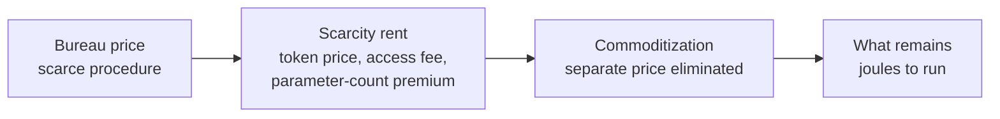

リビジョン db13599、2026年11月5日。 データとコード: [research.openie.dev/data/](/data/#economics). LaTeX PDF: [/pdfs/latex/spellcheck.pdf](/pdfs/latex/spellcheck.pdf) ([source](/pdfs/latex/spellcheck.tex)).

## 要旨

スペルチェックは 1981 年から 1989 年の間に数百ドルで販売されていたが、現在では無料で、すでに人々が使用しているツールに組み込まれている。本稿は、古い資料からその変遷を記録し、限界費用とバンドリングの経済学で説明する [62, 63]。

**平易な言葉で**

1. 人々はかつてスペルチェックに多額の費用を支払っていた。現在では電話、ブラウザ、ワードプロセッサ内で無料で利用できる。
2. 単語をチェックするコストがほぼゼロであり、既に所有しているツール内で最も有用であるため、無料となった。
3. 同様に、他のコンピュータスキルも、人々がすでに所有しているデバイス上で安価に実行できるようになれば、数十億人が利用できるようになる。

## 記法

| Term | Meaning in this paper |
|---|---|
| Automation path | コンピュータ手順が専門機関を離れ、既に利用者が所有するハードウェア上のローカルなルーチンになること。 |
| Existence proof | そのパスの完成した実例。スペルチェックが一例である。比喩的に用いられる語ではない。 |
| Local | チェックが文書を保持するマシン上で実行されること。出荷されたルーチンはフロンティアデータセンターのレンタルを必要としない。 |
| Paired hardware | 利用者がすでに執筆に使用しているエディタ、キーボード、または電話。能力は第二のマシンではない。 |
| Available | ハードウェアは一般的で、希少なレンタルではない。 |
| Accessible | 利用者は専門機関にジョブを送らずに、そのファブリック上で機能を呼び出すことができる。 |
| Capable | ファブリックはジョブを完了させる装置を実行できる。 |
| The many (7B+) | 70億人以上の人々。グローバルアクセスの対象である人々。 |
| The few | 希少価格がまだ到達できる人々。これは人数ではなく価格帯である：フロンティアチャットだけでも2025年10月に週8億ユーザーを超えた[61]。 |
| Proposal | スペル提案。文書はまだ変更されていない。 |
| Commit | 置換が文書に書き込まれる。 |
| Completeness | トークンは保持される：それは既知であるか、候補が受理された。以後の検索はその述語に関して情報価値がゼロになる。 |
| Money price | 誰かが請求できる料金：トークン価格、シートライセンス、希少レンタル、アクセス料。商品化により別途料金はゼロになる。 |
| Parameter count | モデルのサイズ。能力が商品化された後に存続しない指標。 |
| Joule (J) | エネルギーのSI単位。ここではルーチンを実行するために使用されるエネルギー。 |
| Lookup, Formula, Model | 三種のメカニズム。辞書参照はルックアップ。編集距離ジェネレータはフォーミュラ。言語モデルはモデル。 |

## 1. はじめに

スペルチェックは、かつては別個の製品として購入されていた機能であり、現在では既に所有しているツールに組み込まれて提供されている。この論文は、価格の年代別変遷、手順を構築した論文、提供されるライブラリ、そしてそれを実行するマシンを通じてその変化を追跡し、コンピュータ知能全般に何を示唆するかを問う。

人々はプレミアムを支払った。その後、そのものは販売できなくなった。現在は無料で、他の何かにバンドルされている。第2.11節の価格はその事実を示す。第2.9節の名称はそれに続く。

電卓の別個の請求書は、Anita広告からHP-35、TI-2500、VisiCalcに至るまでの年代別シリーズである。スペルチェックの別個の請求書は、ワードプロセッサ内部、さらにオペレーティングシステム内部で終了する。ソースが印刷しないドルは印刷されないままである。

スペルチェックに関しては、価格動向は完結している。ルーチンはエディタにバンドルされ、価格はゼロである。エネルギー消費は依然として発生する。

選択肢は価格である。希少性価格設定は機能を抑制し、保持を販売する。支払える人、すなわち少数に届く。もう一つの選択肢はグローバルアクセスである。機能は既に所有しているマシン上で実行できるように構築され、別途料金は終了する。これにより70億人以上に届く。

スペルチェックはその第二の選択肢であり、完了している。仕事は、書かれたトークンが単語かどうかを判定し、単語でない場合は作者が意図した単語を提案することである。Kukich (1992) はこの仕事を非単語検出、単語単独の訂正、文脈依存の訂正に分割した。最初の二つは一般的になった。これらは人々がすでに使用している執筆プログラム内部で動作する。これはコンピュータ知能であり、別のシステムについて語るための物語ではない。

第二の選択肢は、ルーチンが文書の隣で、ファイルを保持するマシンにローカルに、かつ人々がすでに持っているハードウェアと組み合わせて実行できるほど安価になるときにのみ完了する。McIlroy (1982) はUNIXスペリングリスト論文の最初の文で制約を述べている。チェッカーはミニコンピュータ上でも使用できるように、リストはコンパクトでなければならない。これがエンジニアリングとしてのグローバルアクセスである。レンタルデータセンター内部だけで回答するフロンティアモデルは、依然として希少性価格設定が有効である。能力はあり得るが、依然としてそれをレンタルできる少数に留まる。

第2.11節はプレミアムであり、年代別である。第2.10節は、完成した機能を実行できるマシンを保持している者と、レンタルのみを保持している者を示す。人々がすでに使用しているマシン向けに書かれたソフトウェアが、多くの人へのアクセスを実現する方法である。レンタルを必要とする価格設定が、希少性によって少数を維持する手段である。

### 順序に従って学習されたトークン

Norvig (2007) はローカル補正器と呼び出し `correction('speling')` を文書化しており、これが `spelling` を返す。この呼び出しを経路の教育例として歩く。生産的存在証明は、普通のエディタにおける Hunspell であり、セクション 2.5 に記載されている。

1. 文字列はすでに機械上にある。何も局に送られない。
2. ルックアップは `speling` がローカルの単語カウントにあるかを尋ねる。存在しない。
3. ある式が編集距離 1 の文字列を構築する：削除、転置、置換、または挿入。既知の単語 `spelling` はその集合に含まれる。
4. 提案は提案である。文書は人が受諾するか、明示された方針が受諾する場合にのみ変更される。これがコミットである。
5. `spelling` が保持されると、以後の候補は述語「このトークンは保持する単語である」を変更しない。これが停止である。
6. このトークンに対してフロンティアモデルを開いても、より良い閉鎖は得られない。ルックアップ＋編集の装置がすでに閉じている。より大きな支出を拒否することは割引ではない。これはこの仕事に対する最良の答えである。

同じエッセイはローカルトークンが閉じられないケースを示す。`correction('where')` はテストペアが `were` を期待しているにもかかわらず `where` のままである。単一語は決定を担わない。Kukich (1992) はこれを第3の問題、文脈依存補正と名付けた。より大きなモデルがそこで正しい装置になる可能性がある。その装置が執筆者がすでに所有するハードウェア上で動作するか、執筆者が実際に利用できるリソース最適化された中央ファブリック上で動作するまで、経路は完了しない。執筆者が呼び出せないレンタルフロンティアパスは依然として局である。

## 2. 関連研究

### 2.1 検出と孤立語訂正

Damerau (1964) は、辞書に存在しない単語で、誤りが最大で一つ（誤字、欠字、余字、または単一の転置）の場合の手法を示す。未特定の単語は、これら各仮定の下で辞書と再比較される。要旨は、実施したテストにおいてこれらの誤りタイプの95％以上で正しい識別が得られたことを報告している。この論文はその結果を自身のものとして引用しているが、テスト自体は再現していない。

Peterson (1980) は、綴り誤りを検出・訂正するコンピュータプログラムを調査している。当時は、プログラムが将来的に単語をチェックできるという提案ではなく、実際に機能するプログラムの文献が存在していた。

Kukich (1992) は、上記の三つの問題に領域を整理する。非単語検出は語彙リスト、パターンマッチング、または n-gram 解析を用いる。単語単独の訂正は、検出された非単語に対して辞書語を提案する。文脈依存の訂正は、実際の単語であるが依然として誤った単語を扱う。調査はその地図である。本稿における存在証明は、実稼働環境の Hunspell に基づく：LibreOffice、Firefox、Chrome、Linux ディストリビューション、macOS がローカル辞書ルーチン (Hunspell README) を呼び出す。最初の二つの Kukich の問題は調査から外れ、これらの一般的エディタに組み込まれた。Norvig (2007) は、Lookup から短い編集への教育的ウォークスルーとして残っており、実稼働事実ではない。

### 2.2 リストは機械に適合するよう構築された

McIlroy (1982) は UNIX のスペルチェッカの語彙リストについて述べている。要旨は工学的制約とその結果を示す。チェッカはミニコンピュータ上で使用できる必要があるため、リストはコンパクトでなければならない。接頭辞と接尾辞の除去、ハッシュ化、圧縮により、30,000語の英単語のリストは 16 ビット機械語 26,000語に削減される。Johnson の以前のチェッカは、既に機械上にある文書の語を検索していた。McIlroy の本稿における貢献は、辞書が圧縮された点である。圧縮は、実際に人々が使用するミニコンピュータを対象としたものであり、仕事のために予約された大型機を対象としたものではない。

これらの語数は彼の公表した数である。

### 2.3 ノイズの多いチャネルは依然としてローカルプログラムである

Kernighan、Church、Gale（1990）は、ノイズチャネルモデルを用いて候補修正を順位付けする。候補の確率と、候補が与えられたときの誤字の確率の積である。プログラムは、通常の意味でのスペリング訂正器であり、辞書と誤りモデル上の局所計算である。より良いスコアは別の配置を意味するわけではない。装置はより鋭くなり、テキストを保持する機械上に留まることができる。

### 2.4 1ページに収まりネットワークを必要としない訂正器

Norvig (2007) は、綴り誤りデータもインターネット接続もない平面上で説明を書いた。言語モデルは約100万語のローカルファイルで、32,192 の異なる語が 1,115,504 回出現するように数えられている。エラーモデルは意図的に粗く、編集距離 0 の既知語が距離 1 の語を上回り、距離 1 の語が距離 2 の語を上回る。飛行後、彼は Mitton の Birkbeck コーパスから抽出した集合に対して評価を行った。270 の開発ペアのうち 75 パーセントを正解とし、1 秒あたり 41 語、400 の最終テストペアのうち 68 パーセントを正解とし、1 秒あたり 35 語であると報告した。彼は簡潔さと速度の目標は達成したが、80〜90 パーセントの正確性という希望は叶わなかったと述べている。

これらの数値は彼が報告した評価である。玩具的なチェックは産業用チェッカーではない。有用な能力の一部は、プログラマの前にあるマシン上のファイルから、ネットワークがなくても数十語/秒で動作する点にある。これが完成した自動化パスの形である。彼が列挙した見落とし、特に未知の辞書語や隣接トークンが必要な決定は、残存誤差である。これらはより良いローカル装置への議論であり、仕事を事務所に戻すべきという議論ではない。

### 2.5 通常のエディタに内蔵されたライブラリ

Hunspell プロジェクトは、Hunspell が LibreOffice、Firefox や Chrome を含むフリーブラウザ、そして Linux ディストリビューションや macOS を含む他のツールやオペレーティングシステムで使用されているスペルチェッカーおよび形態素解析器であると述べている（Hunspell README）。このライブラリはローカルの辞書ファイルとローカルの接辞ファイルを読み込む。コマンドラインツールはローカルのテキストファイルをチェックする。コードは MySpell、Kevin Hendricks の OpenOffice.org における実装に由来し、さらに Geoff Kuenning の International Ispell の接辞スペリングの再実装である。László Németh の Hunspell は Unicode と、英語の単語リストだけでは不適切な言語に必要な形態論を追加している。

その README はライブラリが使用されている場所を示している。事実としてそれが貢献しているのは展開クラスである。これらのプログラム内のチェッカーはローカルライブラリとローカル単語リストである。

### 2.6 手元にあるスマートフォン

UITextChecker は UIKit のクラスである。呼び出し側は文字列と使用言語を渡す。メソッドはその文字列中の誤字の範囲を返すか、誤字が見つからなかったことを報告する（Apple, UITextChecker）。チェックはデバイス上で実行され、システムが利用可能と一覧表示している言語に対して行われる。本稿はその呼び出しに対するエネルギー（ジュール）数値を主張しない。API の形は次のような組み合わせである：テキストはすでにテキストビューにあり、チェッカーはそれに付随するメソッドである。

Android のスペルチェックフレームワークもデバイス上にある。アプリケーションは `SpellCheckerService` を拡張し、セッションを実装して、セッションに与えられたテキストに対する候補を返す（Android Developers, spell-checker framework; `SpellCheckerService`）。ラテン文字入力方式のチェッカーはローカルサービスで、ロケール辞書を使用する。こちらも文書からエネルギー数値は取得できない。文書はこの手順が電話上にあることを示している。

Hard ら（2018）は Gboard の電話キーボード向けに次語予測モデルをフェデレーテッドラーニングで訓練した。クライアントはデバイス上に留まるテキストで更新を計算し、サーバはそれらの更新を集約し、生の入力は受け取らない。同論文は Gboard が自動補正と次語予測の両方を提供し、2019 年時点でインストール数が 10 億を超えていると述べている。このインストール文は論文自身の展開主張であり、対象となる 70 億人以上の人数のカウントではない。

配布されるモデルは意図的に小さく設計されている。量子化後は 1.4 メガバイトで、語彙は 10,000 語、製品制約として「約 20 ミリ秒以内の可視応答」と「数十メガバイトのモデルサイズ」を示している。研究への参加条件はインストールベースより狭く、北米のデバイス、少なくとも 2 ギガバイトのメモリ、充電中、アイドル状態、かつ非計量ネットワーク上である。この研究は展開クラスを引用している。人々がすでに使用しているキーボードは小規模なオンデバイス言語モデルを搭載しており、そこで記述された訓練は入力テキストを外部に送信しない。綴り精度の結果としてのリコール表は引用されていない。

### 2.7 ハードウェア抽選

Hooker（2020; 2021）はハードウェア宝くじと呼ぶ概念を提示した。研究アイデアは抽象的に最良であるからではなく、利用可能なハードウェアとソフトウェアに適合するから成功するのである。スペルチェックは価値のある宝くじに当選した。利用可能なハードウェアは文書を保持する機械であり、適合したアルゴリズムは語彙リストと小規模な編集モデルであった。最前線アクセラレータにのみ適合し、そのアクセラレータ上の時間としてのみ販売される能力は別の宝くじに属する。Hookerの警告は、導入されたハードウェアに合わないアイデアは、たとえ優れていても停滞するということである。本稿における設計上の帰結は、同じ事実を逆に読み取ることである。目標が多数に対するコンピュータ知能であるなら、アイデアは多数がすでに所有しているハードウェア、あるいは資源最適化された中央ファブリックが拡張できるハードウェアに適合しなければならない。限られたレンタル資源に適合することが、能力が少数に留まる方法である。

### 2.8 この文献が証明を求められていないこと

上記の綴り情報源のいずれも人口表ではない。第4節で綴り数が示される場合、それは辞書語数、テストセット規模、1秒あたりの語数、または公表された識別率といった、情報源自身のカウントである。第2.10節は別のクラスを追加する。各ハードウェア数は出版社の出荷数、加入者数、収益、または調査数であり、年が付随している。70億人以上の人口と、希少価格を支払える少数の人々が意見における二つのクラスである。これらはそれらの行の総和ではない。

### 2.9 コンピュータ自動化の価格設定方法

引用されたレートはそれを掲載した論文の中に留まる。ここでは曲線は当てはめられない。傾き、半減期、またはゼロ価格年は示されていない。

平易な言葉で言えば、名前の前にある。人々はかつてスペルチェックや通常の計算に対してプレミアムを支払っていた。ベースレイヤー製品としてのスペルチェックはもはや販売できない。無料であり、エディタ、ブラウザ、電話に組み込まれている。通常の計算は電話とコンピュータに組み込まれている。以下の名前はそのシーケンスのラベルに過ぎない。

三つのレジームはコンピュータ自動化ツールの価格設定方法を示す。セクション 2.11 は計算機とスペルチェックのための年代別テープである。各価格は情報源の価格である。曲線はそれらを通して当てはめられない。

**局所価格。** 手順が希少である間、購入者は人または予約された機械に支払う。Nordhaus (2007) はスペルチェックではなく計算そのものの長期的な金銭価格を測定している。その記事では、手作業の計算に対する価格は 1 秒あたり 100 万計算あたり約 500 ドルで始まり、2006 年までに 1 秒あたり 100 万計算あたり $6 \times 10^{-11}$ に低下すると示されている。2006 年の価格は約 8.3 兆の減少である。この数値は本稿が直前に述べた二つの端点の商、すなわち 500 ドル / $6 \times 10^{-11}$ である。端点は彼の報告した数値であり、ここで再適合は行われず、商は予測でもない。これらは自動化基盤の金銭価格が桁違いに低下したことを示す文書である。その指数の低下は製品の別個の請求書が消滅したことを意味するわけではなく、ジュールメーターでもない。

**希少価格、そしてそれが生む競争。** 企業が手順を出荷できるようになると、実行コストを上回る価格を課すことができる。その差額が希少性賃料である。アクセス料金とトークン価格は異なる装いの同一の差額である。購入者がサイズに対して支払うことを学ぶと、パラメータ数が装いの一部になる。賃料が競争を生む。競合他社は機能を購入者が既に所有する製品に組み込むことで賃料を置き換えるか、製品自体を完全に置き換える。公開された推論価格は、言語モデルに対する競争が進行中であり、まだ完了していないことを示す。Epoch AI (2025) は、固定性能に対する価格低下が年あたり 9 倍から 900 倍のオーダーでベンチマーク全体で起きていると報告している。Emberson と Roodman (2026) は、2023 年頃から特定の性能に対するコストが四半期ごとに約 47 パーセント低下しており、年換算で約 13 倍になるとまとめている。これらはそれぞれの系列の要約である。指数は再推定されていない。点を結ぶ直線は描かれていない。いずれのレートもそのウィンドウを超えた法則ではない。Task Satiation 論文は、同じ引用された低下をモート置換が進行中である証拠として使用しており、その主張はその論文に留まる。

**Pricing elimination.** コモディティ化は別個の料金の終焉である。機能は残る。請求書の項目は残らない。スペルチェックは完成した例である。Hunspell は tri‑license (LGPL、GPL、MPL) の下で提供される無料のスペルチェックライブラリである。プロジェクトは LibreOffice、Firefox、Chrome、Linux ディストリビューション、macOS がそれを呼び出し、ローカル辞書を参照することを示している（Hunspell README）。それらのエディタの購入者は非単語に対してトークン価格を支払わず、スペリング局へのアクセス料を支払わず、パラメータ数を購入しない。手法の金銭的価格は別個の財としてゼロである。これが価格の排除である。エディタ自体が無料であるという主張でも、電話が無料であるという主張でもない。スペル訂正がもはや独自の財として価格付けされないという主張である。

**Scarcity pricing can move onto the machine.** 別個のソフトウェア価格を終了しても、すべての希少性価格が終了するわけではない。プラットフォームは新しい機能を新しいデバイスに搭載し、デバイスに対して料金を課すことができる。Yusuf Mehdi、2024 年 5 月 20 日は、40 TOPS 以上のニューラル処理ユニットを備えた Copilot+ PC を定義した。第一波は Snapdragon を使用し、小型モデルはそのユニット上で動作し、大型モデルは Azure に残る。Apple の 2025 年 6 月 9 日のアカウントは、Apple silicon 上に約 30 億パラメータのオンデバイスモデルを配置し、より大きなモデルは Private Cloud Compute に残すと述べている。これらは後続の装置およびそれを保持する機械に対する価格であり、スペルチェックの復活した請求書ではない。チェッカーはすでにエディタ、ブラウザ、電話に組み込まれており、前世代の機器でも利用可能である。古い機械がすでに実行しているチェックを受け取るために新しいクラスのコンピュータを購入させるリフレッシュは、ハードウェアの希少性価格付けである。それはそのクラスを購入する人々に届く。少数のみがそのクラスになることができる。これは 70 億人以上の既に完了したアクセスを元に戻すものではない。

文脈依存の訂正はその完了したケースではない。Kukich (1992) はそれを第 3 の問題として名付けた：実際の単語でありながら誤った単語であるトークンである。より大きなモデルがそこでは適切な装置となり得る。文法エラー訂正において、より大きく、より良く訓練されたモデルはより良く訂正する：GECToR [71] と 110 億パラメータの多言語モデル [72] がそれぞれの時点で最先端を設定した。トレードオフはエネルギーである：Luccioni、Jernite、Strubell は生成タスクが推論あたりのエネルギー消費が分類タスクよりはるかに大きいことを測定した [73]。セクション 4.10 の孤立単語ケースは、追加支出が異なるトークンを生み出さないケースである。装置は、既に所有しているハードウェア上で、または利用者が使用できるリソース最適化された中央ファブリック上で実行される場合にのみアクセス選択を行う。モデルがベンチマークでより正確であっても、希少なレンタルは希少性選択である。通常の非単語ジョブは、文脈ジョブが未完了であるため、そのレンタルに戻らない。辞書プローブ、ローカルモデル、データセンター呼び出しを比較するジュール表はここに印刷されていない。これらのジュールは本稿のために測定されていない。

残っているのは比較を実行するエネルギーである。ローカル辞書プローブは文書を保持するデバイス上でジュールを消費する。ここではジュールは測定されていない。分析的総計は計算されていない。`measured_j` は設定されていない：メーター読取は行われていない。

予測は回帰からではなく、レジームから導かれる。通常のコンピュータ知能タスクはスペルチェックに従う。そのトークン価格、パラメータ数プレミア、希少性賃料、アクセス料金は、既に人々が所有するハードウェアにバンドルされ、ライセンス価格がゼロの手法によって競争的に除去される。最終状態は、希少価格を支払える少数ではなく、70億人以上の人々に向けられる。予測は、スペルチェックがすでに解決しているような普通のタスクが、同等の結果を持つローカルルーチンが文書を保持する人々の手に入った後でも、持続的な別個の金銭価格を保持し続ける場合に失敗する。プレミアがまだ残っているフロンティアベンチマークは、その失敗ではない。それは堀（moat）段階であり、Epoch のノートがすでに価格が下がっていることを示し、スペルチェックがその離脱方法を示している。

同じレジームはインタラクティブな図 [sc-anim-01](/living/spellcheck/#sc-anim-01) に描かれている。二つの点はノードハウスが報告したエンドポイントである。破線のコネクタはその二つのエンドポイントを結んでいる。レートは推定されていない。Epoch の 9 から 900 の範囲と約 13 倍の要約はコールアウトに収められている。要約はそのままである。スペルチェックパネルは完成したレジームであり、別個の金銭価格は消え、ジュールは計測されないままである。

Landauer (1961) はビットを消去する際の物理的下限を設定する。Horowitz (2014) は実用的な CMOS の声明であり、データ移動が支配的であり、理想的な境界をはるかに上回ることを示す。辞書プローブはビットを移動させる。コモディティ化は請求書をゼロにでき、なおかつその動きを残すことができる。スペルチェックのジュール総量はどちらの引用からも計算されていない。

**バンドリングを戦略として。** バンドリング文献は、戦略としてだけでなくアクセスとしても同じ歴史を読む。Adams と Yellen はバンドルが価格差別の手段であることを示す [68]。Nalebuff はバンドルが単一商品を販売する競合への参入を阻むことができると示す [69]。Spolsky はソフトウェアの戦術として「補完品をコモディティ化し、販売する製品の価値を高める」ことを名付けた [70]。各読解は本エッセイが使用する観測対象、すなわちバンドルされた層の別個の価格がゼロになることに同意する。誰が賃料を保持するかで意見が分かれる。その違いが本エッセイがプラットフォーム保持者と価格の両方を追跡する理由である。

### 2.10 ハードウェアアクセス、カテゴリ別

Hookerは宝くじを命名する。この節では機械を命名する。議論は七つの記録である。電話の出荷はデータセンターの出荷ではない。Steamの調査はPCの国勢調査ではない。収益ラインは単位数ではない。企業が単位を開示しない場合、論文はその旨を記し、企業が開示した数値を引用する。これらの数値は多数でも少数でもない。行の合計でもない。実績数値 [sc-hw-01](/living/spellcheck/#sc-hw-01) と [sc-gen-01](/living/spellcheck/#sc-gen-01) は同じ記録である。

各カテゴリの質問は同一である。機械を所有しているのは誰か、情報源自身のカウントで。機械が実行しているソフトウェアスタックは何か。そのスタックが最先端スタックとどのように合致するか。設計主張は一文である：グローバルにアクセス可能な世代向けに書かれたソフトウェアが最大のインパクトを持つ。アクセス可能な世代とは手元にある世代である。スペルチェックはその文の完成した自動化例である。McIlroyはサービス中のミニコンピュータ向けにリストをサイズ付けした。エネルギー消費が残る指標である。これらの行は機械を所有している者を示す。ジュールではない。

**Phones and mobile SoC generations.** GSMA、The Mobile Economy 2025 は、2024年末時点で58億のユニークなモバイル加入者、71パーセントの普及率、47億のモバイルインターネット利用者をカウントしている。IDC の 2026年1月13日付 Worldwide Quarterly Mobile Phone Tracker は、2025年に出荷されたスマートフォンを 12億6030万台とし、そのうち Apple が 2億4780万台を出荷したとカウントしている。IDC の 2025年1月13日付リリースは、2024年に 12億3880万台のスマートフォンをカウントした。2026年の表は 2024年を 12億3630万台と再記載している。各リリースは独自の合計を保持している。Arm の 2025年3月31日終了年度の年次報告書は、Arm ベースの CPU がその会計年度に販売された世界のスマートフォンの 99 パーセント以上に搭載され、顧客が累積で 3100 億個以上の Arm ベースチップを出荷したと述べている。累積数値はすべての Arm 市場を指す。電話の数ではなく、報告書は SoC 世代別に分割していない。

2025年のハンドセットは現在のモバイル SoC 世代である：Apple silicon、Qualcomm Snapdragon、MediaTek、Samsung、Google Tensor。IDC はブランド別ハンドセットをカウントしている。加入者数はモバイル加入者数であり、SoC の数ではない。

そのハンドセット上のソフトウェアスタックはすでにローカルチェッカーを含む。UITextChecker と Android `SpellCheckerService` がスペリングケースである。同一ハンドセット上のモデルは Apple Core ML と Foundation Models フレームワーク、Android LiteRT と NNAPI、Qualcomm の QNN コンパイラ、ExecuTorch、または llama.cpp を使用する。Apple の 2025年6月9日アカウントは、2025年7月17日技術報告書に合わせて、約30億パラメータのオンデバイス基盤モデルを 1 重みあたり 2 ビットに圧縮し、プライベートクラウドコンピュート上で実行されるサーバー型 mixture-of-experts モデルを記述している。Liquid AI の LFM2 レポートは、3億5千万から26億パラメータの密モデル、そして 83 億パラメータの mixture-of-experts モデル（アクティブ 15 億）を ExecuTorch、llama.cpp、vLLM 用に設計し、Snapdragon 8 Elite 搭載の Samsung Galaxy S25 でベンチマークした。PrismML は、Qwen3.8 27B 上に構築された Ternary Bonsai 2 27B が、フル精度版の 98.2 パーセントを保持し、フットプリントを 9 倍小さくした 5.9 GB と主張している。これらの比率は PrismML のものである。本稿はそれらを再測定しない。

フロンティアスタックへのインターフェースは、より小さなモデル、低ビットモデル、あるいはベンダーが運用するサーバへの呼び出しである。Apple は 1 つのレポートで分割を示している。フロンティアのトレーニング実行は電話機上で実行されない。この行の設計主張は、すでに出荷されている SoC 世代向けに書かれたソフトウェア、そして過去数年にわたって使用されているハンドセット向けのソフトウェアが、より大きな影響を持つということである。スペルチェックはそのソフトウェアである。

**PC とノートパソコン。** IDC の 2025 年 1 月 9 日リリースは、2024 年に 2億6270 万台の従来型 PC が出荷されたとカウントしている。IDC の 2026 年 1 月 12 日の予備リリースは、2025 年に 2億8470 万台とカウントしている。2026 年の表は 2024 年を 2億6330 万台と再掲している。2026 年 1 月 28 日の決算説明会で、Satya Nadella は Windows が 10 億人の Windows 11 ユーザーに達し、前年同期比で 45 パーセント増加したと述べた。出荷台数 1 年は、実際のインストールベースとは一致しない。

スタックはオペレーティングシステム、ブラウザ、ローカルライブラリで構成される。Hunspell は通常のエディタ内でのスペルチェック機能である。同一 PC 上のモデルは ONNX Runtime、DirectML、Windows ML、llama.cpp、または ExecuTorch を CPU と統合 GPU 上で使用する。離散 GPU は次のカテゴリである。Liquid AI は AMD Ryzen AI 9 HX 370 上で llama.cpp を Q4_0 で実行した同じ LFM2 ファミリを測定している。これはデータセンター測定ではなく、レポート中のノートPC CPU 測定である。

フロンティアスタックへのインターフェースは API 呼び出し、あるいはマシンのメモリに収まるモデルである。これらは異なるプログラムである。前者はレンタルであり、後者はパスである。この行の設計主張は、PC 世代の人々がすでに使用しているソフトウェアが、より大きな影響を持つということである。スペルチェックはそのパスを取った。レンタルアクセラレータを前提とした重みは取らなかった。

**コンシューマ GPU。** NVIDIA の 2026 会計年度リリース（2026 年 1 月 25 日終了）は、ゲーム部門の収益が 160 億ドルであると報告している。これは収益であり、ユニット数ではない。Jon Peddie Research（2026 年 3 月 5 日）は、2025 年第 4 四半期に 1,148 万枚の PC 用グラフィックスアドインボードが出荷され、前年同期比で 36.0 パーセント増加し、その四半期のデスクトップ搭載率は 55 パーセントであったと報告している。同じ注記では、データセンター GPU ボードは前四半期比で 17.0 パーセント増加したが、ユニット数は公表されていない。その注記にある 1億7200 万の「インストールベース」は予測の終点であり、本稿では現在のセンサスとして使用しない。

Valve の Steam ハードウェア・ソフトウェア調査（2026 年 9 月）は、回答したクライアントのうち NVIDIA GeForce RTX 5070 が 6.15 パーセント、RTX 5090 が 0.40 パーセント、RTX 4060 が 3.89 パーセント、RTX 3060 が 3.66 パーセント、GTX 1650 が 2.19 パーセントであると報告している。この調査は Steam 参加者に限定されており、全世界を代表するものではない。本稿はそれらのシェアを世代総計に加算しない。リストは部分的であり、調査には「その他」項目がある。

スタックは NVIDIA 上の CUDA、AMD 上の ROCm または Vulkan である。llama.cpp はカード上で量子化されたモデルを実行する。vLLM はカードが重みを保持しているときにモデルを提供する。フロンティアスタックへのインターフェースは量子化、より小さなモデル、あるいは API である。コンシューマカードは適合するモデルを実行するが、フロンティアトレーニングシステムは適合しない。この行の設計主張は、フラッグシップ向けソフトウェアがゲーマー調査の 0.40 パーセントを対象としていること、カードがまだ報告されている 30 系列や 40 系列部品を含むソフトウェアがインストール世代をカバーし、より大きな影響を持つということである。

**データセンタアクセラレータ。** NVIDIA の同一会計年度 2026 年リリースは、年間データセンタ収益が 1,937 億ドルで、68 パーセント増、第四四半期は 623 億ドルであると報告している。リリースは Hopper、Blackwell、Rubin の出荷台数を開示していない。Meta との数年にわたるパートナーシップを説明し、数百万台の Blackwell と Rubin GPU を含むと述べている。その文は NVIDIA の展開計画の説明であり、ラック内のカード数の監査済みカウントではない。2025 年 10 月 28 日、ワシントンで開催された GTC において Jensen Huang は、過去四四半期で 600 万台の Blackwell GPU が出荷されたと述べた。同日、CNBC がその文を報じた。会計年度 2026 年のリリースは依然として出荷台数を開示していない。600 万台という数字は Huang の発言であり、監査済みの出荷台数ではない。同じ報告書は Blackwell と Rubin 全体で 5,000 億ドル規模の GPU 売上を見込んでいると引用しているが、これは販売予測であり、本稿はそれを台数に換算していない。

AMD の 2026 年 2 月 3 日のリリースは、カレンダー年 2025 年のデータセンタ部門収益が 166 億ドルで、32 パーセント増であると報告し、成長は EPYC CPU と Instinct GPU の両方によると述べている。Instinct は別個の収益項目ではなく、開示された唯一のスライスは第四四半期の中国向け Instinct MI308 売上が約 3.9 億ドルであることだけである。リリースには Instinct の出荷台数は記載されていない。

2026 年 1 月 28 日の電話会議で、Nadella は Microsoft のフリートに NVIDIA、AMD、そして同社が導入した独自の Maya 200 アクセラレータが含まれると述べた。Amy Hood はその四半期の資本支出が 375 億ドルで、そのうち約 3 分の 2 が短期資産、主に GPU と CPU に費やされ、需要が供給を上回ったと語った。トランスクリプトには Maya の出荷台数は記載されていない。Google TPU と Amazon Trainium の出荷台数も本節で参照した資料には含まれていない。ベンダーが一つに絞られないように名前が挙げられているだけである。欠落している出荷台数が記録である。

それを持っているのは、収益に対して契約を結んだ購入者である。Hood は GPU 資本の多くがハードウェアの有用期間にすでに契約されていると述べている。これはレンタル市場である。アクセラレータ上のスタックは CUDA、ROCm、そしてカードを前提としたサービングスタックであり、TensorRT-LLM と vLLM を含む。このカテゴリはフロンティアスタックである。その他すべてのインターフェースは API、蒸留モデル、または量子化モデルである。この行の設計主張は、アクセラレータを必要とするソフトウェアがレンタル側に届くことである。他の行の世代向けに書かれたソフトウェアは、機械を保有する人々に届く。スペルチェックは後者を行った。前者はビューロー段階である。

**MCU、微小部品、組込み部品。** Arm の累積数値は 3100 億個以上のチップを含み、センサーや組込みデバイスが含まれる。年次報告書はその累積数値をマイクロコントローラに分割していない。IC Insights（2022 年 3 月 29 日）は、2021 年の納入が 309 億個のマイクロコントローラであり、その年のユニット成長率は 12 パーセントであったと述べている。これは 2021 年の出荷である。同じ注記は 2026 年に 358 億個のユニットを予測しているが、予測は現在のカウントではない。

MLCommons、2025年9月17日、MLPerf Tiny v1.3 を公開。スイートは通常 100 キロバイト未満のニューラルネットワークを測定する。リリースには 5 つのテストにわたる 70 件の結果が含まれ、うち 27 件は電力結果であり、Kai Jiang、Qualcomm、STMicroelectronics、Syntiant から提供された。初めてベンチマークされたハードウェアプラットフォームは 5 種類である。テストは画像分類、ビジュアルウェイクワード、キーワードスポッティング、異常検知、ストリーミングウェイクワードタスクをカバーする。

スタックは TensorFlow Lite for Microcontrollers、CMSIS-NN、そして提出物が使用するベンダーランタイムである。モデルはキロバイト単位である。フロンティア言語モデルはロードされない。フロンティアスタックへのインターフェースは、部品向けにコンパイルされたタスクモデルであり、ウェイクワード、センサースコア、カーネルが該当する。この行の設計主張は、当世代のソフトウェアは部品に適合するソフトウェアであるということである。Arm の累積出荷量は本節で最大のシリコン数であり、データセンター向けではない。インパクトは出荷された部品に従う。

**エッジアクセラレータと NPU が搭載された出荷デバイス。** Yusuf Mehdi、2024年5月20日、Copilot+ PC を 40 TOPS 超のニューラルプロセッシングユニットで定義した。第一波は Snapdragon X Elite と Snapdragon X Plus を使用し、同記事は 45 NPU TOPS を提供すると述べている。オンデバイス体験は小規模言語モデルでその NPU 上で実行されるよう指定され、大規模モデルは Azure を通じて利用可能である。Gartner は Computerworld が 2025年8月28日に報じた同日リリースによれば、2025年に AI PC が 7780 万台、全世界 PC 市場の 31% を占めると予測している。この予測は年末前に公表されたもので、IDC の完了した PC 総数でもなく、Copilot+ PC のみのカウントでもない。Canalys（現在 Omdia の一部）は 2025年2月25日付データを 2025年3月7日に報じ、2024年第四四半期に AI 対応 PC が 1540 万台出荷され、当四半期の PC 出荷の 23% を占めたと述べている。2024年通年では同ノートが AI 対応 PC が出荷された PC の 17% とし、年間のユニット総数は記載されていない。その定義は、オンデバイス AI ワークロード用に専用チップセットまたはブロックを備えたデスクトップまたはノートブックである。例として AMD XDNA、Apple の Neural Engine、Intel AI Boost、Qualcomm Hexagon が挙げられる。1540 万台は四半期終了時点の数であり、Gartner の 7780 万台は予測である。

Apple の約 30 億パラメータのオンデバイスモデルは Apple silicon 用にコンパイルされ、Neural Engine を含む。Apple は Neural Engine の別個の出荷数を公表していない。アクティブデバイスベースは以前の Apple の数値であり、NPU センサスではない。

スタックは Qualcomm QNN、Windows Copilot Runtime、Apple Core ML と Foundation Models フレームワーク、AMD Ryzen AI ソフトウェア、Intel の NPU スタック、そして ONNX である。各スタックは自らの NPU 用にグラフをコンパイルする。CUDA 重みはコンパイラが受け入れるまで NPU プログラムではない。フロンティアスタックへのインターフェースは Microsoft が示すものと Apple が示すものであり、デバイス上の小規模モデルとベンダーが運用するサーバ上の大規模モデルである。この行の設計主張は、一般的な電話や PC 内の NPU がアクセス可能な世代であるということである。その NPU 用にベンダーのコンパイラで書かれたソフトウェアが到達範囲を持つ。データセンター GPU を前提としたカーネルはそこで動作しない。

**以前の世代は依然として使用中。** 最新世代は出荷されたものである。インストールされた世代は人々がまだ使用しているものである。両者は異なる数値であり、複数の企業は後者を公表していない。

電話: 2025年に出荷されたスマートフォンは 1,260.3 百万台で、2024年末時点のユニークなモバイル加入者は 58 億人である。加入者は端末ではない。この規模の事実は変換なしで成立する。1 年分の端末出荷は加入者ベースではない。以前の端末は引き続き使用されている。本稿はギャップを世代シェアに変換しない。

Apple は 2025 年 1 月 30 日の決算説明会で、製品カテゴリ全体で 23.5 億台以上のアクティブデバイスがインストールベースにあると述べた。2025 年 10 月 30 日のリリースでは、インストールベースが新たな史上最高に達したとし、交換回数は公表しなかった。2025 年カレンダー年の iPhone 出荷は 2.478 億台で、これは 1 年間の単一製品である。これがアクティブベースではない。

PC: 2026 年 1 月 28 日時点で Windows 11 ユーザーは 10 億人で、2025 年カレンダー年に出荷された PC は 2.847 億台である。IDC の 2026 年 1 月 12 日のメモと Hood の 1 月のコールでの発言は、Windows 10 のサポート終了が 2025 年の PC 需要の変動理由であると指摘している。前世代の OS は刷新を促すほど大規模であった。その残存数は文字起こしに含まれていない。本稿はそれを提供しない。

コンシューマ GPU: 上記の 2026 年 9 月の Steam 調査によると、RTX 5090 が 0.40 パーセント、RTX 3060 が 3.66 パーセント、RTX 4060 が 3.89 パーセント、GTX 1650 が 2.19 パーセントである。最新のフラッグシップは調査で最も頻繁に報告されたカードではない。

データセンタ加速器: NVIDIA の 2026 会計年度リリースは Blackwell と Hopper を比較し、サービス中の Hopper カードのインストール数は示さない。Nadella はソフトウェアが老朽化したフリート上で現在のモデルを実行し続けていると述べた。これは同じ事実のデータセンタ形態であり、フリートは依然としてレンタルである。ここでインストールベースの単位数は創作されていない。

この行およびその前の 6 行の設計主張は、グローバルにアクセス可能な世代向けに書かれたソフトウェアが最大の影響を持つというものである。アクセス可能な世代は手元にあるものであり、上記の情報源はそれが最新のダイと同一の対象ではないことを示している。スペルチェックはサービス中のミニコンピュータ向けに書かれ、次にエディタ向け、そして電話向けに書かれた。別個の金銭価格がなくなると、残るのは稼働エネルギーである。新しいダイはライセンスという指標でそれを置き換えない。

オンデバイスのテーゼはその主張と一致し、出荷記録を置き換えるものではない。Hooker (2020; 2021) は、アイデアは既存のハードウェアに適合することで勝つと述べている。Apple の報告は Apple silicon に約 30 億パラメータのモデルを適合させ、より大きなモデルはプライベートクラウドコンピュートに残す。Liquid AI の LFM2 報告は、測定されたレイテンシとメモリを基に電話 CPU とラップトップ CPU 上のアーキテクチャを探索し、これらのランタイム用に重みを出荷する。PrismML の公開主張は、三値モデルがローカルデバイスに適合するアーティファクトであり、同社が示す比率である。スペルチェックは完成例として残る。辞書プローブはこれらのモデルを必要とせず、テキストを保持している機械だけが必要であった。

### 2.11 日付付き価格、および各価格が持続したことが知られている期間

Section 2.9 のレジームは名称である。この節は価格テープである。各行は情報源が印刷した価格、情報源が付与した日付、そしてその情報源が価格がどれだけ続いたかについて述べた内容である。情報源が一つの広告である場合、期間は次の広告が印刷されるまでのギャップである。そのギャップは連続した価格監査ではない。二つの情報源が食い違う場合、両方が印刷される。ページに価格が記載されていなければ、埋められない。実際の表は [sc-price-01](/living/spellcheck/#sc-price-01)。

**デスク計算機、Sumlock Comptometer と Anita.** anita-calculators.info の広告インデックスは、日付付き広告の編纂である。これは企業が保持する価格表ではない。

1949 年秋。インデックス上の Plus 加算機広告は「Now Plus for only \$100.」と記す。インデックスはその価格がどれだけ続いたかは示さない。

1961 年 10 月。Anita Mk 8 はロンドンの Business Efficiency Exhibition で発売された。Office Magazine、1961 年 12 月、1244-1245 ページが同サイトに転載され、価格は £335、注文は 1962 年 1 月 1 日から受け付けると記す。レビューは機械がまだ一般に供給されていないと述べる。

1963 年 5 月。インデックス上の広告は Anita Mk 8 を £355、Comptometer 993s を £265 と価格付けする。インデックスは 1961 年 12 月のレビューとこの広告の間に Mk 8 の価格を記録していない。その間隔は二つの日付間の沈黙であり、£335 が維持された証明ではない。

1964 年 1 月。インデックスは Mk 8 を £365 と価格付けする。1964 年 2 月。Comptometer 993 系列は £160 から £330 の範囲で価格付けされる。

1965 年 1 月。インデックスは Mk 8 を £335、Mk 9 を £425 と価格付けする。Mk 8 の広告価格は 1961 年 12 月のレビューで £335、1963 年 5 月で £355、1964 年 1 月で £365、1965 年 1 月で £335 である。各数値は一つの広告または一つのレビューに由来し、いずれも価格が期間中一定であったとは述べていない。

1965 年 11 月。インデックスは Mk 9 を £425 と価格付けし、16,000 台以上の Anita が使用中であり、Anita が 1962 年 1 月に導入されたと記す。1965 年 1 月の広告からこの広告まで、インデックス上の Mk 9 の価格は £425 のままである。これは二つの観測であり、月次監査ではない。

1966 年 7 月。インデックスは Mk 10 を £460 と価格付けする。

1968 年 6 月。「Focus on ANITA」という広告が Office Methods and Machines、1968 年 6 月、41 ページに掲載され、anita-calculators.info のモデルページで引用されている。そのページは三つの金額を転写する。Mk 10: £480。Mk 10 ページは広告を引用し「Price £480.」と記す。Mk 11: £298。Mk 12: £480。インデックスは依然として金額を印刷しない。Mk 9 の金額は Mk 9 ページに掲載されていない。そのページは 1964 年導入時の価格を £425 とし、Industrial Electronics、1964 年 11 月、521 ページの「BEE '64」を引用している。これは導入価格であり、1968 年 6 月の行の転写ではない。1968 年 6 月の Mk 9 の金額は本稿で参照した資料には含まれていない。1966 年 7 月は Mk 10 を £460 と価格付けし、1968 年 6 月は £480 と価格付けした。これは二つの広告であり、その間の月は監査ではない。

1969 年 4 月と 5 月。インデックスは Anita 1000 を両月とも £285 と価格付けする。1969 年 7 月。Anita 1010 は £320 である。1971 年 2 月。Anita 1000LSI は £192、1010LSI は £250 である。これらは後続モデルであり、後続モデルの低価格は Mk 8 の価格が下がったことを意味しない。

**HP-35.** 三つの情報源は導入価格で一致し、価格削減の時系列で食い違う。

Computer History Museum, 「This Day in History」, 1972年1月4日: Hewlett-Packard が HP-35 を導入し、販売価格は \$395 であった。

Datamath Calculator Museum, HP-35 ページ: 1972年1月4日に発表、1972年2月に入手可能、1972年1月の MSRP は \$395、1974年1月の MSRP は \$295。同ページは 1975年初頭に価格が \$195 に下がり、HP-21 の直後に製造中止されたことを示す。また、1974年1月19日に導入された HP-65 の価格は \$795 と記載されている。1973年5月の価格削減や \$225 の記載はない。

Craig Finseth, hpdata ファイル（HP-35A 用）: 導入価格は \$395。導入日としてそのファイルでは 1972年7月1日と記載されており、これは「wall of fame」から取得されたもので、1972年2月1日の可能性もある。製造中止日は 1975年2月1日で、価格は \$195。価格変更の行は 1973年5月1日が \$295、1974年5月1日が \$225、1975年2月1日が \$195 とある。同ファイルの注記では、HP-45A が導入された際に価格が \$295 に上がったと記載されている。Datamath は HP-45 の日付を 1973年5月とし、Finseth が \$295 に使用した月と一致するが、Datamath の MSRP 行は依然として 1974年1月の \$295 を示す。

期間として印刷し、各情報源内のみで示す。Finseth のリストをそのファイルのスケジュールとみなす場合: ファイルの導入日から 1973年5月1日まで \$395、1973年5月1日から 1974年5月1日まで \$295、1974年5月1日から 1975年2月1日まで \$225、製造中止日には \$195。導入日は不確かとマークされている。Datamath のリスト: 1972年1月の MSRP が \$395、1974年1月の MSRP が \$295。ページはその間のすべての月で価格が \$395 のままだったとは述べていない。\$195 は「1975年初頭」の表記で、具体的な日付ではない。1974年1月の数値と 1975年の数値の間の月は項目化されていない。

**TI-2500 Datamath.** Datamath Calculator Museum, TI-2500 Version 1 ページ: 1972年4月に提案小売価格 \$149.95 で発表。最初の顧客は 1972年6月にダラスの Neiman-Marcus と Sanger-Harris で受領。正式な導入は 1972年9月21日。提案小売価格はその導入時点で \$119.95 に削減された。ページは削減日の具体的な日付を示さない。此方の情報源における \$149.95 の記録期間は 4月の発表から 9月21日までである。\$119.95 以降の後続削減はこのページに記載されていない。同ページは 1971年9月に導入された Bowmar 901B を名前だけで挙げ、価格は示さない。Datamath の HP-35 ページは 1968年の HP 9100A を名前だけで挙げ、価格は示さない。価格は他のページに記載されており、以下を参照。

**HP 9100A.** Computer History Museum の 1968 年のパンフレット（コレクション 102646164）のスキャンには「Priced at \$4900」および「hp 9100A Calculator, Price: \$4900」と印刷されている。HP Memory Project は同じ \$4900 が 1969 年カタログの 130 ページに記載されていると述べ、モデルは 1968年9月の Hewlett-Packard Journal で導入されたと記載している。パンフレットは \$4900 がどれだけ続いたかは示さない。後続の価格は本稿が読んでいないページから取得されていない。

**Bowmar 901B.** Datamath Calculator Museum, Bowmar 901B ページ: 導入日は 1971年9月、新価格は \$240。ページは 901B が TMS0103 上で発売された際の提案小売価格 \$240.00 を示す。\$240 の期間はページに記載されていない。

**ソフトウェアとしての電卓。** Wikipedia、VisiCalc、本文執筆時点で閲覧したページ。Personal Softwareは1979年中頃に米ドル100未満でVisiCalcを販売開始した。同記事は1979年6月4日から7日に開催されたNational Computer Conferenceでの正式発表を引用している。また、Peter Jenningsによれば、最初のApple II向けコピー、バージョン1.37は1979年10月17日に出荷されたとされている。両日付は記事内にあるが、本稿はそれらを統合しない。

記事によれば、1982年までに価格は100ドルから250ドルに上昇したとされ、Softline、1982年3月を引用している。価格上昇の月は示されていない。100ドルと250ドルはそれぞれ別々の日付の報告であり、両報告間の期間は記事に記載されていない。別の文では、VisiCalcが100ドルで、Apple IIが2,000ドルと比較されているが、2,000ドルは後の記述で示される機械本体の価格であり、ソフトウェアの第二の価格ではない。

同記事は、タイムシェアリングシステム上の財務モデリング言語は20,000ドルかかるとし、UCLAの教育ケースを引用している。これは別製品クラスの官報価格であり、VisiCalcの請求額ではない。

記事中の販売実績は、記事が示すままに保持する：1983年1月に39,000部以上、依然としてベストセラーソフトウェア製品；1983年12月に5,700部。Lotus DevelopmentがSoftware Artsを買収し、販売を終了した。リード日付は1985年まで続く。InfoWorldの項目は1986年6月2日付で「VisiCalc discontinued」と題されている。両日付は保持する。

DOS Days、Lotus 1-2-3ページ：プログラムは1983年1月にリリースされた。ページは1983年1月の価格を示さない。Gregg Williams、Byte、1982年12月、ページ182-198はプレリリース版をレビューしている。その再掲では、Lotusが1-2-3の価格を495ドルに固定し、プログラムは来月中にIBM Personal Computer向けに提供されると述べている。495ドルは商業販売前に決定された価格で、1983年1月26日付の領収書ではない。DOS Daysは独自の1月価格を印刷していない。リリース2.2とリリース3は同価格495ドルで、当時のMicrosoft Excel 2.1およびBorland Quattro Proと同価格であると記載されている。495ドルがどれだけ続いたか、1983年の価格が495ドルであったかはそのページにはない。DOS向けリリース4は1994年5月にスペルチェッカーを追加した。これは機能追加の日付であり、価格ではない。

**製品としてのスペルチェック、そして消えたライン。**

Wikipedia、「Spell checker」、本文執筆時点で閲覧したページ。1961年、Les Earnestのプロジェクトは10,000語の許容語リストを使用した。1971年2月、Ralph Gorinはスタンフォード人工知能研究所でDEC PDP-10向けにアセンブリでSPELLを書き、公開した。記事は価格を示さない。研究所プログラムは小売スケジュールではない。

最初のパーソナルコンピュータ向けチェッカーは1980年に登場した。WordCheckは1980年後半にCommodoreシステム向けにリリースされ、Compute! 1981年1月号（第8号、ページ119）で広告が掲載された。そのページは閲覧済みである。広告はMicro Computer Industries, Ltd.からのもので、WordCheckはCBMおよびPET 32Kマシンでデュアルディスクドライブ搭載の場合に利用可能で、次のように記載されている：「List price is only \$200.00.」同ページではCreate-A-Baseおよび在庫管理プログラムも200ドルと価格付けされている。WordCheckの数値はデュアルディスク行に付随した文である。Wikipedia記事はそれを引用していないが、本稿は引用する。

記事は、スタンドアロンパッケージの市場は短命であり、1980年代半ばまでに WordStar と WordPerfect がスペルチェッカーを組み込んだと述べている。「短命」および「1980年代半ばまでに」は記事自身の範囲であり、請求書の日付のペアではない。記事中にスタンドアロンのドル価格は示されていない。

Sector Software の Spellbound（1987）と Microsoft Word（Word 95 以降）は、記事が例示するインタラクティブチェックである。記事は価格を示さない。Word 95 に関する引用は Raymond Chen, The Old New Thing, 2026年6月22日。Word 95 は 1995 年製品であり、チェッカーの別価格は示されていない。チェッカーはワードプロセッサ内部に組み込まれているためである。

Edward Mendelson, 「A Chronology of Versions」, WPDOS. 1980年3月: SSI*WP for Data General ミニコンピュータ、1 コピー US\$5,500。年代記はそのコピーにスペルチェッカーが含まれているとは述べていない。\$5,500 はワードプロセッサ本体の価格であり、期間は示されていない。

1982年11月26日: IBM PC 用 WordPerfect 2.20。年代記に価格はない。DOS Days はこのバージョンが 30,000 語の辞書を備えていたと述べているが、2.20 のスペルチェックコマンドは記載されていない。1983年10月: DOS 用 WordPerfect 3.0。Mendelson のコマンド一覧では、テキストが選択されていない状態で Alt-F5 が Spellcheck に割り当てられている。したがって、1983年10月時点で出荷された DOS 製品にはスペルチェックコマンドが存在した。DOS Days はこのバージョンが 1983年10月の Comdex で \$495 で発売されたと記載しているが、年代記には価格が印刷されていない。DOS Days の 3.0 段落ではスペルチェッカーの名称は出てこないが、コマンド一覧で示されている。\$495 はワードプロセッサ本体の価格であり、スペルコマンド自体に別価格は付いていない。

1992年11月30日: Windows 用 WordPerfect 5.2 に Grammatik 5 が含まれる。1993年1月6日: WordPerfect が Grammatik の作者である Reference Software International を買収。これにより、製品内の別個の文法請求書は終了した。年代記は Grammatik の以前の小売価格を示さない。別ページでは、Chicago Tribune（1988年4月10日）が Grammatik II を \$89、START（1989年11月、vol.4 no.4）が Grammatik III を \$99 と報じているが、買収時の Grammatik 5 の価格は示されていない。そのスタンドアロン価格は本稿で参照した資料には含まれていない。

Wikipedia, History of Microsoft Word. Word 1.0 は 1983年10月に発売され、\$395 とされている（出典: John Markoff, InfoWorld, 1983年5月30日）。これはワードプロセッサ本体の価格であり、バージョン 1.0 にスペルチェッカーが含まれていたかは記載されていない。Richard Brodie（バージョン 1 の多くを執筆）は、2015年11月7日に Benj Edwards が掲載したメールインタビューで次のように述べている。「1.0 のほか、1.1 ではメールマージが追加され、2.0 では当社が購入したバンドル済みのスペルチェッカーが追加された。」この記述によれば、1.0 にはスペルチェッカーは含まれておらず、1.1 でメールマージが追加され、2.0 で購入したスペルチェッカーが追加された。Michal Necasek, OS/2 Museum, 2018年5月26日 は、DOS 用 Word 2.x および 3.x のスペルチェッカーが 1985 年から 1987 年頃に Software Heaven, Inc. からライセンス供与されたと特定している。\$395 はスペルチェックの価格ではない。Word for Windows は 1989年11月に USD \$498 で発売されたが、\$498 がどれだけ続いたかは記載されていない。Microsoft Write for the Atari ST の小売価格は \$129.95 である。これは唯一の小売価格であり、期間は示されていない。

Section 2.9 で既に述べた除外は、このテープ上の最後の価格である。README が示す三重ライセンスの下では、ライブラリとしての Hunspell のライセンス価格はゼロである。README は以前の小売価格表を公開していない。スペルチェック記事で、綴り修正を OS が引き継ぐと記述された Apple のシステム全体のチェッカーは、その記事において別個の価格を持たない。記事の文言によれば、「別個の価格がない」期間は、組み込みワードプロセッサチェッカーが登場した 1980 年代半ばから始まる。その記事では、OS チェッカーが特定の日付であるとは記載されていない。

図 1 は本節の日時付き価格を一つの軸に配置したものである。

*図 1. 別個の価格からバンドルされたゼロへのスペルチェック。データ図、対数スケール: 本節の情報源 (Compute!、1981 年 1 月; Mendelson、WPDOS; InfoWorld via Wikipedia; Chicago Tribune、1988 年 4 月 10 日; START、1989 年 11 月; Brodie、2015; Hunspell README) によって印刷された価格と日付。 [PNG copy](/figures/spellcheck/price-to-zero.png) が提供されている。*

## 3. 定義と方法

### 3.1 検証としての経路

機能が自動化の道にあるとみなすには、以下の5条件すべてが満たされる必要がある。

1. 作業が既に利用者が所有する機械上、あるいは利用者が専門家の予約なしに使用できるファブリック上に存在すること。
2. 機能がその機械上でルーチンとして実行され、外部の事務所へ送られるジョブとしてではないこと。
3. そのルーチンが当該機械の通常のメモリ容量および電力範囲に適合していること。
4. 呼び出しに際して、フロンティアデータセンターのレンタルが必要とされないこと。
5. ルーチンが返す回答が、作業に対して適切な装置であること。劣った回答を返すことで到達性が購入されることはない。

エディタやキーボードに組み込まれた形態のスペルチェックは、上記5条件をすべて満たす。レンタルされたフロンティアデータセンター内でのみ回答するチャットモデルは、レンタルを持たない利用者に対して条件2、3、4を満たさない。したがって、コンピュータ知能はこの5条件を満たすまで構築され続けるとするのが本論であり、これはコンピュータ自動化が辿る道である。スペルチェックはその道における完成したコンピュータ知能の例である。

### 3.2 存在証明

類推では「X は Y のようである」と述べ、続いて X について論じる。存在証明は Y を示す。ここで Y はスペルチェックである。第 2 節の手順は Y である。ローカルライブラリを呼び出す製品は Y である。スペルチェックは、あるコンピュータ知能がバンドルされたゼロ価格で商品化する存在証明である。すべての機能がその経路をたどることを示すものではない。どの機能がそれをたどるかは、コスト構造によって決まる。限界コストがほぼゼロであり、既に人々が持っている表層との補完性がある場合である[62, 63]。コンピュータ知能の将来に関する主張は、構築者はこの二つの条件を設計すべきだということである。なぜならこの事例はすでに完了しているからである。事例が狭義である場合、論文はその旨を述べている。非単語検出と単語単位の訂正は経路を完了した。文脈依存の訂正は残りのギアであり、同じ意味でローカルになるまで完了していない。

### 3.3 対象者

多くの人は70億人以上である。現在のバンドルされたチェッカーの接続範囲はそれより小さく、ITUは2024年に55億人がオンラインにあると推定し[64]、GSMAは47億人のモバイルインターネット利用者をカウントしている[21]。グローバルアクセスが方向性であり、接続された50億人が現状である。少数派は希少価格を支払える者である。この意見は、技術が第二のグループに対して希少性による価格設定ではなく、第一のグループ向けに構築されたときに何が起こるかについて述べている。スペルチェックは完成した事例である。希少価格が計算と綴りを製品として維持した。グローバルアクセスは別個の販売を終わらせ、機能を人々がすでに持っているツールにバンドルした。第2.10節はどの機械を誰が保持しているかを記録している。その行は人数のいずれにも合算されていない。小規模なグループだけがレンタルできる機能は、ベンチマークスコアが何であれ、道筋を完了していない。

### 3.4 実施内容

この手法は、第2節における一次資料の精読に基づくものである。

以下で使用する証拠クラスを示す：

| クラス | 意味 |
|---|---|
| **文献** | 査読済み論文またはエッセイ。数値は著者の報告値である。 |
| **プロジェクト声明** | ライブラリの使用箇所を記述したプロジェクトのREADMEである。センサスではない。 |
| **API** | デバイスがすでに保持するテキストに対して実行される呼び出しのベンダードキュメントである。ジュール測定ではない。 |
| **設計** | 当該記録から導出された仮説であり、それを反証する観察を伴う。設計として標記される。 |
| **人々** | 70億人を超える人々、および希少価格を支払うことができる少数の人々である。 |
| **出荷数または導入実績** | 発行者自身による集計であり、ユニット数、購読者数、収益、または指定された調査を含む。人数の集計ではない。 |

## 4. 証拠

### 4.1 主張 SC-1. 孤立語訂正は公開された手続きである

Damerau (1964)、Peterson (1980)、Kukich (1992) は、検出と訂正をコンピュータ手続きとして記述している。Kukich の最初の二つの問題には名称、手法、そして調査がある。本稿が指し示す能力は、後のモデルのニックネームではなく、文献である。クラス: 文献。

### 4.2 主張 SC-2. 辞書は人々が実行する機械に合わせてサイズが決定された

McIlroy (1982) は、チェッカがミニコンピュータ上で実行される可能性があるため、UNIX のスペリングリストを圧縮した。彼の報告によれば、30,000 語の英単語からなる縮小リストは 26,000 個の 16 ビット語を占める。展開対象はスペリング専用に新たに取得した機械ではなく、すでに稼働中の機械である。クラス: 文献。

### 4.3 主張 SC-3. 有用な訂正器はネットワークもフロンティアモデルも必要としない

Norvig (2007) はインターネット接続なしでローカルのカウントファイルから訂正器を構築し、1秒あたり 35 語で 400 組の最終テストペアのうち 68 パーセントが正しいと報告している。Kernighan、Church、Gale (1990) はローカルなノイズチャネル計算で候補を順位付けする。いずれの結果も、2007 年の玩具が最も高い公表精度に一致するという議論ではない。両方とも、通常の作業を行う装置が、単語を保持する機械上の辞書と編集モデルであるという議論である。クラス: 文献。

### 4.4 主張 SC-4. 通常のエディタはローカルライブラリを呼び出す

Hunspell の README には、LibreOffice、Firefox、Chrome、Linux ディストリビューション、macOS がこのライブラリを使用していると記載されており、チェックはローカルの affix および辞書ファイルを読み込むと述べられている。クラス: プロジェクトステートメント。この主張は、これらのプログラムが世界の文章のどの程度をカバーしているかという割合を示していない。これらのプログラム内のチェッカーがローカルであることを述べているだけである。

### 4.5 主張 SC-5. スマートフォンはスペルチェックをローカル呼び出しとして公開する

UITextChecker は呼び出し側が渡す文字列をチェックする (Apple) である。 Android の `SpellCheckerService` はデバイス上のセッションで候補を返す (Android Developers) である。 クラス: API である。 ワット数の図は添付されていないである。

### 4.6 主張 SC-6. デバイス上のキーボードモデルはペアリングを維持した

Hard et al. (2018) は、電話上で次単語モデルを訓練し、生の入力をアップロードせずに更新を集約した。彼らが述べる推論モデルは 1.4 メガバイトである。彼らの「over 1 billion installs as of 2019」は Gboard のインストール数に関する主張である。研究における訓練対象はデバイスの制約されたサブセットであった。Class: literature、limited to the pairing。Not a spelling-accuracy result。

### 4.7 主張 SC-7. 出荷されたギアは Lookup、次に数式である

非単語に対して、出荷されたルーチンは語彙リストを検索し、わずかな編集を提案する。これは検索であり、続いて式である。モデルは Kukich の第3問題に対する残余メカニズムであり、Norvig の独自のエラー分析は文脈が高精度に必要であることを示している。作業を完了する最小のメカニズムを使用することは、文脈を禁止することではなく、順序付けである。クラス: 設計、SC-1 から SC-5 に基づく。

### 4.8 主張 SC-8. 提案はまだコミットではない

赤い下線は提案である。執筆者が候補を受諾するか、あるいは自動ポリシーがトークンを置換する際に文書は変更される。明示されたポリシーのない自動置換は認証されていないコミットである。本稿は、出荷されたすべての自動修正ポリシーが良好なコミットゲートであると主張するものではない。普通のインタフェースにおいて正しい形が見えることを主張する：提案を示し、受諾を記録する。クラス: 設計。

### 4.9 主張 SC-9. トークンが保持されると追加候補は停止する

作家が `spelling` を保持すると、編集距離が二の文字列はそのトークンに対する完全性述語を変更しない。述語が真である後に候補リストの残りを生成することは、書かれた目的関数に増分を与えずに費やされる。述語は書き下す必要がある。 「The user might still be unsure」 は別の述語であり、ここでは黙って置き換えられない。 クラス: design.

### 4.12 主張 SC-12. 多数者と少数者は人間である

7 億人以上の人口と、希少価格を支払える少数者。技術が希少性による価格設定ではなく、世界的なアクセスを目的に構築されたときに起こることが意見である。クラス: 意見。

この二つの数値は選択肢を示す。これは国勢調査ではない。少数者は人数ではなく価格階層である。フロンティアチャットの利用はすでにそれを超えている。2025年10月6日、サム・アルトマンは「毎週8億人以上がChatGPTを利用している」と述べた[61]。その到達は無料ティアによって実現された。無料ティアは本稿の意味するところのバンドルであり、別個の価格を伴わずに提供され、他の製品や他の購入者によって支払われる[62, 63]。したがって、8億人という数字は本稿のメカニズムが機能している例であり、反例ではない。依然として希少であるのは、支払う者に対して保持される機能である：フロンティアティア、レートリミット、データセンターのレンタルである。少数者とは、希少価格が依然として届く人々を指す。

### 4.13 結果となるものとそうでないもの

書かれた語句の一部も、言語カバレッジ調査も、提案あたりのエネルギーも、フロンティアデータセンター利用者の人数も報告されていない。第2.10節のカテゴリ数値は出版社の数値である。これらはその人数を示すものではなく、7B+ または少数から導出されたものでもない。利用者に関する測定は別の研究に属している。

### 4.14 主張 SC-13. 金銭的価格は競争の中にある。それは指標ではない

Epoch AI (2025) と Emberson と Roodman (2026) は、セクション 2.9 で名付けられた速度で、固定測定性能の金銭価格が急速に低下することを報告している。Nordhaus (2007) は、そこで名付けられた規模で、計算の金銭価格がはるかに長期間にわたって低下することを報告している。クラス: 文献。 本稿はどちらの系列も再適合しない。 トークン価格、パラメータ数、希少性賃料、アクセス料金は金銭側の要因である。 理論は、商品化がそれらを別個の料金としてゼロに駆り立てると述べている。 引用された系列は、長期記録における計算と、最近の記録における推論の方向性を示している。 それらは本稿が推定した曲線ではない。

### 4.15 主張 SC-14. スペルチェックはすでに独立した価格を排除した

人々はスペルチェッカーにプレミアム料金を支払っていた。その基盤層の製品はもはや販売できない。プレミアム層は文法、スタイル、入力方式へと上位層へ移行し、依然として販売されている: Grammarly は有料プランを提供している[65]、Druide はサブスクリプションで Antidote を販売している[66]、JustSystems は 1983 年から ATOK 入力方式を販売している[67]。基盤層はグローバルであり、プレミアムは上位層へ移動した。これは無料であり、エディタ、ブラウザ、電話にバンドルされている。Hunspell のライセンス価格はゼロであり、チェックは普通のエディタ内のローカルライブラリとして実行される（Hunspell README; Section 2.5 and Section 4.4）。ローカル装置が閉じる非単語ケースに対する残余トークン価格は存在しない。クラス: プロジェクトステートメントと設計。これは完成した自動化例である。別の製品の例示ではない。

### 4.16 主張 SC-15. 残るのはエネルギーである

別個の金銭的コストがなくなった後、手続きを実行するエネルギーは残る。Landauer の境界は、$k_B T \ln 2 \approx 2.9 \times 10^{-21}$ J/ビット（消去されたビット）を $T = 300$ K における下限として与える [Landauer 1961]。そして Horowitz は、実用的な CMOS コストがその下限をはるかに上回り、データ移動が支配的であると報告している [Horowitz 2014]。ここではスペルチェックのジュール値は測定されていない。クラス: physics、測定なし。

### 4.17 主張 SC-16. スマートフォンは年間出荷台数と加入者基盤である

GSMAの2024年末時点の加入者数とIDCの2025年のハンドセット出荷数は別個の対象であり、セクション 2.10 で述べられている。Arm は、2025会計年度に販売されたスマートフォン用アプリケーションプロセッサが、99％以上のユニットで Arm CPU であると述べている。クラス: 出荷またはインストールベース。これらのハンドセット内の SoC ベンダーについては、ここでは個別のダイ数は示されていない。

### 4.18 主張 SC-17. PCは年間出荷台数と使用中のWindows世代である

IDCの2024年および2025年のPC出荷台数と、2026年1月28日のNadellaの10億Windows 11ユーザーは、異なる対象である。クラス: 出荷またはインストールベース。Windows 11の数値はNPUのカウントではない。

### 4.19 主張 SC-18. コンシューマGPUは四半期ユニット数と調査を持ち、フラッグシップ調査ではない

JPRの2025年第4四半期における1,148万枚のアドインボードは出荷量である。  
NVIDIAの2026会計年度のゲーム部門収益は160億ドルであり、これは収益である。  
Valveの2026年9月の調査は参加者調査である。  
クラス: 出荷量またはインストールベース。  
その調査におけるRTX 5090のシェアは0.40パーセントである。  
そのシェアは世界のGPU在庫を表すものではない。

### 4.20 主張 SC-19. データセンターアクセラレータはユニット調査ではなく収益として開示される

NVIDIAの\$193.7億のデータセンター収益とAMDの\$16.6億のデータセンター部門収益は開示された数値である。InstinctはMI308中国スライス約\$390百万を除き分離されていない。Maya 200が名前として挙げられている。TPUおよびTrainiumユニットは使用された情報源に含まれていない。クラスは出荷または導入ベースで、開示された範囲に限定される。NVIDIAの「数百万」のBlackwellおよびRubin GPUがMetaパートナーシップの文で述べられているのは計画として示されたものである。黄氏の2025年10月28日以前の4四半期における600万台のBlackwell GPUは、CNBCが報じた出荷として示されたものである。これは2026会計年度のリリースにおけるユニットラインではない。

### 4.21 主張 SC-20. 小型および組み込み部品はベンチマークと累積チップ数を持ち、2025年のMCU調査ではない

Arm の累積チップ数は 3100 億を超え、このクラスを含み分割されていない。IC Insights によれば 2021 年のマイクロコントローラ出荷は 309 億台である。MLPerf Tiny v1.3 は通常 100 キロバイト未満のネットワークを測定し、70 件の結果と 27 件の電力結果を示す。クラス: 出荷または導入ベース、加えてベンチマーク。2025 年のマイクロコントローラユニット総数は示されていない。

### 4.22 主張 SC-21. 出荷中のNPUは仕様、予測、およびコンパイル済みオンデバイスモデルである

Copilot+ は 40+ TOPS NPU クラスであり、第一波は Snapdragon X 上で 45 TOPS である。Canalys は 2024 年第4四半期に AI 対応 PC が 1540 万台あるとカウントしている。Gartner の 2025 年8月予測では AI PC が 7780 万台でシェアは 31 パーセントである。Apple の約 30 億パラメータのオンデバイスモデルは、文書化された Apple silicon ワークロードである。クラス: カウントが存在する場合は出荷または導入ベース、存在しない場合は製品仕様。予測は予測としてラベル付けされている。

### 4.23 主張 SC-22. 旧世代はアクセス可能なストックとして残る

出荷年と導入ベースの数値が両方存在する場合、それらは一致せず、セクション 2.10 はそれらをシェアに分割しない。導入数が欠如している場合、論文は欠如と記載している。Steam の 2026年9月のカードリストは、最新のフラッグシップと旧カードが同一表にある唯一の場所である。クラス: 出荷または導入ベース。

### 4.24 主張 SC-23. アクセス可能な世代向けソフトウェアが最大の影響を持つ

設計主張は、グローバルにアクセス可能な世代向けに書かれたソフトウェアが最大の影響を持つということである。アクセス可能な世代とは、情報源が手元にある世代を指す。スペルチェックは完成したケースであり、リストはミニコンピュータ用にサイズ付けされ、次にエディタ用、そして電話用となっている。Apple、Liquid AI、PrismML はその世代を対象としたオンデバイスの論文として引用されている。これらの品質数値はそれら固有のものである。クラスは、SC-16 から SC-22 を根拠とした設計である。出荷表からはジュールは計算されていない。

### 4.25 主張 SC-24. 電卓の価格は日付付きの観察であり、単一の曲線ではない

Anita、HP 9100A、HP-35、Bowmar 901B、TI-2500、VisiCalc、Lotus の価格は、セクション 2.11 において引用ページが示す価格である。期間は、これらのページがサポートする区間である。Finseth と Datamath は、HP-35 の価格が \$395 から \$295 に変更された日付について意見が一致しない。両方の日付が掲載されている。クラス: 価格史。

### 4.26 主張 SC-25. スペルチェックは、その価格が部分的にしか知られていない製品の中で独立した価格を失った

WordCheck の 1981 年 1 月の広告は、CBM および PET 32K 機種（デュアルディスクドライブ搭載）に対し 200.00 ドルと記載している。WordPerfect 3.0（1983 年 10 月）は、Mendelson のリストにスペルチェックコマンドがあることを示す。DOS Days は、そのバージョンの Comdex 価格を 495 ドルと述べている。これはワードプロセッサである。Brodie は、Word 2.0 が購入型スペルチェッカーを追加し、1.1 がメールマージを追加したと述べており、バージョン 1.0 にはチェッカーが含まれていなかった。1983 年 10 月の価格 395 ドルはワードプロセッサである。Grammatik II は、1988 年 4 月 10 日のシカゴ・トリビューンで 89 ドルと掲載されている。Grammatik III は、1989 年 11 月の START で 99 ドルと記載されている。Hunspell の別個のライセンス価格は 0 ドルである。1968 年 6 月の Anita Mk 9 の金額は、本稿で参照した資料には含まれていない。1993 年の取得時点での Grammatik 5 のスタンドアロン価格も、本稿で参照した資料には含まれていない。クラス: 価格史。

## 5. 考察

### 5.1 クラウド文法製品は完成した経路の上にある

いくつかの文法製品はテキストをリモートサービスに送信し、助言を返す。そのレンタル層は存在する。これはエディタ内部ですでに実行されているチェッカーに取って代わるものではない。ローカルリストが閉じられない文脈決定に対して、リモートサービスが適切な装置となり得る。ローカル装置がすでに実行しているチェックを実行する唯一の手段である場合、それは局に戻ることになる。存在証明はローカルルーチンである。レンタル層は、すでに完了したパスの上に位置する後続製品である。

### 5.2 フロンティアチャットは官僚段階である

API の背後にある大規模モデルは、短い待ち行列を持つ専門局である。自動化の経路は後段に位置し、利用者が既に所有しているハードウェア上、あるいは多数に開かれたリソース最適化された中央ファブリック上で実行される必要がある。スペルチェックはその完了段階である。

### 5.6 論題に反する証拠となるもの

この論文は、通常の執筆に必要な綴り機能がレンタルされたフロンティアデータセンターに依存している場合に失敗する。第2節では、非単語検出と単語単独訂正に対して逆の結果を示す。大規模モデルが Hunspell を文脈依存文法で上回るリーダーボードは、残余のギアを指す。そのギアは、既に人々が所有するハードウェア上で実行できない場合、または利用可能なリソース最適化された中央ファブリック上で実行できない場合にのみ、経路を阻む。この測定は本研究には含まれない。条件はテストである。

**バンドリングは価格を説明する。機械をランク付けするものではない。** Bakos と Brynjolfsson は、多くの情報商品をバンドルすることで、販売者が平均評価額に近い価格を設定でき、各商品を個別に販売するよりも総価値の多くを獲得できることを示した。これは、バンドル評価がより予測可能であるためである[62]。Shapiro と Varian は、固定費が高く限りなくゼロに近い限界費用を持つ商品に対して同様の経済学を提示した[63]。スペルチェックの失われた価格はこの経済学である。残されたジュールが本研究でランク付けされる対象である。すべての機能がスペルチェックのようになるわけではない。コンピュータ支援設計スイート、電子設計自動化ツール、Bloomberg ターミナルはプレミアムのままである。各々が希少な補完物を保持している：認証済みライブラリ、ファウンドリプロセスデータ、独自データフィード、責任、ユーザーネットワークである。価値がこのような補完物に依存する機能は価格を維持できる。既に人々が所有するハードウェア上で手順として実行できる機能はできない。普通のコンピュータ知能は、ローカルギアに閉じる第二種である。これが予測であり、プレミアムな生存者は失敗するであろう場所である。

## 6. 限界と妥当性への脅威

古典的な検出論文は英語の単語リストを使用している。Hunspell の機能リストは、豊富な形態論には接辞が必要であると述べている。言語カバレッジはここでは調査されていない。すべての表記体系に対する完成したローカルチェッカーが存在すると主張しているわけでもない。

Norvig の 68 パーセントは、欠陥のあるエラーモデルを持つ玩具に対する最終テストの数値である。これはローカル玩具が動作することの証拠である。産業用スペルチェックの精度でもなく、上限でもない。

UITextChecker と `SpellCheckerService` はローカル呼び出しを文書化している。これらはエネルギー（ジュール）やすべてのベンダー構成に対するオフライン保証を公表していない。Hard et al. (2018) は次語予測である。その論文からスペル精度の数値は取得されていない。

Hunspell の README は採用者に関するプロジェクト声明であり、各命名されたオペレーティングシステム内の今年度エンジンの監査ではない。

自動補正ポリシーは異なる。いくつかは確認なしでコミットする。SC-8 は法則を示す：提案し、次にコミットする。ベンダーはここで監査されていない。

70 億人以上の人口と、希少価格を支払える少数の人々。第 2.10 節はその行をいずれの数値にも加えていない。

IDC の合計は暫定的で、次のリリースは前年度を再表記している。Steam の調査はハードウェアを報告した参加者である。Gartner の 77.8 百万 AI PC は 2025 年 8 月 28 日付の予測である。NVIDIA と AMD は引用されたリリースでアクセラレータユニット出荷数を開示していない。Arm の 3100 億超のチップは市場全体の累積である。PrismML のメモリ、速度、エネルギー要因はベンダーの数値である。Apple の 23.5 億アクティブデバイスは 2025 年 1 月 30 日時点のすべての製品カテゴリであり、iPhone や Neural Engine のみではない。行はジュール測定を示すものではない。

基板は合成も測定もされていない。分析エネルギーも計算されていない。`measured_j` は設定されていない。

1968 年 6 月の Anita Mk 9 の金額は依然として欠如している。モデルページはその広告から Mk 10、Mk 11、Mk 12 を転写しており、Mk 9 行は転写していない。Finseth の HP-35 スケジュールと Datamath の HP-35 MSRP 行は両方とも印刷されているが、いずれも相手方のカレンダーに昇格していない。Byte の 1-2-3 の価格は商業利用開始前に固定された価格であり、1983 年 1 月 26 日の領収書ではない。Huang の Blackwell カウントは出荷数として明示されており、2026 年度の財務リリースの行ではない。IC Insights の 309 億マイクロコントローラは 2021 年の納品であり、2025 年の国勢調査ではない。Canalys は 2024 年第4四半期の AI 対応 PC ユニット数と、全年度シェアを全年度ユニット数なしで掲載している。

## 7. 結論

スペルチェックは、技術が希少性による価格設定ではなく、グローバルアクセス向けに構築されたときに何が起こるかを示す。その原因は限界費用と補完性である。手順の限界費用がほぼゼロに低下し、すでに誰もが持っているエディタを補完したため、バンドル販売が単体販売を上回った[62, 63]。

人々はそれに対してプレミアムを支払ったことが、図 1 に記録されている。チェッカはもはや販売できない。無料で提供され、エディタ、ブラウザ、電話にバンドルされている。

手順が安価でローカルであり、既に人々が所有しているハードウェアと組み合わされていたために終了した。McIlroy はリストをミニコンピュータに合わせた。Hunspell は普通のエディタ内のローカルライブラリとして組み込まれている。電話は、すでに保持しているテキストに対する呼び出しとしてチェックを提供する。レンタルされたデータセンター内部だけで機能する能力は、その選択肢を取っていない。依然として希少性による価格設定である。

セクション 2.10 の機械は各選択肢の到達範囲である。電話、PC、コンシューマ GPU、データセンタ加速器、マイクロコントローラ、出荷済み NPU、そして手元に残る前世代の機械はそれぞれ独自のソースを持つ。人々がすでに使用している機械向けに書かれたソフトウェアはグローバルアクセスである。レンタルを必要とする価格は希少性である。

## 参考文献

[1] Damerau, F. J. A technique for computer detection and correction of spelling errors. Communications of the ACM, 7(3), 171-176, 1964. https://doi.org/10.1145/363958.363994

[2] Peterson, J. L. Computer programs for detecting and correcting spelling errors. Communications of the ACM, 23(12), 676-687, 1980. https://doi.org/10.1145/359038.359041

[3] McIlroy, M. D. Development of a spelling list. IEEE Transactions on Communications, 30(1), 91-99, 1982. https://doi.org/10.1109/TCOM.1982.1095395

[4] Kernighan, M. D., Church, K. W., and Gale, W. A. A spelling correction program based on a noisy channel model. In COLING 1990, 205-210. https://aclanthology.org/C90-2036/ and https://doi.org/10.3115/997939.997975

[5] Kukich, K. Techniques for automatically correcting words in text. ACM Computing Surveys, 24(4), 377-439, 1992. https://doi.org/10.1145/146370.146380

[6] Norvig, P. How to write a spelling corrector. 2007 (page updated through 2016). https://norvig.com/spell-correct.html

[7] Hunspell project. README. Library developed by László Németh, descending from Kevin Hendricks's MySpell and Geoff Kuenning's International Ispell. States use by LibreOffice, Firefox, Chrome, Linux distributions, and macOS. https://github.com/hunspell/hunspell/blob/master/README.md

[8] Apple. UITextChecker. UIKit documentation. https://developer.apple.com/documentation/uikit/uitextchecker

[9] Android Developers. Spell checker framework, and `SpellCheckerService`. https://developer.android.com/develop/ui/views/touch-and-input/spell-checker-framework and https://developer.android.com/reference/android/service/textservice/SpellCheckerService

[10] Hard, A., Rao, K., Mathews, R., Ramaswamy, S., Beaufays, F., Augenstein, S., Eichner, H., Kiddon, C., and Ramage, D. Federated learning for mobile keyboard prediction. arXiv:1811.03604, 2018. https://arxiv.org/abs/1811.03604

[11] Hooker, S. The hardware lottery. arXiv:2009.06489, 2020. Communications of the ACM, 64(12), 58-65, 2021. https://doi.org/10.1145/3467017

[16] Nordhaus, W. D. Two centuries of productivity growth in computing. The Journal of Economic History, 2007. Reported computation prices are his, from around \$500 per million computations per second for manual work to around $6 \times 10^{-11}$ by 2006, in 2006 prices. https://www.cambridge.org/core/journals/journal-of-economic-history/article/two-centuries-of-productivity-growth-in-computing/856EC5947A5857296D3328FA154BA3A3

[17] Epoch AI. LLM inference price trends. 12 March 2025. Declines at fixed performance on the order of 9 to 900 times per year across the benchmarks in that note. Not refit here. https://epoch.ai/data-insights/llm-inference-price-trends

[18] Emberson, L., and Roodman, D. / Epoch AI. The plunging price of thought. 22 September 2026. About a 47 percent decline per quarter, summarized as about 13 times per year, since about 2023. Not refit here. https://epoch.ai/publications/the-plunging-price-of-thought

[19] Landauer, R. Irreversibility and heat generation in the computing process. IBM Journal of Research and Development, 5(3), 183-191, 1961. https://doi.org/10.1147/rd.53.0183

[20] Horowitz, M. Computing's energy problem (and what we can do about it). IEEE International Solid-State Circuits Conference, 2014. https://doi.org/10.1109/ISSCC.2014.6757323

[21] GSMA. The Mobile Economy 2025. End of 2024: 5.8 billion unique mobile subscribers, 71 percent penetration; 4.7 billion mobile internet users. https://www.gsma.com/solutions-and-impact/connectivity-for-good/mobile-economy/wp-content/uploads/2025/02/030325-The-Mobile-Economy-2025.pdf

[22] IDC. Worldwide Quarterly Mobile Phone Tracker, preliminary. 13 January 2025: 1,238.8 million smartphones in 2024. 13 January 2026: 1,260.3 million smartphones in 2025, of which Apple 247.8 million. The 2026 table restates 2024 as 1,236.3 million. 2024 release: https://www.businesswire.com/news/home/20250113500219/en/Worldwide-Smartphone-Shipments-Grew-6.4-in-2024-Despite-Macro-Challenges-according-to-IDC . 2025 preliminary table, IDC tracker dated 13 January 2026: https://it-online.co.za/2026/01/14/samsung-apple-push-global-smartphone-sales-up/

[23] IDC. Worldwide Quarterly Personal Computing Device Tracker. 9 January 2025: 262.7 million traditional PCs in 2024. 12 January 2026, preliminary: 284.7 million in 2025. The 2026 table restates 2024 as 263.3 million. 2024 release: https://www.businesswire.com/news/home/20250108905115/en/The-PC-Market-Closed-out-2024-with-Slight-Growth-and-Mixed-Views-on-What-2025-Will-Bring-according-to-IDC . 2025 preliminary table, IDC tracker dated 12 January 2026: https://www.pressreleasepoint.com/2025-holiday-pc-shipments-exceed-expectations-vendors-accelerate-inventory-purchases-amid-supply

[24] Arm Holdings plc. Annual report and accounts for the year ended 31 March 2025. Arm-based CPUs in greater than 99 percent of smartphones sold that fiscal year. Cumulative customer shipments of Arm-based chips greater than 310 billion. https://www.sec.gov/Archives/edgar/data/1973239/000197323925000035/armholdingsplcukannualre.htm

[25] AppleInsider, report of Apple's fiscal first-quarter 2025 earnings call, 30 January 2025: installed base of more than 2.35 billion active devices, all product categories. The call figure is taken from that report, not from an Apple page: https://appleinsider.com/articles/25/01/30/apple-has-more-than-235-billion-active-devices-up-550-million-since-2022 . Apple's fiscal fourth-quarter 2025 release, 30 October 2025, filed with the SEC: installed base at a new all-time high, with no replacement count published. https://www.sec.gov/Archives/edgar/data/320193/000032019325000077/a8-kex991q4202509272025.htm

[26] The Motley Fool, transcript of Microsoft's fiscal second-quarter 2026 earnings call, 28 January 2026. Nadella: 1 billion Windows 11 users, up over 45 percent year over year. Hood: capital expenditure of \$37.5 billion, roughly two-thirds on short-lived assets, primarily GPUs and CPUs. Maya 200 named. No accelerator unit count. The transcript is a third-party page, not a Microsoft page: https://www.fool.com/earnings/call-transcripts/2026/01/28/microsoft-msft-q2-2026-earnings-call-transcript/

[27] NVIDIA. Financial results for the fourth quarter and fiscal 2026, 25 February 2026. Year ended 25 January 2026. Data Center revenue \$193.7 billion. Gaming revenue \$16.0 billion. No accelerator unit shipments. The Meta sentence on millions of Blackwell and Rubin GPUs is a stated deployment plan. https://nvidianews.nvidia.com/news/nvidia-announces-financial-results-for-fourth-quarter-and-fiscal-2026

[28] AMD. Fourth quarter and full year 2025 financial results, 3 February 2026. Data Center segment revenue \$16.6 billion, EPYC and Instinct together. Fourth-quarter Instinct MI308 revenue to China about \$390 million. No Instinct unit count. https://ir.amd.com/news-events/press-releases/detail/1276/amd-reports-fourth-quarter-and-full-year-2025-financial-results

[29] Jon Peddie Research. PC graphics add-in board Market Watch, 5 March 2026. 11.48 million AIB units in the fourth quarter of 2025. Desktop attach rate 55 percent. Data-center GPU boards up 17.0 percent from the prior quarter, units not stated. The 172 million installed-base line in that note is a forecast endpoint and is not used as a current census. https://www.jonpeddie.com/news/q425-pc-graphics-aib-shipments-decreased-4-4-from-last-quarter-to-11-million-units-with-a-cagr-to-2029-of-5-9/

[30] Valve. Steam Hardware and Software Survey, September 2026. Among reporting clients: RTX 5070 6.15 percent, RTX 5090 0.40 percent, RTX 4060 3.89 percent, RTX 3060 3.66 percent, GTX 1650 2.19 percent. Not a world census. Shares are not summed here. https://store.steampowered.com/hwsurvey/videocard/

[31] MLCommons. MLPerf Tiny v1.3 results, 17 September 2025. Networks typically under 100 kilobytes. 70 results, 27 power results. Submitters: Kai Jiang, Qualcomm, STMicroelectronics, Syntiant. https://mlcommons.org/2025/09/mlperf-tiny-v1-3-results/

[32] Mehdi, Y. Introducing Copilot+ PCs. Microsoft, 20 May 2024. NPU class of 40+ TOPS. First-wave Snapdragon X Elite and X Plus stated at 45 NPU TOPS. On-device small language models, with large models available through Azure. https://blogs.microsoft.com/blog/2024/05/20/introducing-copilot-pcs/

[33] Gartner, as reported by Computerworld, 28 August 2025. Forecast: 77.8 million AI PCs in 2025, 31 percent of the global PC market. A forecast, not a closed shipment census, and not a Copilot+ count. https://www.computerworld.com/article/4047019/ai-pcs-to-surge-claiming-over-half-the-market-by-2026.html and https://www.gartner.com/en/newsroom/press-releases/2025-08-28-gartner-says-artificial-intelligence-pcs-will-represent-31-percent-of-worldwide-pc-market-by-the-end-of-2025

[34] Apple Machine Learning Research. Updates to Apple's On-Device and Server Foundation Language Models, 9 June 2025. Figures aligned to the technical report of 17 July 2025. On-device model of about 3 billion parameters, 2 bits per weight. Server model on Private Cloud Compute. https://machinelearning.apple.com/research/apple-foundation-models-2025-updates

[35] Liquid AI. LFM2 Technical Report. arXiv:2511.23404. Dense models from 350 million to 2.6 billion parameters. Mixture-of-experts model of 8.3 billion total and 1.5 billion active. Deployment through ExecuTorch, llama.cpp, and vLLM. CPU timings on a Galaxy S25 (Snapdragon 8 Elite) and a Ryzen AI 9 HX 370. https://arxiv.org/abs/2511.23404

[36] PrismML. Product statement for Ternary Bonsai 2 27B, described by the firm as built on Qwen3.8 27B: 98.2 percent retention of the full-precision counterpart, 9 times smaller footprint, 5.9 GB. The firm also states 9 times less memory, 8 times faster, and 5 times less energy. Vendor figures. Not remeasured here. https://prismml.com/

[37] Sumlock and Anita advertisement index, compiled at anita-calculators.info. Dated advertisements used here: Autumn 1949 Plus at \$100; May 1963 Anita Mk 8 £355 and Comptometer 993s £265; January 1964 Mk 8 £365; February 1964 Comptometer 993 series £160 to £330; January 1965 Mk 8 £335 and Mk 9 £425; November 1965 Mk 9 £425 and more than 16,000 Anitas in use; July 1966 Mk 10 £460; June 1968 index names the ad and does not transcribe amounts; model pages transcribe Mk 10 £480, Mk 11 £298, Mk 12 £480, and do not transcribe Mk 9; April and May 1969 Anita 1000 £285; July 1969 Anita 1010 £320; February 1971 1000LSI £192 and 1010LSI £250. http://www.anita-calculators.info/html/advertisements_-_brochures.html

[38] Office Magazine. "Simple and Silent," review of the Anita Mk 8, December 1961, pp. 1244-1245. Price £335. Orders from 1 January 1962. Reprint: http://www.anita-calculators.info/html/review_of_anita_mk_8.html

[39] Computer History Museum. This Day in History, 4 January 1972. Hewlett-Packard introduces the HP-35, sold for \$395. https://www.computerhistory.org/tdih/january/4/

[40] Datamath Calculator Museum. Hewlett-Packard HP-35. Announced 4 January 1972, available February 1972. MSRP \$395 in January 1972. MSRP \$295 in January 1974. Price tag \$195 early in 1975, then discontinued. HP-65 introduced 19 January 1974 at \$795. HP 9100A of 1968 named, no price on this page. The price is on the 1968 brochure, reference 48. http://www.datamath.org/Related/HewlettPackard/HP35.htm

[41] Finseth, C. hpdata file for the HP-35A. Introduction price \$395. Introduction date 1 July 1972 from a wall of fame, possibly 1 February 1972. Price changes: 1 May 1973 \$295, 1 May 1974 \$225, 1 February 1975 \$195. Discontinued 1 February 1975 at \$195. https://www.finseth.com/hpdata/hp35a.php

[42] Datamath Calculator Museum. Texas Instruments TI-2500 Datamath Version 1. Announced April 1972 at a suggested retail price of \$149.95. First customers June 1972, Neiman-Marcus and Sanger-Harris, Dallas. Formal introduction 21 September 1972, suggested price reduced to \$119.95 by that date. Bowmar 901B named, September 1971, no price on this page. The price is on the 901B page, reference 49. http://www.datamath.org/BASIC/DATAMATH/ti-2500-1.htm

[43] Wikipedia. VisiCalc. Mid-1979 sale for under US\$100. National Computer Conference introduction scheduled 4 to 7 June 1979. First Apple II copy 17 October 1979, citing Peter Jennings. By 1982 the price had risen from \$100 to \$250, citing Softline, March 1982. More than 39,000 copies in January 1983. 5,700 copies in December 1983. Lotus ended sales, lead date 1985, with an InfoWorld item dated 2 June 1986. Timesharing modeling languages at \$20,000, citing a UCLA case. https://en.wikipedia.org/wiki/VisiCalc

[44] DOS Days. Lotus 1-2-3. Released January 1983. The page does not state the 1983 price. Release 2.2 and Release 3 both \$495, the same price as Microsoft Excel 2.1 and Borland Quattro Pro at the time of that comparison. Release 4 for DOS, May 1994, added a spell checker. https://dosdays.co.uk/topics/Software/lotus_123.php

44a. Williams, G. Lotus Development Corporation's 1-2-3. Byte, December 1982, pp. 182-198. Prerelease review. Lotus had fixed the price at \$495, with availability for the IBM PC sometime next month. Read from the reprint at https://aresluna.org/attached/computerhistory/articles/spreadsheets/lotus123review/

[45] Wikipedia. Spell checker. Earnest, 1961, list of 10,000 words. Gorin, SPELL, February 1971, PDP-10 at Stanford, no price. WordCheck for Commodore, late 1980, Compute! January 1981, issue 8, page 119. The article does not quote the price. The advertisement, read for this paper, lists \$200.00. Standalone market short-lived; by the mid-1980s WordStar and WordPerfect had incorporated checkers. Spellbound, 1987. Interactive checking in Microsoft Word since Word 95, citing Raymond Chen, The Old New Thing, 22 June 2026. System-wide Mac OS X checker, no separate price and no day. https://en.wikipedia.org/wiki/Spell_checking

[46] Mendelson, E. WPDOS: A Chronology of Versions. March 1980: SSI*WP for Data General, US\$5,500 per copy, spelling not stated. 26 November 1982: WordPerfect 2.20 for the IBM PC, no price. October 1983: WordPerfect 3.0 for DOS, Alt-F5 assigned to Spellcheck when no text is selected, no price in the chronology. 30 November 1992: WordPerfect 5.2 for Windows includes Grammatik 5. 6 January 1993: acquisition of Reference Software International. The chronology does not state Grammatik's earlier retail price. https://mendelson.org/wpdos/chronology.html

[47] Wikipedia. History of Microsoft Word. Word 1.0, October 1983, \$395, citing Markoff, InfoWorld, 30 May 1983. The article does not say that version included a spelling checker. Word for Windows, November 1989, USD \$498. Microsoft Write for the Atari ST, \$129.95. Durations of those prices are not in the article. https://en.wikipedia.org/wiki/History_of_Microsoft_Word

[48] Hewlett-Packard. hp 9100A Calculator brochure, 1968. Computer History Museum collection 102646164. "Priced at \$4900." "Price: \$4900." http://archive.computerhistory.org/resources/text/HP/HP.9100A.1968.102646164.pdf

[49] HP Memory Project. The 9100A was introduced in the September 1968 Hewlett-Packard Journal and is priced at \$4900 on page 130 of the 1969 catalog. https://www.hpmemoryproject.org/wb_pages/wall_b_page_11a.htm

[50] Datamath Calculator Museum. Bowmar 901B. Introduced September 1971. New price \$240. Suggested retail price \$240.00. http://datamath.org/Related/Bowmar/901B.htm

[51] Compute! January 1981, issue 8, page 119. Micro Computer Industries, Ltd. WordCheck advertisement. CBM and PET 32K machines with dual disk drives. "List price is only \$200.00."

[52] DOS Days. WordPerfect. Version 2.20 featured a 30,000-word dictionary. Version 3.0, October 1983, Comdex, \$495. The 3.0 paragraph does not name the spell checker. https://dosdays.co.uk/topics/Software/wordperfect.php

[53] Edwards, B. Interview with Charles Simonyi and Richard Brodie, October 2008, published 7 November 2015. Brodie: "Besides 1.0, 1.1 added mail merge, 2.0 simply added a bundled spell checker that we purchased." http://www.vintagecomputing.com/index.php/archives/1165/vcg-anthology-interview-charles-simonyi-and-richard-brodie-creators-of-microsoft-word-2008

[54] Necasek, M. A Word on the CALL 5 Spell. OS/2 Museum, 26 May 2018. Spell checker in DOS Word 2.x and 3.x, sold roughly 1985 to 1987, licensed from Software Heaven, Inc. http://www.os2museum.com/wp/a-word-on-the-call-5-spell/

[55] Chicago Tribune. Software isn't sexist friendly. 10 April 1988. Grammatik II costs \$89. Read at https://bancodeprofissionais.com/1988/04/10/software-isnt-sexist-friendly/ which prints the Tribune article of that date.

[56] Edwards, D. Mac & PC on the ST: Readability and Grammatik III Under pc-ditto. START, vol. 4, no. 4, November 1989. Grammatik III, \$99. https://www.atarimagazines.com/startv4n4/macandpc.php

[57] ANITA model pages. Mk 10, Mk 11, and Mk 12 transcribe "Focus on ANITA," Office Methods and Machines, June 1968, p. 41: Mk 10 £480, Mk 11 £298, Mk 12 £480. Mk 9 page: introduced 1964 at £425, citing Industrial Electronics, November 1964, p. 521. No June 1968 Mk 9 amount. http://www.anita-calculators.info/html/anita_mk_10.html http://www.anita-calculators.info/html/anita_mk_11.html http://www.anita-calculators.info/html/anita_mk_12.html http://www.anita-calculators.info/html/anita_mk_9.html

[58] CNBC. Huang says Nvidia AI chips are now in full production in Arizona. 28 October 2025. Huang: 6 million Blackwell GPUs shipped in the last four quarters. Expected GPU sales of \$500 billion across Blackwell and Rubin are a sales expectation, not a unit count. https://www.cnbc.com/2025/10/28/nvidia-jensen-huang-gtc-washington-dc-ai.html

[59] IC Insights. Microcontrollers Get a Lift From Automotive After 2021 Rebound. 29 March 2022. 30.9 billion microcontroller units delivered in 2021. Forecast of 35.8 billion units in 2026 is not used as a current count. https://www.icinsights.com/news/bulletins/microcontrollers-get-a-lift-from-automotive-after-2021-rebound/

[60] Canalys, now part of Omdia. Data dated 25 February 2025, reported 7 March 2025. 15.4 million AI-capable PCs in the fourth quarter of 2024, 23 percent of PC shipments that quarter. Full year 2024: 17 percent, unit total not printed. Definition: a dedicated chipset or block for on-device AI workloads. https://telecomreseller.com/2025/03/07/ai-capable-pc-shipment-share-rises-to-23-in-q4-2024/

[61] TechCrunch. Bellan, R. Sam Altman says ChatGPT has hit 800M weekly active users. 6 October 2025. Altman at OpenAI DevDay: "More than 800 million people use ChatGPT every week." https://techcrunch.com/2025/10/06/sam-altman-says-chatgpt-has-hit-800m-weekly-active-users/

[62] Bakos, Y., and Brynjolfsson, E. Bundling information goods: pricing, profits, and efficiency. *Management Science* 45(12), 1613-1630, 1999. https://doi.org/10.1287/mnsc.45.12.1613

[63] Shapiro, C., and Varian, H. R. *Information Rules: A Strategic Guide to the Network Economy*. Harvard Business School Press, 1998.

[64] International Telecommunication Union. Facts and Figures 2024, press release, 27 November 2024: an estimated 5.5 billion people online in 2024. https://www.itu.int/en/mediacentre/Pages/PR-2024-11-27-facts-and-figures.aspx
[65] Grammarly. Plans. https://www.grammarly.com/plans (checked 11 October 2026).
[66] Druide informatique. Antidote store. https://www.antidote.info/en/store (checked 11 October 2026).
[67] ATOK. Wikipedia. https://en.wikipedia.org/wiki/ATOK (checked 11 October 2026).
[68] Adams, W. J., and Yellen, J. L. Commodity bundling and the burden of monopoly. *Quarterly Journal of Economics* 90(3), 475-498, 1976. https://doi.org/10.2307/1886045
[69] Nalebuff, B. Bundling as an entry barrier. *Quarterly Journal of Economics* 119(1), 159-187, 2004. https://doi.org/10.1162/003355304772839551
[70] Spolsky, J. Strategy Letter V. Joel on Software, 12 June 2002. https://www.joelonsoftware.com/2002/06/12/strategy-letter-v/
[71] Omelianchuk, K., Atrasevych, V., Chernodub, A., and Skurzhanskyi, O. GECToR: grammatical error correction: tag, not rewrite. BEA 2020. https://doi.org/10.18653/v1/2020.bea-1.16
[72] Rothe, S., Mallinson, J., Malmi, E., Krause, S., and Severyn, A. A simple recipe for multilingual grammatical error correction. ACL 2021. https://doi.org/10.18653/v1/2021.acl-short.89
[73] Luccioni, A. S., Jernite, Y., and Strubell, E. Power hungry processing: watts driving the cost of AI deployment? FAccT 2024. arXiv:2311.16863. https://arxiv.org/abs/2311.16863

## 付録 A. 主張マップ

| Claim | Statement | Class |
|---|---|---|
| SC-1 | 検出および単語単位の訂正は、公開されたコンピュータ手順である。 | Literature |
| SC-2 | UNIX のリストは圧縮され、チェッカがミニコンピュータ上で実行できるようにした。 | Literature |
| SC-3 | 訂正器はネットワークを使用せずローカルファイルから実行される。Norvig の報告した最終テストは、400 語に対し 35 語/秒で 68% の正解率である。 | Literature |
| SC-4 | Hunspell はローカルライブラリであり、一般的なエディタが使用するチェッカである。 | Project statement |
| SC-5 | UITextChecker と Android SpellCheckerService はデバイス上の呼び出しである。 | API |
| SC-6 | 1.4 MB の次単語モデルは電話機上で学習された。インストールに関する主張はそれらのものであり、スペリングスコアではない。 | Literature |
| SC-7 | 配布される非単語処理は Lookup、次に Formula である。モデルは最後に残りの部分である。 | Design |
| SC-8 | 提案はコミットされるまで提案である。 | Design |
| SC-9 | さらに候補がある場合、トークンが保持された時点で停止する。 | Design |
| SC-12 | 70 億人以上が、支払える少数者に対して希少価格に逆らう。希少価格に対するアクセスである。 | Opinion |
| SC-13 | 引用された金銭価格は下落した。これらは指標ではなく、ここでは曲線も当てはめていない。 | Literature |
| SC-14 | スペルチェックの別個の金銭価格はすでに消滅している。 | Project statement and design |
| SC-15 | 残るのは手続きを実行するためのエネルギーである。 | Physics |
| SC-16 | 携帯電話: GSMA 加入者数と IDC 出荷台数は別の指標である。Arm は 2025 会計年度のスマートフォン SoC が 99% 以上のユニットで Arm であると述べている。 | Shipment or installed base |
| SC-17 | PC: IDC 出荷台数と 10 億人の Windows 11 ユーザは別の指標である。 | Shipment or installed base |
| SC-18 | コンシューマ GPU: JPR 四半期別出荷台数、NVIDIA Gaming 売上、Steam 調査。フラッグシップシェアは搭載カード数を示さない。 | Shipment or installed base |
| SC-19 | データセンタ加速器: NVIDIA と AMD の売上。Huang の 600 万台の Blackwell GPU は出荷とされるが、10‑K のユニット項目ではない。 | Shipment or installed base |
| SC-20 | 小型・組込み: Arm の累積チップ数は分割されていない。IC Insights によると 2021 年に 309 億個の MCU がある。MLPerf Tiny v1.3。2025 年の MCU センサスは存在しない。 | Shipment or installed base |
| SC-21 | NPUs の出荷: 40 TOPS 超の仕様、Canalys が 2024 年第4四半期に 1540 万台の AI 対応 PC を報告、Gartner の予測、Apple のオンデバイスモデル。 | Spec, forecast, and shipment |
| SC-22 | 前世代は依然として手元に残る。出荷年とインストールベースはシェアに分割されていない。 | Shipment or installed base |
| SC-23 | 世界的にアクセス可能な世代向けソフトウェアが最大のインパクトを持つ。スペルチェックは完成形である。 | Design |
| SC-24 | 計算機の価格は引用ページの価格である。期間はそれらのページがサポートする間隔のみである。HP‑35 のカット日付が一致しないものは両方とも印刷されている。 | Price history |
| SC-25 | スペルチェックの別個の価格はワードプロセッサとライブラリの内部に終わる。Word 1.0 はチェッカを含まなかった（Brodie の声明による）。出典が印刷しない価格は明示されていない。 | Price history |

## 付録 C. 主張されていないこと

- 新たな綴り精度実験は行わない。
- ハードウェア表から7B+または少数の導出は行わない。加入者、ハンドセット、PC、GPU、およびアクセラレータ収益はそれぞれの行に留まる。
- 発明されたアクセラレータ単位数、発明されたマイクロコントローラ調査、そして世代総計にSteamシェアを加えることは行わない。
- 基板電力は読み取られなかった。 ``measured_j`` は設定されていない。基板結果フラグも設定されていない。
- 2007年の玩具が産業精度に匹敵するという主張は行わない。
- すべての言語に完成したローカルチェッカーがあるという主張は行わない。
- クラウド文法サービスが不可能または無用であるという主張は行わない。主張は、スペルチェックを一般化したのはその手順ではないということである。
- 適合した価格曲線、推定係数、予測を測定として販売することは行わない。Epochのレートはそれぞれのものに留まる。第2.9節の約8.3兆という係数は、本稿がそこに引用した二つのNordhaus端点の比率である。
- ``measured_j`` は存在しない。残りのエネルギーは理論である。これはワットメータの読取りではない。
