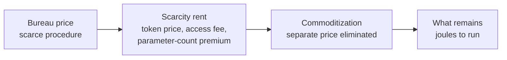

*Revisão db13599, 5 de novembro de 2026. Dados e código: [research.openie.dev/data/](/data/#economics). LaTeX PDF: [/pdfs/latex/spellcheck.pdf](/pdfs/latex/spellcheck.pdf) ([source](/pdfs/latex/spellcheck.tex)).*

## Resumo

A verificação ortográfica foi vendida por centenas de dólares entre 1981 e 1989 e agora é gratuita e incorporada nas ferramentas que as pessoas já utilizam. Este artigo documenta essa mudança a partir de fontes datadas e a explica com a economia de custo marginal e agrupamento [62, 63].

**Em palavras simples**

1. As pessoas costumavam pagar muito pela verificação ortográfica. Agora ela é gratuita em telefones, navegadores e processadores de texto.  
2. Tornou‑se gratuita porque verificar uma palavra custa quase nada para executar, e é mais útil dentro de uma ferramenta que o usuário já possui.  
3. O mesmo pode acontecer com outras habilidades computacionais quando elas são executadas de forma barata nos dispositivos que as pessoas já possuem, permitindo que bilhões de pessoas as utilizem.

## Notação

| Term | Significado neste artigo |
|---|---|
| Automation path | Um procedimento computacional deixa um bureau especializado e torna‑se uma rotina local em hardware que a pessoa já possui. |
| Existence proof | Uma instância concluída desse caminho. A verificação ortográfica é um exemplo. A palavra não é usada como figura de linguagem. |
| Local | A verificação é executada na máquina que contém o documento. A rotina enviada não requer aluguel de datacenter de fronteira. |
| Paired hardware | O editor, teclado ou telefone que a pessoa já usa para escrever. A capacidade não é uma segunda máquina. |
| Available | O hardware é comum, não um aluguel escasso. |
| Accessible | A pessoa pode invocar a capacidade naquele tecido sem enviar o trabalho a um bureau especializado. |
| Capable | O tecido pode executar o equipamento que finaliza o trabalho. |
| The many (7B+) | Mais de 7 bilhões de pessoas. O acesso global é destinado a essas pessoas. |
| The few | As pessoas que ainda podem ser alcançadas por um preço de escassez. Trata‑se de uma classe de preço, não de um número de indivíduos: apenas o chat de fronteira ultrapassou 800 milhões de usuários semanais em outubro de 2025 [61]. |
| Proposal | Uma sugestão de ortografia. O documento ainda não foi alterado. |
| Commit | A substituição é escrita no documento. |
| Completeness | O token é mantido: era conhecido, ou um candidato foi aceito. Busca adicional tem então valor zero de informação sobre esse predicado. |
| Money price | Uma cobrança que alguém pode faturar: preço do token, licença por assento, aluguel de escassez, taxa de acesso. A comoditização reduz a cobrança separada a zero. |
| Parameter count | Um tamanho de modelo. Não é uma métrica que sobrevive quando a capacidade se torna uma commodity. |
| Joule (J) | Unidade SI de energia. Aqui, a energia usada para executar a rotina. |
| Lookup, Formula, Model | Três tipos de mecanismo. Uma sondagem de dicionário é uma busca; um gerador de distância de edição é uma fórmula; um modelo de linguagem é um modelo. |

## 1. Introdução

A verificação ortográfica é uma capacidade que antes era adquirida como produto separado e agora é recebida dentro das ferramentas que já se possui. Este artigo acompanha essa mudança por meio de preços datados, dos artigos que construíram o procedimento, das bibliotecas que o distribuem e das máquinas que o executam, e questiona o que isso implica para a inteligência computacional em geral.

As pessoas pagavam um prêmio. Então a coisa não podia ser vendida. É gratuita, e está incluída em outra coisa. Os preços na Seção 2.11 são esse fato. Os nomes na Seção 2.9 vêm depois dele.

A fatura separada da calculadora é uma série datada, dos anúncios da Anita ao HP-35 e ao TI-2500 até o VisiCalc. A fatura separada da verificação ortográfica termina dentro do processador de texto e depois no sistema operacional. Os dólares que as fontes não imprimem permanecem não impressos.

Para a verificação ortográfica a tendência de preço está completa. A rotina está incluída no editor a preço zero. Os joules ainda são consumidos.

A escolha é o preço. A precificação por escassez retém uma capacidade e vende a retenção. Ela alcança as pessoas que podem pagar, as poucas. O acesso global é a outra escolha. A capacidade é construída para rodar na máquina que a pessoa já possui, e a cobrança separada termina. Isso alcança mais de 7 bilhões de pessoas.

A verificação ortográfica é essa segunda escolha, concluída. O trabalho consiste em decidir se um token escrito é uma palavra e, se não for, propor a palavra que o escritor pretendia. Kukich (1992) divide o trabalho em detecção de não‑palavras, correção de palavra isolada e correção dependente de contexto. As duas primeiras tornaram‑se ordinárias. Elas rodam dentro de programas que as pessoas já utilizam para escrever. São inteligência computacional, não uma história contada para falar de um sistema diferente.

A segunda escolha só se conclui quando a rotina é suficientemente barata para ser executada ao lado do documento, localmente na máquina que contém o arquivo, e emparelhada ao hardware que as pessoas já possuem. McIlroy (1982) expõe a restrição nas primeiras frases do artigo UNIX spelling‑list. O verificador pode ser usado em minicomputadores, portanto a lista precisa ser compacta. Isso é acesso global como engenharia. Um modelo de fronteira que responde apenas dentro de um datacenter alugado é precificação por escassez ainda em vigor. Ele pode ser capaz e ainda permanecer com os poucos que podem alugá‑lo.

A Seção 2.11 é o prêmio, datado. A Seção 2.10 indica quem possui uma máquina na qual a capacidade concluída pode ser executada e quem possui apenas um aluguel. Software escrito para a máquina que as pessoas já utilizam é como o acesso chega a muitos. Um preço que exige o aluguel é como a escassez mantém os poucos.

### Um token, ensinado em ordem

Norvig (2007) documenta um corretor local e a chamada `correction('speling')`, que devolve `spelling`. Percorra essa chamada como o exemplo de ensino do caminho. A prova de existência da produção é o Hunspell em editores comuns, declarada na Seção 2.5.

1. A cadeia já está na máquina. Nada é enviado a um bureau.
2. A consulta verifica se `speling` está nas contagens locais de palavras. Não está.
3. Uma fórmula gera cadeias a distância de edição um: uma deleção, uma transposição, uma substituição ou uma inserção. A palavra conhecida `spelling` está nesse conjunto.
4. A sugestão é uma proposta. O documento muda somente quando uma pessoa a aceita, ou quando uma política declarada a aceita. Isso é o commit.
5. Uma vez que `spelling` é mantido, candidatos adicionais não alteram o predicado "este token é a palavra que estamos mantendo". Isso é a parada.
6. Abrir um modelo de fronteira para este token não obtém um fechamento melhor. O mecanismo de consulta‑mais‑edição já o fechou. Recusar o gasto maior não é um desconto. É a melhor resposta para este trabalho.

O mesmo ensaio mostra o caso em que o token local não pode fechar. `correction('where')` permanece `where` quando um par de teste esperava `were`. A palavra única não carrega a decisão. Kukich (1992) nomeou isso como o terceiro problema, correção dependente de contexto. Um modelo maior pode ser o mecanismo correto aí. O caminho não está concluído para esse mecanismo até que o mecanismo seja executado no hardware que o escritor já possui, ou em um tecido central otimizado em recursos que a pessoa realmente possa usar. Um passe de fronteira alugado que o escritor não pode invocar continua sendo o bureau.

## 2. Trabalhos relacionados

### 2.1 Detecção e correção de palavras isoladas

Damerau (1964) apresenta um método para uma palavra que está ausente de um dicionário e possui no máximo um erro: uma letra errada, uma letra ausente, uma letra extra ou uma única transposição. A palavra não identificada é comparada novamente ao dicionário sob cada uma dessas suposições. O resumo relata identificações corretas para mais de 95 por cento desses tipos de erro no teste que ele realizou. Este artigo cita esse resultado como seu. Não repete o teste.

Peterson (1980) faz um levantamento de programas de computador que detectam e corrigem erros ortográficos. Até essa data, a capacidade já constituía uma literatura de programas funcionais, não uma proposta de que um programa poderia eventualmente verificar uma palavra.

Kukich (1992) organiza o campo nos três problemas nomeados acima. A detecção de não‑palavras usa uma lista de palavras, correspondência de padrões ou análise de n‑gramas. A correção de palavra isolada propõe uma palavra de dicionário para uma não‑palavra detectada. A correção dependente de contexto trata de um token que é uma palavra real, mas ainda assim a palavra errada. O levantamento é o mapa. A prova de existência neste artigo baseia‑se no Hunspell em produção: LibreOffice, Firefox, Chrome, distribuições Linux e macOS chamam uma rotina de dicionário local (Hunspell README). Os dois primeiros problemas de Kukich deixaram o levantamento e entraram nesses editores comuns. Norvig (2007) continua sendo o tutorial de ensino de Lookup seguido de uma edição curta, não o fato de produção.

### 2.2 A lista foi construída para se adequar à máquina

McIlroy (1982) descreve a lista de palavras por trás do verificador ortográfico UNIX. O resumo indica a restrição de engenharia e o resultado. O verificador pode ser usado em minicomputadores, de modo que a lista deve ser compacta. Remover prefixos e sufixos, aplicar hash e compressão reduz uma lista de 30 000 palavras em inglês para 26 000 palavras‑máquina de 16 bits. O verificador anterior de Johnson consultava palavras de um documento que já estava na máquina. A contribuição de McIlroy, para este artigo, é o emparelhamento: o dicionário foi comprimido porque o alvo era o minicomputador que as pessoas realmente utilizariam, e não uma máquina maior reservada para a tarefa.

Essas contagens de palavras são as contagens publicadas por ele.

### 2.3 Um canal ruidoso ainda é um programa local

Kernighan, Church e Gale (1990) classificam correções candidatas com um modelo de canal ruidoso: a probabilidade do candidato multiplicada pela probabilidade do erro tipográfico dado o candidato. O programa é um corretor ortográfico no sentido ordinário, um cálculo local sobre um dicionário e um modelo de erros. Uma pontuação melhor não constitui uma implantação diferente. O mecanismo pode tornar-se mais preciso e permanecer na máquina que armazena o texto.

### 2.4 Um corretor que cabe em uma página e não precisa de rede

Norvig (2007) redigiu a explicação a bordo de um avião, sem dados de erros ortográficos e sem conexão à internet. O modelo de linguagem é um arquivo local de aproximadamente um milhão de palavras, contabilizadas em 32.192 palavras distintas que aparecem 1.115.504 vezes. O modelo de erros é deliberadamente rudimentar: uma palavra conhecida a distância de edição 0 supera qualquer palavra a distância 1, que por sua vez supera qualquer palavra a distância 2. Após o voo, ele realizou a avaliação com conjuntos extraídos do corpus Birkbeck de Mitton. Ele reporta 75 por cento de 270 pares de desenvolvimento corretos, a 41 palavras por segundo, e 68 por cento de 400 pares de teste final corretos, a 35 palavras por segundo. Ele afirma ter atingido seus objetivos de brevidade e velocidade, mas não ter alcançado sua expectativa de 80 a 90 por cento de acurácia.

Esses números constituem a avaliação por ele reportada. A ferramenta não é um verificador industrial. Uma fatia útil da capacidade opera a partir de um arquivo na máquina à frente do programador, a dezenas de palavras por segundo, sem a presença de rede. Essa é a forma de um caminho de automação concluído. As falhas que ele enumera, especialmente palavras desconhecidas do dicionário e decisões que requerem tokens vizinhos, constituem o resíduo. São argumentos a favor de um mecanismo local mais aprimorado, não argumentos de que a tarefa deve retornar a um serviço centralizado.

### 2.5 A biblioteca dentro de editores comuns

O projeto Hunspell declara que o Hunspell é o verificador ortográfico e analisador morfológico utilizado pelo LibreOffice, por navegadores livres incluindo o Firefox e o Chrome, e por outras ferramentas e sistemas operacionais incluindo distribuições Linux e macOS (Hunspell README). A biblioteca lê um arquivo de dicionário local e um arquivo de afixos local. A ferramenta de linha de comando verifica um arquivo de texto local. O código descende do MySpell, a implementação de Kevin Hendricks no OpenOffice.org, ela própria uma reimplementação da verificação ortográfica por afixos do International Ispell de Geoff Kuenning. O Hunspell de László Németh adiciona suporte a Unicode e a morfologia necessária para línguas nas quais uma simples lista de palavras em inglês constitui o instrumento inadequado.

Esse README indica onde a biblioteca é utilizada. O fato que ela contribui é a classe de implantação. O verificador incorporado nesses programas é uma biblioteca local e uma lista de palavras local.

### 2.6 O telefone já na mão

`UITextChecker` é uma classe UIKit. O chamador passa uma string e um idioma. O método retorna o intervalo de uma palavra com erro ortográfico nessa string, ou informa que não encontrou nenhuma (Apple, UITextChecker). A verificação é uma chamada no dispositivo, contra um idioma que o sistema lista como disponível. Este artigo não afirma um valor em joules para essa chamada. A forma da API é o emparelhamento: o texto já está na visualização de texto, e o verificador é um método ao lado dela.

O framework de verificação ortográfica do Android também opera no dispositivo. Uma aplicação estende `SpellCheckerService`, implementa uma sessão e retorna sugestões para o texto fornecido à sessão (Android Developers, spell-checker framework; `SpellCheckerService`). O verificador do método de entrada latino é um serviço local com dicionários de localidade. Novamente, nenhum valor energético é extraído dessa documentação. A documentação situa a rotina no telefone.

Hard e colaboradores (2018) treinam um modelo de próxima palavra para o teclado telefônico Gboard por aprendizado federado. Os clientes calculam atualizações sobre texto que permanece no dispositivo. O servidor agrega essas atualizações e não recebe a digitação bruta. O mesmo artigo afirma que o Gboard fornece autocorreção além de predição de próxima palavra, e que o teclado tinha mais de 1 bilhão de instalações até 2019. Essa afirmação de instalações é a própria declaração de implantação do artigo. Não é uma contagem das mais de 7 bilhões de pessoas sobre as quais esta opinião versa.

O modelo que eles distribuem é pequeno por design. Após quantização, ocupa 1,4 megabytes, com um vocabulário de 10.000 palavras, sob uma restrição de produto que eles definem como uma resposta visível em aproximadamente 20 milissegundos e um tamanho de modelo de dezenas de megabytes. A participação no treinamento em seu estudo é mais restrita do que a base de instalações: dispositivos norte-americanos, com pelo menos 2 gigabytes de memória, em carregamento, ociosos e conectados a uma rede não tarifada. Este estudo cita a classe de implantação. Um teclado que as pessoas já utilizam carrega um pequeno modelo de linguagem no dispositivo, e o treinamento descrito ali não exporta o texto digitado. Ele não cita as tabelas de recuperação dos autores como um resultado de precisão ortográfica.

### 2.7 A loteria do hardware

Hooker (2020; 2021) denomina a loteria do hardware: uma ideia de investigação vence porque se adequa ao hardware e ao software disponíveis, e não porque é a melhor ideia em abstrato. A verificação ortográfica venceu uma loteria que valia a pena vencer. O hardware disponível era a máquina que armazenava o documento. O algoritmo que se adequou foi uma lista de palavras acrescida de um pequeno modelo de edição. Uma capacidade que se adequa apenas a um acelerador de fronteira, e que é comercializada exclusivamente como tempo de utilização nesse acelerador, participa de uma loteria diferente. O aviso de Hooker é que ideias que não se encaixam no hardware instalado estagnam, mesmo quando são boas. A consequência de conceção neste artigo é a leitura inversa do mesmo facto. Se o objetivo é a inteligência computacional para todos, a ideia tem de se adequar ao hardware que a maioria já possui, ou ao hardware que um tecido central otimizado em recursos pode estender a essa maioria. Adequar-se a um aluguer escasso é o modo pelo qual uma capacidade permanece restrita a poucos.

### 2.8 O que esta literatura não é solicitada a provar

Nenhuma das fontes de grafia acima constitui uma tabela populacional. Quando um número de grafia aparece na Secção 4, trata-se da contagem própria da fonte: palavras do dicionário, dimensão do conjunto de teste, palavras por segundo ou uma taxa de identificação publicada. A Secção 2.10 acrescenta uma classe distinta. Cada número de hardware corresponde à figura de expedição, assinantes, receita ou inquérito do editor, com o ano associado. Mais de 7 mil milhões de pessoas, e os poucos que podem pagar um preço de escassez, constituem as duas classes presentes na opinião. Não se trata de uma soma dessas linhas.

### 2.9 Como a automação computacional é precificada

Uma taxa citada permanece no artigo que a publicou. Nenhuma curva é ajustada aqui. Nenhuma inclinação, meia-vida ou ano de preço zero é declarado.

Em palavras simples, antes dos nomes. As pessoas costumavam pagar um prémio pelo corretor ortográfico e pelo cálculo ordinário. O corretor ortográfico como produto de camada base não pode mais ser vendido. É gratuito e está integrado no editor, no navegador e no telemóvel. O cálculo ordinário está integrado no telemóvel e no computador. Os nomes abaixo são apenas rótulos para essa sequência.

Três regimes nomeiam como uma ferramenta de automação computacional é precificada. A Secção 2.11 é a fita datada para a calculadora e para o corretor ortográfico. Cada preço é o preço de uma fonte. Nenhuma curva é ajustada através deles.

**Preço de bureau.** Enquanto o procedimento é escasso, o comprador paga a uma pessoa ou a uma máquina reservada. Nordhaus (2007) mede o preço monetário de longo prazo da computação em si, não do corretor ortográfico. Nesse artigo, o preço da computação começa em cerca de \$500 por milhão de computações por segundo para trabalho manual e cai para cerca de $6 \times 10^{-11}$ por milhão de computações por segundo em 2006, em preços de 2006, um declínio da ordem de 8,3 biliões. Esse valor é o quociente deste ensaio entre os dois pontos extremos que acabou de enunciar, \$500 / $6 \times 10^{-11}$. Os pontos extremos são os valores reportados por ele. Não são reajustados aqui, e o quociente não é uma previsão. Eles documentam que o preço monetário do substrato da automação caiu por ordens de magnitude. Uma queda nesse índice não é ainda a eliminação da fatura separada de um produto, e não é um medidor de joules.

**Preço de escassez, e a corrida que cria.** Assim que uma empresa pode distribuir o procedimento, pode cobrar mais do que custa executá-lo. Essa diferença é renda de escassez. Uma taxa de acesso e um preço por token são a mesma diferença em trajes diferentes. Uma contagem de parâmetros torna-se parte do traje quando os compradores são ensinados a pagar pelo tamanho. A renda é o que cria a corrida. Os rivais deslocam a renda ao integrar a capacidade num produto que o comprador já possui, ou substituem o produto por completo. Os preços de inferência publicados indicam que a corrida está em curso para os modelos de linguagem e não terminou. A Epoch AI (2025) reporta declínios de preço a desempenho fixo da ordem de 9 a 900 vezes por ano nos benchmarks dessa nota. Emberson e Roodman (2026) reportam cerca de 47 por cento de declínio por trimestre no custo de um dado desempenho desde aproximadamente 2023, o que resumem como cerca de 13 vezes por ano. Esses são os resumos que fazem das suas séries. O índice não é reestimado. Nenhuma linha é traçada através dos pontos. Nenhuma das taxas é uma lei além da sua janela temporal. O artigo Task Satiation utiliza a mesma queda citada como evidência do deslocamento de fosso ainda em curso; essa afirmação permanece nesse artigo.

**Eliminação de preços.** A comoditização é o fim da cobrança separada. A capacidade permanece. A linha da fatura, não. A verificação ortográfica é o exemplo concluído. O Hunspell é uma biblioteca gratuita de verificação ortográfica sob uma tripla licença (LGPL, GPL e MPL). O projeto declara que LibreOffice, Firefox, Chrome, distribuições Linux e macOS o utilizam, e que uma verificação lê um dicionário local (Hunspell README). O comprador desses editores não paga um preço unitário por uma palavra inválida, não paga uma taxa de acesso a um serviço de ortografia e não avalia uma contagem de parâmetros. O preço monetário do método, como bem separado, é zero. Isso é eliminação de preços. Não é uma afirmação de que o editor em si é gratuito, nem de que o telefone foi gratuito. É uma afirmação de que a correção ortográfica não é mais precificada como um bem próprio.

**A precificação por escassez pode migrar para a máquina.** O fim do preço separado do software não encerra todo preço de escassez. Uma plataforma pode colocar uma capacidade mais recente em um dispositivo mais recente e cobrar pelo dispositivo. Yusuf Mehdi, em 20 de maio de 2024, definiu um PC Copilot+ por uma unidade de processamento neural de 40 ou mais TOPS. A primeira onda utiliza Snapdragon, o modelo pequeno é executado nessa unidade e os modelos grandes permanecem no Azure. O relato da Apple de 9 de junho de 2025 coloca um modelo local de aproximadamente 3 bilhões de parâmetros no silicon da Apple e mantém o modelo maior no Private Cloud Compute. Esses são preços por um equipamento mais recente e pela máquina que o contém. Não são uma fatura reativada para verificação ortográfica. O verificador já é executado no editor, no navegador e no telefone que as pessoas possuem, incluindo a geração anterior ainda em uso. Uma atualização que exige que alguém compre uma nova classe de computador para receber uma verificação que a máquina antiga já realiza é precificação por escassez do hardware. Ela alcança as pessoas que adquirem essa classe. Apenas poucos podem pertencer a essa classe. Isso não desfaz o acesso já concluído para mais de 7 bilhões de pessoas.

A correção dependente de contexto não é esse caso concluído. Kukich (1992) o denominou como o terceiro problema: um token que é uma palavra real e ainda assim a palavra errada. Um modelo maior pode ser o equipamento adequado nesse caso. Na correção de erros gramaticais, modelos maiores e melhor treinados corrigem com mais eficácia: GECToR [71] e um modelo multilíngue de 11 bilhões de parâmetros [72] estabeleceram o estado da arte em seu tempo. A contrapartida é a energia: Luccioni, Jernite e Strubell medem tarefas generativas como muito mais intensivas em energia do que tarefas de classificação por inferência [73]. O caso de palavra isolada da Seção 4.10 é o caso em que o gasto adicional não produz um token diferente. O equipamento assume a escolha de acesso somente quando é executado em hardware que a pessoa já possui, ou em uma infraestrutura central otimizada em recursos que essa pessoa pode utilizar. Um aluguel escasso é a escolha de escassez, mesmo quando o modelo é mais preciso em um benchmark. A tarefa comum de palavra inválida não retorna a esse aluguel porque a tarefa de contexto está inacabada. Nenhuma tabela de joules comparando uma consulta a dicionário, um modelo local e uma chamada a datacenter é apresentada aqui. Nenhum desses joules foi medido para este artigo.

O que resta é a energia para executar a comparação. Uma consulta a dicionário local gasta joules no dispositivo que contém o documento. Nenhum joule é medido aqui. Nenhum total analítico é calculado. `measured_j` não está definido: nenhuma leitura de medidor foi realizada.

A previsão decorre dos regimes, não de uma regressão. As tarefas comuns de inteligência computacional seguem o verificador ortográfico. Os seus preços por token, os prémios por contagem de parâmetros, as rendas de escassez e as taxas de acesso são eliminados pela concorrência, por meio da integração em hardware que as pessoas já possuem e por métodos cujo preço de licença é zero. O estado final destina-se a mais de 7 mil milhões de pessoas, não aos poucos que podem pagar um preço de escassez. A previsão falha se uma tarefa comum, do tipo que o verificador ortográfico já resolve, mantiver um preço monetário separado e duradouro após uma rotina local de resultado equivalente estar nas mãos das pessoas que detêm o documento. Um benchmark de fronteira que ainda carrega um prémio não constitui essa falha. Trata-se da fase de fosso, que as notas da Epoch já mostram a tornar-se mais barata, e que o verificador ortográfico mostra como abandonar.

Os mesmos regimes estão representados na figura interativa [sc-anim-01](/living/spellcheck/#sc-anim-01). Dois pontos correspondem aos extremos reportados por Nordhaus. O conector tracejado une esses dois extremos. Nenhuma taxa é estimada. O intervalo de 9 a 900 da Epoch e o resumo de cerca de 13 vezes figuram num destaque. Permanecem como os seus resumos. O painel do verificador ortográfico é o regime concluído: o preço monetário separado desapareceu, e os joules permanecem não contabilizados.

Landauer (1961) estabelece um limite físico mínimo para o apagamento de um bit. Horowitz (2014) é a formulação prática em CMOS: o movimento de dados domina, muito acima desse limite ideal. Uma consulta a um dicionário move bits. A comoditização pode zerar a fatura e ainda assim deixar esse movimento intacto. Nenhum total de joules para o verificador ortográfico é calculado a partir de qualquer uma dessas citações.

**Integração como estratégia.** A literatura sobre integração lê a mesma história tanto como estratégia quanto como acesso. Adams e Yellen mostram que um pacote integrado é um instrumento de discriminação de preços [68]. Nalebuff mostra que um pacote integrado pode bloquear a entrada de um concorrente que vende um único bem [69]. Spolsky nomeou a tática para o software: comoditize o seu complemento, de modo que o produto que vende valha mais [70]. Cada leitura concorda quanto ao observável que este ensaio utiliza: o preço separado da camada integrada tende a zero. Diferem quanto a quem retém a renda. Essa diferença é a razão pela qual este ensaio acompanha quem detém a plataforma, bem como o preço.

### 2.10 Acesso ao hardware, categoria por categoria

**Telefones e gerações de SoC móvel.** A GSMA, em *The Mobile Economy 2025*, contabiliza 5,8 bilhões de assinantes móveis únicos ao final de 2024, uma taxa de penetração de 71 por cento, e 4,7 bilhões de usuários de internet móvel. O *Worldwide Quarterly Mobile Phone Tracker* preliminar da IDC, de 13 de janeiro de 2026, contabiliza 1.260,3 milhões de smartphones enviados em 2025, dos quais a Apple enviou 247,8 milhões. A publicação da IDC de 13 de janeiro de 2025 contabilizou 1.238,8 milhões de smartphones em 2024. A tabela de 2026 reapresenta 2024 como 1.236,3 milhões. Cada publicação mantém seu próprio total. O relatório anual da Arm referente ao ano encerrado em 31 de março de 2025 declara que CPUs baseadas em Arm estavam em mais de 99 por cento dos smartphones vendidos no mundo naquele ano fiscal, e que os clientes haviam enviado cumulativamente mais de 310 bilhões de chips baseados em Arm, dos menores sensores aos supercomputadores. O valor cumulativo abrange todos os mercados da Arm. Não se trata de uma contagem de telefones, e o relatório não o divide por gerações de SoC.

O aparelho de 2025 representa uma geração atual de SoC móvel: Apple silicon, Qualcomm Snapdragon, MediaTek, Samsung, Google Tensor. A IDC contabiliza aparelhos por marca. A contagem de assinantes refere-se a pessoas com uma assinatura móvel, não a uma contagem de SoCs.

A pilha de software nesse aparelho já inclui um verificador local. `UITextChecker` e `SpellCheckerService` do Android constituem o caso da verificação ortográfica. Um modelo no mesmo aparelho utiliza Apple Core ML e o framework Foundation Models, Android LiteRT e NNAPI, o compilador QNN da Qualcomm, ExecuTorch ou llama.cpp. O relato da Apple de 9 de junho de 2025, alinhado ao relatório técnico de 17 de julho de 2025, descreve um modelo de fundação em dispositivo de aproximadamente 3 bilhões de parâmetros, comprimido a 2 bits por peso, e um modelo servidor de mistura de especialistas executado no Private Cloud Compute. O relatório LFM2 da Liquid AI projeta modelos densos de 350 milhões a 2,6 bilhões de parâmetros, e um modelo de mistura de especialistas de 8,3 bilhões com 1,5 bilhão ativos, para ExecuTorch, llama.cpp e vLLM, e os cronometra em um Samsung Galaxy S25 com Snapdragon 8 Elite. A PrismML declara que seu Ternary Bonsai 2 27B, que afirma ser construído sobre o Qwen3.8 27B, retém 98,2 por cento do desempenho da contraparte em precisão completa com uma pegada 9 vezes menor, de 5,9 GB. Essas proporções são da PrismML. Este artigo não as remede.

Hooker nomeia a loteria. Esta seção nomeia as máquinas. O argumento consiste em sete registros. Um envio de telefones não é um envio de datacenter. Uma pesquisa do Steam não é um censo de PCs. Uma linha de receita não é uma contagem de unidades. Quando uma empresa não divulga unidades, o artigo o declara e cita o valor que a empresa divulgou. Nenhum desses valores é uma contagem dos muitos ou dos poucos. Não são a soma das linhas. As figuras dinâmicas [sc-hw-01](/living/spellcheck/#sc-hw-01) e [sc-gen-01](/living/spellcheck/#sc-gen-01) constituem os mesmos registros.

Para cada categoria, as perguntas são as mesmas. Quem possui a máquina, segundo a própria contagem da fonte. Qual pilha de software essa máquina executa. Como essa pilha se compara à melhor pilha de fronteira. A afirmação de projeto resume-se a uma frase: o software escrito para a geração globalmente acessível tem o maior impacto. A geração acessível é aquela disponível. A verificação ortográfica é o exemplo acabado de automação dessa frase. McIlroy dimensionou a lista para o minicomputador em serviço. A energia para execução é a métrica que permanece. Essas linhas indicam quem possui a máquina. Não são joules.

A interface com a pilha de fronteira é um modelo menor, um modelo de baixa precisão em bits, ou uma chamada a um servidor operado pelo fornecedor. A Apple declara essa divisão em um relatório. Uma execução de treinamento de fronteira não é implantada no telefone. A afirmação de projeto para esta linha: o software escrito para a geração de SoC já em circulação, e para os aparelhos ainda em uso de anos anteriores, tem o maior impacto. O corretor ortográfico é esse software.

**PCs e laptops.** O relatório da IDC de 9 de janeiro de 2025 contabiliza 262,7 milhões de PCs tradicionais embarcados em 2024. O relatório preliminar da IDC de 12 de janeiro de 2026 contabiliza 284,7 milhões em 2025. A tabela de 2026 reapresenta 2024 como 263,3 milhões. Na teleconferência de resultados de 28 de janeiro de 2026, Satya Nadella afirmou que o Windows havia alcançado 1 bilhão de usuários do Windows 11, um crescimento superior a 45 por cento em relação ao ano anterior. Um ano de embarques não equivale a essa base instalada.

A pilha é o sistema operacional, o navegador e uma biblioteca local. O Hunspell é o componente de ortografia nos editores comuns. Um modelo no mesmo PC utiliza ONNX Runtime, DirectML, Windows ML, llama.cpp ou ExecuTorch na CPU e na GPU integrada. Uma GPU discreta é a categoria seguinte. A Liquid AI mede a mesma família LFM2 em um AMD Ryzen AI 9 HX 370 com llama.cpp em Q4_0. Trata-se de uma medição em CPU de laptop no relatório deles, não de uma medição em datacenter.

A interface com a pilha de fronteira é uma chamada de API, ou um modelo que caiba na memória da máquina. Os dois são programas distintos. O primeiro é um aluguel. O segundo é o caminho. A afirmação de projeto para esta linha: o software para a geração de PCs que as pessoas já utilizam tem o maior impacto. O corretor ortográfico seguiu esse caminho. Um peso que pressupõe um acelerador alugado não o fez.

**GPUs de consumo.** O relatório fiscal de 2026 da NVIDIA, referente ao ano encerrado em 25 de janeiro de 2026, reporta receita de Gaming de 16,0 bilhões de dólares. Trata-se de receita. Não é uma contagem de unidades. A Jon Peddie Research, em 5 de março de 2026, reporta 11,48 milhões de placas de expansão gráfica para PC embarcadas no quarto trimestre de 2025, um crescimento de 36,0 por cento em relação ao mesmo período do ano anterior, com uma taxa de adoção em desktops de 55 por cento naquele trimestre. A mesma nota indica que as placas GPU para datacenters cresceram 17,0 por cento em relação ao trimestre anterior e não publica a contagem de unidades correspondente. Uma "base instalada" de 172 milhões mencionada nessa nota é um ponto final de previsão. Este artigo não a utiliza como um censo atual.

A Pesquisa de Hardware e Software Steam da Valve referente a setembro de 2026 reporta, entre os clientes que responderam, NVIDIA GeForce RTX 5070 com 6,15 por cento, RTX 5090 com 0,40 por cento, RTX 4060 com 3,89 por cento, RTX 3060 com 3,66 por cento e GTX 1650 com 2,19 por cento. A pesquisa abrange participantes da Steam. Não representa o mundo. Este artigo não soma essas participações em um total por geração. A lista é parcial, e a pesquisa possui uma categoria "Outros".

A pilha é CUDA na NVIDIA, e ROCm ou Vulkan na AMD. O llama.cpp executa um modelo quantizado na placa. O vLLM serve um modelo quando a placa comporta os pesos. A interface com a pilha de fronteira é a quantização, um modelo menor ou uma API. Uma placa de consumo executa o modelo que nela cabe. O sistema de treinamento de fronteira não cabe. A afirmação de projeto para esta linha: o software voltado para o modelo topo de linha mira 0,40 por cento de uma pesquisa entre jogadores. O software voltado para as placas que as pessoas ainda reportam, incluindo componentes das séries 30 e 40, cobre a geração instalada. Esse é o maior impacto.

**Aceleradores para centros de dados.** O relatório do mesmo exercício fiscal de 2026 da NVIDIA reporta receita do segmento Data Center de 193,7 mil milhões de dólares no ano, um crescimento de 68 por cento, e 62,3 mil milhões de dólares no quarto trimestre. O relatório não divulga o número de unidades expedidas de Hopper, Blackwell ou Rubin. Descreve uma parceria plurianual com a Meta que inclui milhões de GPUs Blackwell e Rubin. Essa frase constitui o relato da NVIDIA sobre um plano de implantação. Não é uma contagem auditada de placas em racks. Em 28 de outubro de 2025, na GTC em Washington, Jensen Huang afirmou que 6 milhões de GPUs Blackwell tinham sido expedidas nos últimos quatro trimestres. A CNBC noticiou essa declaração no mesmo dia. O relatório do exercício fiscal de 2026 continua sem divulgar o número de unidades expedidas. O valor de 6 milhões é uma declaração de Huang. Não constitui uma linha de unidades auditada. O mesmo relatório cita uma expectativa de 500 mil milhões de dólares em vendas de GPUs entre Blackwell e Rubin. Trata-se de uma expectativa de vendas. Este artigo não a converte em uma contagem de unidades.

O relatório da AMD de 3 de fevereiro de 2026 reporta receita do segmento Data Center de 16,6 mil milhões de dólares para o ano civil de 2025, um crescimento de 32 por cento, e indica que esse crescimento reflete tanto as CPUs EPYC quanto as GPUs Instinct. O Instinct não constitui uma linha de receita separada, com exceção de um segmento divulgado: a receita do Instinct MI308 para a China no quarto trimestre, de aproximadamente 390 milhões de dólares. Nenhuma contagem de unidades Instinct consta do relatório.

Na conferência de 28 de janeiro de 2026, Nadella afirmou que a frota da Microsoft inclui aceleradores da NVIDIA, da AMD e o acelerador próprio da Microsoft, o Maya 200, que a empresa havia colocado em operação. Amy Hood declarou que o investimento em capital naquele trimestre foi de 37,5 mil milhões de dólares, com aproximadamente dois terços destinados a ativos de vida útil curta, principalmente GPUs e CPUs, e que a procura superava a oferta. Nenhuma contagem de unidades Maya consta da transcrição. Os volumes de expedição de unidades das TPUs da Google e do Trainium da Amazon não constam das fontes consultadas para esta secção. São mencionados para que a categoria não se reduza a um único fornecedor. A contagem de unidades em falta é o registo relevante.

Quem a detém: os compradores que contratam essa receita. Hood afirmou que grande parte do capital em GPUs já se encontra contratado pelo período de vida útil do hardware. Trata-se de um mercado de arrendamento. A pilha sobre o acelerador é composta por CUDA, ROCm e as pilhas de serviço que pressupõem a placa, incluindo TensorRT-LLM e vLLM. Esta categoria constitui a pilha de fronteira. A interface de todos os demais com ela é uma API, um modelo destilado ou um modelo quantizado. A afirmação de conceção para esta linha: o software que requer o acelerador chega aos arrendatários. O software escrito para as gerações das outras linhas chega às pessoas que detêm essas máquinas. A verificação ortográfica realizou a segunda. A primeira é a etapa do bureau.

**MCUs, componentes diminutos e componentes embarcados.** O valor acumulado da Arm de mais de 310 mil milhões de chips inclui sensores e dispositivos embarcados. O relatório anual não desagrega esse valor acumulado em microcontroladores. A IC Insights, em 29 de março de 2022, indica que as entregas de 2021 atingiram 30,9 mil milhões de microcontroladores, após um crescimento unitário de 12 por cento nesse ano. Trata-se de uma expedição referente a 2021. A mesma nota prevê 35,8 mil milhões de unidades em 2026. A previsão não constitui uma contagem atual.

MLCommons, 17 de setembro de 2025, publicou o MLPerf Tiny v1.3. O conjunto mede redes neurais tipicamente inferiores a 100 kilobytes. A versão contém 70 resultados distribuídos por cinco testes, incluindo 27 resultados de consumo energético, provenientes de Kai Jiang, Qualcomm, STMicroelectronics e Syntiant. Cinco plataformas de hardware foram avaliadas pela primeira vez. Os testes abrangem classificação de imagens, palavras de ativação visual, deteção de palavras-chave, deteção de anomalias e uma tarefa de palavra de ativação em fluxo contínuo.

A pilha é composta por TensorFlow Lite for Microcontrollers, CMSIS-NN e os runtimes de fornecedores utilizados pelas respetivas submissões. O modelo tem dimensão em kilobytes. Um modelo de linguagem de fronteira não carrega. A interface com a pilha de fronteira é um modelo de tarefa compilado para o componente: uma palavra de ativação, uma pontuação de sensor, um kernel. A afirmação de conceção para esta linha: o software desta geração é o software que cabe no componente. O volume acumulado de expedições da Arm é a maior cifra de silício nesta secção, e não se trata de um datacenter. O impacto acompanha o componente que é expedido.

**Aceleradores de borda e NPUs em dispositivos comercializados.** Yusuf Mehdi, 20 de maio de 2024, definiu um PC Copilot+ por uma unidade de processamento neural de 40+ TOPS. A primeira vaga utiliza Snapdragon X Elite e Snapdragon X Plus, que, segundo essa publicação, entregam 45 NPU TOPS. As experiências no dispositivo estão especificadas para correr nesse NPU com modelos de linguagem pequenos, enquanto os modelos de grande dimensão permanecem disponíveis através do Azure. A Gartner, conforme reportado pela Computerworld em 28 de agosto de 2025 a partir da divulgação da Gartner na mesma data, previu 77,8 milhões de PCs com IA em 2025, correspondendo a 31 por cento do mercado global de PCs. Trata-se de uma previsão publicada antes do encerramento do ano. Não é o total concluído de PCs da IDC, nem uma contagem exclusiva de PCs Copilot+. A Canalys, atualmente parte da Omdia, em dados datados de 25 de fevereiro de 2025 e reportados em 7 de março de 2025, contabiliza 15,4 milhões de PCs com capacidade de IA expedidos no quarto trimestre de 2024, representando 23 por cento das expedições de PCs nesse trimestre. Para o ano completo de 2024, a mesma nota indica que 17 por cento dos PCs expedidos tinham capacidade de IA, não publicando o total de unidades do ano. A sua definição é um computador de secretária ou portátil com um chipset ou bloco dedicado a cargas de trabalho de IA no dispositivo. Os exemplos que nomeia são AMD XDNA, Neural Engine da Apple, Intel AI Boost e Qualcomm Hexagon. Os 15,4 milhões correspondem a um trimestre encerrado. Os 77,8 milhões da Gartner permanecem uma previsão.

O modelo no dispositivo da Apple, de cerca de 3 mil milhões de parâmetros, é compilado para silício Apple, que inclui o Neural Engine. A Apple não publica uma expedição separada do Neural Engine. A base de dispositivos ativos é a cifra anterior da Apple, não um censo de NPUs.

A pilha é composta por Qualcomm QNN, Windows Copilot Runtime, Apple Core ML e o framework Foundation Models, AMD Ryzen AI software, a pilha NPU da Intel e ONNX. Cada um compila um grafo para o seu NPU. Um peso CUDA não é um programa NPU até que um compilador o aceite. A interface com a pilha de fronteira é a que a Microsoft declara e a que a Apple declara: o modelo pequeno no dispositivo, o modelo de grande dimensão num servidor operado pelo fornecedor. A afirmação de conceção para esta linha: o NPU integrado num telemóvel ou PC comum é a geração acessível. O software escrito para esse NPU, no compilador do fornecedor, tem o alcance. Um kernel que pressupõe uma GPU de datacenter não corre aí.

**Gerações anteriores ainda em uso.** A geração mais recente é uma expedição. A geração instalada é aquela que as pessoas ainda utilizam. Os dois são números distintos, e várias empresas não publicam o segundo.

Telefones: 1.260,3 milhões de smartphones enviados em 2025, contra 5,8 bilhões de assinantes móveis únicos no final de 2024. Assinantes não são aparelhos. O facto de escala mantém-se sem essa conversão. Um ano de envios de aparelhos não é a base de assinantes. Os aparelhos anteriores permanecem em uso. Este artigo não converte a diferença numa quota geracional.

A Apple, na conferência de resultados de 30 de janeiro de 2025, declarou uma base instalada de mais de 2,35 bilhões de dispositivos ativos em todas as categorias de produtos. O comunicado de 30 de outubro de 2025 afirmou que a base instalada havia atingido um novo máximo histórico e não publicou uma contagem de substituições. Os envios de iPhone no calendário de 2025, de 247,8 milhões de unidades, correspondem a um produto num único ano. Não constituem a base ativa.

PCs: 1 bilhão de utilizadores do Windows 11 em 28 de janeiro de 2026, contra 284,7 milhões de PCs enviados no calendário de 2025. A nota da IDC de 12 de janeiro de 2026 e as observações de Hood na conferência de janeiro apontam ambas o fim do suporte ao Windows 10 como razão para o movimento da procura de PCs em 2025. A geração anterior do sistema operativo era suficientemente grande para impulsionar uma renovação. A sua contagem remanescente não consta da transcrição. Este artigo não fornece nenhuma.

GPUs de consumo: o inquérito Steam de setembro de 2026, citado acima. RTX 5090 em 0,40 por cento. RTX 3060 em 3,66 por cento. RTX 4060 em 3,89 por cento. GTX 1650 em 2,19 por cento. O mais recente modelo topo de gama não é a placa que o inquérito regista com maior frequência.

Aceleradores para centros de dados: o comunicado fiscal de 2026 da NVIDIA compara Blackwell com Hopper e não fornece a contagem instalada de placas Hopper ainda em serviço. Nadella afirmou que o software continua a executar os modelos atuais na frota envelhecida. Essa é a forma, no contexto dos centros de dados, do mesmo facto, e a frota continua a ser um ativo de aluguer. Nenhuma contagem de unidades da base instalada é inventada aqui.

A afirmação de conceção, para esta linha e para as seis anteriores: o software escrito para a geração globalmente acessível tem o maior impacto. A geração acessível é aquela que está em mãos, e as fontes acima demonstram que não é o mesmo objeto que o mais recente chip. O corretor ortográfico foi escrito para o minicomputador em serviço, depois para o editor de texto, depois para o telefone. Uma vez eliminado o preço monetário separado, o que resta é a energia necessária para executar. Um chip mais recente não substitui essa métrica por uma licença.

As teses de processamento no dispositivo alinham-se com essa afirmação, e não substituem o registo de envios. Hooker (2020; 2021) afirma que uma ideia vence ao adaptar-se ao hardware existente. O relatório da Apple ajusta um modelo de aproximadamente 3 bilhões de parâmetros ao Apple silicon e mantém o modelo maior no Private Cloud Compute. O relatório LFM2 da Liquid AI pesquisa arquiteturas sob latência medida e memória numa CPU de telefone e numa CPU de portátil, e disponibiliza os pesos para esses ambientes de execução. A afirmação pública da PrismML é que um modelo ternário é o artefacto que se adapta a um dispositivo local, nas proporções que a empresa declara. O corretor ortográfico permanece o exemplo acabado. A sondagem ao dicionário não necessitou de nenhum destes modelos. Necessitou da máquina que já continha o texto.

### 2.11 Preços datados e por quanto tempo cada um é conhecido por ter durado

**HP-35.** Três fontes concordam quanto ao preço de introdução e divergem quanto ao calendário das reduções.

Os regimes da Secção 2.9 são designações. Esta secção é o registo de preços. Cada linha corresponde a um preço publicado por uma fonte, à data que essa fonte indica e ao que essa fonte afirma sobre a duração do preço. Quando a fonte é um único anúncio, a duração é o intervalo até ao anúncio seguinte que a compilação publica. Esse intervalo não constitui uma auditoria contínua de preços. Quando duas fontes divergem, ambas são registadas. Quando um preço não consta da página, não é preenchido. A tabela actualizada é [sc-price-01](/living/spellcheck/#sc-price-01).

**Calculadoras de secretária, Sumlock Comptometer e Anita.** O índice de anúncios em anita-calculators.info é uma compilação de anúncios datados. Não se trata de uma lista de preços mantida pela empresa.

Outono de 1949. Um anúncio da máquina de somar Plus nesse índice indica "Now Plus for only \$100." O índice não regista por quanto tempo esse preço vigorou.

Outubro de 1961. A Anita Mk 8 foi lançada na Business Efficiency Exhibition em Londres. A Office Magazine, de Dezembro de 1961, páginas 1244-1245, reproduzida no mesmo sítio, indica o preço de £335 e refere que as encomendas seriam aceites a partir de 1 de Janeiro de 1962. A recensão indica que a máquina ainda não estava disponível no mercado em geral.

Maio de 1963. Um anúncio no índice fixa o preço da Anita Mk 8 em £355 e o da Comptometer 993s em £265. O índice não regista qualquer preço da Mk 8 entre a recensão de Dezembro de 1961 e este anúncio. O intervalo é o silêncio entre essas duas datas, não um certificado de que £335 se manteve.

Janeiro de 1964. O índice fixa o preço da Mk 8 em £365. Fevereiro de 1964. A série Comptometer 993 é cotada como uma gama, de £160 a £330.

Janeiro de 1965. O índice fixa o preço da Mk 8 em £335 e o da Mk 9 em £425. O preço anunciado da Mk 8 é £335 na recensão de Dezembro de 1961, £355 em Maio de 1963, £365 em Janeiro de 1964 e £335 em Janeiro de 1965. Cada valor corresponde a um único anúncio ou a uma única recensão. Nenhum deles afirma que o preço se manteve constante entre as datas.

Novembro de 1965. O índice fixa o preço da Mk 9 em £425 e indica que mais de 16.000 Anitas estavam em uso, e que a Anita foi introduzida em Janeiro de 1962. Do anúncio de Janeiro de 1965 a este, o preço da Mk 9 no índice permanece inalterado em £425. Trata-se de duas observações. Não constitui uma auditoria mensal.

Julho de 1966. O índice fixa o preço da Mk 10 em £460.

Junho de 1968. "Focus on ANITA," um anúncio na Office Methods and Machines, Junho de 1968, página 41, é citado pelas páginas de modelo em anita-calculators.info. Essas páginas transcrevem três valores a partir dele. Mk 10: £480. A página da Mk 10 cita o anúncio: "Price £480." Mk 11: £298. Mk 12: £480. O índice ainda não publica os valores. O valor da Mk 9 não consta da página da Mk 9. Essa página fixa o preço de introdução de 1964 em £425, citando "BEE '64," Industrial Electronics, Novembro de 1964, página 521. Esse valor de £425 é o preço de introdução. Não é uma transcrição da linha de Junho de 1968. O valor da Mk 9 em Junho de 1968 não consta das fontes consultadas para este artigo. Julho de 1966 havia fixado o preço da Mk 10 em £460. Junho de 1968 fixa-o em £480. Trata-se de dois anúncios. Os meses entre eles não constituem uma auditoria.

Abril de 1969 e Maio de 1969. O índice fixa o preço da Anita 1000 em £285 em ambos os meses. Julho de 1969. A Anita 1010 é £320. Fevereiro de 1971. A Anita 1000LSI é £192 e a 1010LSI é £250. Estes são modelos posteriores. Um preço mais baixo num modelo posterior não constitui uma redução no preço da Mk 8.

Computer History Museum, "This Day in History," 4 de janeiro de 1972: a Hewlett-Packard apresentou a HP-35, vendida por \$395.

Datamath Calculator Museum, página da HP-35: anunciada em 4 de janeiro de 1972, disponível em fevereiro de 1972, MSRP de \$395 em janeiro de 1972, MSRP de \$295 em janeiro de 1974. A mesma página indica que no início de 1975 o preço caiu para \$195 e a calculadora foi descontinuada logo após a HP-21. A página também indica o preço da HP-65, apresentada em 19 de janeiro de 1974, como \$795. Não consta nenhuma redução em maio de 1973 e não consta o valor de \$225.

Craig Finseth, arquivo hpdata para a HP-35A: preço de introdução \$395. A data de introdução nesse arquivo é 1 de julho de 1972, extraída de um "wall of fame," com uma possível data de 1 de fevereiro de 1972. Descontinuação em 1 de fevereiro de 1975 ao preço de \$195. As linhas de variação de preço no arquivo são: 1 de maio de 1973 a \$295, 1 de maio de 1974 a \$225 e 1 de fevereiro de 1975 a \$195. Uma nota no mesmo arquivo indica que o preço passou a \$295 quando a HP-45A foi introduzida. O Datamath data a HP-45 em maio de 1973, que é o mês utilizado por Finseth para o valor de \$295, enquanto a própria linha de MSRP do Datamath ainda apresenta \$295 como um valor referente a janeiro de 1974.

Expressos como durações, e apenas dentro de cada fonte. A lista de Finseth, se tomada como o cronograma desse arquivo: \$395 desde a data de introdução constante no arquivo até 1 de maio de 1973; \$295 de 1 de maio de 1973 até 1 de maio de 1974; \$225 de 1 de maio de 1974 até 1 de fevereiro de 1975; \$195 na data de descontinuação. A própria data de introdução nesse arquivo é marcada como incerta. A lista do Datamath: \$395 como MSRP de janeiro de 1972 e \$295 como MSRP de janeiro de 1974. A página não afirma que o preço se manteve em \$395 em todos os meses intermediários. \$195 corresponde a "início do ano de 1975," sem indicação de dia. Os meses entre o valor de janeiro de 1974 e esse valor de 1975 não são detalhados.

**TI-2500 Datamath.** Datamath Calculator Museum, página da TI-2500 Versão 1: anunciada em abril de 1972 a um preço de varejo sugerido de \$149,95. Os primeiros clientes receberam as calculadoras em junho de 1972 na Neiman-Marcus e na Sanger-Harris em Dallas. Introdução formal em 21 de setembro de 1972. O preço de varejo sugerido havia sido reduzido para \$119,95 até a data dessa introdução. A página não indica o dia da redução. O intervalo documentado para \$149,95 nesta fonte vai do anúncio de abril até 21 de setembro de 1972. Reduções posteriores após \$119,95 não constam nesta página. A mesma página menciona a Bowmar 901B, introduzida em setembro de 1971, sem indicar preço. A página da HP-35 no Datamath menciona a HP 9100A de 1968, também sem indicar preço. Os preços constam em outras páginas, lidas a seguir.

**HP 9100A.** O exemplar digitalizado do folheto de 1968 pelo Computer History Museum, coleção 102646164, imprime "Priced at \$4900" e "hp 9100A Calculator, Price: \$4900." O HP Memory Project indica o mesmo valor de \$4900 como preço na página 130 do catálogo de 1969 e afirma que o modelo foi introduzido no Hewlett-Packard Journal de setembro de 1968. O folheto não indica por quanto tempo \$4900 vigorou. Um preço posterior não é extraído de uma página que este artigo não consultou.

**Bowmar 901B.** Datamath Calculator Museum, página da Bowmar 901B: data de introdução setembro de 1971, preço novo \$240. A página indica um preço de varejo sugerido de \$240,00 para a 901B lançada na TMS0103. A duração do preço de \$240 não consta na página.

**A calculadora como software.** Wikipedia, VisiCalc, conforme a página consultada para este artigo. A Personal Software começou a vender o VisiCalc em meados de 1979 por menos de US\$100. O mesmo artigo cita uma apresentação formal programada para a National Computer Conference, de 4 a 7 de junho de 1979. Cita também Peter Jennings: a primeira cópia para Apple II, versão 1.37, foi distribuída em 17 de outubro de 1979. Ambas as datas constam do artigo. Este artigo não as colapsa.

O artigo afirma que até 1982 o preço havia subido de \$100 para \$250, citando a Softline de março de 1982. Não indica o mês do aumento. O valor de \$100 e o valor de \$250 são dois registros datados. A duração de cada preço entre esses registros não consta do artigo. Uma frase separada no artigo denomina-o o VisiCalc de \$100 em contraste com um Apple II de \$2.000. Esse valor de \$2.000 refere-se à máquina, conforme relatos posteriores no artigo, e não a um segundo preço de software.

O mesmo artigo afirma que linguagens de modelagem financeira em sistemas de tempo compartilhado custavam \$20.000, citando um caso pedagógico da UCLA. Trata-se de um preço de bureau para uma classe de produto distinta, e não da fatura do VisiCalc.

Dados de vendas no artigo, mantidos conforme o artigo os apresenta: mais de 39.000 cópias em janeiro de 1983, ainda o produto de software mais vendido; 5.700 cópias em dezembro de 1983. A Lotus Development adquiriu a Software Arts e encerrou as vendas. O texto introdutório data esse encerramento em 1985. Um item da InfoWorld citado está datado de 2 de junho de 1986 e intitulado como VisiCalc descontinuado. Ambas as datas são mantidas.

DOS Days, página do Lotus 1-2-3: o programa foi lançado em janeiro de 1983. A página não indica o preço de janeiro de 1983. Gregg Williams, Byte, dezembro de 1982, páginas 182-198, avaliou uma cópia de pré-lançamento. A resenha, conforme reproduzida, afirma que a Lotus havia fixado o preço do 1-2-3 em \$495, e que o programa estaria disponível para o IBM Personal Computer em algum momento do mês seguinte. Esse valor de \$495 é o preço fixado antes da venda comercial, publicado em dezembro de 1982. Não se trata de um recibo datado de 26 de janeiro de 1983. O DOS Days ainda assim não apresenta um preço próprio para janeiro. Afirma que o Release 2.2 e o Release 3 custavam o mesmo valor, \$495, idêntico ao do Microsoft Excel 2.1 e do Borland Quattro Pro no momento dessa comparação. Por quanto tempo \$495 já vigorava, e se o preço de 1983 era \$495, não constam dessa página. O Release 4 para DOS, de maio de 1994, adicionou um verificador ortográfico. Trata-se de uma data de funcionalidade, e não de um preço.

**O verificador ortográfico como produto e, posteriormente, como uma linha que desapareceu.**

Wikipedia, "Spell checker," conforme consultada para este artigo. Em 1961, o projeto de Les Earnest utilizava uma lista de 10.000 palavras aceitáveis. Fevereiro de 1971: Ralph Gorin escreveu o SPELL para o DEC PDP-10 no Laboratório de Inteligência Artificial de Stanford, em linguagem de montagem, e o tornou publicamente acessível. O artigo não indica preço. Um programa de laboratório não constitui uma tabela de preços para o varejo.

Os primeiros verificadores para computadores pessoais surgiram em 1980. O WordCheck para sistemas Commodore foi lançado no final de 1980, a tempo de um anúncio na Compute!, janeiro de 1981, número 8, página 119. Essa página foi consultada. O anúncio é da Micro Computer Industries, Ltd. O texto do WordCheck informa que o programa está disponível para máquinas CBM e PET 32K com unidades de disco duplas, e acrescenta: "List price is only \$200.00." A mesma página também precifica o Create-A-Base e um programa de inventário em \$200.00. O valor do WordCheck é a frase associada à linha de disco duplo. O artigo da Wikipedia não o cita. Este artigo o faz.

O artigo afirma que o mercado para pacotes independentes foi efêmero e que, em meados da década de 1980, o WordStar e o WordPerfect já haviam incorporado verificadores ortográficos. "Efêmero" e "em meados da década de 1980" são os próprios limites estabelecidos pelo artigo. Não constituem um par de datas de fatura. Nenhum preço avulso em dólares consta do artigo.

O Spellbound, da Sector Software, de 1987, e o Microsoft Word a partir do Word 95 são os exemplos de verificação interativa apresentados pelo artigo. O artigo não fornece preço para nenhum dos dois. A citação relativa à cláusula do Word 95 é Raymond Chen, The Old New Thing, 22 de junho de 2026. O Word 95 é o produto de 1995. O preço separado do seu verificador não é indicado porque o verificador estava integrado ao processador de texto.

Edward Mendelson, "A Chronology of Versions," WPDOS. Março de 1980: SSI\*WP para minicomputadores Data General, US\$5.500 por cópia. A cronologia não afirma que essa cópia incluía um verificador ortográfico. Esse valor de US\$5.500 refere-se ao processador de texto. Sua duração não é indicada.

26 de novembro de 1982: WordPerfect 2.20 para o IBM PC. Nenhum preço consta da cronologia. O DOS Days afirma que essa versão incluía um dicionário de 30.000 palavras. A página não nomeia um comando de verificação ortográfica para a versão 2.20. Outubro de 1983: WordPerfect 3.0 para DOS. A lista de comandos de Mendelson para essa versão atribui Alt-F5, quando nenhum texto está selecionado, à função Spellcheck. Um comando de verificação ortográfica estava presente no produto DOS comercializado a partir de outubro de 1983. O DOS Days afirma que a versão 3.0 foi lançada na Comdex em outubro de 1983 pelo preço de US\$495. A cronologia não registra esse preço. O DOS Days não menciona, no parágrafo referente à versão 3.0, o verificador ortográfico. A lista de comandos o menciona. O valor de US\$495 refere-se ao processador de texto. O comando de verificação ortográfica não possui preço próprio indicado.

30 de novembro de 1992: o WordPerfect 5.2 para Windows inclui o Grammatik 5. 6 de janeiro de 1993: a WordPerfect adquire a Reference Software International, autora do Grammatik. A inclusão representa o fim de uma fatura separada para o verificador gramatical dentro desse produto. A cronologia não indica o preço de varejo anterior do Grammatik. Dois preços de varejo anteriores constam de outras páginas. O Chicago Tribune, de 10 de abril de 1988, indica que o Grammatik II custa US\$89. A publicação START, volume 4, número 4, de novembro de 1989, indica o Grammatik III a US\$99, da Reference Software. Nenhuma dessas páginas constitui um preço para o Grammatik 5 no momento da aquisição. Esse preço avulso não consta das fontes consultadas para este artigo.

Wikipedia, History of Microsoft Word. O Word 1.0, lançado em outubro de 1983, custava US\$395, com base em John Markoff, InfoWorld, 30 de maio de 1983. Esse valor refere-se ao processador de texto. O artigo não indica se a versão 1.0 continha um verificador ortográfico. Richard Brodie, que escreveu grande parte da versão 1, declarou em uma entrevista por correio eletrônico realizada em outubro de 2008 e publicada por Benj Edwards em 7 de novembro de 2015: "Além da 1.0, a 1.1 adicionou mala direta, e a 2.0 simplesmente adicionou um verificador ortográfico integrado que adquirimos." Com base nessa declaração, a versão 1.0 não incluía o verificador ortográfico. A versão 1.1 adicionou a mala direta. A versão 2.0 adicionou um verificador ortográfico adquirido pela empresa. Michal Necasek, OS/2 Museum, 26 de maio de 2018, identifica o verificador ortográfico presente no DOS Word 2.x e 3.x, comercializado aproximadamente entre 1985 e 1987, como licenciado da Software Heaven, Inc. O valor de US\$395 não constitui um preço de verificação ortográfica. O Word para Windows, de novembro de 1989, custava USD\$498. O artigo não indica por quanto tempo o preço de US\$498 vigorou. O Microsoft Write para o Atari ST era vendido a varejo por US\$129,95. Um preço de varejo indicado. Nenhuma duração.

A eliminação já mencionada na Secção 2.9 é o último preço nesta sequência. O preço de licença do Hunspell como biblioteca é zero, conforme indicado pela tri-licença descrita no README. O README não publica uma tabela de preços de retalho anterior. O verificador integrado ao sistema operativo da Apple, descrito no artigo sobre verificação ortográfica como o sistema operativo assumindo as correções ortográficas, não possui preço separado nesse artigo. A duração de "sem preço separado" tem início, segundo a redação desse artigo, em meados da década de 1980, para os verificadores incorporados nos processadores de texto. O verificador do sistema operativo não é datado com precisão de dia no artigo.

A Figura 1 apresenta os preços datados desta secção num único eixo.

![Linha do tempo num eixo de preços em escala logarítmica. O WordCheck foi vendido como verificador autónomo a 200 dólares em janeiro de 1981. O WordPerfect 3.0 com comando de verificação ortográfica custava 495 dólares em outubro de 1983, e o Word 1.0 sem verificador custava 395 dólares. O Grammatik II custava 89 dólares em 1988 e o Grammatik III 99 dólares em 1989. Abaixo, uma faixa de itens sem preço separado: o Word 2.0 incluindo um verificador adquirido, o WordPerfect 5.2 incluindo o Grammatik 5 em 1992, e a biblioteca Hunspell com preço de licença zero.](/figures/spellcheck/price-to-zero.svg)

*Figura 1. Verificação ortográfica de um preço separado ao zero integrado. Figura de dados, escala logarítmica: preços e datas conforme publicados pelas fontes desta secção (Compute!, janeiro de 1981; Mendelson, WPDOS; InfoWorld via Wikipedia; Chicago Tribune, 10 de abril de 1988; START, novembro de 1989; Brodie, 2015; o README do Hunspell). Uma [cópia em PNG](/figures/spellcheck/price-to-zero.png) é disponibilizada.*

## 3. Definições e métodos

### 3.1 O caminho, como um teste

Uma capacidade encontra-se no caminho da automação quando todas as cinco condições seguintes se verificam.

1. O trabalho já reside numa máquina que a pessoa possui, ou numa infraestrutura que essa pessoa pode utilizar sem necessidade de reserva por um especialista.
2. A capacidade é executada como uma rotina nessa máquina, e não como uma tarefa enviada a um bureau.
3. A rotina enquadra-se no envelope ordinário de memória e de energia dessa máquina.
4. A sua invocação não requer o arrendamento de um datacenter de fronteira.
5. A resposta que a rotina devolve é o instrumento adequado para a tarefa. O alcance não é adquirido à custa de uma resposta de qualidade inferior.

A verificação ortográfica, na forma que foi integrada em editores e teclados, satisfaz as cinco condições. Um modelo de conversação que responde exclusivamente no interior de um datacenter de fronteira arrendado falha as condições 2, 3 e 4 para a pessoa que não dispõe desse arrendamento. A tese é a de que a inteligência computacional será desenvolvida até satisfazer as cinco condições, porque esse é o caminho que a automação computacional percorre, e a verificação ortográfica constitui o exemplo concluído de inteligência computacional nesse caminho.

### 3.2 Prova de existência

Uma analogia afirma "X é como Y" e depois fala sobre X. Uma prova de existência exibe Y. Aqui, Y é a verificação ortográfica. Os procedimentos da Secção 2 são Y. Os produtos que chamam uma biblioteca local são Y. A verificação ortográfica é uma prova de existência de que alguma inteligência computacional se torna uma mercadoria incorporada a preço zero. Ela não demonstra que toda capacidade percorre esse caminho. Quais capacidades o percorrem é determinado pela estrutura de custos: custo marginal próximo de zero e complementaridade com uma superfície que as pessoas já possuem [62, 63]. A afirmação sobre o futuro da inteligência computacional é que os construtores devem projetar essas duas condições, porque esta instância já concluiu o percurso. Onde a instância é restrita, o artigo o indica explicitamente. A deteção de palavras incorretas e a correção de palavras isoladas concluíram o percurso. A correção dependente do contexto é o componente residual, e não estará concluída até que seja local no mesmo sentido.

### 3.3 As pessoas

Os muitos são mais de 7 bilhões de pessoas. O alcance conectado de um verificador integrado hoje é menor: a UIT estima 5,5 bilhões de pessoas online em 2024 [64], e a GSMA contabiliza 4,7 bilhões de usuários de internet móvel [21]. O acesso global é a direção; os 5 bilhões conectados são o ponto em que se encontra. Os poucos são aqueles que podem pagar um preço de escassez. Esta opinião trata do que acontece quando a tecnologia é construída para o primeiro grupo em vez de precificada, pela escassez, para o segundo. A verificação ortográfica é o caso concluído. Um preço de escassez manteve o cálculo e a ortografia como produtos. O acesso global encerrou a venda separada e integrou a capacidade às ferramentas que as pessoas já possuem. A Seção 2.10 registra quem detém quais máquinas. Essas linhas não são somadas em nenhum dos dois números de pessoas. Uma capacidade que apenas o grupo menor pode alugar não concluiu o percurso, independentemente de sua pontuação em benchmarks.

### 3.4 O que foi feito

O método consiste numa leitura das fontes primárias na Secção 2.

Classes de evidência utilizadas abaixo:

| Classe | Significado |
|---|---|
| **Literatura** | Um artigo ou ensaio publicado. Os números são os números reportados pelo autor. |
| **Declaração de projeto** | Um README de projeto descrevendo onde a sua biblioteca é utilizada. Não é um censo. |
| **API** | Documentação de fornecedor de uma chamada executada sobre texto que o dispositivo já detém. Não é uma medição em joules. |
| **Design** | Uma hipótese declarada extraída desse registo, com a observação que a refutaria. Marcado como design. |
| **Pessoas** | Mais de 7 mil milhões de pessoas, e os poucos que podem pagar um preço de escassez. |
| **Expedição ou base instalada** | A contagem própria de um editor: unidades, subscritores, receita ou um inquérito nomeado. Não é uma contagem de pessoas. |

## 4. Evidências

### 4.1 Afirmação SC-1. A correção de palavras isoladas é um procedimento publicado

Damerau (1964), Peterson (1980) e Kukich (1992) documentam a detecção e a correção como procedimentos computacionais. Os dois primeiros problemas de Kukich possuem nomes, métodos e um levantamento bibliográfico. A capacidade à qual este artigo se refere é essa literatura, não um apelido para um modelo posterior. Classe: literatura.

### 4.2 Afirmação SC-2. O dicionário foi dimensionado para a máquina que as pessoas usariam

McIlroy (1982) comprimiu a lista ortográfica do UNIX porque o verificador poderia ser executado em minicomputadores. Uma lista reduzida de 30.000 palavras em inglês ocupa 26.000 palavras de 16 bits em seu relato. O alvo de implantação é a máquina já em serviço, não uma máquina adquirida para verificação ortográfica. Classe: literatura.

### 4.3 Afirmação SC-3. Um corretor útil não precisa de rede ou de um modelo de fronteira

Norvig (2007) construiu o corretor sem conexão com a internet, a partir de um arquivo de contagem local, e relata 68 por cento de 400 pares de teste final corretos a 35 palavras por segundo. Kernighan, Church e Gale (1990) classificam os candidatos com um cálculo de canal ruidoso local. Nenhum dos resultados é um argumento de que o modelo de 2007 corresponde à melhor precisão publicada. Ambos são argumentos de que o equipamento que faz o trabalho comum é um dicionário e um modelo de edição na máquina que contém a palavra. Classe: literatura.

### 4.4 Afirmação SC-4. Editores comuns chamam uma biblioteca local

O README do Hunspell afirma que o LibreOffice, o Firefox, o Chrome, distribuições Linux e o macOS utilizam a biblioteca, e que uma verificação lê arquivos locais de afixos e dicionário. Classe: declaração de projeto. Esta afirmação não indica que fração da escrita mundial esses programas cobrem. Ela afirma que o verificador dentro desses programas é local.

### 4.5 Afirmação SC-5. Telefones expõem a verificação ortográfica como uma chamada local

UITextChecker verifica uma string passada pelo chamador (Apple). O `SpellCheckerService` do Android retorna sugestões em uma sessão no dispositivo (Android Developers). Classe: API. Nenhuma figura de watt está associada.

### 4.6 Afirmação SC-6. Modelos de teclado no dispositivo mantiveram o emparelhamento

Hard et al. (2018) treinam um modelo de próxima palavra no telefone e agregam atualizações sem enviar a digitação bruta. O modelo de inferência que descrevem tem 1,4 megabytes. Seu “mais de 1 bilhão de instalações em 2019” é a alegação de instalações para o Gboard. A elegibilidade para treinamento no estudo foi um subconjunto restrito de dispositivos. Classe: literatura, limitada ao pareamento. Não se trata de um resultado de precisão ortográfica.

### 4.7 Afirmação SC-7. O equipamento enviado é Lookup, depois uma fórmula

Para uma não‑palavra, a rotina fornecida examina uma lista de palavras e propõe uma pequena edição. Isso é uma busca, seguida de uma fórmula. Um modelo é o mecanismo residual para o terceiro problema de Kukich, e a própria análise de erros de Norvig afirma que o contexto é o que uma maior precisão requer. Usar o menor mecanismo que conclui a tarefa é uma ordenação, não uma proibição do contexto. Classe: design, fundamentado em SC-1 até SC-5.

### 4.8 Afirmação SC-8. Uma sugestão ainda não é um commit

A sublinhado vermelho propõe. O documento muda quando o escritor aceita um candidato, ou quando uma política automática substitui o token. Uma substituição automática sem política declarada é um commit não certificado. Este artigo não afirma que toda política de autocorreção implementada é um bom gate de commit. Afirma que a forma correta é visível na interface ordinária: mostrar a proposta, registrar a aceitação. Classe: design.

### 4.9 Afirmação SC-9. Candidatos adicionais param quando o token é mantido

Uma vez que o escritor mantém `spelling`, mais strings a distância de edição dois não alteram o predicado de completude para aquele token. Gerar o restante da lista de candidatos após o predicado ser verdadeiro é gasto sem incremento no objetivo escrito. O predicado tem de ser registado. "O utilizador pode ainda estar incerto" é um predicado diferente, e não é silenciosamente substituído aqui. Classe: design.

### 4.12 Afirmação SC-12. Os muitos e os poucos são pessoas

Mais de 7 bilhões de pessoas, e os poucos que podem pagar um preço de escassez. A opinião é o que acontece quando a tecnologia é construída para acesso global em vez de precificada pela escassez. Classe: opinião.

Os dois números enquadram uma escolha. Não são um censo. Os poucos constituem uma classe de preço, não uma contagem de cabeças. O uso de chat de fronteira já a ultrapassou. Em 6 de outubro de 2025, Sam Altman afirmou: "Mais de 800 milhões de pessoas usam o ChatGPT toda semana" [61]. Esse alcance foi obtido por meio de uma camada gratuita. Uma camada gratuita é um pacote no sentido deste artigo: a capacidade é entregue sem um preço separado, financiada por outros produtos e outros compradores [62, 63]. Assim, o número de 800 milhões é o mecanismo deste artigo em funcionamento, e não um contraexemplo a ele. O que permanece escasso é a capacidade reservada para aqueles que pagam: a camada de fronteira, o limite de taxa, o aluguel do datacenter. Os poucos são as pessoas que um preço de escassez ainda alcança.

### 4.13 O que seria um resultado e não é

Nenhuma fração de palavras escritas, nenhum levantamento de cobertura linguística, nenhuma energia por sugestão e nenhuma contagem de locatários de centros de dados de fronteira é reportada. Os valores por categoria na Seção 2.10 são os valores dos editores. Eles não correspondem a essa contagem, nem constituem uma derivação de 7B+ ou dos poucos. Essas medições de locatários pertencem a um estudo distinto.

### 4.14 Afirmação SC-13. Os preços monetários estão em uma corrida. Eles não são a métrica

Epoch AI (2025) e Emberson e Roodman (2026) relatam declínios rápidos no preço monetário de um desempenho medido fixo, às taxas mencionadas na Seção 2.9. Nordhaus (2007) relata um declínio muito mais longo no preço monetário da computação, nas magnitudes ali indicadas. Classe: literatura. Este artigo não reajusta nenhuma das séries. Um preço por token, uma contagem de parâmetros, uma renda de escassez e uma taxa de acesso são fatores do lado monetário. A teoria afirma que a comoditização os conduz a zero enquanto cobranças separadas. As séries citadas mostram a direção para a computação no registro de longo prazo e para a inferência no registro recente. Elas não constituem uma curva estimada por este artigo.

### 4.15 Afirmação SC-14. A verificação ortográfica já eliminou o preço separado

As pessoas pagavam um preço premium por um verificador ortográfico. Esse produto de camada base não pode mais ser vendido. O nível premium subiu uma camada, para gramática, estilo e o método de entrada, e ainda é comercializado: a Grammarly vende um plano pago [65], a Druide vende o Antidote por assinatura [66], e a JustSystems vende o método de entrada ATOK desde 1983 [67]. A camada base é global; o premium subiu uma camada. É gratuito e está integrado ao editor, ao navegador e ao telefone. O preço de licença do Hunspell é zero, e a verificação é executada como uma biblioteca local dentro de editores comuns (Hunspell README; Seção 2.5 e Seção 4.4). Não há preço residual por token para o caso de palavra inválida que o mecanismo local resolve. Classe: declaração de projeto mais design. Este é o exemplo de automação concluído. Não é uma ilustração de um produto diferente.

### 4.16 Afirmação SC-15. O que resta é energia

Após o preço monetário separado desaparecer, a energia necessária para executar a rotina permanece. O limite de Landauer estabelece um piso de $k_B T \ln 2 \approx 2.9 \times 10^{-21}$ J por bit apagado a $T = 300$ K [Landauer 1961], e Horowitz relata custos práticos em CMOS muito acima desse piso, dominados pelo movimento de dados [Horowitz 2014]. Nenhuma figura em joules para a verificação ortográfica é medida aqui. Classe: física, sem medição.

### 4.17 Afirmação SC-16. Telefones são um envio anual mais uma base de assinantes

A contagem de assinantes do final de 2024 da GSMA e o volume de remessas de handsets de 2025 da IDC são objetos distintos, conforme indicado na Seção 2.10. A Arm declara que o processador de aplicações para smartphones comercializado em seu ano fiscal de 2025 era uma CPU Arm em mais de 99 por cento das unidades. Classe: remessa ou base instalada. Os fornecedores de SoC presentes nesses handsets não recebem contagens de dies separadas aqui.

### 4.18 Afirmação SC-17. PCs são um envio anual mais uma geração Windows em uso

IDC's 2024 e 2025 PC shipments e o dado de Nadella sobre 1 bilhão de usuários do Windows 11, de 28 de janeiro de 2026, são objetos distintos. Classe: remessa ou base instalada. O número relativo ao Windows 11 não é uma contagem de NPUs.

### 4.19 Afirmação SC-18. GPUs de consumo têm uma contagem trimestral de unidades e uma pesquisa, não um censo de carro-chefe

A cifra de 11,48 milhões de placas de expansão da JPR no quarto trimestre de 2025 corresponde a uma remessa. A receita de 16,0 mil milhões de dólares da NVIDIA no segmento Gaming para o ano fiscal de 2026 constitui receita. O inquérito da Valve de setembro de 2026 é um inquérito de participantes. Classe: remessa ou base instalada. A participação da RTX 5090 nesse inquérito é de 0,40 por cento. Essa participação não representa o estoque mundial de GPUs.

### 4.20 Afirmação SC-19. Aceleradores de datacenter são divulgados como receita, não como um censo de unidades

As receitas divulgadas são os 193,7 mil milhões de dólares do segmento Data Center da NVIDIA e os 16,6 mil milhões de dólares do segmento Data Center da AMD. O segmento Instinct não é desagregado, à exceção da fatia relativa à China referente ao MI308, de aproximadamente 390 milhões de dólares. O modelo Maya 200 é mencionado pelo nome. As unidades TPU e Trainium não constam das fontes utilizadas. Classe: expedições ou base instalada, limitada ao que foi divulgado. Os "milhões" de GPUs Blackwell e Rubin da NVIDIA mencionados na frase relativa à parceria com a Meta constituem um plano declarado. Os 6 milhões de GPUs Blackwell referidos por Huang nos quatro trimestres anteriores a 28 de outubro de 2025 correspondem a uma expedição declarada, reportada pela CNBC. Este valor não figura como linha de unidades na divulgação do ano fiscal de 2026.

### 4.21 Afirmação SC-20. Peças pequenas e embarcadas têm um benchmark e um número cumulativo de chips, não um censo de MCUs de 2025

O acumulado de mais de 310 mil milhões de chips da Arm inclui esta classe e não é desagregado. A IC Insights indica 30,9 mil milhões de entregas de microcontroladores em 2021. O MLPerf Tiny v1.3 avalia redes tipicamente abaixo de 100 kilobytes, com 70 resultados e 27 resultados de consumo energético. Classe: volume de expedição ou base instalada, acrescido de um benchmark. Nenhum total de unidades de microcontroladores para 2025 é indicado.

### 4.22 Afirmação SC-21. NPUs em envio são uma especificação, uma previsão e um modelo compilado no dispositivo

`Copilot+` é uma classe de NPU com 40+ TOPS, com a primeira geração a 45 TOPS no Snapdragon X. A Canalys contabiliza 15,4 milhões de PCs com capacidade de IA no quarto trimestre de 2024. Os 77,8 milhões de PCs com IA e a participação de 31 por cento da Gartner constituem uma previsão de agosto de 2025. O modelo on-device de aproximadamente 3 mil milhões de parâmetros da Apple é a carga de trabalho documentada para o Apple silicon. Classe: volume de expedições ou base instalada quando existe uma contagem, e especificação de produto quando não existe. A previsão está identificada como previsão.

### 4.23 Afirmação SC-22. Gerações anteriores permanecem o estoque acessível

Onde existem simultaneamente um ano de expedição e um valor de base instalada, eles não coincidem, e a Secção 2.10 não os divide em quota. Onde a contagem instalada está ausente, o artigo indica ausente. A lista de placas de setembro de 2026 do Steam é o único lugar onde uma placa topo de gama mais recente e placas mais antigas figuram na mesma tabela. Classe: expedição ou base instalada.

### 4.24 Afirmação SC-23. O software para a geração acessível tem o maior impacto

A alegação de design é que o software escrito para a geração globalmente acessível tem o maior impacto. A geração acessível é aquela que as fontes mostram em mãos. A correção ortográfica é o caso concluído: a lista foi dimensionada para o mini-computador, depois para o editor, depois para o telefone. Apple, Liquid AI e PrismML são citados como teses on-device direcionadas a essa geração. Seus números de qualidade permanecem seus. Classe: design, fundamentado em SC-16 até SC-22. Nenhum joule é calculado a partir da tabela de remessa.

### 4.25 Afirmação SC-24. Os preços das calculadoras são observações datadas, não uma curva

Os preços da Anita, HP 9100A, HP-35, Bowmar 901B, TI-2500, VisiCalc e Lotus na Seção 2.11 são os preços que as páginas citadas imprimem. As durações são os intervalos que essas páginas suportam. Finseth e Datamath discordam sobre a data do corte do HP-35 de \$395 para \$295. Ambas as datas são impressas. Classe: histórico de preços.

### 4.26 Afirmação SC-25. A verificação ortográfica perdeu seu preço separado dentro de produtos cujos próprios preços são apenas parcialmente conhecidos

O anúncio de janeiro de 1981 da WordCheck lista US\$200,00 para máquinas CBM e PET 32K com unidades de disco duplas. O WordPerfect 3.0, de outubro de 1983, possui um comando de verificação ortográfica na lista de Mendelson. DOS Days indica o preço da Comdex dessa versão como US\$495. Esse é o processador de texto. Brodie afirma que o Word 2.0 adicionou um verificador ortográfico adquirido e que o 1.1 incluiu mesclagem de correspondência, de modo que a versão 1.0 não continha o verificador. O preço de outubro de 1983 de US\$395 refere‑se ao processador de texto. Grammatik II custa US\$89 no Chicago Tribune de 10 de abril de 1988. Grammatik III custa US\$99 na START, de novembro de 1989. A licença separada do Hunspell tem preço zero. O valor da Anita Mk 9 de junho de 1968 não está nas fontes consultadas para este artigo. Um preço autônomo do Grammatik 5 na aquisição de 1993 não está nas fontes consultadas para este artigo. Classe: histórico de preços.

## 5. Discussão

### 5.1 Produtos de gramática em nuvem se baseiam em um caminho concluído

Alguns produtos de gramática enviam texto a um serviço remoto e retornam conselhos. Essa camada de aluguel existe. Ela não substitui o verificador que já é executado dentro do editor. Um serviço remoto pode ser a ferramenta adequada para uma decisão de contexto que a lista local não consegue encerrar. Torna‑se um retorno ao bureau quando é a única maneira de realizar uma verificação que o equipamento local já executa. A prova de existência é a rotina local. A camada de aluguel é um produto posterior que se apoia em um caminho que já foi concluído.

### 5.2 O chat de fronteira é o estágio de escritório

Um modelo grande por trás de uma API é um bureau especializado com uma fila curta. O caminho de automação é a fase posterior: as engrenagens que as pessoas precisam executar em hardware que já possuem, ou em um tecido central otimizado para recursos aberto a muitos. A verificação ortográfica é essa fase concluída.

### 5.6 O que contaria contra a tese

A tese falha se a capacidade de ortografia que chegou à escrita ordinária exigiu um datacenter de fronteira alugado. A Seção 2 mostra o oposto para detecção de não‑palavras e correção de palavras isoladas. Um placar no qual um modelo grande supera o Hunspell em nomes de gramática sensível ao contexto nomeia uma engrenagem residual. Essa engrenagem contraria o caminho apenas se não puder ser executada em hardware que as pessoas já possuam ou em um tecido central otimizado para recursos que elas possam usar. Essa medição não está neste estudo. A condição é o teste.

**O agrupamento explica o preço. Não classifica a máquina.** Bakos e Brynjolfsson demonstraram que agrupar muitos bens de informação permite ao vendedor precificar próximo à avaliação média e capturar mais do valor total do que vender cada bem isoladamente, porque as avaliações agrupadas são mais previsíveis [62]. Shapiro e Varian estabeleceram a mesma economia para bens com custo fixo alto e custo marginal quase zero [63]. O preço perdido da verificação ortográfica é essa economia. Os joules que permanecem são o que este estudo classifica. Nem toda capacidade seguiu o destino da verificação ortográfica. Suítes de design assistido por computador, ferramentas de automação de design eletrônico e o terminal Bloomberg permaneceram premium. Cada uma detém um complemento escasso: bibliotecas certificadas, dados de processos de fundição, fluxos de dados proprietários, responsabilidade, uma rede de usuários. Uma capacidade cujo valor reside em tal complemento pode manter seu preço. Uma capacidade que é um procedimento em hardware que as pessoas já possuem não pode. A inteligência computacional ordinária é o segundo tipo quando se aproxima de uma engrenagem local. Essa é a previsão, e os sobreviventes premium são onde ela falharia.

## 6. Limites e ameaças à validade

Os artigos clássicos de detecção utilizam listas de palavras em inglês. A lista de recursos do Hunspell afirma que morfologia rica requer afixos. A cobertura de idiomas não é pesquisada aqui. Não se reivindica um verificador local concluído para cada sistema de escrita.

Os 68 por cento de Norvig são sua figura de teste final para um brinquedo com um modelo de erro defeituoso. É evidência de que um brinquedo local funciona. Não é a precisão de verificação ortográfica industrial, e não é o teto.

UITextChecker e `SpellCheckerService` documentam uma chamada local. Eles não publicam joules nem garantia offline para cada configuração de fornecedor. Hard et al. (2018) trata de predição da próxima palavra. Nenhum número de acurácia ortográfica é extraído desse artigo.

O README do Hunspell é uma declaração de projeto sobre adotantes. Não é uma auditoria do motor deste ano dentro de cada sistema operacional nomeado.

As políticas de autocorreção diferem. Algumas confirmam sem perguntar. SC-8 estabelece a lei: propor, então confirmar. Os fornecedores não são auditados aqui.

Mais de 7 bilhões de pessoas, e os poucos que podem pagar um preço de escassez. A Seção 2.10 não adiciona suas linhas a nenhum dos números.

Os totais da IDC são preliminares e o próximo lançamento reitera o ano anterior. A pesquisa da Steam inclui participantes que relataram hardware. Os 77,8 milhões de PCs de IA da Gartner são uma previsão datada de 28 de agosto de 2025. NVIDIA e AMD não divulgam remessas de unidades de aceleradores nas publicações citadas. Os mais de 310 bilhões de chips da Arm são cumulativos em todos os mercados. Os fatores de memória, velocidade e energia da PrismML são números do fornecedor. Os 2,35 bilhões de dispositivos ativos da Apple abrangem todas as categorias de produtos em 30 de janeiro de 2025, não apenas iPhones nem Neural Engines. Nenhuma linha mede joules.

Nenhum board foi sintetizado ou medido. Nenhuma energia analítica foi calculada. `measured_j` não está definido.

O valor de Anita Mk 9 de junho de 1968 ainda está ausente. As páginas do modelo transcrevem Mk 10, Mk 11 e Mk 12 daquele anúncio e não transcrevem a linha Mk 9. As linhas de cronograma HP-35 de Finseth e MSRP HP-35 da Datamath são ambas impressas. Nenhuma é promovida ao calendário da outra. O preço da Byte para 1-2-3 é o preço fixado antes da disponibilidade comercial, não um recibo de 26 de janeiro de 1983. A contagem de Blackwell de Huang é um envio declarado, não uma linha no lançamento fiscal de 2026. Os 30,9 bilhões de microcontroladores da IC Insights são entregas de 2021, não um censo de 2025. Canalys publica uma contagem de unidades do quarto trimestre de 2024 para PCs capazes de IA e uma participação anual completa sem uma contagem anual completa.

## 7. Conclusão

A verificação ortográfica mostra o que acontece quando uma tecnologia é construída para acesso global em vez de precificada pela escassez. Sua causa é o custo marginal e a complementaridade: o custo marginal da rotina caiu para quase zero, e ela complementou um editor que todos já possuíam, de modo que o empacotamento superou a venda [62, 63].

As pessoas pagaram um prêmio por isso, como registra a Figura 1. O verificador não pode mais ser vendido. Ele é gratuito e está incluído no editor, no navegador e no telefone.

Ele terminou porque a rotina era barata, local e emparelhada a hardware que as pessoas já tinham. McIlroy ajustou a lista ao minicomputador. Hunspell está dentro de editores comuns como uma biblioteca local. O telefone expõe a verificação como uma chamada ao texto que já contém. Uma capacidade que responde apenas dentro de um datacenter alugado não tomou essa escolha. Ela ainda é precificada pela escassez.

As máquinas na Seção 2.10 representam o alcance de cada escolha. Telefones, PCs, GPUs de consumo, aceleradores de datacenter, microcontroladores, NPUs de envio e a geração anterior ainda em mãos cada um tem sua própria fonte. Software escrito para a máquina que as pessoas já utilizam é acesso global. Um preço que requer o aluguel é escassez.

## Referências

[1] Damerau, F. J. A technique for computer detection and correction of spelling errors. Communications of the ACM, 7(3), 171-176, 1964. https://doi.org/10.1145/363958.363994

[2] Peterson, J. L. Computer programs for detecting and correcting spelling errors. Communications of the ACM, 23(12), 676-687, 1980. https://doi.org/10.1145/359038.359041

[3] McIlroy, M. D. Development of a spelling list. IEEE Transactions on Communications, 30(1), 91-99, 1982. https://doi.org/10.1109/TCOM.1982.1095395

[4] Kernighan, M. D., Church, K. W., and Gale, W. A. A spelling correction program based on a noisy channel model. In COLING 1990, 205-210. https://aclanthology.org/C90-2036/ and https://doi.org/10.3115/997939.997975

[5] Kukich, K. Techniques for automatically correcting words in text. ACM Computing Surveys, 24(4), 377-439, 1992. https://doi.org/10.1145/146370.146380

[6] Norvig, P. How to write a spelling corrector. 2007 (page updated through 2016). https://norvig.com/spell-correct.html

[7] Hunspell project. README. Library developed by László Németh, descending from Kevin Hendricks's MySpell and Geoff Kuenning's International Ispell. States use by LibreOffice, Firefox, Chrome, Linux distributions, and macOS. https://github.com/hunspell/hunspell/blob/master/README.md

[8] Apple. UITextChecker. UIKit documentation. https://developer.apple.com/documentation/uikit/uitextchecker

[9] Android Developers. Spell checker framework, and `SpellCheckerService`. https://developer.android.com/develop/ui/views/touch-and-input/spell-checker-framework and https://developer.android.com/reference/android/service/textservice/SpellCheckerService

[10] Hard, A., Rao, K., Mathews, R., Ramaswamy, S., Beaufays, F., Augenstein, S., Eichner, H., Kiddon, C., and Ramage, D. Federated learning for mobile keyboard prediction. arXiv:1811.03604, 2018. https://arxiv.org/abs/1811.03604

[11] Hooker, S. The hardware lottery. arXiv:2009.06489, 2020. Communications of the ACM, 64(12), 58-65, 2021. https://doi.org/10.1145/3467017

[16] Nordhaus, W. D. Two centuries of productivity growth in computing. The Journal of Economic History, 2007. Reported computation prices are his, from around \$500 per million computations per second for manual work to around $6 \times 10^{-11}$ by 2006, in 2006 prices. https://www.cambridge.org/core/journals/journal-of-economic-history/article/two-centuries-of-productivity-growth-in-computing/856EC5947A5857296D3328FA154BA3A3

[17] Epoch AI. LLM inference price trends. 12 March 2025. Declines at fixed performance on the order of 9 to 900 times per year across the benchmarks in that note. Not refit here. https://epoch.ai/data-insights/llm-inference-price-trends

[18] Emberson, L., and Roodman, D. / Epoch AI. The plunging price of thought. 22 September 2026. About a 47 percent decline per quarter, summarized as about 13 times per year, since about 2023. Not refit here. https://epoch.ai/publications/the-plunging-price-of-thought

[19] Landauer, R. Irreversibility and heat generation in the computing process. IBM Journal of Research and Development, 5(3), 183-191, 1961. https://doi.org/10.1147/rd.53.0183

[20] Horowitz, M. Computing's energy problem (and what we can do about it). IEEE International Solid-State Circuits Conference, 2014. https://doi.org/10.1109/ISSCC.2014.6757323

[21] GSMA. The Mobile Economy 2025. End of 2024: 5.8 billion unique mobile subscribers, 71 percent penetration; 4.7 billion mobile internet users. https://www.gsma.com/solutions-and-impact/connectivity-for-good/mobile-economy/wp-content/uploads/2025/02/030325-The-Mobile-Economy-2025.pdf

[22] IDC. Worldwide Quarterly Mobile Phone Tracker, preliminary. 13 January 2025: 1,238.8 million smartphones in 2024. 13 January 2026: 1,260.3 million smartphones in 2025, of which Apple 247.8 million. The 2026 table restates 2024 as 1,236.3 million. 2024 release: https://www.businesswire.com/news/home/20250113500219/en/Worldwide-Smartphone-Shipments-Grew-6.4-in-2024-Despite-Macro-Challenges-according-to-IDC . 2025 preliminary table, IDC tracker dated 13 January 2026: https://it-online.co.za/2026/01/14/samsung-apple-push-global-smartphone-sales-up/

[23] IDC. Worldwide Quarterly Personal Computing Device Tracker. 9 January 2025: 262.7 million traditional PCs in 2024. 12 January 2026, preliminary: 284.7 million in 2025. The 2026 table restates 2024 as 263.3 million. 2024 release: https://www.businesswire.com/news/home/20250108905115/en/The-PC-Market-Closed-out-2024-with-Slight-Growth-and-Mixed-Views-on-What-2025-Will-Bring-according-to-IDC . 2025 preliminary table, IDC tracker dated 12 January 2026: https://www.pressreleasepoint.com/2025-holiday-pc-shipments-exceed-expectations-vendors-accelerate-inventory-purchases-amid-supply

[24] Arm Holdings plc. Annual report and accounts for the year ended 31 March 2025. Arm-based CPUs in greater than 99 percent of smartphones sold that fiscal year. Cumulative customer shipments of Arm-based chips greater than 310 billion. https://www.sec.gov/Archives/edgar/data/1973239/000197323925000035/armholdingsplcukannualre.htm

[25] AppleInsider, report of Apple's fiscal first-quarter 2025 earnings call, 30 January 2025: installed base of more than 2.35 billion active devices, all product categories. The call figure is taken from that report, not from an Apple page: https://appleinsider.com/articles/25/01/30/apple-has-more-than-235-billion-active-devices-up-550-million-since-2022 . Apple's fiscal fourth-quarter 2025 release, 30 October 2025, filed with the SEC: installed base at a new all-time high, with no replacement count published. https://www.sec.gov/Archives/edgar/data/320193/000032019325000077/a8-kex991q4202509272025.htm

[26] The Motley Fool, transcript of Microsoft's fiscal second-quarter 2026 earnings call, 28 January 2026. Nadella: 1 billion Windows 11 users, up over 45 percent year over year. Hood: capital expenditure of \$37.5 billion, roughly two-thirds on short-lived assets, primarily GPUs and CPUs. Maya 200 named. No accelerator unit count. The transcript is a third-party page, not a Microsoft page: https://www.fool.com/earnings/call-transcripts/2026/01/28/microsoft-msft-q2-2026-earnings-call-transcript/

[27] NVIDIA. Financial results for the fourth quarter and fiscal 2026, 25 February 2026. Year ended 25 January 2026. Data Center revenue \$193.7 billion. Gaming revenue \$16.0 billion. No accelerator unit shipments. The Meta sentence on millions of Blackwell and Rubin GPUs is a stated deployment plan. https://nvidianews.nvidia.com/news/nvidia-announces-financial-results-for-fourth-quarter-and-fiscal-2026

[28] AMD. Fourth quarter and full year 2025 financial results, 3 February 2026. Data Center segment revenue \$16.6 billion, EPYC and Instinct together. Fourth-quarter Instinct MI308 revenue to China about \$390 million. No Instinct unit count. https://ir.amd.com/news-events/press-releases/detail/1276/amd-reports-fourth-quarter-and-full-year-2025-financial-results

[29] Jon Peddie Research. PC graphics add-in board Market Watch, 5 March 2026. 11.48 million AIB units in the fourth quarter of 2025. Desktop attach rate 55 percent. Data-center GPU boards up 17.0 percent from the prior quarter, units not stated. The 172 million installed-base line in that note is a forecast endpoint and is not used as a current census. https://www.jonpeddie.com/news/q425-pc-graphics-aib-shipments-decreased-4-4-from-last-quarter-to-11-million-units-with-a-cagr-to-2029-of-5-9/

[30] Valve. Steam Hardware and Software Survey, September 2026. Among reporting clients: RTX 5070 6.15 percent, RTX 5090 0.40 percent, RTX 4060 3.89 percent, RTX 3060 3.66 percent, GTX 1650 2.19 percent. Not a world census. Shares are not summed here. https://store.steampowered.com/hwsurvey/videocard/

[31] MLCommons. MLPerf Tiny v1.3 results, 17 September 2025. Networks typically under 100 kilobytes. 70 results, 27 power results. Submitters: Kai Jiang, Qualcomm, STMicroelectronics, Syntiant. https://mlcommons.org/2025/09/mlperf-tiny-v1-3-results/

[32] Mehdi, Y. Introducing Copilot+ PCs. Microsoft, 20 May 2024. NPU class of 40+ TOPS. First-wave Snapdragon X Elite and X Plus stated at 45 NPU TOPS. On-device small language models, with large models available through Azure. https://blogs.microsoft.com/blog/2024/05/20/introducing-copilot-pcs/

[33] Gartner, as reported by Computerworld, 28 August 2025. Forecast: 77.8 million AI PCs in 2025, 31 percent of the global PC market. A forecast, not a closed shipment census, and not a Copilot+ count. https://www.computerworld.com/article/4047019/ai-pcs-to-surge-claiming-over-half-the-market-by-2026.html and https://www.gartner.com/en/newsroom/press-releases/2025-08-28-gartner-says-artificial-intelligence-pcs-will-represent-31-percent-of-worldwide-pc-market-by-the-end-of-2025

[34] Apple Machine Learning Research. Updates to Apple's On-Device and Server Foundation Language Models, 9 June 2025. Figures aligned to the technical report of 17 July 2025. On-device model of about 3 billion parameters, 2 bits per weight. Server model on Private Cloud Compute. https://machinelearning.apple.com/research/apple-foundation-models-2025-updates

[35] Liquid AI. LFM2 Technical Report. arXiv:2511.23404. Dense models from 350 million to 2.6 billion parameters. Mixture-of-experts model of 8.3 billion total and 1.5 billion active. Deployment through ExecuTorch, llama.cpp, and vLLM. CPU timings on a Galaxy S25 (Snapdragon 8 Elite) and a Ryzen AI 9 HX 370. https://arxiv.org/abs/2511.23404

[36] PrismML. Product statement for Ternary Bonsai 2 27B, described by the firm as built on Qwen3.8 27B: 98.2 percent retention of the full-precision counterpart, 9 times smaller footprint, 5.9 GB. The firm also states 9 times less memory, 8 times faster, and 5 times less energy. Vendor figures. Not remeasured here. https://prismml.com/

[37] Sumlock and Anita advertisement index, compiled at anita-calculators.info. Dated advertisements used here: Autumn 1949 Plus at \$100; May 1963 Anita Mk 8 £355 and Comptometer 993s £265; January 1964 Mk 8 £365; February 1964 Comptometer 993 series £160 to £330; January 1965 Mk 8 £335 and Mk 9 £425; November 1965 Mk 9 £425 and more than 16,000 Anitas in use; July 1966 Mk 10 £460; June 1968 index names the ad and does not transcribe amounts; model pages transcribe Mk 10 £480, Mk 11 £298, Mk 12 £480, and do not transcribe Mk 9; April and May 1969 Anita 1000 £285; July 1969 Anita 1010 £320; February 1971 1000LSI £192 and 1010LSI £250. http://www.anita-calculators.info/html/advertisements_-_brochures.html

[38] Office Magazine. "Simple and Silent," review of the Anita Mk 8, December 1961, pp. 1244-1245. Price £335. Orders from 1 January 1962. Reprint: http://www.anita-calculators.info/html/review_of_anita_mk_8.html

[39] Computer History Museum. This Day in History, 4 January 1972. Hewlett-Packard introduces the HP-35, sold for \$395. https://www.computerhistory.org/tdih/january/4/

[40] Datamath Calculator Museum. Hewlett-Packard HP-35. Announced 4 January 1972, available February 1972. MSRP \$395 in January 1972. MSRP \$295 in January 1974. Price tag \$195 early in 1975, then discontinued. HP-65 introduced 19 January 1974 at \$795. HP 9100A of 1968 named, no price on this page. The price is on the 1968 brochure, reference 48. http://www.datamath.org/Related/HewlettPackard/HP35.htm

[41] Finseth, C. hpdata file for the HP-35A. Introduction price \$395. Introduction date 1 July 1972 from a wall of fame, possibly 1 February 1972. Price changes: 1 May 1973 \$295, 1 May 1974 \$225, 1 February 1975 \$195. Discontinued 1 February 1975 at \$195. https://www.finseth.com/hpdata/hp35a.php

[42] Datamath Calculator Museum. Texas Instruments TI-2500 Datamath Version 1. Announced April 1972 at a suggested retail price of \$149.95. First customers June 1972, Neiman-Marcus and Sanger-Harris, Dallas. Formal introduction 21 September 1972, suggested price reduced to \$119.95 by that date. Bowmar 901B named, September 1971, no price on this page. The price is on the 901B page, reference 49. http://www.datamath.org/BASIC/DATAMATH/ti-2500-1.htm

[43] Wikipedia. VisiCalc. Mid-1979 sale for under US\$100. National Computer Conference introduction scheduled 4 to 7 June 1979. First Apple II copy 17 October 1979, citing Peter Jennings. By 1982 the price had risen from \$100 to \$250, citing Softline, March 1982. More than 39,000 copies in January 1983. 5,700 copies in December 1983. Lotus ended sales, lead date 1985, with an InfoWorld item dated 2 June 1986. Timesharing modeling languages at \$20,000, citing a UCLA case. https://en.wikipedia.org/wiki/VisiCalc

[44] DOS Days. Lotus 1-2-3. Released January 1983. The page does not state the 1983 price. Release 2.2 and Release 3 both \$495, the same price as Microsoft Excel 2.1 and Borland Quattro Pro at the time of that comparison. Release 4 for DOS, May 1994, added a spell checker. https://dosdays.co.uk/topics/Software/lotus_123.php

44a. Williams, G. Lotus Development Corporation's 1-2-3. Byte, December 1982, pp. 182-198. Prerelease review. Lotus had fixed the price at \$495, with availability for the IBM PC sometime next month. Read from the reprint at https://aresluna.org/attached/computerhistory/articles/spreadsheets/lotus123review/

[45] Wikipedia. Spell checker. Earnest, 1961, list of 10,000 words. Gorin, SPELL, February 1971, PDP-10 at Stanford, no price. WordCheck for Commodore, late 1980, Compute! January 1981, issue 8, page 119. The article does not quote the price. The advertisement, read for this paper, lists \$200.00. Standalone market short-lived; by the mid-1980s WordStar and WordPerfect had incorporated checkers. Spellbound, 1987. Interactive checking in Microsoft Word since Word 95, citing Raymond Chen, The Old New Thing, 22 June 2026. System-wide Mac OS X checker, no separate price and no day. https://en.wikipedia.org/wiki/Spell_checking

[46] Mendelson, E. WPDOS: A Chronology of Versions. March 1980: SSI*WP for Data General, US\$5,500 per copy, spelling not stated. 26 November 1982: WordPerfect 2.20 for the IBM PC, no price. October 1983: WordPerfect 3.0 for DOS, Alt-F5 assigned to Spellcheck when no text is selected, no price in the chronology. 30 November 1992: WordPerfect 5.2 for Windows includes Grammatik 5. 6 January 1993: acquisition of Reference Software International. The chronology does not state Grammatik's earlier retail price. https://mendelson.org/wpdos/chronology.html

[47] Wikipedia. History of Microsoft Word. Word 1.0, October 1983, \$395, citing Markoff, InfoWorld, 30 May 1983. The article does not say that version included a spelling checker. Word for Windows, November 1989, USD \$498. Microsoft Write for the Atari ST, \$129.95. Durations of those prices are not in the article. https://en.wikipedia.org/wiki/History_of_Microsoft_Word

[48] Hewlett-Packard. hp 9100A Calculator brochure, 1968. Computer History Museum collection 102646164. "Priced at \$4900." "Price: \$4900." http://archive.computerhistory.org/resources/text/HP/HP.9100A.1968.102646164.pdf

[49] HP Memory Project. The 9100A was introduced in the September 1968 Hewlett-Packard Journal and is priced at \$4900 on page 130 of the 1969 catalog. https://www.hpmemoryproject.org/wb_pages/wall_b_page_11a.htm

[50] Datamath Calculator Museum. Bowmar 901B. Introduced September 1971. New price \$240. Suggested retail price \$240.00. http://datamath.org/Related/Bowmar/901B.htm

[51] Compute! January 1981, issue 8, page 119. Micro Computer Industries, Ltd. WordCheck advertisement. CBM and PET 32K machines with dual disk drives. "List price is only \$200.00."

[52] DOS Days. WordPerfect. Version 2.20 featured a 30,000-word dictionary. Version 3.0, October 1983, Comdex, \$495. The 3.0 paragraph does not name the spell checker. https://dosdays.co.uk/topics/Software/wordperfect.php

[53] Edwards, B. Interview with Charles Simonyi and Richard Brodie, October 2008, published 7 November 2015. Brodie: "Besides 1.0, 1.1 added mail merge, 2.0 simply added a bundled spell checker that we purchased." http://www.vintagecomputing.com/index.php/archives/1165/vcg-anthology-interview-charles-simonyi-and-richard-brodie-creators-of-microsoft-word-2008

[54] Necasek, M. A Word on the CALL 5 Spell. OS/2 Museum, 26 May 2018. Spell checker in DOS Word 2.x and 3.x, sold roughly 1985 to 1987, licensed from Software Heaven, Inc. http://www.os2museum.com/wp/a-word-on-the-call-5-spell/

[55] Chicago Tribune. Software isn't sexist friendly. 10 April 1988. Grammatik II costs \$89. Read at https://bancodeprofissionais.com/1988/04/10/software-isnt-sexist-friendly/ which prints the Tribune article of that date.

[56] Edwards, D. Mac & PC on the ST: Readability and Grammatik III Under pc-ditto. START, vol. 4, no. 4, November 1989. Grammatik III, \$99. https://www.atarimagazines.com/startv4n4/macandpc.php

[57] ANITA model pages. Mk 10, Mk 11, and Mk 12 transcribe "Focus on ANITA," Office Methods and Machines, June 1968, p. 41: Mk 10 £480, Mk 11 £298, Mk 12 £480. Mk 9 page: introduced 1964 at £425, citing Industrial Electronics, November 1964, p. 521. No June 1968 Mk 9 amount. http://www.anita-calculators.info/html/anita_mk_10.html http://www.anita-calculators.info/html/anita_mk_11.html http://www.anita-calculators.info/html/anita_mk_12.html http://www.anita-calculators.info/html/anita_mk_9.html

[58] CNBC. Huang says Nvidia AI chips are now in full production in Arizona. 28 October 2025. Huang: 6 million Blackwell GPUs shipped in the last four quarters. Expected GPU sales of \$500 billion across Blackwell and Rubin are a sales expectation, not a unit count. https://www.cnbc.com/2025/10/28/nvidia-jensen-huang-gtc-washington-dc-ai.html

[59] IC Insights. Microcontrollers Get a Lift From Automotive After 2021 Rebound. 29 March 2022. 30.9 billion microcontroller units delivered in 2021. Forecast of 35.8 billion units in 2026 is not used as a current count. https://www.icinsights.com/news/bulletins/microcontrollers-get-a-lift-from-automotive-after-2021-rebound/

[60] Canalys, now part of Omdia. Data dated 25 February 2025, reported 7 March 2025. 15.4 million AI-capable PCs in the fourth quarter of 2024, 23 percent of PC shipments that quarter. Full year 2024: 17 percent, unit total not printed. Definition: a dedicated chipset or block for on-device AI workloads. https://telecomreseller.com/2025/03/07/ai-capable-pc-shipment-share-rises-to-23-in-q4-2024/

[61] TechCrunch. Bellan, R. Sam Altman says ChatGPT has hit 800M weekly active users. 6 October 2025. Altman at OpenAI DevDay: "More than 800 million people use ChatGPT every week." https://techcrunch.com/2025/10/06/sam-altman-says-chatgpt-has-hit-800m-weekly-active-users/

[62] Bakos, Y., and Brynjolfsson, E. Bundling information goods: pricing, profits, and efficiency. *Management Science* 45(12), 1613-1630, 1999. https://doi.org/10.1287/mnsc.45.12.1613

[63] Shapiro, C., and Varian, H. R. *Information Rules: A Strategic Guide to the Network Economy*. Harvard Business School Press, 1998.

[64] International Telecommunication Union. Facts and Figures 2024, press release, 27 November 2024: an estimated 5.5 billion people online in 2024. https://www.itu.int/en/mediacentre/Pages/PR-2024-11-27-facts-and-figures.aspx
[65] Grammarly. Plans. https://www.grammarly.com/plans (checked 11 October 2026).
[66] Druide informatique. Antidote store. https://www.antidote.info/en/store (checked 11 October 2026).
[67] ATOK. Wikipedia. https://en.wikipedia.org/wiki/ATOK (checked 11 October 2026).
[68] Adams, W. J., and Yellen, J. L. Commodity bundling and the burden of monopoly. *Quarterly Journal of Economics* 90(3), 475-498, 1976. https://doi.org/10.2307/1886045
[69] Nalebuff, B. Bundling as an entry barrier. *Quarterly Journal of Economics* 119(1), 159-187, 2004. https://doi.org/10.1162/003355304772839551
[70] Spolsky, J. Strategy Letter V. Joel on Software, 12 June 2002. https://www.joelonsoftware.com/2002/06/12/strategy-letter-v/
[71] Omelianchuk, K., Atrasevych, V., Chernodub, A., and Skurzhanskyi, O. GECToR: grammatical error correction: tag, not rewrite. BEA 2020. https://doi.org/10.18653/v1/2020.bea-1.16
[72] Rothe, S., Mallinson, J., Malmi, E., Krause, S., and Severyn, A. A simple recipe for multilingual grammatical error correction. ACL 2021. https://doi.org/10.18653/v1/2021.acl-short.89
[73] Luccioni, A. S., Jernite, Y., and Strubell, E. Power hungry processing: watts driving the cost of AI deployment? FAccT 2024. arXiv:2311.16863. https://arxiv.org/abs/2311.16863

## Apêndice A. Mapa de afirmações

| Claim | Statement | Class |
|---|---|---|
| SC-1 | Detecção e correção de palavras isoladas são procedimentos computacionais publicados. | Literatura |
| SC-2 | A lista UNIX foi comprimida para que o verificador pudesse ser executado em minicomputadores. | Literatura |
| SC-3 | Um corretor funciona a partir de um arquivo local sem rede. O teste final relatado por Norvig: 68 % de 400 a 35 palavras/segundo. | Literatura |
| SC-4 | Hunspell, uma biblioteca local, é o verificador usado por editores comuns. | Declaração de projeto |
| SC-5 | UITextChecker e Android SpellCheckerService são chamadas on‑device. | API |
| SC-6 | Um modelo de próxima palavra de 1,4 MB foi treinado no telefone. A alegação de instalação é deles. Não se trata de pontuação ortográfica. | Literatura |
| SC-7 | O equipamento não‑palavra enviado é Lookup, depois Formula. O modelo é o último e residual. | Design |
| SC-8 | Uma sugestão é uma proposta até o commit. | Design |
| SC-9 | Candidatos adicionais param quando o token é mantido. | Design |
| SC-12 | Mais de 7 bilhões de pessoas, contra os poucos que podem pagar um preço de escassez. Acesso contra precificação de escassez. | Opinião |
| SC-13 | Os preços monetários citados caíram. Eles não são a métrica, e nenhuma curva foi ajustada aqui. | Literatura |
| SC-14 | O preço monetário separado da verificação ortográfica já desapareceu. | Declaração de projeto e design |
| SC-15 | O que resta é a energia para executar a rotina. | Física |
| SC-16 | Telefones: assinantes GSMA e remessas de aparelhos IDC são contagens diferentes. A Arm afirma que o SoC de smartphone do exercício fiscal de 2025 estava na Arm em mais de 99 % das unidades. | Remessa ou base instalada |
| SC-17 | PCs: remessas IDC e 1 bilhão de usuários do Windows 11 são contagens diferentes. | Remessa ou base instalada |
| SC-18 | GPUs de consumo: unidades trimestrais JPR, receita de jogos da NVIDIA, pesquisa da Steam. A participação de flagship não corresponde ao cartão instalado. | Remessa ou base instalada |
| SC-19 | Aceleradores de datacenter: receita da NVIDIA e AMD. Os 6 milhões de GPUs Blackwell de Huang são uma remessa declarada, não uma linha de unidades 10‑K. | Remessa ou base instalada |
| SC-20 | Pequenos e embarcados: chips cumulativos da Arm, sem divisão. IC Insights: 30,9 bilhões de MCUs em 2021. MLPerf Tiny v1.3. Nenhum censo de MCU para 2025. | Remessa ou base instalada |
| SC-21 | Remessa de NPUs: especificação de 40+ TOPS, Canalys 15,4 milhões de PCs com IA em Q4 2024, previsão da Gartner, modelo on‑device da Apple. | Especificação, previsão e remessa |
| SC-22 | Gerações anteriores permanecem em mãos. Ano de remessa e base instalada não são divididos em participação. | Remessa ou base instalada |
| SC-23 | Software para a geração globalmente acessível tem o maior impacto. A verificação ortográfica é o caso concluído. | Design |
| SC-24 | Os preços das calculadoras são os preços das páginas citadas. Durações são apenas os intervalos que essas páginas suportam. As datas de corte do HP‑35 que discordam são ambas impressas. | História de preços |
| SC-25 | O preço separado da verificação ortográfica termina dentro do processador de texto e da biblioteca. O Word 1.0 não incluía o verificador, conforme declaração de Brodie. Preços que as fontes não imprimem ficam não declarados. | História de preços |

## Apêndice C. O que não é afirmado

- Nenhum novo experimento de precisão ortográfica.
- Nenhuma derivação de 7B+ ou dos poucos a partir da tabela de hardware. Assinantes, aparelhos, PCs, GPUs e receita de aceleradores permanecem em suas próprias linhas.
- Nenhuma contagem inventada de unidades de acelerador, nenhum censo inventado de microcontroladores e nenhuma participação da Steam adicionada ao total de uma geração.
- Nenhuma potência da placa foi lida. `measured_j` não está definido. O sinalizador de resultado da placa não está definido.
- Nenhuma alegação de que o brinquedo de 2007 corresponde à precisão industrial.
- Nenhuma alegação de que todo idioma possui um verificador local concluído.
- Nenhuma alegação de que um serviço de gramática em nuvem seja impossível ou inútil. A alegação é que não é a rotina que tornou a verificação ortográfica comum.
- Nenhuma curva de preço ajustada, nenhum coeficiente estimado e nenhuma previsão vendida como medida. As taxas da época permanecem as suas. O fator de aproximadamente 8,3 trilhões na Seção 2.9 é a divisão neste ensaio dos dois pontos finais de Nordhaus citados ali.
- Nenhum `measured_j`. A energia restante é a teoria. Não é uma leitura de wattímetro.
