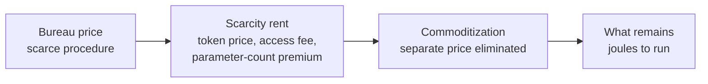

*修订版 db13599，2026 年 11 月 5 日。数据与代码：[research.openie.dev/data/](/data/#economics)。LaTeX PDF：[/pdfs/latex/spellcheck.pdf](/pdfs/latex/spellcheck.pdf)（[源文件](/pdfs/latex/spellcheck.tex)）。*

## 摘要

拼写检查软件在约 1981 年至 1989 年间售价高达数百美元，如今已免费内置于人们日常使用的工具之中。本文以有据可查的历史资料记录这一演变过程，并以边际成本与捆绑销售的经济学原理加以阐释 [62, 63]。

**用平常话说**

1. 人们过去为拼写检查支付高昂费用，如今它已免费内置于手机、浏览器和文字处理软件之中。
2. 它之所以变得免费，是因为检查一个单词的运行成本几乎为零，且在用户已有的工具内部使用时效用最大。
3. 其他计算机能力一旦能够在人们已拥有的设备上以低廉的成本运行，同样的转变便可能发生，从而使数十亿人得以使用这些能力。

## 记号与术语

| 术语 | 本文含义 |
|---|---|
| 自动化路径 | 某项计算机程序脱离专业机构，成为运行于个人已有硬件上的本地例程。 |
| 存在性证明 | 该路径的一个已完成实例。拼写检查即为其一。此处"证明"并非修辞用法。 |
| 本地 | 检查在持有文档的机器上运行。所交付的例程无需租用前沿数据中心。 |
| 配对硬件 | 用户已用于写作的编辑器、键盘或手机。该能力并非第二台机器。 |
| 可用 | 硬件属于普通设备，而非稀缺租赁资源。 |
| 可访问 | 用户无需将任务提交至专业机构，即可在该基础设施上调用相应能力。 |
| 有能力 | 该基础设施能够运行完成任务所需的组件。 |
| 多数人（70 亿以上） | 超过 70 亿人。全球访问所面向的群体。 |
| 少数人 | 稀缺定价仍能触达的群体。这是一个价格类别，而非人数统计：仅前沿对话产品在 2025 年 10 月的周活跃用户便已超过 8 亿 [61]。 |
| 建议 | 一条拼写候选项。文档尚未发生变更。 |
| 提交 | 替换内容被写入文档。 |
| 完整性 | 该词元已被保留：其已知，或某候选项已被接受。此后对该谓词的进一步搜索的信息价值为零。 |
| 货币价格 | 可开具发票的费用：词元计费、席位许可、稀缺租金、访问费。商品化驱使该独立收费趋近于零。 |
| 参数量 | 模型的规模度量。一旦该能力成为商品，此指标便不再具有持续意义。 |
| 焦耳（J） | 能量的国际单位制单位。本文中指运行该例程所消耗的能量。 |
| 查找、公式、模型 | 三类机制。词典探查属于查找；编辑距离生成器属于公式；语言模型属于模型。 |

## 1. 引言

拼写检查曾是人们单独购买的一项功能，如今已内置于他们本已拥有的工具之中。本文通过有据可查的价格、构建该流程的论文、承载其实现的库以及运行它的硬件，追溯这一变化的历程，并探讨其对计算机智能整体发展的启示。

人们曾为此支付溢价，后来这项功能便无法单独出售，最终免费捆绑于其他产品之中。第 2.11 节中的价格数据正是这一事实的体现，第 2.9 节中的名称则紧随其后。

计算器的独立发票构成一个有时间标记的序列，从 Anita 的广告，到 HP-35 和 TI-2500，再到 VisiCalc。拼写检查的独立发票则终结于文字处理器，继而终结于操作系统。那些原始资料未曾印出的价格数字，在此同样付之阙如。

就拼写检查而言，价格趋势已走完全程：该功能以零价格捆绑于编辑器之中，但焦耳仍在消耗。

选择即价格。稀缺性定价将某项功能束之高阁，并将这种束缚本身作为商品出售，其触达的是能够付费的人，即少数人。另一种选择是全球可及：将该功能构建为可在用户已有的设备上运行，并取消单独收费，从而触达逾 70 亿人。

拼写检查正是这第二种选择的完成形态。其任务在于判断一个书写符号是否为合法词汇，若非，则向作者提议其所意指的词汇。Kukich (1992) 将这一任务划分为非词检测、孤立词纠错与上下文相关纠错三个子任务。前两项已成为常规功能，运行于人们日常写作所用的程序之中。这是计算机智能，而非为引出另一套系统而讲述的故事。

第二种选择只有在以下条件满足时才算真正完成：该功能廉价到足以在文档旁边本地运行，驻留于存储文件的设备之上，并与用户已有的硬件相配合。McIlroy (1982) 在 UNIX 拼写词表论文的开篇数句中即已阐明这一约束：该检查器可能在小型计算机上使用，因此词表必须紧凑。这是作为工程实践的全球可及。一个仅在租用数据中心内响应的前沿模型，仍是稀缺性定价的延续，它可以具备强大能力，却依然只服务于能够负担租用费用的少数人。

第 2.11 节记录的是溢价及其时间标记，第 2.10 节探讨的是谁拥有可运行成熟功能的设备，谁又仅持有租用权。为人们已在运行的设备编写的软件，是访问权触达大众的途径；而要求租用才能使用的价格，则是稀缺性将能力锁定于少数人的方式。

### 一个词元，按序习得

Norvig（2007）记录了一个本地纠错器及调用 `correction('speling')`（返回 `spelling`）的过程，以此作为路径的教学示例。其生产可行性证明是普通编辑器中的 Hunspell，详见第 2.5 节。

1. 字符串已在本机上。无任何内容被发送至外部机构。
2. 查找步骤询问 `speling` 是否存在于本地词频表中，结果为否。
3. 一个公式构造编辑距离为一的字符串集合，包括删除、换位、替换或插入操作。已知词 `spelling` 即属于该集合。
4. 建议仅为一项提案，文档仅在人工接受或既定策略接受时才发生变更，此即提交操作。
5. 一旦 `spelling` 被保留，后续候选项不会改变"此词元即为所保留词语"这一谓词，此即停止条件。
6. 为处理该词元而调用前沿模型，并不能获得更优的结果，查找加编辑的机制已完成闭合。拒绝更大的开销并非折中之举，而是针对此任务的最优解。

同一文章亦展示了本地词元无法完成闭合的情形：当测试对期望输出为 `were` 时，`correction('where')` 仍返回 `where`。单个词语本身不足以承载该判断。Kukich（1992）将此命名为第三类问题，即依赖上下文的纠错。对于此类情形，更大的模型可能是合适的工具。然而，该路径对于此类工具而言尚未完成，除非该工具运行于作者已有的硬件之上，或运行于作者实际可用的资源优化型中央计算平台之上。作者无法调用的租用前沿访问权限，仍属外部机构。

## 2. 相关工作

### 2.1 检测与孤立词纠错

Damerau（1964）给出了一种方法，用于处理字典中缺失且至多含有一处错误的单词：错误字母、缺失字母、多余字母或单次换位。未识别的单词在上述每种假设下再次与字典进行比对。摘要报告称，在其所运行的测试中，上述错误类型的正确识别率超过 95%。本文引用该结果作为其成果，不重复该测试。

Peterson（1980）综述了检测和纠正拼写错误的计算机程序。至该日期，这一能力已是一批可运行程序的文献积累，而非关于某程序未来某日或许能够检查单词的设想。

Kukich（1992）将该领域划分为上述三个问题。非词检测使用词表、模式匹配或 n-gram 分析。孤立词纠错为检测到的非词提出候选字典词。上下文相关纠错处理某个标记本身是真实词汇但仍属用词错误的情形。该综述是该领域的全局图谱。本文的存在性证明依托于生产环境中的 Hunspell：LibreOffice、Firefox、Chrome、各 Linux 发行版以及 macOS 均调用本地字典例程（Hunspell README）。Kukich 所述的前两个问题已离开综述，进入上述普通编辑器之中。Norvig（2007）至今仍是"查词典再做短编辑距离"这一思路的教学演示，而非生产事实。

### 2.2 词表的构建以适配机器为目标

McIlroy（1982）描述了 UNIX 拼写检查器背后的词表。摘要阐明了工程约束条件与最终结果。该检查器可在小型计算机上使用，因此词表必须紧凑。通过剥离前缀与后缀、哈希处理以及压缩，将一份精简后包含 30,000 个英语单词的列表压缩至 26,000 个 16 位机器字。Johnson 早期的检查器查找的是已存储于机器上的文档中的单词。McIlroy 在本文中的贡献在于二者的配对：词典之所以被压缩，是因为目标平台是人们实际运行的小型计算机，而非专门为此保留的更大型机器。

以上词数均为其已发表论文中的数据。

### 2.3 噪声信道仍是一个本地程序

Kernighan、Church 与 Gale（1990）采用噪声信道模型对候选纠错结果进行排序：候选词的概率乘以在该候选词条件下产生该拼写错误的概率。该程序是通常意义上的拼写纠错器，是对词典与错误模型的局部计算。更高的得分并不意味着不同的部署方式。该机制可以持续精化，同时保留在存储文本的机器上。

### 2.4 一页纸即可容纳、无需网络的纠错器

Norvig（2007）在飞机上撰写了这篇说明，当时既无拼写错误数据，也无网络连接。语言模型是一个约百万词的本地文件，统计得到 32,192 个不同词形，共出现 1,115,504 次。错误模型刻意保持粗糙：编辑距离为 0 的已知词优先于距离为 1 的任意词，距离为 1 的词又优先于距离为 2 的任意词。飞行结束后，他以取自 Mitton Birkbeck 语料库的测试集进行了评估。他报告称，270 对开发集的正确率为 75%，处理速度为每秒 41 词；400 对最终测试集的正确率为 68%，处理速度为每秒 35 词。他表示，在简洁性与速度方面达到了预期目标，但未能实现 80% 至 90% 准确率的期望。

上述数字是他所报告的评估结果。该工具并非工业级检查器。其能力中具有实用价值的部分，体现在以下场景中：程序员面前的机器上存有本地文件，处理速度达每秒数十词，且无需网络连接。这正是一条完整自动化路径的形态。他所列举的失误，尤其是词典外未知词以及需要依赖相邻词元才能作出判断的情形，属于残余问题。这些失误是改进本地工具的论据，而非将任务迁回集中处理机构的理由。

### 2.5 普通编辑器内置的函数库

Hunspell 项目说明，Hunspell 是 LibreOffice、Firefox 和 Chrome 等自由浏览器以及其他工具和操作系统（包括 Linux 发行版和 macOS）所使用的拼写检查器与形态分析器（Hunspell README）。该库读取本地词典文件和本地词缀文件。命令行工具检查本地文本文件。其代码源自 MySpell，即 Kevin Hendricks 在 OpenOffice.org 中的实现，而 MySpell 本身是对 Geoff Kuenning 的 International Ispell 中词缀拼写方案的重新实现。László Németh 的 Hunspell 在此基础上增加了 Unicode 支持以及处理复杂语言所需的形态学功能，因为对于此类语言而言，仅凭一份简单的英语词表是远远不够的。

该 README 说明了该库的使用场景，其所贡献的事实属于部署类别。上述程序内部的拼写检查器是一个本地库，配合一份本地词表运行。

### 2.6 手中已有的手机

`UITextChecker` 是一个 UIKit 类。调用方传入一个字符串和一种语言，该方法返回字符串中拼写错误单词的范围，或报告未发现任何错误（Apple，UITextChecker）。该检查在设备本地调用，针对系统列为可用的语言进行。本文不对该调用给出焦耳数值。API 的形态体现为如下配对：文本已存在于文本视图中，检查器则作为其旁的一个方法。

Android 的拼写检查框架同样运行于设备本地。应用程序继承 `SpellCheckerService`，实现一个会话，并对会话所接收的文本返回建议（Android Developers，拼写检查框架；`SpellCheckerService`）。拉丁输入法的检查器是一个带有本地区域词典的本地服务。同样，本文不从该文档中提取任何能耗数值。文档将该例程定位于手机本地。

Hard 等人（2018）通过联邦学习为 Gboard 手机键盘训练了一个下一词预测模型。客户端在留存于设备上的文本基础上计算更新，服务器聚合这些更新，而不接收原始输入内容。同一论文指出，Gboard 同时提供自动纠错和下一词预测功能，且该键盘截至 2019 年的安装量已超过 10 亿次。该安装量表述是论文自身的部署声明，并非本意见所涉及的逾 70 亿人口的计数。

他们所部署的模型有意设计得较小。经量化后，模型大小为 1.4 兆字节，词汇量为 10,000 个词，满足其所述的产品约束条件，即约 20 毫秒内可见响应以及数十兆字节的模型体积上限。其研究中的训练参与范围窄于安装基数：仅限北美设备，且需满足至少 2 吉字节内存、正在充电、处于空闲状态以及连接非计量网络等条件。本研究引用该部署类别，旨在说明：人们已在使用的键盘搭载了一个小型的设备端语言模型，且该文所述的训练过程不会导出用户输入的文本。本文不将其召回率表格引用为拼写准确性结果。

### 2.7 硬件彩票

Hooker（2020；2021）提出了"硬件彩票"这一概念：某个研究想法之所以胜出，是因为它契合了现有的硬件与软件条件，而非因为它在抽象意义上是最优方案。拼写检查赢得了一张值得赢的彩票。可用的硬件是存储文档的那台机器，与之匹配的算法是一个词表加上一个小型编辑模型。而一种只能在前沿加速器上运行、且仅以该加速器的机时形式出售的能力，则身处另一场彩票之中。Hooker 的警示在于：那些与已部署硬件不匹配的想法，即便本身优秀，也会陷入停滞。本文在设计层面得出的推论，是对同一事实的反向解读。若目标是让大众共享计算机智能，那么相关想法就必须契合大众已有的硬件，或契合资源优化型中央基础设施能够向大众延伸的硬件。只适配稀缺租用资源的能力，注定只能停留在少数人手中。

### 2.8 本文献无需证明的内容

上述拼写来源均非人口统计表。第 4 节中出现的拼写数字，均为来源本身的计数：词典词条数、测试集规模、每秒处理词数，或已发表的识别率。第 2.10 节另增一类。每项硬件数字均为发布方的出货量、订阅数、营收或调查数据，并附有对应年份。逾 70 亿人口，以及少数能够支付稀缺价格者，构成该观点中的两类群体。它们并非上述各行数据之和。

### 2.9 计算机自动化的定价方式

引用的费率仍然保留在发表该费率的论文中。这里没有进行曲线拟合。没有给出斜率、半衰期或零价年份。

用平常话说，在名称之前。人们过去为拼写检查和普通计算支付溢价。作为基础层产品的拼写检查已经无法再出售。它是免费的，并且已捆绑到编辑器、浏览器和手机中。普通计算已捆绑到手机和电脑中。下面的名称仅是该序列的标签。

三种制度说明了计算机自动化工具的定价方式。第 2.11 节是计算器和拼写检查的有日期的磁带。每个价格都是来源的价格。这里没有对它们进行曲线拟合。

**局部价格。** 当该过程稀缺时，买方支付给个人或预订的机器。Nordhaus（2007）测量了计算本身的长期货币价格，而不是拼写检查。在那篇文章中，计算的价格起始约为每秒一百万次计算 500 美元，随后下降到 2006 年每秒一百万次计算约 $6 \times 10^{-11}$ 美元，以 2006 年价格计，下降幅度约为 8.3 万亿。该数字是本文刚刚给出的两个端点的商，500 美元 / $6 \times 10^{-11}$。端点是他报告的数值。这里没有重新拟合，也不将该商视为预测。它们记录了自动化基底的货币价格下降了数量级。该指数的下降尚未等同于产品单独发票的消除，也不是焦耳计。

**稀缺价格及其产生的竞争。** 一旦企业能够交付该过程，就可以收取高于运行成本的费用。该差额即为稀缺租金。接入费和代币价格是同一差额的不同表现形式。当买方被教导为规模付费时，参数数量就成为表现形式的一部分。租金正是竞争的来源。竞争者通过将能力捆绑到买方已有的产品中，或直接取代该产品，从而消除租金。已发表的推理价格表明，语言模型的竞争已经启动且尚未结束。Epoch AI（2025）报告称，在该报告中的基准上，固定性能的价格每年下降约 9 到 900 倍。Emberson 和 Roodman（2026）报告自 2023 年起，给定性能的成本每季度下降约 47%，他们将其概括为每年约下降 13 倍。这些是他们系列的概括。指数未重新估计，也未在点之间作连线。任何费率都不是超出其时间窗口的定律。《任务饱和》论文使用相同的引用下降作为仍在进行的护城河置换的证据；该主张仍保留在该论文中。

**定价消除。** 商品化是单独收费的终结。功能仍然存在。发票行则不存在。拼写检查是完整的示例。Hunspell 是一个在三重许可证（LGPL、GPL 和 MPL）下的免费拼写检查库。项目声明 LibreOffice、Firefox、Chrome、Linux 发行版和 macOS 调用它，并且检查读取本地词典（Hunspell README）。这些编辑器的购买者不为非词支付代价，不为拼写局支付访问费，也不为参数计数付费。该方法作为单独商品的金钱价格为零。这就是定价消除。这并不是说编辑器本身免费，也不是说手机免费，而是说拼写纠正不再作为其自身商品定价。

**稀缺定价可以转移到机器上。** 结束单独软件价格并不结束所有稀缺定价。平台可以在新设备上放置更新的功能并对设备收费。Yusuf Mehdi，2024 年 5 月 20 日，将 Copilot+ PC 定义为神经处理单元达到 40 TOPS 或以上。第一波使用 Snapdragon，小模型运行在该单元上，大模型仍在 Azure。Apple 于 2025 年 6 月 9 日的说明将约 30 亿参数的本地模型放在 Apple silicon 上，较大模型留在 Private Cloud Compute。这些是后期装备以及承载它的机器的价格，并不是为拼写检查重新开具的发票。检查器已经在编辑器、浏览器以及人们已有的手机：including 仍在手中的前一代：上运行。要求用户购买新类别计算机以获得旧机器已经执行的检查的刷新，是硬件的稀缺定价。它面向购买该类别的少数人。它并未撤销已为超过 70 亿人完成的访问。

上下文依赖的纠正并非已完成的案例。Kukich（1992）将其称为第三个问题：一个是真实单词却仍然错误的 token。更大的模型可以在此提供正确的装备。对于语法错误纠正，更大且训练更好的模型确实纠正得更好：GECToR [71] 和一个 110 亿参数的多语言模型 [72] 在其时代设定了最新水平。权衡在于能量：Luccioni、Jernite 和 Strubell 测量生成任务的能耗远高于分类任务每次推理的能耗 [73]。第 4.10 节的孤立词案例是额外支出未购买不同 token 的情形。只有当模型运行在用户已有的硬件上，或运行在用户可使用的资源优化中心织物上时，才实现了访问选择。稀缺租赁是稀缺选择，即使模型在基准上更准确。普通非词任务不会回到该租赁上，因为上下文任务尚未完成。此处未打印字典探测、本地模型和数据中心调用的能量表。本文未对这些能量进行计量。

剩下的就是运行比较所需的能量。本地字典探测在保存文档的设备上消耗能量。此处未计量能量。未计算分析总量。`measured_j` 未设置：未进行能量读数。

预测来自各阶段的规律，而非来自回归分析。普通计算机智能任务遵循拼写检查的路径。其单词元价格、参数规模溢价、稀缺租金与访问费用，因被捆绑至人们已有的硬件以及许可证价格为零的方法而被竞争消除。最终状态面向逾70亿人，而非少数能够支付稀缺价格的人。若某项普通任务（即拼写检查已能解决的那类任务）在本地等效程序已掌握于文档持有者手中之后，仍长期保持独立货币价格，则该预测失效。仍携带溢价的前沿基准测试并非此类失效，而是护城河阶段，Epoch 的注释已显示该阶段成本持续下降，拼写检查亦展示了如何走出这一阶段。

同样的阶段规律绘制于交互图 [sc-anim-01](/living/spellcheck/#sc-anim-01)。两个点为 Nordhaus 报告的端点，虚线连接器连接这两个端点，未估算任何速率。Epoch 的 9 至 900 倍范围及约 13 倍的概括性数字置于标注框中，保持其概括性表述不变。拼写检查面板为已完成阶段：独立货币价格已消失，焦耳能耗仍未计量。

Landauer（1961）为擦除一个比特设定了物理下限。Horowitz（2014）给出了实用 CMOS 层面的表述：数据移动占主导，远高于该理想下限。字典查询操作移动比特，商品化可将账单归零，但该移动过程依然存在。本文未从上述任一引用中计算拼写检查的焦耳总量。

**捆绑作为策略。** 捆绑文献将同一段历史既解读为策略，也解读为访问路径。Adams 与 Yellen 指出，捆绑是价格歧视的工具 [68]。Nalebuff 指出，捆绑可阻止仅销售单一商品的竞争者进入市场 [69]。Spolsky 将这一战术命名为软件领域的策略：商品化你的互补品，从而使你所销售的产品更具价值 [70]。每种解读在本文所用的可观测指标上达成一致：被捆绑层的独立价格趋向于零。各方的分歧在于谁保留了租金。正因如此，本文既追踪价格，也追踪平台的持有者。

### 2.10 硬件访问权限，按类别划分

**手机与移动 SoC 世代。** GSMA《2025 年移动经济》报告统计，截至 2024 年底，全球唯一移动用户数达 58 亿，渗透率为 71%，移动互联网用户数为 47 亿。IDC 于 2026 年 1 月 13 日发布的《全球季度手机追踪》初步数据显示，2025 年智能手机出货量为 12.603 亿部，其中苹果出货 2.478 亿部。IDC 于 2025 年 1 月 13 日发布的数据统计 2024 年智能手机出货量为 12.388 亿部。2026 年版表格将 2024 年数据修订为 12.363 亿部。各版本各自保留其总量。Arm 截至 2025 年 3 月 31 日财年的年度报告指出，该财年全球销售智能手机中逾 99% 搭载基于 Arm 架构的 CPU，且客户累计出货基于 Arm 架构的芯片超过 3100 亿颗，涵盖从最小传感器到超级计算机的各类产品。该累计数字涵盖 Arm 的全部市场，并非手机出货量，报告亦未按 SoC 世代进行拆分。

2025 年手持设备代表当前移动 SoC 世代，包括：Apple Silicon、高通骁龙、联发科、三星及谷歌 Tensor。IDC 统计的是品牌手持设备出货量。用户订阅数统计的是持有移动订阅的人数，而非 SoC 数量。

该手持设备上的软件栈已内置本地检查器。拼写场景的代表为 UITextChecker 与 Android `SpellCheckerService`。同一设备上的模型可调用 Apple Core ML 及 Foundation Models 框架、Android LiteRT 与 NNAPI、高通 QNN 编译器、ExecuTorch 或 llama.cpp。苹果于 2025 年 6 月 9 日发布、并与 2025 年 7 月 17 日技术报告对齐的说明，描述了一个约 30 亿参数的端侧基础模型，压缩至每权重 2 比特，以及一个运行于私有云计算上的服务端混合专家模型。Liquid AI 的 LFM2 报告设计了参数量从 3.5 亿到 26 亿的稠密模型，以及一个总参数 83 亿、活跃参数 15 亿的混合专家模型，支持 ExecuTorch、llama.cpp 与 vLLM，并在搭载骁龙 8 Elite 的三星 Galaxy S25 上进行了基准测试。PrismML 声称其 Ternary Bonsai 2 27B（据称基于 Qwen3.8 27B 构建）在占用空间缩小 9 倍（5.9 GB）的情况下，保留了全精度版本 98.2% 的性能。上述比率均来自 PrismML，本文不对其进行复测。

Hooker 为彩票命名，本节为机器命名。论证由七条记录构成。手机出货量不等同于数据中心出货量。Steam 调查不等同于 PC 普查。营收数据不等同于单位数量统计。若某企业未披露单位数量，本文将予以说明并引用该企业所披露的数据。上述数字均非对多数或少数的计数，亦非各行之和。动态数据 [sc-hw-01](/living/spellcheck/#sc-hw-01) 与 [sc-gen-01](/living/spellcheck/#sc-gen-01) 即为上述记录。

对于每一类别，所提问题相同：依据来源自身统计，谁持有该机器；该机器运行何种软件栈；该软件栈与最优前沿软件栈的差距如何。设计主张可概括为一句话：为全球可及世代编写的软件具有最大影响力。可及世代即当下在手之物。拼写检查是该主张的已完成自动化示例。McIlroy 为当时在役的小型计算机确定了列表规模。运行所需能耗是留存至今的度量指标。这些行统计的是谁持有机器，而非焦耳数。

前沿堆栈的接口是一个更小的模型、低比特模型，或是供应商运营的服务器调用。Apple 在一份报告中说明了拆分。前沿训练运行不会在手机上落地。该行的设计声明：已在出货的 SoC 代际上编写的软件，以及仍在使用的前几年手机上的软件，产生更大的影响。拼写检查就是该软件。

**PC 与笔记本电脑。** IDC 2025 年 1 月 9 日的发布统计了 2024 年出货的 2.627 亿台传统 PC。IDC 2026 年 1 月 12 日的初步发布统计了 2025 年的 2.847 亿台。2026 年的表格将 2024 年重新列为 2.633 亿台。2026 年 1 月 28 日的财报电话会议上，Satya Nadella 表示 Windows 已达到 10 亿 Windows 11 用户，同比增长超过 45%。一次出货年份并不等同于已安装基数。

堆栈包括操作系统、浏览器和本地库。Hunspell 是普通编辑器中的拼写检查案例。相同 PC 上的模型使用 ONNX Runtime、DirectML、Windows ML、llama.cpp 或 ExecuTorch 在 CPU 与集成 GPU 上运行。离散 GPU 是下一类。Liquid AI 在 AMD Ryzen AI 9 HX 370 上使用 llama.cpp 以 Q4_0 运行相同的 LFM2 系列。这是他们报告中的笔记本 CPU 测量，而非数据中心测量。

前沿堆栈的接口是 API 调用，或是适配机器内存的模型。两者是不同的程序。第一种是租用，第二种是路径。该行的设计声明：人们已经在使用的 PC 代际软件产生更大的影响。拼写检查走了这条路径。假设租用加速器的权重则没有。

**消费级 GPU。** NVIDIA 2026 财年发布（截至 2026 年 1 月 25 日）报告游戏收入为 160 亿美元。那是收入，而非单位数量。Jon Peddie Research 2026 年 3 月 5 日报告 2025 年第四季度出货 1148 万块 PC 图形附加板，同比增长 36%，该季度桌面附加率为 55%。同一说明指出数据中心 GPU 板块环比增长 17%，但未公布其单位数量。该说明中的 1.72 亿“已安装基数”是预测终点。本论文未将其用作当前普查。

Valve 的 2026 年 9 月 Steam 硬件与软件调查在回答的客户端中，NVIDIA GeForce RTX 5070 占 6.15%，RTX 5090 占 0.40%，RTX 4060 占 3.89%，RTX 3060 占 3.66%，GTX 1650 占 2.19%。该调查仅限 Steam 参与者，并非全球。本论文未将这些份额计入代际总量。列表不完整，且调查设有其他选项。

堆栈在 NVIDIA 上为 CUDA，在 AMD 上为 ROCm 或 Vulkan。llama.cpp 在显卡上运行量化模型。vLLM 在显卡持有权重时提供模型服务。前沿堆栈的接口是量化、更小的模型或 API。消费级显卡运行适配的模型，前沿训练系统不适配。该行的设计声明：针对旗舰的软件只占游戏调查的 0.40%，而针对仍在报告的卡，包括 30 系列和 40 系列部件的软件覆盖已安装代际，产生更大的影响。

**数据中心加速器。** NVIDIA 同一财年 2026 年的发布报告显示，数据中心收入为 1937 亿美元，同比增长 68%，第四季度为 623 亿美元。该报告未披露 Hopper、Blackwell 或 Rubin 的出货量。报告描述了与 Meta 的多年合作伙伴关系，其中包括数百万块 Blackwell 和 Rubin GPU。该句是 NVIDIA 对部署计划的描述，而非经审计的机架卡片数量。2025 年 10 月 28 日，在华盛顿的 GTC 上，黄仁勋表示过去四个季度已出货 600 万块 Blackwell GPU。CNBC 同日报道了该句。财年 2026 年的发布仍未披露出货量。600 万的数字是黄仁勋的声明，而非经审计的单位行。同一报告引用了 Blackwell 和 Rubin GPU 销售额预计为 5000 亿美元的预测。这是销售预期，本文并未将其转化为单位计数。

AMD 于 2026 年 2 月 3 日的发布报告显示，2025 年日历年的数据中心部门收入为 166 亿美元，同比增长 32%，并指出增长来源于 EPYC CPU 和 Instinct GPU。Instinct 并非单独的收入线，唯一披露的细分是：第四季度向中国的 Instinct MI308 收入约为 3.9 亿美元。发布中未包含 Instinct 的单位计数。

在 2026 年 1 月 28 日的电话会议上，Nadella 表示微软的机群包括 NVIDIA、AMD 以及微软自家的 Maya 200 加速器，该加速器已上线。Amy Hood 表示该季度资本支出为 375 亿美元，其中约三分之二用于短期资产，主要是 GPU 和 CPU，且需求超过供应。文字稿中未出现 Maya 的单位计数。Google TPU 和 Amazon Trainium 的出货量也未在本节所阅读的来源中出现。之所以提及它们，是为了避免将该类别简化为单一供应商。缺失的单位计数即为记录。

拥有这些数据的是：为该收入签约的买家。Hood 表示，大部分 GPU 资本已经在硬件使用寿命内签约，这是一种租赁市场。加速器上的软件栈包括 CUDA、ROCm 以及假设卡片存在的服务栈，如 TensorRT-LLM 和 vLLM。该类别属于前沿栈。其他人的接口是 API、蒸馏模型或量化模型。此行的设计主张：需要加速器的软件能够触达租户。为其他行代代相传的软件则能触达持有这些机器的人。拼写检查完成了第二项。第一项属于局部阶段。

**MCU、微小部件和嵌入式部件。** Arm 累计超过 3100 亿芯片的数字包括传感器和嵌入式设备。年报未将该累计数字拆分为微控制器。IC Insights 于 2022 年 3 月 29 日指出，2021 年交付的微控制器达到 309 亿件，当年单位增长 12%。这是一项 2021 年的出货量。同一说明预测 2026 年将达到 358 亿件。该预测并非当前计数。

MLCommons，2025 年 9 月 17 日，发布了 MLPerf Tiny v1.3。该套件测量的神经网络通常小于 100 千字节。此次发布包含五项测试的 70 条结果，其中包括 27 条功耗结果，来自 Kai Jiang、Qualcomm、STMicroelectronics 和 Syntiant。首次基准测试了五个平台硬件。测试覆盖图像分类、视觉唤醒词、关键词检测、异常检测以及流式唤醒词任务。

技术栈为 TensorFlow Lite for Microcontrollers、CMSIS-NN，以及提交使用的供应商运行时。模型以千字节计。前沿语言模型未加载。前沿栈的接口是为该部件编译的任务模型：唤醒词、传感器分数、内核。该行的设计声明：本代软件即适配该部件的软件。Arm 的累计出货量是本节中最大的硅片数字，且并非数据中心产品。影响随部件出货而来。

**Edge 加速器和 NPU 在出货设备中。** Yusuf Mehdi，2024 年 5 月 20 日，将 Copilot+ PC 定义为具备 40+ TOPS 神经处理单元的设备。第一波使用 Snapdragon X Elite 和 Snapdragon X Plus，该帖子称其提供 45 TOPS NPU。设备端体验被指定在该 NPU 上运行小型语言模型，而大型模型仍通过 Azure 提供。Gartner 在 2025 年 8 月 28 日 Computerworld 报道的同日发布中预测 2025 年 AI PC 将达 7780 万台，占全球 PC 市场的 31%。该预测在年度结束前发布，并非 IDC 完整的 PC 总量，也不是仅统计 Copilot+ PC。Canalys（现为 Omdia）在 2025 年 2 月 25 日的数据并于 2025 年 3 月 7 日报道中，统计 2024 年第四季度出货的 AI 能力 PC 为 1540 万台，占该季度 PC 出货的 23%。同一说明中指出 2024 年全年出货的 AI 能力 PC 占比为 17%，但未给出全年出货总量。其定义为具备专用芯片组或块用于设备端 AI 工作负载的台式机或笔记本。其列举的例子包括 AMD XDNA、Apple Neural Engine、Intel AI Boost 和 Qualcomm Hexagon。1540 万是已结束季度的数据。Gartner 的 7780 万仍为预测。

Apple 的约 30 亿参数的设备端模型已为 Apple silicon 编译，其中包括 Neural Engine。Apple 未单独公布 Neural Engine 的出货量。活跃设备基数仍为之前的 Apple 数据，而非 NPU 普查。

技术栈包括 Qualcomm QNN、Windows Copilot Runtime、Apple Core ML 与 Foundation Models 框架、AMD Ryzen AI 软件、Intel NPU 栈以及 ONNX。每个栈都为其 NPU 编译图。CUDA 权重在编译器接受之前不算 NPU 程序。前沿栈的接口是 Microsoft 所述以及 Apple 所述的：设备上的小模型，供应商运行的服务器上的大模型。该行的设计声明：普通手机或 PC 中的 NPU 即为可访问的代际。为该 NPU 编写的软件，在供应商的编译器中即可使用。假设使用数据中心 GPU 的内核在此无法运行。

**前代仍在使用。** 最新代是出货量。已安装代是人们仍在运行的代。两者是不同的数字，且多家公司未公布后者。

手机：2025 年出货 12.603 亿部智能手机，2024 年底移动用户唯一数为 58 亿。用户数并非手机数量。该规模事实不依赖于此类转换。一年的手机出货量并不等同于用户基数。之前的手机仍在使用中。本文并未将此差距转化为代际份额。

Apple 在 2025 年 1 月 30 日财报电话会议上表示，其跨产品类别的活跃设备基数超过 23.5 亿台。2025 年 10 月 30 日的发布称该基数已达到新的历史最高，但未公布更换数量。2025 年日历年的 iPhone 出货量为 2.478 亿部，仅为一年中的单一产品，并非活跃基数。

个人电脑：2026 年 1 月 28 日时 Windows 11 用户数为 10 亿，2025 年日历年的 PC 出货量为 2.847 亿台。IDC 于 2026 年 1 月 12 日的报告以及 Hood 在 1 月电话会议上的发言均将 Windows 10 停止支持列为 2025 年 PC 需求转移的原因。前一代操作系统的用户基数足以推动换机，其剩余数量未在记录中出现。本文未提供此数据。

消费级 GPU：上述 2026 年 9 月 Steam 调查显示，RTX 5090 占比 0.40%。RTX 3060 占比 3.66%。RTX 4060 占比 3.89%。GTX 1650 占比 2.19%。最新旗舰并非调查中最常报告的显卡。

数据中心加速器：NVIDIA 2026 财年报告将 Blackwell 与 Hopper 进行比较，但未给出仍在使用的 Hopper 卡的装机数量。Nadella 表示软件仍在老旧机群上运行当前模型。这是同一事实在数据中心的表现，且该机群仍为租赁形式。本文未捏造任何装机基数计数。

设计主张（本行及其前六行）：为全球可访问代际编写的软件影响最大。可访问代际是手中已有的代际，上述来源表明它并非最新制程的同一对象。拼写检查最初为小型计算机编写，随后为编辑器、再为手机编写。一旦单独的金钱价格消失，剩下的就是运行所需的能量。更新的制程并未以许可证取代该度量。

设备端论点与该主张相符，且并未取代出货记录。Hooker（2020；2021）指出，想法通过适配现有硬件而获胜。Apple 的报告将约 30 亿参数模型适配于 Apple silicon，并将更大的模型留在私有云计算上。Liquid AI 的 LFM2 报告在手机 CPU 与笔记本 CPU 上以测得的延迟和内存搜索架构，并为这些运行时提供权重。PrismML 的公开主张是三值模型是适配本地设备的产物，比例符合公司声明。拼写检查仍是完成的示例。字典探测不需要这些模型，只需要已经持有文本的机器。

### 2.11 有据可查的价格，及各价格已知的持续时长

Section 2.9 中的制度名称。本节为价格记录。每一行包含来源打印的价格、该来源附加的日期以及该来源对价格持续时间的说明。当来源为一次广告时，持续时间为该编录打印的下一次广告之间的间隔。该间隔并非连续的价格审计。若两个来源意见不合，均予以列出。若页面上未出现某价格，则不填入。活页表为 [sc-price-01](/living/spellcheck/#sc-price-01)。

**台式计算器，Sumlock Comptometer 与 Anita。** anita-calculators.info 上的广告索引是按日期编排的广告汇编，而非公司保存的价目表。

1949 年秋。该索引上的一则 Plus 加法机广告写道 “Now Plus for only \$100”。索引未说明该价格持续了多久。

1961 年 10 月。Anita Mk 8 在伦敦的商务效率展上首次亮相。*Office Magazine*，1961 年 12 月，第 1244-1245 页，已在同一站点转载，标明价格为 £335，并说明订单将于 1962 年 1 月 1 日起接受。评论指出该机器尚未普遍上市。

1963 年 5 月。索引上的一则广告将 Anita Mk 8 标价为 £355，Comptometer 993s 为 £265。索引未记录 1961 年 12 月评论与此广告之间的 Mk 8 价格。该区间是两日期之间的沉默，而非 £335 仍然有效的证明。

1964 年 1 月。索引将 Mk 8 标价为 £365。1964 年 2 月。Comptometer 993 系列的价格列为区间，£160 至 £330。

1965 年 1 月。索引将 Mk 8 标价为 £335，Mk 9 为 £425。Mk 8 的广告价格分别为 1961 年 12 月评论的 £335、1963 年 5 月的 £355、1964 年 1 月的 £365、以及 1965 年 1 月的 £335。每个数字均来源于一次广告或一次评论，均未说明价格在日期之间保持不变。

1965 年 11 月。索引将 Mk 9 标价为 £425，并说明已有超过 16,000 台 Anita 在使用，且 Anita 于 1962 年 1 月推出。从 1965 年 1 月的广告到本条目，索引上 Mk 9 的价格保持在 £425。这是两次观察，并非月度审计。

1966 年 7 月。索引将 Mk 10 标价为 £460。

1968 年 6 月。*Office Methods and Machines*，1968 年 6 月，第 41 页的 “Focus on ANITA” 广告被 anita-calculators.info 的型号页面引用。该页面从广告中转录了三个金额：Mk 10：£480（页面引用广告原文 “Price £480”），Mk 11：£298，Mk 12：£480。索引仍未列出这些金额。Mk 9 的金额未出现在 Mk 9 页面上。该页面将 1964 年的推出价引用为 £425，出处为 “BEE '64,” *Industrial Electronics*, 1964 年 11 月，第 521 页。该 £425 为推出价，并非对 1968 年 6 月行文的转录。June 1968 的 Mk 9 金额未在本论文所阅读的来源中出现。1966 年 7 月的 Mk 10 价为 £460，1968 年 6 月的价为 £480，这两条均为广告，二者之间的月份不构成审计。

1969 年 4 月和 5 月。索引在两个月均将 Anita 1000 标价为 £285。1969 年 7 月。Anita 1010 为 £320。1971 年 2 月。Anita 1000LSI 为 £192，1010LSI 为 £250。这些为后期型号。后期型号的较低价格并不意味着 Mk 8 的价格被削减。

**HP-35。** 三个来源对推出价一致，但对降价时间表存在分歧。

Computer History Museum，“This Day in History”，1972 年 1 月 4 日：惠普推出 HP-35，售价 395 美元。

Datamath Calculator Museum，HP-35 页面：宣布于 1972 年 1 月 4 日，1972 年 2 月可购，1972 年 1 月的建议零售价为 395 美元，1974 年 1 月的建议零售价为 295 美元。同一页面指出，1975 年初价格降至 195 美元，随后在 HP-21 推出后不久即停产。页面还列出 HP-65，1974 年 1 月 19 日推出，售价 795 美元。页面未列出 1973 年 5 月的降价，也未列出 225 美元。

Craig Finseth，hpdata 文件关于 HP-35A：推出价 395 美元。该文件中的推出日期为 1972 年 7 月 1 日，来源于“名人墙”，可能为 1972 年 2 月 1 日。停产日期为 1975 年 2 月 1 日，售价 195 美元。文件中的价格变动行分别为 1973 年 5 月 1 日 295 美元，1974 年 5 月 1 日 225 美元，1975 年 2 月 1 日 195 美元。同一文件的注释说明，HP-45A 推出时价格升至 295 美元。Datamath 将 HP-45 的日期定为 1973 年 5 月，这正是 Finseth 用于 295 美元的月份，而 Datamath 自己的 MSRP 行仍显示 295 美元为 1974 年 1 月的数字。

以持续时间的形式呈现，仅在各自来源内部。Finseth 的列表，如果按该文件的时间表计算：从该文件的推出日期起至 1973 年 5 月 1 日为 395 美元；1973 年 5 月 1 日至 1974 年 5 月 1 日为 295 美元；1974 年 5 月 1 日至 1975 年 2 月 1 日为 225 美元；停产日为 195 美元。该文件中的推出日期本身标记为不确定。Datamath 的列表：395 美元为 1972 年 1 月的 MSRP，295 美元为 1974 年 1 月的 MSRP。页面未说明 395 美元在两者之间的每个月是否保持不变。195 美元为“1975 年初”，而非具体日期。1974 年 1 月的数字与 1975 年的数字之间的月份未列出。

**TI-2500 Datamath。** Datamath Calculator Museum，TI-2500 Version 1 页面：宣布于 1972 年 4 月，建议零售价为 149.95 美元。首批客户于 1972 年 6 月在达拉斯的 Neiman-Marcus 和 Sanger-Harris 收到计算器。正式推出日期为 1972 年 9 月 21 日。建议零售价在该推出日期时已降至 119.95 美元。页面未给出降价的具体日期。该来源中 149.95 美元的记录窗口为 4 月宣布至 1972 年 9 月 21 日。此后 119.95 美元的降价未在此页面列出。同一页面提及 Bowmar 901B，推出于 1971 年 9 月，但未给出价格。Datamath 的 HP-35 页面提到 1968 年的 HP 9100A，但未给出价格。价格信息在其他页面，见下文。

**HP 9100A。** Computer History Museum 对 1968 年宣传册的扫描（收藏号 102646164）显示“价格为 4900 美元”和“hp 9100A 计算器，价格：4900 美元”。HP Memory Project 同样指出 4900 美元为 1969 年目录第 130 页的价格，并说明该型号于 1968 年 9 月的 Hewlett-Packard Journal 中推出。宣传册未说明 4900 美元的持续时间。后续价格未取自本文未阅读的页面。

**Bowmar 901B。** Datamath Calculator Museum，Bowmar 901B 页面：推出日期为 1971 年 9 月，新的价格为 240 美元。页面声明 901B 的建议零售价为 240.00 美元，基于 TMS0103 推出。240 美元的持续时间未在页面上列出。

**作为软件的计算器。** Wikipedia，VisiCalc，本文阅读的页面。Personal Software 于 1979 年中期以低于 US\$100 的价格开始销售 VisiCalc。相同文章引用了计划于 1979 年 6 月 4 日至 7 日在全国计算机大会上正式介绍的消息。它还引用了 Peter Jennings：第一版 Apple II 副本，版本 1.37，于 1979 年 10 月 17 日发布。两个日期均出现在文章中。本文不对其进行合并。

文章指出，到 1982 年价格已从 \$100 上涨至 \$250，引用了 Softline，1982 年 3 月。未给出涨价的具体月份。\$100 与 \$250 为两个有日期的报告。两次报告之间的价格持续时间未在文章中给出。文章中另一句将其称为 \$100 VisiCalc 对比 \$2,000 Apple II。该 \$2,000 为机器价格，来源于文章后续的叙述，并非第二个软件价格。

相同文章称，时分系统上的金融建模语言费用为 \$20,000，引用了 UCLA 的教学案例。这是针对不同产品类别的局部价格，而非 VisiCalc 的发票。

文章中的销售数据保持原文：1983 年 1 月超过 39,000 份，仍是最畅销的软件产品；1983 年 12 月 5,700 份。Lotus Development 收购 Software Arts 并终止销售。结束日期指向 1985 年。引用的 InfoWorld 项目日期为 1986 年 6 月 2 日，标题为 VisiCalc 停止销售。两个日期均保留。

DOS Days，Lotus 1-2-3 页面：该程序于 1983 年 1 月发布。页面未说明 1983 年 1 月的价格。Gregg Williams，Byte，1982 年 12 月，第 182-198 页，评审了一个预发行副本。该评审再版中指出 Lotus 已将 1-2-3 的价格固定为 \$495，并且该程序将在下个月某时可用于 IBM 个人计算机。该 \$495 为 1982 年 12 月印刷的商业销售前的固定价格，并非 1983 年 1 月 26 日的收据。DOS Days 仍未自行打印 1 月的价格。它指出 Release 2.2 与 Release 3 的价格相同，均为 \$495，且与当时 Microsoft Excel 2.1 与 Borland Quattro Pro 的价格相同。该页面未说明 \$495 已持续多久，也未确认 1983 年的价格是否为 \$495。Release 4 for DOS，1994 年 5 月，加入了拼写检查功能。那是功能的发布日期，而非价格。

**拼写检查作为产品，随后作为消失的行。**

Wikipedia，“Spell checker”，本文阅读的页面。1961 年 Les Earnest 的项目使用了 10,000 个可接受词汇的列表。1971 年 2 月：Ralph Gorin 为斯坦福人工智能实验室的 DEC PDP-10 编写了 SPELL，使用汇编语言，并公开发布。文章未说明价格。实验室程序并非零售计划。

第一批个人电脑拼写检查器出现在 1980 年。WordCheck 为 Commodore 系统于 1980 年底发布，恰逢 Compute! 1981 年 1 月，第 8 期，第 119 页的广告。该页已阅读。广告来自 Micro Computer Industries, Ltd. WordCheck 副本说明该程序适用于配备双磁盘驱动的 CBM 和 PET 32K 机器，随后写道：“列表价仅为 \$200.00”。同一页还为 Create-A-Base 和一个库存程序标价 \$200.00。WordCheck 的数字来源于与双磁盘行相连的句子。Wikipedia 文章未引用此信息。本文引用。

文章指出，独立软件包的市场寿命短暂，且到 1980 年代中期，WordStar 和 WordPerfect 已经集成了拼写检查器。“寿命短暂”和“到 1980 年代中期”是文章自身的界定，而非一对发票日期。文中没有出现独立的美元价格。

Sector Software 的 Spellbound（1987 年）以及自 Word 95 起的 Microsoft Word，是文章中交互式检查的例子。文章未给出任何价格。Word 95 条款的引用来源是 Raymond Chen，《The Old New Thing》，2026 年 6 月 22 日。Word 95 是 1995 年的产品。其检查器的单独价格未说明，因为检查器已内置于文字处理器中。

Edward Mendelson，“版本年表”，WPDOS。1980 年 3 月：SSI*WP 用于 Data General 小型机，每套 5,500 美元。年表未说明该套装是否包含拼写检查器。5,500 美元是文字处理器的价格，持续时间未说明。

1982 年 11 月 26 日：WordPerfect 2.20 用于 IBM PC。年表未给出价格。DOS Days 称该版本配备了 30,000 词词典。页面未列出 2.20 版的拼写检查命令。1983 年 10 月：WordPerfect 3.0 用于 DOS。Mendelson 的该版命令列表将 Alt-F5（未选中文本时）指派给 Spellcheck。到 1983 年 10 月，DOS 产品已包含拼写检查命令。DOS Days 说明 3.0 版在 1983 年 10 月的 Comdex 上发布，售价 495 美元。年表未列出该价格。DOS Days 在 3.0 段落中未提及拼写检查器，命令列表中有提及。495 美元是文字处理器的价格，拼写检查命令未单独定价。

1992 年 11 月 30 日：WordPerfect 5.2 for Windows 包含 Grammatik 5。1993 年 1 月 6 日：WordPerfect 收购 Reference Software International，作者为 Grammatik。此举标志着该产品内部原有的独立语法费用结束。年表未说明 Grammatik 之前的零售价格。其他页面提供了两项早期零售价：芝加哥论坛报 1988 年 4 月 10 日称 Grammatik II 售价 89 美元；《START》1989 年 11 月第 4 卷第 4 期称 Grammatik III 售价 99 美元，均来自 Reference Software。上述页面均未给出 Grammatik 5 在收购时的价格。该独立价格未出现在本论文所阅读的来源中。

Wikipedia，《Microsoft Word 的历史》。Word 1.0 于 1983 年 10 月发布，售价 395 美元，引用 John Markoff，《InfoWorld》，1983 年 5 月 30 日。该价格对应文字处理器。文章未说明 1.0 版是否包含拼写检查器。Richard Brodie：：撰写了大量 1.x 版：：在 2008 年 10 月接受 Benj Edwards 于 2015 年 11 月 7 日发布的电子邮件访谈中表示：“除了 1.0，1.1 添加了邮件合并，2.0 简单地加入了我们购买的捆绑拼写检查器。”据此，1.0 版未包含拼写检查器；1.1 版添加了邮件合并；2.0 版加入了公司购买的拼写检查器。Michal Necasek，OS/2 Museum，2018 年 5 月 26 日，指出 DOS Word 2.x 与 3.x 中的拼写检查器大约在 1985 至 1987 年间销售，授权自 Software Heaven, Inc.。395 美元不是拼写检查器的价格。Word for Windows 于 1989 年 11 月发布，售价 498 美元。文章未说明 498 美元的持续时间。Microsoft Write for Atari ST 的零售价为 129.95 美元。仅有一项零售价格，未说明持续时间。

已在第 2.9 节中说明的淘汰是此磁带上的最后一个价格。根据三重许可证，Hunspell 作为库的许可证费用为零，README 中已说明。README 未公布此前的零售价目表。Apple 的系统范围检查器在拼写检查文章中被描述为操作系统接管拼写修正，在该文章中没有单独的价格。根据该文章的措辞，“无单独价格”的期限始于 1980 年代中期，用于已合并的文字处理器检查器。文章中未给出操作系统检查器的具体日期。

图 1 将本节的已标注价格放在同一坐标轴上。

*图 1. 拼写检查从单独价格到捆绑零。数据图，对数刻度：本节来源（Compute!，1981 年 1 月；Mendelson，WPDOS；InfoWorld 通过 Wikipedia；Chicago Tribune，1988 年 4 月 10 日；START，1989 年 11 月；Brodie，2015；Hunspell README）所列的价格和日期。提供了一个 [PNG 副本](/figures/spellcheck/price-to-zero.png)。*

## 3. 定义与方法

### 3.1 路径，作为一项测试

当且仅当满足以下五条时，某项能力位于自动化路径上。

1. 该工作已经在用户拥有的机器上，或在用户无需预约专业人员即可使用的系统上。
2. 该能力作为例程在该机器上运行，而不是作为任务发送到外部机构。
3. 例程符合该机器的普通内存和功耗限制。
4. 调用该例程不需要租用前沿数据中心。
5. 例程返回的答案正好是完成任务所需的工具。返回较差答案并不能获得“覆盖”。  

拼写检查：：以嵌入编辑器和键盘的形式提供：：满足上述五条。仅在租用的前沿数据中心内部回答的聊天模型则未满足第 2、3、4 条，因为使用者并未拥有该租用资源。论点在于，计算机智能将被构建至满足这五条，因为这正是计算机自动化的演进路径，而拼写检查正是该路径上已完成的计算机智能示例。

### 3.2 存在性证明

一个类比说“X 像 Y”，随后讨论 X。存在性证明展示了 Y。这里的 Y 是拼写检查。第 2 节中的过程是 Y。调用本地库的产品是 Y。拼写检查是一种存在性证明，表明某些计算智能将其商品化为零价捆绑。它并未表明每种能力都走这条路。哪些能力走这条路由成本结构决定：边际成本接近零，并且与人们已经拥有的表面形成互补[62, 63]。关于计算智能未来的论断是，构建者应当设计这两个条件，因为该实例已经完成。若实例是狭窄的，论文会说明。非词检测和孤立词纠正已经完成了路径。上下文相关纠正是剩余的齿轮，只有在同样意义上的本地化后才算完成。

### 3.3 相关人员

许多人超过 70 亿。如今捆绑检查器的连接覆盖范围更小：ITU 估计 2024 年有 55 亿人上网[64]，而 GSMA 统计移动互联网用户为 47 亿[21]。全球可及性是方向；已连接的 50 亿人是其现状。少数人是能够支付稀缺价格的群体。本文观点在于，当技术为第一类人群而非按稀缺性为第二类人群定价时会发生什么。拼写检查是已完成的案例。稀缺价格将计算和拼写作为产品。全球可及性终结了单独销售，将能力捆绑进人们已有的工具中。第 2.10 节记录了谁拥有哪些机器。这些行并未汇总为人数。只有较小群体能够租用的能力尚未完成路径，无论其基准分数如何。

### 3.4 所做工作

该方法是对第 2 节主要文献的解读。

下文所用证据类别如下：

| 类别 | 含义 |
|---|---|
| **文献** | 已发表的论文或文章，数据均为作者所报告的数字。 |
| **项目说明** | 项目 README 中描述其库被使用情况的说明，并非普查结果。 |
| **API** | 供应商关于某调用的文档，该调用针对设备已持有的文本运行，并非焦耳级测量。 |
| **设计** | 从该记录中提出的假设，附有可证伪该假设的观测条件，标记为设计。 |
| **人群** | 逾 70 亿人口，以及少数能够承担稀缺价格的群体。 |
| **出货量或装机基数** | 发布方自行统计的数量：单位数、订阅数、营收或具名调查结果，并非人口统计。 |

## 4. 证据

### 4.1 命题 SC-1：孤立词纠错是一项已发表的程序

Damerau（1964）、Peterson（1980）和 Kukich（1992）将检测与纠正记录为计算机过程。Kukich 的前两个问题已有名称、方法和综述。本文指出的能力是文献，而非后续模型的昵称。类别：文献。

### 4.2 命题 SC-2：词典的规模依据人们所运行的机器而定

McIlroy（1982）压缩了 UNIX 拼写列表，因为检查器可能在小型计算机上运行。他的统计中，30,000 个英文单词的精简列表占用 26,000 个 16 位字。部署目标是已经在使用的机器，而不是为拼写专门采购的机器。类别：文献。

### 4.3 命题 SC-3：实用的纠错器无需网络或前沿模型

Norvig（2007）在没有互联网连接的情况下，从本地计数文件构建了纠错器，并报告在每秒 35 个词的速度下，400 对最终测试样本中有 68% 正确。Kernighan、Church 和 Gale（1990）使用本地噪声信道计算对候选项进行排序。上述结果都不能说明 2007 年的玩具模型匹配了已发表的最高准确率。它们的共同点在于，完成普通任务的工具是一部包含词典和编辑模型的机器。类别：文献。

### 4.4 命题 SC-4：普通编辑器调用本地函数库

Hunspell README 表明 LibreOffice、Firefox、Chrome、Linux 发行版以及 macOS 使用该库，并且检查会读取本地词缀和词典文件。类别：项目声明。此说法并未说明这些程序覆盖了全球书写的多少比例，只是指出这些程序内部的检查器是本地的。

### 4.5 命题 SC-5：手机将拼写检查作为本地调用暴露出来

UITextChecker 检查调用者传入的字符串（Apple）。Android 的 `SpellCheckerService` 在设备上的会话中返回建议（Android Developers）。类：API。未附加瓦特图。

### 4.6 命题 SC-6：设备端键盘模型保持了该配对关系

Hard 等（2018）在手机上训练下一个词模型，并在不上传原始输入的情况下聚合更新。它们描述的推理模型大小为 1.4 兆字节。它们的“截至 2019 年超过 10 亿次安装”是针对 Gboard 的安装声明。研究中的训练资格是受限的设备子集。类别：文献，仅限配对。不是拼写准确性结果。

### 4.7 命题 SC-7：所出货的硬件采用查找表后接公式的方式

对于非单词，已实现的例程会查询单词列表并提出一个小的编辑。这是一次查找，然后是一个公式。模型是 Kukich 第三问题的残差机制，Norvig 本人的错误分析指出上下文是实现更高准确率所必需的。使用最小的机制来完成任务是一种排序，而不是对上下文的禁令。类别：设计，基于 SC-1 到 SC-5。

### 4.8 命题 SC-8：建议尚未构成提交

红色下划线表示提议。 当作者接受候选项，或当自动策略替换该标记时，文档会发生变化。 未声明策略的自动替换属于未认证的提交。 本文并未声称每个已发布的自动纠正策略都是良好的提交门槛。 它主张正确的形式可以在普通界面中看到：展示提议，记录接受。 类别：设计。

### 4.9 命题 SC-9：词元被保留后，进一步的候选项即停止生成

只要作者保持 `spelling`，编辑距离为二的更多字符串就不会改变该标记的完整性谓词。在谓词为真后生成其余候选列表的过程不会在已写目标上产生增量。必须将该谓词写下来。 “The user might still be unsure” 是另一个谓词，且此处不会被静默替换。 类别：设计。

### 4.12 命题 SC-12：众多人与少数人均指具体的人

超过 70 亿人，以及少数能够支付稀缺价格的人。该观点探讨的是当技术面向全球开放而非以稀缺定价时会发生什么。类别：观点。

这两个数字构成了一个选择框架。它们并非人口普查。少数人是一个价格层级，而非人数统计。使用前沿聊天已经超出了这一层级。2025 年 10 月 6 日，Sam Altman 说：“每周有超过 8 亿人使用 ChatGPT” [61]。这一覆盖率是通过免费层实现的。免费层在本文的意义上是一种捆绑：功能在没有单独定价的情况下提供，由其他产品和其他买家支付费用 [62, 63]。因此，8 亿的数字是本文机制的实际运作，而非对其的反例。仍然稀缺的是为付费用户保留的能力：前沿层、速率限制、数据中心租用。少数人是仍然能够接触到稀缺价格的群体。

### 4.13 何为结果，何者并非结果

没有任何书面文字的比例、语言覆盖调查、每项建议的能耗或前沿数据中心租户的人数被报告。第 2.10 节中的类别数字是出版商提供的数字。它们既不是该人数，也不是 7B+ 或少数的推导。这些租户的测量属于另一项研究。

### 4.14 命题 SC-13：货币价格处于竞争之中，并非衡量指标

Epoch AI (2025) 和 Emberson 与 Roodman (2026) 报告了固定测量性能的货币价格快速下降，下降率在第 2.9 节中给出。Nordhaus (2007) 报告了计算货币价格的更长期下降，幅度在该处列出。类别：文献。本文未重新拟合任一序列。代币价格、参数计数、稀缺租金和访问费用是货币侧因素。理论指出商品化会将它们作为独立费用驱动至零。所引用的序列展示了长期记录中计算以及近期记录中推理的方向。它们并非本文估计的曲线。

### 4.15 命题 SC-14：拼写检查已消除独立定价

人们为拼写检查器支付了溢价。该基础层产品已无法再出售。溢价层向上移动到语法、风格和输入法，并仍在销售：Grammarly 提供付费计划 [65]，Druide 通过订阅销售 Antidote [66]，JustSystems 自 1983 年起销售 ATOK 输入法 [67]。基础层是全球性的；溢价层向上移动了一层。它是免费的，并且捆绑在编辑器、浏览器和手机中。Hunspell 的许可证费用为零，检查在普通编辑器内部作为本地库运行（Hunspell README；第 2.5 节和第 4.4 节）。对于本地设备关闭的非单词情况，没有残余代币费用。类别：项目声明加设计。这是完整的自动化示例。它不是不同产品的示例。

### 4.16 命题 SC-15：剩余的成本在于能耗

在单独的金钱成本消失后，运行该例程所需的能量仍然存在。Landauer 界限给出每擦除一位在 $T = 300$ K 时的下限为 $k_B T \ln 2 \approx 2.9 \times 10^{-21}$ J [Landauer 1961]，而 Horowitz 报告实际 CMOS 成本远高于该下限，主要由数据移动主导 [Horowitz 2014]。此处未测得拼写检查的焦耳数值。类别：物理，未进行测量。

### 4.17 命题 SC-16：手机是年度出货量加上订阅用户基数

GSMA 在 2024 年底的用户数和 IDC 在 2025 年的手机出货量是不同的对象，见第 2.10 节。Arm 表示其在 2025 财年售出的智能手机应用处理器在超过 99% 的设备中为 Arm CPU。类别：出货量或已装机基数。这些手机中的 SoC 供应商在此未给出单独的芯片计数。

### 4.18 命题 SC-17：PC 是年度出货量加上在用的 Windows 世代

IDC 的 2024 年和 2025 年 PC 出货量以及 Nadella 于 2026 年 1 月 28 日公布的 10 亿 Windows 11 用户是不同的对象。类别：出货量或已装机基数。Windows 11 的数字并非 NPU 的计数。

### 4.19 命题 SC-18：消费级 GPU 有季度单位数量与调查数据，而非旗舰机型普查

JPR 在 2025 年第四季度的 1148 万块附加板是一次出货。NVIDIA 在 2026 财年的 160 亿美元游戏收入是收入。Valve 在 2026 年 9 月的调查是一次参与者调查。类别：出货或已装机基数。该调查中 RTX 5090 的份额为 0.40 百分比。该份额并非全球 GPU 库存。

### 4.20 命题 SC-19：数据中心加速器以营收形式披露，而非单位普查

NVIDIA 的 1937 亿美元数据中心收入和 AMD 的 166 亿美元数据中心细分收入是公开的数字。Instinct 未单独列出，除 MI308 中国片区约 3.9 亿美元外。Maya 200 已命名。TPU 和 Trainium 单位未出现在所用来源中。类别：出货量或已装机基数，仅限于已披露的部分。NVIDIA 在与 Meta 合作的句子中提到的“数百万” Blackwell 和 Rubin GPU 是已声明的计划。黄仁勋在 2025 年 10 月 28 日之前的四个季度中出货 600 万 Blackwell GPU 是 CNBC 报道的已声明出货量。它并非 2026 财年发布中的单位行。

### 4.21 命题 SC-20：微型与嵌入式部件有基准测试与累计芯片数据，而非 2025 年 MCU 普查

Arm 超过 3100 亿累计芯片包括此类且未拆分。IC Insights 表示 2021 年交付 309 亿微控制器。MLPerf Tiny v1.3 测量通常小于 100 千字节的网络，包含 70 项结果和 27 项功耗结果。类别：出货或已装机基数，加上基准。未给出 2025 年微控制器单元总量。

### 4.22 命题 SC-21：已出货的 NPU 以规格、预测及已编译的设备端模型为依据

Copilot+ 是一种 40+ TOPS NPU 级别的产品，首批在 Snapdragon X 上实现 45 TOPS。Canalys 统计了 2024 年第四季度 1540 万台具备 AI 能力的 PC。Gartner 对 2025 年 8 月的预测为 7780 万台 AI PC，市场份额为 31%。Apple 的约 30 亿参数的本地模型是已记录的 Apple silicon 工作负载。类别：出货量或已安装基数（若有计数），以及产品规格（若无计数）。此预测标记为预测。

### 4.23 命题 SC-22：前代产品仍是可及的存量

当同时存在出货年份和已装机基数时，它们不匹配，且第 2.10 节并未将其划分为份额。当缺少已装机计数时，论文中写为 absent。Steam 的 2026 年 9 月卡片列表是唯一一个最新旗舰卡和旧卡出现在同一表格的地方。类别：出货或已装机基数。

### 4.24 命题 SC-23：面向可及世代的软件具有最大影响力

设计声明认为，为全球可访问代际编写的软件影响最大。可访问代际是来源手中显示的那一代。拼写检查是已完成的案例：该列表最初为小型计算机而设，然后是编辑器，随后是电话。Apple、Liquid AI 和 PrismML 被引用为针对该代际的设备端论点。它们的质量数值保持不变。类别：设计，基于 SC-16 至 SC-22。没有从出货表中计算焦耳。

### 4.25 命题 SC-24：计算器价格是有据可查的观测值，而非单一曲线

Anita、HP 9100A、HP-35、Bowmar 901B、TI-2500、VisiCalc 和 Lotus 在第 2.11 节的价格是引用页面所列的价格。期间是这些页面所支持的时间间隔。Finseth 与 Datamath 对 HP-35 从 395 美元降至 295 美元的日期存在分歧。两个日期均已列出。类别：价格历史。

### 4.26 命题 SC-25：拼写检查在产品内部失去了独立定价，而这些产品自身的价格也仅为部分已知

WordCheck 1981 年 1 月的广告列出 CBM 和 PET 32K 机器（配双磁盘驱动器）的价格为 200.00 美元。WordPerfect 3.0（1983 年 10 月）在 Mendelson 的列表中提供拼写检查命令。DOS Days 将该版本的 Comdex 价格标为 495 美元。那是文字处理器。Brodie 说明 Word 2.0 增加了已购买的拼写检查器，而 1.1 版增加了邮件合并功能，因此 1.0 版不包括检查器。1983 年 10 月的 395 美元价格是文字处理器。Grammatik II 在 1988 年 4 月 10 日的《芝加哥论坛报》上标价 89 美元。Grammatik III 在 1989 年 11 月的《START》上标价 99 美元。Hunspell 的单独许可证价格为零。1968 年 6 月的 Anita Mk 9 金额未在本论文阅读的来源中出现。1993 年收购时的 Grammatik 5 独立版价格也未在本论文阅读的来源中出现。类别：价格历史。

## 5. 讨论

### 5.1 云端语法产品处于一条已完成的路径上

一些语法产品将文本发送到远程服务并返回建议。该租赁层确实存在。它并不取代已经在编辑器内部运行的检查器。远程服务可以成为本地列表无法完成的上下文决策的合适工具。当它是执行本地设备已实现的检查的唯一方式时，它就会返回到局部机构。存在性证明是本地例程。租赁层是位于已完成路径之上的后续产品。

### 5.2 前沿对话系统处于局端阶段

大型模型背后的 API 是一个排队时间短的专门机构。自动化路径是后期阶段：人们需要的齿轮在他们已有的硬件上运行，或在面向众多用户的资源优化的中心织体上运行。拼写检查就是那个完成阶段。

### 5.6 何种情况将构成对本论点的反驳

如果拼写功能需要租用前沿数据中心才能满足普通写作的需求，则该论文会失败。第 2 节展示了非词检测和孤立词校正的相反情况。一个排行榜上，大模型在上下文敏感语法上击败 Hunspell，称为残余齿轮。该齿轮仅在无法在已有硬件上运行或无法使用资源优化的中心织物时才会抵消路径。该测量未包含在本研究中。条件即为测试。

**捆绑解释了价格。它并不对机器进行排名。** Bakos 和 Brynjolfsson 表明，捆绑许多信息商品使卖方能够以接近平均估值的价格定价，并捕获比单独出售每件商品更多的总价值，因为捆绑估值更可预测 [62]。Shapiro 和 Varian 为高固定成本且边际成本接近零的商品提出了相同的经济学原理 [63]。拼写检查的失价正是该经济学。剩余的焦耳即是本研究所排名的内容。并非所有能力都走向了拼写检查的命运。计算机辅助设计套件、电子设计自动化工具和 Bloomberg 终端仍保持高端。每项都拥有稀缺的补充：认证库、代工工艺数据、专有数据源、责任、用户网络。价值体现在此类补充上的能力可以保持其价格。价值体现在已拥有硬件上的过程的能力则不能。普通计算机智能是第二类，当它在本地齿轮上收敛时。那就是预测，而高端幸存者正是其可能失败之处。

## 6. 局限性与效度威胁

经典检测论文使用英文单词列表。Hunspell 的特性列表指出，丰富的形态学需要词缀。这里未对语言覆盖进行调查。并未声称为每种书写系统提供完整的本地检查器。

Norvig 的 68% 是他对一个带有缺陷错误模型的玩具的最终测试数据。它证明了本地玩具能够运行。它不是工业拼写检查的准确率，也不是上限。

UITextChecker 和 `SpellCheckerService` 文档描述了本地调用。它们未公布功耗，也未对每个供应商配置提供离线保证。Hard 等人（2018）是下一个词预测。该论文未给出拼写准确率数字。

Hunspell README 是关于采用者的项目声明。它并非对每个命名操作系统中本年度引擎的审计。

自动纠正策略各不相同。有的在未询问的情况下直接提交。SC-8 规定了法律流程：提议，然后提交。此处未对供应商进行审计。

超过 70 亿人，以及少数能够支付稀缺价格的人。第 2.10 节并未将其行数计入任一数字。

IDC 总量为初步数据，下一版会重新陈述前一年数据。Steam 调查的参与者是报告硬件的用户。Gartner 的 7780 万 AI PC 是截至 2025 年 8 月 28 日的预测。NVIDIA 和 AMD 未在所引用的发布中披露加速器单元出货量。Arm 的超过 3100 亿芯片是跨市场的累计数。PrismML 的内存、速度和能耗因素为供应商提供的数字。Apple 的 23.5 亿活跃设备涵盖截至 2025 年 1 月 30 日的所有产品类别，而非仅限 iPhone 或神经引擎。没有任何一行是焦耳测量。

没有板子被合成或计量。没有计算分析能量。`measured_j` 未被设置。

1968 年 6 月的 Anita Mk 9 数量仍未出现。模型页面转录了 Mk 10、Mk 11 和 Mk 12 的广告内容，却未转录 Mk 9 行。Finseth 的 HP-35 时间表和 Datamath 的 HP-35 MSRP 行均已印刷。两者并未相互推广到对方的日历。Byte 对 1-2-3 的价格是商业可用前确定的价格，而非 1983 年 1 月 26 日的收据。Huang 的 Blackwell 数量是声明的出货量，而非 2026 财年发布中的一行。IC Insights 的 309 亿微控制器是 2021 年的交付量，而非 2025 年的人口普查。Canalys 打印了 2024 年第四季度 AI 能力 PC 的单位计数以及全年份额，但未提供全年单位计数。

## 7. 结论

拼写检查展示了当技术面向全球访问而非按稀缺性定价时会发生的情况。其原因在于边际成本和互补性：该例程的边际成本降至几乎为零，并且它补充了每个人已经拥有的编辑器，因此捆绑销售胜过单独出售[62, 63]。

正如图 1 所示，人们为此支付了溢价。检查器已经无法再出售。它是免费的，并且已捆绑进编辑器、浏览器和手机中。

它之所以结束，是因为该例程成本低、局部且与人们已有的硬件配对。McIlroy 将列表适配到小型计算机。Hunspell 作为本地库嵌入普通编辑器。手机将检查作为对已有文本的调用暴露出来。仅在租用的数据中心内部提供答案的能力并未做出该选择，它仍然按稀缺性定价。

第 2.10 节中的机器展示了每种选择的覆盖范围。手机、个人电脑、消费级 GPU、数据中心加速器、微控制器、已出货的 NPU，以及仍在手中的前一代产品各自拥有其来源。为人们已经在运行的机器编写的软件实现了全球访问。需要租用的价格则体现了稀缺性。

## 参考文献

[1] Damerau, F. J. A technique for computer detection and correction of spelling errors. Communications of the ACM, 7(3), 171-176, 1964. https://doi.org/10.1145/363958.363994

[2] Peterson, J. L. Computer programs for detecting and correcting spelling errors. Communications of the ACM, 23(12), 676-687, 1980. https://doi.org/10.1145/359038.359041

[3] McIlroy, M. D. Development of a spelling list. IEEE Transactions on Communications, 30(1), 91-99, 1982. https://doi.org/10.1109/TCOM.1982.1095395

[4] Kernighan, M. D., Church, K. W., and Gale, W. A. A spelling correction program based on a noisy channel model. In COLING 1990, 205-210. https://aclanthology.org/C90-2036/ and https://doi.org/10.3115/997939.997975

[5] Kukich, K. Techniques for automatically correcting words in text. ACM Computing Surveys, 24(4), 377-439, 1992. https://doi.org/10.1145/146370.146380

[6] Norvig, P. How to write a spelling corrector. 2007 (page updated through 2016). https://norvig.com/spell-correct.html

[7] Hunspell project. README. Library developed by László Németh, descending from Kevin Hendricks's MySpell and Geoff Kuenning's International Ispell. States use by LibreOffice, Firefox, Chrome, Linux distributions, and macOS. https://github.com/hunspell/hunspell/blob/master/README.md

[8] Apple. UITextChecker. UIKit documentation. https://developer.apple.com/documentation/uikit/uitextchecker

[9] Android Developers. Spell checker framework, and `SpellCheckerService`. https://developer.android.com/develop/ui/views/touch-and-input/spell-checker-framework and https://developer.android.com/reference/android/service/textservice/SpellCheckerService

[10] Hard, A., Rao, K., Mathews, R., Ramaswamy, S., Beaufays, F., Augenstein, S., Eichner, H., Kiddon, C., and Ramage, D. Federated learning for mobile keyboard prediction. arXiv:1811.03604, 2018. https://arxiv.org/abs/1811.03604

[11] Hooker, S. The hardware lottery. arXiv:2009.06489, 2020. Communications of the ACM, 64(12), 58-65, 2021. https://doi.org/10.1145/3467017

[16] Nordhaus, W. D. Two centuries of productivity growth in computing. The Journal of Economic History, 2007. Reported computation prices are his, from around \$500 per million computations per second for manual work to around $6 \times 10^{-11}$ by 2006, in 2006 prices. https://www.cambridge.org/core/journals/journal-of-economic-history/article/two-centuries-of-productivity-growth-in-computing/856EC5947A5857296D3328FA154BA3A3

[17] Epoch AI. LLM inference price trends. 12 March 2025. Declines at fixed performance on the order of 9 to 900 times per year across the benchmarks in that note. Not refit here. https://epoch.ai/data-insights/llm-inference-price-trends

[18] Emberson, L., and Roodman, D. / Epoch AI. The plunging price of thought. 22 September 2026. About a 47 percent decline per quarter, summarized as about 13 times per year, since about 2023. Not refit here. https://epoch.ai/publications/the-plunging-price-of-thought

[19] Landauer, R. Irreversibility and heat generation in the computing process. IBM Journal of Research and Development, 5(3), 183-191, 1961. https://doi.org/10.1147/rd.53.0183

[20] Horowitz, M. Computing's energy problem (and what we can do about it). IEEE International Solid-State Circuits Conference, 2014. https://doi.org/10.1109/ISSCC.2014.6757323

[21] GSMA. The Mobile Economy 2025. End of 2024: 5.8 billion unique mobile subscribers, 71 percent penetration; 4.7 billion mobile internet users. https://www.gsma.com/solutions-and-impact/connectivity-for-good/mobile-economy/wp-content/uploads/2025/02/030325-The-Mobile-Economy-2025.pdf

[22] IDC. Worldwide Quarterly Mobile Phone Tracker, preliminary. 13 January 2025: 1,238.8 million smartphones in 2024. 13 January 2026: 1,260.3 million smartphones in 2025, of which Apple 247.8 million. The 2026 table restates 2024 as 1,236.3 million. 2024 release: https://www.businesswire.com/news/home/20250113500219/en/Worldwide-Smartphone-Shipments-Grew-6.4-in-2024-Despite-Macro-Challenges-according-to-IDC . 2025 preliminary table, IDC tracker dated 13 January 2026: https://it-online.co.za/2026/01/14/samsung-apple-push-global-smartphone-sales-up/

[23] IDC. Worldwide Quarterly Personal Computing Device Tracker. 9 January 2025: 262.7 million traditional PCs in 2024. 12 January 2026, preliminary: 284.7 million in 2025. The 2026 table restates 2024 as 263.3 million. 2024 release: https://www.businesswire.com/news/home/20250108905115/en/The-PC-Market-Closed-out-2024-with-Slight-Growth-and-Mixed-Views-on-What-2025-Will-Bring-according-to-IDC . 2025 preliminary table, IDC tracker dated 12 January 2026: https://www.pressreleasepoint.com/2025-holiday-pc-shipments-exceed-expectations-vendors-accelerate-inventory-purchases-amid-supply

[24] Arm Holdings plc. Annual report and accounts for the year ended 31 March 2025. Arm-based CPUs in greater than 99 percent of smartphones sold that fiscal year. Cumulative customer shipments of Arm-based chips greater than 310 billion. https://www.sec.gov/Archives/edgar/data/1973239/000197323925000035/armholdingsplcukannualre.htm

[25] AppleInsider, report of Apple's fiscal first-quarter 2025 earnings call, 30 January 2025: installed base of more than 2.35 billion active devices, all product categories. The call figure is taken from that report, not from an Apple page: https://appleinsider.com/articles/25/01/30/apple-has-more-than-235-billion-active-devices-up-550-million-since-2022 . Apple's fiscal fourth-quarter 2025 release, 30 October 2025, filed with the SEC: installed base at a new all-time high, with no replacement count published. https://www.sec.gov/Archives/edgar/data/320193/000032019325000077/a8-kex991q4202509272025.htm

[26] The Motley Fool, transcript of Microsoft's fiscal second-quarter 2026 earnings call, 28 January 2026. Nadella: 1 billion Windows 11 users, up over 45 percent year over year. Hood: capital expenditure of \$37.5 billion, roughly two-thirds on short-lived assets, primarily GPUs and CPUs. Maya 200 named. No accelerator unit count. The transcript is a third-party page, not a Microsoft page: https://www.fool.com/earnings/call-transcripts/2026/01/28/microsoft-msft-q2-2026-earnings-call-transcript/

[27] NVIDIA. Financial results for the fourth quarter and fiscal 2026, 25 February 2026. Year ended 25 January 2026. Data Center revenue \$193.7 billion. Gaming revenue \$16.0 billion. No accelerator unit shipments. The Meta sentence on millions of Blackwell and Rubin GPUs is a stated deployment plan. https://nvidianews.nvidia.com/news/nvidia-announces-financial-results-for-fourth-quarter-and-fiscal-2026

[28] AMD. Fourth quarter and full year 2025 financial results, 3 February 2026. Data Center segment revenue \$16.6 billion, EPYC and Instinct together. Fourth-quarter Instinct MI308 revenue to China about \$390 million. No Instinct unit count. https://ir.amd.com/news-events/press-releases/detail/1276/amd-reports-fourth-quarter-and-full-year-2025-financial-results

[29] Jon Peddie Research. PC graphics add-in board Market Watch, 5 March 2026. 11.48 million AIB units in the fourth quarter of 2025. Desktop attach rate 55 percent. Data-center GPU boards up 17.0 percent from the prior quarter, units not stated. The 172 million installed-base line in that note is a forecast endpoint and is not used as a current census. https://www.jonpeddie.com/news/q425-pc-graphics-aib-shipments-decreased-4-4-from-last-quarter-to-11-million-units-with-a-cagr-to-2029-of-5-9/

[30] Valve. Steam Hardware and Software Survey, September 2026. Among reporting clients: RTX 5070 6.15 percent, RTX 5090 0.40 percent, RTX 4060 3.89 percent, RTX 3060 3.66 percent, GTX 1650 2.19 percent. Not a world census. Shares are not summed here. https://store.steampowered.com/hwsurvey/videocard/

[31] MLCommons. MLPerf Tiny v1.3 results, 17 September 2025. Networks typically under 100 kilobytes. 70 results, 27 power results. Submitters: Kai Jiang, Qualcomm, STMicroelectronics, Syntiant. https://mlcommons.org/2025/09/mlperf-tiny-v1-3-results/

[32] Mehdi, Y. Introducing Copilot+ PCs. Microsoft, 20 May 2024. NPU class of 40+ TOPS. First-wave Snapdragon X Elite and X Plus stated at 45 NPU TOPS. On-device small language models, with large models available through Azure. https://blogs.microsoft.com/blog/2024/05/20/introducing-copilot-pcs/

[33] Gartner, as reported by Computerworld, 28 August 2025. Forecast: 77.8 million AI PCs in 2025, 31 percent of the global PC market. A forecast, not a closed shipment census, and not a Copilot+ count. https://www.computerworld.com/article/4047019/ai-pcs-to-surge-claiming-over-half-the-market-by-2026.html and https://www.gartner.com/en/newsroom/press-releases/2025-08-28-gartner-says-artificial-intelligence-pcs-will-represent-31-percent-of-worldwide-pc-market-by-the-end-of-2025

[34] Apple Machine Learning Research. Updates to Apple's On-Device and Server Foundation Language Models, 9 June 2025. Figures aligned to the technical report of 17 July 2025. On-device model of about 3 billion parameters, 2 bits per weight. Server model on Private Cloud Compute. https://machinelearning.apple.com/research/apple-foundation-models-2025-updates

[35] Liquid AI. LFM2 Technical Report. arXiv:2511.23404. Dense models from 350 million to 2.6 billion parameters. Mixture-of-experts model of 8.3 billion total and 1.5 billion active. Deployment through ExecuTorch, llama.cpp, and vLLM. CPU timings on a Galaxy S25 (Snapdragon 8 Elite) and a Ryzen AI 9 HX 370. https://arxiv.org/abs/2511.23404

[36] PrismML. Product statement for Ternary Bonsai 2 27B, described by the firm as built on Qwen3.8 27B: 98.2 percent retention of the full-precision counterpart, 9 times smaller footprint, 5.9 GB. The firm also states 9 times less memory, 8 times faster, and 5 times less energy. Vendor figures. Not remeasured here. https://prismml.com/

[37] Sumlock and Anita advertisement index, compiled at anita-calculators.info. Dated advertisements used here: Autumn 1949 Plus at \$100; May 1963 Anita Mk 8 £355 and Comptometer 993s £265; January 1964 Mk 8 £365; February 1964 Comptometer 993 series £160 to £330; January 1965 Mk 8 £335 and Mk 9 £425; November 1965 Mk 9 £425 and more than 16,000 Anitas in use; July 1966 Mk 10 £460; June 1968 index names the ad and does not transcribe amounts; model pages transcribe Mk 10 £480, Mk 11 £298, Mk 12 £480, and do not transcribe Mk 9; April and May 1969 Anita 1000 £285; July 1969 Anita 1010 £320; February 1971 1000LSI £192 and 1010LSI £250. http://www.anita-calculators.info/html/advertisements_-_brochures.html

[38] Office Magazine. "Simple and Silent," review of the Anita Mk 8, December 1961, pp. 1244-1245. Price £335. Orders from 1 January 1962. Reprint: http://www.anita-calculators.info/html/review_of_anita_mk_8.html

[39] Computer History Museum. This Day in History, 4 January 1972. Hewlett-Packard introduces the HP-35, sold for \$395. https://www.computerhistory.org/tdih/january/4/

[40] Datamath Calculator Museum. Hewlett-Packard HP-35. Announced 4 January 1972, available February 1972. MSRP \$395 in January 1972. MSRP \$295 in January 1974. Price tag \$195 early in 1975, then discontinued. HP-65 introduced 19 January 1974 at \$795. HP 9100A of 1968 named, no price on this page. The price is on the 1968 brochure, reference 48. http://www.datamath.org/Related/HewlettPackard/HP35.htm

[41] Finseth, C. hpdata file for the HP-35A. Introduction price \$395. Introduction date 1 July 1972 from a wall of fame, possibly 1 February 1972. Price changes: 1 May 1973 \$295, 1 May 1974 \$225, 1 February 1975 \$195. Discontinued 1 February 1975 at \$195. https://www.finseth.com/hpdata/hp35a.php

[42] Datamath Calculator Museum. Texas Instruments TI-2500 Datamath Version 1. Announced April 1972 at a suggested retail price of \$149.95. First customers June 1972, Neiman-Marcus and Sanger-Harris, Dallas. Formal introduction 21 September 1972, suggested price reduced to \$119.95 by that date. Bowmar 901B named, September 1971, no price on this page. The price is on the 901B page, reference 49. http://www.datamath.org/BASIC/DATAMATH/ti-2500-1.htm

[43] Wikipedia. VisiCalc. Mid-1979 sale for under US\$100. National Computer Conference introduction scheduled 4 to 7 June 1979. First Apple II copy 17 October 1979, citing Peter Jennings. By 1982 the price had risen from \$100 to \$250, citing Softline, March 1982. More than 39,000 copies in January 1983. 5,700 copies in December 1983. Lotus ended sales, lead date 1985, with an InfoWorld item dated 2 June 1986. Timesharing modeling languages at \$20,000, citing a UCLA case. https://en.wikipedia.org/wiki/VisiCalc

[44] DOS Days. Lotus 1-2-3. Released January 1983. The page does not state the 1983 price. Release 2.2 and Release 3 both \$495, the same price as Microsoft Excel 2.1 and Borland Quattro Pro at the time of that comparison. Release 4 for DOS, May 1994, added a spell checker. https://dosdays.co.uk/topics/Software/lotus_123.php

44a. Williams, G. Lotus Development Corporation's 1-2-3. Byte, December 1982, pp. 182-198. Prerelease review. Lotus had fixed the price at \$495, with availability for the IBM PC sometime next month. Read from the reprint at https://aresluna.org/attached/computerhistory/articles/spreadsheets/lotus123review/

[45] Wikipedia. Spell checker. Earnest, 1961, list of 10,000 words. Gorin, SPELL, February 1971, PDP-10 at Stanford, no price. WordCheck for Commodore, late 1980, Compute! January 1981, issue 8, page 119. The article does not quote the price. The advertisement, read for this paper, lists \$200.00. Standalone market short-lived; by the mid-1980s WordStar and WordPerfect had incorporated checkers. Spellbound, 1987. Interactive checking in Microsoft Word since Word 95, citing Raymond Chen, The Old New Thing, 22 June 2026. System-wide Mac OS X checker, no separate price and no day. https://en.wikipedia.org/wiki/Spell_checking

[46] Mendelson, E. WPDOS: A Chronology of Versions. March 1980: SSI*WP for Data General, US\$5,500 per copy, spelling not stated. 26 November 1982: WordPerfect 2.20 for the IBM PC, no price. October 1983: WordPerfect 3.0 for DOS, Alt-F5 assigned to Spellcheck when no text is selected, no price in the chronology. 30 November 1992: WordPerfect 5.2 for Windows includes Grammatik 5. 6 January 1993: acquisition of Reference Software International. The chronology does not state Grammatik's earlier retail price. https://mendelson.org/wpdos/chronology.html

[47] Wikipedia. History of Microsoft Word. Word 1.0, October 1983, \$395, citing Markoff, InfoWorld, 30 May 1983. The article does not say that version included a spelling checker. Word for Windows, November 1989, USD \$498. Microsoft Write for the Atari ST, \$129.95. Durations of those prices are not in the article. https://en.wikipedia.org/wiki/History_of_Microsoft_Word

[48] Hewlett-Packard. hp 9100A Calculator brochure, 1968. Computer History Museum collection 102646164. "Priced at \$4900." "Price: \$4900." http://archive.computerhistory.org/resources/text/HP/HP.9100A.1968.102646164.pdf

[49] HP Memory Project. The 9100A was introduced in the September 1968 Hewlett-Packard Journal and is priced at \$4900 on page 130 of the 1969 catalog. https://www.hpmemoryproject.org/wb_pages/wall_b_page_11a.htm

[50] Datamath Calculator Museum. Bowmar 901B. Introduced September 1971. New price \$240. Suggested retail price \$240.00. http://datamath.org/Related/Bowmar/901B.htm

[51] Compute! January 1981, issue 8, page 119. Micro Computer Industries, Ltd. WordCheck advertisement. CBM and PET 32K machines with dual disk drives. "List price is only \$200.00."

[52] DOS Days. WordPerfect. Version 2.20 featured a 30,000-word dictionary. Version 3.0, October 1983, Comdex, \$495. The 3.0 paragraph does not name the spell checker. https://dosdays.co.uk/topics/Software/wordperfect.php

[53] Edwards, B. Interview with Charles Simonyi and Richard Brodie, October 2008, published 7 November 2015. Brodie: "Besides 1.0, 1.1 added mail merge, 2.0 simply added a bundled spell checker that we purchased." http://www.vintagecomputing.com/index.php/archives/1165/vcg-anthology-interview-charles-simonyi-and-richard-brodie-creators-of-microsoft-word-2008

[54] Necasek, M. A Word on the CALL 5 Spell. OS/2 Museum, 26 May 2018. Spell checker in DOS Word 2.x and 3.x, sold roughly 1985 to 1987, licensed from Software Heaven, Inc. http://www.os2museum.com/wp/a-word-on-the-call-5-spell/

[55] Chicago Tribune. Software isn't sexist friendly. 10 April 1988. Grammatik II costs \$89. Read at https://bancodeprofissionais.com/1988/04/10/software-isnt-sexist-friendly/ which prints the Tribune article of that date.

[56] Edwards, D. Mac & PC on the ST: Readability and Grammatik III Under pc-ditto. START, vol. 4, no. 4, November 1989. Grammatik III, \$99. https://www.atarimagazines.com/startv4n4/macandpc.php

[57] ANITA model pages. Mk 10, Mk 11, and Mk 12 transcribe "Focus on ANITA," Office Methods and Machines, June 1968, p. 41: Mk 10 £480, Mk 11 £298, Mk 12 £480. Mk 9 page: introduced 1964 at £425, citing Industrial Electronics, November 1964, p. 521. No June 1968 Mk 9 amount. http://www.anita-calculators.info/html/anita_mk_10.html http://www.anita-calculators.info/html/anita_mk_11.html http://www.anita-calculators.info/html/anita_mk_12.html http://www.anita-calculators.info/html/anita_mk_9.html

[58] CNBC. Huang says Nvidia AI chips are now in full production in Arizona. 28 October 2025. Huang: 6 million Blackwell GPUs shipped in the last four quarters. Expected GPU sales of \$500 billion across Blackwell and Rubin are a sales expectation, not a unit count. https://www.cnbc.com/2025/10/28/nvidia-jensen-huang-gtc-washington-dc-ai.html

[59] IC Insights. Microcontrollers Get a Lift From Automotive After 2021 Rebound. 29 March 2022. 30.9 billion microcontroller units delivered in 2021. Forecast of 35.8 billion units in 2026 is not used as a current count. https://www.icinsights.com/news/bulletins/microcontrollers-get-a-lift-from-automotive-after-2021-rebound/

[60] Canalys, now part of Omdia. Data dated 25 February 2025, reported 7 March 2025. 15.4 million AI-capable PCs in the fourth quarter of 2024, 23 percent of PC shipments that quarter. Full year 2024: 17 percent, unit total not printed. Definition: a dedicated chipset or block for on-device AI workloads. https://telecomreseller.com/2025/03/07/ai-capable-pc-shipment-share-rises-to-23-in-q4-2024/

[61] TechCrunch. Bellan, R. Sam Altman says ChatGPT has hit 800M weekly active users. 6 October 2025. Altman at OpenAI DevDay: "More than 800 million people use ChatGPT every week." https://techcrunch.com/2025/10/06/sam-altman-says-chatgpt-has-hit-800m-weekly-active-users/

[62] Bakos, Y., and Brynjolfsson, E. Bundling information goods: pricing, profits, and efficiency. *Management Science* 45(12), 1613-1630, 1999. https://doi.org/10.1287/mnsc.45.12.1613

[63] Shapiro, C., and Varian, H. R. *Information Rules: A Strategic Guide to the Network Economy*. Harvard Business School Press, 1998.

[64] International Telecommunication Union. Facts and Figures 2024, press release, 27 November 2024: an estimated 5.5 billion people online in 2024. https://www.itu.int/en/mediacentre/Pages/PR-2024-11-27-facts-and-figures.aspx
[65] Grammarly. Plans. https://www.grammarly.com/plans (checked 11 October 2026).
[66] Druide informatique. Antidote store. https://www.antidote.info/en/store (checked 11 October 2026).
[67] ATOK. Wikipedia. https://en.wikipedia.org/wiki/ATOK (checked 11 October 2026).
[68] Adams, W. J., and Yellen, J. L. Commodity bundling and the burden of monopoly. *Quarterly Journal of Economics* 90(3), 475-498, 1976. https://doi.org/10.2307/1886045
[69] Nalebuff, B. Bundling as an entry barrier. *Quarterly Journal of Economics* 119(1), 159-187, 2004. https://doi.org/10.1162/003355304772839551
[70] Spolsky, J. Strategy Letter V. Joel on Software, 12 June 2002. https://www.joelonsoftware.com/2002/06/12/strategy-letter-v/
[71] Omelianchuk, K., Atrasevych, V., Chernodub, A., and Skurzhanskyi, O. GECToR: grammatical error correction: tag, not rewrite. BEA 2020. https://doi.org/10.18653/v1/2020.bea-1.16
[72] Rothe, S., Mallinson, J., Malmi, E., Krause, S., and Severyn, A. A simple recipe for multilingual grammatical error correction. ACL 2021. https://doi.org/10.18653/v1/2021.acl-short.89
[73] Luccioni, A. S., Jernite, Y., and Strubell, E. Power hungry processing: watts driving the cost of AI deployment? FAccT 2024. arXiv:2311.16863. https://arxiv.org/abs/2311.16863

## 附录 A：命题映射表

| Claim | Statement | Class |
|---|---|---|
| SC-1 | 检测和孤立词校正是已发表的计算机程序。 | 文献 |
| SC-2 | UNIX 列表已压缩，以便检查器能够在小型计算机上运行。 | 文献 |
| SC-3 | 校正器从本地文件运行，无需网络。Norvig 报告的最终测试：在 35 字/秒下，400 条中有 68% 正确。 | 文献 |
| SC-4 | Hunspell 是本地库，也是普通编辑器使用的检查器。 | 项目声明 |
| SC-5 | UITextChecker 和 Android SpellCheckerService 是设备端调用。 | API |
| SC-6 | 一个 1.4 MB 的下一个词模型在手机上训练。它们的安装声明属于它们自己。不是拼写得分。 | 文献 |
| SC-7 | 随附的非词工具是 Lookup，然后是 Formula。模型是最后的且是残差的。 | 设计 |
| SC-8 | 建议在提交之前仅是提案。 | 设计 |
| SC-9 | 当保留该 token 时，进一步的候选项停止。 | 设计 |
| SC-12 | 超过 70 亿人，针对少数能够支付稀缺价格的人。访问对抗稀缺定价。 | 观点 |
| SC-13 | 引用的金钱价格下降。它们不是度量标准，此处也未拟合曲线。 | 文献 |
| SC-14 | 拼写检查的独立金钱价格已经不存在。 | 项目声明与设计 |
| SC-15 | 剩余的只有运行例程所需的能量。 | 物理 |
| SC-16 | 手机：GSMA 订阅者和 IDC 手机出货量是不同的计数。Arm 表示 2025 财年智能手机 SoC 在超过 99% 的设备中使用 Arm。 | 出货或已装机基数 |
| SC-17 | PC：IDC 出货量和 10 亿 Windows 11 用户是不同的计数。 | 出货或已装机基数 |
| SC-18 | 消费级 GPU：JPR 季度出货量、NVIDIA 游戏收入、Steam 调查。旗舰份额并非已装卡数。 | 出货或已装机基数 |
| SC-19 | 数据中心加速器：NVIDIA 和 AMD 收入。黄的 600 万 Blackwell GPU 是声明的出货量，而非 10-K 的单位行。 | 出货或已装机基数 |
| SC-20 | 小型和嵌入式：Arm 累计芯片，未拆分。IC Insights：2021 年有 309 亿 MCU。MLPerf Tiny v1.3。没有 2025 年 MCU 普查。 | 出货或已装机基数 |
| SC-21 | 出货 NPU：40+ TOPS 规格，Canalys 2024 年第四季度 1540 万 AI 能力 PC，Gartner 预测，Apple 设备端模型。 | 规格、预测与出货 |
| SC-22 | 之前的代际仍在手中。出货年份和已装机基数未划分为份额。 | 出货或已装机基数 |
| SC-23 | 面向全球可访问代际的软件影响最大。拼写检查是已完成的案例。 | 设计 |
| SC-24 | 计算器价格是引用页面的价格。持续时间仅是这些页面支持的区间。HP-35 切割日期不一致的均已印刷。 | 价格历史 |
| SC-25 | 拼写检查的独立价格位于文字处理器和库内部。Word 1.0 未包含检查器，依据 Brodie 的陈述。来源未印刷的价格未作说明。 | 价格历史 |

## 附录 C：未主张的内容

- 没有新的拼写准确性实验。  
- 没有从硬件表中推导 7B+ 或少量数据。订阅者、手机、PC、GPU 和加速器收入各自保持在独立行。  
- 没有虚构的加速器单元计数，没有虚构的微控制器普查，也没有将 Steam 份额加入到一代总计中。  
- 没有读取板卡功率。`measured_j` 未设置。板卡结果标志未设置。  
- 没有声称 2007 年的玩具匹配工业精度。  
- 没有声称每种语言都有完成的本地检查器。  
- 没有声称云语法服务是不可能或无用的。声明的是，它并非例行程序使拼写检查变得普通。  
- 没有拟合的价格曲线，没有估计系数，也没有将预测作为测量出售。Epoch 的费率保持不变。第 2.9 节中约 8.3 万亿的因子是本文对该处引用的两个 Nordhaus 端点的比值。  
- 没有 `measured_j`。剩余能量是理论值。它不是瓦特计读数。
